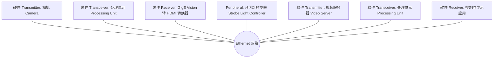
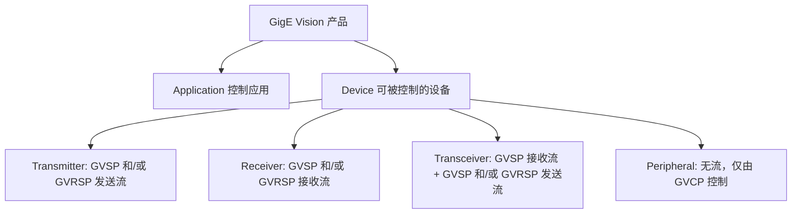
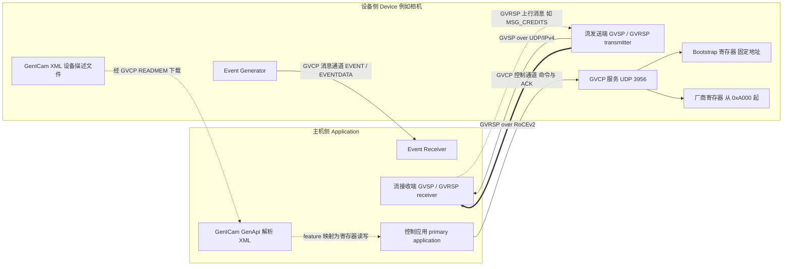

# GigE Vision 3.0 引言与系统架构（第 1 章）

> **覆盖范围**：Chapter 1 Introduction（§1.1–§1.7），PDF p.15–30。另附“全书结构导读”，依据 PDF 书签与各 PART 扉页（p.31、57、163、205、245、353、369）以及封面/许可页（p.1–2）。
>
> **一句话总结**：GigE Vision 是 A3 Vision & Imaging 制定的、基于以太网（任意速率等级、任意 IEEE 802.3 物理介质）的视觉设备通信标准：用 **GVCP**（UDP）做控制与事件，用 **GVSP**（UDP）或 3.0 新增的 **GVRSP**（RoCEv2）传输数据流，用固定地址的 **bootstrap 寄存器** + **GenICam XML** 描述设备；第 1 章给出目的、委员会、术语与需求编号规则、参考文档、排版约定和系统总体模型。
>
> **本文目录**：核心要点 → 1.1 目的 → 1.2 技术委员会 → 1.3 定义与缩略语（含 1.3.2 需求术语详解）→ 1.4 参考文档 → 1.5 排版约定 → 1.6 免责声明 → 1.7 系统概览 → 系统架构总览图 → 全书结构与知识库映射 → 实现要点与易错点 → 相关章节 → 自测题
>
> **阅读约定（全知识库通用）**：页码一律为 **PDF 页码**（页脚印刷页码 = PDF 页码 − 1）。规范的位编号是 **MSB-first**：bit 0 是字段/32 位寄存器的最高有效位（例如 32 位寄存器中 bit 31 是最低位）；多字节字段一律 **big-endian（网络字节序）**（§15.3, p.115，[R-137c]；bootstrap 寄存器见 [R-416cd]，§36, p.246）。

---

## 核心要点

- GigE Vision 规定的是**协议**（GVCP / GVSP / GVRSP、寄存器与 XML 约定），**不**规定传输介质的物理特性，也**不**包含特定的高性能 IP 协议栈或网络驱动（§1.1, p.15）。
- 名字虽叫 “Gigabit Ethernet”，但 GigE Vision **可在任意以太网速率等级、任意 IEEE 802.3 物理介质**上实现（§1.1, p.15）。
- 产品要与同一网络上的其他 IP 设备互通，因此实现 **MUST** 遵循相关 IETF RFC；同时规范**刻意限制强制要求的数量**，以便低成本实现（§1.1, p.15）。
- 需求编号格式为 `[类型-序号后缀]`：`R` 绝对需求（MUST）、`CR` 条件需求（条件成立时 MUST）、`O` 目标（SHOULD）、`CO` 条件目标；后缀 `ca`/`cd`/`c`/`st`/`sr`/`s`/无 指出适用角色（§1.3.2, p.19–20）。
- 自 1.2 版起，控制与流在需求术语上解耦：产品必须是 **application、device 或两者**；产品**不一定**有 stream channel（§1.7, p.29）。
- 设备分 4 类：**Transmitter**（如相机）、**Receiver**（如 GigE Vision→HDMI 转换器）、**Transceiver**（如图像处理器）、**Peripheral**（如频闪灯控制器，无流，仅受 GVCP 控制）（§1.7, p.29）。
- 若产品要通过以太网被控制，就**必须能用 GVCP 控制**；一个应用可控制多个设备，但一个设备**同一时刻只能被一个控制应用控制**（§1.7, p.30）。
- 3.0 新增基于 RoCEv2 的流协议 **GVRSP**：与以往流方式不兼容，但一个流设备可同时支持 GVSP 与 GVRSP；GVRSP **只支持 GenDC payload**；控制协议与消息协议不受影响，仅新增 bootstrap 寄存器（§1.7, p.30）。
- 3.0 引用的关键外部规范版本：GenICam 2021.02、SFNC 2.8、PFNC 2.4、GenDC 1.2、GenTL 1.6、IEEE 1588-2008、IEEE 802.1AX-2014、InfiniBand Architecture Specification（§1.4, p.24–27）。
- 命名约定：GVCP 命令 `READMEM_CMD`、状态码 `GEV_STATUS_*`、事件 `GEV_EVENT_*`、GenICam feature `AcquisitionStart`、包/寄存器字段 `packet_size`（§1.5, p.27–28）。

---

## 1.1 目的（§1.1, p.15）

**GigE Vision 是什么**：一种面向视觉应用、建立在无处不在的以太网技术之上的通信接口。GigE Vision 设备与网卡之间可以用标准 CAT-5e/6 线缆，或以太网支持的任何其他物理介质连接，并支持**任何以太网速率等级**。

**规范的范围**：

| 规范定义的内容 | 规范**不**定义的内容 |
|---|---|
| GigE Vision 兼容产品之间相互通信所使用的协议 | 传输介质的物理描述（这些由以太网/IEEE 802.3 负责） |
| | 任何特定的高性能 IP 协议栈或网络驱动实现 |

**拓扑范围**：最简单的是 PC 与 GigE Vision 流设备之间单根线缆的点对点连接；复杂的则是在使用路由器的 IP 网络上，由硬件/软件视频源（source）、视频汇（sink）和处理单元组成的视频分发系统。

**两条设计原则**（p.15）：

1. GigE Vision 产品要与同一网络上的其他 IP 设备互操作，因此 “implementations MUST follow relevant Request for Comments (RFC) documents published by the Internet Engineering Task Force (IETF)”。（注意：这句话有大写 MUST，但没有需求编号。）
2. 规范**有意限制强制要求的数量**，以便实现经济型产品。

**IMPORTANT NOTICE（p.15）**：

- GigE Vision® 名称与特有 logo 是 A3 Vision & Imaging 的注册商标，只能在已向 A3 注册的产品上依许可使用。
- 对本标准或其中技术的任何商业使用（全部或部分）都需要另行从 A3 获得许可；**单纯持有文档并不授予使用标准的任何权利**。
- A3 不负责识别本标准可能需要许可的全部专利，也不负责调查提请其注意的专利的法律效力或范围。

许可页（p.2）进一步说明：所有使用 GigE Vision 标准开发的商业产品都必须取得标准许可，提交相应文件，并**通过 GigE Vision compliance testing**，才有权使用名称与 logo；logo 只能用于通过合规测试的已许可产品。

> 💡 解读：对工程师而言，“合规”包含两层：技术上满足本规范所有适用需求（见第 39 章自我认证与 Validation Framework，[互操作与测试](../06_interoperability/interoperability_and_testing.md)），商务上完成 A3 的产品注册与许可。

---

## 1.2 技术委员会（§1.2, p.15–17）

- **GigE Vision Standard Committee** 成立于 **2003 年 6 月**，目标是为高性能视觉应用定义一个基于千兆以太网的开放传输平台；由 **A3 Vision & Imaging** 赞助（www.automate.org/vision）（p.15）。

### 1.2.1 Version 3.0（§1.2.1, p.16–17）

- **3.0 版的工作于 2023 年 8 月启动**（p.16）。
- 为 3.0 提供技术内容的成员共 15 人，来自 Groget、Teledyne Digital Imaging、Pleora Technologies、Lucid Vision Labs、MVTec Software、Balluff、Baumer Optronic、Zebra、imavix engineering & Sensor to Image、Basler、Teledyne IIS（p.16）。
- 3.0 发布负责人：**Bob McCurrach**（A3 Vision & Imaging Director of Standards Development）、**主席 Eric Bourbonnais**、**副主席 James Falconer**；另有 22 位个人参与了 3.0 的发布（p.16–17）。
- 对本版投票的技术会员公司共 **28 家**（p.17）：A&B Software、Allied Vision、Allysium-Tech、Automation Technology、AVAL DATA、Balluff、Basler、Baumer Optronic、Daheng Imaging、Emergent Vision Technologies、EZ Automation Systems、Heliotis、HIKROBOT、IDS Imaging Development Systems、imavix engineering、Imperx、Intercon 1、JAI、Lucid Vision Labs、MEGA PHASE Industrial Inspection Technology、MVTec Software、Pleora Technologies、Prodrive Technologies、SICK、Stemmer Imaging、Teledyne DALSA、Teledyne IIS、Zebra Technologies。

---

## 1.3 定义与缩略语（§1.3, p.17–24）

### 1.3.1 定义（§1.3.1, p.17–19）

规范共给出 25 条定义，**完整中英对照见 [术语表](02_glossary.md)**。以下是理解全书最关键的几条：

| 术语 | 规范定义要点（中文转述） |
|---|---|
| Device（设备） | GigE Vision 兼容的**可被控制的**设备。通常是相机，也可以是 PC 上运行的软件视频服务器（p.18）。 |
| Application（应用） | 运行在主机上的 GigE Vision **控制应用**软件。通常是 PC 软件，也可以是 FPGA 中的微码等（p.17）。 |
| Primary application（主应用） | 对设备拥有 exclusive 或 control 访问权（读/写）的应用，包括启用了 switchover 的 control 访问（p.19）。 |
| Secondary application（从应用） | 对设备只有 monitoring（只读）访问权的应用（p.19）。 |
| Primary application Switchover request | 另一个应用试图接管一个“以启用 switchover 的 control 访问方式”被主应用控制的设备时的状况（p.19）。 |
| Management Entity（管理实体） | 负责系统中已部署设备的配置与控制的应用（p.18）。 |
| Standard GVCP port | 设备上接收 GVCP 命令的 UDP 端口；IETF 为其分配了 **3956**；多服务设备上指第一个服务所用端口（p.19）。 |
| Persistent IP vs Static IP | Persistent IP 写在设备**非易失存储**中，启用时上电复用；Static IP 由应用写入设备**易失存储**，掉电即丢失，主要用于“强制”设备使用某个 IP（例如设备里存了无效的 Persistent IP 时）（p.19）。 |
| GVSP/GVRSP Transmitter / Receiver | 按 GVSP 或 GVRSP 产生数据流的实体 / 接收并能解封装数据流的实体（p.18）。 |

### 1.3.2 需求术语（§1.3.2, p.19–20）——读懂规范的钥匙

规范用带编号的条目（PDF 中显示为方框）列出需求与目标，格式约定见 **Table 1-1 Requirements Terminology**：

| 术语 | 含义 | 规范措辞 | 编号表示 |
|---|---|---|---|
| Absolute Requirement（绝对需求） | 产品**必须**支持的特性；为保证互操作性而强制 | MUST | `[R-<sn><suffix>]` |
| Conditional Requirement（条件需求） | **如果**存在另一特性，则**必须**支持本特性 | MUST（IF …） | `[CR-<sn><suffix>]` |
| Absolute Objective（绝对目标） | 产品**应当**支持的特性；推荐但非必需 | SHOULD | `[O-<sn><suffix>]` |
| Conditional Objective（条件目标） | **如果**存在另一特性，则**应当**支持本特性；推荐但非必需 | SHOULD（IF …） | `[CO-<sn><suffix>]` |

**编号由最多 3 个元素组成**（p.19–20）：

1. **需求类型**：R / CR / O / CO。
2. **序号 sn（sequence number）**：唯一标识该需求/目标的编号，随着新需求加入**按顺序分配**。
3. **后缀 suffix**：指明适用对象（应用软件、设备、流发送端、流接收端或组合），见 Table 1-2。

**Table 1-2 Suffix Terminology**（附 3.0 正文中的真实例子）：

| 后缀 | 英文含义 | 适用对象 | 3.0 中的例子 |
|---|---|---|---|
| `ca` | control application | **仅**应用软件 | [R-058ca] 应用必须先建立控制通道才能访问设备寄存器（Ch10, p.68）；[R-615ca] 接收端（应用）必须同时支持 GVSP 与 GVRSP（§11.1, p.82） |
| `cd` | control device | **仅**设备 | [R-061cd] 设备必须支持 exclusive access（§10.1, p.69，也是 §1.3.2 自带的示例）；[O-414cd] bootstrap 寄存器应当在 XML 中提供（Ch36, p.246） |
| `c` | control | 应用**和**设备 | [R-042c] 设备的第一个 GVCP 端口必须是 UDP 3956（§8.1, p.60）；[R-137c] GVCP 必须使用网络字节序（§15.3, p.115） |
| `st` | stream transmitter | **仅**流发送端 | [CR-506st] 流发送端必须在 XML 中支持表 37-1 的强制 feature（§37.5, p.357） |
| `sr` | stream receiver | **仅**流接收端 | [CR-634sr] 接收端发起 RoCEv2 连接时必须使用 Reliable Connection 及正确的 ServiceID（TCP port 3956）（§31.1, p.223）；[CO-281sr]（§24.5, p.183） |
| `s` | stream | 流发送端**和**接收端 | [R-079s] 支持流的产品必须提供至少 1 个、至多 512 个 stream channel（Ch11, p.81）；[O-345s]（§26.3, p.203） |
| 无后缀 | – | 应用、设备、流发送端和接收端**全部** | （见下方统计：3.0 当前有效条目中未出现无后缀编号） |

**如何读一条需求**——以 `[CR-506st]` 为例：

```
[ CR - 506 st ]
  │     │   └─ 后缀 st：只约束 stream transmitter（流发送端）
  │     └───── 序号 506：全书唯一，按加入顺序分配
  └─────────── 类型 CR：条件需求——条件成立时 MUST
```

更多类型例子：`[O-039ca]` 应用**应当**能动态响应设备的加入/移除（Ch6, p.56）；`[CO-009cd]` 若支持链路聚合，聚合器**应当**使用该 LAG 中编号最小的物理网口的 MAC 地址（§3.3.1, p.37）；`[CO-011st]` 若支持链路聚合，流通道的分发算法**应当**在各链路间轮询（round-robin）（§3.3.3, p.38）。

**与 GigE Vision 1.x 旧编号的对应**（p.20）：

- 1.x 使用另一种编号，**章节号是需求编号的一部分**（例如附录 D 中提到的 `[R14-62a]`）。章节一增加，编号就要变，因此 2.0 起改为现在的顺序编号。
- §1.3.2 原文说交叉对照表在 “Appendix 1”；**在 3.0 文档中实际位置是 “Appendix A: Requirements Reference Tables”（p.370 起）**，其中 Table 40-1 有 “Version 1.x cross-reference” 一列，例如 `[R-001cd]` ↔ `[R12-1cd]`、`[R-505cd]` ↔ `[R28-1cd]`（p.370、p.386）。⚠️ 这是规范文字与实际附录命名的不一致。
- §1.3.2 还说“在适用时，旧编号附在需求文本末尾”。⚠️ 本知识库对 3.0 各章提取文本的检索**未发现**任何附在需求正文后的旧式编号，旧编号只在附录 A 的表中出现——以附录 A 为准。
- 💡 解读：从附录 A 的废弃表（Table 40-2）中可见旧式编号的后缀写法如 `[R7-17a]`、`[CO3-10d]`、`[R10-1s]`，推测 1.x 中 `a`≈application、`d`≈device、`s`≈stream；规范未在 3.0 中给出旧后缀定义，此处仅为推断。

**统计视角（💡 本知识库对附录 A 的统计，以 [requirements_index](../reference/requirements_index.md) 为准）**：

- Table 40-1 当前有效条目共 **521** 条：R 231、CR 232、O 44、CO 14；后缀分布 cd 280、st 100、c 43、ca 43、s 40、sr 15；**没有无后缀的条目**。
- Table 40-2 列出 **197** 条已废弃条目（含 28 条 1.x 旧式编号），其中 **96 条在 3.0 中废弃**；3.0 新增条目 84 条（[R-604cd]–[CR-687st]）。序号**不会复用**：例如第 37 章中缺失的 [CR-513st]、[CR-515st] 等都出现在废弃表里（p.400）。详见 [版本历史](03_version_history_and_v3_changes.md) 与 [废弃需求列表](../reference/deprecated_requirements.md)。

> 💡 解读：做合规自检时，先按后缀过滤出与自己角色相关的条目（例如做相机固件只看 `cd`、`c`、`st`、`s`；做主机 SDK 看 `ca`、`c`、`sr`、`s`），再逐条判断 CR/CO 的前置条件是否成立。

### 1.3.3 缩略语（§1.3.3, p.21–24）

规范列出 **91** 个缩略语（ARB 到 WQE），**完整表格见 [术语表](02_glossary.md)**。按主题大致可分为：

| 主题 | 代表缩略语 |
|---|---|
| GigE Vision / GenICam 自身 | GEV、GigE、GVCP、GVSP、GVRSP、CCP、SC、GenICam、GenDC、GenTL、PFNC、CID、LFSR |
| IP 网络与配置 | IP、IPv4、IPv6、UDP、TCP、DHCP、BOOTP、LLA、DNS、mDNS、DNS-SD、MAC、MTU、NAT、NIC、OUI、SPI、IANA、IETF |
| 链路聚合 | SL、ML、LAG、sLAG、dLAG |
| 时间同步 | PTP、ARB、TAI、UTC、GMT、GPS |
| RDMA / RoCEv2（GVRSP 相关） | RDMA、RoCE、RoCEv2、RRoCE、IB、IBA、QP、QPN、RC、PSN、WQE、WC、CM、NDSPI、DMA |
| 图像/编码 | ROI、CFA、JPEG、JFIF、SOI、EOI、SOC、SOT、EOC、IDR、NAL、VCL、FMO、MPEG、GIF |
| 位/字节 | msb、lsb（位）与 MSB、LSB（字节）——注意大小写区分 |

---

## 1.4 参考文档（§1.4, p.24–27）

§1.4 按 5 类列出引用文档。下表“在规范中的作用”一列中，带出处的为在 3.0 正文中检索到的实际引用位置；标 💡 的是本知识库补充的背景解释。

### IEEE 标准

| 文档 | 标题（中文概括） | 在规范中的作用 |
|---|---|---|
| IEEE 1588-2008 | 网络化测控系统的精确时钟同步协议，即 PTP | 设备时间同步与时间戳（§14.2, p.98 起）；PTP 相关 SFNC feature（§37.7, p.364） |
| IEEE 802-2001 | 局域网/城域网：概述与体系结构 | 💡 802 系列网络体系的总纲 |
| IEEE 802.1as-2011 | 桥接局域网中时间敏感应用的定时与同步（gPTP） | 802.1AS PTP profile（§14.2.4, p.102）；IEEE 1588 profile 相关寄存器中的 802.1as 支持位（§36.44, p.310–311） |
| IEEE 802.1ax-2014 | 链路聚合（Link Aggregation） | 第 3 章 sLAG/dLAG 链路聚合（p.34–39）；术语 Aggregator、Conversation 即引自该标准（p.17–18） |
| IEEE 802.3-2002 | CSMA/CD 访问方法与物理层（以太网） | 链路速率自动协商（§2.1, p.32）；可选的 802.3 PAUSE 流控机制（§3.3.3, p.38 等）；任何 802.3 物理介质均可承载 GigE Vision（§1.1） |

### Internet Standard（STD）

| 文档 | 标题 | 在规范中的作用 |
|---|---|---|
| STD3（RFC1122 + RFC1123） | 主机要求：通信层 / 应用与支持 | 广播类型（limited broadcast 等）定义（§5.1.1, p.49）；ICMP 处理（Ch21, p.161）；RFC1123 中的 “Sorcerer's Apprentice Syndrome” 重传问题（§8.1.3, p.64） |
| STD5（RFC791 + RFC792 + RFC919 + RFC922 + RFC950 + RFC1112） | IP、ICMP、广播、子网广播、子网划分、IP 多播主机扩展 | IPv4 基础；字节发送顺序按 RFC791 附录 B（§15.3, p.115） |
| STD6（RFC768） | UDP | GVCP、GVSP 都是基于 UDP 的应用层协议（§7.1, p.58；§22.1, p.164） |
| STD13（RFC1034 + RFC1035） | 域名概念与设施 / 实现与规范 | 💡 DNS 基础，mDNS/DNS-SD 设备枚举（§5.2, p.51 起）建立在其上 |
| STD33（RFC1350） | TFTP 协议（第 2 版） | 规范用 TFTP 类比说明用 READMEM 分块读取 XML 文件的方式（§14.1.1, p.96） |
| STD37（RFC826） | 以太网地址解析协议 ARP | 使用 Persistent IP 前用 ARP 探测冲突（[CR-020cd]，§4.2, p.43）；FORCEIP 设置的 static IP 应先用 ARP 探测、再发 gratuitous ARP 通告（[O-572cd]，§16.2.1, p.124） |
| STD41（RFC894） | IP 数据报在以太网上的传输 | 💡 IPv4 在 Ethernet II 帧中的封装 |
| STD43（RFC1042） | IP 数据报在 IEEE 802 网络上的传输 | 💡 IPv4 在 802.2/SNAP 帧中的封装 |

### Internet RFC

| 文档 | 标题 | 在规范中的作用 |
|---|---|---|
| RFC951 | BOOTP | 💡 DHCP 的前身，DHCP 服务器常兼容 BOOTP |
| RFC1035 | 域名实现与规范 | 💡 DNS 报文格式（mDNS 复用） |
| RFC1534 | DHCP 与 BOOTP 的互操作 | 💡 同上 |
| RFC1542 | BOOTP 的澄清与扩展 | 💡 同上 |
| RFC1951 | DEFLATE 压缩数据格式 1.3 | 压缩 XML 文件：ZIP 只允许 DEFLATE 与 STORE 方法（§14.1, p.95） |
| RFC2131 | DHCP | [R-021cd] 设备必须支持 DHCP（§4.3, p.43） |
| RFC2132 | DHCP 选项与 BOOTP 厂商扩展 | [O-026cd] 设备应当支持若干 DHCP 选项（§4.3, p.45） |
| RFC2435 | JPEG 压缩视频的 RTP 负载格式 | 💡 3.0 正文未检索到直接引用；可能与 JPEG payload（定义在 2.2 版）相关 |
| RFC3171 | IANA IPv4 多播地址分配指南 | 流通道/消息通道目的地址为多播时的地址范围说明（§11.9, p.86；§12.5, p.91） |
| RFC3376 | IGMPv3 | 💡 3.0 正文未检索到直接引用；接收多播流时主机需加入多播组 |
| RFC3629 | UTF-8 | 字符串字符集（Device Mode 寄存器 character_set_index，§36.2, p.271；mDNS TXT 记录，§5.2.1, p.52） |
| RFC3927 | IPv4 链路本地地址（LLA） | [R-028cd] 设备必须支持 LLA（§4.4, p.47） |
| RFC3984 | H.264 视频的 RTP 负载格式 | 💡 3.0 正文未检索到直接引用；可能与 H.264 payload（定义在 2.2 版）相关 |
| RFC3986 | URI 通用语法 | First/Second URL 寄存器中 XML 位置字符串遵循 URI 语法（§14.1, p.95） |
| RFC5227 | IPv4 地址冲突检测 | Persistent IP 的冲突检测（§4.2, p.43）；FORCEIP_CMD 设置的地址的冲突检测（§16.2.1, p.124） |
| RFC5371 | JPEG 2000 视频流的 RTP 负载格式 | 💡 3.0 正文未检索到直接引用；可能与 JPEG 2000 payload（定义在 2.2 版）相关 |

### Internet Draft

| 文档 | 作者 | 在规范中的作用 |
|---|---|---|
| Multicast DNS | S. Cheshire, M. Krochmal | 可选的 Zeroconf 设备发现：mDNS（§5.2 / §5.2.1, p.51–52） |
| DNS-Based Service Discovery | S. Cheshire, M. Krochmal | DNS-SD 服务发现（`_gvcp._udp` 服务，§5.2, p.51–55） |

### Others

| 文档 | 版本/说明 | 在规范中的作用 |
|---|---|---|
| GenICam™ | Generic Interface for Cameras，EMVA，**version 2021.02**；GenICam™ 是 EMVA 的商标 | 设备 XML 描述文件遵循其 GenApi 模块语法（§37.1, p.354） |
| GenICam PFNC | Pixel Format Naming Convention **version 2.4** | 像素格式命名（§26.3, p.203） |
| GenICam Pixel Format Values | 像素格式取值表 | PixelFormat 枚举项使用其名称时必须使用对应数值（[CR-514st]，§37.5.2, p.361）；[O-345s]（§26.3, p.203） |
| GenICam SFNC | Standard Features Naming Convention **version 2.8** | 设备 XML 必须符合 SFNC 2.8 或更高（[R-505cd]，§37.1, p.354） |
| GenICam GenDC | GenDC **version 1.2** | GVSP 的 GenDC payload 与 GVRSP 唯一的 payload 格式（第 38 章；[CR-617s] §29.2, p.212 允许 GenDC 1.x 的任意次版本） |
| GenICam GenTL | GenTL **version 1.6** | GVRSP 与旧接收端兼容的 GenTL Producer 方案（§35.2.2, p.243） |
| ITU-T Rec. T.81 | JPEG | JPEG payload 类型（表 25-1, p.186） |
| ITU-T Rec. T.800 | JPEG 2000 | JPEG 2000 payload 类型（表 25-1, p.186） |
| ITU-T Rec. H.264 | 高级视频编码 | H.264 payload 类型（表 25-1, p.186） |
| GigE Vision Mechanical Supplement | A3 GigE Vision Mechanical Supplement **1.0** | 💡 机械（如带锁紧的连接器）方面的补充文件，本规范正文不定义物理/机械细节 |
| InfiniBand Architecture Specification | InfiniBand Trade Association（p.27） | RoCEv2/GVRSP 的基础：连接管理（CM）、QP、RC 等（Ch28–31、Ch34） |

> 💡 解读：3.0 把 SFNC 升到 2.8、GenDC 升到 1.2（附录 D, p.416）。做互操作时要特别注意：XML 合规是**硬性需求**（[R-505cd]），且 GVRSP 只能传 GenDC，因此 3.0 主机软件必须能处理 GenDC 容器。

---

## 1.5 排版约定（§1.5, p.27–28）

| 对象 | 约定 | 示例 |
|---|---|---|
| Bootstrap 寄存器 | 用较大字号突出显示 | Link Speed |
| 包与 bootstrap 寄存器中的字段名 | 小写斜体；含缩略语或保留字时缩略语可用大写斜体；多个单词用下划线 `_` 连接 | `packet_size` |
| Feature 名称（GenICam） | 各单词首字母大写后直接拼接 | `AcquisitionStart` |
| GVCP 命令 | 全大写、无空格；用 `_` 分隔 CMD（命令）或 ACK（应答）后缀 | `READMEM_CMD` |
| GigE Vision 状态码 | 全大写、`_` 分隔，以 `GEV_STATUS` 开头 | `GEV_STATUS_SUCCESS` |
| GigE Vision 事件 | 全大写、`_` 分隔，以 `GEV_EVENT` 开头 | `GEV_EVENT_LINK_SPEED_CHANGE` |
| GenICam 关键字 | 粗斜体 | ***flow*** |

> 💡 解读：从 PDF 提取的纯文本会丢失字体信息（大字号、斜体、粗斜体都看不出来），所以阅读本知识库或源文本时，主要靠命名形态识别：`snake_case` 多为包/寄存器字段，`PascalCase` 多为 GenICam feature，`XXX_CMD/XXX_ACK` 为 GVCP 消息，`GEV_STATUS_*`/`GEV_EVENT_*` 为状态码/事件。

---

## 1.6 免责声明（§1.6, p.28）

规范按 “as is” 提供，不作任何明示或暗示担保；使用风险由用户自负，A3 Vision & Imaging、技术委员会成员及其公司对使用本规范造成的任何损害概不负责。

---

## 1.7 系统概览（§1.7, p.28–30）

### 典型与复杂拓扑（Figure 1-1、Figure 1-2）

- **Figure 1-1（p.28）传统用例**：流设备（Device）与控制兼接收应用（Application）点对点相连——既可以用一根线直连（原文提到 crossover cable），也可以经过以太网网络（Device ⟷ Ethernet ⟷ Network ⟷ Ethernet ⟷ Application）。
- **Figure 1-2（p.29）高级视频分发系统**：硬件/软件的发送端、收发端、接收端以及外设都挂在同一个以太网上。下图按原图重绘：



### 1.2 版的“解耦”与产品分类（p.29）

- 1.2 之前的版本，需求术语只围绕“流设备向控制兼接收应用发送视频”这一相机用例，限制了可以声明 GigE Vision 合规的产品种类。
- **1.2 版在需求术语中把控制与流解耦**：设备可以发送和/或接收数据；应用同样可以发送和/或接收数据。由此推出两条主要概念：
  1. 一个产品必须是 **application、device 或两者兼具**；
  2. 一个产品**不需要**拥有 stream channel。
- 同时定义了 4 种设备类别：

| 设备类别 | 定义（§1.7, p.29） | 包含的流 | 原文举例 |
|---|---|---|---|
| **Transmitter** | 能发送（streaming）数据的设备 | 1 个或多个 **GVSP 和/或 GVRSP 发送流** | 相机 |
| **Receiver** | 能接收数据的设备 | 1 个或多个 **GVSP 和/或 GVRSP 接收流** | GigE Vision → HDMI 转换器 |
| **Transceiver** | 能接收也能发送数据的设备 | 1 个或多个 **GVSP 接收流** + 1 个或多个 **GVSP 和/或 GVRSP 发送流** | GigE Vision 图像处理器 |
| **Peripheral** | 不能发送或接收数据，但可执行由 GVCP 控制的任务 | 无 | GigE Vision 频闪灯控制器 |



> 💡 解读：设备类别在寄存器层面由 Device Mode 寄存器（0x0004）的 `device_class` 字段（bit 1–3，MSB-first 编号）报告：0 = Transmitter、1 = Receiver、2 = Transceiver、3 = Peripheral，对应 SFNC `DeviceType`（§36.2, p.270–271）。
>
> ⚠️ 注意 3.0 的实际约束比 §1.7 的类别定义更窄：[CR-663cd] 规定**支持 GVRSP 的设备必须是 Transmitter**（§36.27, p.291）；附录 C 也说明规范目前只完整定义了作为**发送端**的 GVRSP 设备的 bootstrap 接口，接收端/收发端留给未来版本（p.408）。因此 3.0 中 GVRSP 的接收方实际上是主机侧应用（见 [R-615ca]）。另外，§1.7 对 Transceiver 的接收流只写了 GVSP，没有写 GVRSP——这与上述约束一致。

### 控制的唯一性与 GVCP 的强制性（p.30）

- **若一个 GigE Vision 产品要通过以太网被控制，就必须能用 GigE Vision 控制协议（GVCP）控制**——这是为了保证 GigE Vision 产品之间的互操作性。
- 一个产品可以充当多个设备的控制应用；但**一个设备在任一时刻只能由一个控制应用控制**（详见 §10.1 控制通道权限，[GVCP 传输与通道](../02_gvcp/01_transport_and_channels.md)）。

### 兼容性说明（p.30）

- 1.2 版保持了对传统“流设备 → 控制兼接收应用”模型（Figure 1-1）的**向后兼容**。
- 但因为引入了新的产品类别，**不能假设向前兼容**：例如为早期版本流设备编写的应用，如果试图在新定义的 Peripheral 设备上实例化 stream channel，就可能出问题。

### 3.0 新增：GVRSP（p.30）

- 3.0 增加了基于 **RoCEv2** 协议的新流方法 **GVRSP**（GigE Vision RDMA Streaming Protocol）。
- 它**与以前的流方法不兼容**，但规范允许一个流设备**同时支持两种流协议**。
- GVRSP **把 payload 类型限制为仅 GenDC**，这可能导致与较旧主机和设备的不兼容；规范为同时支持两种流协议的接收端/发送端加入了减少不兼容的措施。
- **控制协议与消息协议不受影响**，只是新增了用于控制 GVRSP 和改善兼容性的 bootstrap 寄存器。

> 💡 解读（结合其他章节）：同一时刻只有一种流协议处于激活状态，由 Streaming Configuration 寄存器（0x0960）的 `streaming_protocol` 字段选择（0 = GVSP，1 = GVRSP），设备的所有 stream channel 使用同一种协议（§11.1, p.82；§36.38, p.305）。3.0 的接收端应用**必须同时支持 GVSP 与 GVRSP**（[R-615ca]）；若主机操作系统或网卡不支持 RoCEv2 而又发现了仅支持 GVRSP 的设备，必须明确告知用户该设备无法使用（§11.1, p.82）。

---

## 系统架构总览（综合第 1 章与各 PART 概述）



| 组成部分 | 作用（中文概括） | 规范位置 | 知识库 |
|---|---|---|---|
| 设备发现 Device Discovery | 三步：链路协商 → IP 配置（DHCP、LLA 必须支持，Persistent IP 可选）→ 设备枚举（应用发起，同子网可用 UDP 广播） | PART 1, Ch2–6（§2.1, p.32） | [设备发现](../01_device_discovery/device_discovery.md) |
| GVCP 控制通道 | 应用（master）向设备（slave）发命令并等待 ACK；命令总由应用发起；只有一个 primary application 可写设备 | PART 2, Ch7–10、15–19（§7.1, p.58） | [GVCP 传输与通道](../02_gvcp/01_transport_and_channels.md)、[GVCP 消息格式](../02_gvcp/03_message_formats.md) |
| GVCP 消息通道 | 设备向应用异步发送事件（EVENT / EVENTDATA） | Ch12、17、20 | [GVCP 消息格式](../02_gvcp/03_message_formats.md)、[命令值/状态码/事件](../02_gvcp/04_command_values_status_events.md) |
| GVSP 流通道 | 基于 UDP 的流协议：数据块由 leader / payload / trailer 包组成，丢包可经 GVCP 请求重发 | Ch11、PART 3（Ch22–26） | [GVSP 传输与数据块](../03_gvsp/01_transport_and_data_block.md)、[payload 与像素布局](../03_gvsp/02_payload_types_and_pixel_layouts.md) |
| GVRSP 流通道（3.0 新增） | 基于 RoCEv2（InfiniBand over UDP）的可靠、按序、可硬件加速的流；仅 GenDC；无需应用层重发；用 credit 做应用层流控 | Ch11、PART 4（Ch27–35） | [RoCEv2 与流模型](../04_gvrsp/01_rocev2_and_streaming_model.md)、[连接与流控](../04_gvrsp/02_connection_and_flow_control.md) |
| Bootstrap 寄存器 | 所有 GigE Vision 设备共用的固定地址寄存器；32 位对齐、big-endian；厂商自定义寄存器从 0xA000 起 | PART 5, Ch36（p.246） | [寄存器总览](../05_bootstrap_registers/01_overview_and_register_map.md) |
| GenICam XML | 由设备提供、应用读取并解释，给出 feature 到寄存器的映射；必须符合 GenICam 与 SFNC 2.8+ | §14.1（p.94 起）、Ch37 | [高级概念](../02_gvcp/02_advanced_concepts.md)、[互操作与测试](../06_interoperability/interoperability_and_testing.md) |

---

## 全书结构与知识库映射

规范正文由引言 + 5 个 PART + Interoperability + Appendix 组成（PDF 书签与扉页）：

| 部分 | 章节 | PDF 页 | 主要内容 | 对应知识库文件 |
|---|---|---|---|---|
| 引言 | Ch1 | 15–30 | 目的、术语、需求编号、参考文档、系统模型 | 本文、[术语表](02_glossary.md) |
| PART 1 – Device Discovery | Ch2–6 | 31–56 | 链路配置（SL/ML/LAG）、IP 配置、设备枚举、设备接入与移除 | [device_discovery.md](../01_device_discovery/device_discovery.md) |
| PART 2 – GVCP | Ch7–13 | 57–93 | GVCP 传输、通道概念、控制/流/消息通道、多网口设备 | [01_transport_and_channels.md](../02_gvcp/01_transport_and_channels.md) |
| | Ch14 | 94–111 | XML 获取、IEEE 1588 设备同步、Action 命令、主应用切换 | [02_advanced_concepts.md](../02_gvcp/02_advanced_concepts.md) |
| | Ch15–17 | 112–153 | GVCP 头、控制通道命令字典、消息通道字典 | [03_message_formats.md](../02_gvcp/03_message_formats.md) |
| | Ch18–21 | 154–162 | 命令/应答数值、状态码、事件、ICMP | [04_command_values_status_events.md](../02_gvcp/04_command_values_status_events.md) |
| PART 3 – GVSP | Ch22–24 | 163–185 | GVSP 传输、数据块（leader/payload/trailer、chunk、test packet） | [01_transport_and_data_block.md](../03_gvsp/01_transport_and_data_block.md) |
| | Ch25–26 | 186–204 | Payload 类型、像素布局/像素格式 | [02_payload_types_and_pixel_layouts.md](../03_gvsp/02_payload_types_and_pixel_layouts.md) |
| PART 4 – GVRSP | Ch27–30 | 205–222 | GVRSP 概述、RoCEv2、GVRSP 流与 stream channel | [01_rocev2_and_streaming_model.md](../04_gvrsp/01_rocev2_and_streaming_model.md) |
| | Ch31–35 | 223–244 | 连接维护、上行通信、应用层流控、SRQ、主机侧考虑 | [02_connection_and_flow_control.md](../04_gvrsp/02_connection_and_flow_control.md) |
| PART 5 – Bootstrap Registers | Ch36 | 245–352 | 全部 bootstrap 寄存器 | [05_bootstrap_registers/](../05_bootstrap_registers/01_overview_and_register_map.md)（3 个文件） |
| Interoperability | Ch37–39 | 353–368 | 相机强制 XML feature、GenDC 流使用、测试 | [interoperability_and_testing.md](../06_interoperability/interoperability_and_testing.md) |
| Appendix A | 需求参考表 | 370–401 | 全部需求的引入版本、1.x 对照、废弃表 | [requirements_index](../reference/requirements_index.md)、[deprecated_requirements](../reference/deprecated_requirements.md) |
| Appendix B | 状态码详解 | 402–406 | 各状态码的使用场景 | [04_command_values_status_events.md](../02_gvcp/04_command_values_status_events.md) |
| Appendix C | GVSP/GVRSP 寄存器兼容 | 407–408 | 为支持 GVRSP 而修改的寄存器 | [02_connection_and_flow_control.md](../04_gvrsp/02_connection_and_flow_control.md) |
| Appendix D | 文档历史 | 409–416 | 1.0 → 3.0 各版变化 | [版本历史](03_version_history_and_v3_changes.md) |

---

## 实现要点与易错点

**设备端**

- “GigE” 不等于 “只能 1 Gbps”：规范对速率无要求，任何 IEEE 802.3 介质与速率等级都可（§1.1, p.15）。
- 一旦产品可经以太网被控制，就必须支持 GVCP 控制；厂商私有控制路径不能替代 GVCP（§1.7, p.30）。
- 正确报告 `device_class`（Transmitter / Receiver / Transceiver / Peripheral）。3.0 中支持 GVRSP 的设备必须是 Transmitter（[CR-663cd]，§36.27, p.291）。
- 产品必须遵守相关 IETF RFC（DHCP、LLA、ARP 冲突检测等），这是与普通 IP 网络共存的前提（§1.1, p.15；相关需求见第 4 章）。
- 3.0 支持双流协议的设备，两种协议共用同一组 stream channel，且同时只能激活一种（§11.1, p.82）。

**应用端（主机软件 / SDK）**

- 不要假设每个设备都有 stream channel：Peripheral 没有流；在实例化 stream channel 前先检查设备类别和 stream channel 数量——这正是 §1.7 提到的“向前兼容不能假设”的典型坑（p.30）。
- 一个设备同一时刻只能有一个控制应用；多应用系统需要规划 primary / secondary 角色，或使用 switchover（§1.3.1 定义；§10.1）。
- 3.0 接收端应用必须同时支持 GVSP 与 GVRSP（[R-615ca]）；若 OS/网卡不支持 RoCEv2，必须清楚提示用户（§11.1, p.82）。
- GVRSP 只传 GenDC：主机必须能解析 GenDC 容器，或通过 GenTL Producer 转换（第 35 章）。

**阅读规范时**

- 页码：PDF 页 = 印刷页 + 1；本知识库一律引用 PDF 页。
- 位编号 MSB-first（bit 0 = 最高位），多字节字段 big-endian（§15.3, p.115）。
- 先看需求后缀判断是否适用于自己的角色；CR/CO 先判断前置条件。
- 并非所有大写 MUST 都有编号（如 §1.1 中“必须遵守 RFC”），但它们同样是规范性要求。
- §1.3.2 所说的 “Appendix 1” 实为 Appendix A。

---

## 相关章节

- [术语表（定义与缩略语）](02_glossary.md)
- [版本历史与 3.0 变化](03_version_history_and_v3_changes.md)
- [端到端流程演练](04_end_to_end_walkthrough.md)
- [设备发现](../01_device_discovery/device_discovery.md)
- [GVCP：传输与通道](../02_gvcp/01_transport_and_channels.md) · [高级概念](../02_gvcp/02_advanced_concepts.md) · [消息格式](../02_gvcp/03_message_formats.md) · [命令值/状态码/事件](../02_gvcp/04_command_values_status_events.md)
- [GVSP：传输与数据块](../03_gvsp/01_transport_and_data_block.md) · [Payload 与像素布局](../03_gvsp/02_payload_types_and_pixel_layouts.md)
- [GVRSP：RoCEv2 与流模型](../04_gvrsp/01_rocev2_and_streaming_model.md) · [连接与流控](../04_gvrsp/02_connection_and_flow_control.md)
- [Bootstrap 寄存器总览](../05_bootstrap_registers/01_overview_and_register_map.md)
- [互操作与测试](../06_interoperability/interoperability_and_testing.md)
- [全部需求索引](../reference/requirements_index.md) · [废弃需求](../reference/deprecated_requirements.md)

---

## 自测题

1. `[CR-506st]` 与 `[R-615ca]` 分别表示什么类型的需求？各约束哪类实体？
   <details><summary>答案</summary>

   `[CR-506st]`：条件需求（Conditional Requirement，条件成立时 MUST），序号 506，后缀 `st` 只约束流发送端（stream transmitter），内容是流发送端须在 XML 中提供表 37-1 的强制 feature（§37.5, p.357）。`[R-615ca]`：绝对需求（MUST），后缀 `ca` 只约束控制应用软件，内容是接收端应用必须同时支持 GVSP 与 GVRSP（§11.1, p.82）。
   </details>

2. 后缀 `s` 与 `st`、`c` 与 `cd` 的区别是什么？
   <details><summary>答案</summary>

   `st` 仅适用于流发送端，`sr` 仅适用于流接收端，`s` 同时适用于两者；`cd` 仅适用于设备，`ca` 仅适用于应用，`c` 同时适用于应用和设备；无后缀则适用于所有角色（Table 1-2, p.20）。
   </details>

3. GigE Vision → HDMI 转换器、GigE Vision 频闪灯控制器、GigE Vision 图像处理器分别属于哪类设备？
   <details><summary>答案</summary>

   分别是 Receiver、Peripheral、Transceiver（§1.7, p.29）。Peripheral 不能收发数据，只执行由 GVCP 控制的任务。
   </details>

4. GigE Vision 必须运行在千兆以太网上吗？规范是否规定物理介质与 IP 协议栈？
   <details><summary>答案</summary>

   不必。GigE Vision 可在任意以太网速率等级、任意 IEEE 802.3 物理介质上实现；规范只定义协议，不覆盖传输介质的物理描述，也不包含特定高性能 IP 协议栈或驱动（§1.1, p.15）。
   </details>

5. 3.0 新增的 GVRSP 与 GVSP 是什么关系？它对 GVCP 有什么影响？
   <details><summary>答案</summary>

   GVRSP 基于 RoCEv2，与以前的流方法不兼容，但一个流设备可以同时支持两者；GVRSP 只支持 GenDC payload。控制与消息协议（GVCP）不受影响，只增加了控制该协议、改善兼容性的 bootstrap 寄存器（§1.7, p.30）。
   </details>

6. 两个应用能否同时控制同一个设备？一个应用能否控制多个设备？
   <details><summary>答案</summary>

   设备在任一时刻只能被一个控制应用控制（其他应用最多以 secondary 身份只读监视）；一个产品可以作为多个设备的控制应用（§1.7, p.30；详见 §10.1）。
   </details>

7. 想找某条 3.0 需求在 GigE Vision 1.x 中的旧编号，该去哪里查？为什么 2.0 要改编号方式？
   <details><summary>答案</summary>

   查附录 A（Appendix A: Requirements Reference Tables，p.370 起）Table 40-1 的 “Version 1.x cross-reference” 列（§1.3.2 文字中写作 “Appendix 1”）。1.x 的编号包含章节号，增加章节就会打乱编号，所以 2.0 起改为全书唯一的顺序编号（p.20）。
   </details>

