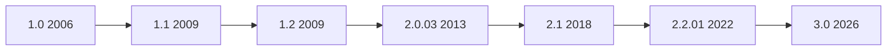
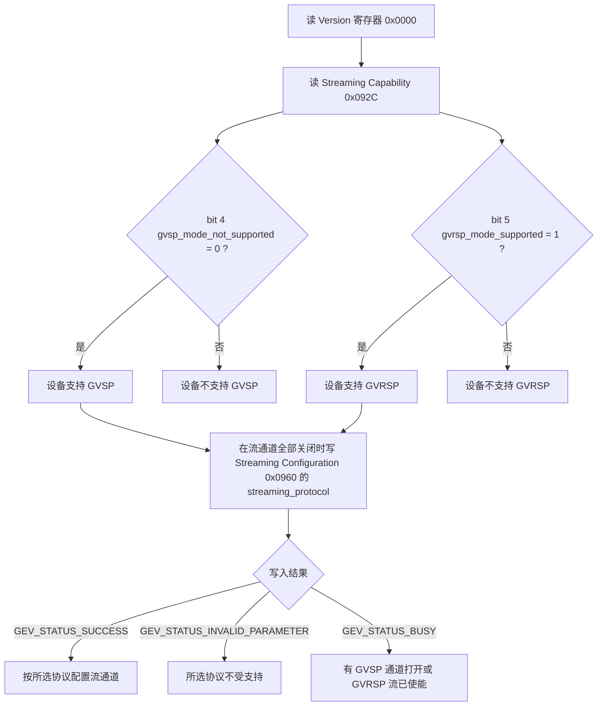

# GigE Vision 版本历史与 3.0 变化（附录 D）

> **覆盖范围**：Appendix D: Document History（D.1–D.7），PDF p.409–416。为把 3.0 的每项变化“落地”，本文还引用并核对了 3.0 正文的对应位置（Ch8、Ch10、Ch11、Ch16、Ch24、Ch25、Ch36、附录 A、附录 C），均注明 PDF 页码。
>
> **一句话总结**：附录 D 记录了 GigE Vision 从 2006 年 1.0 到 3.0 的 7 个发布版本；3.0 的核心是新增基于 RoCEv2 的流协议 **GVRSP**，同时清理历史包袱——**移除 16 位 Block ID**（Extended ID 成为唯一 GVSP 模式）、**PENDING_ACK 改为强制**、CCP 增加 **connection counter**、支持**更大的 GVCP 包**、精简 payload 类型与旧文字，并把 SFNC/GenDC 引用升级到 2.8/1.2。
>
> **本文目录**：核心要点 → 版本时间线 → D.1 1.0 → D.2 1.1 → D.3 1.2 → D.4 2.0.03 → D.5 2.1 → D.6 2.2.01 → D.7 3.0（原文条目 / 逐条落地 / 废弃与删除汇总 / 新增需求分布 / 协议选择流程）→ 从 2.x 迁移到 3.0 需要注意什么 → 规范内部不一致与疑点 → 实现要点与易错点 → 相关章节 → 自测题

---

## 核心要点

- 共 7 个发布：**1.0（2006）→ 1.1 → 1.2（2009）→ 2.0.03（2013）→ 2.1.00（2018）→ 2.2.01（2022）→ 3.0.00（2026）**（p.409–416）。
- **1.1**：ACTION_CMD/ACTION_ACK、PENDING_ACK 与 Pending Timeout 寄存器、扩展状态码、Discovery ACK 随机延迟、Manifest Table（p.409–410）。
- **1.2**：产品分类（控制与流解耦）、management entity、主应用切换、unconditional streaming、extended chunk data payload；删除 PACKETRESEND_ACK（p.411）。
- **2.0.03**：链路聚合（SL/ML/sLAG/dLAG）、mDNS/DNS-SD、64 位 `block_id64` + 32 位 `packet_id32`（EI 标志）、JPEG/JPEG 2000/H.264、IEEE 1588 PTP、Scheduled Action、CCP 四种访问模式（p.411–414）。
- **2.1**：Multi-part payload 与 large leader/trailer、扩展 stream channel 寄存器、Manifest Table（最多 63 项）、相机强制 XML feature、测试 feature（p.414）。
- **2.2.01**：**GenDC 流**、multi-event data、GenDC Descriptor / Flow Mapping Table 寄存器，MCC 更名为 MCCFG（p.414–415）。
- **3.0**：新增 **GVRSP（RoCEv2）**；更大 GVCP 包；SFNC 2.8、GenDC 1.2；**Extended ID 为唯一 GVSP 模式、移除 16 位 Block ID**；**PENDING_ACK 强制**；CCP 加 connection counter；PTP、网络配置、Force IP 恢复相关需求加强；删除旧 Asynchronous Events 章节、“GEV-only” 像素格式文字，精简 payload 类型（p.415–416）。
- 💡 统计（附录 A）：3.0 **新增 84 条**需求（[R-604cd]–[CR-687st]），**废弃 96 条**；当前有效 521 条。
- Version 寄存器（0x0000）：3.0 设备返回 **0x00030000**，2.2 设备返回 **0x00020002**（§36.1, p.269）。

---

## 版本时间线

| 版本 | 日期（原文写法） | 编辑 | 主题 | 页 |
|---|---|---|---|---|
| 1.0 | 2006-05-03 | Eric Carey, DALSA | 技术委员会首次发布 | p.409 |
| 1.1 | 2009-02-04 | Eric Carey, DALSA | 控制/网络澄清、扩展状态码、ACTION、PENDING_ACK、Manifest Table | p.409–410 |
| 1.2 | 2009-12-23 | Vincent Rowley, Pleora Technologies | 产品分类、主应用切换、unconditional streaming、extended chunk | p.410–411 |
| 2.0.03（含勘误） | 2013-04-16 | Eric Carey, Teledyne DALSA | 链路聚合、Zeroconf、64 位 Block ID、压缩 payload、PTP、Scheduled Action | p.411–414 |
| 2.1.00 | 2018-8-1 | Eric Bourbonnais, Teledyne DALSA | Multi-part、large leader/trailer、Manifest Table、测试 feature | p.414 |
| 2.2.01（含勘误） | 2022-22-06 | Eric Bourbonnais, Teledyne Imaging | GenDC 流、multi-event data | p.414–415 |
| 3.0.00 | 2026-15-4 | Eric Bourbonnais, Teledyne Digital Imaging | GVRSP（RoCEv2）、更大 GVCP 包、清理旧特性 | p.415–416 |

> ⚠️ 日期按原文照录。“2022-22-06”“2026-15-4” 不是合法的 年-月-日（月份不可能是 22 或 15），💡 推测为 年-日-月，即 2022 年 6 月 22 日、2026 年 4 月 15 日；而封面（p.1）写的是 “Version 3.0.00, 2026-24-4”，与附录 D 的 3.0 日期不一致。“2018-8-1” 同样无法确定是 8 月 1 日还是 1 月 8 日。

---

## D.1 GigE Vision 1.0（p.409）

- 版本 1.0，日期 2006-05-03，编辑 Eric Carey（DALSA）。
- 技术委员会的首次发布（“Initial release from GigE Vision by the technical committee”）。

---

## D.2 GigE Vision 1.1（p.409–410）

版本 1.1，日期 2009-02-04，编辑 Eric Carey（DALSA）。

**控制与网络澄清（Control & Network Clarifications）**

- 澄清 DHCP / Link-Local 的双重解释、租约到期，以及无效的 Persistent IP 0.0.0.0 / 255.255.255.255 的处理。
- FORCEIP 的引用统一；需求交叉链接更新。
- 明确设备回 ACK 时**复用应用的动态 GVCP UDP 源端口**（作为目的端口）。
- 控制通道关闭时**必须清除 MCP / SCPx**，并复位 Primary Application 的源 IP/端口。
- DISCOVERY_CMD 必须置位 ACKNOWLEDGE 位（旧编号 [R14-62a]）；新增随机化 Discovery ACK 延迟寄存器及能力位；有条件地允许广播 FORCEIP_ACK。

**状态码与错误报告**

- 新增：GEV_STATUS_PACKET_RESEND、GEV_STATUS_WRONG_CONFIG、GEV_STATUS_PACKET_NOT_YET_AVAILABLE、GEV_STATUS_PACKET_AND_PREV_REMOVED_FROM_MEMORY、GEV_STATUS_PACKET_REMOVED_FROM_MEMORY。
- 指导：若不支持扩展的重发状态码，回退使用 GEV_STATUS_PACKET_UNAVAILABLE。
- 扩展重发/状态码为可选，由新的能力/配置位控制。
- 澄清心跳行为（可禁用心跳的能力位 + 控制位）。

**消息、Action 与调度**

- 引入 **ACTION_CMD / ACTION_ACK**（最多 128 个 ID），为定时执行打基础（late / overflow / no ref time 等状态码在之后版本出现）。
- 新增 **PENDING_ACK** 机制与 **Pending Timeout** 寄存器。

**流与 payload 演进**

- 扩充像素格式（更多 Bayer packed 变体、YUYV、RGB12/16、MONO14；之后又修正了排列顺序）。
- 澄清 inter-packet delay 语义与包重发行为（信息性的 resend 状态标志）。
- 可选的 big-endian 支持标志；LFSR 测试数据生成规则。
- 区分“包不可用”的不同情形（尚不可用 vs 已从内存移除）。

**Bootstrap 与能力模型**

- 新增/更新寄存器：Discovery ACK 随机延迟（0x0950）、Heartbeat Control（0x0954）、Link Speed、Primary Application Port/IP、Manifest Table 基址、消息通道与流通道能力寄存器、每个流的 SCCx 能力寄存器。
- Device Mode 的 bit 0 定义寄存器字节序。
- 若干出厂默认值由固定值改为 device-specific。

> 💡 对照 3.0：0x0954 在 3.0 中名为 **GVCP Configuration** 寄存器（§36.35, p.301–302），心跳禁用位是其 bit 31；Device Mode bit 0 在 3.0 中已 deprecated、恒为 1，因为自 2.0 起 bootstrap 寄存器恒为 big-endian（§36.2, p.270）。

**XML / GenICam 集成**

- 目标（objective）：通过 GenICam XML 暴露 bootstrap 寄存器（3.0 中对应 [O-414cd]，Ch36, p.246）。
- 废弃私有 XML 扩展（消息/状态/像素格式），迁移到 PFNC 与 SFNC 命名。
- 引入 Manifest Table 来枚举 XML 文档。
- ZIP 只允许 DEFLATE / STORE；第一个条目必须是 XML。

**合规与需求**

- 细化条件需求/目标的评估方式（原文 “FC when condition false”，即条件不成立时视为 FC；⚠️ 附录 D 未解释 FC，💡 推测指合规矩阵中的 “Fully Compliant”）。
- 废弃过时的目标；更新编号与矩阵以便追溯。
- 明确标注寄存器是可选还是强制。

**质量与格式**

- 修正错别字与图（YUV422、YUV411、Bayer packed 排列）。
- 定义字符串寄存器访问的字节序转换规则。
- 明确多字寄存器的访问顺序：**先访问最低地址**（3.0 中对应 [R-417ca]，Ch36, p.246）。

---

## D.3 GigE Vision 1.2（p.410–411）

版本 1.2，日期 2009-12-23，编辑 Vincent Rowley（Pleora Technologies）。

| 类别 | 内容 |
|---|---|
| 新概念 | 产品分类（product classification）、management entity、主应用切换（及切换请求）、**unconditional streaming**、**extended chunk data payload** |
| 澄清 | 需求、设备控制章节、包重发/状态处理、LSB/MSB 定义、destination unreachable 处理、group_key/group_mask 一致性 |
| 新增 | 新像素格式（RGB565、BGR565）、扩展的寄存器列表、image format 字段 |
| 废弃 | Packed 16-bit Bayer 名称改为非 “Packed” 版本；删除冗余或不可测试的需求；删除 minimal GenICam XML 文件；**删除 PACKETRESEND_ACK** |
| 整合 | 需求 ID 清理与后缀标准化 |
| 质量与格式 | 修正错别字、改进版式、术语更清晰、便于打印、更新链接与许可说明 |

> 💡 对照 3.0：产品分类正是 §1.7 描述的 Transmitter / Receiver / Transceiver / Peripheral（[引言与架构](01_introduction_and_architecture.md)）；PACKETRESEND_ACK 删除后，3.0 的命令值表中 0x0041 标为 “Invalid. Resent packet must be on the stream channel”（Ch18, p.154）。

---

## D.4 GigE Vision 2.0.03（含勘误）（p.411–414）

版本 2.0.03，日期 2013-04-16，编辑 Eric Carey（Teledyne DALSA）。这是内容最多的一次发布。

**控制与网络层增强**

- 链路模型正式化：Single Link（SL）、Multiple Links（ML）、Static / Dynamic Link Aggregation（sLAG / dLAG），新增 Physical Link Configuration 与 Capability 寄存器；可报告活动链路。
- 明确 PAUSE（IEEE 802.3x）配置与能力位；为流控调优打基础。
- 可选的 **mDNS + DNS-SD（Zeroconf）** 发现（含 host 与使用标准键的 TXT 记录）。澄清 FORCEIP（广播用例、强制重配置、建议发 gratuitous ARP）。
- 澄清 DHCP 租约到期的双重解释与回退到 link-local；加强心跳语义（可通过能力/配置位禁用）。

**流协议（GVSP）演进**

- **64 位 Block ID（`block_id64`）+ Extended ID（EI）标志**；保留旧 16 位以向后兼容。
- 使用 Extended ID 时为 32 位 `packet_id32`，便于超大数据块/长时间运行。
- 统一、自描述的 GVSP 头改进（resend、previous block dropped、resend range error 等标志位）。
- 扩展包重发模型：范围重发、重发结果标志、显式错误信令包、hold-off 提示。
- Test Packet 正式化（LFSR 数据经能力位可选）；澄清包大小协商流程（写 SCPSx → 回读 → fire test packet → 开始流后锁定）。
- 隔行（interlaced）支持标准化（leader 中的 `field_id` / `field_count`）。
- 定义 **All-in Transmission** 模式（leader + payload + trailer 合在一个包），同时保留标准三类包分帧；仍为可选。
- 收紧 image leader/trailer 语义（时间戳、`padding_x/y`、trailer 中的可变高度）。

**Payload 与数据模型扩展**

- 正式纳入压缩 payload 类型：**JPEG、JPEG 2000、H.264**（含色彩空间与 profile 字段）。
- 推广 Extended Chunk Mode：任何合格的基础 payload（Image、JPEG、JPEG2000、H.264，后来还有 Multi-part）+ 追加的 chunk 列表；trailer 增加 `chunk_data_payload_length` 与 `layout_id`。
- Multi-zone image（2.0 引入，2.1 起被 Multi-part 取代）最初用于多抽头/空间分段。
- 澄清 chunk 数据规则：tag 为 big-endian、多字节图像数据为 little-endian、32 位对齐、解析器从末尾向前遍历。
- Planar / 多抽头指导；ROI 处理规则（时间戳一致、重叠区域复制）。

**时间同步与确定性**

- 集成 **IEEE 1588（PTP）**（能力位 + 使能位）；PTP 模式下时间戳频率固定为 1 GHz；限制 PTP 下复位时间戳。
- **Scheduled Action Commands**：在未来时间执行、队列大小寄存器、late / no reference time / overflow 状态码。
- 扩展 ACTION 命令语义（定时 vs 立即；应答时序规则）。

**错误报告与新状态码**

- 包重发系列：PACKET_TEMPORARILY_UNAVAILABLE（带 hold-off）、PACKET_UNAVAILABLE（回退用）；DATA_OVERRUN 与 previous block dropped 标志的区别。
- ACTION_LATE、OVERFLOW（如 action 队列满）、NO_REF_TIME、LEADER_TRAILER_OVERFLOW。
- PACKET_RESEND 状态标记（启用时，重发数据优先用它而不是 SUCCESS）。
- BAD_ALIGNMENT 统一用于大小与地址未对齐。明确指导：使用最具体的状态码，扩展码被禁用时回退到 ERROR 或 UNAVAILABLE。

**发现与枚举改进**

- Manifest Table（多 XML 支持、带版本的条目、URL 间接；压缩 XML 的第一个条目规则）。
- 保留 First/Second URL；存在 manifest 时优先使用。
- XML 内容改变时必须改文件名（保证缓存一致性）。
- 字符集处理（UTF-8 或 ASCII）在 Device Mode 中正式化。

**Bootstrap 寄存器扩展与规范化**

- 能力“三件套”扩展：GVCP Capability、GVSP Capability、每流 SCCx + SCCFGx。
- 新的控制/时序/action/PTP/链路配置寄存器（Physical Link Config、Scheduled Action Queue Size、IEEE 1588 状态与 profile 选择）。
- 用户与切换密钥、discovery ACK 延迟、心跳禁用；配置在通道关闭时的保持/复位规则（除非 unconditional 模式激活）。
- 明确 reserved 位必须为 0；bootstrap 空间强制 big-endian（厂商空间不作规定）。

**GenICam / PFNC 对齐**

- 大力推动通过 PFNC 使用标准像素格式（只有在无标准格式时才用自定义格式；最高位表示厂商空间），并给出 Bayer ROI 对齐与翻转补偿指导。
- 细化相机强制 feature 核心集：Width、Height、PixelFormat、PayloadSize、AcquisitionMode（Continuous）、AcquisitionStart/Stop、GevSCPSPacketSize。
- 澄清 PayloadSize = 最大数据 payload（不含 leader/trailer 与协议头；包含 chunk）。
- 鼓励在 XML 中暴露 bootstrap 寄存器以便更丰富的校验。

**访问控制与安全姿态**

- 明确 CCP 模式（Open、Control、Control with Switchover、Exclusive）；只写的密钥（Action Device Key、Control Switchover Key）。
- 区分未授权与无效操作的响应码（ACCESS_DENIED vs WRITE_PROTECT vs INVALID_PARAMETER）。
- unconditional 模式必须显式使能（避免意外的持续出流或远程触发误用）。

**ROI、多抽头与隔行澄清**

- ROI 分组规则（多 ROI 曝光用统一时间戳；重叠区域复制）。
- 多抽头指导：优先在本地重建，或使用不同通道；之后 2.1 的 multi-part 方案取代 multi-zone。

**包重发细化**

- 允许异步重发，即使仍在等待前一个 ACK（低延迟恢复）。
- 接收端在 PACKETRESEND 中必须清除 ACK 位（通过收到重发包来确认）。
- 范围重发 + 错误合并包（标志 + 首/末 packet ID + 状态）。
- 针对临时带宽受限的 hold-off 微建议。

**测试与互操作基础（2.0 后期奠定）**

- 结构化的需求矩阵与废弃列表，便于自动化验证。
- 强调确定的读写顺序（多字寄存器先访问高位部分）。
- 鼓励使用压缩 XML 以提高分发效率。

**向后兼容与迁移辅助**

- Extended ID 变化用 EI 标志隔离，旧接收端可忽略新语义。
- 扩展状态码被禁用时回退使用通用状态码。
- 保留 test packet 与基础发现以兼容 1.x 行为。
- Manifest 可选；保留旧的 URL 路径。

---

## D.5 GigE Vision 2.1（p.414）

版本 2.1.00，日期 2018-8-1，编辑 Eric Bourbonnais（Teledyne DALSA）。

| 类别 | 内容 |
|---|---|
| 新的流与数据模型基础设施 | 定义 **multi-part payload** 使能与 **large leader/trailer** 能力位；新增扩展 stream channel 寄存器（如 Max Packet Count、Max Block Size high/low、Extended Bootstrap Address），并要求流激活期间不可更改 |
| 能力、安全与配置规则 | 把配置位与允许的模式绑定（例如原文所说 “prohibition of multi_part / extended chunk bits in GVSP”）、控制通道关闭时的复位行为、校验与错误响应要求（ACCESS_DENIED / INVALID_PARAMETER） |
| 发现 / XML 与互操作扩展 | 规定 **Manifest Table（表头 + 最多 63 个条目）**：按版本选择 XML、缓存键（版本元组）、URL 对编码、改文件名要求；以及相机 XML 强制 feature 核心集（Width、Height、PixelFormat、PayloadSize、GevSCPSPacketSize、AcquisitionMode=Continuous、AcquisitionStart/Stop）。测试 feature（如 TestPendingAck、TestPayloadFormatMode）为验证工具而正式化 |

---

## D.6 GigE Vision 2.2.01（含勘误）（p.414–415）

版本 2.2.01，日期 2022-22-06（原文写法），编辑 Eric Bourbonnais（Teledyne Imaging）。

**关键新增与功能变化**

- 新增 **GenDC 流**（payload 结构、强制 GenDC feature 集、纳入 TestPayloadFormatMode）。
- 引入 multi-event data 能力。
- 扩充 stream channel bootstrap 寄存器：Max Block Size（high/low）、Extended Bootstrap Address、GenDC Descriptor Address/Size、GenDC Flow Mapping Table Address/Size。
- GenDC payload/数据结构调整：`data_size` 扩为 32 位；修订 `data_flag` 语义；新增规则禁止在流激活期间更改 max packet count；GenDC 未启用时 GenDC flow / prefetch descriptor 大小必须保持为 0。
- 澄清 R-263st 的适用范围（仅 payload packet format 3）并增加了补偿性的新需求。

**标准与互操作细化**

- 原 objective 494cd 与 495cd 升级为正式需求。
- SFNC 引用更新到 2.7；更新 GenICam 版本引用。
- 保留（reserve）了原本无意中定义的 GVSP GenDC user flag。

**寄存器与命名调整**

- 流通道最大值：Max Block Size（64 位拆分）、Max Packet Count（适用于可变 payload 大小）、为每通道 GenDC/Multi-part 演进而设的 Extended Bootstrap Address。
- **MCC 更名为 MCCFG**。
- SCMBSx 拆成两个表项。
- 删除 SCPD 锁定要求。

**文档与清晰度改进**

- 修订事件表措辞；澄清 flag 定义以免与 “Event” 混淆。
- 改进 chunk 示例；在 multi-ROI 指导中加入 GenDC。
- 修正 multi-part ID 引用；若干错别字与注释删除（如状态码表的注释）。

---

## D.7 GigE Vision 3.0（p.415–416）——重点

版本 3.0.00，日期 2026-15-4（原文写法；封面 p.1 为 2026-24-4），编辑 Eric Bourbonnais（Teledyne Digital Imaging）。

### D.7.1 原文条目逐条翻译

**Summary（概要）**

1. 新增基于 **RoCEv2** 的 **GVRSP** 流支持（包括相关的兼容性/澄清）。
2. 支持**更大的 GVCP 包**，以容纳扩展的寄存器负载（例如文件传输时），同时保持向后兼容。
3. 新增一条需求，明确：**如果设备支持 GVSP，则必须至少支持一种 GigE Vision 3.0 所支持的 GVSP payload 类型**。
4. 重写需求，消除与新 GVRSP 协议的冲突和歧义。

**澄清文字与需求的适用范围**：GVSP 设备 / GVRSP 设备 / 混合模式（两者都支持的设备）。

**标准与互操作细化**

- SFNC 引用更新为 **2.8**。
- 调整需求，使其明确提到 **SFNC 合规**。
- GenDC 引用更新为 **1.2**。

**更新流方面的指导，收敛到更简洁的方案**

- 把 **Extended ID** 定位为主要/唯一被引用的 GVSP 模式。
- 相应更新流寄存器及相关需求。
- 删除大部分 GVSP payload 类型定义，改为引用规范的上一版本。
- 删减较旧/不再使用的 payload 类型。

**提高在真实网络中的健壮性**

- 加强应答（acknowledgement）与超时处理的需求。
- 在 CCP 寄存器中增加 **connection counter**，改善断连检测。
- **PENDING_ACK 支持改为强制**。
- 加强关于 ACK 超时选择与行为的指导。

**澄清时间同步预期**

- 新增/加强 PTP 相关需求。
- 澄清启用/禁用 PTP 时的时间戳时域（timestamp domain）行为。

**澄清网络配置预期**

- 澄清多网口设备中的网络接口行为。
- 新增/加强某些网络设置在复位后保持（persistence）的需求。
- 新增/加强 “Force IP” 恢复相关需求。

**移除或废弃遗留特性与高风险兼容项**

- **移除 16 位 Block ID 支持。**
- **移除较旧的 Asynchronous Events 章节。**
- **删减 “GEV-only” 像素格式文字。**

### D.7.2 逐条落地：3.0 正文中的对应内容（已核对）

| 附录 D 条目 | 3.0 正文中的体现 | 知识库 |
|---|---|---|
| GVRSP / RoCEv2 | PART 4（Ch27–35, p.205–244）。Streaming Capability（0x092C）bit 4 `gvsp_mode_not_supported`、bit 5 `gvrsp_mode_supported`（§36.27, p.291）；Streaming Configuration（0x0960）bit 4–5 `streaming_protocol`：0 = GVSP，1 = GVRSP（§36.38, p.305）；GVRSP 通道寄存器 RSCCTLx 等（§36.71–§36.78, p.341–347）；附录 C 寄存器兼容表（p.407–408） | [GVRSP 流模型](../04_gvrsp/01_rocev2_and_streaming_model.md)、[连接与流控](../04_gvrsp/02_connection_and_flow_control.md) |
| 更大的 GVCP 包 | GVCP Capability（0x0934）**bit 16 `control_channel_large_packet_size`（MPS）**（§36.29, p.294）；置位时必须实现 **Control Channel Max Packet Size（CCMPS, 0x0A24）**（[CR-608cd]）与 **Control Channel Test Region Address（0x0A28）**（[CR-611cd]）（§36.49–§36.50, p.315–317）；`max_packet_size` 须 4 字节对齐（[CR-609cd]）且 ≥ 576（[CR-610cd]）；应用与设备发送的 GVCP 包不得超过 Control Channel Max Packet Size（默认 576 字节）（[R-044c]，§8.1.1, p.61），表 8-1 给出总长 576–65536 字节 | [GVCP 传输与通道](../02_gvcp/01_transport_and_channels.md) |
| GVSP 至少支持一种 3.0 payload | [R-606s]：当 `gvsp_mode_not_supported` 未置位时，发送端/接收端/收发端必须至少支持表 25-1 中的一种 GVSP payload；[R-607s]：必须至少支持 GVSP 或 GVRSP 之一（§36.27, p.291） | [Payload 类型](../03_gvsp/02_payload_types_and_pixel_layouts.md) |
| 消除与 GVRSP 的冲突 | 例如：仅支持 GVRSP 时不得置位 SCSPx_supported（[CR-664cd]）、不得置位 PACKETRESEND 位（[CR-666cd]）、不得支持 unconditional streaming（[CR-616cd]，p.88）；支持 GVRSP 必须置位 SCEBAx_supported（[CR-665cd]）；GVRSP 模式下访问 SCPx 返回 GEV_STATUS_ACCESS_DENIED（[R-671cd]，p.322） | [寄存器](../05_bootstrap_registers/02_device_and_network_registers.md) |
| GVSP / GVRSP / 混合模式适用范围 | 发送端可实现 GVSP、GVRSP 或两者；**同一时刻只有一种激活**，所有 stream channel 用同一协议（§11.1, p.81–82）；stream channel 数量不随所选协议改变（[R-605cd]，§36.23, p.287）；接收端应用必须两种都支持（[R-615ca]，p.82）；支持 GVRSP 的设备必须是 Transmitter（[CR-663cd]，p.291） | [GVCP 传输与通道](../02_gvcp/01_transport_and_channels.md) |
| SFNC 2.8 / 明确 SFNC 合规 | §1.4（p.26）；[R-505cd]：设备 XML 必须符合 GenICam（含 **SFNC 2.8 或更高**）（§37.1, p.354） | [互操作](../06_interoperability/interoperability_and_testing.md) |
| GenDC 1.2 | §1.4（p.26）；GVRSP 数据须按 GenDC version 1 格式化，任何次版本均可（[CR-617s]，§29.2, p.212） | [GVRSP 流模型](../04_gvrsp/01_rocev2_and_streaming_model.md) |
| Extended ID 为唯一 GVSP 模式 | GVSP 头的 EI 标志**必须为 1**，表示 Block ID 为 64 位；16 位 Block ID 请参阅 GigE Vision 2.0（§24.2, p.174）。Streaming Capability bit 1 deprecated、恒为 0（原 `legacy_16bit_block_id_supported`，p.290）；Streaming Configuration bit 1 deprecated、恒为 1（原 `64bit_block_id_enable`，p.305） | [GVSP 数据块](../03_gvsp/01_transport_and_data_block.md) |
| 更新流寄存器 | 0x092C 改称 **Streaming Capability** 寄存器——“In earlier versions of the specification, this register was referred to as the GVSP Capability register”（§36.27, p.290）；0x0960 为 Streaming Configuration（§36.38, p.304–306） | [寄存器](../05_bootstrap_registers/02_device_and_network_registers.md) |
| 删除大部分 payload 定义 | 3.0 只重新定义解释协议行为所需的 Image、Chunk Data、GenDC；JPEG、JPEG 2000、H.264、Multi-part 只在 2.2 中定义，但**仍然有效且仍是规范性的**；其他 2.2 payload 类型可在支持表 25-1 某一类型之外选择性支持，前提是完全符合 §24.3 规则（Ch25, p.186–187） | [Payload 类型](../03_gvsp/02_payload_types_and_pixel_layouts.md) |
| 删减旧 payload 类型 | 表 25-1 仅列：Image 0x0001（扩展 chunk 0x4001）、Chunk data 0x0004、JPEG 0x0006/0x4006、JPEG 2000 0x0007/0x4007、H.264 0x0008/0x4008、Multi-part 0x000A/0x400A、GenDC 0x000B（不允许扩展 chunk）、厂商自定义 ≥ 0x8000（p.186）；extended chunk data 0x0005 被称为 “deprecated”（§36.62, p.331） | 同上 |
| 加强应答与超时处理 / ACK 超时指导 | 附录 D 未给出条目编号；相关规则见 Ch8（§8.1.3 Reliability and Error Recovery, p.61–64）、Ch10（§10.7 Use of Pending Acknowledge, p.77 起） | [GVCP 传输与通道](../02_gvcp/01_transport_and_channels.md) |
| CCP 增加 connection counter | CCP（0x0A00）**bit 16–19 `connection_count`**：设备每次打开控制通道时递增，首次连接后永不为 0，写入被忽略，不支持则恒为 0（§36.46, p.312–313）；应用可通过回读 CCP 的访问模式位和/或 `connection_count` 是否与自己建立时一致来检测失去所有权（§10.5, p.75） | [GVCP 传输与通道](../02_gvcp/01_transport_and_channels.md) |
| PENDING_ACK 强制 | “introduced as an optional message in version 1.1 … became a mandatory requirement in version 3.0”（§16.8, p.142）；GVCP Capability bit 26 deprecated、恒为 1（原 PENDING_ACK，p.294）；GVCP Configuration bit 30 deprecated、恒为 1（原 `PENDING_ACK_enable`，p.302）；Pending Timeout（0x0958）在寄存器表中为 M（p.258）；[R-209cd]–[R-212cd]（p.143） | [消息格式](../02_gvcp/03_message_formats.md) |
| PTP 需求 | 支持 IEEE 1588 时必须实现 9 个 PTP SFNC feature（[CR-612cd]，§37.7, p.364） | [高级概念](../02_gvcp/02_advanced_concepts.md)、[互操作](../06_interoperability/interoperability_and_testing.md) |
| PTP 启用/禁用时的时域行为 | GVCP Configuration bit 12 `IEEE1588_PTP_enable`：PTP 启用时不能用 Timestamp Control 寄存器复位时间戳；启用或禁用 PTP 时，Timestamp Tick Frequency 与 Timestamp Value 寄存器的值可能改变以反映新的时域（§36.35, p.301） | [高级概念](../02_gvcp/02_advanced_concepts.md) |
| 多网口设备行为 | Ch13（p.93）；GVRSP 多网口时 flow 与物理网口映射不符须拒绝连接（[CR-644st]，p.228） | [GVCP 传输与通道](../02_gvcp/01_transport_and_channels.md) |
| 网络设置复位后保持 | 附录 D 未给出条目编号。💡 可能相关：PAUSE 配置必须跨复位保持（[CR-053cd]，§8.1.4, p.65；Network Interface Configuration 寄存器 PR/PG 位 “must persist across device reset”，§36.5, p.275） | [设备发现](../01_device_discovery/device_discovery.md) |
| Force IP 恢复 | 3.0 新增 [R-604cd]：**FORCEIP_CMD 不得修改任何 Persistent IP 配置**（§16.2.1, p.123） | [消息格式](../02_gvcp/03_message_formats.md) |
| 移除 16 位 Block ID | 见上方 “Extended ID” 行 | [GVSP 数据块](../03_gvsp/01_transport_and_data_block.md) |
| 移除旧 Asynchronous Events 章节 | 该章节已不在 3.0 中，无法对照原文；事件机制现见 Ch12、Ch17、Ch20（命令值表中 “Asynchronous Events” 只剩分组标题，p.155） | [命令值/状态码/事件](../02_gvcp/04_command_values_status_events.md) |
| 删减 “GEV-only” 像素格式文字 | Ch26 现在只引用 PFNC 与 GenICam Pixel Format Values（§26.3, p.203）；自定义像素格式需置位 `pixel_format` 最高位 | [像素布局](../03_gvsp/02_payload_types_and_pixel_layouts.md) |

### D.7.3 3.0 中“废弃 / 删除”内容汇总

**(a) 附录 D 明确列出的删除/废弃**

| 项目 | 3.0 状态 | 出处 |
|---|---|---|
| 16 位 Block ID | 删除；EI 必须为 1 | p.416；§24.2, p.174 |
| PENDING_ACK 能力位 / 使能位 | 改为强制，对应位 deprecated 且恒为 1 | §16.8, p.142；p.294；p.302 |
| 旧 Asynchronous Events 章节 | 删除 | p.416 |
| “GEV-only” 像素格式文字 | 删减 | p.416 |
| 大部分 GVSP payload 定义（JPEG、JPEG 2000、H.264、Multi-part） | 从 3.0 文本删除，但仍以 2.2 定义为准且仍是规范性的 | Ch25, p.186–187 |
| 较旧/不再使用的 payload 类型 | 删减（不在表 25-1 中） | p.416；表 25-1, p.186 |
| 需求条目 | 💡 附录 A 表 40-2 中标为 “Deprecated in version 3.0” 的有 **96 条** | p.392–401 → [deprecated_requirements](../reference/deprecated_requirements.md) |

**(b) 3.0 文本中标为 deprecated 的其他寄存器位（⚠️ 规范只写 “Defined by a previous version of the specification”，未注明是哪一版废弃的，不一定是 3.0 才废弃）**

提醒：以下位号均按规范 **MSB-first** 编号（bit 0 = 32 位寄存器最高位）。

| 寄存器 | 位 | 原用途 | 3.0 读回值 | 出处 |
|---|---|---|---|---|
| Device Mode（0x0004） | 0 | 1.x 中表示 bootstrap 寄存器字节序 | 恒为 1（自 2.0 起恒为 big-endian） | §36.2, p.270 |
| Streaming Capability（0x092C） | 1 | `legacy_16bit_block_id_supported` | 恒为 0 | §36.27, p.290 |
| GVCP Capability（0x0934） | 9 | `extended_status_code_for_1_1` | 恒为 1 | §36.29, p.293 |
| GVCP Capability（0x0934） | 13 | `extended_status_code_for_2_0` | 恒为 1 | §36.29, p.294 |
| GVCP Capability（0x0934） | 26 | PENDING_ACK | 恒为 1 | §36.29, p.294 |
| GVCP Capability（0x0934） | 30 | WRITEMEM | 恒为 1 | §36.29, p.294 |
| GVCP Configuration（0x0954） | 13 | `extended_status_code_for_2_0` | 恒为 1 | §36.35, p.301 |
| GVCP Configuration（0x0954） | 29 | `extended_status_code_for_1_1` | 恒为 1 | §36.35, p.302 |
| GVCP Configuration（0x0954） | 30 | `PENDING_ACK_enable` | 恒为 1 | §36.35, p.302 |
| Streaming Configuration（0x0960） | 1 | `64bit_block_id_enable` | 恒为 1 | §36.38, p.305 |
| SCPSx（0x0D04 起） | 2 | `pixel_endianness`（2.0 及更早） | 恒为 0 | §36.58, p.325 |
| SCCx（0x0D20 起） | 27 | `multi_zone_supported` | 恒为 0 | §36.62, p.330 |
| SCCx | 29 | `all_in_transmission_supported` | 恒为 0 | §36.62, p.331 |
| SCCFGx（0x0D24 起） | 27 | `multi_zone_enabled` | 恒为 0 | §36.63, p.333 |
| SCCFGx | 29 | `all_in_transmission_enabled` | 恒为 0 | §36.63, p.333 |
| 寄存器表 0x0D28（8 字节） | – | 以前用于 zone 寄存器 | Deprecated | 寄存器表, p.260 |

> 💡 解读：“恒为 1” 的 deprecated 能力位意味着该能力在 3.0 中被视为**总是具备**（例如 PENDING_ACK、扩展状态码、WRITEMEM 位）；“恒为 0” 的位意味着该特性**不再提供**（16 位 Block ID、multi-zone、all-in transmission）。老应用读这些位仍能得到“合理”的值，这是一种向后兼容设计。另外 SCCx bit 31 / SCCFGx bit 31 仍保留，但描述中称其对应的是 “deprecated extended chunk data payload type (0x0005)”（p.331、p.333）。

### D.7.4 3.0 新增需求分布（💡 依据附录 A 表 40-1 统计）

3.0 新增 84 条（编号 604–687），按章节分布：

| 编号范围 | 所在章节 | 主题 |
|---|---|---|
| [R-604cd] | §16.2.1, p.123 | FORCEIP_CMD 不得修改 Persistent IP 配置 |
| [R-605cd]、[R-606s]、[R-607s] | §36.23 / §36.27, p.287–291 | stream channel 数量恒定；GVSP payload 与流协议至少支持其一 |
| [CR-608cd]–[CR-611cd] | §36.49–§36.50, p.316–317 | 大 GVCP 包：CCMPS 与测试区寄存器 |
| [CR-612cd] | §37.7, p.364 | PTP SFNC feature |
| [CR-613st]、[CR-614st] | Ch38, p.365 | TLParamsLocked 时冻结 GenDC prefetch descriptor 与 flow mapping table |
| [R-615ca]、[CR-616cd] | §11.1, p.82；p.88 | 接收端须支持两种流协议；仅 GVRSP 设备的限制 |
| 617–630（含 [R-621s]–[R-627s]） | Ch29, p.212–219 | GVRSP 块布局、buffer layout table、duplicate buffer |
| 631–633 | Ch30, p.222 | GVRSP stream channel 状态（stream_enable） |
| 634–645 | Ch31, p.223–229 | GVRSP 连接建立与拒绝（CM REQ/REP/REJ、ServiceID、通道/flow 索引、签名与版本校验、REJ 原因码等） |
| 646–654 | Ch32, p.234–237 | 上行通信（MSG_CREDITS 等） |
| 655–661 | Ch33, p.238–239 | 应用层 credit 流控 |
| [CR-662sr] | Ch34, p.241 | 不得对 stream channel QP 使用 Shared Receive Queue |
| 663–687（含 [R-667cd]、[R-668cd]、[R-671cd]） | Ch36, p.291–347 | 流协议选择规则与 GVRSP 寄存器（RSCCTLx、buffer layout、credits、upstream、QP connection key） |

### D.7.5 3.0 应用如何判断与选择流协议

要点（§36.38, p.304–306）：`streaming_protocol` 必须与能力位一致；选择不支持的协议时 3.0 设备返回 GEV_STATUS_INVALID_PARAMETER；**3.0 之前的设备会忽略对该字段的写入且读回恒为 0**；任何 GVSP 通道打开（SCPx 非 0）或任何 GVRSP 流使能时写该寄存器返回 GEV_STATUS_BUSY（[R-667cd]）；出厂默认：支持 GVSP 则为 0（[CR-669cd]），仅支持 GVRSP 则为 1（[CR-670cd]）。

> 💡 解读：2.x 设备在 0x092C（当时叫 GVSP Capability）的 bit 4/5 读到 0，按 3.0 的解释就是“支持 GVSP、不支持 GVRSP”——新能力位的极性设计（GVSP 用 “not_supported”，GVRSP 用 “supported”）保证了对旧设备的正确解读。

---

## 从 2.x 迁移到 3.0 需要注意什么（💡 解读）

以下是本知识库基于附录 D 与 3.0 正文整理的检查清单，属于分析建议；每一项都附上规范出处，最终以规范原文为准。

### 设备端（相机 / 发送端固件）

| # | 检查项 | 3.0 要求与出处 |
|---|---|---|
| 1 | Version 寄存器 | 返回 0x00030000（major = 3，minor = 0）（[R-429cd]，§36.1, p.269） |
| 2 | PENDING_ACK | 必须实现；能力位/使能位恒为 1；Pending Timeout（0x0958）为强制寄存器；DISCOVERY_CMD、FORCEIP_CMD、PACKETRESEND_CMD 不得用 PENDING_ACK（[R-209cd]）；须在执行时间超过 Pending Timeout 前发出（[R-210cd]）；PENDING_ACK 期间暂停心跳计时（[R-212cd]）（§16.8, p.142–143） |
| 3 | 只用 Extended ID | GVSP 头 EI = 1、`block_id64` + `packet_id32`；通道打开时 `block_id64` 复位为 1（[R-259st]，§24.2, p.174）；删除所有 16 位 Block ID 路径；Streaming Capability bit 1 读 0、Streaming Configuration bit 1 读 1 |
| 4 | 流能力/配置寄存器 | 0x092C 正确报告 bit 4（GP）/ bit 5（RP）；0x0960 实现 `streaming_protocol`（GVSP 设备出厂默认 0，[CR-669cd]）；流激活时拒绝写 0x0960 并返回 GEV_STATUS_BUSY（[R-667cd]）；按表 36-2 处理写入（[R-668cd]） |
| 5 | Payload 类型 | 至少支持表 25-1 中一种（[R-606s]）；其他 2.2 payload 类型可选，但必须完全符合 §24.3（p.186） |
| 6 | XML | 符合 GenICam + SFNC 2.8 或更高（[R-505cd]）；支持 PTP 则实现 9 个 PTP feature（[CR-612cd]）；支持 GenDC 则 TLParamsLocked 期间冻结 prefetch descriptor 与 flow mapping table（[CR-613st]、[CR-614st]） |
| 7 | FORCEIP | FORCEIP_CMD 不得修改任何 Persistent IP 配置（[R-604cd]，§16.2.1, p.123） |
| 8 | CCP `connection_count` | 规范写的是 “If supported by the device”（§36.46, p.313）；💡 建议实现，便于主机检测断连/失去所有权 |
| 9 | 大 GVCP 包（可选） | 若置位 GVCP Capability bit 16（MPS），必须实现 CCMPS（0x0A24，≥ 576 且为 4 的倍数）与测试区地址寄存器（0x0A28）（[CR-608cd]–[CR-611cd]） |
| 10 | 新增 GVRSP 时 | 设备必须是 Transmitter（[CR-663cd]）；置位 SCEBAx_supported（[CR-665cd]）；stream channel 数量不随协议变化（[R-605cd]）；仅 GVRSP 时：不置位 SCSPx_supported / PACKETRESEND 位、不支持 unconditional streaming、`streaming_protocol` 出厂默认 1（[CR-664cd]、[CR-666cd]、[CR-616cd]、[CR-670cd]）；实现 GVRSP 通道寄存器及其相关行为（[CR-672cd]–[CR-687st]，§36.71–§36.78） |
| 11 | deprecated 位 | 按上表固定读回值实现，不要再赋予旧含义 |

### 应用端（主机 SDK / GenTL Producer / 采集软件）

| # | 检查项 | 说明与出处 |
|---|---|---|
| 1 | 同时支持 GVSP 与 GVRSP | [R-615ca]（§11.1, p.82）；若 OS/网卡不支持 RoCEv2 而发现仅 GVRSP 的设备，必须明确提示用户 |
| 2 | GenDC 处理 | GVRSP 只传 GenDC；可在主机解析，或由 GenTL Producer 转换为传统图像缓冲（第 35 章） |
| 3 | 流协议选择 | 按 D.7.5 流程；对 3.0 以前的设备，写 `streaming_protocol` 会被忽略且读回 0（§36.38, p.305） |
| 4 | PENDING_ACK | 3.0 设备一定支持；收到 PENDING_ACK 时按其中的剩余时间延长等待（§16.8, p.142–143） |
| 5 | Block ID | 3.0 设备一定使用 64 位 `block_id64`、32 位 `packet_id32`；💡 现场仍可能有发 16 位 Block ID 的老设备，3.0 文本已不描述该格式，需参考 GigE Vision 2.0（§24.2, p.174） |
| 6 | GVCP 包大小 | 默认不超过 576 字节；仅在 MPS 位置位后读取 CCMPS，并用测试区验证整条路径（主机协议栈、网卡、交换机）后再用大包；任何时候都不得超过 CCMPS（[R-044c]；§36.50, p.316–317） |
| 7 | 断连检测 | 回读 CCP，比对访问模式位与 `connection_count`（§10.5, p.75） |
| 8 | 版本感知 | 先读 Version 寄存器，再决定期待哪些 3.0 特性；忽略 deprecated 位 |

### 测试与合规

- 3.0 新增 84 条、废弃 96 条需求（附录 A），合规矩阵需要按 3.0 重新整理（[全部需求索引](../reference/requirements_index.md)、[废弃需求](../reference/deprecated_requirements.md)）。
- 测试 feature：TestPendingAck 对所有设备强制（[R-563cd]，§39.3, p.367）——与 PENDING_ACK 强制相呼应。
- JPEG、JPEG 2000、H.264、Multi-part 的细节需要查阅 **GigE Vision 2.2** 规范（Ch25, p.186–187），迁移时请保留 2.2 文档。

---

## 规范内部不一致与疑点

| # | 现象 | 出处 | 建议 |
|---|---|---|---|
| 1 | 日期格式异常（2022-22-06、2026-15-4），且 3.0 日期与封面（2026-24-4）不一致 | p.414–415；p.1 | 以 A3 官方发布信息为准 |
| 2 | 附录 C 表 42-1 仍把 Streaming Capability bit 1 称为 `legacy_16bit_block_id_supported`（“Must not be set if only GVRSP”），把 Streaming Configuration bit 1 称为 `64bit_block_id_enable`（“Ignored for GVRSP”）；而 §36.27 / §36.38 已将这两位标为 deprecated（恒为 0 / 恒为 1） | p.407 vs p.290、p.305 | 以第 36 章寄存器定义为准 |
| 3 | 附录 D 把同一特性列在多个版本下：Manifest Table（1.1、2.0.03、2.1）、相机强制 feature（2.0.03、2.1）、Max Block Size / Extended Bootstrap Address（2.1、2.2.01） | p.410–415 | 附录 D 是摘要；需求的引入版本以附录 A 为准 |
| 4 | 1.1 中的 “FC when condition false” 未解释 FC 含义 | p.410 | 💡 推测为合规矩阵中的 “Fully Compliant” |
| 5 | 1.1 把 0x0954 称为 “Heartbeat Control”，3.0 中为 GVCP Configuration 寄存器 | p.410；§36.35, p.301 | 以 3.0 名称为准 |
| 6 | §1.3.2 称 1.x 交叉对照表在 “Appendix 1”，实际为 Appendix A | p.20；p.370 | — |

---

## 实现要点与易错点

**设备端**

- 不要以为 PENDING_ACK 仍是可选：3.0 中它是强制的，能力位恒为 1；老固件里“未使能就不发”的逻辑需要重新审视（GVCP Configuration bit 30 已恒为 1）。
- 删除 16 位 Block ID 时，别忘了同步修改 Streaming Capability / Streaming Configuration 的 bit 1 读回值。
- 同时支持 GVSP 与 GVRSP 的设备，必须让所有 stream channel 跟随同一个 `streaming_protocol`，且通道数量不变。

**应用端**

- 新增的 Streaming Capability bit 4 是“**不**支持 GVSP”，极性与 bit 5“支持 GVRSP”相反，判断时不要写反。
- 对旧设备写 `streaming_protocol` 不会报错（写入被忽略）——应回读确认，而不是只看 ACK 状态。
- 用大 GVCP 包前务必验证整条路径；设备支持不代表主机协议栈、网卡、交换机都支持（§36.50, p.316）。

**阅读规范**

- 3.0 正文不再描述 JPEG、JPEG 2000、H.264、Multi-part 的包格式，但它们仍是规范性的——需要同时参考 2.2 版。
- deprecated 位的“恒定读回值”是规范的一部分，实现时不能随意返回 0。

---

## 相关章节

- [引言与系统架构](01_introduction_and_architecture.md) · [术语表](02_glossary.md) · [端到端流程演练](04_end_to_end_walkthrough.md)
- [GVCP：传输与通道](../02_gvcp/01_transport_and_channels.md) · [消息格式（PENDING_ACK、FORCEIP）](../02_gvcp/03_message_formats.md) · [高级概念（PTP、Action）](../02_gvcp/02_advanced_concepts.md)
- [GVSP：数据块（EI、block_id64）](../03_gvsp/01_transport_and_data_block.md) · [Payload 类型](../03_gvsp/02_payload_types_and_pixel_layouts.md)
- [GVRSP：RoCEv2 与流模型](../04_gvrsp/01_rocev2_and_streaming_model.md) · [连接与流控（含附录 C）](../04_gvrsp/02_connection_and_flow_control.md)
- [Bootstrap 寄存器：总览](../05_bootstrap_registers/01_overview_and_register_map.md) · [设备与网络寄存器](../05_bootstrap_registers/02_device_and_network_registers.md) · [通道寄存器](../05_bootstrap_registers/03_channel_registers.md)
- [互操作与测试](../06_interoperability/interoperability_and_testing.md)
- [全部需求索引](../reference/requirements_index.md) · [废弃需求列表](../reference/deprecated_requirements.md)

---

## 自测题

1. ACTION_CMD 与 PENDING_ACK 最早在哪个版本引入？PENDING_ACK 何时变为强制？
   

答案

   都在 1.1 引入（p.409–410）；PENDING_ACK 在 3.0 变为强制（附录 D p.416；§16.8, p.142）。
   

2. 读 Version 寄存器（0x0000），3.0 设备与 2.2 设备分别返回什么？
   

答案

   3.0 返回 0x00030000，2.2 返回 0x00020002（bit 0–15 为 major_version，bit 16–31 为 minor_version，MSB-first 编号）（§36.1, p.269–270）。
   

3. 3.0 中 GVSP 头的 EI 标志必须是多少？Streaming Configuration 寄存器 bit 1 读回什么？为什么？
   

答案

   EI 必须为 1，表示 Block ID 为 64 位（§24.2, p.174）；Streaming Configuration bit 1（原 `64bit_block_id_enable`）已 deprecated、恒为 1（p.305）。因为 3.0 移除了 16 位 Block ID，Extended ID 成为唯一的 GVSP 模式。
   

4. 一个 3.0 应用向 2.2 设备的 `streaming_protocol` 字段写 1，会发生什么？
   

答案

   3.0 之前的设备忽略对该字段的写入，读回恒为 0（GVSP）（§36.38, p.305）。所以应用应回读确认，而不能只依赖 ACK 状态。若是 3.0 设备且不支持 GVRSP，则返回 GEV_STATUS_INVALID_PARAMETER。
   

5. 3.0 如何支持更大的 GVCP 包？默认上限是多少？
   

答案

   设备置位 GVCP Capability 寄存器 bit 16（`control_channel_large_packet_size`，MPS）后，必须提供 Control Channel Max Packet Size（0x0A24，≥ 576 且 4 字节对齐）与 Control Channel Test Region Address（0x0A28），应用可用测试区验证可用包长。默认（及最小）为 576 字节，包长包括 IP、UDP、GVCP 头（§8.1.1, p.61；§36.49–§36.50, p.315–317）。
   

6. CCP 寄存器中的 `connection_count` 位于哪些位？有什么用？
   

答案

   CCP（0x0A00）的 bit 16–19。若设备支持，每次打开控制通道时设备将其递增，首次连接后永不为 0，写入被忽略；应用回读 CCP 时发现访问模式位或 `connection_count` 与自己建立时不一致，即可判定连接已丢失（§36.46, p.312–313；§10.5, p.75）。
   

7. 3.0 正文定义了哪些 GVSP payload 类型？JPEG 与 Multi-part 还能用吗？
   

答案

   表 25-1 列出 Image、Chunk data、JPEG、JPEG 2000、H.264、Multi-part、GenDC 和厂商自定义（≥ 0x8000），但 3.0 只重新给出 Image、Chunk Data、GenDC 的定义；JPEG、JPEG 2000、H.264、Multi-part 仍然有效且是规范性的，其细节见 GigE Vision 2.2（Ch25, p.186–187）。
   

8. GenDC 流、Multi-part、64 位 Block ID 分别是在哪个版本引入的？
   

答案

   GenDC 流：2.2.01（p.414）；Multi-part：2.1（p.414）；64 位 Block ID（block_id64 + EI 标志）：2.0.03（p.411）。
   

