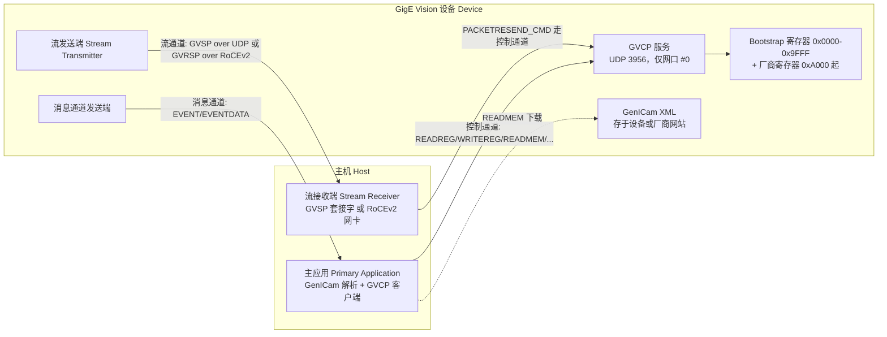
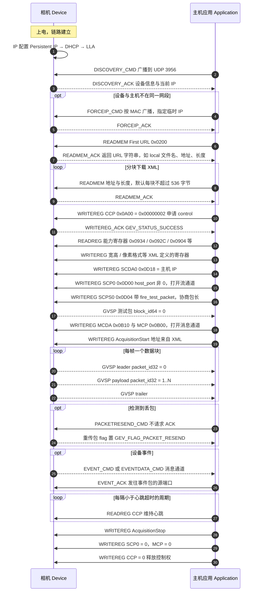
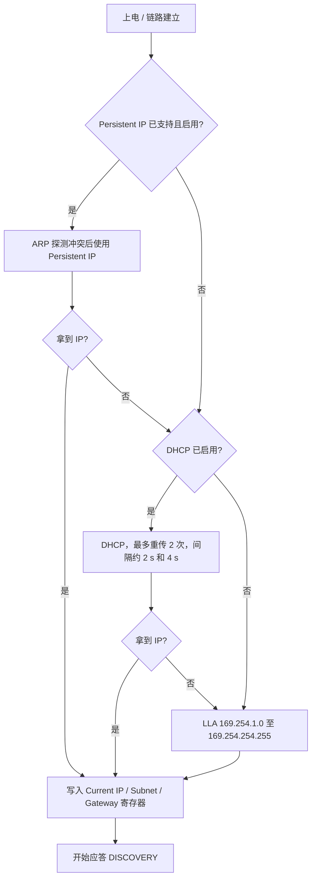
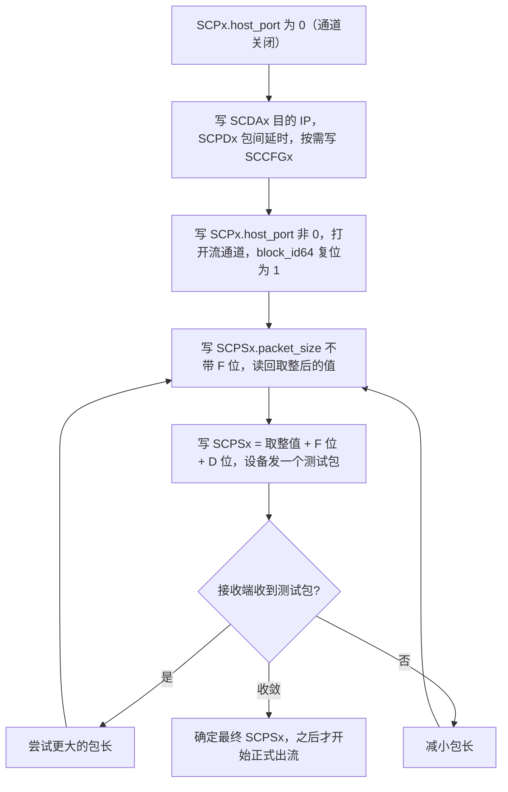

# 端到端流程：从上电到出图（End-to-End Walkthrough）

> **覆盖范围**：串联 Part 1–5 与互操作性章节的典型使用流程——Ch3–5（链路/IP/发现）、Ch10–12（控制/流/消息通道）、§14.1–14.4（XML、1588、Action、切换）、Ch16–17（报文）、Ch24–25（GVSP）、Ch29–33（GVRSP）、Ch36（寄存器）、§37.4（用例）；PDF p.34–357。
>
> **一句话总结**：以“主机应用控制一台 GigE Vision 相机并收图”为主线，按时间顺序把 IP 配置 → 发现 → 读 XML → 取得控制权 → 配置 → 打开流/消息通道 → 采集收图 → 断开串起来，每一步给出所用报文、寄存器与规范出处，并链接到详细笔记。
>
> **本文目录**：[核心要点](#核心要点) · [0 参与者与通道](#0-参与者与通道) · [1 全景时序图](#1-全景时序图) · [2 分步详解](#2-分步详解) · [3 典型寄存器操作清单](#3-典型寄存器操作清单gvsp-相机) · [4 设备端最小实现清单](#4-设备端最小实现清单) · [实现要点与易错点](#实现要点与易错点) · [相关章节](#相关章节) · [自测题](#自测题)

---

## 核心要点

- **三类通道**：控制通道（GVCP，设备端 UDP 3956，应用发命令、设备回 ACK）；消息通道（GVCP 报文格式，设备主动发事件、应用回 ACK）；流通道（设备 → 接收端的数据：GVSP over UDP，或 3.0 新增的 GVRSP over RoCEv2）。
- **上电 → 可被发现**：设备按 Persistent IP → DHCP → LLA 的顺序取得 IP，完成 IP 配置之前不得应答发现命令（[R-015cd] [R-031cd]）。
- **发现**：应用广播 `DISCOVERY_CMD`，设备回 `DISCOVERY_ACK`（内容就是 bootstrap 寄存器 0x0000–0x00F7 的镜像）；网段不匹配时用 `FORCEIP_CMD`（按 MAC 寻址）临时改 IP。
- **一切相机功能都在 XML 里**：应用从 First URL（0x0200）或 Manifest Table（0x9000）找到 GenICam XML（常为 zip），宽高、像素格式、`AcquisitionStart` 等都是 XML 描述的寄存器地址。
- **控制权与心跳**：写 CCP（0x0A00）申请 control/exclusive 权限；之后周期性读 CCP 维持心跳（默认 3000 ms 超时）。设备一旦心跳超时就关闭控制通道并停止出流。
- **GVSP 打开顺序**：SCPx 先置 0 → 写 SCDAx 等配置 → 写 SCPx.host_port ≠ 0 打开 → 用 SCPSx 测试包协商包长 → `AcquisitionStart`；丢包用 `PACKETRESEND_CMD` 补。
- **GVRSP 打开顺序**：读 flow mapping table → 写 RSCCKEYx → 每个 GenDC flow 建一个 RC QP（CM REQ/REP/RTU）→ RSCCTLx.stream_enable = 1 → 读 buffer layout table → 发初始 credit → `AcquisitionStart`。
- **关闭顺序与打开相反**：`AcquisitionStop` → 关流（SCPx = 0 / stream_enable = 0）→ MCP = 0 → CCP = 0；控制通道关闭（含心跳超时）时设备必须自动完成这些复位（[R-072cd]）。

---

## 0. 参与者与通道

| 通道 | 方向 | 传输 | 打开/关闭方式 | 详见 |
|---|---|---|---|---|
| 控制通道（Control Channel） | 应用 ⇄ 设备（命令/ACK） | UDP，设备端口 3956 | 写 CCP 申请权限 / 写 0 释放（monitor 访问无需打开） | [02_gvcp/01](../02_gvcp/01_transport_and_channels.md) |
| 消息通道（Message Channel） | 设备 → 应用（事件），应用回 ACK | UDP，设备侧动态源端口 | 写 MCDA，再写 MCP.host_port ≠ 0 / MCP = 0 关闭 | [02_gvcp/01](../02_gvcp/01_transport_and_channels.md)、[02_gvcp/03](../02_gvcp/03_message_formats.md) |
| GVSP 流通道 | 发送端 → 接收端 | UDP | SCDAx + SCPx.host_port ≠ 0 / SCPx = 0 关闭 | [03_gvsp/01](../03_gvsp/01_transport_and_data_block.md) |
| GVRSP 流通道（3.0 新增） | 发送端 → 接收端（另有 flow 0 上行消息） | RoCEv2 Reliable Connection | QP 连接 + RSCCTLx.stream_enable = 1 / 写 0 断开 | [04_gvrsp/01](../04_gvrsp/01_rocev2_and_streaming_model.md) |

> 多网口设备：只有网口 #0 支持 GVCP（控制与消息通道），其他网口只承载 GVSP/GVRSP 流；FORCEIP 也只能作用于网口 #0（§3.2, p.36，[R-006cd]）。

---

## 1. 全景时序图

以单网口、GVSP 流、带事件的相机为例（GVRSP 的差异见[步骤 7B](#步骤-7b打开-gvrsp-流通道30131323)）：

---

## 2. 分步详解

### 步骤 1：上电与物理链路（Ch3）

| 要点 | 内容 | 出处 |
|---|---|---|
| 链路配置 | 设备至少一个网口、最多 4 个；所有设备必须支持单链路（SL）；可选多链路（ML）、静态/动态链路聚合（LAG） | §3.1–3.3, p.35–39（[R-001cd] [R-002cd] [R-003cd]） |
| 控制只走网口 #0 | 网口 #0 是唯一支持 GVCP 的接口，发现也总在 #0 上进行，避免同一设备以多个 IP 出现 | §3.2, p.36 |
| 寄存器 | Physical Link Configuration Capability（0x0964）/ Configuration（0x0968）、Number of Network Interfaces（0x0600）、Link Speed（0x0670…） | §36.17、§36.21、§36.39–36.40 |

详见 [01_device_discovery/device_discovery.md](../01_device_discovery/device_discovery.md)。

### 步骤 2：IP 配置（Ch4）

- 顺序固定：① Persistent IP（若支持且启用）② DHCP（若启用）③ LLA（[R-015cd], p.40）。出厂默认：Persistent IP 关、DHCP 开；LLA 永远开启、不可关闭（[R-016cd] [R-029cd]）。
- 规范允许两种解读：进入 LLA 后停止 DHCP 客户端；或按 RFC3927 建议让 DHCP 客户端继续运行，日后拿到 DHCP 地址再替换 LLA 地址（§4.1 NOTE, p.41）。
- 使用 Persistent IP 前必须用 ARP 探测地址冲突（RFC5227），冲突则不得使用（[CR-020cd], p.43）。
- DHCP 重传策略（建议）：首次发送后约 2 s 未应答则重传，再等约 4 s……可加 ±1 s 随机抖动；最多重传 2 次（§4.3.1, p.46，[O-027cd]）。规范期望设备上电后 20 s 内可访问。
- 拿到 IP 后写入当前 IP 相关寄存器（[R-017cd], p.42）——⚠️ 规范此处把 0x0024 写成 “Persistent IP Address”，实际 0x0024 是 Current IP Address。
- FORCEIP 设置的地址会覆盖上述结果，但掉电/复位后丢失（§4.1, p.41）；3.0 起 FORCEIP 不得修改 Persistent IP 配置（[R-604cd], p.123）。

### 步骤 3：设备发现（Ch5、§16.1–16.2）

1. 应用向 **255.255.255.255:3956**（limited broadcast，不跨路由器）或子网定向广播发送 `DISCOVERY_CMD`（0x0002）。常用 flag = `0x11`：bit 7（掩码 0x01）要求 ACK，bit 3（掩码 0x10）允许设备在跨子网时广播 ACK（§5.1.1, p.49；§16.1.1, p.119–120）。
2. 设备在 Discovery ACK Delay（0x0950）给出的上限内随机延时后回 `DISCOVERY_ACK`（0x0003）。负载 248 字节，按 “ACK 偏移 = bootstrap 地址 + 8” 镜像 0x0000–0x00F7：版本、Device Mode、MAC、IP 配置能力/当前配置、当前 IP/掩码/网关、厂商名、型号、设备版本、厂商信息、序列号、用户自定义名（§16.1.2, p.120–122）。
3. 单播发现只能用于已知设备 IP 的情况，设备必须单播应答（[R-033cd]）。
4. 发现设备与主机不在同一网段（例如 Persistent IP 配错）时：应用广播 `FORCEIP_CMD`（0x0004，按 MAC 地址指定目标，携带新 IP/掩码/网关），设备回 `FORCEIP_ACK`（§16.2, p.123–126）。
5. 可选的 Zeroconf：mDNS/DNS-SD 服务类型 `_gvcp._udp`，TXT 记录提供 SpecVer、DevMode、MacAddr、Vendor、Model 等（§5.2, p.49–55）。

详见 [01_device_discovery/device_discovery.md](../01_device_discovery/device_discovery.md)、[02_gvcp/03_message_formats.md](../02_gvcp/03_message_formats.md)。

### 步骤 4：获取 XML 描述文件（§14.1、§36.15–36.16、§36.79）

- 位置来源：Manifest Table（0x9000，若支持）或 First URL（0x0200）/ Second URL（0x0400），各 512 字节字符串，可用一次 READMEM 读出（§14.1, p.95）。
- URL 三种形式（§14.1.1–14.1.3, p.95–97）：
  - `local:<filename>.<extension>;<address hex>;<length hex>`，例如 `local:acme_titan_rev1.zip;1C400;A000`：文件在设备地址 0x1C400，长 0xA000 字节，用 READMEM 分块读（类似 TFTP 的一问一答）。
  - `http://...`：从厂商网站下载。
  - `file:...`：主机本地目录。
- 文件可以是 `.xml` 或 `.zip`（只允许 DEFLATE/STORE，取 zip 中**第一个**文件）；应用两种都必须支持（[R-118ca]）。文件内容一变，文件名就必须变（[R-532cd]），应用可据此做本地缓存。
- READMEM 地址与长度须 4 字节对齐；默认 576 字节包长下每次最多 536 字节（§16.5, p.132）。
- 解析 GenApi XML 后，相机的 “feature” 就映射为具体寄存器地址；相机至少要有 Width、Height、PixelFormat、PayloadSize、GevSCPSPacketSize、AcquisitionMode、AcquisitionStart、AcquisitionStop 等强制特性（§37.5, p.357–363）。

详见 [02_gvcp/02_advanced_concepts.md](../02_gvcp/02_advanced_concepts.md)、[06_interoperability/interoperability_and_testing.md](../06_interoperability/interoperability_and_testing.md)。

### 步骤 5：打开控制通道与心跳（§10.3–10.5、§36.46、§36.30）

- **申请权限**：`WRITEREG CCP(0x0A00)`，写 `0x00000002` = control access，`0x00000001` = exclusive access，`0x00000006` = control + switchover enable。成功返回 `GEV_STATUS_SUCCESS`，否则 `GEV_STATUS_ACCESS_DENIED`（§10.3, p.73）。主应用可以直接在三种权限之间切换，无需先断开（[R-069cd] [R-070cd]）。
- **3.0 新增 connection_count**：CCP bit 16–19 由设备维护，每次打开控制通道递增（首次连接后不为 0）。应用读回并记住它，之后若发现变化即可判断“控制权已丢失”（§10.5, p.75；§36.46, p.313）。
- **心跳**：Heartbeat Timeout 寄存器（0x0938，单位 ms，默认 3000，最小 500）。主应用发出的任何有效 GVCP 命令都会复位心跳计时，但 PACKETRESEND、DISCOVERY、ACTION、FORCEIP 除外（[R-075cd]）；推荐用 READREG CCP 作为心跳。超时且未在 GVCP Configuration（0x0954）bit 31 关闭心跳时，设备必须关闭控制通道（[R-076cd]）。
- **次应用（monitor）**：无需打开控制通道，可直接 READREG/READMEM 读状态；但主应用持有 exclusive 权限时不行（§10.1–10.3）。

详见 [02_gvcp/01_transport_and_channels.md](../02_gvcp/01_transport_and_channels.md)、[05_bootstrap_registers/03_channel_registers.md](../05_bootstrap_registers/03_channel_registers.md)。

### 步骤 6：读取能力并配置设备（§36.1、§36.27–36.29、§36.38、§36.49）

| 读什么 | 地址 | 用途 |
|---|---|---|
| Version | 0x0000 | 3.0 设备为 0x00030000 |
| GVCP Capability | 0x0934 | 哪些可选命令/功能可用（如 PACKETRESEND、EVENT、ACTION、更大的控制包 MPS 等） |
| Streaming Capability | 0x092C | 是否支持 GVSP（`gvsp_mode_not_supported`，bit 4）/ GVRSP（`gvrsp_mode_supported`，bit 5） |
| Number of Stream / Message Channels | 0x0904 / 0x0900 | 通道数量 |
| CCMPS | 0x0A24 | 3.0 起可用更大的 GVCP 包（需 GVCP Capability 相应位支持） |
| Timestamp Tick Frequency | 0x093C/0x0940 | 时间戳换算 |

- **选择流协议**：同一时刻设备的所有流通道只能使用一种协议，由 Streaming Configuration（0x0960）的 `streaming_protocol` 选择（0 = GVSP，1 = GVRSP）；流激活时不能改（§11.1, p.82；§36.38, p.304–306）。作为接收端的应用必须同时支持 GVSP 和 GVRSP（[R-615ca]）。
- 然后按 XML 写入图像参数（Width/Height/PixelFormat…），并读取 PayloadSize 分配接收缓冲。

详见 [05_bootstrap_registers/02_device_and_network_registers.md](../05_bootstrap_registers/02_device_and_network_registers.md)。

### 步骤 7A：打开 GVSP 流通道（§11.5–11.8、§36.57–36.63）

- 应用写 SCPx 之前必须先让 host_port = 0 才能改 SCDAx/SCCFGx/SCPSx（包长协商除外）（[R-561ca]）；SCPx 是打开时最后写、关闭时第一个写的寄存器（§11.8, p.85）。
- 包长协商必须在通道打开之后、正式出流之前进行（[R-567s]）；测试包 block_id64 = 0，IP 头 DF 位置 1；不支持的包长不发测试包，并向下取整写回寄存器（[R-093st] [R-562st]）。
- 正式出流期间写 SCPx（除写 0 关闭外）返回 `GEV_STATUS_BUSY`（[R-586cd]）。
- 多播：SCDAx 可写组播地址（§11.9）；穿越防火墙/NAT：可用 SCSPx 得知设备源端口并“打洞”（§11.11）。

详见 [02_gvcp/01_transport_and_channels.md](../02_gvcp/01_transport_and_channels.md)、[05_bootstrap_registers/03_channel_registers.md](../05_bootstrap_registers/03_channel_registers.md)。

### 步骤 7B：打开 GVRSP 流通道（§30.1、§31.2–31.3、§32–33）

| 步骤 | 执行者 | 动作 | 寄存器 / 消息 |
|---|---|---|---|
| 0 | 主应用 | 确认 0x092C bit 5 = 1，把 0x0960 `streaming_protocol` 设为 1；配置设备；设置（或虚拟设置）`TLParamsLocked` | 0x092C、0x0960 |
| 1 | 接收端 | 读 GenDC flow mapping table，得知本次会话有几个 flow | SCGFTAx / SCGFTSx（SCEBAx + 0x08 / + 0x0C） |
| 2 | 主应用 | 写非零 `qp_connection_key` | RSCCKEYx（SCEBAx + 0x4C，只写） |
| 3 | 接收端 | 为每个 GenDC flow 建立一个 RC QP：CM REQ（ServiceID 对应 TCP 3956，私有数据带连接密钥等）→ REP → RTU | §31.1–31.3 |
| 4 | 主应用 | 写 `stream_enable = 1`；若仍有 flow 未连上 QP，返回 `GEV_STATUS_BUSY`（[CR-632st]） | RSCCTLx（SCEBAx + 0x30） |
| 5 | 接收端 | 读 buffer layout table（流使能后被锁定），按其分配接收 buffer、post receive | RSCBLTAx / RSCBLTSx |
| 6 | 接收端 | 在 flow 0 上发初始 `MSG_CREDITS` | 第 32–33 章 |
| 7 | 主应用 | `AcquisitionStart`；此后接收端持续补发 credit，发送端按 credit 发送 GenDC 容器 | — |

- GVRSP 没有 leader/trailer、没有 PACKETRESEND：可靠性由 RoCEv2 RC 的硬件 ACK/重传保证；一个块 = 一个 GenDC 容器，按 buffer layout table 切成若干 buffer 发送（§29.2–29.3）。
- 关闭：接收端停止上行消息 → 主应用写 `stream_enable = 0` → 发送端停流并对每个 QP 发 DREQ、收 DREP → 回到 Configuration 态（§30.2, p.222）。

详见 [04_gvrsp/01_rocev2_and_streaming_model.md](../04_gvrsp/01_rocev2_and_streaming_model.md)、[04_gvrsp/02_connection_and_flow_control.md](../04_gvrsp/02_connection_and_flow_control.md)。

### 步骤 8：打开消息通道（§12.2–12.3、Ch17）

- 先写 MCDA（0x0B10，主机 IP），再写 MCP（0x0B00）的 host_port ≠ 0 打开（[CR-099ca]）；MCTT（0x0B14）为等待 ACK 的超时，MCRC（0x0B18）为重试次数。
- MCTT ≠ 0 时设备发出的事件报文置 ACK 请求位；超时未收到 ACK 则按 MCRC 重发；MCRC = 0 则不重发（[CR-101cd]–[CR-103cd]）。
- 应用必须把 `EVENT_ACK`/`EVENTDATA_ACK` 发到**事件包的源 UDP 端口**（[CR-100ca]）。
- 事件报文：`EVENT_CMD`（0x00C0，每个事件 24 字节，576 字节包内最多 22 个）、`EVENTDATA_CMD`（0x00C2，附带数据）；事件 ID 的含义通过 GenICam XML 解码（§17.3）。

详见 [02_gvcp/03_message_formats.md](../02_gvcp/03_message_formats.md)、[02_gvcp/04_command_values_status_events.md](../02_gvcp/04_command_values_status_events.md)。

### 步骤 9：开始采集与接收数据（Ch24–25、§16.7）

- 写 XML 中 `AcquisitionStart` 对应的寄存器；GVSP 发送端随即按块发送：
  - **Leader**（packet_format = 1，packet_id32 = 0）：payload_type（如 Image 0x0001）、时间戳、pixel_format、size_x/y、offset、padding 等；默认 ≤ 576 字节。
  - **Payload**（packet_format = 3 generic；packet_id32 从 1 递增）：除最后一包外大小都等于 SCPSx.packet_size；有效数据 = packet_size − 48 字节（IP 20 + UDP 8 + GVSP 头 20）。
  - **Trailer**（packet_format = 2）：块结束；之后 block_id64 + 1、packet_id32 归 0（[R-268st]）。
- 3.0 的 GVSP 头固定使用 64 位 block_id64 与 32 位 packet_id32（EI 位 = 1），不再有 16 位 block_id（§24.2, p.173–174）。
- **丢包处理**：接收端根据 packet_id32 的空洞判断丢包，经控制通道发 `PACKETRESEND_CMD`（0x0040，flag = 0x10，不请求 ACK；需 GVCP Capability 的 PACKETRESEND 位支持）。重传包的 flag bit 15 置 `GEV_FLAG_PACKET_RESEND`，status 优先用 `GEV_STATUS_PACKET_RESEND`；无法重传时发送仅含头部的包并带上 `GEV_STATUS_PACKET_UNAVAILABLE` 等状态（§16.7, p.136–142）。
- 发送端丢弃过块时，后续包的 flag bit 14（GEV_FLAG_PREVIOUS_BLOCK_DROPPED）置位，接收端可根据 block_id64 的跳变计算丢了几块（Table 24-1, p.175）。

详见 [03_gvsp/01_transport_and_data_block.md](../03_gvsp/01_transport_and_data_block.md)、[03_gvsp/02_payload_types_and_pixel_layouts.md](../03_gvsp/02_payload_types_and_pixel_layouts.md)。

### 步骤 10（可选）：时间同步与 Action 触发（§14.2–14.3）

- **IEEE 1588 / PTP**：设备时间戳可与主时钟同步，使多台相机的 leader 时间戳可直接比较；相关寄存器 IEEE 1588 Status（0x096C）、Supported/Selected Profile（0x0978/0x097C）等。
- **ACTION_CMD**（0x0100）：一条广播命令同时触发多台设备；设备按 device_key、group_key、group_mask 匹配后执行；带 `action_time` 的“定时 Action”要求时间已同步，否则返回 `GEV_STATUS_NO_REF_TIME`，时间已过返回 `GEV_STATUS_ACTION_LATE`，队列满返回 `GEV_STATUS_OVERFLOW`。

详见 [02_gvcp/02_advanced_concepts.md](../02_gvcp/02_advanced_concepts.md)。

### 步骤 11：停止与断开（§10.4、§11.8、§12.4、§30.2）

1. 写 `AcquisitionStop`（在块边界停流的正确做法，§11.8, p.85）。
2. GVSP：SCPx 写 0（[R-091ca]）；发送端不得发出不完整的包（[R-092st]），但最后一块可能没有 trailer。GVRSP：`stream_enable` 写 0，设备断开全部 QP（[CR-633st]）。
3. 消息通道：MCP 写 0（[CR-106ca]）。
4. 控制通道：CCP 写 0（[R-071ca]）。

设备在控制通道关闭（主动释放或心跳超时）时必须：停止采集与出流（GVSP 若启用了无条件流则可继续）、清 MCP 与各 SCPx、清 RSCCTLx.stream_enable 并断开 QP、复位 Primary Application Port/IP 寄存器，然后等待新连接（[R-072cd], p.74）。注意设备不会把其他寄存器恢复为默认值——新应用拿到控制权后应写入一整套一致的配置（§10.4 NOTE）。

### 步骤 12：异常与恢复

| 现象 | 原因 / 规范行为 | 应对 |
|---|---|---|
| 命令超时无 ACK | UDP 丢包 | 用**相同 req_id** 重发；设备对重复命令只重发 ACK、不重复执行（§8.1.3） |
| `GEV_STATUS_BUSY` | 资源暂不可用 | 稍后重试 |
| 收到 `PENDING_ACK`（0x0089） | 设备执行时间较长，告知应用延长等待（3.0 起设备必须支持）；其 `time_to_completion` 字段（16 位，单位 ms）给出预计完成时间，期间心跳计数暂停 | 按 `time_to_completion` 延长等待原命令 ACK（§16.8, p.142–143，[R-212cd] [R-215cd]） |
| CCP 读回的权限位或 connection_count 变了 | 心跳超时或被其他应用接管（switchover） | 重新走步骤 5 起的流程 |
| 写寄存器返回 `GEV_STATUS_ACCESS_DENIED` | 非主应用，或当前状态不允许（如 GVRSP 模式下访问 SCPx） | 检查 CCP 与 streaming_protocol |
| 帧不完整、大量重传 | 包长过大被丢、交换机缓存不足 | 重新协商 SCPSx、增大 SCPDx、检查 PAUSE 帧流控 |

---

## 3. 典型寄存器操作清单（GVSP 相机）

| 顺序 | 操作 | 地址 | 示例值 / 说明 |
|---|---|---|---|
| 1 | READMEM | 0x0200 | First URL 字符串 |
| 2 | WRITEREG | 0x0A00 CCP | `0x00000002`（control） |
| 3 | READREG | 0x0A00 CCP | 记录 connection_count（bit 16–19） |
| 4 | WRITEREG | 0x0938 Heartbeat Timeout | 可选，例如 3000（ms） |
| 5 | READREG | 0x0934 / 0x092C / 0x0904 | 能力与通道数 |
| 6 | WRITEREG | 0x0960 Streaming Configuration | 选 GVSP（streaming_protocol = 0）（若设备支持两种） |
| 7 | WRITEREG | XML 地址 | Width、Height、PixelFormat… |
| 8 | READREG | XML 地址 | PayloadSize → 分配缓冲 |
| 9 | WRITEREG | 0x0D00 SCP0 | 0（确保关闭后再配置） |
| 10 | WRITEREG | 0x0D18 SCDA0 | 主机 IP，如 `0xC0A80164`（192.168.1.100） |
| 11 | WRITEREG | 0x0D08 SCPD0 | 包间延时（时间戳 tick 单位） |
| 12 | WRITEREG | 0x0D00 SCP0 | host_port，如 `0x0000C350`（50000） |
| 13 | WRITEREG/READREG | 0x0D04 SCPS0 | 包长协商；巨帧网络可试 9000 附近 |
| 14 | WRITEREG | 0x0B10 MCDA → 0x0B00 MCP | 主机 IP → 事件端口 |
| 15 | WRITEREG | XML 地址 | AcquisitionStart |
| … | READREG | 0x0A00 CCP | 周期心跳（间隔小于超时，💡 常用超时的 1/3 左右） |
| 末 | WRITEREG | XML / 0x0D00 / 0x0B00 / 0x0A00 | AcquisitionStop → SCP0 = 0 → MCP = 0 → CCP = 0 |

> 💡 解读：示例 IP/端口只是说明编码方式（寄存器为大端 32 位，host_port 位于 bit 16–31 即低 16 位）。

---

## 4. 设备端最小实现清单

| 类别 | 必须实现（摘要） | 出处 |
|---|---|---|
| 网络 | 网口 #0；IP 配置 Persistent IP（可选）/ DHCP / LLA，顺序与默认值固定；发现前完成 IP 配置 | Ch3–4 |
| GVCP 命令 | DISCOVERY、FORCEIP、READREG、WRITEREG、READMEM、WRITEMEM、PENDING_ACK（3.0 起强制）；不支持的命令回 `GEV_STATUS_NOT_IMPLEMENTED` | Ch16，[R-139cd] [R-147cd] [R-157cd] [R-166cd] [R-176cd] [R-185cd] |
| 寄存器 | 全部强制 bootstrap 寄存器（Version、Device Mode、MAC、IP、字符串、URL、通道数、能力、Heartbeat、CCP、SCP0/SCPS0/SCDA0…） | Ch36，[reference/bootstrap_register_map.md](../reference/bootstrap_register_map.md) |
| XML | 符合 GenApi 的 XML；相机强制特性；文件名随内容变化 | §14.1、§37.5 |
| 控制通道 | 权限管理、心跳超时关闭、关闭时完整复位 | §10.1–10.5 |
| 流 | 至少一种表 25-1 中的负载类型；GVSP 和/或 GVRSP | Ch11、Ch24–25、Ch29–33 |
| 测试 | 合规测试与可测性特性 | Ch39 |

完整逐条要求见 [reference/requirements_index.md](../reference/requirements_index.md)（可按“适用：设备”筛选 CSV）。

---

## 实现要点与易错点

**应用端**
- req_id 不能为 0、逐条递增；重发时保持同一 req_id，否则设备会当成新命令重复执行。
- 不要把 PACKETRESEND、DISCOVERY、ACTION、FORCEIP 当心跳——它们不复位心跳计时（[R-075cd]）。
- 改流配置前先把 SCPx 置 0；协商包长要在打开通道后、`AcquisitionStart` 之前完成。
- 接收缓冲按 PayloadSize 分配，超出 PayloadSize 的数据必须丢弃（[R-568sr]），最后一包可能有填充。
- 读 CCP 判断是否掉线时，同时比较权限位与 connection_count（3.0 新增）。
- 事件 ACK 要发到事件包的源端口，而不是 3956。

**设备端**
- 发现应答只在网口 #0、且 IP 配置完成后进行；跨子网收到带广播标志的发现命令时广播应答。
- 控制通道关闭（含心跳超时）时必须完成 [R-072cd] 列出的全部复位；GVRSP 不允许无条件流。
- 打开流通道时 block_id64 复位为 1；测试包用 block_id64 = 0；leader/trailer 默认不超过 576 字节。
- 不支持的包长不发测试包，并把 SCPSx 取整后写回，应用会读回确认。

---

## 相关章节

- 总览：[01_introduction_and_architecture.md](01_introduction_and_architecture.md) · [05_quick_reference.md](05_quick_reference.md) · [03_version_history_and_v3_changes.md](03_version_history_and_v3_changes.md)
- 发现：[01_device_discovery/device_discovery.md](../01_device_discovery/device_discovery.md)
- GVCP：[01_transport_and_channels.md](../02_gvcp/01_transport_and_channels.md) · [02_advanced_concepts.md](../02_gvcp/02_advanced_concepts.md) · [03_message_formats.md](../02_gvcp/03_message_formats.md) · [04_command_values_status_events.md](../02_gvcp/04_command_values_status_events.md)
- GVSP：[01_transport_and_data_block.md](../03_gvsp/01_transport_and_data_block.md) · [02_payload_types_and_pixel_layouts.md](../03_gvsp/02_payload_types_and_pixel_layouts.md)
- GVRSP：[01_rocev2_and_streaming_model.md](../04_gvrsp/01_rocev2_and_streaming_model.md) · [02_connection_and_flow_control.md](../04_gvrsp/02_connection_and_flow_control.md)
- 寄存器：[01_overview_and_register_map.md](../05_bootstrap_registers/01_overview_and_register_map.md) · [02_device_and_network_registers.md](../05_bootstrap_registers/02_device_and_network_registers.md) · [03_channel_registers.md](../05_bootstrap_registers/03_channel_registers.md)
- 互操作：[interoperability_and_testing.md](../06_interoperability/interoperability_and_testing.md)

---

## 自测题

1. 设备上电后多久可以被发现？在此之前它会应答 DISCOVERY_CMD 吗？

答案
必须先完成 IP 配置（Persistent IP → DHCP → LLA）才能应答发现命令（[R-031cd]）；规范期望设备上电后约 20 s 内可访问（§4.3.1）。

2. 主机与相机不在同一网段，广播发现能看到相机但无法通信，怎么办？

答案
发现命令置 flag bit 3（0x10）让设备广播应答；再用广播的 FORCEIP_CMD 按 MAC 指定一个同网段的临时 IP（掉电丢失，且 3.0 起不修改 Persistent IP 配置）。

3. 应用应该用什么命令维持心跳？为什么不能靠 PACKETRESEND_CMD？

答案
推荐周期性 READREG CCP（0x0A00）。PACKETRESEND、DISCOVERY、ACTION、FORCEIP 都不会复位心跳计数（[R-075cd]），只靠它们会导致设备超时关闭控制通道。

4. 打开 GVSP 流通道时，SCPx 为什么要“最后写”？关闭时为什么“第一个写”？

答案
SCPx.host_port 非 0 即打开通道、为 0 即关闭；为保证配置一致，其他流寄存器（SCDAx、SCCFGx…）只能在通道关闭时修改（[R-561ca]），所以打开前先配好其他寄存器、最后写 SCPx；关闭时先写 SCPx = 0。

5. SCPSx.packet_size = 1500 时，一个 Generic 负载包携带多少字节图像数据？

答案
1500 − 20（IP）− 8（UDP）− 20（3.0 的 GVSP 头，含 64 位 block_id64 与 32 位 packet_id32）= 1452 字节。

6. GVRSP 流为什么不需要 PACKETRESEND？它用什么防止接收端缓冲溢出？

答案
GVRSP 使用 RoCEv2 Reliable Connection，丢包检测与重传由网卡硬件完成；接收端通过 flow 0 上的 MSG_CREDITS 发放容器 credit，发送端只在有 credit 时发送（第 32–33 章）。

7. 应用崩溃没有写 CCP = 0，设备会怎样？新应用接管时要注意什么？

答案
心跳超时后设备关闭控制通道，停止采集与出流、清 MCP/SCPx/stream_enable 等（[R-072cd]）。但其他寄存器保持上一个应用写入的值，新应用应写入一整套完整、一致的配置，不能假设设备处于默认状态。

