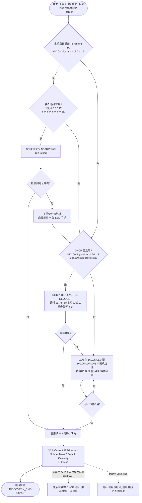
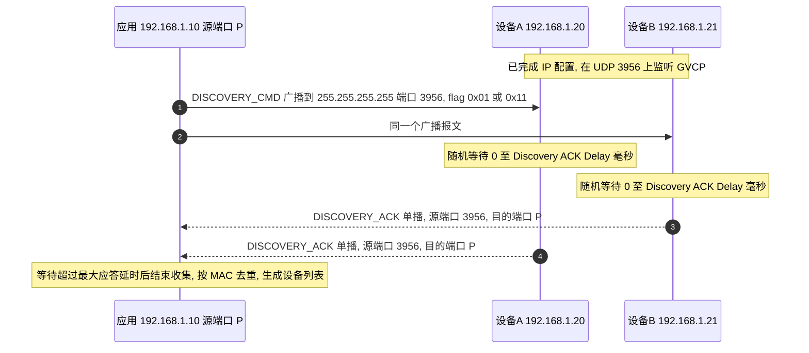
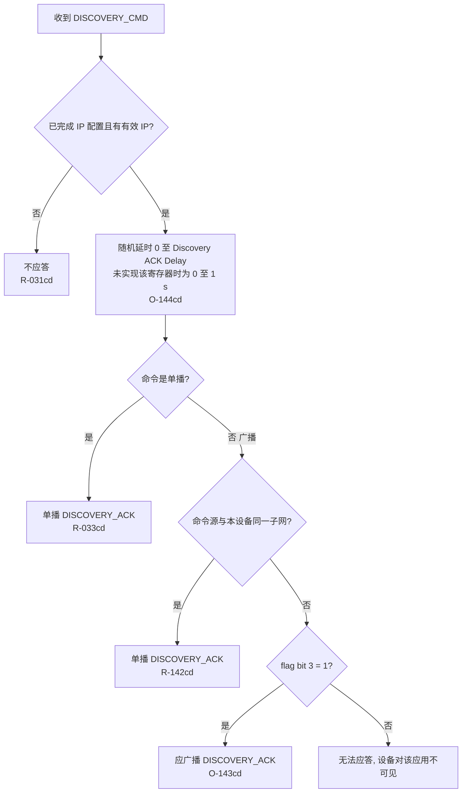
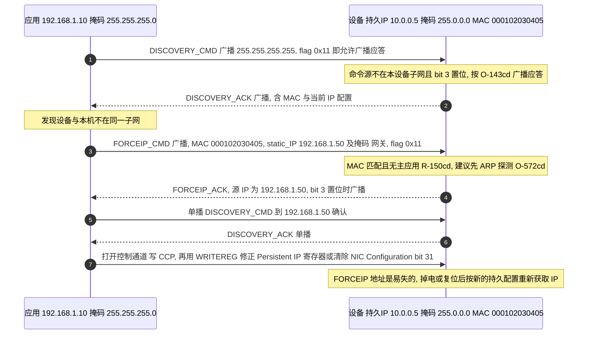
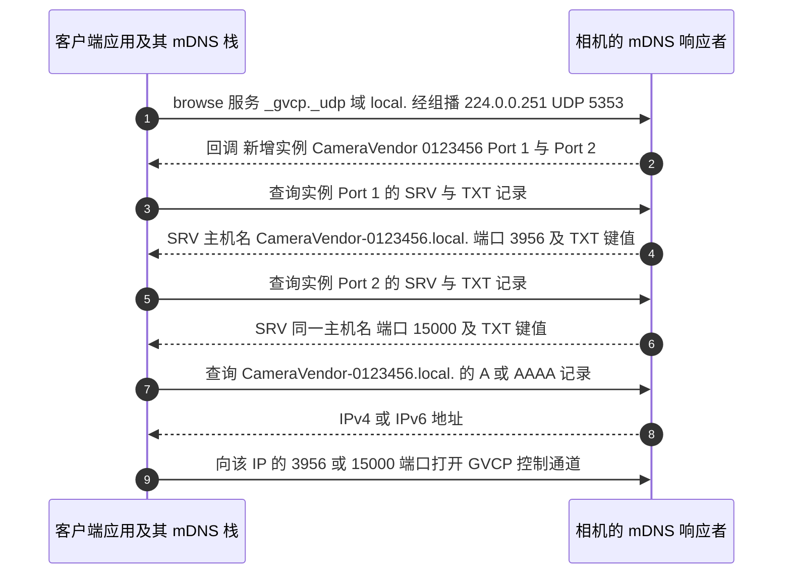

# 第一部分：设备发现（Device Discovery）—— 物理链路、IP 配置与设备枚举

> **覆盖范围**：GigE Vision Specification v3.0.00 第 2–6 章（Part 1 Device Discovery，§2.1–§6.2），PDF p.32–56。为便于工程查阅，另交叉引用了 §8.1（GVCP 端口）、§10.1/§10.6（发现命令的权限与时机）、§13（多网口）、§16.1–§16.2/§16.8（DISCOVERY / FORCEIP / PENDING_ACK）、§20（事件）以及 §36（相关引导寄存器）中的条款，引用处均注明页码。
>
> **一句话总结**：设备上电后先完成以太网链路协商，再按 “Persistent IP → DHCP → LLA” 的固定顺序**自行**获取 IP；IP 就绪后，应用通过 GVCP DISCOVERY（UDP 3956，广播或单播，所有设备必须支持）或 mDNS/DNS-SD（可选）枚举设备；对 IP 配置错误、与应用不在同一子网的设备，可借助 DISCOVERY 的“允许广播应答”标志找到它，再用 FORCEIP_CMD 临时改 IP 进行修复。
>
> **约定**：文中 `p.xx` 一律为 **PDF 页码**（= 印刷页码 + 1）。**位编号**沿用规范的 MSB 优先编号：32 位寄存器的 bit 0 是最高位、bit 31 是最低位；8 位 GVCP `flag` 字节中 bit 0 是最高位、bit 7 是最低位。多字节字段均为大端（网络字节序）。“💡 解读：”标记的内容是本知识库补充的理解/推导，不是规范原文。

**本文目录**

1. [核心要点](#key-points)
2. [第 2 章 设备发现概述（p.32–33）](#ch2)
3. [第 3 章 物理链路配置（p.34–39）](#ch3)
4. [第 4 章 IP 配置（p.40–47）](#ch4)
5. [第 5 章 设备枚举（p.48–55）](#ch5)
6. [第 6 章 设备接入与移除（p.56）](#ch6)
7. [本部分需求的版本来源](#req-versions)
8. [实现要点与易错点](#pitfalls)
9. [相关章节](#related)
10. [自测题](#quiz)

<a id="key-points"></a>
## 核心要点

- **三步走**：链路协商（IEEE 802.3 自协商）→ IP 配置（由**设备**发起）→ 设备枚举（由**应用**发起）；设计目标是设备上电/复位后 **20 秒内**可达（§2.1–§2.2, p.32–33）。
- **四种物理链路配置**：SL（所有设备必须支持，[R-002cd]）、ML（每个网口独立 IP）、静态 LAG、动态 LAG（基于 IEEE 802.1AX，对应用呈现为单一虚拟接口 / 单 IP）。设备最多 4 个网络接口（[R-003cd]）；**只有接口 #0 承载 GVCP**，设备发现总在接口 #0 上进行（§3, p.34–39）。
- **IP 配置顺序固定**：Persistent IP（若支持且启用）→ DHCP（若启用）→ LLA（[R-015cd]）。DHCP 与 LLA 必须支持（[R-014cd]），LLA 永远启用、不可关闭（[R-029cd]）；出厂默认 Persistent IP 关闭、DHCP 开启（[R-016cd]）。
- **DHCP 快速重传**：超时 2 s → 4 s → 6 s（每次可选 ±1 s 随机化），最多重传 2 次；无 DHCP 服务器时通常约 12 s（最坏 15 s）后转入下一方案（[O-027cd], p.46）。
- **Persistent IP 使用前必须 ARP 探测**（RFC5227），冲突则不得使用并转入下一方案（[CR-020cd]）；0.0.0.0 / 255.255.255.255 不允许作为持久 IP（p.43）。
- **LLA 地址范围**：169.254.1.0 – 169.254.254.255（RFC3927）（§4.4, p.47）。
- **获得 IP 后**：必须把 IP / 子网掩码 / 默认网关写入 Current IP 系列寄存器（[R-017cd]）；**完成 IP 配置之前不得应答发现请求**，完成之后必须应答任何应用的发现请求（[R-030cd] [R-031cd]）。
- **GVCP 发现**：广播（255.255.255.255 或子网定向广播，不跨路由器）或单播到设备 UDP 3956；同子网设备必须**单播**应答（[R-142cd]）；不在同一子网且命令 `flag` bit 3 置位时，设备应**广播**应答（[O-143cd]）；应答前随机延时 0 ~ Discovery ACK Delay（未实现该寄存器时为 0–1 s）（[O-144cd]）。
- **FORCEIP_CMD**：按 MAC 寻址、由应用广播发送、只作用于接口 #0、写入的是易失的 “Static IP”（掉电/复位丢失），且不得修改 Persistent IP 配置（[R-006cd] [R-148ca] [R-604cd]）；是找回“IP 配错”设备的标准手段。
- **Zeroconf（v2.0 引入，可选）**：mDNS（224.0.0.251 / FF02::FB，UDP 5353，`.local.`）+ DNS-SD，服务类型 `_gvcp._udp`；TXT 记录必须含 SpecVer / DevMode / MacAddr / Vendor / Model；第一个 GVCP 服务实例必须使用 3956 端口（§5.2, p.49–55）。
- **热插拔**：移除依靠命令/心跳超时、流超时（GVRSP 则为 QP 断开）发现；接入依靠 DHCP 服务器、周期或手动 DISCOVERY、mDNS/DNS-SD 发现（[O-039ca], §6, p.56）。

---

<a id="ch2"></a>
## 第 2 章 设备发现概述（Ch2, p.32–33）

### 2.1 概述（§2.1, p.32）

设备发现（Device Discovery）涵盖两件事：① **可控设备**（controllable device）通过其网络接口建立连接，并用标准 IP 协议获得有效 IP 地址；② **控制应用**（control application）枚举网络上的设备。完成之后，应用即可向设备发送控制请求。

- 术语：规范中 **device** 专指“GigE Vision 兼容的可控设备”，**application** 专指“运行在主机上的 GigE Vision 兼容控制应用软件”（p.32 NOTE）。

设备发现分为 **3 个顺序步骤**：

| 步骤 | 发起方 | 做什么 | 使用的标准/协议 |
|---|---|---|---|
| 1. 链路协商（Link negotiation） | 设备与链路对端 | 设备判断自己的哪些链路处于 active 状态；链路速率由以太网自协商决定 | IEEE 802.3 自协商 |
| 2. IP 配置（IP configuration） | **设备** | 为设备分配一个唯一的 IP 地址。设备**必须**支持 DHCP 和 LLA，**可以**支持 Persistent IP（存放在非易失存储中、跨掉电/复位保持的静态 IP） | DHCP、LLA、Persistent IP |
| 3. 设备枚举（Device enumeration） | **应用** | 收集网络上设备的存在信息。不知道设备 IP 时，在应用所在子网用 **UDP 广播**；已知设备 IP 时用 **UDP 单播**。通过 GVCP 消息交换完成，应答中包含厂商、型号等设备信息 | GVCP（DISCOVERY） |


> ⚠️ **WARNING（p.32）**：规范**没有**定义应用如何获取位于**不同子网**的设备的 IP 地址。可能的途径包括：利用 DHCP 服务器提供的信息、组播（multicast）设备枚举请求、或使用 DNS；未来版本可能会处理该问题。

### 2.2 设计目标（§2.2, p.32–33）

| # | 目标 | 强度 |
|---|---|---|
| 1 | 必须支持多网络接口 | must |
| 2 | IP 配置与设备枚举应为相互独立的步骤 | should |
| 3 | 必须为 GigE Vision 设备分配有效 IP 地址 | must |
| 4 | 必须枚举与应用**同一子网**的所有 GigE Vision 设备 | must |
| 5 | 应提供查找**不同子网**设备的手段 | should |
| 6 | 尽可能提供无需任何网络配置的即插即用方案 | should |
| 7 | 应确保设备在上电或复位后 **20 秒内**可达 | should |
| 8 | 应提供设备特定信息，使应用能唯一识别设备（含型号与厂商） | should |
| 9 | 应尽量利用现有 IP 协议，保证与 IP 网络互操作并减少开发量 | should |
| 10 | 应可选地允许用户为设备强制设置持久 IP，之后每次重新初始化都使用该地址 | should |
| 11 | 应尽量降低设备端 IP 协议栈的复杂度，把复杂度推到 CPU 与内存更充裕的应用端 | should |

设备发现结束时：应用必须已识别出其子网内的全部 GigE Vision 兼容设备，且每台设备都已准备好接收请求（p.33）。

💡 解读：这里的 must/should 是“设计目标”，并非带编号的需求条款；真正约束实现的是后文 `[R-xxx]` 等编号需求。目标 11 解释了为什么规范让设备只做“最小 IP 栈”（如 GVCP 禁止 IP 分片、禁止 IP 选项，见 §8.1），而把多网卡选择、跨子网等复杂问题留给应用。

### 2.3 范围（§2.3, p.33）

本部分只覆盖 GigE Vision 设备发现：链路协商、IP 配置与设备枚举。设备与应用之间的其他通信协议（如 GVCP）在规范其他部分定义。

---

<a id="ch3"></a>
## 第 3 章 物理链路配置（Ch3, p.34–39）

IP 配置之前，设备与应用之间必须先建立物理连接。GigE Vision 设备可以使用多条物理链路来提高总带宽，例如合并两条 1 GbE 链路可提供最高 2 Gbit/s 的带宽（p.34）。规范为设备定义了 4 种物理链路配置：

1. 单链路配置（Single Link，**SL**）
2. 多链路配置（Multiple Links，**ML**）
3. 静态链路聚合组配置（static Link Aggregation Group，**sLAG**）
4. 动态链路聚合组配置（dynamic LAG，**dLAG**）

- **SL 与 ML**：人工控制，每个网络接口单独配置；每个网络接口在启动时都要各自走一遍 IP 配置 → **每个物理接口一个不同的 IP**。
- **sLAG 与 dLAG**：使用 IEEE 802.1AX 创建链路聚合组，形成**单一虚拟链路** → 应用只看到**一个 IP**。物理链路的分组在 MAC 层完成，对应用软件透明。

**四种配置对比**（规范原表，p.34–35；带“补充”的行摘自 §36，便于对照寄存器）：

| 特性 | SL | ML | 静态 LAG | 动态 LAG |
|---|---|---|---|---|
| 网络接口数 | 1 | 2、3 或 4 | 2、3 或 4 | 2、3 或 4 |
| IP 地址数 | 1 | 每个网络接口一个 | 1 | 1 |
| 最少流通道数 | 1 | 每条链路一个 | 1 | 1 |
| 负载均衡 | 不适用 | 手动：通过流通道分配 | 轮询（round-robin）分发算法 | 轮询分发算法 |
| 物理链路断开后的恢复 | 设备丢失，需人工恢复 | 断开链路上的流通道失效；可能丢失控制通道；需人工恢复 | 数据包重新分布到剩余物理链路 | 数据包重新分布到剩余物理链路 |
| 分组配置 | 不需要 | 每条链路独立配置（不视为一组） | 设备上部分（或全部）链路自动（有时手动）分组；PC 端须手动分组（常称 teaming） | 配置后通过链路聚合控制协议（LACP）在设备和 PC 两端自动完成 |
| 是否必须支持（补充） | **必须**（[R-002cd]） | 可选 | 可选 | 可选 |
| Physical Link Configuration Capability 位（补充，§36.39, p.307） | bit 31（SL） | bit 30（ML） | bit 29（sLAG） | bit 28（dLAG） |
| Physical Link Configuration `link_configuration` 值 / Device Mode `CLC` 值（补充，§36.40 p.308、§36.2 p.271） | 0 | 1 | 2 | 3 |

> NOTE（p.35）：允许设备**组合使用** LAG 与 ML。NOTE（p.36）：一个 LAG 也可以在 ML 配置中被当作一条链路。

### 3.1 单链路配置 SL（§3.1, p.35）

SL 是最简单的配置：只需一个物理网络接口，所有控制通道、流通道、消息通道都附着在这个接口上，不需要任何额外步骤来说明链路如何分组或流通道如何分配。即使设备有多个物理链路，也可以用其中一个来提供 SL 配置。

- 设备**必须**至少有一个网络接口（[R-001cd]）。
- **所有设备都必须支持 SL 配置**（[R-002cd]，v2.0 引入）。

### 3.2 多链路配置 ML（§3.2, p.35–36）

当设备有多个网络接口时，一种做法是把它们配置为**相互独立的链路**，每个接口拥有不同的 IP。带多个网口的**流设备**可以选择支持 ML。

- 设备**最多**支持 4 个网络接口（[R-003cd]）。
- 若支持 ML，则在 ML 配置下每个网络接口**必须独立执行** IP 配置流程（[CR-004cd]）。
- 网络接口数量由位于 **0x0600** 的 Number of Network Interfaces 寄存器报告；0x0600–0x07FF 范围内的其他引导寄存器保存各网络接口的链路协商与 IP 配置信息。
- 每个网络接口有索引 0–3。**接口 #0 是主接口**，承载控制通道和消息通道，**是唯一支持 GVCP 的接口**。因此设备发现总在接口 #0 上进行，以免同一设备以不同 IP 被重复发现；其他接口只用于额外的流通道，只收发 GVSP/GVRSP 包，**不支持 GVCP**（p.36）。
  - 💡 解读：§13 进一步规定，多网口设备**必须**静默丢弃从非 #0 接口收到的 GVCP 请求（[R-112cd], p.93），应用也必须通过接口 #0 控制设备（[R-111c]）。
- 接口 #0 不一定是机壳上的“第一个”物理口：厂商可以明确标注接口 #0，也可以把“第一个变为 active 的接口”定义为接口 #0。若拔掉接口 #0 的网线，控制通道断开、与设备的通信丢失；LAG 配置在这种情况下更健壮（p.36）。
- 若支持 ML，设备**必须**为每个接口提供独立的 IP 配置相关引导寄存器存储（[CR-005cd]）。
- **FORCEIP 只能用于接口 #0**；其他接口（若存在）**必须**通过 Persistent IP、DHCP 或 LLA 获取 IP 配置（[R-006cd]）。
- 建议允许任一流通道绑定到任一网络接口，绑定通过 SCPx 寄存器的 `network_interface_index` 字段完成；也允许把流通道硬编码到特定接口，此时该字段只读（p.36）。
  - ⚠️ 规范内部不一致：§3.2（p.36）写该字段位于 SCPx 的 **bit 12–15**，而 §36.57 的寄存器图（p.323）把 `network_interface_index (NII)` 画在 **bit 14–15**（bit 1–13 为 reserved，取值 0–3）。实现时以 §36.57 寄存器定义为准并结合设备 XML 核实（MSB 优先编号，bit 0 为最高位）。
- 在 GVSP 模式下支持 ML 时，GVSP 通道使用哪个接口**必须**在 SCPx 寄存器中指定（[CR-007s]）。
- NOTE（p.36）：产品也可以把每个网络接口呈现为**一台独立的 GigE Vision 设备**——此时每个接口都要提供完整的资源（如引导寄存器），各接口相互独立，相当于把多台设备装进一个外壳。

**每个网络接口的 IP 相关引导寄存器地址**（摘自 §36.3–§36.8、§36.18–§36.21，p.271–286；接口 #1–#3 的寄存器均为可选，不支持的接口访问时返回 `GEV_STATUS_INVALID_ADDRESS`）：

| 寄存器 | 接口 #0 | 接口 #1 | 接口 #2 | 接口 #3 | 访问 |
|---|---|---|---|---|---|
| Device MAC Address – High（低 16 位存 MAC 高 2 字节） | 0x0008 | 0x0680 | 0x0700 | 0x0780 | R |
| Device MAC Address – Low（MAC 低 4 字节） | 0x000C | 0x0684 | 0x0704 | 0x0784 | R |
| Network Interface Capability | 0x0010 | 0x0688 | 0x0708 | 0x0788 | R |
| Network Interface Configuration | 0x0014 | 0x068C | 0x070C | 0x078C | R/W |
| Current IP Address | 0x0024 | 0x069C | 0x071C | 0x079C | R |
| Current Subnet Mask | 0x0034 | 0x06AC | 0x072C | 0x07AC | R |
| Current Default Gateway | 0x0044 | 0x06BC | 0x073C | 0x07BC | R |
| Persistent IP Address | 0x064C | 0x06CC | 0x074C | 0x07CC | R/W |
| Persistent Subnet Mask | 0x065C | 0x06DC | 0x075C | 0x07DC | R/W |
| Persistent Default Gateway | 0x066C | 0x06EC | 0x076C | 0x07EC | R/W |
| Link Speed（Mbps） | 0x0670 | 0x06F0 | 0x0770 | 0x07F0 | R |

详细位定义见 [../05_bootstrap_registers/02_device_and_network_registers.md](../05_bootstrap_registers/02_device_and_network_registers.md)。

#### 3.2.1 负载均衡考虑（§3.2.1, p.36）

- 由于设备的每个网络接口有不同的 IP，负载均衡可以在**发送端**用合适的分配算法实现，中间网络设备（如以太网交换机）无需参与分配；接收端由 IP 协议负责把流量路由到正确的接口。
- ML 下的负载均衡方法：使用**多个流通道**，并把每个流通道分别关联到不同链路，以平衡各链路所需带宽。
- 例：双网口流设备需要 2 个带宽相同的流通道，各自绑定到不同链路，才能让两个接口上的带宽消耗相同。

### 3.3 链路聚合组配置 LAG（§3.3, p.37）

IEEE 802.1AX 正式定义了链路聚合：把多条链路组合成一个链路聚合组（LAG），设备可以像对待单条链路一样对待 LAG。与 ML 不同，这对应用是**透明**的。

- IEEE 802.1AX 定义了**会话（conversation）**：一组接收时必须保持顺序的数据包。
- IEEE 802.1AX **没有**定义聚合组发送端使用的分发算法。GigE Vision 在 802.1AX 基础上补充了若干澄清以利于互操作。
- NOTE（p.37）：符合 IEEE 802.1AX 的以太网交换机直接遵循 IEEE 标准，通常只用以太网帧头（有时加 IP 头）作为分发算法输入，看不到 GVSP 层信息。由于 LAG 只呈现**一个 MAC/IP**，这类交换机无法把 GVSP 流量分摊到多个出口，流量可能全部落在交换机的同一个出口上。
  - 💡 解读：因此 LAG 的带宽收益主要体现在“设备 ⇄ 多端口网卡”的直连场景；中间若经过交换机，交换机到主机这一段仍可能只用到一条链路的带宽。
- GigE Vision 流设备可以选择支持静态 LAG、动态 LAG，或两者都支持。

#### 3.3.1 网络接口（§3.3.1, p.37）

- 只允许**一个聚合器（aggregator）**，所有关联到 LAG 的活动链路都绑定到这个聚合器。
- 若支持链路聚合，设备在静态和动态 LAG 配置下都**必须只允许一个聚合器**（[CR-008cd]）。
- 聚合器**应**使用 LAG 中**编号最小**的物理网络接口的 MAC 地址（[CO-009cd]）。
- 因此在 LAG 配置下，引导寄存器中只能看到**一个“虚拟”网络接口**。若设备只支持 LAG 且没有额外的 ML 物理接口，则该 LAG 接口显示为网络接口 #0；否则可能是任一可用接口。
- 可通过 Link Speed 寄存器获知任一接口（无论是否 LAG）实际可用的带宽。💡 解读：§36.21（p.285）说明 LAG 时该寄存器报告参与聚合的所有链路的**聚合速率**；§36.3/§36.4 等也说明 LAG 时 MAC、IP 相关寄存器反映的是 LAG 本身的值。

#### 3.3.2 对 GVCP 的影响（§3.3.2, p.37）

- 若支持链路聚合，每个 GVCP 通道（控制通道或消息通道）被视为**一个会话**（[CR-010c]）。
- 因此一个 GVCP 通道必须始终在 LAG 的**同一条物理链路**上发送（保证命令/应答顺序）。

#### 3.3.3 对 GVSP 的影响（§3.3.3, p.38）

为实现负载均衡，GigE Vision 对流通道的“会话”采取了**宽松定义**：

- 若支持链路聚合，流通道的分发算法**应**为在聚合组所有链路间**轮询**（round-robin）（[CO-011st]）。
- 由于 GVSP 包（每个数据块的最后一个包可能除外）大小相同，轮询能把一个流通道的带宽均匀分布到 LAG 的各条链路上；必须选择所有物理链路都能承载的包大小。
- 由于“会话”定义宽松且采用轮询，GVSP 接收端**必须容忍乱序包**，并且在等待重传缺失包时要使用比 SL 配置**更长的超时**。
- **包间延时（inter-packet delay）**需特别处理：它表示同一流通道的包在**某一条物理链路上**的最小间隔。另一种更可取的做法是让设备使用可选的 IEEE 802.3 **PAUSE** 机制。全双工流控在架构上位于链路聚合之下，因此**每条物理链路独立处理 PAUSE**。
- NOTE：同一聚合器内的所有物理 MAC 使用**相同的 PAUSE 配置**，因为它们呈现为一个逻辑链路。💡 解读：PAUSE 的使能位位于 Network Interface Configuration 寄存器的 bit 0（PAUSE_reception）和 bit 1（PAUSE_generation），在下次链路协商时生效（§36.5, p.275）。
- 轮询周期从哪条物理链路开始属于实现质量问题（quality of implementation），第一个流包可以从聚合器的任一接口发出；允许在新数据块边界重新开始一轮轮询。

#### 3.3.4 对 GVRSP 的影响（§3.3.4, p.38）

技术委员会**尚未完全评估**链路聚合对某些 GVRSP 实现或边界情况的影响；未来版本可能提供建议和澄清。💡 解读：在 v3.0 中把 GVRSP（RoCEv2）与 LAG 组合使用缺乏规范指导，属于需要厂商自行验证的领域。

#### 3.3.5 静态 LAG 与动态 LAG（§3.3.5, p.38–39）

- 两者**唯一的区别**是是否使用 IEEE 802.1AX 的**链路聚合控制协议（LACP）**。
- **静态 LAG**：任何绑定到聚合器的活动链路都被视为 LAG 的一部分（每台设备只有一个聚合组）。这假设所有这些链路的网线都连到**同一个目的端**（通常是一块多端口网卡）——这正是 LAG 的用意：在 GigE Vision 发送设备与其目的端之间形成更粗的“管道”以增加流带宽。若布线错误，就会形成错误配置，设备无法正常工作；静态 LAG 对此**没有保证**，正确布线的负担落在系统搭建者身上。
- **动态 LAG**：LACP 确保系统只绑定属于同一互连的物理链路，即保证聚合器中的所有连接都位于**同一对伙伴（partner）**之间（按 IEEE 802.1AX 定义）。
- 设备上 LACP 的配置方法属于实现质量问题（p.39）。

#### 3.3.6 LAG 相关事件（§3.3.6, p.39）

- 若支持链路聚合，设备**应**提供 `GEV_EVENT_LINK_SPEED_CHANGE` 事件，在聚合组参与链路的**聚合速率**变化时触发（[CO-012cd]）——例如聚合组中某条物理链路 up 或 down 时。
- 该事件的使能方法由标准特性命名约定（SFNC）定义；实际速率值由对应的 Link Speed 寄存器报告。
- 💡 解读：`GEV_EVENT_LINK_SPEED_CHANGE` 的事件标识值为 **0x0008**（Table 20-1, p.160），无附加数据；事件通过消息通道（EVENT/EVENTDATA）发送，见 [../02_gvcp/03_message_formats.md](../02_gvcp/03_message_formats.md) 与 [../02_gvcp/04_command_values_status_events.md](../02_gvcp/04_command_values_status_events.md)。

### 3.4 链路配置相关寄存器速查（补充，摘自 §36）

> 位编号为 MSB 优先：bit 0 是 32 位寄存器的最高位，bit 31 是最低位。

| 寄存器 | 地址 | 访问 | 与链路配置相关的内容 | 需求 |
|---|---|---|---|---|
| Device Mode | 0x0004 | R | bits 6–7 `current_link_configuration (CLC)`：0=SL、1=ML、2=sLAG、3=dLAG；ML 与 LAG 并用时报告**较大的值**（§36.2, p.271） | [R-430cd] |
| Number of Network Interfaces | 0x0600 | R | bits 29–31 `number_of_interfaces`，取值 1–4；LAG 聚合的多个物理口只算 1 个虚拟接口（§36.17, p.282–283） | [R-446cd] |
| Number of Active Links | 0x0910 | R | bits 29–31 当前活动链路数（完成以太网链路协商、连接到另一以太网设备即为 active），须 ≤ 网络接口数；单网口设备报告 1（§36.26, p.289–290） | [R-455cd] |
| Physical Link Configuration Capability | 0x0964 | R | bit 28 dLAG、bit 29 sLAG、bit 30 ML、bit 31 SL（§36.39, p.306–307） | [R-475cd] |
| Physical Link Configuration | 0x0968 | R/W | bits 30–31 `link_configuration (LC)`：**下次重启/上电**使用的主链路配置（0=SL、1=ML、2=sLAG、3=dLAG）；修改后必须重启设备才生效，**FORCEIP_CMD 不能**使新链路配置生效（§36.40, p.307–308） | [R-476cd] |
| Link Speed（每接口） | 0x0670 等 | R | 当前以太网链路速率（Mbps），链路断开为 0；LAG 时为聚合速率；是否支持看 GVCP Capability（0x0934）bit 3（§36.21, p.285–286） | [CR-450cd] |
| SCPx | 0x0D00 + 0x40·x | R/W | `network_interface_index` 指定流通道使用的网口（见上文关于 bit 位置的不一致说明）（§36.57, p.322–323） | [CR-007s] |

---

<a id="ch4"></a>
## 第 4 章 IP 配置（Ch4, p.40–47）

本章列出设备获取有效 IP 地址必须遵守的规则（p.40）。

- **触发时机**：所有设备在**上电、设备复位或以太网链路协商成功之后**都**必须**执行 IP 配置（[R-013cd]）。
- **必须支持的协议**：DHCP 与 LLA（[R-014cd]）。Persistent IP 是可选的：用户可配置的持久地址存放在设备非易失存储（引导寄存器）中，在上电或复位时使用；使用持久 IP 时，由**用户**负责确保所选地址不会在网络上引起冲突。
- **“有效 IP 地址”**在本章中指三者的组合：① IP 地址；② 对应的子网掩码；③ 默认网关。
- **时间目标**：在合理时间内完成 IP 分配（理想情况下即使最坏也少于 **20 秒**）。数百台设备同时上电可能压垮 DHCP 服务器，因此**除 LLA 外**每种配置方案都**可以被禁用**以缩短 IP 配置时间。另外应用端也可能有自身限制：某些操作系统为网卡分配 LLA 地址可能需要长达 **1 分钟**。
- NOTE（p.40）：一个 GigE Vision 产品可以承载多个设备，此时每个设备都被视为独立设备，各自遵守针对设备的需求与目标。

### 4.1 协议选择（§4.1, p.40–42）

每台设备都要依次尝试一系列 IP 配置方案。执行顺序**必须**为（[R-015cd]）：

1. Persistent IP（若支持且已启用）
2. DHCP（若已启用）
3. Link-Local Address（LLA）

**[R-015cd] 的两种解释，规范都接受**（p.41）：

| | 解释一：严格顺序 | 解释二：DHCP 客户端持续运行 |
|---|---|---|
| 行为 | 状态机从 DHCP 阶段转入 LLA 阶段时**停止** DHCP 客户端 | 按 RFC3927 的建议让 DHCP 客户端**继续运行**：即使已分配 LLA，DHCP 客户端仍可能从 DHCP 服务器获得地址，此时设备用新获得的 DHCP 地址**替换** LLA 地址 |
| 与图 4-1 / RFC 的关系 | 更贴合图 4-1，但与 RFC3927 的一条建议相矛盾 | 与 Windows、Linux 等典型操作系统的行为一致；此时 RFC3927 的建议适用于一般 DHCP 客户端操作，包括地址续租（无法续租时设备可能失去该 IP）以及“初始 2 次重传失败之后”的重传间隔 |

💡 解读：对应用而言，解释二意味着设备的 IP 可能在运行中从 169.254.x.x **变为** DHCP 地址（例如 DHCP 服务器比相机晚上线）。应用应能处理设备 IP 的变化：控制通道心跳超时后重新枚举，并以 MAC 地址（而不是 IP）作为设备身份标识。

- **出厂默认值**：Persistent IP **禁用**、DHCP **启用**；LLA 始终启用（[R-016cd]）。这保证了即使不同厂商的新设备放在同一网段上，也有一种标准化的 IP 配置方式。
  - 💡 解读：换算到 Network Interface Configuration 寄存器（0x0014），出厂时 bit 29（LLA）=1、bit 30（DHCP）=1、bit 31（Persistent IP）=0，即 IP 相关位的值为 **0x00000006**（bit 0/1 的 PAUSE 位出厂值由设备决定）。注意 MSB 优先编号：bit 31 是最低位，数值为 0x1。
- **FORCEIP_CMD**：GVCP 还提供 FORCEIP_CMD，可把一个静态 IP 强制写入设备的**接口 #0**。该地址会**覆盖**按本节流程获得的地址，但在**掉电或设备复位后丢失**（p.41）。术语表把这种地址称为 Static IP：由应用写入设备易失存储，主要用于“强制”设置 IP，例如设备记住了一个无效的 Persistent IP 时（p.19）。

**规范图 4-1 协议选择流程（p.42，按原图转写）**：

```text
Begin
  │
  ▼
Is persistent IP configured? ──Yes──► Use persistent IP ──► Was IP address assigned? ──Yes──► End
  │No                                                          │No
  ◄────────────────────────────────────────────────────────────┘
  ▼
Is DHCP enabled? ──Yes──► Use DHCP ──► Was IP address assigned? ──Yes──► End
  │No                                     │No
  ◄───────────────────────────────────────┘
  ▼
Use Link-Local Address ──► End  (DHCP client might still be running)
```

**扩展版：上电/链路建立时的 IP 配置决策流程**（结合 §4.2–§4.4 的细节；寄存器位均为 MSB 优先编号，bit 31 是 32 位寄存器的最低位）：



- 一旦设备获得有效 IP 地址，相关信息**必须**复制到以下引导寄存器（[R-017cd], p.42）：
  1. 原文：“Persistent IP Address (address 0x0024 for network interface #0)”
  2. Current Subnet Mask（接口 #0：0x0034）
  3. Current Default Gateway（接口 #0：0x0044）
  - ⚠️ **规范笔误**：第 1 项的名称与地址不一致——寄存器表中 0x0024 是 **Current IP Address**（§36.6, p.275），而 Persistent IP Address 位于 0x064C（§36.18, p.283）。结合第 2、3 项都是 Current 系列寄存器，此处应理解为 **Current IP Address（0x0024）**。已用 PDF 原文核对，v3.0.00 印刷版确实如此。

**IP 配置相关的 Network Interface Capability / Configuration 位**（§36.4–§36.5, p.273–275；§4.2–§4.4 所引用的就是这些位）：

> 位编号 MSB 优先：bit 0 = 最高位（数值 0x80000000），bit 31 = 最低位（数值 0x00000001）。“数值”一列为 💡 换算结果。

| 位 | 名称 | Capability（0x0010，R） | Configuration（0x0014，R/W） | 数值 | 对应 SFNC 特性（Configuration） |
|---|---|---|---|---|---|
| 0 | PAUSE_reception (PR) | 接口能处理 PAUSE 帧 | 使能接收 PAUSE；出厂值由设备决定（不可配置时可硬编码）；**下次链路协商时生效**；须跨设备复位保持 | 0x80000000 | GevPAUSEFrameReception |
| 1 | PAUSE_generation (PG) | 接口能产生 PAUSE 帧 | 使能发送 PAUSE；其余同上 | 0x40000000 | GevPAUSEFrameTransmission |
| 2–28 | reserved | 恒为 0 | 恒为 0 | — | — |
| 29 | LLA (L) | 支持 LLA，**恒为 1** | LLA 已激活，**恒为 1**（只读） | 0x00000004 | GevCurrentIPConfigurationLLA |
| 30 | DHCP (D) | 支持 DHCP，**恒为 1** | DHCP 已激活；出厂默认 1 | 0x00000002 | GevCurrentIPConfigurationDHCP |
| 31 | Persistent_IP (P) | 1 = 支持 Persistent IP | Persistent IP 已激活；出厂默认 0 | 0x00000001 | GevCurrentIPConfigurationPersistentIP |

💡 解读：这两个寄存器每个网络接口各有一份（接口 #1–#3 的地址见 [§3.2 的表](#ch3)）；LAG 时反映的是 LAG 本身的配置。DISCOVERY_ACK 中的 `IP_config_options` / `IP_config_current` 字段分别对应接口 #0 的这两个寄存器（见 [§5.1](#ch5)）。

### 4.2 Persistent IP（§4.2, p.42–43）

设备可以选择在任一网络接口上支持 Persistent IP。

- 若支持 Persistent IP，**必须**通过相应的引导寄存器实现，并**必须**提供非易失存储来保存这些设置（[CR-018cd]）。
- 支持 Persistent IP 所用的引导寄存器（接口 #0）：

| # | 寄存器 | 地址 | 用途 |
|---|---|---|---|
| 1 | Network Interface Capability | 0x0010 | **bit 31**：置位 = 设备支持 Persistent IP |
| 2 | Network Interface Configuration | 0x0014 | **bit 31**：置位 = 用户已激活 Persistent IP |
| 3 | Persistent IP Address | 0x064C | 用户指定的持久 IP，由用户确保其有效 |
| 4 | Persistent Subnet Mask | 0x065C | 与持久 IP 关联的子网掩码 |
| 5 | Persistent Default Gateway | 0x066C | 激活 Persistent IP 时使用的默认网关 |

- 若支持 Persistent IP，持久 IP 地址及其子网掩码、默认网关**必须**保存在设备的非易失存储中（对所有支持 Persistent IP 的网络接口都成立）；并且只要应用**写入**某个 Persistent IP 寄存器（Address / Subnet Mask / Default Gateway），其状态就要**立即**存入非易失存储（[CR-019cd]）。
- 没有非易失存储的设备**不能**支持 Persistent IP。
- 由最终用户负责正确设置持久 IP 并保证不在网络上造成冲突；应遵守与 IP 地址分配相关的 RFC，以免产生 IP 配置问题。
- NOTE（p.43）：接口配置为 Persistent IP 时，**不允许**持久 IP 为 **0.0.0.0** 或 **255.255.255.255**。某些设备还可能存在其他会导致设备不可达的 IP 或子网掩码（例如环回地址）。若设置了这类配置，设备**转到下一个有效的 IP 配置方法**。
- 若支持 Persistent IP，设备在使用持久地址之前**必须**按 **RFC5227** 用 ARP 探测该地址以发现潜在冲突；若检测到冲突，设备**不得**使用该地址，**应**向用户提示该问题（例如闪烁状态 LED；提示方式属于实现质量问题），然后**必须**转到下一个 IP 配置方案（[CR-020cd]；该条在 1.x 中是条件目标 [CO3-11cd]，v2.1 升级为条件需求）。
- **恢复手段**：当设备通过 Persistent IP 获得了一个“来历不明”的地址时，应用可以用 GVCP 的 **FORCEIP_CMD** 取得对设备的控制，然后把 Persistent IP 相关寄存器改为有效值，或直接禁用 Persistent IP（p.43）。完整流程见本文 [“补充：跨子网设备与 FORCEIP 恢复流程”](#ch5-forceip)。

💡 解读：
- “写入即落盘”意味着每次写 Persistent IP 寄存器都可能触发一次 Flash 写入：应用侧不要循环反复写；设备侧需考虑写寿命与掉电保护。
- 规范在 §36.18–§36.20 中说明这三个寄存器“只在设备以 Persistent IP 方案启动时使用”（p.283–284）——写入后不会立即改变当前 IP，要等下一次 IP 配置（上电、复位、链路重新建立，或 FORCEIP_CMD 的 static_IP=0 触发重启 IP 配置，见 [FORCEIP 恢复流程](#ch5-forceip)）。

### 4.3 DHCP（§4.3, p.43–45）

DHCP 是获取 IP 地址的常见方案，设备的**所有**网络接口都必须支持 DHCP（p.43）。

- 设备**必须**支持 DHCP，参见 RFC2131（Dynamic Host Configuration Protocol）与 RFC2132（DHCP Options and BOOTP Vendor Extensions）（[R-021cd]）。
- 设备**应**在非易失存储中实现一个 **DHCP 使能标志**，表示下次设备复位时是否启用 DHCP；该标志是 Network Interface Configuration 寄存器的一部分（每个网络接口一个）（[O-022cd]）。
- 若支持该使能标志且其为 TRUE，设备**必须**尝试用 DHCP 获取 IP 地址（[CR-023cd]）。
- 若支持该使能标志且其为 FALSE，设备**必须**不使用 DHCP，直接转到协议选择流程图中的下一个 IP 配置协议（[CR-024cd]）。
- 若设备没有这种非易失存储，则**必须**按 DHCP 已启用处理（DHCP 使能标志硬编码为 TRUE，且用户不可配置）（[CR-025cd]）。
- 相关寄存器（接口 #0）：Network Interface Capability（0x0010）**bit 30** 表示支持 DHCP，**恒为 1**；Network Interface Configuration（0x0014）**bit 30** 表示用户是否激活了 DHCP。

**DHCP 报文格式（规范图 4-2，p.45；报文构造方式见 RFC2131）**：

```text
 0             7 8            15 16           23 24           31
+---------------+---------------+---------------+---------------+
|      op       |     htype     |     hlen      |     hops      |
+---------------+---------------+---------------+---------------+
|                              xid                              |
+-------------------------------+-------------------------------+
|             secs              |             flags             |
+-------------------------------+-------------------------------+
|                            ciaddr                             |
+---------------------------------------------------------------+
|                            yiaddr                             |
+---------------------------------------------------------------+
|                            siaddr                             |
+---------------------------------------------------------------+
|                            giaddr                             |
+---------------------------------------------------------------+
|                       chaddr [16 bytes]                       |
+---------------------------------------------------------------+
|                       sname [64 bytes]                        |
+---------------------------------------------------------------+
|                       file [128 bytes]                        |
+---------------------------------------------------------------+
|                  options [up to 312 bytes]                    |
+---------------------------------------------------------------+
```

- 设备**应**支持以下 DHCP 选项（见 RFC2132）（[O-026cd]）：
  - **Subnet mask option（code 1）**：用于确定设备属于哪个子网。在多宿主（multi-homed）配置中尤其有用——此时仅凭 IP 地址可能不足以判断设备连在哪块网卡上。
  - **Router option（code 3）**：用于确定默认网关；当应用与设备不在同一子网时有用。
- 💡 解读：规范说会“提供关于 GigE Vision 设备如何使用特定字段的附加信息”，但在 v3.0 正文中，图 4-2 之后只有 [O-026cd] 这一条；其余字段（`chaddr` 填设备 MAC、`xid` 事务号等）完全按 RFC2131 处理。

#### 4.3.1 DHCP 重传策略（§4.3.1, p.46）

RFC2131 只给出通用的重传指导。由于 GigE Vision 要依次尝试多种 IP 配置机制，而用户期望设备上电后很快就能访问（本规范要求 20 秒内），规范要求采用**不同的（更快的）**重传策略，以确保设备在合理时间内获得 IP。

- 使用 DHCP 时，设备可能在两种报文上超时：
  1. **DHCPDISCOVER**：发出后期望服务器回复 **DHCPOFFER**；
  2. **DHCPREQUEST**：发出后期望服务器回复 **DHCPACK** 或 **DHCPNAK**。
- 若未收到 DHCP 服务器的有效应答，设备超时并重传该报文。**最多允许 2 次重传**（最坏情况下共 3 个 DHCPDISCOVER，随后 3 个 DHCPREQUEST）。
- 设备的 DHCP 重传策略**应**遵循如下算法（[O-027cd]）：

| 阶段 | 发出的报文 | 等待服务器应答的超时 | 可选随机化 | 超时后的动作 |
|---|---|---|---|---|
| 首次发送 | 第 1 个 DISCOVER（或 REQUEST） | **2 s** | 加上在 [-1, +1] s 内均匀分布的随机数 | 第 1 次重传 |
| 第 1 次重传 | 第 2 个 | **4 s** | 同上 | 第 2 次重传 |
| 第 2 次重传 | 第 3 个 | **6 s** | 同上 | 转入协议选择流程中的下一个 IP 配置协议 |

- 按此算法，网络上**没有 DHCP 服务器**时，设备通常在 DHCP 阶段停留 **12 秒**后转入下一方案，**最坏 15 秒**（p.46）。

```text
t = 0 s       ≈2 s                    ≈6 s                                ≈12 s（最坏 15 s）
   |DISCOVER#1 |------ DISCOVER#2 ------|------------ DISCOVER#3 ------------|──► 转入 LLA
   |<- 2s±1 -->|<------- 4s±1 --------->|<------------- 6s±1 -------------->|
```

💡 解读：
- 12 s = 2 + 4 + 6；15 s = 3 + 5 + 7（每次都取 +1 s）。
- 若 DHCP 服务器存在但应答不稳定，DISCOVER 与 REQUEST 两个阶段各自都可能耗尽 3 次发送，DHCP 阶段理论上可接近 2 × 15 = 30 s，会突破 20 s 目标。部署时应保证 DHCP 服务器可靠；在确定没有 DHCP 的现场，可禁用 DHCP（设备支持 [O-022cd] 使能标志时）或改用 Persistent IP。
- 该算法只约束**进入 LLA 之前**的 DHCP 阶段；若采用 §4.1 的“解释二”，之后后台 DHCP 客户端的重传间隔按 RFC 的一般建议执行（p.41）。

#### 4.3.2 DHCP 租约到期（§4.3.2, p.46）

设备以 DHCP 模式运行时必须遵循 RFC2131，其中特别重要的是 DHCP 服务器所给 IP 地址的**租约到期**：租约到期时，设备必须**停止使用该 IP 地址并重新开始 IP 配置周期**。若此时网络上没有 DHCP 服务器，设备将回退到 LLA（假设未启用 Persistent IP）。

💡 解读：租约到期引起的 IP 变化会打断正在进行的控制与图像传输，应用端表现为心跳/命令超时。现场应使用足够长的租期，或在 DHCP 服务器上按 MAC 为相机保留固定地址。

### 4.4 链路本地地址 LLA（§4.4, p.46–47）

LLA 为设备提供了一种选择有效 IP 的简单方案：设备在特定范围内**随机**声明一个 IP 地址，然后检查子网上是否已有其他设备在使用该地址；若已被占用，则重新开始这一过程，直到找到可用的地址（p.46）。

- 设备**必须**支持 LLA，完整描述见 **RFC3927**（Dynamic Configuration of IPv4 Link-Local Addresses）（[R-028cd]）。
- 设备上的 LLA **必须始终激活**（不能被禁用）（[R-029cd]）。
- LLA 有时被称为 “Auto IP”，对应 169.254.xxx.xxx 地址段；更精确地说，可用于 LLA 的地址范围是 **169.254.1.0 至 169.254.254.255**。
- 相关引导寄存器（接口 #0）：
  1. Network Interface Capability（0x0010）**bit 29**：支持 LLA，**恒为 1**；
  2. Network Interface Configuration（0x0014）**bit 29**：**恒为 1**，因为 LLA 必须始终被支持并激活（它是默认的 IP 配置方案）。

💡 解读（以下数值来自 RFC3927 §2 / §9 与 RFC5227，**不是** GigE Vision 规范正文，实现前请以 RFC 原文为准）：
- 169.254.1.0–169.254.254.255 即 169.254.0.0/16 去掉首尾各 256 个保留地址；LLA 对应 /16 前缀（子网掩码 255.255.0.0），且链路本地地址的报文不会被路由器转发。规范本身没有规定 LLA 下 Current Default Gateway 应取何值。
- RFC3927 的冲突检测流程：先随机等待 0～PROBE_WAIT（1 s）→ 发送 PROBE_NUM（3）个 ARP Probe（发送方 IP 填 0.0.0.0），相邻间隔在 PROBE_MIN～PROBE_MAX（1～2 s）间随机 → 最后一个 Probe 之后再等 ANNOUNCE_WAIT（2 s），期间无冲突即可占用 → 发送 ANNOUNCE_NUM（2）个 ARP Announcement，间隔 ANNOUNCE_INTERVAL（2 s）。冲突累计达 MAX_CONFLICTS（10）次后，每次尝试之间至少间隔 RATE_LIMIT_INTERVAL（60 s）；占用后的地址防御间隔为 DEFEND_INTERVAL（10 s）。RFC5227（Persistent IP 探测所依据的标准）使用同一组常数。
- RFC3927 要求伪随机数算法保证不同主机产生不同的地址序列，并建议以 MAC 地址等主机唯一信息作种子；这样同一台设备每次上电通常会选到相同的 LLA 地址，便于调试。

### 4.5 IP 配置时间预算（💡 解读）

| 场景 | 主要耗时（按规范与 RFC 常数粗算） | 结论 |
|---|---|---|
| 有可靠的 DHCP 服务器 | DHCP 交互通常在数秒以内 | 远低于 20 s |
| 无 DHCP 服务器，DHCP 启用（出厂默认） | DHCP 阶段 12 s（最坏 15 s）+ LLA 探测约 4–7 s | 约 16–22 s，处在 20 s 目标的边缘 |
| 无 DHCP 服务器，DHCP 已禁用 | 仅 LLA 探测约 4–7 s | 最快的“免配置”方式 |
| 启用 Persistent IP 且无冲突 | RFC5227 ARP 探测约 4–7 s | 地址确定、可预测 |

另外，PC 端网卡自己获得 LLA 也可能需要长达 1 分钟（p.40）：相机与 PC 直连且没有 DHCP 时，常见的“相机已经有 169.254 地址、PC 却还没有”的现象即源于此。

---

<a id="ch5"></a>
## 第 5 章 设备枚举（Ch5, p.48–55）

GigE Vision 提供两种设备枚举机制（p.48）：

1. **GVCP 设备发现**（GVCP Device Discovery）——**强制**；
2. **组播 DNS / DNS 服务发现**（mDNS / DNS-SD，合称 Zeroconf Discovery）——**可选**。

| 对比项 | GVCP 设备发现 | Zeroconf（mDNS + DNS-SD） |
|---|---|---|
| 是否必须 | 必须（DISCOVERY 命令 [R-139cd]） | 可选（[O-035cd] [O-036cd]） |
| 传输 | UDP/IPv4，设备端口 3956 | UDP 5353，组播 224.0.0.251（IPv6 为 FF02::FB） |
| 交互方式 | 应用广播/单播 DISCOVERY_CMD，设备逐个回 DISCOVERY_ACK | 应用 browse `_gvcp._udp`，设备的 mDNS 响应者应答（并可主动通告） |
| 返回信息 | 设备身份 + 当前 IP 配置（版本、Device Mode、MAC、IP 配置能力/当前状态、IP/掩码/网关、厂商、型号、版本、序列号、用户自定义名等） | 实例名、主机名、端口（SRV 记录）+ TXT 键值对（**不含** IP 配置）；IP 需另查 A/AAAA 记录 |
| 一台主机多个 GVCP 实例 | 只能发现使用 3956 端口的第一个实例 | 原生支持多个服务实例、任意端口 |
| 跨子网 | 广播不跨路由器；单播可以 | 可借助集中式 DNS 服务器注册与查询 |
| 引入版本 | 1.0 | 2.0 |

💡 解读：表中“只能发现第一个实例”“多实例/任意端口”由 §5.2.2（p.52）与 §8.1（p.60）推出：设备必须用标准端口 3956 呈现第一个 GVCP 实例，使不支持 mDNS 的应用也能用 DISCOVERY 枚举它；其他端口上的实例只能通过 mDNS/DNS-SD 获知。

### 5.1 GVCP 设备发现（§5.1, p.48）

- 设备完成 IP 配置后，只要拥有有效 IP，就**必须**应答来自**任何应用**的设备发现请求（[R-030cd]）。
- 设备在完成 IP 配置**之前不得**应答设备发现请求（[R-031cd]）。
- 设备发现消息是 GVCP 的组成部分。应用**可以**执行设备枚举，但不是必须的：若事先已知设备 IP 及其他信息，跳过枚举可以减少带宽占用。

规范图 5-1（p.48）的流程：设备在 GVCP 端口上监听发现消息 → 应用广播发现消息 → 设备收到后构建发现应答包 → 设备**单播**应答 → 应用收到应答。下面的时序图补充了端口、随机延时等细节：



#### 补充：DISCOVERY_CMD / DISCOVERY_ACK 要点（摘自 §16.1, p.119–123）

完整位级布局见 [../02_gvcp/03_message_formats.md](../02_gvcp/03_message_formats.md)，命令码见 [../02_gvcp/04_command_values_status_events.md](../02_gvcp/04_command_values_status_events.md)。这里只汇总与“发现”行为相关的要点。

- 所有设备都**必须**支持 DISCOVERY 命令（[R-139cd]）。执行它**不需要任何权限**；设备一旦拥有 IP，就要在任何时候应答任何应用（主应用或从应用）的该请求（p.119）。
- 命令码：`DISCOVERY_CMD` = **0x0002**，`DISCOVERY_ACK` = **0x0003**（第 18 章命令/应答值表，p.154，[R-238c]）。
- 端口：应用从自己动态分配的 UDP 端口发往设备 GVCP 端口 **3956**；设备以 3956 为源端口、以应用的动态端口为目的端口应答（§8.1, p.60，[R-042c]：设备的第一个 GVCP 端口必须是 UDP 3956）。

**DISCOVERY_CMD**（只有 8 字节 GVCP 头，无载荷）：

```text
 0             7 8            15 16                           31
+---------------+---------------+-------------------------------+
|     0x42      |     flag      |   command = DISCOVERY_CMD     |
+---------------+---------------+-------------------------------+
|            length             |            req_id             |
+-------------------------------+-------------------------------+
```

`flag` 字节（8 位，**MSB 优先**：bit 0 = 0x80 … bit 7 = 0x01）：

| 位 | 含义 | 💡 字节值 |
|---|---|---|
| 0–2 | 保留：发送置 0，接收忽略 | — |
| 3 | **允许广播应答**（Allows broadcast of acknowledge） | 0x10 |
| 4–7 | 沿用 GVCP 头的标准定义：bit 4–6 保留，**bit 7 = ACKNOWLEDGE**（要求接收方回应答） | bit 7 = 0x01 |

- DISCOVERY_CMD 的 ACKNOWLEDGE 位（bit 7）**必须**置位（[R-141ca]）。
- 💡 解读：因此实际使用的 `flag` 只有两种：**0x01**（不允许广播应答）或 **0x11**（允许广播应答）；`length` 为 0（无载荷）。bit 3 清零时，设备不能广播其应答。

**DISCOVERY_ACK**：GVCP 应答头（`status` / `acknowledge` = DISCOVERY_ACK / `length` / `ack_id`）之后的字段与**引导寄存器开头的一段完全对应**（“identically match to the first few bootstrap registers”, p.123）。由于设备发现总在接口 #0 上进行，字段对应的都是接口 #0 的寄存器：

| DISCOVERY_ACK 字段 | 大小 | 对应引导寄存器（地址） |
|---|---|---|
| spec_version_major / spec_version_minor | 16 + 16 bit | Version（0x0000），v3.0 设备为 0x00030000 |
| device_mode | 32 bit | Device Mode（0x0004） |
| reserved + device_MAC_address (high) | 16 + 16 bit | Device MAC Address – High（0x0008） |
| device_MAC_address (low) | 32 bit | Device MAC Address – Low（0x000C） |
| IP_config_options | 32 bit | Network Interface Capability（0x0010） |
| IP_config_current | 32 bit | Network Interface Configuration（0x0014） |
| reserved ×3 | 96 bit | 0x0018–0x0023（保留） |
| current_IP | 32 bit | Current IP Address（0x0024） |
| reserved ×3 | 96 bit | 0x0028–0x0033（保留） |
| current_subnet_mask | 32 bit | Current Subnet Mask（0x0034） |
| reserved ×3 | 96 bit | 0x0038–0x0043（保留） |
| default_gateway | 32 bit | Current Default Gateway（0x0044） |
| manufacturer_name | 32 B | Manufacturer Name（0x0048） |
| model_name | 32 B | Model Name（0x0068） |
| device_version | 32 B | Device Version（0x0088） |
| manufacturer_specific_information | 48 B | Manufacturer Info（0x00A8） |
| serial_number | 16 B | Serial Number（0x00D8，可选；不支持时全为 NULL） |
| user_defined_name | 16 B | User-defined Name（0x00E8，可选；不支持时全为 NULL） |

💡 解读：
- 载荷从 0x0000 一直对应到 0x00F7，即 **248 字节（0xF8）**；加上 IP 头 20 + UDP 头 8 + GVCP 头 8，整包 284 字节，小于 GVCP 默认最大包长 576 字节（§8.1.1, p.61）。
- 应答中的源 IP 地址、子网掩码和默认网关必须等于 IP 配置所得的信息（[R-032cd], p.49）。应用据此即可判断设备是否与自己处于同一子网、是否需要修正 IP。
- 字符串：GigE Vision 1.x 中字符串总以 NULL 结尾；从 2.x 起，若字符串占满整个字段则**可以不带** NULL，由应用负责补 NULL（p.123 NOTE）。字符集由 Device Mode 的 `character_set_index`（bits 24–31：1 = UTF-8，2 = ASCII）决定（§36.2, p.271）。

**DISCOVERY_ACK 的单播/广播规则**（§16.1.2, p.120）：

- 设备若与应用在**同一子网**，**必须单播** DISCOVERY_ACK（[R-142cd]）——无论 DISCOVERY_CMD 是以受限广播、网络定向广播还是单播方式发来的。
- NOTE：若设备自身 IP 配置不正确，它可能无法正确判断应用的子网。
- 设备**应**在同时满足以下两个条件时**广播** DISCOVERY_ACK（[O-143cd]）：① DISCOVERY_CMD **不是**在设备所在子网上收到的；② 应用置位了 `flag` 的 **bit 3**。典型场景：设备配置了一个与应用子网不匹配的 Persistent IP。
- 若 bit 3 清零且设备与应用不在同一子网，则设备**无法**应答此次发现——该设备对应用**不可见**。

**DISCOVERY 广播汇总（规范 Table 16-1, p.120）**：

| 发现报文类型 | 广播标志（bit 3） | 设备与应用同一子网 | DISCOVERY_ACK 是否广播 | 备注 |
|---|---|---|---|---|
| 单播 | 任意 | 任意 | 否 | |
| 受限广播（255.255.255.255）或子网定向广播 | 0 | 任意 | 否 | |
| 同上 | 1 | 否 | 可选（Optionally） | 用受限广播还是子网定向广播应答属于实现细节 |
| 同上 | 1 | 是 | 否 | |

设备端的应答决策可以概括为：



> 💡 注：上图把 [O-144cd] 的随机延时画在所有应答之前，这与规范措辞（“before sending the DISCOVERY_ACK”，未区分单播/广播命令）一致；其设计目的是防止大量设备同时应答广播时淹没应用。

**其他与发现相关的规则**（汇总自第 10、16 章）：

| 规则 | 出处 |
|---|---|
| 当某应用持有独占访问（exclusive access）时，设备对其他应用的命令返回 `GEV_STATUS_ACCESS_DENIED`，但 DISCOVERY_CMD（以及 ACTION_CMD、PACKETRESEND_CMD、FORCEIP_CMD）除外；设备在成功完成 IP 配置后必须**随时**应答 DISCOVERY，即使主应用拥有独占控制 | [R-063cd], §10.1, p.69 |
| 应用发出命令后必须等到应答才能发下一条，但 DISCOVERY_CMD 例外 | [R-060ca], p.69 |
| PENDING_ACK 发出后到最终应答之前，设备仍必须应答 DISCOVERY_CMD；设备不得对 DISCOVERY_CMD 使用 PENDING_ACK | [R-077cd] [R-078cd], p.79–80；[R-209cd] [R-211cd], p.143 |
| DISCOVERY 命令可由任何应用在任何时间发送；不复位心跳计时，不会产生 PENDING_ACK（Table 10-1 为参考性信息） | §10.6, p.76 |
| 处理 DISCOVERY_CMD 出错时，设备必须在 DISCOVERY_ACK 头中给出相应状态码，此时 `length` = 0，应答只含头部 | [R-146cd], p.123 |

#### 补充：Discovery ACK Delay（应答随机延时，§16.1.2 与 §36.34）

- 若实现了 Discovery ACK Delay 寄存器，设备**应**在发送 DISCOVERY_ACK 之前等待一个在 **0 到该寄存器值**之间均匀分布的随机时间；否则**应**等待 **0 到 1 秒**之间均匀分布的随机时间（[O-144cd], p.121）。这样即使大量设备同时收到广播，也不容易让应用饱和。
- 寄存器细节（§36.34, p.299–300）：

| 项目 | 内容 |
|---|---|
| 地址 / 长度 / 访问 | **0x0950** / 4 字节 / Read（可选 Write） |
| 位定义（MSB 优先） | bits 0–15 保留；**bits 16–31 `delay`**：收到 DISCOVERY_CMD 后发送 DISCOVERY_ACK 之前的最大随机延时，单位 **ms** |
| 是否实现 | 设备**应**实现（[O-468cd]）；应用通过 GVCP Capability（0x0934）**bit 7**（discovery_ACK_delay）判断是否支持 |
| 可写性 | GVCP Capability **bit 8**（writable_discovery_ACK_delay）为 1 表示可写；为 0 则只读。只支持固定值时可只读；不支持随机延时的设备可将其设为只读且值为 0 |
| 持久性 | 若可写，其值**必须**保存在非易失存储中，下次复位/上电后继续使用（[CR-469cd]） |
| 出厂值上限 | 若支持，出厂默认值**必须 ≤ 1000 ms（1 秒）**——为了与 1.0 版本向后兼容（[CR-470cd]） |
| 其他 | 应用应从 XML 设备描述文件获知该寄存器是否可写及其最大值；对应 SFNC 特性 `GevDiscoveryAckDelay` |

💡 解读：应用的发现收集窗口必须**大于**设备可能使用的最大应答延时（再加网络与处理余量）。出厂默认情况下延时不超过 1 s，但用户可能把可写设备的 `GevDiscoveryAckDelay` 调大；若现场改过该值，应用的收集窗口也要相应加长，否则会“漏设备”。

#### 5.1.1 广播设备发现（§5.1.1, p.49）

- 应用可用广播发现消息查找**同一子网**上的设备：用目的 IP 为 **255.255.255.255** 的 UDP 广播实现，RFC1122 称之为“受限广播（limited broadcast）”。该消息**不会穿过路由器**，因此只有同一子网的设备能收到；用广播发现**无法**枚举与应用网卡不在同一子网的设备。
- 规范**没有**规定当应用运行在多宿主（multihomed）主机上时，受限广播应从哪块（哪些）网卡发出；RFC1122 对此也未表态。为消除这种歧义，应用可以改用 **“子网定向”广播（subnet directed broadcast）**。
- 各类广播的定义见 RFC1122 第 3.3.6 节。**GigE Vision 规范中凡提到“广播”，都隐含涵盖所有类型的广播。**
- 在应答消息中，设备**必须**把源 IP 地址、子网掩码和默认网关设为 IP 配置过程中获得的信息（[R-032cd]）。

💡 解读：
- 多网卡主机的常见做法是：对每块网卡分别绑定其 IP 发送一次 DISCOVERY_CMD（受限广播或该网卡的子网定向广播，如 192.168.1.10/24 → 192.168.1.255），收到的应答即可与网卡对应。
- 子网定向广播能明确出口网卡，但一个 IP 配置在**其他子网**的设备通常不会接受目的地址是“别的子网广播地址”的包；要找到这类“配错 IP”的设备，应使用受限广播 255.255.255.255 并置位 bit 3。

#### 5.1.2 单播设备发现（§5.1.2, p.49）

- 单播发现只能在应用**事先知道设备 IP** 时使用：直接向设备 IP 发送 UDP 包。
- 规范不规定应用如何事先得知设备 IP；用 Persistent IP 固定地址或使用 DNS 都是可行办法。
- 设备**必须**用**单播**应答消息回应单播设备发现消息（[R-033cd]）。

💡 解读：单播 DISCOVERY 可以经由路由器到达其他子网的设备（设备默认网关配置正确时），是 §2.1 WARNING 所说“跨子网”场景下最直接的手段；按 Table 16-1，单播发现永远不会触发广播应答。

#### 5.1.3 将设备与枚举列表关联（§5.1.3, p.49）

- 为便于把实物设备与发现列表中的条目对应起来，设备**应**在机壳上贴有**序列号和 MAC 地址标签**（[O-034cd]），以便与发现消息返回的信息比对。

<a id="ch5-forceip"></a>
#### 补充：跨子网设备与 FORCEIP 恢复流程（综合 §2.1、§4.2、§16.1.2、§16.2）

规范没有定义跨子网发现的通用方法（§2.1 WARNING, p.32），但为最常见的问题——**设备的 Persistent IP 与应用不在同一子网**——提供了完整的恢复路径：

1. 应用发送置位 bit 3 的广播 DISCOVERY_CMD（`flag` = 0x11）；
2. 设备发现命令不是来自本子网，按 [O-143cd] **广播** DISCOVERY_ACK，应用由此得到它的 MAC 与当前 IP 配置；
3. 应用**广播** FORCEIP_CMD，按 MAC 指定目标设备，并给出与应用同子网的 static_IP / 掩码 / 网关；
4. 设备改用该静态 IP 后回 FORCEIP_ACK（源 IP 为新地址；bit 3 置位时广播）；
5. 应用此时即可正常通信：打开控制通道，修正 Persistent IP 寄存器或禁用 Persistent IP（p.43）。

**FORCEIP 关键规则**（§16.2, p.123–126；完整布局见 [../02_gvcp/03_message_formats.md](../02_gvcp/03_message_formats.md)）：

| 规则 | 出处 |
|---|---|
| 所有设备都必须支持 FORCEIP 命令；它**临时**覆盖由 MAC 标识的设备的 IP，并可同时设置子网掩码与默认网关 | [R-147cd], p.123 |
| 应用必须在 GVCP 端口上**广播** FORCEIP_CMD，且必须带上目标设备的 MAC 地址 | [R-148ca], p.123 |
| `device_MAC_address` 与本机 MAC 不符时，设备必须**静默丢弃** | [R-149cd], p.123 |
| FORCEIP_CMD **不得修改**任何 Persistent IP 配置 | [R-604cd], p.123 |
| 只有在**没有**应用持有独占或控制访问（无论是否启用 switchover）时，设备才处理 FORCEIP_CMD，否则静默丢弃——即 FORCEIP 不是来自主应用，便于用它找回 IP 未知的设备 | [R-150cd], p.123–124 |
| `static_IP` = 0：设备必须先关闭所有已打开的 GVSP/GVRSP 流通道（含断开 GVRSP 的 QP）和消息通道，然后在**所有**网络接口上重新开始 IP 配置周期，并且**不发送** FORCEIP_ACK | [R-151cd], p.124 |
| `static_IP` ≠ 0：设备必须把 IP 改为 `static_IP`，且只有在新地址**生效后**才回 FORCEIP_ACK（若要求应答）；若改地址需要复位通信栈与内部状态，复位后仍须保持该静态 IP | [R-152cd], p.124 |
| 设备**应**先按 RFC5227 用 ARP 探测 `static_IP`；若检测到冲突则**不得**使用并应提示用户 | [O-572cd], p.124 |
| 建议设备每次获得新 IP 时发送**免费 ARP（gratuitous ARP）**，以便远端主机更新 ARP 缓存 | p.124 NOTE |
| `flag` bit 3（1.1 及以上版本）：允许广播 FORCEIP_ACK，在命令执行期间子网发生变化时有用；1.0 设备该位须保持清零。bit 3 置位时设备**应**广播 FORCEIP_ACK | p.126，[O-155cd] |
| FORCEIP_ACK 必须以**新的** IP 地址作为 IP 包源地址发送 | p.126 |
| 只有接口 #0 可使用 FORCEIP，其他接口必须用 Persistent IP / DHCP / LLA | [R-006cd], p.36 |
| 强制的地址在掉电或设备复位后丢失 | p.41；术语 Static IP, p.19 |
| 修改 Physical Link Configuration 后，FORCEIP_CMD 不能使新链路配置生效（必须重启设备） | §36.40 NOTE, p.308 |

- FORCEIP_CMD 载荷要点：`device_MAC_address`（48 bit）、`static_IP`、`static_subnet_mask`、`static_default_gateway`（各 32 bit），中间以保留字段填充；命令码 `FORCEIP_CMD` = 0x0004，`FORCEIP_ACK` = 0x0005（p.154；FORCEIP_ACK 只有头部）。💡 按图 16-3 逐项相加，载荷长度为 56 字节。



💡 解读：
- 第 2 步设备广播应答时，用**受限广播**（255.255.255.255）比用它自己（错误）子网的定向广播更可能被应用收到；规范把选择留给实现（Table 16-1）。
- 修改 Persistent IP 后若不想重新上电：先关闭控制通道（否则 [R-150cd] 会让设备丢弃 FORCEIP），再发送 `static_IP` = 0 的 FORCEIP_CMD，设备将在所有接口上重新执行 IP 配置（[R-151cd]），此时没有 FORCEIP_ACK，应用需重新发现设备。
- FORCEIP 只在二层广播域内有效（命令必须广播），无法跨路由器修复设备。
- ⚠️ 规范未明确的点：规范只说强制地址在“掉电或设备复位”后丢失（p.41），而 [R-013cd] 又要求每次以太网链路协商成功后都执行 IP 配置（p.40）。因此拔插接口 #0 网线后 FORCEIP 设置的地址是否保留，规范没有直接说明，取决于设备实现；应用不应依赖它。

### 5.2 Zeroconf 发现（§5.2, p.49–51）

**背景**：GigE Vision 1.x 中 GVCP 只定义在 UDP 3956 端口上监听。这意味着要在一个物理盒子里放多个可独立控制的设备，至少需要多个 IP 地址和多个 GVCP 协议栈。产品也可以在一个以太网口后面放多个虚拟 MAC 地址（好像前面有一台交换机），但这种做法扩展性差（p.49）。

GigE Vision **2.0** 定义了设备如何用 **mDNS 与 DNS-SD 的组合**（称为 **Zeroconf Discovery**）通告与发现彼此。它除了提供一种更标准、更健壮的发现机制外，还**原生支持多服务配置**（p.50）。

- **主机（host）与服务（service）分离**：主机通常指接入网络的一台硬件，可以有多个以太网接口、多个 IP 地址（IPv4 与 IPv6 均可）；服务是通过网络提供某种服务的一个应用实例（如一个 HTTP 服务器）。
- 服务有三个主要组成：**类型**（对 GVCP 固定）、**名称**（标识具体实例）、服务运行的 **UDP/TCP 端口号**；每个服务还可以有自己的一组 **TXT 记录**来描述该实例的细节。
- 于是一台主机可以有 N 个 IP 接口和 M 个服务，两者之间没有显式关系。在 GigE Vision 中，**每个服务实例对应一个 GVCP 控制通道**。

由此可实现以下用例（p.50–51）：

| 用例 | 以太网口 | IP 地址 | GVCP 通道 | mDNS 中的呈现 | 对应链路配置 |
|---|---|---|---|---|---|
| 标准设备 | 1 | 1 | 1（端口 3956） | 一个主机、一个服务 | SL |
| 带链路聚合的标准设备 | 多个（通过 LAG 绑定，原文写作 “sLAG or mLAG”） | 1 | 1（端口 3956） | 一个主机、一个服务（多条链路视为一条逻辑链路） | sLAG / dLAG |
| 多链路、无链路聚合的标准设备 | N | N | 1（端口 3956） | 一个主机、多个 IP、一个服务；由应用决定连接哪个 IP（可总用列出的第一个）；流使用哪条链路由实现决定。等同于 GigE Vision 1.x 的行为 | ML |
| 单链路多控制器设备 | 1 | 1 | 多个（使用不同 UDP 端口，**第一个必须用 3956**） | 一个主机、多个 GVCP 服务；每个服务看作共享同一物理接口的 SL 配置 | SL（共享） |
| 多独立链路多控制器设备 | N | N | N（**全部**使用端口 3956） | 每条链路通告为不同的主机（mDNS 允许），各自通告一个服务；每条链路通常只应答与本链路主机/服务名匹配的查询，因此对端只看到与自己相连的接口，并能判断哪个服务经哪条链路可达 | 每个服务各用一个物理接口的 SL |

- ⚠️ 表中第 2 行原文为 “sLAG or mLAG”（p.50），规范其他地方只有 sLAG / dLAG，“mLAG” 应为 dLAG 的笔误。
- NOTE（单链路多控制器，p.51）：同一以太网口和 IP 后面的所有“独立”GVCP 栈**共享同一个 IP**。因此若应用修改其中一个设备的 IP，其他设备的 IP 也会随之改变。

#### 5.2.1 组播 DNS（mDNS）（§5.2.1, p.51–52）

- mDNS 是传统 DNS 协议的一种**去中心化**实现：通过组播向其他正在运行的 mDNS 客户端发出查询。查询本身就是标准 DNS 查询，可查询 A/AAAA 记录（IPv4/IPv6 名称解析）和服务的 SRV 记录等。
- 为在主机很多时降低收发查询的开销，协议使用了记录缓存（record caching）、主机通告（host announcement）、已知答案抑制（known answer suppression）、重复答案抑制（duplicate answer suppression）和响应聚合（response aggregation）等技术。
- DNS 用于分配域名（文本字符串）并建立域名与设备 IP 的关联，好比电话簿：人名（域名）对应电话号码（IP 地址）。
- 设备**应**按 Multicast DNS Internet Draft 实现 mDNS（[O-035cd]）。

**mDNS 速查**（p.52）：

| 项目 | 值 |
|---|---|
| IPv4 组播地址 | **224.0.0.251** |
| IPv6 链路本地组播地址 | **FF02::FB** |
| UDP 端口 | **5353** |
| 资源记录名编码 | 只使用 **UTF-8** |
| 顶级域 | **`.local.`** |

- 设备主机名形如 `"<host_name>.local."`，其中 `<host_name>` 是由设备厂商提供的**唯一**标签，以免在子网上发生名称冲突。主机名**应**由“厂商名 + 设备名 + 大写十六进制 MAC 地址”拼接而成，例如 `Manufacturer-Camera-01020300A2F3.local.`。
- 💡 解读：规范引用的 mDNS 与 DNS-SD “Internet Draft” 后来已正式发布为 **RFC 6762**（mDNS）与 **RFC 6763**（DNS-SD）。

#### 5.2.2 DNS 服务发现（DNS-SD）（§5.2.2, p.52–55）

- DNS-SD 是用 DNS 按名称查找特定服务的机制。主机可以通过查询特定记录来“浏览（browse）”自己感兴趣的服务；查询既可发往传统 DNS 服务器，也可借助 mDNS 在本地网络中搜索。主机可以只在本地通告服务，也可以把服务动态更新到集中式 DNS 服务器上，以便在更大范围（甚至全球）内被发现。
  - 💡 解读：规范原文说 browse 是“查询特定 SRV 记录”；按 RFC 6763，严格来说浏览是对 `_gvcp._udp.<domain>` 做 PTR 查询得到实例列表，再对实例名查 SRV/TXT。
- **一个服务 = 一个 GVCP 控制通道**。只有一个 GVCP 控制通道的多流设备只有一个服务；以多个独立设备形式呈现的多流设备（目前有些厂商实现为带多个 MAC/IP 的多端口设备）可以在一台设备上通告多个服务，也可以表现为多台单服务设备。
- DNS-SD 的两大任务：① 枚举服务名称列表；② 把服务名称翻译为对应的 IP 地址。
- 设备**应**按 DNS-Based Service Discovery Internet Draft 实现 DNS-SD（[O-036cd]）。
- 若支持 DNS-SD，经 DNS 引用的完整服务名**必须**是 **`_gvcp._udp`**（[CR-037cd]）。
- GVCP 服务的**第一个实例必须在 IANA 保留的 3956 端口上通告**，以兼容基于 1.x 规范的旧软件；有多个控制端口的设备（例如多个独立的相机接口）可以在任意端口上通告其他服务实例（p.52）。
- TXT 记录的内容大体与当前 DISCOVERY_ACK 包中的项目一致。TXT 记录允许包含用户自定义键；此时应按 DNS-SD RFC 校验尺寸限制，因为它可能限制键的最大长度（p.53）。

**TXT 记录必须支持的键**（[CR-038cd]，p.53；最后一列为 💡 对照）：

| 键与取值格式 | 含义（规范原文意译） | 要求 | 💡 对应 DISCOVERY_ACK 字段 / 寄存器 |
|---|---|---|---|
| `SpecVer=<decimal major>.<decimal minor>` | 与 Version 引导寄存器一致 | 必需 | spec_version_major/minor（0x0000） |
| `DevMode=<uppercase hex value string MSB first>` | 与 Device Mode 引导寄存器一致 | 必需 | device_mode（0x0004） |
| `MacAddr=<12-character uppercase hex MAC string>` | MAC 地址，为所有厂商的设备提供唯一标识，例如 `001F3B67C2C9` | 必需 | device_MAC_address（0x0008 / 0x000C） |
| `Vendor=<string>` | 与 Manufacturer Name 引导寄存器一致 | 必需 | manufacturer_name（0x0048） |
| `Model=<string>` | 与 Model Name 引导寄存器一致 | 必需 | model_name（0x0068） |
| `DevVer=<string>` | 厂商自定义的版本信息 | 可选 | 概念上接近 device_version（0x0088） |
| `VenSpecific=<string>` | 厂商自定义字符串 | 可选 | 概念上接近 manufacturer_specific_information（0x00A8） |
| `SerialNum=<string>` | 不同厂商的序列号方案不同，因此以字符串提供，与引导寄存器中的实现一致 | 设备支持时 | serial_number（0x00D8） |
| `UserDefName=<string>` | 与 User-defined Name 引导寄存器一致 | 设备支持时 | user_defined_name（0x00E8） |
| `instance=<8-bit unsigned decimal>` | 在多实例设备上唯一标识各个实例。应用可据此把它显示为**一台多实例设备**而不是多台单实例设备，也可区分 MAC 相同的多个服务。通常从 0 开始，每个实例递增 1 | 可选；**单实例设备上不应出现** | 无对应字段 |

- ⚠️ 规范表中该键印作 `VenSpecific =<string>`（“=” 前多一个空格，p.53），而 p.54 的示例写作 `VenSpecific=`；前者应为排版笔误，以无空格形式为准。
- **为什么 TXT 中没有 IP 配置信息**（p.53–54 NOTE）：
  1. 与 DNS-SD 的指导原则相悖——那是重复信息，应通过解析服务实例、获取 A（IPv4）或 AAAA（IPv6）记录来查询；
  2. 会在包中占用大量额外空间；
  3. 这些参数的主要用途是方便“IP 配置器”类程序扫描并修改设备 IP。设备与当前网络配置匹配时，可打开 GVCP 控制会话读取引导寄存器得到它们；设备配置错误、无法打开控制会话时，此类程序仍可发送广播 DISCOVERY_CMD 获取这些信息。而无论如何要修改这些设置都需要先建立 GVCP 控制会话（可能要借助 FORCEIP_CMD）。由于应用除当前 IP 外还需要扩展 IP 配置信息的场合很少，它不必成为常规 DNS 发现机制的一部分。

💡 解读（来自 RFC 6763，非 GigE Vision 正文，请以 RFC 原文为准）：TXT 记录中每个 `key=value` 字符串最长 255 字节；RFC 6763 建议键不超过 9 个字符（SHOULD，`UserDefName`、`VenSpecific` 都超过了，这也是规范提醒“校验尺寸限制”的原因之一）；**键名不区分大小写**，应用解析时应按大小写不敏感匹配。

**相机端示例**（p.54）：一台 2 端口的“模拟 → GigE Vision 转换器”，在没有 DHCP 或其他机制提供主机名时，把自动主机名设为唯一标识 `CameraVendor-0123456`，并通告两个相机实例：

```text
主机名：     CameraVendor-0123456.local.
实例 1：     "CameraVendor 0123456 (Port 1)._gvcp._udp"   端口 3956
实例 2：     "CameraVendor 0123456 (Port 2)._gvcp._udp"   端口 15000（相机自定）

实例 1 的 TXT                    实例 2 的 TXT
SpecVer=2.0                      SpecVer=2.0
DevMode=80000001                 DevMode=80000001
MacAddr=000102030405             MacAddr=000102030405
Vendor=My Vendor Name            Vendor=My Vendor Name
Model=My Model Name              Model=My Model Name
DevVer=1201.2345beta22           DevVer=1201.2345beta22
VenSpecific=My Device Info       VenSpecific=My Device Info
SerialNum=30405                  SerialNum=30405
UserDefName=MyConverter          UserDefName=MyConverter
instance=0                       instance=1
```

💡 解读：
- `DevMode=80000001` 按 Device Mode 寄存器（§36.2, p.270–271，MSB 优先）解码：bit 0 = 1（已废弃字段，恒为 1）；bits 1–3 `device_class` = 0（Transmitter）；bits 6–7 `CLC` = 0（SL）；bits 24–31 `character_set_index` = 1（UTF-8）。
- 示例写的是 `SpecVer=2.0`（2.0 时代的示例）；v3.0 设备的 Version 寄存器为 0x00030000，对应 `SpecVer=3.0`。
- 两个实例的 `MacAddr` 相同，靠 `instance` 区分，应用应把它们显示为“一台双实例设备”。
- NOTE（p.54–55）：主机名与服务名遵循不同的规则。主机名通常不可见——目标是发现**服务**，而不是承载服务的主机名称；服务名不必由主机名构造，两者可以有共同之处，但不是必需的。

**主机端示例**（p.55）：



1. 客户端应用通常向 mDNS 栈发起一个针对服务 `._gvcp._udp`、域 `local.` 的 **browse 请求**；也可以在非本地域上查询注册到集中式 DNS 服务器的相机。
2. 随后应用通常会收到回调，告知匹配的服务实例何时**新增**或**移除**——本例中会看到两个相机实例被新增。
3. 对感兴趣的实例名，应用请求其 **SRV 和 TXT 记录**：Port 1 实例返回主机名 `CameraVendor-0123456.local.` 与端口 3956；Port 2 实例返回同一主机名与端口 15000。
4. 最后，若应用要连接设备或显示其 IP 信息，再请求该主机名的 **A（IPv4）或 AAAA（IPv6）记录**。

💡 解读：连接时一定要使用 SRV 记录给出的端口，不能想当然地用 3956；GVCP 控制通道在设备端使用“标准 GVCP 端口，除非经 mDNS 通告了其他端口号”（§10.1, p.72）。

---

<a id="ch6"></a>
## 第 6 章 设备接入与移除（Ch6, p.56）

设备在网络上的**在线（live）接入或移除**是设备发现不可分割的一部分。“在线”指：应用已经启动并已枚举过设备，之后网络拓扑才发生变化。

- 应用**应**能动态响应设备网络拓扑的变化（新增或移除设备）（[O-039ca]）。

### 6.1 移除（§6.1, p.56）

- 在线移除主要由**控制协议**处理：应用会在所发命令上超时——应用发送心跳时收不到设备的应答。
- 另一种方式：同时负责控制与接收的应用，可以在 GVSP 发送端的视频流不再到来时超时；对 GVRSP 流，则可通过**队列对（Queue Pair，QP）断开**察觉。
- 设备移除时如何通知用户（若支持该功能）属于实现质量问题。

💡 解读：心跳超时由 Heartbeat Timeout 寄存器（0x0938，单位 ms，出厂默认 3000 ms）决定（§36.30, p.294–295）；应用通常以小于该超时的周期读写寄存器作为心跳，连续失败（含重试）即判定设备丢失。详见 [../02_gvcp/01_transport_and_channels.md](../02_gvcp/01_transport_and_channels.md)。

### 6.2 接入（§6.2, p.56）

- **DHCP 服务器**：在线接入时，使用 DHCP 可以让服务器在收到 DHCP 请求时认出有新设备加入网络，从而通知应用。但这要求服务器与应用之间紧密配合，当二者不在同一台主机上时尤其难以实现。
- **周期性 DISCOVERY**：应用可以周期性地发送 DISCOVERY 命令来发现新设备。但周期性广播会消耗网络带宽，设备很多、每次都要应答时尤甚。减少带宽占用的一种方法是给用户提供一个“刷新设备列表”的控件。
- **mDNS / DNS-SD**：是发现新设备的又一种手段。
- 由于设备不会收到“有其他设备加入网络”的通知，它们不受新设备接入的影响（除了配置新设备所需的网络带宽之外）。
- 设备接入时如何通知用户（若支持该功能）属于实现质量问题。

**接入/移除检测手段汇总**：

| 事件 | 检测手段 | 出处 | 代价 / 限制 |
|---|---|---|---|
| 移除 | 控制通道命令/心跳超时 | §6.1 | 需等待超时 |
| 移除 | GVSP 流超时 | §6.1 | 只在有流传输时有效 |
| 移除 | GVRSP QP 断开 | §6.1 | 只适用于 GVRSP |
| 移除 | mDNS 实例移除回调 | §5.2.2 主机端示例 | 依赖设备支持 mDNS |
| 接入 | DHCP 服务器收到新设备的 DHCP 请求 | §6.2 | 服务器与应用需紧密配合 |
| 接入 | 周期性广播 DISCOVERY | §6.2 | 占用带宽；可改为用户手动刷新 |
| 接入 | mDNS / DNS-SD 新增实例回调 | §6.2、§5.2.2 | 依赖设备支持 mDNS |

---

<a id="req-versions"></a>
## 本部分需求的版本来源（Appendix A Table 40-1, p.370–371）

第 2–6 章的需求编号为 [R-001cd]–[O-039ca]。其中大部分在 GigE Vision **1.0** 就已存在（例如 [R-013cd] ↔ 1.x 的 [R3-1cd]、[R-015cd] ↔ [R3-5cd]、[O-027cd] ↔ [O3-19cd]、[R-030cd] ↔ [R4-1cd]、[O-039ca] ↔ [O5-1ca]）。以下是后续版本新增或升级的条目：

| 需求 | 内容 | 引入版本 | 1.x 对应编号 |
|---|---|---|---|
| [R-002cd] | 所有设备必须支持 SL 配置 | 2.0 | — |
| [CR-008cd] | 只允许一个聚合器 | 2.0 | — |
| [CO-009cd] | 聚合器使用编号最小物理接口的 MAC | 2.0 | — |
| [CR-010c] | 每个 GVCP 通道视为一个会话 | 2.0 | — |
| [CO-011st] | 流通道在 LAG 链路间轮询分发 | 2.0 | — |
| [CO-012cd] | LAG 聚合速率变化时发 `GEV_EVENT_LINK_SPEED_CHANGE` | 2.0 | — |
| [CR-020cd] | 使用 Persistent IP 前按 RFC5227 做 ARP 探测 | 2.1 | [CO3-11cd]（1.x 中为条件目标） |
| [O-035cd] | 实现 mDNS | 2.0 | — |
| [O-036cd] | 实现 DNS-SD | 2.0 | — |
| [CR-037cd] | 服务名必须为 `_gvcp._udp` | 2.0 | — |
| [CR-038cd] | TXT 记录必须支持的键 | 2.0 | — |

完整列表见 [../reference/requirements_index.md](../reference/requirements_index.md)；版本演进见 [../00_overview/03_version_history_and_v3_changes.md](../00_overview/03_version_history_and_v3_changes.md)。

---

<a id="pitfalls"></a>
## 实现要点与易错点

### 设备端

1. **发现应答的时机**：IP 配置完成前绝不应答（[R-031cd]）；完成后必须随时应答任何应用——即使有主应用持有独占访问（[R-063cd]），即使 PENDING_ACK 正在进行（[R-077cd] [R-211cd]）；且不得对 DISCOVERY_CMD 回 PENDING_ACK（[R-078cd] [R-209cd]）。
2. **单播/广播选择**：同一子网一律**单播**应答，无论命令如何发来（[R-142cd]）；单播命令必须单播应答（[R-033cd]）；只有“不同子网 **且** bit 3 置位”才广播（[O-143cd]）；bit 3 清零时绝不能广播。
3. **随机延时**：实现 0～Discovery ACK Delay（出厂值 ≤ 1000 ms，[CR-470cd]）的均匀随机延时；寄存器可写时其值须持久保存（[CR-469cd]），并正确设置 GVCP Capability 的 bit 7 / bit 8（MSB 优先编号）。
4. **DISCOVERY_ACK 内容**：源 IP、掩码、网关必须是 IP 配置所得的值（[R-032cd]）；不支持的 serial_number / user_defined_name 填全 NULL；字符串占满字段时可以不带 NULL；出错时只回带状态码的头部（[R-146cd]）。
5. **IP 配置触发**：上电、复位**以及每次链路协商成功**都要重新执行 IP 配置（[R-013cd]），拔插网线后也不例外；获得 IP 后更新 Current IP / Subnet Mask / Default Gateway 寄存器（[R-017cd]，注意规范把 0x0024 误写为 Persistent IP Address）。
6. **Persistent IP**：拒绝 0.0.0.0、255.255.255.255 及会导致不可达的配置（如环回地址）；使用前做 RFC5227 ARP 探测，冲突时不用该地址、用 LED 等提示并转入 DHCP/LLA（[CR-020cd]）；应用写入寄存器时立即存入非易失存储（[CR-019cd]）。
7. **DHCP**：按 2 s / 4 s / 6 s（各 ±1 s）且最多重传 2 次的策略（[O-027cd]），保证无服务器时约 12 s（最坏 15 s）转入 LLA；租约到期要停止使用地址并重启 IP 配置（§4.3.2）；没有非易失存储时 DHCP 必须恒为启用（[CR-025cd]）；支持选项 1 与 3（[O-026cd]）。
8. **LLA 不可关闭**（[R-029cd]）：Capability 的 bit 29/30 恒为 1，Configuration 的 bit 29 恒为 1 且只读（bit 31 为最低位）。
9. **多网口**：GVCP 只在接口 #0 上处理，其他接口收到的 GVCP 请求静默丢弃（[R-112cd]）；FORCEIP 只作用于接口 #0（[R-006cd]）；每个接口独立执行 IP 配置（[CR-004cd]）并有独立的 IP 寄存器存储（[CR-005cd]）；接口 #0 的标识要在产品上说清楚。
10. **LAG**：只允许一个聚合器（[CR-008cd]），MAC 取编号最小的物理口（[CO-009cd]）；控制/消息通道固定在一条物理链路（[CR-010c]）；流包轮询分发（[CO-011st]），包大小要所有链路都能承载；聚合组内各 MAC 的 PAUSE 配置一致；聚合速率变化时发 `GEV_EVENT_LINK_SPEED_CHANGE`（[CO-012cd]）。
11. **FORCEIP**：MAC 不匹配或存在主应用时静默丢弃（[R-149cd] [R-150cd]）；绝不改动持久配置（[R-604cd]）；新地址生效后才回 ACK，且以新地址为源 IP（[R-152cd]）；`static_IP` = 0 时关闭所有流/消息通道并在所有接口重启 IP 配置、不回 ACK（[R-151cd]）；换地址后发送免费 ARP。
12. **Zeroconf**：第一个 GVCP 实例必须在 3956 端口；服务名 `_gvcp._udp`（[CR-037cd]）；TXT 必须含五个必需键（[CR-038cd]）；主机名用“厂商-型号-大写 MAC”保证唯一；单实例设备不要带 `instance` 键；单 IP 多控制器设备要意识到“改一个 IP，全都变”。
13. 在机壳上贴序列号与 MAC 标签（[O-034cd]）。

### 应用端

1. **flag 取值**：DISCOVERY_CMD 必须置位 ACKNOWLEDGE 位（bit 7，[R-141ca]）；推荐同时置位 bit 3 以发现配错子网的设备，即 `flag` = **0x11**（MSB 优先编号：bit 3 → 0x10，bit 7 → 0x01）。
2. **收集窗口**：等待时间要大于设备可能使用的最大应答延时（出厂 ≤ 1 s，但可写设备可能被调大）再加余量；不要收到第一个应答就结束。
3. **多网卡主机**：规范不规定受限广播从哪块网卡发出（§5.1.1）；应逐网卡发送（可用子网定向广播明确出口），而查找配错 IP 的设备时要用受限广播 255.255.255.255 + bit 3。
4. **去重与身份**：以 MAC（多实例 mDNS 设备再加 `instance`）作为设备身份，而不是 IP；同一设备可能经多块网卡或以广播+单播方式重复应答。
5. **子网检查**：用 DISCOVERY_ACK 中的 current_IP / current_subnet_mask 与本机网卡比对；不匹配时提示用户，并提供 FORCEIP 修复——注意 FORCEIP 只在没有主应用控制该设备时生效（[R-150cd]），且地址是易失的，应同时修正或禁用 Persistent IP。
6. **字符串处理**：32/48/16 字节的字符串字段可能没有 NULL 结尾，需自行补齐；字符集看 Device Mode bits 24–31。
7. **IP 可能在运行中变化**：DHCP 在 LLA 之后才拿到地址（§4.1 解释二）、租约到期、链路重新协商后重新执行 IP 配置，都**可能**让 IP 改变；心跳超时后应重新枚举并按 MAC 重新匹配。
8. **直连且无 DHCP**：相机约 12–15 s 后才进入 LLA，PC 端得到 LLA 可能长达 1 分钟（p.40）；若追求快速上线，可禁用 DHCP 或使用 Persistent IP。
9. **带宽**：周期性广播发现会占用带宽，设备多时尤甚；优先提供手动刷新或使用 mDNS（§6.2）。
10. **mDNS**：browse `_gvcp._udp` / `local.` → 解析 SRV + TXT → 查询 A/AAAA；连接时使用 SRV 给出的端口（不一定是 3956）；TXT 键按大小写不敏感解析；靠 `MacAddr` + `instance` 归并多实例设备。
11. **多链路设备**：只与接口 #0 进行 GVCP 通信；ML 下负载均衡需要多个带宽相同的流通道并分别绑定网口（SCPx `network_interface_index`，注意规范对其位位置的不一致描述）。
12. **LAG 接收**：容忍乱序包，加长重传等待超时（§3.3.3）；中间有交换机时，LAG 未必能真正分摊带宽（p.37 NOTE）。
13. **链路配置变更**：写 Physical Link Configuration（0x0968）后必须重启设备才生效，FORCEIP 无法使其生效（§36.40）。

---

<a id="related"></a>
## 相关章节

- [../README.md](../README.md) —— 知识库索引
- [../00_overview/01_introduction_and_architecture.md](../00_overview/01_introduction_and_architecture.md) —— 规范整体架构与各协议的关系
- [../00_overview/02_glossary.md](../00_overview/02_glossary.md) —— 术语：Aggregator、Conversation、Gratuitous ARP、Multihomed、Persistent IP、Static IP、Standard GVCP port 等
- [../00_overview/03_version_history_and_v3_changes.md](../00_overview/03_version_history_and_v3_changes.md) —— 链路模型、Zeroconf、Discovery ACK Delay 等的引入版本
- [../00_overview/04_end_to_end_walkthrough.md](../00_overview/04_end_to_end_walkthrough.md) —— 从上电、发现到取图的完整流程
- [../02_gvcp/01_transport_and_channels.md](../02_gvcp/01_transport_and_channels.md) —— GVCP 的 UDP 3956 端口、重传与心跳、控制通道权限、多网口设备（第 13 章）
- [../02_gvcp/02_advanced_concepts.md](../02_gvcp/02_advanced_concepts.md) —— 主应用切换（switchover，与 FORCEIP 的 [R-150cd] 相关）、动作命令等
- [../02_gvcp/03_message_formats.md](../02_gvcp/03_message_formats.md) —— DISCOVERY_CMD/ACK、FORCEIP_CMD/ACK 的完整报文布局与 GVCP 头
- [../02_gvcp/04_command_values_status_events.md](../02_gvcp/04_command_values_status_events.md) —— 命令码 0x0002–0x0005、状态码、`GEV_EVENT_LINK_SPEED_CHANGE`（0x0008）
- [../03_gvsp/01_transport_and_data_block.md](../03_gvsp/01_transport_and_data_block.md) —— 包重传、包间延时（与 LAG 下的乱序/超时相关）
- [../04_gvrsp/02_connection_and_flow_control.md](../04_gvrsp/02_connection_and_flow_control.md) —— GVRSP 连接与 QP 断开（设备移除检测）
- [../05_bootstrap_registers/01_overview_and_register_map.md](../05_bootstrap_registers/01_overview_and_register_map.md) —— 引导寄存器总览
- [../05_bootstrap_registers/02_device_and_network_registers.md](../05_bootstrap_registers/02_device_and_network_registers.md) —— Version、Device Mode、MAC、Network Interface Capability/Configuration、Current/Persistent IP、Link Speed、GVCP Capability、Discovery ACK Delay、Physical Link Configuration 等寄存器的位定义
- [../05_bootstrap_registers/03_channel_registers.md](../05_bootstrap_registers/03_channel_registers.md) —— SCPx（`network_interface_index`）等通道寄存器
- [../06_interoperability/interoperability_and_testing.md](../06_interoperability/interoperability_and_testing.md) —— 标准特性（SFNC）与互操作测试
- [../reference/requirements_index.md](../reference/requirements_index.md) —— 全部需求索引
- [../reference/bootstrap_register_map.md](../reference/bootstrap_register_map.md) —— 引导寄存器地址总表

---

<a id="quiz"></a>
## 自测题

**1.** 一台出厂默认配置的相机直连到一台没有 DHCP 服务器的 PC，相机大约多久后得到什么样的地址？为什么？

<details><summary>答案</summary>

出厂默认 Persistent IP 关闭、DHCP 开启（[R-016cd]），所以先走 DHCP：按 [O-027cd] 的 2 s + 4 s + 6 s 重传策略，没有服务器时通常 **12 s**（最坏 15 s，每次 +1 s 随机）后放弃，转入 LLA，在 **169.254.1.0–169.254.254.255** 中随机选址并做 ARP 冲突检测（RFC3927，约再需数秒）。PC 端自己得到 LLA 可能长达 1 分钟（p.40）。若设备采用“解释二”让 DHCP 客户端在后台继续运行，之后一旦出现 DHCP 服务器，设备会用 DHCP 地址替换 LLA 地址（p.41）。

</details>

**2.** 应用发送广播 DISCOVERY_CMD 时 `flag` 字节应取什么值？若某相机的 Persistent IP 为 10.0.0.5/8，而应用网卡是 192.168.1.10/24，用不同的 `flag` 会有什么结果？

<details><summary>答案</summary>

ACKNOWLEDGE 位（bit 7，MSB 优先编号下是字节的最低位）必须置位（[R-141ca]），所以至少为 **0x01**；若再置位 bit 3（允许广播应答，值 0x10）则为 **0x11**。
- `flag` = 0x01：设备与应用不在同一子网，且不允许广播应答，设备无法应答，对应用**不可见**（p.120）。
- `flag` = 0x11：命令不是来自设备子网且 bit 3 置位，设备**应**广播 DISCOVERY_ACK（[O-143cd]），应用即可看到它并用 FORCEIP_CMD 修复。

</details>

**3.** 写出 IP 配置的执行顺序，以及每一步由哪个寄存器位决定。获得地址后要更新哪些寄存器？

<details><summary>答案</summary>

顺序（[R-015cd]）：Persistent IP → DHCP → LLA。
- Persistent IP：Network Interface Capability（0x0010）bit 31 表示支持，Network Interface Configuration（0x0014）bit 31 表示启用；还要地址合法且 ARP 探测无冲突（[CR-020cd]）。
- DHCP：Configuration bit 30 = 1（没有非易失存储时视为恒启用，[CR-025cd]）。
- LLA：始终执行（bit 29 恒为 1，[R-029cd]）。

（MSB 优先编号：bit 31 是最低位。）获得地址后写入 Current IP Address（0x0024）、Current Subnet Mask（0x0034）、Current Default Gateway（0x0044）（[R-017cd]；规范原文把 0x0024 误写成 “Persistent IP Address”）。

</details>

**4.** FORCEIP_CMD 在哪些情况下会被设备静默丢弃？`static_IP` = 0 时设备会做什么？

<details><summary>答案</summary>

静默丢弃：`device_MAC_address` 与设备 MAC 不符（[R-149cd]）；或已有应用持有独占/控制访问（无论是否启用 switchover，[R-150cd]）。另外 FORCEIP 只能作用于接口 #0（[R-006cd]）。
`static_IP` = 0：设备先关闭所有 GVSP/GVRSP 流通道（含断开 GVRSP QP）和消息通道，然后在**所有**网络接口上重新开始 IP 配置周期，且**不发送** FORCEIP_ACK（[R-151cd]）。FORCEIP 任何时候都不修改 Persistent IP 配置（[R-604cd]），强制的地址掉电/复位后丢失。

</details>

**5.** 一台双网口相机工作在 ML 配置下：DISCOVERY 应发往哪个接口？怎样让两个网口的带宽均衡？

<details><summary>答案</summary>

只有接口 #0 支持 GVCP，设备发现总在接口 #0 上进行，以免同一设备以不同 IP 出现两次（p.36）；其他接口收到的 GVCP 请求会被静默丢弃（[R-112cd]）。负载均衡需要两个带宽相同的流通道，分别通过 SCPx 的 `network_interface_index` 绑定到不同网口（§3.2.1；[CR-007s]）。注意规范对该字段位位置的描述不一致：§3.2 写 bit 12–15，§36.57 写 bit 14–15。

</details>

**6.** 静态 LAG 与动态 LAG 的唯一区别是什么？为什么 LAG 下 GVSP 接收端必须容忍乱序，而 GVCP 不会乱序？

<details><summary>答案</summary>

唯一区别是是否使用 IEEE 802.1AX 的 LACP（§3.3.5）：动态 LAG 由 LACP 保证所有链路连到同一对伙伴；静态 LAG 依赖正确布线。
GVSP 对“会话”采取宽松定义，流包在聚合组各链路间**轮询**分发（[CO-011st]），不同链路的时延不同就会乱序到达，因此接收端要容忍乱序并加长重传等待超时（§3.3.3）。每个 GVCP 通道被视为一个会话（[CR-010c]），始终在同一条物理链路上发送，所以保持顺序。

</details>

**7.** Discovery ACK Delay 寄存器的地址、有效位、单位与出厂值上限是什么？应用如何得知它是否存在、是否可写？未实现时设备应怎样延时？

<details><summary>答案</summary>

地址 **0x0950**；bits 16–31 为 `delay`（bits 0–15 保留，MSB 优先编号），单位 **ms**；若支持，出厂值必须 **≤ 1000 ms**（[CR-470cd]）；若可写，其值须持久保存（[CR-469cd]）。GVCP Capability（0x0934）**bit 7** 表示支持、**bit 8** 表示可写；最大值等信息应从 XML 获取；对应 SFNC 特性 `GevDiscoveryAckDelay`。未实现该寄存器时，设备应在 **0–1 s** 内均匀随机延时后再应答（[O-144cd]）。

</details>

**8.** 设备用 DNS-SD 通告 GVCP 服务时：服务名是什么？第一个实例必须用哪个端口？TXT 记录的必需键有哪些？为什么 TXT 里不放 IP 配置？

<details><summary>答案</summary>

服务名必须是 `_gvcp._udp`（[CR-037cd]）；第一个实例必须在 IANA 保留端口 **3956** 上通告（兼容 1.x 软件），其他实例可用任意端口（p.52）。必需键：`SpecVer`、`DevMode`、`MacAddr`、`Vendor`、`Model`；设备支持时提供 `SerialNum`、`UserDefName`；可选键 `DevVer`、`VenSpecific`、`instance`（单实例设备上不应出现）（[CR-038cd]）。不放 IP 配置的原因：违背 DNS-SD“通过 A/AAAA 记录解析地址”的原则、浪费包空间；需要完整 IP 配置的“IP 配置器”类程序仍可使用广播 DISCOVERY_CMD 与 FORCEIP_CMD（p.53–54）。

</details>
