# GVCP 传输机制与通道概念（第 7–13 章）

> **覆盖范围**：Part 2 – GVCP 的第 7 章（GVCP Summary）至第 13 章（Device with Multiple Network Interfaces），即 §7–§13，PDF p.58–93（印刷页码 = PDF 页码 − 1；本文一律引用 PDF 页码）。为便于理解，少量引用了 Ch15/16/36 中直接相关的要求，均已标注出处。
>
> **一句话总结**：GVCP 是运行在 UDP/IPv4（设备端口 3956）之上、"应用为主、设备为从"的请求/确认协议，靠 **req_id + 超时重传 + 单包不分片 + 停等式流控 + 心跳** 获得可靠性；它用 **CCP 寄存器** 保证"同一时刻只有一个主应用能写设备"，并通过引导寄存器（bootstrap registers）创建 **流通道（GVSP/GVRSP）** 和 **消息通道**。
>
> **本文目录**：[核心要点](#核心要点) · [§7 GVCP 概述](#7-gvcp-概述7-p5859) · [§8 传输协议考虑](#8-gvcp-传输协议考虑8-p6065) · [§9 通道概念](#9-通道概念9-p6667) · [§10 控制通道](#10-控制通道10-p6880) · [§11 流通道](#11-流通道11-p8188) · [§12 消息通道](#12-消息通道12-p8992) · [§13 多网络接口设备](#13-多网络接口设备13-p93) · [实现要点与易错点](#实现要点与易错点) · [相关章节](#相关章节) · [自测题](#自测题)

> 📌 **位编号约定（务必牢记）**：规范采用 MSB-first 位编号——32 位寄存器的 **bit 0 是最高位、bit 31 是最低位**；GVCP 头 flag 字节的 "bit 7"（ACKNOWLEDGE）是该字节的**最低位**（值 0x01）。所有多字节字段均为**大端（网络字节序）**。本文中给出的十六进制掩码/写入值均按此换算（换算属于作者解读，标注 💡）。

---

## 核心要点

- **传输层**：GVCP 只能用 **UDP over IPv4**，且**不得使用任何 IP 选项**（IP 头固定 20 字节）（[R-040c]、[R-041c]）；设备的第一个 GVCP 端口**必须是 UDP 3956**（[R-042c]），应用侧使用任意动态端口。
- **单包、不分片、4 字节对齐**：每条命令/确认必须装在一个包里（[R-043c]）；包总长（IP+UDP+GVCP 头+负载，不含以太网头）不超过 **Control Channel Max Packet Size，默认 576 字节**（[R-044c]）；GVCP 负载长度必须是 **32 位整数倍**（[R-045c]）。
- **可靠性**：请求-确认 + 超时重传。重传时 **req_id 保持不变**（[R-047ca]），新命令 req_id 递增且**永不为 0**（[R-050ca]）；设备对重复 req_id 的非幂等命令**只重发 ACK、不重复执行**（[R-051cd]），并对每个收到的命令（含重传）都回 ACK（[R-052cd]）。建议默认：ACK 超时 200 ms、重试 3 次（§8.1.3）。
- **停等式流控**：收到上一条 ACK 之前不得发下一条命令；例外仅限 DISCOVERY_CMD、PACKETRESEND_CMD、超时重传、未请求 ACK（[R-060ca]）。
- **三类通道**：控制通道（主应用恰好 1 条）、流通道（0–512 条）、消息通道（0 或 1 条）（§9）。
- **四种权限**：Exclusive（设备**必须**支持）、Control、Control with switchover、Monitor。前三种写 **CCP（0x0A00）** 获得，Monitor 无需写 CCP（§10.1、§10.3）。主应用写 **CCP=0** 释放（[R-071ca]）。
- **关闭控制通道的后果**：设备必须停采集、中止所有流（GVSP 无条件流除外）、清 MCP/SCPx、关闭 GVRSP 流并断开 QP、复位 Primary Application Port/IP 寄存器（[R-072cd]）。
- **心跳**：主应用的任何有效 GVCP 命令都会清零心跳计数（PACKETRESEND/DISCOVERY/ACTION/FORCEIP 除外）（[R-075cd]）；超过 Heartbeat Timeout（默认 3000 ms，最小 500 ms）未收到控制消息，设备关闭控制通道（[R-076cd]）。建议一个超时周期内发 3 次心跳，推荐用**读 CCP** 作心跳；v3.0 在 CCP 增加了 **connection_count** 用于检测失去所有权。
- **PENDING_ACK**（v3.0 起强制）：命令执行将超过 Pending Timeout（0x0958）时，设备先回 PENDING_ACK（ack_id = 原 req_id），应用按 time_to_completion 延长等待；建议 time_to_completion **不超过心跳超时的 1/3**（§10.7）。
- **流通道**：GVSP（UDP）或 GVRSP（RoCEv2，仅 GenDC），**同一时刻全设备只启用一种协议**；**接收端应用必须同时支持 GVSP 与 GVRSP**（[R-615ca]）。GVSP 通道写 SCPx.host_port≠0 打开、写 0 关闭；包大小协商必须在打开之后、常规流之前（[R-567s]）。
- **消息通道**：设备主动发事件；req_id 65535 之后回到 1（[CR-097cd]）；MCTT=0 表示不要 ACK；多播时禁止 ACK（[CR-109cd]）。
- **多网口设备**：GVCP **只在接口 #0** 上工作（[R-111c]、[R-112cd]）；GVSP 流按 SCPx 的 network_interface_index 选择接口（[R-113st]）。

---

## 7 GVCP 概述（§7, p.58–59）

### 7.1 概述（§7.1, p.58）

- GVCP（GigE Vision Control Protocol，GigE Vision 控制协议）是**依赖 UDP 传输层的应用层协议**，作用有三：
  1. 应用**配置**设备（通常是相机）；
  2. 在设备上**实例化流通道**（适用时可以是发送端或接收端）；
  3. 设备在特定事件发生时**通知**应用。
- GVCP 只支持**一个**应用——**主应用（primary application）**——控制（写）设备；在主应用允许的前提下，**多个**应用可以**监视**（读）设备；若设备支持且主应用允许，另一应用也可以请求接管已被控制的设备。
- **应用是主（master），设备是从（slave）**：命令请求总是由应用发起（消息通道方向相反，见 §12）。
- 命令和确认消息各自必须装在**单个包**内；应用必须等收到确认（若请求了确认）才能发送下一条命令——这是最基本的握手，也提供了最低限度的流控。确认既反馈"命令确实已被收到"，也携带命令要求的响应数据。
- 当前版本只使用 **UDP IPv4**；由于 UDP 不可靠，GVCP 自定义了保证可靠传输与最小流控的机制。

### 7.2 目标（§7.2, p.58）

| # | GVCP 的设计目标 |
|---|---|
| 1 | 在 GigE Vision 设备与应用之间交换命令/确认消息 |
| 2 | 让应用能（在适用时）从设备实例化流通道 |
| 3 | 定义设备向应用发送**异步事件消息**的机制（事件生成器，event generator） |
| 4 | 提供"唯一性访问"机制，确保**只有一个应用能控制设备** |
| 5 | **尽量降低设备 IP 协议栈的复杂度** |

💡 解读：目标 5 解释了本部分许多"保守"的约束——禁止 IP 选项、禁止分片、负载 32 位对齐、停等式流控——都是为了让 FPGA/小型 MCU 能用简单的硬件或固件实现 UDP/IP 卸载。

### 7.3 范围（§7.3, p.58–59）

Part 2（GVCP 部分）包含：控制协议规范、GVCP 头部描述、全部命令与确认消息列表、设备错误状态码列表、异步事件码列表。**不包含 GVSP**（流协议在规范的另一部分描述）。

---

## 8 GVCP 传输协议考虑（§8, p.60–65）

- GVCP **必须**使用 UDP + IPv4 作为传输协议（[R-040c]）。
- 设备与应用在 GVCP 的 IP 数据报中**不得**使用任何 IP 选项（[R-041c]）→ IP 头固定为 20 字节，便于高效的 UDP/IP 卸载引擎硬件实现。
- 本章定义 GVCP 保证应用与设备间可靠传输的各种机制。

### 8.1 UDP（§8.1, p.60）

UDP 是无连接协议，不提供可靠性、流控和错误恢复，因此 GVCP 对"连接"的处理施加了约束。

- [R-042c] 设备的**第一个** GVCP 端口**必须**使用 **UDP 3956**（已在 IANA 注册）。应用可使用任何可用的动态端口。

| 方向 | 源端口 | 目的端口 |
|---|---|---|
| 应用 → 设备（命令） | 应用动态分配的 UDP 端口 | 设备 GVCP 端口 3956 |
| 设备 → 应用（确认） | 3956 | 应用的那个动态端口 |

- 出于兼容性，设备必须总以标准端口 3956 呈现其**第一个实例**，这样不支持 mDNS 的应用也能用 GVCP DISCOVERY 命令枚举设备。
- NOTE：设备用 mDNS/DNS-SD 公布 GVCP 服务的情形见 §5.2。💡 按 §5.2，多实例设备的第一个实例必须在 3956 上公布，其他实例可使用任意端口（详见 [设备发现](../01_device_discovery/device_discovery.md)）。

### 8.1.1 分片（Fragmentation）（§8.1.1, p.60–61）

分片指把大消息切成适合 IP 传输的小段。

- [R-043c] GVCP 的命令和确认消息**必须各自装在单个包内**——保证永远不需要 IP 分片，设备协议栈无需实现 IP 重组。**设备可以拒绝分片的 IP 数据报。**
- **576 字节**：IP 规定所有主机都必须能接收（或从分片重组）的最大数据报为 576 字节，因此它是"保证不分片"的保守尺寸。设备厂商可以提高控制通道支持的最大包长；由于所有请求（ReadReg、WriteReg、ReadMem、WriteMem）都由应用发出、由设备确认，**实际使用的包大小由应用控制**。
- [R-044c] 应用和设备发送的 GVCP 包**最多为 Control Channel Max Packet Size 字节（默认 576 字节）**。该尺寸**包含 IP 头、UDP 头、GVCP 头和负载，不含以太网头**。

**表 8-1 GVCP 包头大小（Table 8-1, p.61）**

| 层 | 字节数 |
|---|---|
| IP 头（不允许选项） | 20 |
| UDP 头 | 8 |
| GVCP 头 | 8 |
| 最大 GVCP 负载 | 540 – 65500 |
| 总计 | 576 – 65536 |

- 即便应用和设备都能不分片地处理 >576 字节的包，交换机、路由器等网络部件仍可能施加该限制。GVSP 可能使用更大的包；GVRSP 的包大小在连接建立时约定。

> 💡 解读（v3.0 新增"大包控制通道"）：附录 D 指出 v3.0 "支持更大的 GVCP 包以容纳扩展寄存器负载（如文件传输），同时保持向后兼容"（p.415）。对应的是可选寄存器 **Control Channel Max Packet Size（CCMPS，0x0A24）**：当 GVCP Capability（0x0934）**bit 16** `control_channel_large_packet_size` 置位时必须实现（[CR-608cd]），取值必须 4 字节对齐（[CR-609cd]）且 **≥ 576**（[CR-610cd]）（§36.49, p.315–316）。配套的 **Control Channel Test Region Address（0x0A28）** 指向一个只读、内容确定的测试区，应用可用逐渐增大的 READREG/READMEM 读取它，探测整条路径（主机协议栈、网卡、交换机）上真正可用的包长（§36.50, p.316–317）。
>
> ⚠️ 规范内部不一致：寄存器总表（p.259）把 0x0A24/0x0A28 标为 R/W，而 §36.49/§36.50 的详细定义（p.316–317）标为 Read。按详细定义理解为"设备报告的能力值"更合理。

> 💡 衍生数字（据 §16.4/§16.5, p.129/p.132）：默认 576 字节的包中，IP+UDP+GVCP 头共 36 字节；单条 READMEM/WRITEMEM 最多读/写 **CCMPS − 40** 字节（再减去 4 字节地址字段），即默认 **536 字节**；设备支持拼接（concatenation）时，一条 WRITEREG 最多写 **67** 个寄存器（(576−36)/8，向下取整）。

### 8.1.2 包大小要求（§8.1.2, p.61）

- [R-045c] GVCP 负载大小**必须是 32 位（4 字节）的整数倍**。GVCP 头本身（8 字节）也是 32 位整数倍。

### 8.1.3 可靠性与错误恢复（§8.1.3, p.61–64）

可靠性 = 确保每个包都被目的方正确接收。GVCP 通过**应用为每条命令（可选地）请求确认**来实现（请求确认靠 GVCP 命令头 flag 字节的 **bit 7 `ACKNOWLEDGE`**，即该字节最低位，§15.1, p.113）。

**图 8-1 确认的使用（Figure 8-1, p.62）**

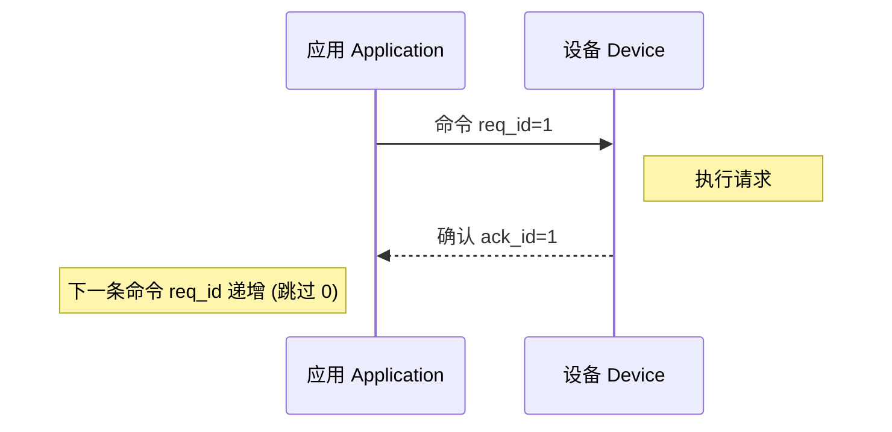

- 应用发出命令后等待确认（若请求了），并用计时器检测超时。应用**不是必须**请求确认——这属于实现质量问题，但确认有助于流控。
- [O-046ca] 请求了确认而在**用户可配置**的超时内没收到时，应用**应该**重发该命令。
- [R-047ca] 重发命令时，应用**必须保持 req_id 字段不变**——设备据此判断该命令是否为重传。
- 达到最大重试次数后，应用向上层软件报错，报错方式属于实现质量。
- [O-048ca] 对于控制通道，应用**应该**为 GVCP 消息提供**用户可编程的超时值**。确认超时**可以**默认 **200 ms**。Pending Timeout 寄存器（0x0958）给出设备自身的最坏情况超时参考。
  - NOTE：规范**不**对默认确认超时值提出要求，认为它与系统相关。
- [O-049ca] 应用**应该**为 GVCP 消息提供**用户可编程的重试次数**，可默认 **3 次**。
- 由于控制通道与消息通道对称，设备引导寄存器为消息通道（若有）提供**传输超时（MCTT）**与**重试次数（MCRC）**寄存器（见 §12）。
- [R-050ca] 应用发出的 GVCP 消息的 **req_id 必须逐条递增**。
  - NOTE：由于存在广播命令，设备**不能假设**其控制通道上的 req_id 每次恰好 +1，可能一次增加不止 1。req_id 的作用本质上是：便于应用把确认与命令对应起来；便于设备判断同一来源应用是否重传了同一命令。
- req_id 的初值未规定，但**不能为 0**；控制通道关闭时可把 req_id 复位到初值。按 §15.1（p.114），req_id 回绕到 0 时必须改为 1。

**图 8-2 请求超时（Figure 8-2, p.63）**——命令丢失，应用超时后以**相同 req_id** 重发：

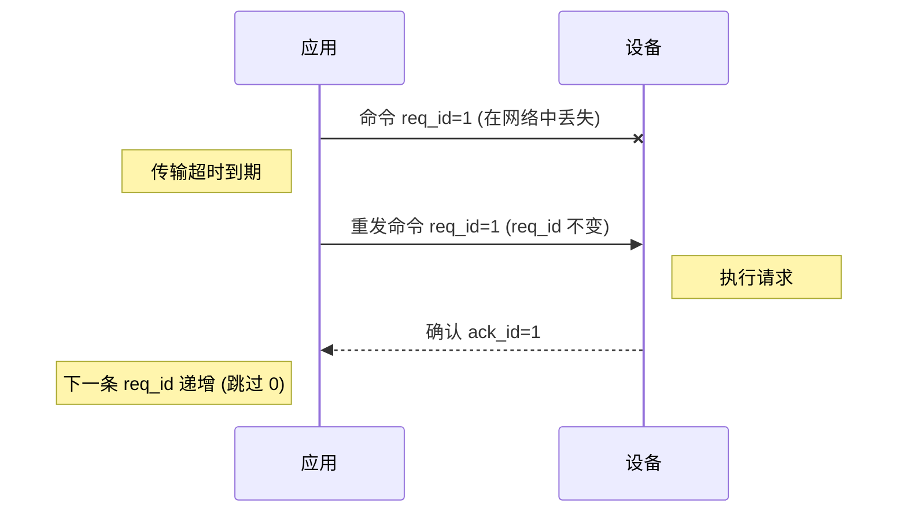

- 设备若收到与**同一应用**上一条命令**相同 req_id** 的命令，便知道同一命令被收到了两次：若执行两次对设备状态没有影响（幂等），允许再执行；否则只执行一次。
- [R-051cd] 若重复执行**会**造成差异，设备**必须**再次返回相应的确认消息，**而不第二次执行**该命令。
- [R-052cd] 只要请求了确认，设备**必须**对收到的**每一条**命令（原始的与重复的）都返回确认。

**图 8-3 确认超时（Figure 8-3, p.64）**——确认丢失，设备识别出重复 req_id，不再执行但重发确认：

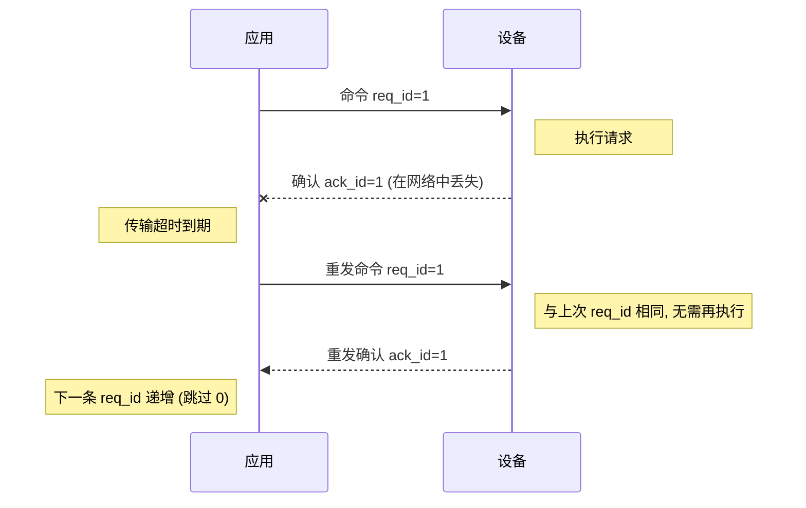

- 以太网 CRC 保证数据完整性，CRC 不符的包被静默丢弃；GVCP **不要求** UDP 校验和，但可以使用。
- GVCP 头中有一个 8 位字段，固定为十六进制键值 **0x42**，用于让设备和应用识别 GVCP 包。
- 超时机制保证了损坏的 GVCP 消息会被重传。
- **当心"魔法师学徒综合征"（Sorcerer's Apprentice Syndrome，见 RFC1123）**：应用收到与**当前 ack_id 不匹配**的确认时，必须**静默丢弃**。

> 💡 解读：若应用把一个迟到的旧 ACK 当成新命令的 ACK 并据此立刻发出下一条命令，就会出现"每个重复 ACK 都触发一次额外发送"的连锁放大，这就是 Sorcerer's Apprentice 问题。正确做法：只接受 `ack_id == 当前未完成命令的 req_id` 的 ACK。

### 8.1.4 流控（§8.1.4, p.64–65）

流控 = 保证设备接收消息时不会溢出其内部通信缓冲区。GVCP 只要求一个简单方案：

- 应用发出一个包后，若请求了确认就**必须等待**确认；在收到第一个确认之前**不允许**发送第二个包，**除非**传输超时到期，或应用没有请求确认。
- 若未请求确认，流控交由实现质量处理：应用无需等待确认，但要自行保证不会让设备溢出。
- 一种可行方式是 **IEEE 802.3 PAUSE** 机制：**Network Interface Capability 寄存器（接口 #0 为 0x0010）** 可查询设备是否支持 PAUSE，**Network Interface Configuration 寄存器（接口 #0 为 0x0014）** 用于使能。
- [CR-053cd] 若设备支持 PAUSE，PAUSE 配置**必须在设备复位后保持**，并可在 Network Interface Configuration 寄存器中看到。

### 8.1.5 端到端连接（§8.1.5, p.65）

- UDP 无连接，本身没有办法确认远端设备仍然在线。GVCP 因此要求设备支持**心跳计数器（heartbeat counter）**：来自主应用的任何有效命令或 GVCP 包都会清零心跳计数器。
- [R-055ca] 若应用没有 GVCP 消息要发送，**必须**确保发送一个"人工"GVCP 消息，以清零设备的心跳计数器。
- **只有主应用**需要发送心跳消息。
- 设备提供 **Heartbeat Timeout** 引导寄存器。建议应用在该心跳超时周期内**发送 3 次**心跳消息，这样即便丢失两个心跳 UDP 包也不会因心跳超时被设备自动关闭连接；可视网络质量调整这些数字。

💡 例：Heartbeat Timeout = 3000 ms（默认）→ 心跳间隔约 1000 ms。

> 📎 §8 中缺失的编号 R-054ca 是已废弃的要求（v1.0 引入、v2.0.03 废弃，附录 A, p.394），见 [deprecated_requirements.md](../reference/deprecated_requirements.md)。

---

## 9 通道概念（§9, p.66–67）

为了处理多条各自承载不同信息的连接，GigE Vision 引入了**通道（channel）**概念：通道是 GigE Vision 实体之间传输信息的**虚拟链路**。共三种：

1. **控制通道（Control channel）**——主应用总是有 1 条控制通道；
2. **流通道（Stream channel）**——0 到 512 条；
3. **消息通道（Message channel）**——0 或 1 条。

- 不同通道可以使用同一个网络接口，此时各自分配不同的 UDP 端口。
- 通道由应用和设备**动态创建**；除了设备控制通道使用的标准 GVCP 端口外，通道可以使用任何可用的 UDP 端口；应用可按需打开或关闭通道（p.67）。

**通道一览**（据 §9–§12 整理）

| 通道 | 数量 | 协议 | 事务发起方 / 数据方向 | 设备侧 UDP 端口 | 应用侧 UDP 端口 | 打开 / 关闭 |
|---|---|---|---|---|---|---|
| 控制通道 | 主控制通道恰好 1 条（[R-057cd]）；次级控制通道 0..N | GVCP | 应用发命令 → 设备回确认 | 3956（或 mDNS 公布的端口） | 应用选定的动态端口，通道生命期内固定 | 写 CCP 获取权限 / 写 CCP=0 |
| 流通道 | 0–512（[R-079s]），索引从 0 起连续 | GVSP（UDP）或 GVRSP（RoCEv2） | 发送端 → 接收端，单向；方向固定不可编程 | GVSP 发送端用动态源端口（可读 SCSPx） | SCPx.host_port | GVSP：写 SCPx.host_port≠0 / 写 0 |
| 消息通道 | 0 或 1（[R-096cd]） | GVCP（头部与控制通道相同） | 设备发 EVENT/EVENTDATA → 应用回确认 | 动态源端口（可读 MCSP） | MCP.host_port | 写 MCP.host_port≠0 / 写 0 |

**图 9-1 基本通道示例（Figure 9-1, p.66）**：设备侧有引导及设备寄存器（Bootstrap and Device Registers）、控制通道（Controllable Device）、流通道 0/1（GVSP Transmitter）、消息通道（Event Generator）；应用侧对应有控制通道（Control Application）、流通道 0/1（GVSP Receiver）、消息通道（Event Receiver）。Command 从应用到设备、Acknowledge 返回；Stream 0/1 从设备到应用；Event 从设备到应用、其 Acknowledge 返回设备。

**图 9-2 高级通道示例（Figure 9-2, p.67）**——一个节点同时扮演"设备"和"应用"：

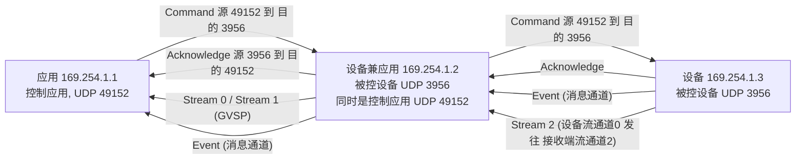

- 169.254.1.2 一方面被 169.254.1.1 控制（它的流通道 0/1 是 GVSP 发送端、消息通道是事件生成器），另一方面它自身又作为控制应用去控制 169.254.1.3，并用自己的**流通道 2（GVSP 接收端）**接收 169.254.1.3 流通道 0 的数据。
- 💡 解读："应用/设备""发送端/接收端"是**角色**而不是硬件类型；一个产品可以同时是被控设备和控制应用（例如视频网关、视频接收显示器）。

---

## 10 控制通道（§10, p.68–80）

应用使用控制通道与设备通信。GVCP 定义两类控制通道（p.68）：

1. **主控制通道（Primary control channel）**：由**主应用**创建。主应用是被允许**写**设备寄存器的那个应用；一个设备**只允许一个**主应用。
2. **次级控制通道（Secondary control channel）**：由任意**次级应用（secondary application）**创建。次级应用只能**读**设备寄存器（不能写），用于监视或调试。设备可以支持多个次级应用，也可以完全不支持。

- NOTE：虽然只支持一个主应用，仍可通过 UDP 广播或多播向/从多个接收方/来源收发图像或数据流；但**所有流都受主应用控制**（PACKETRESEND 请求除外）。
- [R-056cd] IP 配置完成后，设备**必须**应答来自**任何**应用的设备发现请求，即使请求并非来自主应用。
- 控制通道用于从应用向设备发送命令并接收相应的确认（若请求了确认）。
- [R-057cd] 设备**必须**支持**一个**主控制通道；次级控制通道可以不支持，也可以支持任意多个。
- 流通道或消息通道必须在主应用实例化控制通道**之后**才能创建。[R-058ca] 应用**必须**实例化控制通道才能访问设备寄存器。引导寄存器让主应用创建消息/流通道；**若应用没有一条具有 exclusive 或 control（含/不含 switchover）权限的控制通道，就无法实例化消息通道或流通道。**

**控制通道上的包流程**（p.68）：① 应用发送命令包 → ② 设备接收命令包 → ③ 设备执行命令 → ④ 设备发送确认包（若请求）→ ⑤ 应用接收确认包（若请求）。

- [O-059cd] 设备**应该**在命令所要求的**直接动作**执行完毕后**立即**回确认（若请求了确认）。例：应用写某寄存器以启动一次图像采集——设备应在寄存器写入（直接动作）完成时回 ACK，而不是等到图像采集完成（写寄存器的间接后果）。
- [R-060ca] 应用在收到第一个确认之前**不得**发送第二条命令；**唯一例外**是：DISCOVERY_CMD、PACKETRESEND_CMD、传输超时到期后的重发包、或未请求确认的情况。
- 建议设备非常高效地执行所有命令请求并回确认，以便应用发送下一条请求。

### 10.1 控制通道权限（§10.1, p.69–73）

GVCP 定义四级权限：

**① 独占访问（Exclusive access）**（p.69–70）
- 持有者就是该设备的**主应用**，可读可写；**其他任何应用都不能读也不能写**该设备。
- [R-061cd] 设备**必须**支持独占访问。
- [R-062cd] 有应用持有独占访问时，设备**不得**允许次级应用创建次级控制通道。
- 授予条件：当前没有应用以 exclusive 或 control 访问注册时，设备可以授予独占访问；若当前应用持有"带切换的控制访问"，则另一个持有**正确凭据**的应用也可以获得独占访问。
- [R-063cd] 授予独占访问后，设备对**任何其他应用**发来的命令消息**必须**在确认中返回错误 `GEV_STATUS_ACCESS_DENIED`，**例外**是 ACTION_CMD、DISCOVERY_CMD、PACKETRESEND_CMD 和 FORCEIP_CMD；其中 FORCEIP_CMD 必须遵守 [R-150cd]（💡 即：有应用持有 exclusive/control 权限时，FORCEIP_CMD 被**静默丢弃**，§16.2, p.123）。
- 独占访问只提供最低程度的保护（其他应用无法访问设备）。通过**写 CCP 寄存器**获得。设备在 IP 配置成功后必须**随时**应答任何 DISCOVERY_CMD，即使主应用持有独占控制。
- 图 10-1（p.70）：次级应用经控制通道发送"写 CCP 请求控制访问"或任意 GVCP 命令 → 设备检查权限是否可用 → 回带错误的确认 `GEV_STATUS_ACCESS_DENIED`。

**② 控制访问（Control access）**（p.70）
- 持有者是主应用，可读可写；**其他应用可以读**该设备。设备**不要求**支持控制访问。
- [CO-064cd] 设备支持控制访问且某应用持有控制访问时，设备**应该**允许次级应用创建支持 READREG 和 READMEM 的控制通道。
- [CR-065cd] 设备支持控制访问时：没有应用以 exclusive 或 control 访问注册即可授予控制访问；若当前应用持有"带切换的控制访问"，则可以授予持有正确凭据的另一应用。所谓**正确凭据**：请求访问时，该应用写入 CCP 的 `control_switchover_key` 字段等于 **Control Switchover Key** 引导寄存器中的值。否则设备**必须**返回 `GEV_STATUS_ACCESS_DENIED`。
- 通过写 CCP 获得。
- 图 10-2（p.71）：次级应用请求控制访问（或发送它无权执行的命令）→ `GEV_STATUS_ACCESS_DENIED`；次级应用发送它有权执行的命令（读）→ 设备检查该应用权限 → 执行 → 返回带读结果的确认。

**③ 带切换的控制访问（Control access with switchover enabled）**（p.71–72）
- 与控制访问一样：持有者是主应用、可读写、其他应用可读；**此外**该模式允许持有正确凭据的**另一应用接管**设备控制。设备**不要求**支持此模式。
- [CO-066cd] 设备支持该模式且某应用持有该权限时，设备**应该**允许次级应用创建支持 READREG 和 READMEM 的控制通道。
- [CR-067cd] 授予/拒绝规则同 [CR-065cd]（凭据不对**必须**返回 `GEV_STATUS_ACCESS_DENIED`）。
- 通过写 CCP 获得。切换流程详见 [02_advanced_concepts.md §14.4](02_advanced_concepts.md)。

**④ 监视访问（Monitor access）**（p.72）
- 监视访问没有任何特权，是一个**次级应用**；只有在**没有应用持有独占访问**时才能读设备。典型用途是调试，例如 dump 设备寄存器。
- 若可用，次级应用**直接**发送 READREG_CMD 或 READMEM_CMD 即可；**不写 CCP**。
- 设备**不要求**支持监视访问。设备**不需要跟踪次级应用的 req_id**：次级应用的每一条命令（即使是重试）都会被执行。
- 设备**只支持独占访问也是完全合法的**——此时只有主应用能访问该设备。

> ⚠️ 与 Ch16 的关系（实现时以更具体者为准 💡）：§16.3/§16.5 对读命令有更强的表述——"若**没有**应用持有独占访问，设备**必须**应答来自主应用或任何次级应用的 READREG/READMEM"（[R-161cd] p.127、[R-180cd] p.132）；有应用持有独占访问时，次级应用的读请求得到 `GEV_STATUS_ACCESS_DENIED` 且 length=0（[R-162cd]、[R-181cd]）。次级应用的 WRITEREG/WRITEMEM 一律返回 `GEV_STATUS_ACCESS_DENIED`，除非是"设备处于带切换的控制访问、另一应用持正确凭据请求控制"的情形（[R-171cd] p.130、[R-191cd] p.135）；**没有主应用时，设备必须接受任何应用对 CCP 的 WRITEREG**（[R-172cd] p.130）。

**权限能力对照表**（据 §10.1 与 §36.46 整理）

| 权限 | 主应用? | 本应用读 | 本应用写 | 如何获得 | 其他应用能否读 | 其他应用能否接管 | 设备是否必须支持 |
|---|---|---|---|---|---|---|---|
| Exclusive | 是 | ✔ | ✔ | 写 CCP：EA=1 | ✘（ACCESS_DENIED） | ✘ | **必须**（[R-061cd]） |
| Control | 是 | ✔ | ✔ | 写 CCP：CA=1、CSE=0 | ✔（[CO-064cd]） | ✘ | 可选 |
| Control with switchover | 是 | ✔ | ✔ | 写 CCP：CA=1、CSE=1 | ✔（[CO-066cd]） | ✔ 持正确 key（[CR-067cd]） | 可选 |
| Monitor | 否（次级） | ✔ 仅 READREG/READMEM | ✘ | 不写 CCP，直接读 | — | — | 可选；仅当无 Exclusive 时 |

**访问矩阵：设备处于某状态时，"非主应用"发来的请求如何处理**（据 §10.1、§10.5、§10.6 及 §16 整理）

| 设备当前状态 | 次级应用 READREG / READMEM | 次级应用 WRITEREG / WRITEMEM（非 CCP） | 其他应用写 CCP 申请权限 | DISCOVERY_CMD | ACTION_CMD | PACKETRESEND_CMD | FORCEIP_CMD |
|---|---|---|---|---|---|---|---|
| 开放访问 Open access（CCP=0，无主应用） | 应答（[R-161cd]、[R-180cd]） | ACCESS_DENIED（[R-171cd]、[R-191cd]） | 接受（[R-172cd]），按设备支持的模式授予 | 应答（[R-056cd]） | 仅当 unconditional action 已使能且其余条件满足（§14.3） | 处理（若支持） | 处理（[R-150cd]） |
| Exclusive | **ACCESS_DENIED**（[R-063cd]、[R-162cd]、[R-181cd]） | ACCESS_DENIED | ACCESS_DENIED | 应答 | 处理（满足 4 条件时） | 处理 | 静默丢弃（[R-150cd]） |
| Control | 应答（[CO-064cd]、[R-161cd]） | ACCESS_DENIED | ACCESS_DENIED（[CR-065cd]） | 应答 | 处理 | 处理 | 静默丢弃 |
| Control with switchover | 应答（[CO-066cd]、[R-161cd]） | ACCESS_DENIED | key 匹配→授予（发生主应用切换）；否则 ACCESS_DENIED（[CR-067cd]） | 应答 | 处理 | 处理 | 静默丢弃 |

注：主应用**自己**重写 CCP 请求同一权限必须成功（[R-069cd]），也可在三种主应用权限间直接切换（[R-070cd]）。

**CCP 寄存器速查（Control Channel Privilege，0x0A00，R/W，出厂默认 0，§36.46, p.312–314）**

| 位（bit 0 = MSB） | 名称 | 说明 | 掩码（💡 换算） |
|---|---|---|---|
| 0–15 | control_switchover_key | 切换请求携带的 16 位密钥。仅当设备支持主应用切换、此前 CSE（bit 29）已被置位、且本次写来自**另一个**应用时才被考虑；匹配 Control Switchover Key 寄存器才发生切换。**无论是否支持，读出恒为 0** | 0xFFFF0000 |
| 16–19 | connection_count | **（v3.0 新增，可选）**连接所有权标识，由设备管理，写入被忽略；**每次打开控制通道时递增**；首次连接后永不为 0；不支持时读 0 | 0x0000F000 |
| 20–28 | reserved | 读为 0 | — |
| 29 | control_switchover_enable（CSE） | 与 CA 配合使用；写 1 允许另一应用请求 exclusive 或 control（含/不含 switchover）访问；EA=1 时为 don't care；不支持切换时读为 0 | 0x00000004 |
| 30 | control_access（CA） | 写 1 请求控制访问（是否带切换取决于 CSE） | 0x00000002 |
| 31 | exclusive_access（EA） | 写 1 请求独占访问；EA 与 CA 同时置位时 **EA 优先** | 0x00000001 |

**表 36-3 访问模式定义（Table 36-3, p.314）**

| CSE | CA | EA | 访问模式 | 💡 典型写入值 |
|---|---|---|---|---|
| x | 0 | 0 | Open access（开放访问，即释放/无主应用） | 0x00000000 |
| 0 | 1 | 0 | Control access | 0x00000002 |
| 1 | 1 | 0 | Control access with switchover enabled | 0x00000006 |
| x | x | 1 | Exclusive access | 0x00000001 |

💡 例：另一应用持有密钥 K=0x1234、希望通过切换获得独占访问 → 写 CCP = `0x12340001`；读回 CCP 时 key 字段恒为 0，connection_count = `(CCP >> 12) & 0xF`。

**主应用上下文**（p.72）
- [R-068cd] 设备**必须**记住与主应用相关的上下文，至少包括：① 应用的 **IP 地址**；② 应用的**源 UDP 端口**；③ 所授予的**权限**（exclusive、control 或 control with switchover）。设备据此判断能否给其他应用授权、以及收到的命令消息是否有效。
- 设备被发现之后，应用通过打开主控制通道来"接管"设备，保证只有一个应用控制设备。
- NOTE：**主控制通道不是安全机制**，它只保证只有一个应用绑定控制该设备。
- 控制通道在应用侧使用（任意选定的）**动态端口**，在设备侧使用**标准 GVCP 端口**（除非通过 mDNS 公布了其他端口）。应用必须在**通道整个生命期**内使用同一个端口；还必须表明它要独占控制还是允许其他应用监视；若设备支持，还可以允许持有正确凭据的另一应用接管。
- NOTE：开发期使用非独占访问，便于其他调试工具监视设备；在需要冗余与故障恢复的系统中可能需要允许另一应用接管（§14.4）。
- 设备侧使用标准 GVCP 端口使得借助 DISCOVERY 建立连接变得简单；但也可以用 mDNS 公布不同的 GVCP 端口号（p.72–73）。

### 10.2 控制通道寄存器（§10.2, p.73）

| 寄存器 | 地址 | 访问 | 要点（详见 Ch36） |
|---|---|---|---|
| Control Channel Privilege（CCP） | 0x0A00 | R/W | 申请/释放权限、切换密钥、connection_count（§36.46, p.312–314；[R-479cd] 必须实现） |
| Control Switchover Key | 0x095C | W（只写） | 16 位密钥位于 **bits 16–31**（注意与 CCP 中 bits 0–15 不同）；只写以向次级应用隐藏密钥；支持切换时必须实现（[CR-473cd]，§36.37, p.303–304） |
| Heartbeat Timeout | 0x0938 | R/W | 单位 ms；出厂默认 **3000（0x0BB8）**；最小 **500 ms**；精度至少 100 ms（[R-459cd]，§36.30, p.294–295） |
| Pending Timeout | 0x0958 | R | `max_execution_time`（ms）：发 PENDING_ACK 之前的最坏执行时间；不含网络传输时间，不考虑拼接命令（[R-472cd]，§36.36, p.302–303） |

NOTE：上表不是控制通道相关寄存器的全部，只列出本节概念相关的主要寄存器。其他密切相关的有：GVCP Capability（0x0934）、GVCP Configuration（0x0954，bit 31 `heartbeat_disable`）、Primary Application Port（0x0A04）/ Primary Application IP Address（0x0A14）（GVCP Capability bit 4 指示是否支持；无主应用即 CCP=0 时必须为 0，§36.47–36.48）、CCMPS（0x0A24）、Control Channel Test Region Address（0x0A28）。

### 10.3 打开控制通道（§10.3, p.73）

- 应用打开控制通道是为了获得 exclusive 或 control（含/不含 switchover）访问；**监视访问无需打开控制通道**。
- 打开方法：应用把所请求的权限**写入 CCP**，并检查设备确认中返回的状态。成功 → 设备返回 `GEV_STATUS_SUCCESS`，应用获得权限；否则 → 设备返回 `GEV_STATUS_ACCESS_DENIED`。应用由状态码得知是否获得所请求的权限。
- 设备收到写 CCP 的命令时，若应用请求的是 exclusive 或 control（含/不含 switchover）访问，设备尝试**创建通道上下文**：先验证能否给予所需权限，必要时更新上下文。次级应用无需写 CCP，可以直接读设备。
- [R-069cd] 主应用可以在**不关闭控制通道**的情况下**再次请求相同权限**，此时设备**必须**接受并返回 `GEV_STATUS_SUCCESS`。
- [R-070cd] 设备**必须**允许应用在 Exclusive、Control 和 Control with switchover（若支持）之间**直接切换**，无需先断开控制通道。
- 主应用持有"带切换的控制访问"时，持正确凭据的另一应用可以请求并获得设备控制（§14.4）。

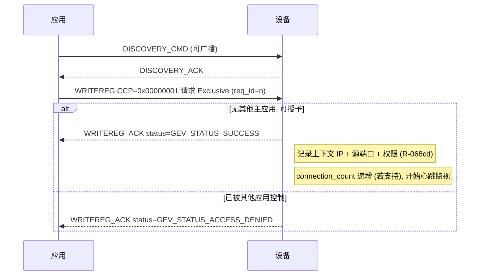

### 10.4 关闭控制通道（§10.4, p.74–75）

- 主应用通过**向 CCP 写 0** 关闭已打开的控制通道。其他应用不能写 CCP，除非主应用持有"带切换的控制访问"——此时若其他应用凭据正确，其 CCP 请求可以被授予；否则得到 `GEV_STATUS_ACCESS_DENIED`。
- [R-071ca] 主应用**必须**向 CCP 写 0 来释放其权限。
- [R-072cd] 主控制通道关闭时，设备**必须**：
  1. **停止设备采集，并中止所有流**——除非已通过 GVSP Stream Channel Configuration 寄存器（SCCFGx）的 unconditional streaming 使能位另行配置；
  2. **复位所有连接状态**（包括消息通道与 GVSP/GVRSP 发送端流通道），至少包括：清除 **Message Channel Port（MCP）** 寄存器及 GVSP 发送端的 **GVSP Stream Channel Port（SCPx）** 寄存器（若适用）；清除 GVRSP 发送端 **RSCCTLx 的 stream_enable 位**并**断开所有已打开的 QP**（若适用）；
  3. **复位 Primary Application Port 和 Primary Application IP Address 寄存器**（若支持）；
  4. 在控制通道关闭后**让自己可被另一连接使用**；
  5. 操作完成后，设备寄存器（包括引导寄存器）**必须**反映新状态。
- NOTE（寄存器一致性，p.74）：关闭主控制通道可能让设备留下一组"不连贯"的寄存器。获取 exclusive/control 访问的主应用**始终**有责任写入一整套完整、一致的寄存器。例：设备默认像素位深 10 bit，第一个主应用改成 8 bit 后关闭通道；第二个应用配置采集时没写像素位深、以为仍是默认值——实际寄存器与预期不符。
- NOTE（GVSP 接收端）：对含 GVSP 接收端的设备，控制通道关闭时是否复位接收端流通道属于实现细节，但**建议保持打开**——简单的接收器产品即便没有主控制通道，也可能希望继续显示收到的视频。
- NOTE（无条件流）：在某些以太网视频分发系统中，希望视频源在主应用崩溃或关闭后仍继续发送。规范允许 GVSP 发送端**独立于控制通道状态**、也独立于设备收到的 ICMP 消息（如目的不可达）继续发送；该特性由配置位使能，见 §11.13。
- NOTE（GVRSP，p.74–75）：对于 GVRSP 传输，若主控制通道关闭，GVRSP 流**必须**停止且所有连接**必须**终止；GVRSP 传输**不允许**设置无条件流位。

Ch36 中与"关闭控制通道"配套的复位要求：
- [CR-570s] 支持 SCCFGx 的 GVSP 发送端，在其控制通道关闭且**既没有无条件流、也没有无条件动作**处于激活状态时，**必须**把 SCCFGx 复位为出厂默认（§36.63, p.333）。
- [CR-571s] 支持 GVCP Configuration 寄存器的 GVSP 发送端/接收端，在同样条件下**必须**把 `heartbeat_disable` 字段复位为出厂默认（§36.35, p.302）。
- GVRSP：若控制通道因心跳超时关闭，流发送端须按规定步骤释放已连接的 QP，并把 RSCCTLx、RSCCKEYx 复位为出厂默认（§31.5.3, p.233）。

### 10.5 控制通道心跳（§10.5, p.75）

由于 UDP 无连接，当通信一方未经正常关闭流程就**突然断开**时，GVCP 必须有恢复机制——这就是**心跳序列**。控制通道上没有其他活动时，应用必须周期性地执行该序列；序列的执行速率可在设备中编程。

- [O-073ca] 应用**应该**提供配置心跳速率的参数。
- [R-074cd] 设备**必须**提供一个引导寄存器来控制心跳超时（Heartbeat Timeout，0x0938）。
- [R-075cd] 来自主应用的**任何有效 GVCP 命令都必须**重置相应设备的心跳计数器，**例外**是 PACKETRESEND_CMD、DISCOVERY_CMD、ACTION_CMD 和 FORCEIP_CMD（FORCEIP_CMD 必须遵守 [R-150cd]）。
  - NOTE：ACTION_CMD 可能来自与控制通道**不同的 UDP 端口**，因此不能重置心跳。
- **推荐应用以读 CCP 寄存器作为重置心跳计数器的方法。**
  - NOTE：心跳计数器**只能由主应用重置**；次级应用的读访问对心跳计数器没有影响。
- [R-076cd] 若设备在超过引导寄存器中用户可编程值（**默认 3 秒**）的时间内没有收到控制消息，并且心跳功能未被禁用（**GVCP Configuration 寄存器 bit 31**），设备**必须**按 §10.4 的方式关闭控制通道。
- 应用若无法读 CCP 或读到意外值，即可判定设备故障。
- **检测失去所有权**：应用读 CCP 时，若发现**访问模式位和/或 connection_count 字段**与它先前建立的状态不再一致，就应认为连接已丢失，并通过重新实例化控制通道与设备建立新连接（p.75）。

**Heartbeat Timeout 寄存器细节**（0x0938，§36.30, p.294–295）：
- 单位 ms，出厂默认 3000（0x0BB8）；内部按心跳所用时钟取整，精度至少 100 ms；**最小值 500 ms**。
- [O-460cd] 小于 500 ms 的值**应该**被设备按 500 ms 处理，并修改寄存器内容以反映实际使用值。
- NOTE：修改心跳超时后，新值生效可能需要最多"**修改前**的超时值"那么长的时间。

**禁用心跳**：仅当 GVCP Capability（0x0934）**bit 2** `heartbeat_disable` 置位时可用——写 GVCP Configuration（0x0954）**bit 31** `heartbeat_disable`=1（出厂默认必须为 0）；通常用于调试（§36.29, §36.35）。注意 [CR-571s] 会在控制通道关闭时把它复位。

**PENDING_ACK 与心跳**：从发出 PENDING_ACK 到发出最终确认之间，设备**暂停**心跳超时计数（[R-212cd]，§16.8, p.143）。

**控制通道生命周期**（💡 据 §10.3–§10.5、§10.7、§14.4 归纳）

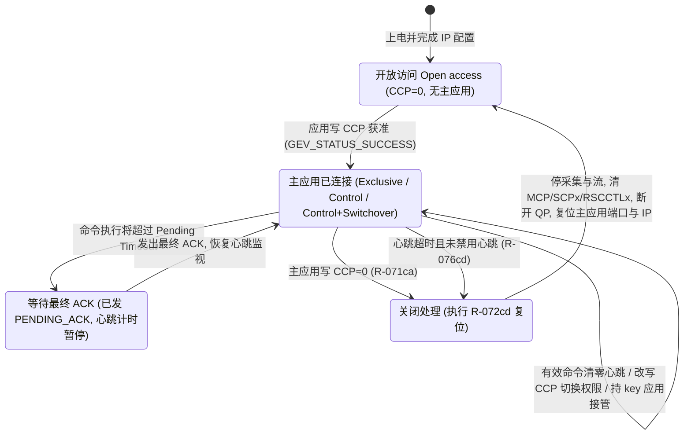

### 10.6 控制设备（§10.6, p.75–77）

- 应用打开主控制通道后，可以发送 GVCP 支持的**任何**命令（见 Control Channel Dictionary 与 Message Channel Dictionary，即 Ch16/Ch17）。
- 次级应用可以发送 READREG 和 READMEM 读取设备状态。
- DISCOVERY 命令可由**任何应用在任何时间**发送并得到设备正确应答；设备完成 IP 配置周期后**必须总是**应答来自任何应用的 DISCOVERY。
- 若设备与应用**不在同一子网**，设备可以**广播** DISCOVERY_ACK；否则可以**单播**回发现请求的来源。
- ACTION 和 PACKETRESEND 命令也可以由任何应用在任何时间发送，并由设备正确处理。
- 次级应用发来的 FORCEIP 命令必须按 [R-150cd] 处理。

**表 10-1 GVCP 命令特性（Table 10-1, p.76–77，仅供参考，以正文要求为准）**

| 命令 | 强制 | 发送方应用类型 | CMD 单播/广播 | ACK 单播/广播 | 重置心跳 | 可产生 PENDING_ACK |
|---|---|---|---|---|---|---|
| DISCOVERY | 是 | 主、次 | 单播或广播 | 单播或广播 | 否 | 否 |
| FORCEIP | 是 | 次 | 广播 | 单播或广播 | 否 | 否 |
| READREG | 是 | 主、次 | 推荐单播，可广播 | 单播 | 是 | 是 |
| WRITEREG | 是 | 主 | 推荐单播，不推荐广播 | 单播 | 是 | 是 |
| READMEM | 是 | 主、次 | 推荐单播，可广播 | 单播 | 是 | 是 |
| WRITEMEM | 是 | 主、次（⚠️ 见下） | 推荐单播，不推荐广播 | 单播 | 是 | 是 |
| PACKETRESEND | 否 | 主、次 | 单播 | N/A——重发的数据走 GVSP 流通道 | 否 | 否 |
| PENDING | 是 | 主、次 | N/A | 单播 | N/A | N/A |
| ACTION | 否 | 主、次 | 单播或广播 | 单播 | 否 | 是 |

- ⚠️ PDF 中 WRITEMEM 的"应用类型"为 "Primary and secondary"（p.77），与 WRITEREG 的 "Primary" 不一致，也与 [R-191cd]（次级应用发 WRITEMEM 必须得到 ACCESS_DENIED）矛盾。💡 应理解为与 WRITEREG 相同：只有主应用（及合法的切换请求）可写。
- "重置心跳"列只对**主应用**发出的命令有意义（次级应用的读不影响心跳）。"PENDING"行指 PENDING_ACK 消息本身（v3.0 起为强制，§16.8, p.142）。各命令的报文格式见 [03_message_formats.md](03_message_formats.md)，命令/确认码值见 [04_command_values_status_events.md](04_command_values_status_events.md)。

### 10.7 PENDING_ACK 的使用（§10.7, p.77–80）

GVCP 通过确认消息在设备与应用之间提供了非常简单的握手，但有时命令执行时间会超出应用的预期，因此需要一种机制来：① 告知执行典型请求的最长时间；② 当请求执行时间将超过该值时通知应用，使其能正确地多等一段时间。

- **v1.0** 没有任何机制让设备告诉应用"执行时间将超过超时"——请求执行过久时，应用很可能认为包丢了并以相同 req_id 重传，导致命令处理低效。
- **v1.1** 引入了特殊确认 **PENDING_ACK**：设备用它告诉应用"当前命令的执行时间将超过 **Pending Timeout** 引导寄存器报告的值"。（**v3.0** 起 PENDING_ACK 成为强制要求，§16.8, p.142。）
- 按 [O-059cd] 快速完成"直接动作"时，不需要发 PENDING_ACK。

**图 10-3 无 PENDING_ACK（Figure 10-3, p.78）**：请求 → 执行 → ACK，应用随后递增 req_id。

**图 10-4 请求重传（Figure 10-4, p.78）**——应用的 ACK 超时先于设备执行完成而到期：

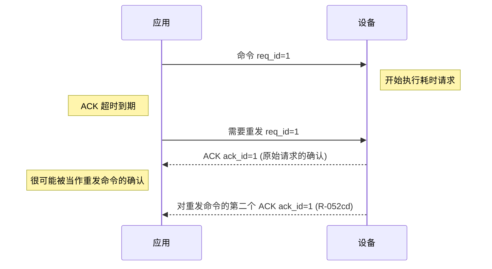

- 这种情况下，初始请求的 ACK 很可能被应用当作重传命令的 ACK。通常设备不会重新执行相同 req_id 的请求；但设备**可能**会第二次执行该耗时命令（见 [R-051cd] 及其前文：仅非幂等命令禁止重复执行），这又可能导致应用的**下一条**请求超时！此外，按 [R-052cd]，设备会返回**两个** ACK：一个对应初始命令，一个对应重传命令。

**图 10-5 设备使用 PENDING_ACK（Figure 10-5, p.79）**——设备用 PENDING_ACK 把应用的 ACK 超时重置为 2000 ms：

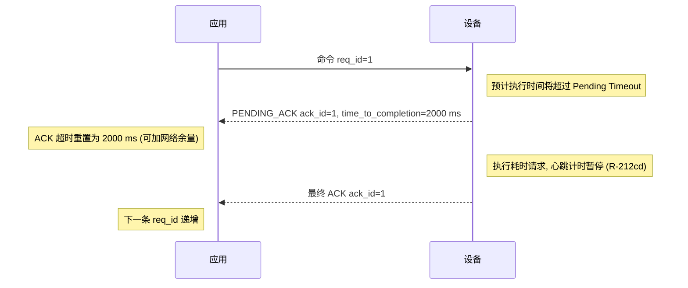

- 应用由此明确知道完成原请求需要多少时间（如果不能接受，应用仍可决定超时放弃）。**PENDING_ACK 的 ack_id 必须与原请求相同**，清楚表明它属于该请求（[R-214cd]，§16.8.1, p.144）。
- 收到 PENDING_ACK 的应用必须等待其指示的超时结束或真正的请求 ACK 到达，**之后**才发送下一条命令。若 PENDING_ACK 丢失，应用的行为与 v1.0 相同。
- **最终 ACK 发出后，设备恢复心跳超时监视。** 若该最终 ACK 丢失，而应用因 PENDING_ACK 延长了 ACK 超时仍在等待，控制通道可能在设备心跳超时到期时被关闭。为降低此风险（p.79）：
  - PENDING_ACK 的 **time_to_completion 不要大于心跳超时的 1/3**；
  - 若需要更长时间，在前一个 PENDING_ACK 的超时到期**之前**再发新的 PENDING_ACK；每个 PENDING_ACK 都会把应用的命令超时重置为 time_to_completion。
  - 这样应用有足够时间在设备心跳周期结束前发现最终 ACK 丢失并重试命令。

**多次 PENDING_ACK 的推荐用法**（💡 以默认心跳超时 3000 ms 为例，time_to_completion ≤ 1000 ms）：

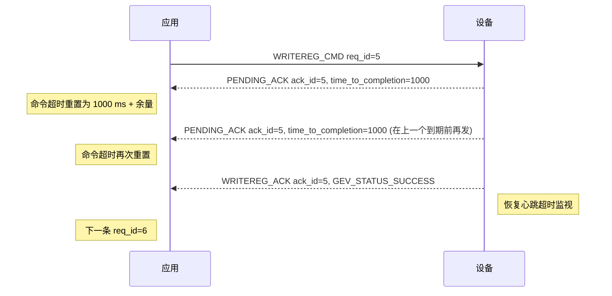

- [R-077cd] 在发出 PENDING_ACK 之后、发送该命令的 ACK 之前，设备**必须**应答 DISCOVERY_CMD。
- [R-078cd] 设备**不得**用 PENDING_ACK 应答 DISCOVERY_CMD。
- 没有这两条要求，网络上的其他应用可能无法正确枚举设备。
- **实现质量问题**（p.80）：在已发 PENDING_ACK、尚未发最终确认期间，设备收到另一条 GVCP 命令（DISCOVERY_CMD 以外）如何处理，由实现决定。可选做法例如：
  - 设备有能力同时处理来自不同应用的请求；
  - 对新请求回 PENDING_ACK，time_to_completion = 前一命令剩余时间 + 新命令所需时间（即使新命令通常不会触发 PENDING_ACK），表示新命令已排队、不应重发；
  - 回 `GEV_STATUS_BUSY`，让应用稍后重发；
  - 也可以简单地把新命令当普通包排队——但由于发出新请求的应用没收到前一命令的 PENDING_ACK，这会增加新命令超时的可能性。
- 若设备对**次级应用**的请求回 PENDING_ACK，则假定系统中的主应用和所有次级应用都支持 PENDING_ACK；主应用如何确认这一点超出规范范围，属系统级考虑。

**§16.8 中与 PENDING_ACK 直接相关的要求**（p.142–144，报文格式见 [03_message_formats.md](03_message_formats.md)）：

| 要求 | 内容 |
|---|---|
| [R-209cd] | DISCOVERY_CMD、FORCEIP_CMD、PACKETRESEND_CMD **不得**发 PENDING_ACK |
| [R-210cd] | 必须在命令执行**超过** Pending Timeout 寄存器值**之前**发出 PENDING_ACK |
| [R-211cd] | PENDING_ACK 进行中设备也**必须**应答 DISCOVERY_CMD |
| [R-212cd] | 发出 PENDING_ACK 后到发出命令 ACK 前，心跳超时计数器**暂停** |
| [R-214cd] | PENDING_ACK 的 ack_id **必须**等于触发它的命令的 req_id |
| [R-215cd] | time_to_completion（16 位，单位 ms，最长约 65 s）表示完成执行所需时间；可无限次再发 PENDING_ACK 继续延长 |

---

## 11 流通道（§11, p.81–88）

流通道使数据能从**发送端（transmitter）**传到**接收端（receiver）**，使用 GigE Vision 流协议 **GVSP**（GigE Vision Streaming Protocol）或 GigE Vision RDMA 流协议 **GVRSP**（GigE Vision RDMA Streaming Protocol）。

- [R-079s] 支持流传输的产品**必须**提供**至少 1 个、至多 512 个**流通道。
  - NOTE：产品不要求支持流传输；不支持时就没有任何流通道。
- [R-080s] 支持流传输的产品**必须**从**索引 0 开始连续**支持流通道，**不允许**在索引中留空洞。
- 流通道可传输本规范定义的任何负载类型，但 **GVRSP 只支持 GenDC 负载类型**。
- 每个流通道要么是发送端（数据源），要么是接收端（数据宿），**不能两者兼是**；即**方向不可编程**，由引导寄存器位（SCPx 的 direction 位）给出。
  - NOTE：为了与旧版本的应用兼容，建议收发一体（transceiver）设备在寄存器映射中把**发送**流通道排在**接收**流通道之前（发送通道使用较低索引）。
- **Number of Stream Channels**（0x0904，取值 0–512）报告设备支持的流通道总数。有多个流通道时，设备不必全部使用；实际使用的通道数及各通道传输的数据类型通过 SFNC 特性公开，超出本规范范围。
- 支持多种流协议的设备，**所有流通道都支持设备支持的所有流协议**；流通道数量**固定**，不随所选流协议或其他配置变化。
- 流通道用 GVCP 配置，且**只有主控制应用**可以配置。许多系统中流接收端就是主应用本身，但规范也允许流接收端是另一个（次级）应用或设备——此时主应用如何把连接信息告知接收端属于实现质量问题。

### 11.1 流通道协议支持（§11.1, p.81–82）

- GigE Vision 1.x 与 2.x 只定义了 **GVSP**（直接运行在 UDP 上）。**GigE Vision 3.0** 新增 **GVRSP**：利用 **RoCEv2** 传输 GenDC 容器，以更高速度更高效、更可靠地传输数据。
- 发送端可实现 GVSP、GVRSP 或两者；支持的协议通过 **Streaming Capability**（0x092C）公布；**同一时刻只有一种协议处于活动状态**，通过 **Streaming Configuration**（0x0960）选择；有多个流通道的设备在**所有**流通道上使用同一种流协议。
- **接收端必须同时支持两种流协议**，以避免不兼容——这保证任何 GEV 3.0 发送端与接收端都能互通。但 GVRSP 依赖兼容的操作系统和网卡；若二者之一不支持 RoCEv2，接收端即使实现了 GVRSP 也无法以 GVRSP 模式工作。运行在这种主机上的接收端若发现**仅支持 GVRSP 的设备**，必须**明确通知用户**该设备因操作系统或硬件限制无法使用（通知形式属于实现质量）。
- [R-615ca] 接收端**必须**支持 GVSP 和 GVRSP；能否以 GVRSP 模式运行可能受主机操作系统和网络接口硬件的限制。

💡 Ch36 补充（§36.27, p.290–291；§36.38, p.304–306）：Streaming Capability **bit 4** `gvsp_mode_not_supported`、**bit 5** `gvrsp_mode_supported`；Streaming Configuration **bits 4–5** `streaming_protocol`（0 = GVSP，1 = GVRSP）。任一 GVSP 流通道打开（SCPx≠0）或任一 GVRSP 流已使能时，写 Streaming Configuration 必须返回 `GEV_STATUS_BUSY`（[R-667cd]）。详见 [设备与网络寄存器](../05_bootstrap_registers/02_device_and_network_registers.md)。

### 11.2 流通道支持的负载类型（§11.2, p.82）

- GVSP 提供多种负载类型（包括 GenDC，见 Part 3 – GVSP）；GVSP 仍是本规范的一部分，因此本规范定义的**所有负载类型都由 GVSP 流通道支持**。众多格式提供了对旧设备、旧协议版本的向后兼容；GenDC 负载类型则提供了"一种负载类型承载多种数据类型"的方法。
- **GVRSP 只支持 GenDC 负载类型**。GenDC 是通用、自描述的容器，能表示现有及未来的数据布局，新增负载格式时无需修改流协议；对原始 2D 图像等简单情况，描述符开销很小，在资源受限的嵌入式设备上也可行。
- 负载类型详情见 [GVSP 负载类型与像素布局](../03_gvsp/02_payload_types_and_pixel_layouts.md)。

### 11.3 GVSP 流通道寄存器（§11.3, p.82–83）

一个 GVSP 流通道可以是发送端或接收端。规范列出的寄存器如下（地址据 §36 寄存器总表 p.259–263；x = 0…511，每个通道间隔 0x40）：

| 寄存器 | 缩写 | 地址 | 适用 | 要点 |
|---|---|---|---|---|
| GVSP Stream Channel Capability | SCCx | 0x0D20 + 0x40·x | 发送端/接收端 | 每通道能力位，如 bit 30 `unconditional_streaming_supported` |
| GVSP Stream Channel Configuration | SCCFGx | 0x0D24 + 0x40·x | 发送端/接收端 | 每通道配置位，如 bit 30 `unconditional_streaming_enable` |
| GVSP Stream Channel Port | SCPx | 0x0D00 + 0x40·x | 发送端/接收端 | bit 0 `direction`（只读：0=发送端，1=接收端）；bits 14–15 `network_interface_index`；bits 16–31 `host_port`（0 = 关闭） |
| GVSP Stream Channel Packet Size | SCPSx | 0x0D04 + 0x40·x | 发送端/接收端 | bit 0 `fire_test_packet`；bit 1 `do_not_fragment`；bits 16–31 `packet_size` |
| GVSP Stream Channel Destination Address | SCDAx | 0x0D18 + 0x40·x | 发送端/接收端 | 目的 IPv4 地址（单播或多播） |
| GVSP Stream Channel Max Packet Count | SCMPCx | 0x0D30 + 0x40·x | 发送端/接收端 | 一个 GVSP 块的最大包数 |
| GVSP Stream Channel Packet Delay | SCPDx | 0x0D08 + 0x40·x | 仅发送端 | 包间延时（时间戳 tick） |
| GVSP Stream Channel Source Port | SCSPx | 0x0D1C + 0x40·x | 仅发送端 | bits 16–31 发送端 UDP 源端口（可选，只读） |
| GVSP Stream Channel Max Block Size | SCMBSx | 0x0D34（High）/ 0x0D38（Low）+ 0x40·x | 仅发送端 | 一个 GVSP 块负载的最大字节数（64 位，分 High/Low 两个寄存器） |

- 原文列表中前 6 项（SCCx、SCCFGx、SCPx、SCPSx、SCDAx、SCMPCx）用于发送端和接收端；随后 3 项（SCPDx、SCSPx、SCMBSx）仅用于发送端（原文第二段编号从 5 重新开始，属排版瑕疵）。
- NOTE：SCPSx 对**发送端**用于**配置**流传输使用的包大小；对**接收端**则用于**报告**接收端支持的**最大**包大小。
- 各字段完整定义见 [通道寄存器](../05_bootstrap_registers/03_channel_registers.md)（§36.57–§36.66）。

### 11.4 标记 GVSP 数据块（§11.4, p.83）

- 对 GVSP 传输，流通道上的数据被划分为**块（block）**。例如 GigE Vision 相机把每幅图像编码为一个数据块，GVSP 接收端用**块 ID（block ID）**识别它。
- GigE Vision 3.0 的 GVSP 包与 **GigE Vision 2.x 兼容**，因此 3.0 发送端可与 2.x 接收端配合使用。
  - NOTE：某些 GigE Vision 2.x 应用可能依据 **Version 寄存器**排除设备：若设备报告"3.0 或更高"，即使支持 GVSP 也可能被拒绝访问。此时 GVSP 发送端可能需要原生支持 GigE Vision 2.x 的固件才能与 2.x 应用互通。
  - **GigE Vision 1.x 接收端与 GVSP 3.0 及更新的发送端不兼容。**
- 💡 背景：附录 D 指出 v3.0 已移除 16 位 Block ID，仅保留 Extended ID（64 位 block_id64）模式（p.416），这正是 1.x 接收端不再兼容的原因。数据块格式见 [GVSP 传输与数据块](../03_gvsp/01_transport_and_data_block.md)。

### 11.5 打开 GVSP 流通道（§11.5, p.83）

- 主应用通过把**主机端口写入 SCPx**、把**目的 IP 地址写入 SCDAx** 来打开 GVSP 流通道；**只有主应用**可以配置流通道。
- [O-086st] GVSP 发送端**应该**使用任意**动态端口号**作为该流通道的 UDP 源端口。IANA 规定动态端口（临时端口）范围为 **49152–65535**。
- [R-087ca] 应用**必须**通过向 SCPx 的 `host_port` 字段写入**非 0 值**来激活 GVSP 流通道；否则通道处于关闭状态。

💡 Ch36 配套要求（§36.57, p.322–324）：[R-561ca] 应用在写 SCDAx、SCCFGx、SCPSx 之前**必须**先把 host_port 置 0（SCPSx 在包大小协商期间除外）——即"先配置、后打开"，保证配置一致；[R-586cd] 常规流进行中设备必须禁止写 SCPx（写 0 关闭除外），否则返回 `GEV_STATUS_BUSY`；GVSP 发送端在流通道打开时必须把块 ID 复位为 1。

### 11.6 GVSP 流通道的运行（§11.6, p.84）

流通道打开后须遵守：
- [CR-089cd] 若设备支持 SCSPx，当 SCPx 非 0 时，SCSPx **必须**返回一个**非 0** 值，即该 GVSP 发送端流通道的 UDP 源端口。SCSPx 在此之前任何时刻非 0 也合法，只要在该控制会话期间**保持不变**。
- [CR-090cd] 若设备支持 SCSPx，当 SCPx 非 0 时，设备**必须静默忽略**来自 SCDAx/SCPx 所列"地址+端口"组合、发往设备 SCSPx 端口的任何 UDP 流量（即 §11.11 的防火墙打洞包）。

### 11.7 GVSP 流的包大小协商（§11.7, p.84–85）

- GVSP 本身不限制包大小，由管理整个系统和 GVSP 发送端的**管理实体（management entity）**协商合适的包大小。一种确定"不导致 IP 分片的最大包长"的方法是发送**流测试包（test packet）**（应用应为测试包设置 do_not_fragment 位）。
- 通过 GVSP 发送端的 **SCPSx** 寄存器实现：**bits 16–31 为包大小，bit 0 表示发射测试包**；**bit 1 必须置位**以表明应用不允许 IP 分片。这些位**一次性同时写入** SCPSx。结果是 GVSP 发送端发送**一个**测试包，其总大小（含 IP 与 UDP 头）等于所请求的最大包大小。
- 💡 掩码换算：fire_test_packet = 0x80000000，do_not_fragment = 0x40000000，packet_size = 低 16 位。例：以 1500 字节发测试包并禁止分片 → 写 `0xC00005DC`。
- **协商流程**：管理实体先写 SCPDx、SCDAx、SCPx 建立流通道，并把 SCPx 的 host_port 设为非 0 打开通道；此时通道即可进行包大小协商。然后可在 SCPSx 上做简单的**迭代二分搜索**（或其他搜索）。对每个待测包大小：
  1. 写入包大小，**不**置位 bit 0（fire_test_packet）；
  2. **回读**取整后的包大小；
  3. 写入取整后的包大小**并置位 bit 0**，请求一个测试包。
  - 为找到搜索上下限，可以写一个很小和一个很大的值（如 0 和 65535）并回读取整后的值。
- 若测试包**没有**到达 GVSP 接收端，管理实体可减小包大小；若到达则可增大，从而收敛到最优值。多数场景下，包越大传输开销越低。
- 协商必须在发出任何"常规"流包**之前**进行。常规流传输指在流通道上发送非测试包；**常规流开始后，在关闭并重新打开流通道之前不能再改包大小**。测试包协商紧接在打开流通道之后进行。注意 **fire_test_packet 位会自动清零**。
- 流通道**关闭**时请求测试包：设备可以忽略，或返回 `GEV_STATUS_INVALID_PARAMETER`。
- NOTE：点对点配置下若管理实体同时是应用和 GVSP 接收端，它很容易判断测试包是否到达；其他情形可能更复杂，如何判断超出规范范围，属于实现质量。
- [R-567s] 通过 SCPSx 的包大小协商**必须**在 GVSP 流通道**打开之后**、**常规流开始之前**进行。
- 常规流进行中请求测试包，设备**应该**返回 `GEV_STATUS_BUSY`。
- [R-093st] 若 GVSP 发送端**不支持** SCPSx 中请求的包大小，在被要求发送测试包时**不得**发送。（NOTE：[R-562st] 同样适用——发送端必须把 packet_size **向下取整**到最近的支持值并更新寄存器；若请求值小于最小支持值则**向上取整**，§36.58, p.326。）
- 管理实体需要找到一个 GVSP 发送端以及发送端与所有接收端之间**所有网络部件**都支持的包大小。
  - NOTE：从发送端到接收端存在多条路由时，这不是找到最大包长的万无一失的方法——不同路由的 MTU 可能不同，无法保证所有数据包都走测试包的那条路由。

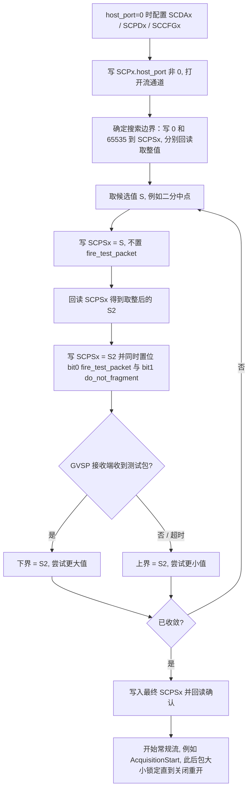

### 11.8 关闭 GVSP 流通道（§11.8, p.85–86）

- [R-091ca] 主应用**必须**通过向 SCPx 写 0 关闭 GVSP 流通道。
- 由于 SCPx 用于打开和关闭 GVSP 流通道，它必须是打开时**最后一个**被访问的流通道寄存器（用于包大小协商的 SCPSx 除外），也是关闭时**第一个**被访问的寄存器。
- GVSP 发送端应在流通道关闭后**尽快**停止发送数据。关闭时最后一个数据块可能没有完整发出，但**每个包都必须完整发送**，由接收端正确处理这种情况。
- [R-092st] GVSP 发送端**不得**发送不完整的流包。
- 在一个完整的块边界上停流的正确方式是使用厂商特定寄存器——例如相机提供 **AcquisitionStart / AcquisitionStop** 特性。
- 若在传输某个 block_id64 的包期间关闭流通道，GVSP 发送端**不必**发送数据尾（data trailer），其行为相当于中止（abort），当前包就是最后发出的包（p.86）。

### 11.9 GVSP 流多播（§11.9, p.86）

- 若数据流需要送到多个地点，GVSP 流通道可以使用**多播**：把 GVSP 发送端的目的 IP 地址（**SCDAx**）设为一个多播组即可激活。
- 多播时，**任何**目的方都可以在控制通道上发送 **PACKETRESEND** 命令。
- NOTE：多播目的地址范围可为 **239.0.0.0–239.255.255.255**（管理范围/本地，Administratively-scoped）以及 **224.0.1.0–238.255.255.255**（全局范围，Globally-scoped）；参见 RFC3171。
- 💡 相关：重发包默认发往 SCDAx（即多播组）；设备可选支持把重发包单播回 PACKETRESEND_CMD 的源 IP（SCCx bit 28 `packet_resend_destination_option` / SCCFGx bit 28 `packet_resend_destination`，§16.7, p.137；§36.62–36.63）。

### 11.10 多网络接口的影响（§11.10, p.86）

- GVSP 允许流通道使用**多个网络接口**来增加流传输可用带宽（多接口设备见第 3 章）。
- 由主应用借助引导寄存器正确管理设备上可用的网络接口（流通道所用接口由 SCPx 的 `network_interface_index` 指定，见 §13.2）。
- 可选的引导寄存器可报告每个网络接口的当前链路速率（Link Speed 寄存器）。

### 11.11 穿越防火墙或 NAT 设备（§11.11, p.86–87）

- GVSP 流量是**单向**的，入站流量无法与任何出站包对应，因此常被防火墙或其他网络设备拦截。为此 **SCSPx** 寄存器把发送端的**远端 UDP 端口**告诉与接收端关联的应用，使其能在接收端与发送端流通道之间制造一个"模拟的双向会话"。否则该端口要等第一个流包到达才知道——而如果流包被拦截，它可能永远不会到达。此信息还可用于其他方式配置软件和/或网络设备。
- 可用 **Streaming Capability 寄存器（0x092C）** 查询设备是否支持 SCSPx（bit 0 `SCSPx_supported`）。
- [CR-094st] 若产品为某一个 GVSP 发送端支持 SCSPx，则**必须**为其所有 GVSP 发送端流通道都支持。
- **建议用法**：通过 SCDAx 和 SCPx 打开图像流**之后**、启动相机图像数据流**之前**查询 SCSPx。也可以更早查询并缓存（仅当其非 0 时），以免每次打开流通道都查询。SCSPx 的正确行为见 [CR-089cd]。
- 接着，应用从它写入 SCPx 的**同一个源端口**向 SCSPx 指定的端口发送一个 UDP 包。包内容被忽略，建议负载小于 GVCP 命令包的最大尺寸。**所有已打开的流通道**都应这样做。
- 然后应用即可继续启动相机采集。视防火墙等配置，应用可以在整个流会话期间**周期性地**发送类似的包；建议间隔 **30 秒**，可配置，不同防火墙可能需要调整。
- [CR-095ca] 应用支持 SCSPx 时，**除非**它已打开该流通道**并且**成功从 SCSPx 读到**非 0 值**，否则**不得**向 SCSPx 指定的端口发包。
- 应用不应期待设备应答它发往 GVSP 发送端流通道的包；该机制只是为了在防火墙上"打开"UDP 端口，具体实现属于实现质量，可能随防火墙类型和操作系统而不同。同样的机制也可用于消息通道（§12.6）。

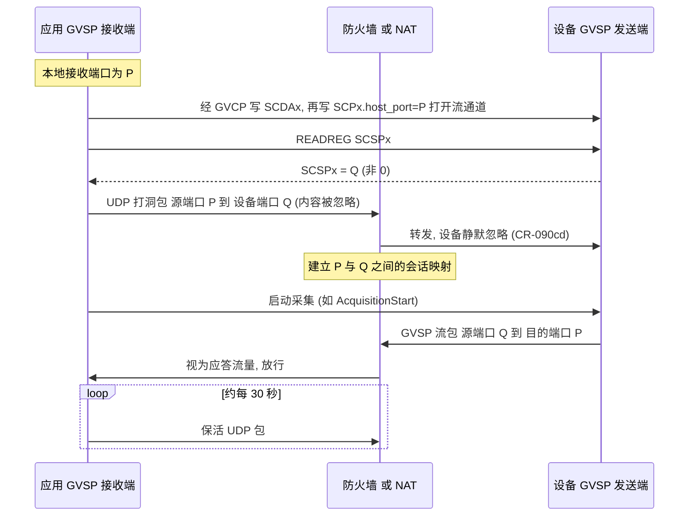

### 11.12 GVRSP 流通道寄存器（§11.12, p.87–88）

- GVRSP 流通道寄存器用前缀区分数据流寄存器与上行通信寄存器：**RSC…**——数据流寄存器；**RSCU…**——上行（upstream）通信寄存器。
- GVRSP 上行通信路径**独立于** GVCP 控制/消息通道：它只在 RoCEv2 队列对（QP，Queue Pair）连接之后才存在，承载 credits（信用）、triggers（触发）等 GVRSP 上行消息。
- **所有 GVRSP 引导寄存器只在 Streaming Configuration 寄存器的 `streaming_protocol` 字段为 1 时可用**；否则应用读写这些寄存器时，设备必须返回 `GEV_STATUS_ACCESS_DENIED` 或 `GEV_STATUS_INVALID_ADDRESS`。

| # | 寄存器 | 缩写 | 地址（相对 SCEBAx，§36 总表 p.261–262） | 访问 |
|---|---|---|---|---|
| 1 | GVRSP Stream Channel Control | RSCCTLx | SCEBAx + 0x30（bit 0 `stream_enable`） | R/W |
| 2 | GVRSP Stream Channel Buffer Layout Table Address | RSCBLTAx | SCEBAx + 0x34 | R |
| 3 | GVRSP Stream Channel Buffer Layout Table Size | RSCBLTSx | SCEBAx + 0x38 | R |
| 4 | GVRSP Stream Channel Credits Counter Maximum Supported Value | RSCCMAXx | SCEBAx + 0x3C | R |
| 5 | GVRSP Stream Channel Credits Counter Current Value | RSCCCNTx | SCEBAx + 0x40 | R |
| 6 | GVRSP Stream Channel Upstream Capability | RSCUCAPx | SCEBAx + 0x44 | R |
| 7 | GVRSP Stream Channel Upstream Maximum Supported Message Size | RSCUMAXx | SCEBAx + 0x48 | R |
| 8 | GVRSP Stream Channel QP Connection Key | RSCCKEYx | SCEBAx + 0x4C | W |

- SCEBAx（Stream Channel Extended Bootstrap Address，0x0D3C + 0x40·x）给出每个流通道扩展引导寄存器块的起始地址。各寄存器的完整定义见 Ch36 与 [GVRSP 连接与流控](../04_gvrsp/02_connection_and_flow_control.md)。

### 11.13 无条件流（Unconditional Streaming）（§11.13, p.88）

- 在许多以太网视频分发系统中（尤其是有多个 GVSP 接收端时），往往**必须**保证 GVSP 发送端不论主应用或网络状态如何都能持续发送。例如：主应用崩溃，或被关闭后迁移到另一台主机，设备仍需持续发流。
- 从 **v1.2** 起，规范允许支持此能力的 GVSP 发送端被配置为**独立于控制通道状态**、也**独立于其设备收到的任何 ICMP 消息**持续发送。
- 配置方法：在 **SCCFGx** 中置位 `unconditional_streaming_enable`（bit 30），前提是相应发送端支持该能力（由 **SCCx** 的 `unconditional_streaming_supported`，bit 30 指示）。此模式下：设备控制通道关闭时发送端**不停流**；设备收到 ICMP 目的不可达消息时也**不停流**。换言之，发送端按主应用的指示一直发送。
- **GVRSP 不支持无条件流**：在 GVRSP 模式下 SCCx 的 `unconditional_streaming_supported` 位**不得**置位。
- [CR-616cd] 若设备**只**支持 GVRSP 流（Streaming Capability 的 `gvsp_mode_not_supported` 与 `gvrsp_mode_supported` 均置位），则**不得**置位 SCCx 的 `unconditional_streaming_supported` 位。
- 💡 注意：控制通道关闭后，无条件流仍在发送，但 [R-072cd] 已清除 SCPx 等状态的要求有"除非配置了无条件流"的例外；同时 [CR-570s] 规定在无条件流激活时**不复位** SCCFGx。

> 📎 Ch11 中缺失的编号（R-081s～CO-085st、R-088st）是已废弃的要求：R-081s、R-082s、CR-083s、CO-084s、CO-085st 于 v3.0 废弃，R-088st 于 v2.1 废弃（附录 A，p.394）。见 [deprecated_requirements.md](../reference/deprecated_requirements.md)。

---

## 12 消息通道（§12, p.89–92）

消息通道让设备向应用发送**异步消息**，例如设备想通知"检测到相机触发"。

- [R-096cd] 设备**必须**提供**一个或零个**消息通道（事件生成器）。
- 消息通道与控制通道非常相似，只是请求方向相反：**总是由设备发起**事务。因此消息通道的头部与控制通道**完全相同**。设备对消息通道的支持是**可选**的。

**消息通道上的包流程**：① 设备发送消息包 → ② 应用接收 → ③ 应用处理消息 → ④ 应用发送确认包（若请求）→ ⑤ 设备接收确认包（若请求）。

- [CR-097cd] 设备支持消息通道时，消息通道上的 **req_id 必须逐条递增**（重传除外）。req_id 回绕到 0 时必须设为 **1**（0 对 req_id 非法），因此 **65535 递增后为 1**。
- 这使应用即使在**未请求确认**时也能检测到 UDP 消息丢失（看 req_id 是否跳号）。
- NOTE：GigE Vision 1.x 应用与当前版本的消息通道不兼容。
- 事件消息（EVENT_CMD/EVENTDATA_CMD）格式见 [03_message_formats.md](03_message_formats.md)，事件码见 [04_command_values_status_events.md](04_command_values_status_events.md)。

### 12.1 消息通道寄存器（§12.1, p.89）

| 寄存器 | 缩写 | 地址 | 访问 | 要点（Ch36） |
|---|---|---|---|---|
| Message Channel Port | MCP | 0x0B00 | R/W | bits 14–15 `network_interface_index`（本版恒为 0，只有接口 #0 支持 GVCP）；bits 16–31 `host_port`（0 = 关闭）（§36.51） |
| Message Channel Destination Address | MCDA | 0x0B10 | R/W | 目的 IPv4，可单播或多播（§36.52） |
| Message Channel Transmission Timeout | MCTT | 0x0B14 | R/W | 等待确认的超时（ms）；**0 = 关闭确认**（§36.53） |
| Message Channel Retry Count | MCRC | 0x0B18 | R/W | 超时后允许的重传次数（§36.54） |
| Message Channel Source Port | MCSP | 0x0B1C | R | 可选；bits 16–31 设备消息通道 UDP 源端口（§36.55） |
| Message Channel Configuration | MCCFG | 0x0B20 | R/W | 可选；bit 0 `MCEC_enable`（允许在一个 EVENTDATA_CMD 中拼接多个事件）（§36.56） |

可选特性是否存在看 **Message Channel Capability**（0x0930）：bit 0 `MCSP_supported`、bit 1 `MCCFG_supported`、bit 2 `MCEC_supported`（§36.28, p.291–292）。

### 12.2 打开消息通道（§12.2, p.90）

- 主应用打开消息通道的步骤：**先把目的 IP 地址写入 MCDA，再把主机端口写入 MCP**。由于需要写权限，**只有主应用**可以打开消息通道。
- [CO-098cd] 设备支持消息通道时，**应该**使用任意动态端口号作为消息通道的 UDP 源端口。
- [CR-099ca] 支持消息通道时，应用**必须**通过向 MCP 的 `host_port` 写**非 0 值**来激活消息通道；否则通道处于关闭状态。
- [CR-100ca] 应用支持消息通道时，若对方请求了确认，应用**必须**以**入站包的 UDP 源端口**作为确认包的 UDP 目的端口来确认消息。

### 12.3 消息通道的运行（§12.3, p.90）

消息通道打开后须遵守：
- [CR-101cd] 支持消息通道时，若超时到期，设备**必须**尝试重发同一消息；重试次数由 **MCRC** 指定。
- [CR-102cd] MCRC 为 0 时，设备**不得**重传消息。
- [CR-103cd] **MCTT 不为 0 时，命令头的 ACKNOWLEDGE 位必须置位**；把 MCTT 设为 0 即**禁用确认生成**，此时设备**必须清除**命令头的 ACKNOWLEDGE 位。
- [CR-104cd] 若设备支持 MCSP，当 MCP 非 0 时，MCSP **必须**返回非 0 值，即消息通道的 UDP 源端口。此前任何时刻非 0 也合法，只要在控制会话期间保持不变。
- [CR-105cd] 若设备支持 MCSP，当 MCSP 非 0 时，对于来自 MCDA/MCP 所列"地址+端口"组合（若消息通道已打开）、发往设备 MCSP 端口的 UDP 流量，若**不是** EVENT_ACK 或 EVENTDATA_ACK，设备**必须静默忽略**。

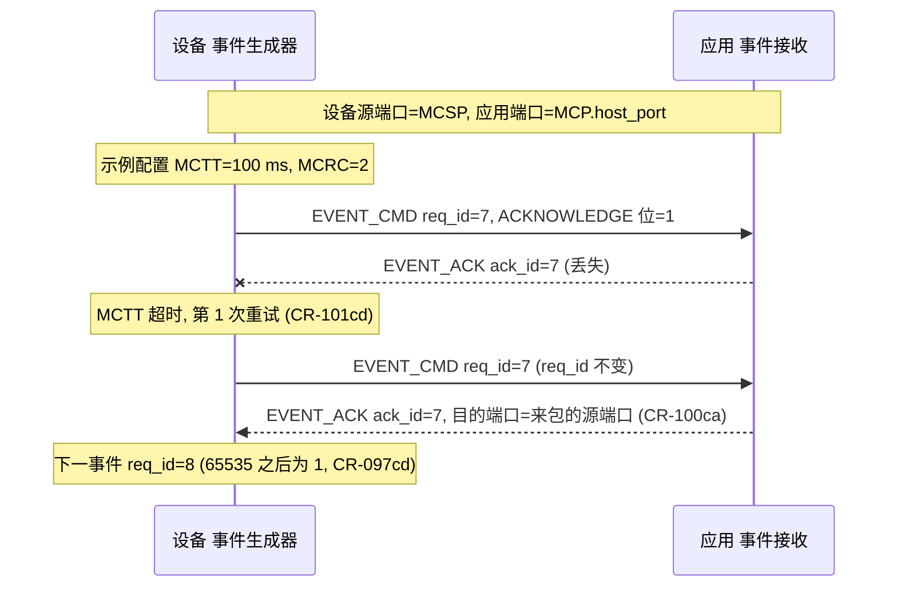

💡 解读：Ch15 规定"消息通道必须以与控制通道等价的方式反应"（p.112），因此应用侧应像设备对待重复命令一样：对重复 req_id 的 EVENT 仍回确认，但避免重复处理事件。

### 12.4 关闭消息通道（§12.4, p.91）

- [CR-106ca] 支持消息通道时，主应用**必须**通过向 **MCP 写 0** 关闭消息通道。
- MCP 用于打开和关闭消息通道，因此它必须是打开时**最后**访问、关闭时**最先**访问的消息通道寄存器。关闭时不允许发送不完整的消息包。
- [CR-107cd] 若设备正在发送一个包时消息通道被关闭，该消息**必须**完整发送。
- [CR-108ca] 若应用在其消息通道关闭状态下收到消息，**必须静默丢弃**。

### 12.5 多播（§12.5, p.91）

- 若事件需要送往多个地点，消息通道可使用多播。
- [CR-109cd] 事件消息多播时**不允许确认包**（设备**必须**清除消息的 acknowledge 位）。
- 把 **MCDA** 设为多播组即可激活多播。**应用在 MCDA 中设置多播地址时，必须同时把 MCTT 设为 0** 以禁用确认生成（见 [CR-103cd]），从而满足上一条要求。
- NOTE：多播地址范围同 §11.9（239.0.0.0–239.255.255.255 管理范围；224.0.1.0–238.255.255.255 全局范围；RFC3171）。

### 12.6 穿越防火墙或 NAT 设备（§12.6, p.91–92）

- 消息通道与流通道面临同样的防火墙问题，也可使用同样的"打洞"机制。
- 可用 **Message Channel Capability 寄存器（0x0930）** 查询设备是否支持 MCSP。
- 建议用法：通过 MCDA 和 MCP 打开消息通道**之后**查询 MCSP；然后应用从它写入 MCP 的**同一源端口**向 MCSP 指定的端口发一个 UDP 包（内容被忽略，建议小于 GVCP 命令包的最大尺寸）。
- 视防火墙配置，可在整个会话期间周期性发送类似的包，建议间隔 **30 秒**，可配置。
- [CR-110ca] 应用支持 MCSP 时，**除非**已打开消息通道**并且**成功从 MCSP 读到**非 0 值**，否则**不得**向 MCSP 指定的端口发包。
- 应用不应期待设备应答这些包；具体实现属于实现质量，可能随防火墙类型和操作系统而不同。

---

## 13 多网络接口设备（§13, p.93）

当设备有不止一个网络接口时，控制、流和消息通道需要额外规则才能正确工作。

### 13.1 对控制通道的影响（§13.1, p.93）

- [R-111c] 控制通道**必须始终在接口 #0 上实例化**；应用**必须**通过该接口获得设备控制权。
- [R-112cd] 有多个接口的设备**不得**应答来自接口 #0 以外接口的 GVCP 请求；此类消息被**静默丢弃**。

### 13.2 对流通道的影响（§13.2, p.93）

- [R-113st] 在某流通道上发送数据时，GVSP 发送端**必须**使用对应 **SCPx** 的 `network_interface_index` 字段所指定的网络接口。
- [CR-114sr] 若 GVSP 接收端是一个**设备**，在某流通道上接收数据时**必须**使用对应 SCPx 的 `network_interface_index` 字段所指定的网络接口。
  - NOTE：不是设备的 GVSP **软件**接收端无需实现引导寄存器。
- [R-115ca] 应用**必须**在**接口 #0** 上发送 PACKETRESEND_CMD，因为只有它支持 GVCP；此时 PACKETRESEND_CMD 的 `stream_channel_index` 字段告诉设备在哪个网络接口上重发包（因为它映射到 SCPx）。

💡 补充（§36.57, p.323）：SCPx 的 `network_interface_index` 取值 0–3；某些流可能被硬连到特定接口，此时该字段只读；链路聚合（link aggregation）配置下设备只呈现单个网络接口。

### 13.3 对消息通道的影响（§13.3, p.93）

- [CR-116c] 若支持，消息通道**必须**在**接口 #0** 上实例化（这也是 MCP 的 `network_interface_index` 在本版恒为 0 的原因）。

---

## 实现要点与易错点

### 设备端

1. **主应用身份 = IP + 源 UDP 端口**（[R-068cd]）。💡 由此推论：同一主机但不同 socket（不同源端口）发来的命令**不是**主应用的命令——写操作应被拒绝、也不重置心跳；这也是 ACTION_CMD 不重置心跳的原因（它可能来自控制通道以外的端口，§10.5 NOTE）。
2. **重复命令检测**：为主应用缓存"最近一次 req_id + 对应 ACK"。收到相同 req_id：幂等命令（如读）可重新执行；非幂等命令（如写"触发/启动"类寄存器、写 FIFO 类存储区等）**只重发缓存的 ACK**（[R-051cd]）；每次都要回 ACK（[R-052cd]）。不要假设 req_id 恰好 +1（广播命令会造成跳号，§8.1.3 NOTE）。次级应用的命令无需跟踪 req_id（§10.1）。
3. **DISCOVERY 永远优先**：完成 IP 配置后对任何应用都要应答，即使处于 Exclusive 或正在执行带 PENDING_ACK 的长命令（[R-056cd]、[R-077cd]）；DISCOVERY/FORCEIP/PACKETRESEND 不得回 PENDING_ACK（[R-078cd]、[R-209cd]）。
4. **PENDING_ACK 时序**：在执行时间**超过** Pending Timeout **之前**发出（[R-210cd]）；ack_id 必须等于原 req_id（[R-214cd]）；time_to_completion 建议 ≤ 心跳超时的 1/3，需要更久就在前一个到期前续发（§10.7）；PENDING 期间暂停心跳计时（[R-212cd]），发完最终 ACK 恢复。
5. **关闭控制通道（写 CCP=0 或心跳超时）要做完整复位**（[R-072cd]）：停采集、中止流（无条件流除外）、清 MCP 与 GVSP 发送端 SCPx、清 RSCCTLx.stream_enable 并断开 QP、清 Primary Application Port/IP；并按 [CR-570s]/[CR-571s] 复位 SCCFGx 与 heartbeat_disable（无条件流/无条件动作激活时除外）。复位完成后寄存器必须反映新状态。GVSP **接收端**通道建议保持打开。
6. **Heartbeat Timeout 寄存器**：小于 500 ms 的写入按 500 ms 处理并回写（[O-460cd]）；新值可能在"旧超时值"之后才生效；heartbeat_disable 只有在能力位支持时才可用，出厂默认 0。
7. **CCP 细节**：key 字段（bits 0–15）读出恒为 0；connection_count（bits 16–19）每次打开控制通道递增、首次连接后永不为 0；EA 与 CA 同时置位时 EA 优先；Control Switchover Key 寄存器中的 key 位于 **bits 16–31**（与 CCP 位置不同）。
8. **包与报文合法性**：首字节不是 0x42 的包按非 GVCP 包静默丢弃（[R-131c]，§15.1）；不要发出超过 CCMPS（默认 576）的 ACK；可以拒绝 IP 分片报文（§8.1.1）。
9. **GVSP 包大小协商**：不支持的值必须取整并更新寄存器、且不发测试包（[R-093st]、[R-562st]）；测试包 IP 头必须置 DF；fire_test_packet 自清零；通道关闭时请求测试包可忽略或返回 INVALID_PARAMETER，常规流进行中返回 BUSY（§11.7）。常规流开始后不得自行改变包大小（[R-490st]）。
10. **SCSPx / MCSP**：在会话期间保持不变（[CR-089cd]、[CR-104cd]）；对应用发来的"打洞包"静默忽略（[CR-090cd]、[CR-105cd]）；支持 SCSPx 就要对**所有** GVSP 发送端通道支持（[CR-094st]）。
11. **多网口**：GVCP（含消息通道）只在接口 #0；其他接口上的 GVCP 请求静默丢弃（[R-112cd]、[CR-116c]）；流通道按 SCPx.network_interface_index 选接口（[R-113st]）。
12. **消息通道**：req_id 65535 → 1（[CR-097cd]）；MCTT=0 时清 ACK 位，多播时必须清 ACK 位（[CR-103cd]、[CR-109cd]）；关闭时在途消息要完整发出（[CR-107cd]）。
13. **GVRSP-only 设备**：不得声明 unconditional_streaming_supported（[CR-616cd]）；GVRSP 寄存器只在 streaming_protocol=1 时可访问，否则返回 ACCESS_DENIED 或 INVALID_ADDRESS（§11.12）。

### 应用端

1. **整个控制会话使用同一个 UDP socket（固定源端口）**（§10.1）；ACK 会回到该端口。若另开 socket 发 ACTION_CMD，记住它不算心跳。
2. **req_id 管理**：非 0、逐条递增、65535 之后回到 1；**重发保持 req_id 不变**（[R-047ca]、[R-050ca]）；只接受 ack_id 等于当前未完成 req_id 的 ACK，其余静默丢弃（Sorcerer's Apprentice，§8.1.3）。
3. **超时/重试可配置**：默认可取 200 ms / 3 次（[O-048ca]、[O-049ca]），并结合 Pending Timeout（0x0958）设置合理的 ACK 超时；收到 PENDING_ACK 时把超时重置为 time_to_completion + 网络余量，可能连续收到多个（[R-215cd]）。
4. **严格停等**：未收到 ACK（或超时）前不发下一条命令（[R-060ca]）；只有 DISCOVERY、PACKETRESEND、重传、或未请求 ACK 的命令例外。
5. **心跳**：控制通道空闲时按"心跳超时 / 3"左右的周期**读 CCP**（§8.1.5、§10.5）；同时检查访问模式位与 connection_count，一旦不符即视为失去所有权并重新连接。调试单步时，可增大 Heartbeat Timeout，或在支持时设置 heartbeat_disable——但它会在控制通道关闭时被复位（[CR-571s]）。
6. **包大小**：任何 GVCP 包不超过 CCMPS（默认 576）；READMEM/WRITEMEM 单次最多 CCMPS − 40 字节且 4 字节对齐（§16.5–16.6）；负载 4 字节整数倍（[R-045c]）。
7. **取得控制后写入完整、一致的配置**，不要依赖上一个应用留下的寄存器值（§10.4 NOTE）；退出时**显式写 CCP=0**（[R-071ca]），不要依赖心跳超时来释放设备。
8. **GVSP 流通道顺序**：host_port=0 时写 SCDAx / SCCFGx / SCPSx 等（[R-561ca]）→ **最后**写 SCPx.host_port≠0 打开 → 包大小协商 → 开始采集；关闭时**先**写 SCPx=0（[R-091ca]、§11.8）。写 SCPSx 后回读确认取整结果。在块边界停流请用 AcquisitionStop 之类的厂商特性。
9. **GVSP/GVRSP**：接收端应用必须两种协议都支持（[R-615ca]）；主机不支持 RoCEv2 而遇到 GVRSP-only 设备时，要明确提示用户。
10. **防火墙打洞**：只在通道已打开且读到非 0 的 SCSPx/MCSP 之后，从**与 host_port 相同的源端口**发包（[CR-095ca]、[CR-110ca]），可约每 30 s 保活一次；不要期待设备回复。
11. **消息通道**：先写 MCDA、再写 MCP 打开；关闭先写 MCP=0；ACK 发往入站包的源端口（[CR-100ca]）；多播 MCDA 时必须把 MCTT 设为 0（§12.5）；通道关闭时收到的消息静默丢弃（[CR-108ca]）；可用 req_id 跳号检测丢失的事件。
12. **多网口设备**：控制与 PACKETRESEND 都走接口 #0（[R-111c]、[R-115ca]）。

---

## 相关章节

- 本部分其他文件：[02_advanced_concepts.md](02_advanced_concepts.md)（XML 获取、IEEE 1588、动作命令、主应用切换）· [03_message_formats.md](03_message_formats.md)（GVCP 头部、所有命令/确认报文格式、PENDING_ACK、EVENT/EVENTDATA）· [04_command_values_status_events.md](04_command_values_status_events.md)（命令码、状态码、事件码、ICMP）
- 设备发现与 IP 配置（DISCOVERY、FORCEIP、mDNS、多接口链路模型）：[../01_device_discovery/device_discovery.md](../01_device_discovery/device_discovery.md)
- GVSP（测试包、数据块、PACKETRESEND 接收端行为）：[../03_gvsp/01_transport_and_data_block.md](../03_gvsp/01_transport_and_data_block.md) · [../03_gvsp/02_payload_types_and_pixel_layouts.md](../03_gvsp/02_payload_types_and_pixel_layouts.md)
- GVRSP（RoCEv2、QP 连接、心跳超时时的 QP 释放）：[../04_gvrsp/01_rocev2_and_streaming_model.md](../04_gvrsp/01_rocev2_and_streaming_model.md) · [../04_gvrsp/02_connection_and_flow_control.md](../04_gvrsp/02_connection_and_flow_control.md)
- 引导寄存器：[../05_bootstrap_registers/01_overview_and_register_map.md](../05_bootstrap_registers/01_overview_and_register_map.md) · [../05_bootstrap_registers/02_device_and_network_registers.md](../05_bootstrap_registers/02_device_and_network_registers.md)（GVCP Capability/Configuration、Heartbeat Timeout、Pending Timeout、Control Switchover Key、Streaming Capability/Configuration）· [../05_bootstrap_registers/03_channel_registers.md](../05_bootstrap_registers/03_channel_registers.md)（CCP、CCMPS、MCP/MCDA/MCTT/MCRC/MCSP/MCCFG、SCPx/SCPSx/SCDAx/SCSPx/SCCx/SCCFGx、GVRSP 寄存器）
- 互操作与测试：[../06_interoperability/interoperability_and_testing.md](../06_interoperability/interoperability_and_testing.md)
- 总体架构与术语：[../00_overview/01_introduction_and_architecture.md](../00_overview/01_introduction_and_architecture.md) · [../00_overview/02_glossary.md](../00_overview/02_glossary.md) · v3.0 变化：[../00_overview/03_version_history_and_v3_changes.md](../00_overview/03_version_history_and_v3_changes.md)
- 全部要求列表：[../reference/requirements_index.md](../reference/requirements_index.md) · 废弃要求：[../reference/deprecated_requirements.md](../reference/deprecated_requirements.md) · 寄存器总表：[../reference/bootstrap_register_map.md](../reference/bootstrap_register_map.md)

---

## 自测题

**1.** 在默认配置下，一个 GVCP 包最大多少字节？这个尺寸包含哪些头？GVCP 负载最多多少字节？

答案

默认 Control Channel Max Packet Size = **576 字节**（[R-044c]），包含 **IP 头（20，不允许选项）+ UDP 头（8）+ GVCP 头（8）+ 负载**，**不含以太网头**。因此最大 GVCP 负载为 576 − 36 = **540 字节**（Table 8-1，p.61），且负载必须是 4 字节整数倍（[R-045c]）。若设备置位 GVCP Capability bit 16 并实现 CCMPS（0x0A24），可使用更大的值（≥ 576，4 字节对齐）。

**2.** 应用发出 WRITEREG（req_id=0x1234，请求确认），200 ms 未收到确认。应用应如何重发？设备若其实已执行过该写操作，收到重发后应怎么做？

答案

应用以**相同 req_id=0x1234** 重发（[O-046ca]、[R-047ca]），直到达到重试上限（默认可取 3 次）后向上层报错。设备发现与该主应用上一条命令 req_id 相同：若重复执行会造成差异，**不再执行**、只**重发确认**（[R-051cd]）；无论如何都要对每个收到的命令回确认（[R-052cd]）。应用只接受 ack_id=0x1234 的确认，其他不匹配的确认静默丢弃（§8.1.3）。

**3.** 哪四种命令即使来自主应用也不会重置心跳计数器？为什么 ACTION_CMD 不能重置心跳？推荐用什么命令做心跳？

答案

PACKETRESEND_CMD、DISCOVERY_CMD、ACTION_CMD、FORCEIP_CMD（[R-075cd]）。ACTION_CMD 可能来自与控制通道**不同的 UDP 端口**，而设备以 IP+源端口识别主应用，故不能用它重置心跳（§10.5 NOTE）。推荐**读 CCP 寄存器**作为心跳（§10.5），顺便检查访问模式位和 connection_count 判断是否失去所有权。

**4.** 要获得"带切换的控制访问"，应向 CCP 写什么值？如何释放控制？另一个应用持密钥 0x00AB 想接管为 Control access，应写什么值？

答案

CCP：CSE=bit 29、CA=bit 30、EA=bit 31（bit 31 为 LSB）。带切换的控制访问 = CSE=1、CA=1、EA=0 → **0x00000006**（💡 换算）。释放：写 **0**（[R-071ca]）。另一应用：key 位于 bits 0–15（高 16 位），Control access 为 CA=1 → **0x00AB0002**；仅当 key 与 Control Switchover Key 寄存器（0x095C，key 位于其 bits 16–31）一致时授权，否则 `GEV_STATUS_ACCESS_DENIED`（[CR-065cd]/[CR-067cd]）。

**5.** 设备当前被某应用以 Exclusive 方式控制。另一个应用分别发送 READREG、DISCOVERY_CMD、FORCEIP_CMD、ACTION_CMD，各得到什么结果？

答案

- READREG：确认中返回 `GEV_STATUS_ACCESS_DENIED`，length=0（[R-063cd]、[R-162cd]）；
- DISCOVERY_CMD：正常应答（[R-056cd]，R-063cd 的例外）；
- FORCEIP_CMD：按 [R-150cd]，有应用持有 exclusive/control 权限时**静默丢弃**；
- ACTION_CMD：不受访问权限限制（R-063cd 例外），满足 §14.3 的 4 个条件则执行并（若请求）回 ACTION_ACK，否则忽略且不回 ACK。

**6.** Heartbeat Timeout 为默认值时，设备发 PENDING_ACK 的 time_to_completion 建议不超过多少？如果命令总共需要 5 秒怎么办？

答案

默认心跳超时 3000 ms → 建议 time_to_completion **≤ 1000 ms**（不超过 1/3，§10.7）。需要 5 秒时，在前一个 PENDING_ACK 的超时到期**之前**续发新的 PENDING_ACK（次数不限，[R-215cd]），每次都会把应用的命令超时重置为 time_to_completion。PENDING 期间设备暂停心跳计时（[R-212cd]），发出最终 ACK 后恢复；若最终 ACK 丢失，应用能在心跳超时前发现并重试。

**7.** 描述 GVSP 包大小协商的寄存器操作顺序与限制。若请求的包大小不被支持会怎样？

答案

先在 host_port=0 时配置 SCDAx、SCPDx 等 → 写 SCPx.host_port≠0 打开通道 → 对每个候选值：写 SCPSx（不置 bit 0）→ 回读取整值 → 写取整值并同时置位 bit 0（fire_test_packet）和 bit 1（do_not_fragment）发出一个测试包 → 根据接收端是否收到调整（二分搜索）。必须在打开之后、常规流之前进行（[R-567s]）；常规流开始后不能改包大小，直到关闭重开；常规流中请求测试包应返回 BUSY；通道关闭时请求可忽略或返回 INVALID_PARAMETER。不支持的值：发送端**不发测试包**（[R-093st]），并向下取整（小于最小值则向上取整）后更新寄存器（[R-562st]）。

**8.** 应用把消息通道的 MCDA 设为 239.1.2.3，为什么必须同时把 MCTT 设为 0？此时设备的事件报文有什么特征？

答案

事件多播时**不允许确认包**，设备必须清除消息的 acknowledge 位（[CR-109cd]）；而 MCTT≠0 时设备必须置位 ACKNOWLEDGE 位（[CR-103cd]），因此应用必须把 MCTT 设为 0 以禁用确认生成（§12.5）。此时 EVENT/EVENTDATA 报文的 flag bit 7（ACKNOWLEDGE）为 0，设备不等待确认、不重传；接收方仍可通过 req_id 是否跳号检测丢失（[CR-097cd]）。

