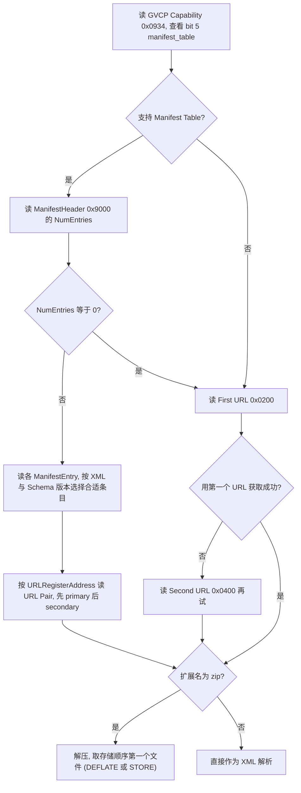
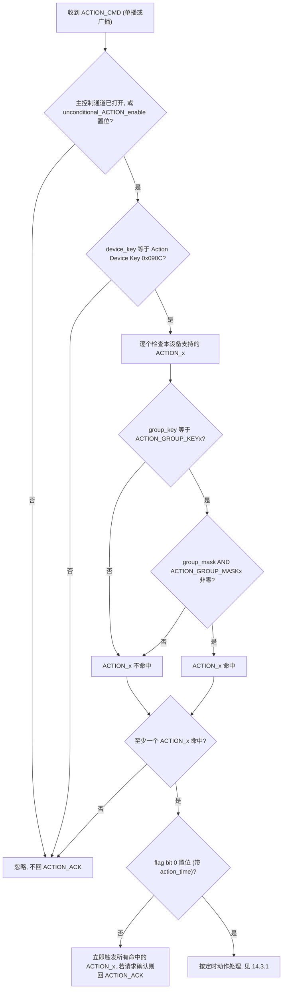
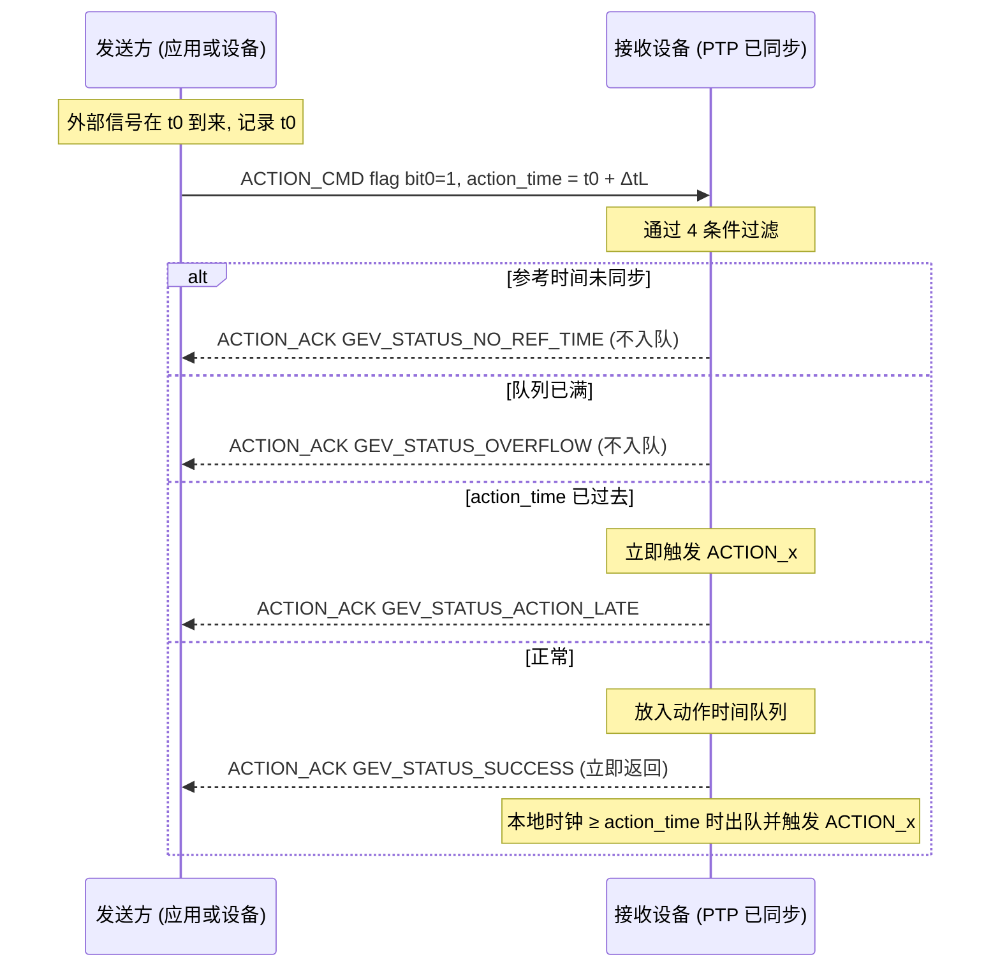
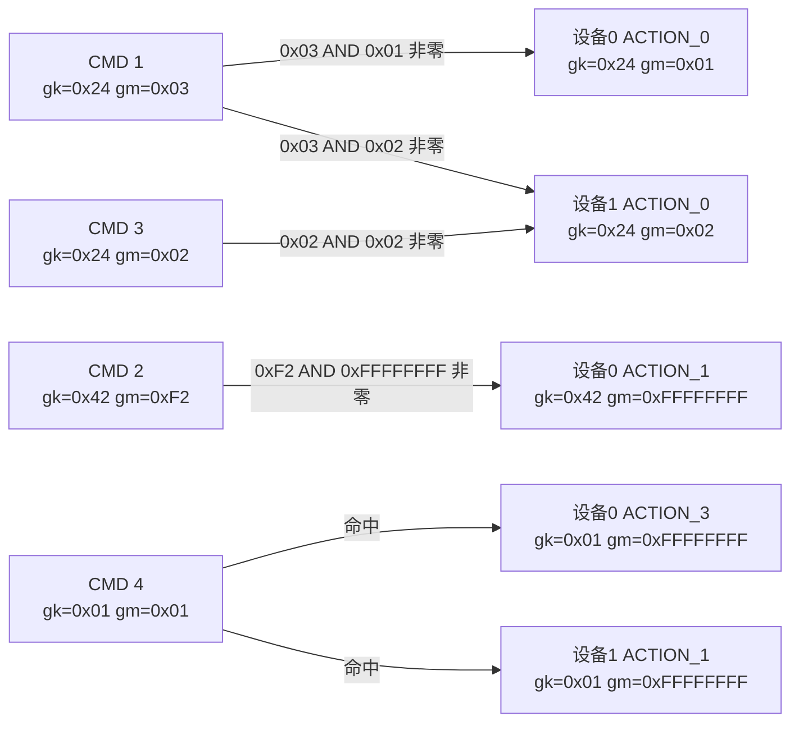
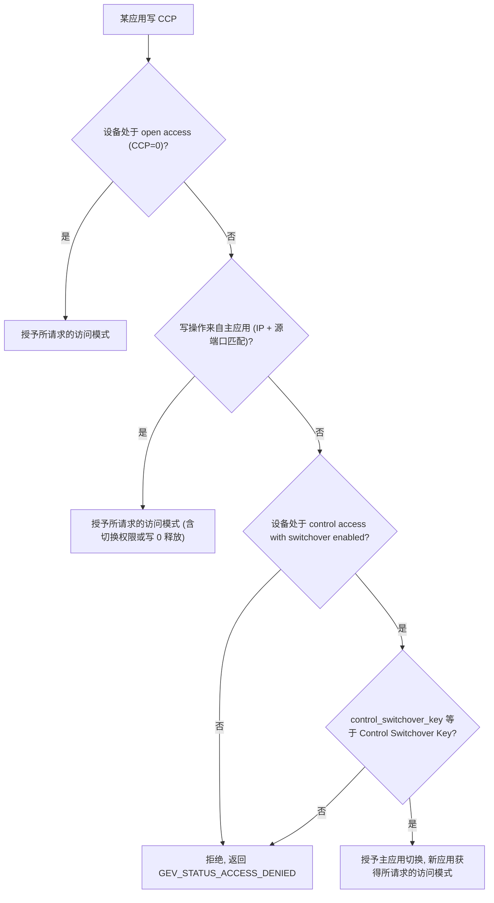
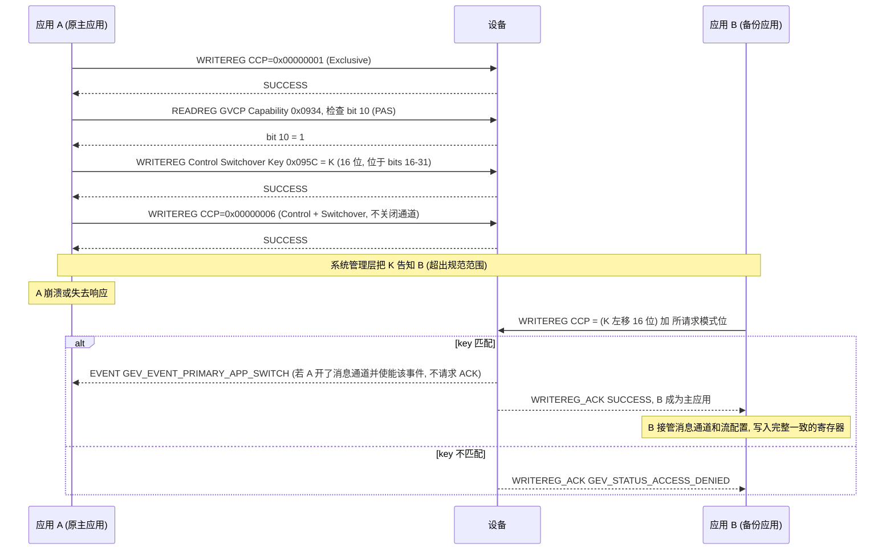

# GVCP 高级概念：XML 描述文件获取、IEEE 1588 同步、动作命令、主应用切换（第 14 章）

> **覆盖范围**：第 14 章 Additional Concepts（§14.1–§14.4.1），PDF p.94–111（印刷页码 = PDF 页码 − 1；本文一律引用 PDF 页码）。为完整起见，引用了 Ch16（ACTION_CMD 报文与迟到处理）、Ch19/20（状态码/事件码）与 Ch36（相关寄存器）中直接相关的内容，均标注出处。
>
> **一句话总结**：设备必须提供 GenICam XML 描述文件，应用优先通过 **Manifest Table**、否则依次通过 **First/Second URL** 按 `local:` / `http://` / `file:` 三种 URL 获取（可 ZIP 压缩）；IEEE 1588 PTP 把设备 64 位时间戳变为 **1 GHz 的全网同步时钟**；**ACTION_CMD** 用 device_key / group_key / group_mask 三重过滤实现多设备"同时"触发，配合 PTP 可做**定时（scheduled）动作**；**主应用切换**通过 "Control access with switchover enabled" 与 16 位密钥实现冗余接管。
>
> **本文目录**：[核心要点](#核心要点) · [§14.1 获取 XML 设备描述文件](#141-获取-xml-设备描述文件141-p9498) · [§14.2 设备同步（IEEE 1588）](#142-设备同步device-synchronization142-p98103) · [§14.3 动作命令](#143-动作命令action-commands143-p103109) · [§14.4 主应用切换](#144-主应用切换primary-application-switchover144-p109111) · [实现要点与易错点](#实现要点与易错点) · [相关章节](#相关章节) · [自测题](#自测题)

> 📌 **位编号约定**：规范采用 MSB-first——32 位寄存器的 bit 0 是最高位、bit 31 是最低位；字节字段（如 GVCP flag）的 bit 0 是该字节最高位（0x80）、bit 7 是最低位（0x01）。多字节字段均为大端。本文中的十六进制掩码为作者换算（💡）。

---

## 核心要点

- 每台 GigE Vision 设备**必须**有符合 GenICam GenApi 语法的 XML 设备描述文件（[R-117cd]）；**文件内容一变，文件名必须变**（[R-532cd]），应用可据文件名判断本地缓存是否过期。
- XML 可**未压缩（.xml）**或 **ZIP 压缩（.zip）**；ZIP 中**按存储顺序的第一个文件**必须是该 XML，只允许 **DEFLATE / STORE** 两种压缩方法；应用必须两种都支持（[R-118ca]、[CR-534cd]），设备应当压缩（[O-533cd]）。
- 位置有三种：设备非易失存储 `local:<filename>.<extension>;<address in hex>;<length in hex>`、厂商网站 `http://...`、应用本机目录 `file:<filename>.<extension>`。
- 无 Manifest Table 时，用 **First URL（0x0200）** 和 **Second URL（0x0400）**（各 512 字节，RFC3986 URI 语法），**先试第一个，失败再试第二个**（[R-121ca]）；有 Manifest Table 时**必须优先用它**（[R-122ca]）。
- 存在设备里的 XML 用 **READMEM** 读取（[O-120ca]），起始地址 **32 位对齐**（[R-119cd]）；过程类似 TFTP：一块一包、逐块确认。
- **IEEE 1588**：支持 PTP 的设备 **Timestamp Tick Frequency 必须固定为 1 GHz**（[CR-123cd]）；时钟受 PTP 驯服时**不能复位时间戳**，写复位返回 `GEV_STATUS_WRITE_PROTECT`（[CR-124cd]）；1588 时间与 GEV 时间戳按 `t_GEV = t_ns + 10^9 × t_s` 互换（[CR-125c]）。
- 支持的 PTP profile：**IEEE 1588-2008 默认 delay request-response profile** 与 **IEEE 802.1AS**，至少支持其一（[CR-126c]）。
- **ACTION_CMD**：由主应用或任何次级应用**单播或广播**；ACTION_ACK **总是单播**；触发 ACTION_x 需满足 **4 个条件**（主控制通道已打开或 unconditional action 已使能、device_key 相等、group_key 相等、group_mask AND 非零）；任一 ACTION_x 都不满足时**忽略且不回 ACK**。
- **Scheduled Action**：带 64 位 action_time，进入时间队列并**立即**回 ACK；队列满 → `GEV_STATUS_OVERFLOW`（[CR-127cd]），无参考时间 → `GEV_STATUS_NO_REF_TIME`（[CR-128cd]），时间已过 → 立即执行并回 `GEV_STATUS_ACTION_LATE`（[CR-221cd]，§16.9）。
- **主应用切换**：主应用以 "Control access with switchover enabled" 连接并设置只写的 **Control Switchover Key（0x095C）**；另一应用写 CCP 时在 `control_switchover_key` 字段带上相同的 16 位密钥即可接管；设备可先向原主应用发送 **GEV_EVENT_PRIMARY_APP_SWITCH** 事件（不请求确认）。

---

## 14.1 获取 XML 设备描述文件（§14.1, p.94–98）

GigE Vision 使用 GenICam™ 标准来公布设备能力。引导寄存器提供了足够信息，让应用建立通信并获取 XML 设备描述文件。

- [R-117cd] GigE Vision 设备**必须**有一个 XML 设备描述文件，其语法遵循 GenICam 标准的 GenApi 模块。
- XML 文件的**实际文件名必须在文件内容改变时随之改变**，这样应用无需下载解析即可判断它与本地缓存的文件是否不同。
  - [R-532cd] XML 设备描述文件的文件名在内容改变时**必须**不同。
  - 这通常发生在发布新固件时；对给定设备，XML 的每个版本都有唯一文件名。
- 对相机设备，其强制特性的名称和类型必须遵守第 37 章的标准特性列表（见 [互操作与测试](../06_interoperability/interoperability_and_testing.md)）。

**压缩**（p.94–95）
- XML 文件可能有几百 KB，因此规范支持文件压缩；**文件扩展名指示设备所用的压缩类型**，由应用在下载后解压。设备只是保存一份 XML 文件副本，无需了解压缩细节（文件可能在存入非易失存储之前就已压缩好）。
- NOTE：ZIP 文件允许包含多个文件，但**必须用 ZIP 中存储的第一个文件**作为设备 XML 描述文件。
- [O-533cd] 设备**应该**对其 XML 描述文件进行压缩（ZIP）——对较大的 XML 尤其重要，可缩短应用的下载时间。
- [CR-534cd] 若设备用 ZIP 文件存放 XML 描述文件，**必须**把它存为 ZIP 中的**第一个文件**（按存储顺序）。
- [R-118ca] 应用**必须**同时支持未压缩与压缩（ZIP）的 XML 文件：
  1. **未压缩（xml）**：文件**必须**以标准 `.XML` 扩展名保存，是未压缩的文本文件。
  2. **压缩（zip）**：文件以标准 `.ZIP` 格式压缩，且**必须**是 ZIP 中第一个文件（按存储顺序）；扩展名**必须**为 `".zip"`；**只允许 ZIP 规范中的 DEFLATE 和 STORE 压缩方法**；由应用在下载后解压。
- 压缩既能减少存储 XML 所需的非易失存储空间，也能缩短下载时间。
- NOTE：ZIP 算法由 Phil Katz 于 1989 年 1 月为 PKZIP 开发；DEFLATE 是结合 LZ77 与 Huffman 编码的无损压缩算法。ZIP 规范可从 PKWARE（APPNOTE.TXT）获得，免费的压缩/解压工具见 info-zip.org。

> ⚠️ 大小写不一致：[R-118ca] 写的是 `.XML` 扩展名与 `".zip"`，而 §14.1.1–14.1.3 的字段表规定 extension **区分大小写**、取值为小写 `xml` / `zip`（p.96–97）。💡 实践中设备使用小写 `.xml` / `.zip` 最稳妥，应用解析扩展名时宜大小写不敏感。

**三个可能的存放位置**（p.95）：① 设备非易失存储；② 厂商网站；③ 应用所在机器上的本地目录。

**URL 寄存器**（p.95）
- 可以用 **Manifest Table**（§14.1.4）指示 XML 位置；**没有 Manifest Table 时**，用两个引导寄存器：
  1. **First URL（地址 0x0200）**
  2. **Second URL（地址 0x0400）**
- 这两个寄存器各保存一个**最长 512 字节**、符合 **RFC3986 URI 语法**的字符串，**各自可用一次 READMEM 读出**。💡 默认 576 字节包下单次 READMEM 最多 536 字节（§16.5, p.132），恰好能一次读完 512 字节。
- 字符串使用 **Device Mode 寄存器**所指示的字符集；即便存在 Manifest Table，设备也**必须**实现 First/Second URL（[R-444cd]、[R-445cd]，§36.15–36.16, p.281–282）。
- [R-119cd] 设备**必须**把 XML 文件的起始地址**对齐到 32 位边界**，以便用 READMEM 读取。

### 14.1.1 设备非易失存储（§14.1.1, p.95–96）

当 URL 形如：

```text
local:<filename>.<extension>;<address in hex>;<length in hex>
```

表示 XML 设备描述文件存放在设备板载非易失存储中（尖括号中的斜体项须替换为实际字符值）。

| 字段 | 含义 | 大小写 |
|---|---|---|
| `local` | 表示 XML 文件位于板载非易失存储 | 不区分 |
| `filename` | 文件名。建议包含厂商、设备、版本信息并以下划线分隔，例如 `acme_titan_rev1` 表示 Acme 公司 Titan 设备的第 1 版。文件名必须唯一，以便应用判断是否需要从设备下载新版本（见 [R-532cd]） | **区分** |
| `extension` | 文件类型：`xml` = 未压缩文本文件；`zip` = ZIP 压缩文件 | **区分** |
| `address` | 文件在设备内存映射中的**起始地址**，必须用十六进制表示 | 不区分 |
| `length` | 文件**长度（字节）**，必须用十六进制表示 | 不区分 |

**示例**：`local:acme_titan_rev1.zip;1C400;A000` 表示 `acme_titan_rev1` 是一个 ZIP 文件，位于设备内存映射地址 **0x1C400**，长度 **0xA000** 字节（💡 = 40960 字节）。保留文件名便于与应用机器上可能已有的本地版本比较。

- 注意分隔符：文件名与扩展名之间是 `.`，扩展名、地址、长度之间是 **`;`**；示例中地址和长度**不带 `0x` 前缀**。💡 稳健的解析器可以容忍 `0x` 前缀或多余空白，但设备应按示例格式输出。
- [O-120ca] XML 文件存放在设备本地时，应用**应该**使用 GVCP 的 **READMEM** 消息读取。
- 由于 READMEM 的读取长度必须是 32 位的整数倍，为满足对齐和长度限制，读请求可能比实际需要多读一点数据。
- READMEM 的工作方式与 **TFTP**（RFC1350）非常相似：文件被分成若干个"一个 GVCP 包大小"的小块，应用每读一块都需要收到 ACK 才发下一块的请求。
- READMEM 是 GVCP 的**强制**命令，因此应用总能用它读取设备本地的 XML 文件。

💡 下载伪代码（据 §14.1.1 与 §16.5 整理）：

```python
# url = "local:acme_titan_rev1.zip;1C400;A000"
scheme, rest = url.split(":", 1)                 # scheme 大小写不敏感
assert scheme.lower() == "local"
name_ext, addr_hex, len_hex = rest.split(";")
filename, ext = name_ext.rsplit(".", 1)          # 文件名、扩展名区分大小写
addr, length = int(addr_hex, 16), int(len_hex, 16)

MAX_CHUNK = ccmps - 40                           # 默认 576 - 40 = 536 字节，且为 4 的倍数
data = bytearray()
offset = 0
while offset < length:
    n = min(MAX_CHUNK, length - offset)
    n = (n + 3) & ~3                             # READMEM 长度必须是 4 的倍数
    data += readmem(addr + offset, n)            # 每块等待 READMEM_ACK（停等）
    offset += n
data = data[:length]                             # 去掉对齐多读的尾部
xml = unzip_first_entry(data) if ext.lower() == "zip" else data
```

### 14.1.2 厂商网站（§14.1.2, p.96–97）

当 URL 形如：

```text
http://www.<manufacturer.com>/<path>/<filename.extension>
```

表示 XML 文件可从互联网上的厂商网站获取。这是可以直接在浏览器中使用的标准 URL。

| 字段 | 含义 | 大小写 |
|---|---|---|
| `http` | 表示文件位于互联网 | 不区分 |
| `www.manufacturer.com` | 厂商网站 | 不区分 |
| `path` | 文件在厂商网站上的位置 | **区分** |
| `filename` | 文件名（同上建议：厂商_设备_版本）；必须唯一，以便应用判断是否需要从厂商网站下载新版本 | **区分** |
| `extension` | `xml` = 未压缩；`zip` = ZIP 压缩 | **区分** |

**示例**：`http://www.acme.com/camera/acme_titan_rev1.xml` 表示 XML 位于 Acme 网站，扩展名 `.xml` 说明是未压缩文本。`.com` 以外的域名（如 `.org`）同样可以。

### 14.1.3 本地目录（§14.1.3, p.97–98）

当 URL 形如：

```text
file:<filename>.<extension>
```

表示 XML 文件位于**运行应用的机器上**。该文件通常随设备附带的光盘提供，用户必须把它放到应用存放设备描述文件的**预定义目录**中；由应用软件负责找到与文件名匹配的文件。

| 字段 | 含义 | 大小写 |
|---|---|---|
| `file` | 表示必须从应用机器上的某个目录获取 XML | 不区分 |
| `filename` | 文件名（同上建议）；必须唯一，以便应用判断是否需要从本地目录取新版本 | **区分** |
| `extension` | `xml` = 未压缩；`zip` = ZIP 压缩 | **区分** |

**示例**：`file:acme_titan_rev1.zip` 表示 XML 必须以文件名 `acme_titan_rev1.zip` 存在于应用的设备描述文件夹中；扩展名为 `.zip`，故为 ZIP 压缩格式。

> ⚠️ 关于 `SchemaVersion`：v3.0 规范的三种 URL 语法中**没有**定义任何 `?SchemaVersion=...` 之类的查询参数（全文检索也只在 Manifest Table 示例中出现 "schema version"）。GenApi schema 版本只通过 **Manifest Table 条目的 SchemaMajorVersion / SchemaMinorVersion 字段**表达（见下节）。💡 若在其他 GenICam 文档或某些实现中见到带 schema 版本参数的 URL，那不是本规范定义的语法，解析时应容忍但不要依赖。

### 14.1.4 清单表（Manifest Table）（§14.1.4, p.98）

- GigE Vision 设备可以支持多个版本的 GenApi schema，从而提供**多个 XML 文件**。
- **Manifest Table（清单表）**寄存器块列出若干条目，每个条目描述一个 XML 文件：XML 文件自身的**版本号**、它所基于的 GenApi **schema 版本号**，以及一对用于命名和定位该文档的 **URL 寄存器（URL Pair）的地址**。
- Manifest Table 只支持 GenICam XML 文件；但 GenICam 文件本身可以提供引用其他文档（如数据手册）的机制。
- [R-121ca] 设备**不支持** Manifest Table 时，应用**必须**退回使用 First URL 和 Second URL 寄存器：**必须先尝试第一个 URL，失败后再尝试第二个 URL**。
- GVCP Capability 寄存器（0x0934）中的能力位 **`manifest_table`（bit 5）** 指示是否支持 Manifest Table。
- [R-122ca] 若设备提供 Manifest Table，应用**必须优先**使用 Manifest Table（而非 First/Second URL）获取 XML 设备描述文件。

**Manifest Table 结构速览**（§36.79, p.347–351，详见 [通道寄存器](../05_bootstrap_registers/03_channel_registers.md)）：

| 项 | 地址 / 位 | 内容 |
|---|---|---|
| 表基址与长度 | 0x9000，512 字节，只读 | 仅当 GVCP Capability bit 5 置位时存在；[O-498cd] 设备应实现；[R-499ca] 应用必须支持 |
| ManifestHeader | 0x9000（8 字节） | bits 0–5 `NumEntries`（N，0 ≤ N ≤ 63）；N=0 时必须改用 First/Second URL |
| ManifestEntry_n | 0x9000 + 8·n（n = 1…63，每项 8 字节） | bits 0–5 XMLMajorVersion；6–11 XMLMinorVersion；12–17 XMLSubMinorVersion；18–23 SchemaMajorVersion；24–29 SchemaMinorVersion；30–31 reserved；**32–63 URLRegisterAddress** |
| URL Pair | 由 URLRegisterAddress 指定，1024 字节 | 字节 0–511 primary_URL，512–1023 secondary_URL；先试 primary、失败再试 secondary |

- 读 8 字节条目时**先读高位部分**（bit 0–31，低地址）再读低位部分（bit 32–63，高地址）。
- URL Pair 必须位于厂商自定义寄存器空间（从 **0xA000** 开始），**唯一例外**是直接指向 First URL 寄存器 0x0200（这使 v1.0 起的 First/Second URL 可被复用）。
- [CR-501cd] 被引用的文档若是 ZIP，必须是 ZIP 中第一个文件；[CR-502cd] 文档内容改变时，版本五元组 {XMLMajor, XMLMinor, XMLSubMinor, SchemaMajor, SchemaMinor} **必须**改变，可用作缓存键。
- 规范给出的最小示例：XML 版本 3.1.0、基于 GenApi schema 1.0 的相机 → `NumEntries=1`，Entry_1 = {3, 1, 0, 1, 0}，`URLRegisterAddress = 0x0200`（p.350）。

**XML 获取决策流程**（💡 据 [R-121ca]、[R-122ca]、§36.79 归纳）



URL 方案的处理：`local:` → READMEM 从设备读取；`http://` → 从厂商网站下载；`file:` → 在应用的设备描述目录中查找同名文件。

---

## 14.2 设备同步（Device Synchronization）（§14.2, p.98–103）

- GigE Vision 1.x 中唯一的时间概念是一个以**设备特定速率**自由运行的计数器，用于给图像和事件打时间戳。单设备时可据此给图像排序；多设备时由于各计数器独立启动、各自晶振的漂移与精度不同，时间戳**无法**用来给多台设备的图像和事件正确排序。
- 为此 **GigE Vision 2.0** 引入了**可选**的时间同步支持：用全网同步的时钟替代 1.x 中未受驯服的自由计数器，基于 **IEEE 1588 精确时间协议（PTP）**系列标准。
- 支持多个不同的 1588 时间同步 **profile**，它们遵循相同的基本原理、略有差异。

### 14.2.1 IEEE 1588 原理（§14.2.1, p.98–99）

- IEEE 1588 定义了一种网络协议，用于在联网的测量与控制系统中精确同步时钟——**PTP（Precision Time Protocol）**。即便各系统本地时钟的精度和稳定度不同，也能对一个**祖主时钟（grandmaster clock）**进行**同频（syntonize）**与**同步（synchronize）**。1588 网络通过**最佳主时钟选择算法（best master clock algorithm）**选出精度最高的时钟作为祖主时钟。
  1. **Syntonize（同频/频率同步）**：把本地时钟的**频率**调到与祖主时钟一致——两台设备上"一秒"的长度相同。
  2. **Synchronize（时间同步）**：把本地时钟的**时刻**设为祖主时钟的时间。
- 适度投入即可达到**亚微秒级**同步精度。
- 基本思想是交换**时间戳报文**：发送方记录精确的发送时刻，接收方记录精确的接收时刻。为精确记录，需要专用硬件在 **MAC-PHY 接口（MII）或 PHY 内部**检查 1588 报文，尽量贴近网络介质记录入口/出口时间。
- 精确测得网络传输时间后，接收方能计算出发送方的准确时间；由时间戳信息计算本地时钟的**漂移（drift）、延迟（delay）和偏移（offset）**，用于同频和同步本地时钟。
- 1588 协议引擎含一个**控制环路**以平滑测量波动。IEEE 1588-2008 profile 还描述了一个可与 GigE Vision 协议并行运行的**管理协议**，用于控制和观察设备的时间同步状态。

### 14.2.2 时间戳同步（§14.2.2, p.99–101）

1588 以这样的方式集成到 GigE Vision：**支持 1588 的设备可以与不支持 1588 的软件应用互操作**。在传统网络中，1588 定义的两种特殊工作模式保证了兼容性：

1. 网络中**没有其他** 1588 设备时，1588 设备**不驯服**其本地时钟——本地时钟的漂移与精度与非 1588 设备相同。
2. 由 1588 设备组成、但**没有**任何可溯源到 UTC 的时间源（如 GPS 接收机）的网络，工作在 **ARB（arbitrary，任意）时标**下：该时标是相对的，只在该网络内有效；最佳主时钟算法会选出稳定度和精度最高的时钟作为祖主时钟。

1588 与 GigE Vision 时间表示的差异，通过把 1588 时间结构转换为与现有 GigE Vision 时间结构兼容的格式来解决。

**把 IEEE 1588 时间映射到 GigE Vision 时间戳计数器**（p.99–101）

- 所有 1588 时间戳都表示为自**纪元（epoch，1970 年 1 月 1 日 00:00:00 TAI）**以来累计的秒和纳秒。
- 1588 定义的 Timestamp 数据结构由两个计数器组成（图 14-1，大端表示，p.100）：

```text
 0 (msb)                                         47   0                          31 (lsb)
+-----------------------------------------------------+------------------------------+
|                 secondsField (48 bit)                |   nanosecondsField (32 bit)  |
+-----------------------------------------------------+------------------------------+
                    IEEE 1588 Timestamp 结构（共 80 bit）
```

| 字段 | 类型 | 含义 |
|---|---|---|
| secondsField | 无符号整数 | 时间戳的整数秒部分；当 nanosecondsField 达到 10⁹ 纳秒时加 1 |
| nanosecondsField | 整数 | 时间戳的小数部分（单位纳秒），总是小于 10⁹ |

- 这个 80 位结构能以纳秒精度保存自 1588 纪元以来的时间，称为 **PTP 时标**；它也可以保存 **ARB 时标**下的时间（此时纪元是任意的，不绑定绝对时间）。
- 与之相对，GigE Vision 的时间概念是一个**按设备特定速率递增的 64 位时间戳计数器**，速率从 **Timestamp Tick Frequency** 引导寄存器读出。为把 1588 时间映射到 GigE Vision 时间戳，有如下限制：
  - [CR-123cd] 若设备支持 IEEE 1588，其 **Timestamp Tick Frequency 寄存器必须固定为 1 000 000 000（即 1 GHz）**。
  - [CR-124cd] 若设备支持 IEEE 1588，在以**受驯服时钟（disciplined clock）**运行时，**Timestamp Control 寄存器的复位功能必须禁用**；应用试图通过写 Timestamp Control 复位时间戳时，设备**必须**返回 `GEV_STATUS_WRITE_PROTECT`。
  - 此时 GigE Vision **Timestamp Value** 引导寄存器的值由 1588 协议控制。由于不可能在多台设备上**同时**触发 GigE Vision 时间戳复位，使用复位功能会破坏时钟同步，因此必须禁用。
- 时间戳分辨率从 1588 的 **80 位无符号值**降为 **64 位有符号整数（二进制补码）**，以适配 GigE Vision 时间戳计数器。NOTE：该 64 位有符号值与 GenICam 的整数定义直接匹配。
- 对**正**的时间戳，63 位幅值（不含符号位）是自纪元（时标原点）以来以纳秒计的连续时间表示。IEEE 1588-2008 **不支持负**时间戳值（NOTE：1588-2002 允许负值，2008 版已删除）。
- 这个 63 位的缩减时标会在某一时刻溢出——规范原文写作 "**Nov 4th, 2262 at 23:47:16 GMT**"。
  > ⚠️ 💡 核算：2⁶³ − 1 ns ≈ 292.3 年，自 1970-01-01 起算溢出于 **2262-04-11 23:47:16**（忽略 TAI 与 UTC 的数十秒差）。规范的 "Nov 4th" 疑为把 "04/11" 的日/月顺序弄反，具体日期以计算为准；年份与时分秒一致。

- [CR-125c] 所有在 IEEE 1588-2008 与 GigE Vision 之间传递时间信息的实现（应用与设备）**必须**按式 14-1 与式 14-2 进行时间格式转换（p.101）：

**式 14-1：IEEE 1588-2008 → GigE Vision**

$$t_{GEV} = t_{nanoseconds} + 10^{9} \times t_{seconds}$$

注：必要时 $t_{GEV}$ 必须**饱和**到 `0x7FFF FFFF FFFF FFFF`。

**式 14-2：GigE Vision → IEEE 1588-2008**

$$t_{nanoseconds} = t_{GEV} \bmod 10^{9}, \qquad t_{seconds} = \left\lfloor \frac{t_{GEV}}{10^{9}} \right\rfloor$$

- NOTE：在 GigE Vision 的语境中，IEEE 1588 使用 **UDP/IPv4** 传输。

纯文本形式（便于不支持公式渲染的查看器）：

```text
1588 → GEV:  t_GEV = t_nanoseconds + 10^9 × t_seconds     （必要时饱和到 0x7FFF FFFF FFFF FFFF）
GEV → 1588:  t_nanoseconds = t_GEV mod 10^9
             t_seconds     = floor(t_GEV / 10^9)
```

💡 换算示例：secondsField = 1 700 000 000，nanosecondsField = 123 456 789 → t_GEV = 1 700 000 000 123 456 789（= `0x17979CFE3D85CD15`）；反向：1 700 000 000 123 456 789 mod 10⁹ = 123 456 789，⌊…/10⁹⌋ = 1 700 000 000。

💡 相关寄存器行为（Ch36）：读取 64 位时间戳须先写 Timestamp Control（0x0944）**bit 30（latch）**锁存，再**先读高位** Timestamp Value High（0x0948）、后读 Low（0x094C）（[CR-466ca]，§36.33, p.298）；Timestamp Control **bit 31（reset）**在 PTP 驯服时钟下不可用。通过 GVCP Configuration（0x0954）**bit 12** `IEEE1588_PTP_enable` 使能/禁用 PTP 时，Timestamp Tick Frequency 与 Timestamp Value 可能改变以反映新的时间域（§36.35, p.301）。即使报告 1 GHz，时间戳也可能跳值（取决于主时钟质量）（§36.33, p.298）。

### 14.2.3 IEEE 1588 配置（§14.2.3, p.101）

- IEEE 1588 定义了许多可在运行时配置的选项来调整系统行为（例如按精度需求调整漂移测量频率）。由于 1588 自带管理协议，**无需**把这些选项暴露为 GigE Vision 引导寄存器。
- **IEEE 1588 Status 寄存器（地址 0x096C）**包含 1588 时钟的状态信息。大多数支持 1588 的嵌入式设备用 LED 显示该信息；GigE Vision 设备不要求有 LED，因此必须在寄存器接口中给出。
  - 💡 据 §36.41（p.308–309）：bits 28–31 `clock_status`，取值必须与 IEEE 1588 PTP **端口状态枚举**一致（INITIALIZING、FAULTY、DISABLED、LISTENING、PRE_MASTER、MASTER、PASSIVE、UNCALIBRATED、SLAVE；具体数值见 IEEE 1588 原文）；该寄存器**不锁存**，与 SFNC 的 PtpStatus 特性不同。支持 1588 时必须实现（[CR-477cd]）。

### 14.2.4 IEEE 1588 Profiles（§14.2.4, p.101–103）

- 本标准支持多个不同的 1588 profile，设备厂商和应用可自行选择支持哪些。
- 1588 标准定义了多种同步机制，使用 1588 的 GigE Vision 设备必须选定一组选项，这就是 **IEEE 1588 profile**。一个 profile 应定义：
  - 配置与节点管理选项；
  - 路径延迟测量选项；
  - 所有可配置属性的范围与默认值；
  - 要求 / 允许 / 禁止的传输机制；
  - 要求 / 允许 / 禁止的选项；
  - 要求 / 允许 / 禁止的节点类型；
  - 一致性验证流程。

**表 14-1 IEEE 1588 Profiles（Table 14-1, p.102）**

| Profile | 说明 |
|---|---|
| IEEE 1588-2008 默认 PTP profile（delay request-response 机制） | 使用 delay request-response 机制的默认 PTP profile。Version 1.0；**Profile identifier: 00-1B-19-00-01-00**。由 IM/ST 委员会 Precise Networked Clock Synchronization 工作组制定，随 IEEE Std 1588-2008 提供（http://standards.ieee.org/） |
| IEEE 802.1AS | 用于在全双工点对点链路上传输定时的 802.1AS PTP profile。Version 1.0；**Profile identifier: 00-80-C2-00-01-00**。定义 1588 在桥接网络上的定时与同步，属于 802.1 系列标准（802.1AS-2011） |

- [CR-126c] 若 GigE Vision 设备或应用支持 IEEE 1588，则**必须**支持表 14-1 定义的 profile 之一。
- 设备用**可选**的 **IEEE 1588 Supported Profiles** 引导寄存器（地址 **0x0978**）列出所支持的 profile。
- 应用可通过**可选**的 **IEEE 1588 Selected Profile** 引导寄存器（地址 **0x097C**）更改当前使用的 profile；设备可以把该设置持久保存在非易失存储中。
- NOTE：GenICam SFNC 的 **PTP Control** 部分定义了用于配置、控制和报告 1588 相关信息的特性。

**IEEE 1588 相关寄存器速查**（据 §36.29–§36.45 整理，详见 [设备与网络寄存器](../05_bootstrap_registers/02_device_and_network_registers.md)）

| 寄存器 / 位 | 地址 | 访问 | 要点 |
|---|---|---|---|
| GVCP Capability bit 12 `IEEE1588_support`（PTP） | 0x0934 | R | 支持 IEEE 1588 PTP |
| GVCP Capability bit 15 `IEEE1588_extended_capabilities`（IEC） | 0x0934 | R | 存在 IEEE 1588 Extended Capability 寄存器 |
| GVCP Configuration bit 12 `IEEE1588_PTP_enable` | 0x0954 | R/W | 使能 PTP 作为时间戳源；出厂默认由设备决定（SFNC PtpEnable） |
| Timestamp Tick Frequency High / Low | 0x093C / 0x0940 | R | 支持 1588 时必须为 1 GHz（[CR-123cd]） |
| Timestamp Control | 0x0944 | W | bit 30 latch、bit 31 reset；PTP 驯服时 reset 返回 WRITE_PROTECT（[CR-124cd]） |
| Timestamp Value High / Low | 0x0948 / 0x094C | R | 锁存值，先读 High |
| IEEE 1588 Status | 0x096C | R | bits 28–31 `clock_status`（[CR-477cd]） |
| IEEE 1588 Extended Capability | 0x0974 | R | bit 0 `profile_reg_presence`：存在 0x0978/0x097C（[CR-558cd]） |
| IEEE 1588 Supported Profiles | 0x0978 | R | bit 0 `default_PTP`；bit 1 `IEEE1588_802_1as`（[CR-559cd]） |
| IEEE 1588 Selected Profile | 0x097C | R/W | bits 27–31 `profile_index` = 所选 profile 在 Supported Profiles 中的位索引（[CR-560cd]） |

---

## 14.3 动作命令（Action Commands）（§14.3, p.103–109）

- 通过**可选**的 **ACTION_CMD** 消息，可以让多台设备"大致同时"触发一个动作。使用专用命令（而不是 WRITEREG_CMD）的好处是**不依赖特定的寄存器映射**，因此可以用同一条消息触发不同类型的设备。
- 由于以太网的特性，它不如硬件触发同步——不同网段的延迟可能不同；但在交换网络中，产生的抖动对很多应用来说可以接受，这是一种用软件命令同步设备的便捷方法。
- ACTION_CMD 可以由**主应用或任何次级应用**以**单播或广播**方式发往设备的 **GVCP 端口**；设备回送的确认（**ACTION_ACK**）**总是单播**。
- 最典型场景：应用想在多台设备上同时触发动作，于是发一个**广播** ACTION_CMD，到达子网内所有设备（图 14-2，p.103：应用 PC 有分别对应设备 0/1/2 的 GVCP 端口，另有一个广播端口向三台设备广播）。
- ACTION_CMD 也可由**次级应用**发出——甚至可以是同一子网上的**另一台设备**（图 14-3，p.104：设备 2 作为次级应用向设备 0、1 广播 ACTION_CMD）。

**动作信号（action signal）**（p.104）
- 设备收到 ACTION_CMD 后解码其中信息，确定请求的是哪个内部**动作信号**。动作信号是设备**内部**信号，可作为设备内部功能单元的触发（如帧触发），并可路由到设备的所有信号接收端（signal sinks）。
- 每条 ACTION_CMD 携带供设备验证请求的信息：
  1. **device_key**：授权在**本设备**上执行动作；
  2. **group_key**：定义一组要执行动作的设备；
  3. **group_mask**：用于从该组中**过滤掉**部分设备。
- 只有设备有一个**已打开的主控制通道**，或**无条件动作（unconditional action）模式已使能**时，才能触发动作信号。

**表 14-2 ACTION 命令的四个条件（Table 14-2, p.104）**——设备触发动作信号 ACTION_x 的条件：

| # | 条件 |
|---|---|
| 1 | 设备有一个已打开的主控制通道，**或**无条件动作模式已使能 |
| 2 | ACTION_CMD 包中的 **device_key** 等于引导寄存器中配置的 **Action Device Key**（地址 0x090C） |
| 3 | ACTION_CMD 包中的 **group_key** 等于 ACTION_x 对应设备动作引导寄存器 **ACTION_GROUP_KEYx** |
| 4 | ACTION_CMD 包中的 **group_mask** 与 ACTION_x 对应的 **ACTION_GROUP_MASKx** 按位**与（AND）**的结果**非零**——即在 32 位寄存器中至少有一个相同位置的位同时为 1 |

- 若至少有一个 ACTION_x 满足全部 4 个条件，设备在内部触发所请求的动作并返回 **ACTION_ACK**。由于可能有多个动作同时满足条件，设备可能**并行**触发多个动作信号。
- 若对于**任何**支持的动作信号，4 个条件中有一个不满足，设备**忽略**该 ACTION_CMD，**连 ACTION_ACK 都不返回**（p.105）。
- 第 1 个条件要求主控制通道已打开，**除非** GVCP Configuration 寄存器（地址 **0x0954**）中的 **unconditional action 位**被置位。置位后，即使主控制通道已关闭，只要其余 3 个条件满足，设备也可以触发所请求的动作。确保设备在主控制通道关闭时仍被正确配置以处理这些动作命令，属于系统的实现质量问题。
- NOTE：GenICam SFNC 的 **Action Control** 部分定义了配置和控制动作命令的特性。

**相关寄存器**（据 §36.24–36.25、§36.29、§36.35、§36.42、§36.80–36.81 整理）

| 寄存器 / 位 | 地址 | 访问 | 要点 |
|---|---|---|---|
| GVCP Capability bit 25 `ACTION` | 0x0934 | R | 支持 ACTION_CMD/ACTION_ACK（应用应先检查，[O-216ca]） |
| GVCP Capability bit 11 `unconditional_ACTION` | 0x0934 | R | 支持无条件 ACTION_CMD |
| GVCP Capability bit 14 `scheduled_action_command` | 0x0934 | R | 支持定时动作命令，且存在队列大小寄存器（[O-217ca]） |
| GVCP Configuration bit 28 `unconditional_ACTION_enable` | 0x0954 | R/W | 使能无条件动作模式，出厂默认**必须为 0** |
| Number of Action Signals | 0x0908 | R | 支持的动作信号数，0–128 |
| Action Device Key | 0x090C | **W（只写）** | 与 device_key 比较。只写是为了在 CCP 非独占模式时**隐藏密钥**，主应用可把密钥告知次级应用，防止"流氓"应用滥用 ACTION_CMD |
| ACTION_GROUP_KEYx | 0x9800 + 0x10·x（x < 128） | R/W | 与 group_key 比较 |
| ACTION_GROUP_MASKx | 0x9804 + 0x10·x（x < 128） | R/W | 与 group_mask 按位与；出厂默认 **0（禁用）** |
| Scheduled Action Command Queue Size | 0x0970 | R | 可同时挂起的定时动作命令数（队列深度） |

**ACTION_CMD 报文要点**（§16.9.1, p.144–146，完整格式见 [03_message_formats.md](03_message_formats.md)）：
- 命令码 ACTION_CMD = **0x0100**，ACTION_ACK = **0x0101**（§18）。负载依次为 device_key（32 位）、group_key（32 位）、group_mask（32 位）、可选 action_time（64 位）。
- flag 字节 **bit 0**（字节最高位，💡 0x80）= "action time available"：0 → 无 action_time，GVCP 包 **20 字节**；1 → 有 64 位 action_time，GVCP 包 **28 字节**。bit 7（0x01）为标准 ACKNOWLEDGE 位。
- group_mask 特殊值：**0x00000000 保留**；**0xFFFFFFFF** 表示"覆盖所有设备中配置的掩码"——任何对该动作配置了非零 ACTION_GROUP_MASKx 的设备都会触发（仍须满足表 14-2 其他条件）。
- [CR-218cd] 支持 ACTION 的设备**必须**处理来自主应用或任何次级应用的 ACTION_CMD；[CR-222cd] 只有在**请求了确认且满足 4 个条件**时才返回 ACTION_ACK。

**ACTION_CMD 过滤逻辑**（💡 据表 14-2 与 §16.9 归纳）



### 14.3.1 定时动作命令（Scheduled Action Commands）（§14.3.1, p.105–106）

定时动作命令用于在**将来某个指定时刻**触发设备中的动作。典型用法如图 14-4（p.105）：

```text
 应用或设备(发送方)                                        设备(接收方)
+---------------------------------------+               +------------------------------------------+
| 外部信号 @ t0 → 捕获信号时刻 t0         |               |  ACTION_CMD 过滤器 → 动作时间队列 → 触发  |
| 最大延迟 ΔtL                           |  action_cmd   |                ↑                          |
| t0 + ΔtL ──────────────────────────────┼──────────────▶|        本地(PTP 同步)时钟                 |
+---------------------------------------+   t0 + ΔtL     +------------------------------------------+
```

- 动作命令的发送方记录源信号（外部信号）被触发的准确时刻 **t0**，加上一个时间增量 **ΔtL** 后，把 `t0 + ΔtL` 放入 ACTION_CMD 发给接收方。**ΔtL 必须大于** ACTION_CMD 在网络中可能的**最长传输与处理延迟**。
- 若报文通过接收方的动作命令过滤器，动作信号被放入一个**时间队列**（队列深度见 **Scheduled Action Command Queue Size** 寄存器），设备**立即**回 ACTION_ACK——不等待动作执行（执行可能要很久，而应用正在控制通道上等待确认）。
- [CR-127cd] 若设备支持定时动作命令，当队列**已满**又收到新的 ACTION_CMD 时，设备**必须**返回带 **`GEV_STATUS_OVERFLOW`** 的 ACTION_ACK，且**不得**把该请求入队。
- [CR-128cd] 若设备支持定时动作命令，当参考时间**未同步**到任何主时钟时，设备**必须**返回带 **`GEV_STATUS_NO_REF_TIME`** 的 ACTION_ACK，且**不得**入队。
- 当本地时钟时间**大于或等于**队列中某个动作信号的时间时，该信号出队并被触发。
- 结合 IEEE 1588 的亚微秒级时间戳精度，定时动作命令可实现**低抖动的软件触发**。
- 若动作命令的发送方无法在报文中填入将来时间，可通过 flag 字段的 **bit 0** 退回**传统模式（legacy mode）**：此时信号在报文通过动作命令过滤器的那一刻被触发。

**迟到处理**（§16.9.1, p.146）：
- [CR-220cd] 带 action time 的 ACTION_CMD 必须排队，在设备时间戳等于指定时间时执行。
- [CR-221cd] 若 action_time **已经过去**（相对设备时间戳）且是有效的动作命令：设备**必须立即执行**（不入队），若请求了确认则返回 **`GEV_STATUS_ACTION_LATE`**；设备**应该**在消息通道已打开且该事件已使能时发送 **GEV_EVENT_ACTION_LATE** 事件。
- [CR-223cd] 对定时动作命令，ACTION_ACK **必须**在命令入队后**立即**发送——避免无限期阻塞控制通道。

| 情形 | 设备行为 | ACTION_ACK 状态码（值，§19, p.157–159） |
|---|---|---|
| 正常入队 | 入队，到时触发 | `GEV_STATUS_SUCCESS`（0x0000） |
| 队列已满 | 不入队 | `GEV_STATUS_OVERFLOW`（0x8015） |
| 参考时间未同步 | 不入队 | `GEV_STATUS_NO_REF_TIME`（0x8013） |
| action_time 已过 | 立即执行，不入队；可发事件 GEV_EVENT_ACTION_LATE（0x0009） | `GEV_STATUS_ACTION_LATE`（0x8016） |
| 4 个条件不满足 | 忽略 | 不回 ACK |

💡 注：规范未规定 NO_REF_TIME / OVERFLOW / LATE 的检查先后顺序；按 [CR-222cd]，所有 ACTION_ACK 都只在请求了确认时发送。



### 14.3.2 ACTION_CMD 示例（§14.3.2, p.106–109）

图 14-5（p.107）给出 4 个 ACTION_CMD 请求（由主应用或次级应用发出）与两台设备的配置。必须针对**每个**支持的动作信号检查表 14-2 的 4 个条件（假设两台设备都满足条件 1：主控制通道已打开或无条件动作已使能）。

**设备配置（图 14-5）**

| 设备 | DEVICE KEY | 动作信号 | ACTION_GROUP_KEYx | ACTION_GROUP_MASKx |
|---|---|---|---|---|
| 设备 0（支持 4 个动作信号） | 0x34638452 | ACTION_0 | 0x00000024 | 0x00000001 |
| | | ACTION_1 | 0x00000042 | 0xFFFFFFFF |
| | | ACTION_2 | 0x12341244（⚠️ 图中写作 0x12431244） | 0x00000000 |
| | | ACTION_3 | 0x00000001 | 0xFFFFFFFF |
| 设备 1（支持 2 个动作信号） | 0x34638452 | ACTION_0 | 0x00000024 | 0x00000002 |
| | | ACTION_1 | 0x00000001 | 0xFFFFFFFF |

**四个请求**（所有请求的 device_key 都是 0x34638452，与两台设备的 Action Device Key 相同，条件 2 均满足）

| 请求 | group_key | group_mask |
|---|---|---|
| ACTION_CMD #1 | 0x00000024 | 0x00000003 |
| ACTION_CMD #2 | 0x00000042 | 0x000000F2 |
| ACTION_CMD #3 | 0x00000024 | 0x00000002 |
| ACTION_CMD #4 | 0x00000001 | 0x00000001 |

**请求 #1（group_key=0x24，group_mask=0x03）**

| 动作信号 | group_key 相等? | group_mask AND | 结果 |
|---|---|---|---|
| 设备 0 ACTION_0 | ✔（0x24） | 0x03 & 0x01 = **0x01** ≠ 0 | ✅ 触发 |
| 设备 0 ACTION_1 | ✘（0x42） | — | 不触发 |
| 设备 0 ACTION_2 | ✘（0x12341244） | 0x03 & 0x00 = 0 | 不触发 |
| 设备 1 ACTION_0 | ✔（0x24） | 0x03 & 0x02 = **0x02** ≠ 0 | ✅ 触发 |

→ 设备 0 只对 ACTION_0 满足 4 个条件，立即回 ACTION_ACK（原文写作 "GEV_STATUS_OK"，💡 即 `GEV_STATUS_SUCCESS`）并触发内部 ACTION_0；设备 1 的掩码虽不同，但按位与仍非零，同样触发 ACTION_0 并回确认。

**请求 #2（group_key=0x42，group_mask=0xF2）**

| 动作信号 | group_key 相等? | group_mask AND | 结果 |
|---|---|---|---|
| 设备 0 ACTION_0 | ✘（0x24） | — | 不触发 |
| 设备 0 ACTION_1 | ✔（0x42） | 0xF2 & 0xFFFFFFFF = **0xF2** ≠ 0 | ✅ 触发 |
| 设备 0 ACTION_2 | ✘ | — | 不触发 |
| 设备 1 ACTION_0 | ✘（0x24） | — | 不触发 |

→ 设备 0 触发 ACTION_1；设备 1 的 group_key 条件不满足，**不触发任何信号，也不回确认**。

**请求 #3（group_key=0x24，group_mask=0x02）**

| 动作信号 | group_key 相等? | group_mask AND | 结果 |
|---|---|---|---|
| 设备 0 ACTION_0 | ✔（0x24） | 0x02 & 0x01 = **0** | 不触发 |
| 设备 0 ACTION_1 | ✘（0x42） | — | 不触发 |
| 设备 0 ACTION_2 | ✘ | — | 不触发 |
| 设备 1 ACTION_0 | ✔（0x24） | 0x02 & 0x02 = **0x02** ≠ 0 | ✅ 触发 |

→ 设备 0 的 ACTION_0~ACTION_2 都不满足（group_key 或 group_mask 不匹配），**忽略请求**；设备 1 满足 4 个条件，触发 ACTION_0。

**请求 #4（group_key=0x01，group_mask=0x01）——同一功能、不同动作编号**（p.109）

ACTION_CMD 足够灵活，可以"同时"触发**功能上不同**的设备中的**同一功能动作**。假设设备 0 的软件触发只能关联到它的 ACTION_3，而设备 1 的软件触发只能关联到它的 ACTION_1——只要各自的 group key 与 mask 满足表 14-2，同一条 ACTION_CMD 即可触发两者。

| 动作信号 | group_key 相等? | group_mask AND | 结果 |
|---|---|---|---|
| 设备 0 ACTION_3 | ✔（0x01） | 0x01 & 0xFFFFFFFF = **0x01** | ✅ 触发 |
| 设备 1 ACTION_1 | ✔（0x01） | 0x01 & 0xFFFFFFFF = **0x01** | ✅ 触发 |

→ 设备 0 触发 ACTION_3、设备 1 触发 ACTION_1，两台设备的软件触发被"同时"触发，尽管它们关联的动作编号不同。原文表格未列出设备 0 的 ACTION_3 与设备 1 的 ACTION_1；💡 它们的 group_key 为 0x01，与 #1~#3 的请求都不相等，不影响这三个示例的结果。



> 💡 设计提示：把 **group_key** 理解为"哪一组设备/哪一类动作"，把 **group_mask** 的每一位理解为"组内的一个子集"。例如一条产线上 8 台相机都配 group_key=0x24、各自 mask 设一个不同的位（0x01、0x02、0x04…），则发 group_mask=0x03 只触发前两台、发 0xFF 触发全部。mask 为 0 的动作信号永远不会被触发（出厂默认即为 0，相当于禁用）。

---

## 14.4 主应用切换（Primary Application Switchover）（§14.4, p.109–111）

- 在需要**冗余与故障恢复**的系统中，常常需要第二个应用接管一台已被主应用控制的设备——例如主应用（或其一部分）失去响应或崩溃、必须快速恢复设备时；也可能由更高层的系统管理实体决定让另一个应用接管。
- **何时**接管、**如何**通知另一应用去接管，**不在**本规范范围内，属于更高层的系统集成考虑，由系统架构师定义各应用间的通信机制及切换时机。关键在于本规范**使切换成为可能**。

**机制**（p.109–110）
- 主应用切换依靠 **"Control access with switchover enabled"** 访问模式：主应用以该模式连接设备，就允许持有**正确凭据**的另一应用接管控制——即另一应用需要知道授权切换所需的**密钥**。
- 密钥保存在**只写**的 **Control Switchover Key** 寄存器（0x095C）中（只写是为了向次级应用隐藏密钥；主应用或更高层系统管理实体把密钥发给可能请求控制的应用，§36.37, p.303）。
- 设备授予"带切换的控制访问"后，另一应用可通过**写 CCP 寄存器**请求控制。CCP 中有一个字段（`control_switchover_key`，bits 0–15）让该应用提供一个 **16 位**数值用于切换认证；若与 Control Switchover Key 寄存器的值匹配，切换即被授予。
- 该认证只提供**最低限度的保护**，防止其他应用**误操作**接管设备（并非安全机制）。

**切换通知事件**（p.110）
- 为了让原主应用知道发生了切换，设备可**选择性地**配置为发送 **GEV_EVENT_PRIMARY_APP_SWITCH** 事件（事件码 **0x0007**，§20, p.160），使原主应用知道自己已失去控制。此时设备**在授予新主应用访问权之前**发送该事件。
- 前提：原主应用已实例化**消息通道**并使能了 GEV_EVENT_PRIMARY_APP_SWITCH 事件。
- 发送该事件的设备**不应请求确认**——因为当原主应用确认该报文时，消息通道可能已归新主应用控制。
- 注意：主应用切换**不会关闭消息通道**，由新主应用负责管理它。

**设备对写 CCP 的处理（据规范伪代码意译，p.110）**

```text
当某应用写 CCP 时：
    若设备当前为 "open access"（无主应用）     → 授予所请求的访问模式
    否则若该写操作来自当前主应用               → 授予所请求的访问模式
    否则若设备处于 control access with switchover enabled：
        若 control_switchover_key 字段 == Control Switchover Key 寄存器值
                                               → 授予主应用切换，新应用获得所请求的访问模式
        否则                                   → 拒绝
    否则                                       → 拒绝
```



💡 解读：
- "所请求的访问模式"可以是 exclusive、control 或 control with switchover（CCP 中 CSE 位的说明：允许另一应用请求 "exclusive or control access (without or with switchover enabled)"，§36.46, p.313）。新主应用若请求 Exclusive，此后就不再允许任何切换。
- 拒绝时返回 `GEV_STATUS_ACCESS_DENIED`（[CR-065cd]、[CR-067cd]，见 [01_transport_and_channels.md §10.1](01_transport_and_channels.md)）。
- 切换后设备记录的主应用上下文（IP、源端口、权限，[R-068cd]）换成新应用；原主应用再写寄存器会得到 ACCESS_DENIED，读 CCP 时可从访问模式位或 connection_count 的变化发现失去所有权（§10.5）。

### 14.4.1 主应用切换设置示例（§14.4.1, p.110–111）

本节给出在设备上设置主应用切换的指导步骤，假设开始时设备未被任何应用控制：

1. 主应用请求并获得**独占访问**（Exclusive）。
2. 主应用查看 **GVCP Capability 寄存器 bit 10**（`primary_application_switchover`，💡 掩码 0x00200000），确认设备支持主应用切换。
3. 主应用配置 **Control Switchover Key** 寄存器。
4. 主应用请求并获得**带切换的控制访问**（Control access with switchover enabled）——注意这一步**无需关闭控制通道**（参见 [R-070cd]）。
5. 设备现已准备好主应用切换：持有正确凭据（即知道密钥）的另一应用可以请求并获得设备控制。

- 这只是最佳实践指导，也可以采用不同步骤，并不意图覆盖所有场景。例如若已知设备支持该功能，可以不查 GVCP Capability 寄存器（p.111）。

💡 为什么先拿 Exclusive 再配置密钥？（作者解读）在 Exclusive 期间其他应用无法读写设备，主应用可以从容地写入只写的 Control Switchover Key，再切换到 "control with switchover"，避免出现"已开放切换但密钥尚未设置（出厂默认 0）"的窗口。



---

## 实现要点与易错点

### 设备端

1. **XML 文件名随内容变化**（[R-532cd]），例如在文件名中带固件/XML 版本号；ZIP 时 XML 必须是**存储顺序第一个**文件，且只用 DEFLATE/STORE（[CR-534cd]、[R-118ca]）。
2. `local:` URL 中的地址、长度用十六进制、不带 `0x`；XML 起始地址 **32 位对齐**（[R-119cd]）；即便提供 Manifest Table，First/Second URL 也必须有效（[R-444cd]、[R-445cd]）；Manifest 条目的版本五元组在内容改变时必须改变（[CR-502cd]）。
3. **PTP**：支持 1588 则 Tick Frequency 固定 1 GHz（[CR-123cd]）；驯服时钟下拒绝时间戳复位并返回 `GEV_STATUS_WRITE_PROTECT`（[CR-124cd]）；时间换算严格按式 14-1/14-2，溢出时饱和到 0x7FFF FFFF FFFF FFFF（[CR-125c]）；IEEE 1588 Status 寄存器反映端口状态。
4. **ACTION_CMD**：任一 ACTION_x 都不满足 4 条件时**完全静默**（不回 ACK）；条件 1 要看主控制通道是否打开或 unconditional_ACTION_enable（出厂默认 0）；Action Device Key 只写；ACTION_ACK 总是单播；ACTION_CMD 不重置心跳（[R-075cd]）。
5. **定时动作**：入队后**立即**回 ACK（[CR-223cd]）；队列满 → OVERFLOW、未同步 → NO_REF_TIME，均不入队（[CR-127cd]、[CR-128cd]）；时间已过 → 立即执行并回 ACTION_LATE（[CR-221cd]），可发 GEV_EVENT_ACTION_LATE。
6. **主应用切换**：key 只在"此前 CSE 已置位 + 写来自另一应用"时比较；CCP 中 key 读回恒为 0；切换事件在授予新主应用**之前**发出且**不请求确认**；切换**不关闭**消息通道。

### 应用端

1. **XML 来源选择**：有 Manifest Table 就必须优先用（[R-122ca]）；否则先 First URL、失败再 Second URL（[R-121ca]）；必须同时支持 .xml 与 .zip（[R-118ca]）。以文件名（或 Manifest 版本五元组）作缓存键，避免每次连接都下载。
2. **READMEM 分块读取**：单块 ≤ CCMPS − 40 字节（默认 536）且长度、地址 4 字节对齐；最后一块可能多读几个字节，按 URL 中的 length 截断；停等式逐块确认（类似 TFTP）。
3. **URL 解析**：scheme（local/http/file）大小写不敏感，文件名与扩展名区分大小写；`local:` 用 `;` 分隔地址与长度。注意 v3.0 没有 SchemaVersion 之类的 URL 参数。
4. **时间戳**：读 64 位时间戳前先 latch，再先读 High 后读 Low；PTP 使能/禁用后重新读取 Tick Frequency；不要在 PTP 模式下尝试复位时间戳。
5. **ACTION_CMD**：先查 GVCP Capability bit 25（ACTION）、bit 14（定时动作）（[O-216ca]、[O-217ca]）；广播时可能收到多台设备的 ACK，也可能某些设备按规定静默——**不要把"没收到 ACK"一律当成丢包而重发**：已执行的设备可能因此再次触发（💡 设备只对来自同一应用的重复 req_id 去重，[R-051cd]；而 ACTION_CMD 常从控制通道以外的端口发出，次级应用的命令也不跟踪 req_id，§10.1）。ΔtL 要大于网络最长延迟。
6. **主应用切换**：按 §14.4.1 顺序设置（Exclusive → 查 bit 10 → 写密钥 → 改为 Control+Switchover，不关闭通道）；备份应用接管后要重新写入完整、一致的配置，并接管消息通道；原主应用应处理 GEV_EVENT_PRIMARY_APP_SWITCH 或通过读 CCP 发现失去控制，不要再盲目重试写操作。

---

## 相关章节

- 控制通道权限、CCP、心跳、PENDING_ACK：[01_transport_and_channels.md](01_transport_and_channels.md)
- ACTION_CMD / ACTION_ACK / READMEM / EVENT 报文格式：[03_message_formats.md](03_message_formats.md)；命令码、状态码（OVERFLOW 0x8015、NO_REF_TIME 0x8013、ACTION_LATE 0x8016、WRITE_PROTECT 0x8004）、事件码（PRIMARY_APP_SWITCH 0x0007、ACTION_LATE 0x0009）：[04_command_values_status_events.md](04_command_values_status_events.md)
- 寄存器：[../05_bootstrap_registers/02_device_and_network_registers.md](../05_bootstrap_registers/02_device_and_network_registers.md)（First/Second URL、Action Device Key、GVCP Capability/Configuration、Timestamp、IEEE 1588、Scheduled Action Queue Size、Control Switchover Key）· [../05_bootstrap_registers/03_channel_registers.md](../05_bootstrap_registers/03_channel_registers.md)（CCP、Manifest Table、ACTION_GROUP_KEYx/MASKx）· [../reference/bootstrap_register_map.md](../reference/bootstrap_register_map.md)
- 相机标准特性（XML 必备特性、SFNC Action/PTP Control）：[../06_interoperability/interoperability_and_testing.md](../06_interoperability/interoperability_and_testing.md)
- 设备发现（获取 XML 前的枚举与 IP 配置）：[../01_device_discovery/device_discovery.md](../01_device_discovery/device_discovery.md)
- 术语：[../00_overview/02_glossary.md](../00_overview/02_glossary.md) · 版本变化：[../00_overview/03_version_history_and_v3_changes.md](../00_overview/03_version_history_and_v3_changes.md) · 全部要求：[../reference/requirements_index.md](../reference/requirements_index.md)

---

## 自测题

**1.** First URL 读出为 `local:acme_titan_rev1.zip;1C400;A000`。请解析各字段，并说明在默认 576 字节控制通道包长下如何读取该文件。

<details><summary>答案</summary>

`local` → 文件在设备非易失存储；文件名 `acme_titan_rev1`（区分大小写）；扩展名 `zip` → ZIP 压缩；起始地址 0x1C400；长度 0xA000 = 40960 字节（§14.1.1）。用 READMEM（[O-120ca]）分块读取：每块 ≤ 576 − 40 = 536 字节，地址与长度 4 字节对齐（§16.5），共约 77 块，逐块等待 READMEM_ACK；读完后解压，取 ZIP 中**存储顺序第一个**文件作为 XML（[R-118ca]）。
</details>

**2.** 设备的 GVCP Capability bit 5 置位，ManifestHeader 的 NumEntries = 0。应用应从哪里获取 XML？若 NumEntries = 2 呢？

<details><summary>答案</summary>

NumEntries = 0 时必须改用 First URL（0x0200）与 Second URL（0x0400），先第一个、失败再第二个（§36.79.1、[R-121ca]）。NumEntries = 2 时必须**优先**使用 Manifest Table（[R-122ca]）：读两个 ManifestEntry，按 XML 版本与 GenApi schema 版本选择合适条目，再按其 URLRegisterAddress 读 URL Pair，先 primary 后 secondary。
</details>

**3.** 支持 IEEE 1588 的设备，其 Timestamp Tick Frequency 必须是多少？PTP 驯服时钟下应用写 Timestamp Control 的 reset 位会怎样？把 1588 时间（s=10，ns=5）转换为 GEV 时间戳是多少？

<details><summary>答案</summary>

必须固定为 1 000 000 000（1 GHz）（[CR-123cd]）。写 reset 会被拒绝并返回 `GEV_STATUS_WRITE_PROTECT`（[CR-124cd]）。t_GEV = 5 + 10⁹ × 10 = 10 000 000 005 ns（[CR-125c] 式 14-1）。
</details>

**4.** 列出触发 ACTION_x 的 4 个条件。如果某设备上所有 ACTION_x 都至少有一个条件不满足，设备如何响应？

<details><summary>答案</summary>

① 主控制通道已打开，或 unconditional action 模式已使能（GVCP Configuration bit 28）；② device_key 等于 Action Device Key（0x090C）；③ group_key 等于 ACTION_GROUP_KEYx；④ group_mask 与 ACTION_GROUP_MASKx 按位与非零（Table 14-2）。都不满足时设备**忽略**该命令，**不返回 ACTION_ACK**（p.105、[CR-222cd]）。
</details>

**5.** 设备 1 的 ACTION_0 配置为 group_key=0x24、mask=0x02。分别收到 (gk=0x24, gm=0x01)、(gk=0x24, gm=0xFFFFFFFF)、(gk=0x42, gm=0x02) 三条 ACTION_CMD（device_key 正确、主控制通道已打开），哪些会触发？

<details><summary>答案</summary>

- (0x24, 0x01)：0x01 & 0x02 = 0 → **不触发**（且若无其他命中则不回 ACK）；
- (0x24, 0xFFFFFFFF)：0xFFFFFFFF & 0x02 = 0x02 → **触发**（0xFFFFFFFF 会命中所有掩码非零的设备）；
- (0x42, 0x02)：group_key 不等 → **不触发**。
</details>

**6.** 定时动作命令在以下情形下设备分别返回什么：队列已满；设备未同步到主时钟；action_time 早于设备当前时间；正常入队。正常入队时 ACK 何时发送？

<details><summary>答案</summary>

队列满 → `GEV_STATUS_OVERFLOW`（0x8015），不入队（[CR-127cd]）；未同步 → `GEV_STATUS_NO_REF_TIME`（0x8013），不入队（[CR-128cd]）；已过时 → 立即执行，返回 `GEV_STATUS_ACTION_LATE`（0x8016），并应发 GEV_EVENT_ACTION_LATE（[CR-221cd]）；正常 → 入队并**立即**返回 ACTION_ACK（[CR-223cd]），不等动作执行；本地时钟 ≥ action_time 时触发。以上 ACK 均只在请求了确认时发送。
</details>

**7.** 简述主应用切换的设置步骤。备份应用 B 持有密钥 0x5A5A，希望以 Exclusive 接管，应向 CCP 写什么？原主应用如何得知自己失去控制？

<details><summary>答案</summary>

步骤（§14.4.1）：A 获得 Exclusive → 查 GVCP Capability bit 10 → 写 Control Switchover Key（0x095C）→ 不关闭通道直接改为 Control access with switchover（CCP=0x00000006）。B 写 CCP = **0x5A5A0001**（key 在 bits 0–15 即高 16 位，EA=bit 31）。A 可通过消息通道收到 GEV_EVENT_PRIMARY_APP_SWITCH（0x0007，前提是 A 开了消息通道并使能该事件；设备在授予 B 之前发送、不请求确认），或在下次读 CCP（心跳）时发现异常——B 取得 Exclusive 时 A 的读请求会得到 `GEV_STATUS_ACCESS_DENIED`；B 取得 Control 时 A 仍可读，但会看到访问模式位/connection_count 与自己建立的状态不符（§10.5）；此外 A 的写操作都会得到 ACCESS_DENIED。
</details>

