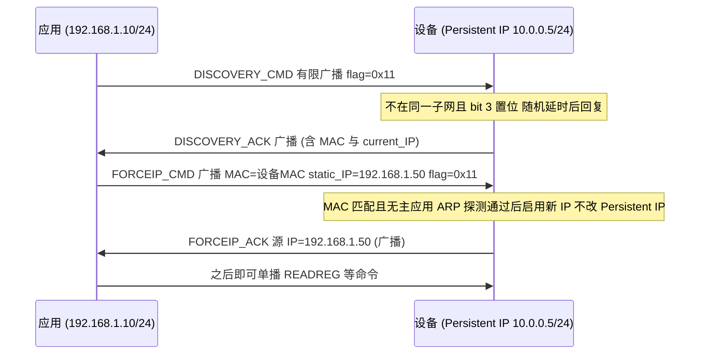
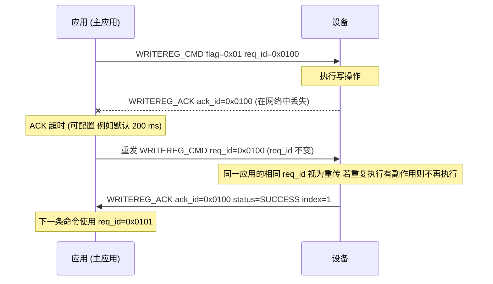
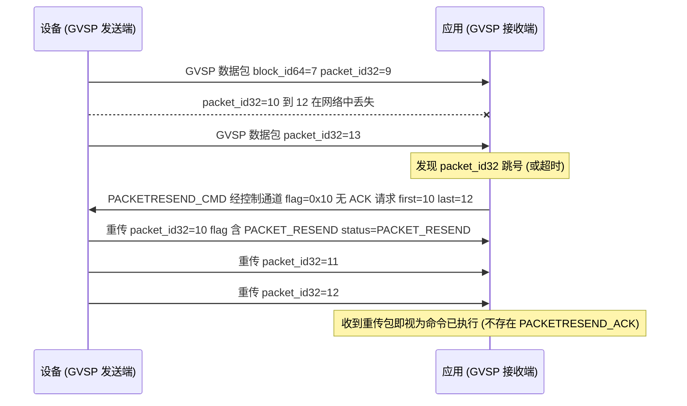
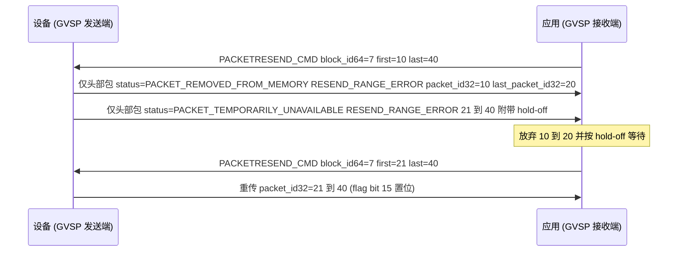
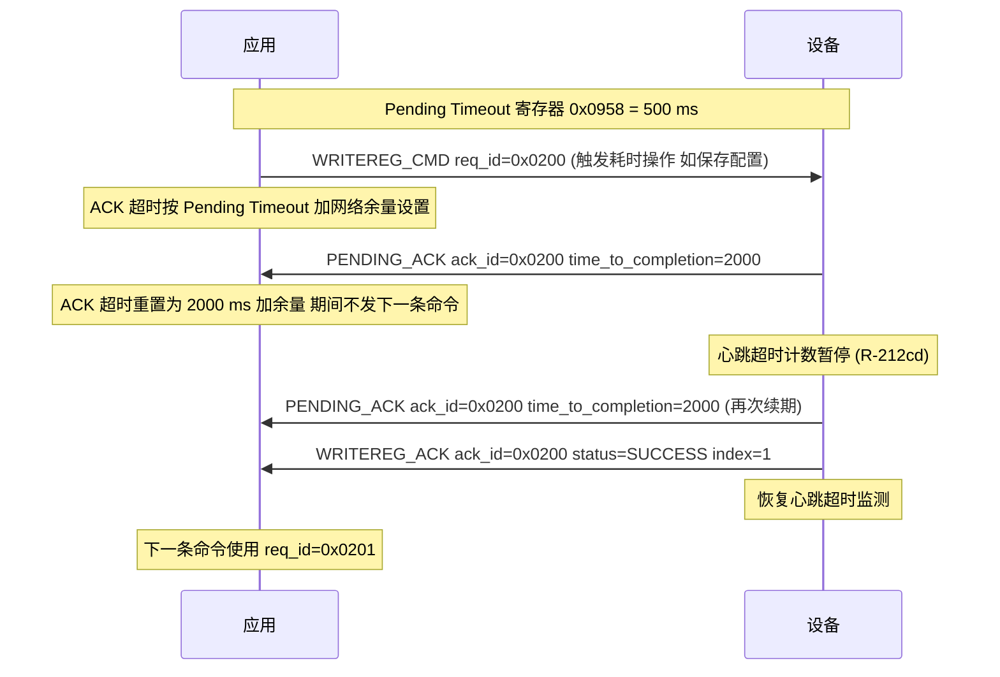
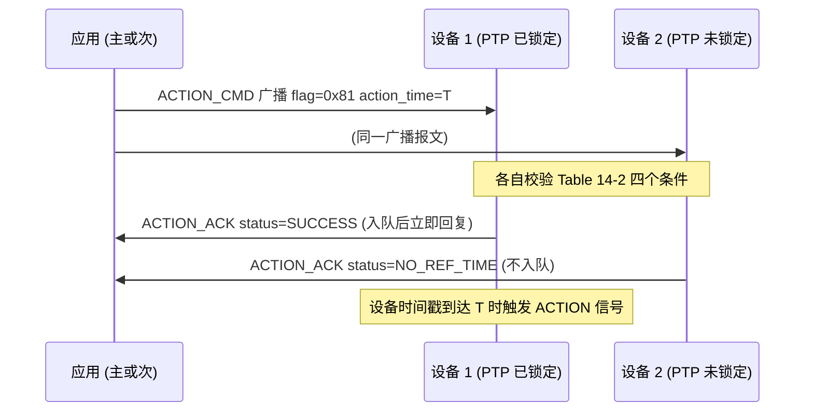
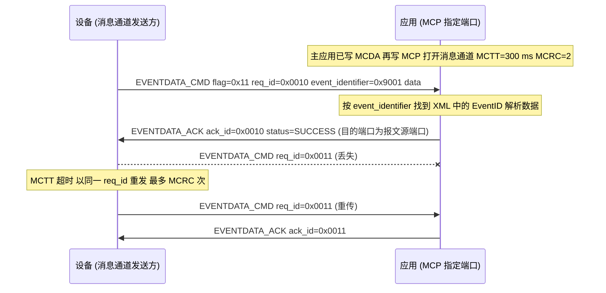

# GVCP 报文格式：报文头、控制通道字典与消息通道字典（Ch15–17）

> **覆盖范围**：Chapter 15 GVCP Headers（§15.1–15.3，PDF p.112–118）；Chapter 16 Control Channel Dictionary（§16.1–16.9，PDF p.119–146）；Chapter 17 Message Channel Dictionary（§17.1–17.3，PDF p.147–153）。
>
> **一句话总结**：GVCP 的所有命令/确认报文都由一个 8 字节、32 位对齐、大端序的报文头加上 32 位对齐的载荷构成；本文逐一给出每条命令（DISCOVERY、FORCEIP、READREG、WRITEREG、READMEM、WRITEMEM、PACKETRESEND、PENDING_ACK、ACTION、EVENT、EVENTDATA）的字节级格式、标志位含义、长度限制与可能返回的状态码，是抓包解析和协议栈实现的核心参考。
>
> **约定提醒**：
> - 规范的位编号是 **MSB-first**：bit 0 = 字段的最高位。8 位 flag 字节中 **bit 7 是 LSB（值 0x01）**，**bit 3 的值是 0x10**，bit 0 的值是 0x80。32 位寄存器中 bit 31 是 LSB。
> - 所有多字节字段为 **大端序（网络字节序）**。
> - 本文的 “字节偏移(Offset)” 一律从 **GVCP 报文头第一个字节（0x42 或 status 高字节）起算**，报文头占字节 0–7；不含以太网/IP/UDP 头（IP 头 20 字节 + UDP 头 8 字节 = 28 字节）。
> - 页码均为 PDF 页码（打印页码 = PDF 页码 − 1）。
>
> **本文目录**
> - 核心要点
> - 报文速查总表
> - 15 GVCP 报文头：15.1 命令报文头 / 15.2 确认报文头 / 15.3 字节序
> - 16 控制通道字典：16.1 DISCOVERY / 16.2 FORCEIP / 16.3 READREG / 16.4 WRITEREG / 16.5 READMEM / 16.6 WRITEMEM / 16.7 PACKETRESEND / 16.8 PENDING / 16.9 ACTION
> - 17 消息通道字典：17.1 EVENT / 17.2 EVENTDATA / 17.3 用 GenICam 解码消息
> - v3.0 相对 2.x 的格式变化小结
> - 实现要点与易错点
> - 相关章节
> - 自测题

---

## 核心要点

- **报文头只有两种**：命令报文头（`0x42 | flag | command | length | req_id`）与确认报文头（`status | acknowledge | length | ack_id`），各 8 字节、32 位自然对齐、大端序（§15，p.112–114）。消息通道（Message Channel）使用完全相同的报文头，只是方向相反（设备发命令、应用回确认）。
- **ACK 值 = CMD 值 + 1**（[R-238c]）。不支持的命令要用 “命令值 + 1” 回一个 `GEV_STATUS_NOT_IMPLEMENTED` 且不带载荷（[R-132c]，p.112）。例外：PACKETRESEND_CMD 没有 ACK（0x0041 无效），PENDING_ACK（0x0089）没有对应命令。
- **flag 字节**：低 4 位（bit 4–7）为通用位，其中只有 **bit 7 = ACKNOWLEDGE（0x01）** 有定义；高 4 位（bit 0–3）为各命令专用：DISCOVERY/FORCEIP 的 bit 3（0x10）= 允许广播 ACK，PACKETRESEND/EVENT/EVENTDATA 的 bit 3（0x10）= Extended ID（**v3.0 发送时必须置 1**），ACTION 的 bit 0（0x80）= 携带 action_time。
- **req_id 永远是 16 位、非 0、单调递增**，回绕时 65535 → 1；重发时 req_id 保持不变（[R-047ca]），设备据此识别重传。“Extended ID” 只影响 block_id/packet_id 的宽度，不影响 req_id。
- **v3.0 只剩 Extended ID 一种格式**：16 位 block_id 已被移除（附录 D，p.416），PACKETRESEND_CMD、EVENT_CMD、EVENTDATA_CMD 一律使用 `block_id64` + `packet_id32`；图中的方括号 `[block_id64 ...]` 是 2.x 双格式时代的遗留写法。
- **长度限制**：控制通道报文（含 IP/UDP/GVCP 头）≤ Control Channel Max Packet Size（CCMPS，默认/最小 576 字节，v3.0 可通过 0x0A24 报告更大值）。576 字节时：READREG 最多 135 个寄存器、WRITEREG 最多 67 个、READMEM/WRITEMEM 最多 536 字节（= CCMPS − 40）。**消息通道 EVENT/EVENTDATA 仍固定 ≤ 576 字节**，EVENT 最多 22 个事件。
- **READREG/WRITEREG 的拼接（concatenation）** 需 GVCP Capability（0x0934）bit 31；出错即停止，READREG_ACK 用 length 表示成功读取的数量，WRITEREG_ACK 用 `index` 表示出错位置（0 基）或成功个数。
- **PACKETRESEND 不允许请求 ACK**（[CR-198ca]），设备也绝不能回 0x0041（[CR-201cd]）；结果通过流通道体现：重发包置 `GEV_FLAG_PACKET_RESEND`（flag bit 15），无法重发时回一个“只有头部”的 GVSP 错误包（可带 `last_packet_id32` 范围和 hold-off）。
- **PENDING_ACK 在 v3.0 变为强制**（p.142）：执行时间将超过 Pending Timeout（0x0958）前必须发出（[R-209cd]–[R-215cd]），`time_to_completion` 单位 ms（最大约 65 s），可多次续期；DISCOVERY/FORCEIP/PACKETRESEND 不得使用。
- **ACTION_ACK 只在满足 Table 14-2 的四个条件且请求了 ACK 时发送**；Scheduled Action 入队后立即回 ACK，可能的状态包括 `GEV_STATUS_ACTION_LATE`、`GEV_STATUS_OVERFLOW`、`GEV_STATUS_NO_REF_TIME`。
- **EVENT 每个事件固定 24 字节**；EVENTDATA = 24 字节事件头 + 设备自定义数据，且只有在 MCCFG（0x0B20）的 `MCEC_enable` 置位时才允许一包多个事件（[CR-234cd]）。

---

## 报文速查总表

“GVCP 总长” = GVCP 报文头 8 字节 + 载荷（length 字段值）；加上 IP（20）+ UDP（8）即为 IP 报文长度。

| 报文 | 值 | 通道 / 方向 | length（载荷字节） | GVCP 总长 | 是否强制 | 详见 |
|---|---|---|---|---|---|---|
| DISCOVERY_CMD | 0x0002 | 控制，App→Dev（单播/广播） | 0 | 8 | 必须（[R-139cd]） | [16.1](#discovery) |
| DISCOVERY_ACK | 0x0003 | 控制，Dev→App | 248（0xF8）；出错时 0 | 256 | 必须 | [16.1](#discovery) |
| FORCEIP_CMD | 0x0004 | 控制，App→Dev（必须广播） | 56（0x38） | 64 | 必须（[R-147cd]） | [16.2](#forceip) |
| FORCEIP_ACK | 0x0005 | 控制，Dev→App（单播或广播） | 0 | 8 | 必须 | [16.2](#forceip) |
| PACKETRESEND_CMD | 0x0040 | 控制，App→Dev | 20（0x14） | 28 | GVSP 发送端 SHOULD（[O-196cd]） | [16.7](#packetresend) |
| （无效值） | 0x0041 | — | — | — | 不存在 PACKETRESEND_ACK | [16.7.2](#packetresend-response) |
| READREG_CMD | 0x0080 | 控制，App→Dev | 4 × N | 8 + 4N | 必须（[R-157cd]） | [16.3](#readreg) |
| READREG_ACK | 0x0081 | 控制，Dev→App | 4 × 成功读取个数 | 8 + 4N' | 必须 | [16.3](#readreg) |
| WRITEREG_CMD | 0x0082 | 控制，App→Dev | 8 × N | 8 + 8N | 必须（[R-166cd]） | [16.4](#writereg) |
| WRITEREG_ACK | 0x0083 | 控制，Dev→App | 4（ACCESS_DENIED 时 0） | 12 | 必须 | [16.4](#writereg) |
| READMEM_CMD | 0x0084 | 控制，App→Dev | 8 | 16 | 必须（[R-176cd]） | [16.5](#readmem) |
| READMEM_ACK | 0x0085 | 控制，Dev→App | 4 + count；失败时 0 | 12 + count | 必须 | [16.5](#readmem) |
| WRITEMEM_CMD | 0x0086 | 控制，App→Dev | 4 + 数据字节数 | 12 + N | 必须（[R-185cd]） | [16.6](#writemem) |
| WRITEMEM_ACK | 0x0087 | 控制，Dev→App | 4（ACCESS_DENIED 时 0） | 12 | 必须 | [16.6](#writemem) |
| PENDING_ACK | 0x0089 | 控制，Dev→App | 4 | 12 | v3.0 起必须 | [16.8](#pending) |
| EVENT_CMD | 0x00C0 | 消息，Dev→App | 24 × N（N ≤ 22） | 8 + 24N | SHOULD（[O-228cd]） | [17.1](#event) |
| EVENT_ACK | 0x00C1 | 消息，App→Dev | 0 | 8 | 随 EVENT | [17.1](#event) |
| EVENTDATA_CMD | 0x00C2 | 消息，Dev→App | Σ event_size | ≤ 548（IP 包 ≤ 576） | 可选 | [17.2](#eventdata) |
| EVENTDATA_ACK | 0x00C3 | 消息，App→Dev | 0 | 8 | 随 EVENTDATA | [17.2](#eventdata) |
| ACTION_CMD | 0x0100 | 控制，App→Dev（单播/广播） | 12；带 action_time 时 20 | 20 / 28 | 可选 | [16.9](#action) |
| ACTION_ACK | 0x0101 | 控制，Dev→App（单播） | 0 | 8 | 随 ACTION | [16.9](#action) |

> 💡 解读：表中 DISCOVERY_ACK 的 248、FORCEIP_CMD 的 56、PACKETRESEND_CMD 的 20 等数值是按规范图示逐字段累加得到的，规范正文并未直接写出这些 length 数值；ACTION_CMD 的 20/28 字节则是规范原文给出的（p.145）。完整的命令值表、所属通道与状态码见 [04_command_values_status_events.md](04_command_values_status_events.md)。

---

## 15 GVCP 报文头（Ch15，p.112–118）

GVCP 只定义两类报文头：**命令报文头（Command header）** 和 **确认报文头（Acknowledge header）**。两者都是 32 位自然对齐、始终大端序（p.112）。本章文字以控制通道为例，但消息通道必须以等价方式工作（p.112）。

<a id="cmd-header"></a>
### 15.1 命令报文头 Command Header（§15.1，p.112–114）

**格式要求**：命令报文头必须符合 Figure 15-1（[R-129c]）。

```
 0               7 8              15 16                             31
+-----------------+-----------------+--------------------------------+
|   0x42 (key)    |      flag       |            command             |   字节 0-3
+-----------------+-----------------+--------------------------------+
|              length               |             req_id             |   字节 4-7
+-----------------------------------+--------------------------------+
            Figure 15-1: Command Message Header (p.113)
```

| 字节偏移(Offset) | 字段 | 长度 | 说明 |
|---|---|---|---|
| 0 | `0x42` | 8 bits | 硬编码的 key 值，用于报文校验。首字节不是 0x42 的报文不被视为 GVCP 报文（[O-130c]），必须静默丢弃（[R-131c]）。 |
| 1 | `flag` | 8 bits | 高 4 位（bit 0–3，MSB 侧）为各命令专用；低 4 位（bit 4–7，LSB 侧）为所有命令通用。未使用的位必须为 0。 |
| 2–3 | `command` | 16 bits | 命令值（见 [04 文件命令值表](04_command_values_status_events.md)）。 |
| 4–5 | `length` | 16 bits | 报文头之后的有效载荷字节数（不含报文头）。 |
| 6–7 | `req_id` | 16 bits | 应用生成的请求 ID；设备把它原样拷贝到对应 ACK 的 `ack_id`。 |

**flag 字节逐位定义**（p.113）：

```
 bit:    0      1      2      3   |   4      5      6      7
      +------+------+------+------+------+------+------+------+
      |  命令专用 (bit 0..3)      | rsv  | rsv  | rsv  | ACK  |
      +------+------+------+------+------+------+------+------+
 掩码:  0x80   0x40   0x20   0x10   0x08   0x04   0x02   0x01
```

| 位 | 掩码 | 定义 |
|---|---|---|
| bit 0–3 | 0x80/0x40/0x20/0x10 | 各命令专用，命令不使用时置 0（见下表）。 |
| bit 4 | 0x08 | 保留：发送置 0，接收忽略。 |
| bit 5 | 0x04 | 保留：发送置 0，接收忽略。 |
| bit 6 | 0x02 | 保留：发送置 0，接收忽略。 |
| bit 7 | 0x01 | **ACKNOWLEDGE**：置位 = 要求接收方回确认报文；清零 = 接收方不得回 ACK。该位优先级最高：即使某命令“通常需要 ACK”，只要该位清零就不回 ACK（例如读寄存器仅用于复位心跳时，不需要设备回传寄存器值）。ACK 也可用于实现流控。 |

**各命令对专用位（bit 0–3）的使用汇总**（汇总自 §16–17 各命令定义）：

| 命令 | 专用位 | 掩码 | 含义 | 典型 flag 值 |
|---|---|---|---|---|
| DISCOVERY_CMD | bit 3 | 0x10 | 允许设备广播 DISCOVERY_ACK（p.119） | 0x01 或 0x11 |
| FORCEIP_CMD | bit 3 | 0x10 | 要求设备广播 FORCEIP_ACK（1.1 及以上，p.125） | 0x01 / 0x11 / 0x00 |
| READREG / WRITEREG / READMEM / WRITEMEM | — | — | 无专用位 | 0x01（或 0x00 不要 ACK） |
| PACKETRESEND_CMD | bit 3 | 0x10 | Extended ID，**发送时置 1**（p.138） | **0x10**（ACK 位必须清零） |
| ACTION_CMD | bit 0 | 0x80 | action_time 字段存在（Scheduled Action，p.145） | 0x01 / 0x81 / 0x00 / 0x80 |
| EVENT_CMD | bit 3 | 0x10 | Extended ID，**发送时置 1**（p.148） | 0x11（MCTT≠0）或 0x10 |
| EVENTDATA_CMD | bit 3 | 0x10 | Extended ID，**发送时置 1**（p.151） | 0x11 或 0x10 |

> ⚠️ 易错：“bit 3” 在 flag 字节中的数值是 **0x10**，不是 0x08。规范在 p.117 的例子里专门说明：bit 7 是 LSB，因此 flag = 0000 0001b = 0x01。

**command 字段取值范围**：§15.1 写的是 “Commands from 0 to 32765 are reserved for GigE Vision. Others are available for customization”（p.113），而 Ch18 写的是 0–32767（最高位为 0）保留给 GVCP、32768–65535（最高位为 1）用于设备自定义（p.154）。⚠️ 两处数字不一致，32765 很可能是笔误；以 Ch18 的 “最高位区分标准/自定义” 规则为准（💡 解读）。

**length 字段**：只计载荷，不计 8 字节报文头。另据 §8.1.2，GVCP 载荷大小必须是 32 位的整数倍（[R-045c]，p.61），因此 length 总是 4 的倍数。

**req_id 规则**（p.114）：
- 由应用生成，设备拷贝到 ACK 的 `ack_id`，用于匹配命令与确认；
- **永远不能为 0**；应用必须使用递增的 req_id（通常 +1），回绕到 0 时必须改为 1；
- 重发同一命令时 req_id 不变（[R-047ca]，p.62），设备由此判断是否为重传（[R-051cd]/[R-052cd]，p.63–64）；
- 因为广播命令的存在，设备不能假定 req_id 每次严格 +1（p.63 NOTE）。

> 💡 解读（关于 “Extended ID” 与 req_id）：v3.0 的报文头里 `req_id`/`ack_id` 固定为 16 位，没有“扩展 req_id”。Extended ID 标志只存在于 PACKETRESEND_CMD、EVENT_CMD、EVENTDATA_CMD 的命令专用 bit 3（以及 GVSP 头的 EI 位），它决定的是 **block_id 为 64 位、packet_id 为 32 位**。v3.0 已移除 16 位 block_id（附录 D，p.416），所以这些命令发送时 bit 3 必须为 1。

**接收方对命令报文头的校验**：
- 至少校验首字节 0x42（[O-130c]）；不是 GVCP 报文则静默丢弃（[R-131c]）。
- 命令不被支持时，若对方请求了 ACK，接收方应回 `GEV_STATUS_NOT_IMPLEMENTED`，ACK 值 = 命令值 + 1，**不附任何载荷**（[R-132c]，p.112）。⚠️ 注意 [R-132c] 虽以 R（MUST）编号，正文却用的是 “SHOULD”。
- 报文中的保留字段发送时必须置 0、接收时必须忽略（[R-133c]）。
- 报文头其他字段非法时，应回 `GEV_STATUS_INVALID_HEADER`（[O-134c]）；例如需要载荷的命令其 length 却为 0（附录 B.12，p.404）。

<a id="ack-header"></a>
### 15.2 确认报文头 Acknowledge Header（§15.2，p.114）

确认报文头必须符合 Figure 15-2（[R-135c]）。

```
 0                               15 16                             31
+-----------------------------------+--------------------------------+
|              status               |          acknowledge           |   字节 0-3
+-----------------------------------+--------------------------------+
|              length               |             ack_id             |   字节 4-7
+-----------------------------------+--------------------------------+
            Figure 15-2: Acknowledge Message Header (p.114)
```

| 字节偏移(Offset) | 字段 | 长度 | 说明 |
|---|---|---|---|
| 0–1 | `status` | 16 bits | 所请求操作的状态码（见 [04 文件状态码表](04_command_values_status_events.md)）。bit 0 = severity（1 = error），bit 1 = 设备自定义标志。 |
| 2–3 | `acknowledge` | 16 bits | 确认报文值（= 对应命令值 + 1）。 |
| 4–5 | `length` | 16 bits | 报文头之后的有效载荷字节数。 |
| 6–7 | `ack_id` | 16 bits | 与对应命令的 `req_id` 相同。 |

- 确认报文的接收方应做最小校验：至少检查 `ack_id` 是否与之前发出的 `req_id` 匹配，也可以检查 `acknowledge` 是否为规范中的合法值（[O-136c]）。
- 当 status 返回错误码且没有载荷时，发送方可以把 length 置 0（p.114）。

> 💡 解读：确认报文没有 0x42 key，首字节就是 status 的高字节（成功时为 0x00，标准错误时为 0x80；设备自定义的信息码 0x42xx 甚至会恰好等于 0x42）。因此“首字节是否为 0x42”只能用来校验**命令**报文；识别确认报文应依据端口/会话上下文与 `ack_id` 匹配。

<a id="byte-order"></a>
### 15.3 字节序 Byte Sequencing（§15.3，p.114–118）

- GVCP 必须使用网络字节序（大端序）（[R-137c]）。传输顺序遵循 RFC791 附录 B：图中从左到右、从上到下，即 Byte 1 → Byte 8；GVCP 载荷也遵循同样顺序（p.115）。
- 单字节内 bit 0 为 MSB；多字节数值字段的最左位为整个字段的 MSB，先发送最高有效字节（Figure 15-4/15-5/15-6，p.115）。
- 小端主机必须对 16/32 位字段做字节交换；8 位字段（包括 8 位字符串）不交换（p.116）。可用 `ntohl()/htonl()/ntohs()/htons()`（p.118 NOTE）。

**报文头在线路上的字节顺序**（Table 15-1，p.116）：

| 线路字节序号 | 内容 |
|---|---|
| 1 | key 值 0x42 |
| 2 | flag |
| 3 | command MSB |
| 4 | command LSB |
| 5 | length MSB |
| 6 | length LSB |
| 7 | req_id MSB |
| 8 | req_id LSB |

**规范示例：用 WRITEREG_CMD 打开 SCPS0 的测试包**（Figure 15-8，p.116–118）：

```
 0               7 8              15 16                             31
+-----------------+-----------------+--------------------------------+
|      0x42       |   flag = 0x01   |   command = WRITEREG_CMD 0x0082 |
+-----------------+-----------------+--------------------------------+
|          length = 8               |        req_id = 826 (0x033A)   |
+-----------------------------------+--------------------------------+
|              register_address = 0x00000D04  (SCPS0)                |
+--------------------------------------------------------------------+
|              register_data    = 0xC000219C                         |
+--------------------------------------------------------------------+
```

线路上的 16 个字节（十六进制）：

```
42 01 00 82 00 08 03 3A   00 00 0D 04   C0 00 21 9C
```

- flag = 0x01：bit 7（LSB）置位，要求 ACK。
- register_data = 0xC000219C：bit 0（`fire_test_packet`）和 bit 1（`do_not_fragment`）置位（合起来为 0xC0000000），即设备将发出一个**不分片**的测试包；bits 16–31 为包大小 8604 = 0x219C（p.117；SCPSx 位定义见 §36.58，p.324–325）。

---

## 16 控制通道字典（Ch16，p.119–146）

本章的报文都在控制通道上由应用发往设备，确认报文反向传输。设备执行任何命令之前都要检查请求者的权限（p.119）：

- 请求者权限不足时，设备必须在 ACK 的 status 中返回 `GEV_STATUS_ACCESS_DENIED`，并把 length 置 0，ACK 只含报文头（[R-138cd]）。
- 收到 `GEV_STATUS_ACCESS_DENIED` 的应用应忽略 ACK 可能附带的任何数据，以兼容旧版本规范（p.119）。

> 各命令的权限、单播/广播方式、是否复位心跳、能否产生 PENDING_ACK 的汇总见 Table 10-1（p.76–77，资料性），详见 [01_transport_and_channels.md](01_transport_and_channels.md)。

<a id="discovery"></a>
### 16.1 DISCOVERY（§16.1，p.119–123）

- 所有设备必须支持 DISCOVERY（[R-139cd]），它是设备枚举（Device Enumeration）的基础。
- 执行 DISCOVERY **不需要任何权限**；设备一旦获得 IP 地址，就必须随时回应任何应用（主应用和次应用）的发现请求（p.119）。
- DISCOVERY_CMD 可以用有限广播（255.255.255.255）、子网定向广播或单播发送到设备的 GVCP 端口（UDP 3956，[R-042c]，p.60）。

#### 16.1.1 DISCOVERY_CMD（§16.1.1，p.119–120）

必须符合 Figure 16-1（[R-140c]）。DISCOVERY_CMD 没有载荷。

```
 0               7 8              15 16                             31
+-----------------+-----------------+--------------------------------+
|      0x42       |      flag       |  command = DISCOVERY_CMD (0x0002)
+-----------------+-----------------+--------------------------------+
|          length = 0               |             req_id             |
+-----------------------------------+--------------------------------+
               Figure 16-1: DISCOVERY_CMD Message (p.119)
```

| 字节偏移(Offset) | 字段 | 长度 | 说明 |
|---|---|---|---|
| 0 | 0x42 | 8 bits | key |
| 1 | flag | 8 bits | bit 0–2：保留（发送置 0，接收忽略）；**bit 3（0x10）：允许设备广播 DISCOVERY_ACK**；bit 4–7：通用定义，其中 **bit 7（ACKNOWLEDGE）必须置 1**（[R-141ca]）。 |
| 2–3 | command | 16 bits | DISCOVERY_CMD = 0x0002 |
| 4–5 | length | 16 bits | 0 |
| 6–7 | req_id | 16 bits | 非 0 |

示例（允许广播 ACK，req_id = 1）：`42 11 00 02 00 00 00 01`。

bit 3 由应用设置，表示在满足下文条件时设备**可以**广播 DISCOVERY_ACK；bit 3 清零时设备**不能**广播其 ACK（p.119–120）。

#### 16.1.2 DISCOVERY_ACK（§16.1.2，p.120–123）

**单播还是广播？**

- 设备与应用在同一子网时，设备**必须单播** DISCOVERY_ACK，与 DISCOVERY_CMD 是以有限广播、子网定向广播还是单播发送无关（[R-142cd]）。NOTE：设备 IP 配置不正确时，它可能无法正确判断应用所在子网（p.120）。
- 同时满足以下两条时，设备**应广播** DISCOVERY_ACK（[O-143cd]）：① DISCOVERY_CMD 不是在设备所在子网上收到的；② DISCOVERY_CMD 的 flag bit 3 被应用置位。典型场景：设备配置了与应用子网不匹配的 Persistent IP。
- bit 3 清零且设备与应用不在同一子网时，设备无法确认该发现请求，应用就“看不见”这台设备（p.120）。

**Table 16-1：DISCOVERY 广播汇总**（p.120）

| DISCOVERY_CMD 发送方式 | 广播标志（flag bit 3） | 设备与应用同子网 | DISCOVERY_ACK 是否广播 | 备注 |
|---|---|---|---|---|
| 单播 | x（任意） | x（任意） | 否 | |
| 有限广播（255.255.255.255）或子网定向广播 | 0 | x（任意） | 否 | |
| 同上 | 1 | 否 | 可选（Optionally） | 用有限广播还是子网定向广播回复属于实现细节 |
| 同上 | 1 | 是 | 否 | |

**随机延时**：若支持 Discovery ACK Delay 寄存器（0x0950），设备应在 0 到该寄存器值之间按均匀分布随机等待后再发送 DISCOVERY_ACK；否则在 0 到 1 秒之间随机等待（[O-144cd]，p.121）。目的是避免大量设备同时收到广播后同时回复、冲垮应用。

**报文格式**：必须符合 Figure 16-2（[R-145c]）。除 GVCP 报文头外，各字段与**前若干个 bootstrap 寄存器完全一致**（**ACK 偏移 = 寄存器地址 + 8**）；设备发现总是在第一个网络接口（interface #0）上进行，因为只有它支持 GVCP（p.123）。

```
 0               7 8              15 16                             31
+-----------------------------------+--------------------------------+
|              status               |  acknowledge = DISCOVERY_ACK   |  0
+-----------------------------------+--------------------------------+
|              length               |             ack_id             |  4
+-----------------------------------+--------------------------------+
|        spec_version_major         |       spec_version_minor       |  8
+-----------------------------------+--------------------------------+
|                           device_mode                              |  12
+-----------------------------------+--------------------------------+
|             reserved              |   device_MAC_address (high)    |  16
+-----------------------------------+--------------------------------+
|                    device_MAC_address (low)                        |  20
+--------------------------------------------------------------------+
|                        IP_config_options                           |  24
+--------------------------------------------------------------------+
|                        IP_config_current                           |  28
+--------------------------------------------------------------------+
|                   reserved  (3 x 32 bits)                          |  32-43
+--------------------------------------------------------------------+
|                           current_IP                               |  44
+--------------------------------------------------------------------+
|                   reserved  (3 x 32 bits)                          |  48-59
+--------------------------------------------------------------------+
|                       current_subnet_mask                          |  60
+--------------------------------------------------------------------+
|                   reserved  (3 x 32 bits)                          |  64-75
+--------------------------------------------------------------------+
|                         default_gateway                            |  76
+--------------------------------------------------------------------+
|                 manufacturer_name [32 bytes]                       |  80-111
|                 model_name [32 bytes]                              |  112-143
|                 device_version [32 bytes]                          |  144-175
|                 manufacturer_specific_information [48 bytes]       |  176-223
|                 serial_number [16 bytes]                           |  224-239
|                 user_defined_name [16 bytes]                       |  240-255
+--------------------------------------------------------------------+
               Figure 16-2: DISCOVERY_ACK Message (p.122)
```

> ⚠️ 规范笔误：Figure 16-2 中写的是 “acknowledge = DISCOVERY_CMD”（p.122，已对照 PDF 原图确认），按 [R-238c] 与 Ch18 的取值表，DISCOVERY_ACK 的 acknowledge 字段应为 **0x0003**。

| 字节偏移(Offset) | 字段 | 长度 | 对应 bootstrap 寄存器 | 说明 |
|---|---|---|---|---|
| 0–1 | status | 16 bits | — | 成功为 GEV_STATUS_SUCCESS |
| 2–3 | acknowledge | 16 bits | — | 0x0003 |
| 4–5 | length | 16 bits | — | 成功时 248（0x00F8）；出错时 0（[R-146cd]） |
| 6–7 | ack_id | 16 bits | — | = DISCOVERY_CMD 的 req_id |
| 8–9 | spec_version_major | 16 bits | Version 0x0000 bits 0–15 | v3.0 设备 = 3（Version 寄存器 = 0x00030000，§36.1，p.269） |
| 10–11 | spec_version_minor | 16 bits | Version 0x0000 bits 16–31 | v3.0 设备 = 0 |
| 12–15 | device_mode | 32 bits | Device Mode 0x0004 | 设备类别、链路配置、字符集（见下） |
| 16–17 | reserved | 16 bits | 0x0008 bits 0–15 | 0 |
| 18–19 | device_MAC_address (high) | 16 bits | 0x0008 bits 16–31 | MAC 高 2 字节 |
| 20–23 | device_MAC_address (low) | 32 bits | 0x000C | MAC 低 4 字节（与 18–19 连续构成 6 字节 MAC） |
| 24–27 | IP_config_options | 32 bits | Network Interface Capability 0x0010 | 支持的 IP 配置方式（见下） |
| 28–31 | IP_config_current | 32 bits | Network Interface Configuration 0x0014 | 当前启用的 IP 配置方式 |
| 32–43 | reserved | 3 × 32 bits | 0x0018–0x0023 | 0 |
| 44–47 | current_IP | 32 bits | Current IP Address 0x0024 | |
| 48–59 | reserved | 3 × 32 bits | 0x0028–0x0033 | 0 |
| 60–63 | current_subnet_mask | 32 bits | Current Subnet Mask 0x0034 | |
| 64–75 | reserved | 3 × 32 bits | 0x0038–0x0043 | 0 |
| 76–79 | default_gateway | 32 bits | Current Default Gateway 0x0044 | |
| 80–111 | manufacturer_name | 32 bytes | 0x0048 | 字符串（SFNC DeviceVendorName） |
| 112–143 | model_name | 32 bytes | 0x0068 | 字符串（DeviceModelName） |
| 144–175 | device_version | 32 bytes | 0x0088 | 字符串（DeviceVersion） |
| 176–223 | manufacturer_specific_information | 48 bytes | 0x00A8 | 字符串（DeviceManufacturerInfo） |
| 224–239 | serial_number | 16 bytes | 0x00D8（可选） | 字符串（DeviceSerialNumber），GVCP Capability bit 1 表示是否支持 |
| 240–255 | user_defined_name | 16 bytes | 0x00E8（可选） | 字符串（DeviceUserID），GVCP Capability bit 0 表示是否支持 |

关键子字段速记（详见 [02_device_and_network_registers.md](../05_bootstrap_registers/02_device_and_network_registers.md)）：

- **device_mode（§36.2，p.270–271）**：bit 0 已废弃、恒为 1（1.x 中表示寄存器字节序；2.0 起 bootstrap 寄存器总是大端）；bit 1–3 `device_class`（0 Transmitter，1 Receiver，2 Transceiver，3 Peripheral）；bit 4–5 保留；bit 6–7 `current_link_configuration`（0 单链路，1 多链路，2 静态 LAG，3 动态 LAG）；bit 8–23 保留；bit 24–31 `character_set_index`（1 = UTF-8，2 = ASCII）。
- **IP_config_options / IP_config_current（§36.4–36.5，p.273–275）**：bit 0 PAUSE_reception（PR），bit 1 PAUSE_generation（PG），bit 29 LLA（恒为 1），bit 30 DHCP（options 中恒为 1），bit 31 Persistent_IP；bit 2–28 保留。注意这里是 32 位寄存器的 MSB-first 编号：bit 31 = 值 0x00000001，bit 30 = 0x00000002，bit 29 = 0x00000004。
- **字符串**：使用 Device Mode 指定的字符集。GigE Vision 1.x 中字符串总以 NULL 结尾；2.x 起若字符串占满整个区域可以不带 NULL，此时由**应用负责补 NULL**（p.123 NOTE）。

> 💡 解读：对可选的 serial_number / user_defined_name，规范只说“若支持则在 DISCOVERY_ACK 中返回”（p.280–281），未规定不支持时该区域的内容；应用应结合 GVCP Capability（0x0934）bit 0/bit 1 判断，设备实现上建议填 0。

**出错处理**：处理 DISCOVERY_CMD 出错时，设备必须在 DISCOVERY_ACK 报文头中返回合适的状态码，length 置 0，ACK 只含报文头（[R-146cd]），以便应用获知错误原因。规范没有列举 DISCOVERY_ACK 的具体错误码（💡 可能见到 `GEV_STATUS_INVALID_HEADER`、`GEV_STATUS_ERROR` 等通用码）。

**其他相关规则**（来自 Ch10）：设备在 PENDING_ACK 进行期间也必须回答 DISCOVERY_CMD（[R-077cd]/[R-211cd]），且不得用 PENDING_ACK 回答 DISCOVERY_CMD（[R-078cd]/[R-209cd]）；DISCOVERY_CMD 不复位心跳（[R-075cd]，p.75）。

<a id="forceip"></a>
### 16.2 FORCEIP（§16.2，p.123–126）

用途：当设备使用了“未知的” Persistent IP 时，应用所在子网往往与设备不同，难以通信（DHCP 与 LLA 因为是协商得到的地址，不存在这个问题）。只要应用知道设备的 MAC 地址，就可以用 FORCEIP 给设备“强制”设置一个静态 IP，同时可设置子网掩码和默认网关（p.123）。

- 所有设备必须支持 FORCEIP（[R-147cd]）。它**临时**覆盖由 MAC 地址标识的设备的 IP 地址。
- 应用发送 FORCEIP_CMD 时**必须在 GVCP 端口上广播**，且必须包含目标设备 MAC 地址（[R-148ca]）。
- MAC 不匹配的设备必须静默丢弃该报文（[R-149cd]）。
- FORCEIP_CMD **不得修改任何 Persistent IP 配置**（[R-604cd]，v3.0 新增）。
- 只有当**没有应用持有 exclusive 或 control access**（无论是否启用 switchover）时设备才处理 FORCEIP_CMD，否则必须静默丢弃（[R-150cd]）。这意味着 FORCEIP_CMD 不是来自主应用，它的定位是“恢复一台 IP 未知的设备”。
- **static_IP = 0**：设备必须先关闭所有已打开的 GVSP/GVRSP 流通道（适用时包括断开所有 GVRSP 流通道 QP）和消息通道，然后在所有网络接口上**重新启动 IP 配置流程**，并且**不发送** FORCEIP_ACK（[R-151cd]）。
- **static_IP ≠ 0**：设备必须把 IP 改为 static_IP，并且仅在新地址**已生效后**才发送 FORCEIP_ACK（若被请求）；如果分配静态 IP 需要复位通信栈和内部状态，复位后必须保持该静态 IP（[R-152cd]）。
- 设备应按 RFC5227 用 ARP 探测 static_IP 以检测地址冲突；若检测到冲突，设备**不得**使用该地址，并应以某种方式提示用户（如闪烁状态 LED）（[O-572cd]）。NOTE：设备每次获得新 IP 时，建议发送免费 ARP（gratuitous ARP）通告，便于其他主机更新 ARP 缓存（p.124）。

#### 16.2.1 FORCEIP_CMD（§16.2.1，p.124–126）

必须符合 Figure 16-3（[R-153cd]；[CR-154ca]）。

```
 0               7 8              15 16                             31
+-----------------+-----------------+--------------------------------+
|      0x42       |      flag       |   command = FORCEIP_CMD (0x0004)
+-----------------+-----------------+--------------------------------+
|          length = 56              |             req_id             |  4
+-----------------------------------+--------------------------------+
|             reserved              |   device_MAC_address (high)    |  8
+-----------------------------------+--------------------------------+
|                    device_MAC_address (low)                        |  12
+--------------------------------------------------------------------+
|                   reserved  (3 x 32 bits)                          |  16-27
+--------------------------------------------------------------------+
|                            static_IP                               |  28
+--------------------------------------------------------------------+
|                   reserved  (3 x 32 bits)                          |  32-43
+--------------------------------------------------------------------+
|                       static_subnet_mask                           |  44
+--------------------------------------------------------------------+
|                   reserved  (3 x 32 bits)                          |  48-59
+--------------------------------------------------------------------+
|                     static_default_gateway                         |  60
+--------------------------------------------------------------------+
               Figure 16-3: FORCEIP_CMD Message (p.125)
```

| 字节偏移(Offset) | 字段 | 长度 | 说明 |
|---|---|---|---|
| 0 | 0x42 | 8 bits | key |
| 1 | flag | 8 bits | bit 0–2：保留；**bit 3（0x10）：要求设备广播 FORCEIP_ACK**（仅 1.1 及以上；对 1.0 设备该位必须保持清零）；bit 4–7：通用定义（bit 7 = ACKNOWLEDGE） |
| 2–3 | command | 16 bits | FORCEIP_CMD = 0x0004 |
| 4–5 | length | 16 bits | 56（0x0038） |
| 6–7 | req_id | 16 bits | |
| 8–9 | reserved | 16 bits | 发送置 0，接收忽略 |
| 10–11 | device_MAC_address (high) | 16 bits | 目标 MAC 高 2 字节 |
| 12–15 | device_MAC_address (low) | 32 bits | 目标 MAC 低 4 字节（MAC 共 48 bits） |
| 16–27 | reserved | 96 bits | 置 0 |
| 28–31 | static_IP | 32 bits | 要强制设置的静态 IP；**0 表示重启 IP 配置流程** |
| 32–43 | reserved | 96 bits | 置 0 |
| 44–47 | static_subnet_mask | 32 bits | 与静态 IP 配套的子网掩码 |
| 48–59 | reserved | 96 bits | 置 0 |
| 60–63 | static_default_gateway | 32 bits | 与静态 IP 配套的默认网关 |

> 💡 解读：FORCEIP_CMD 的载荷布局与 DISCOVERY_ACK 的 MAC/IP 区段“形似但不相同”——它在 MAC 与 static_IP 之间只有 3 个保留字，而 DISCOVERY_ACK 在 MAC 与 current_IP 之间还有 IP_config_options/IP_config_current 两个字。解析时请按上表偏移，而不要套用“寄存器地址 + 8”的规则。

flag bit 3 的意义：子网可能在执行该命令的过程中发生改变，此时广播 ACK 能保证应用收到（p.126）。bit 3 清零时设备不能广播其 ACK。

#### 16.2.2 FORCEIP_ACK（§16.2.2，p.126）

- 在强制静态 IP 分配完成后由设备发回，status 字段用于报告问题（p.126）。必须符合 Figure 16-4（[R-156cd]）。
- 该报文必须以**新强制的 IP 地址作为 IP 源地址**发送；若 FORCEIP_CMD 的 flag bit 3 置位，设备应广播该 ACK（[O-155cd]）。
- static_IP = 0 时不发送 FORCEIP_ACK（[R-151cd]）。

```
 0                               15 16                             31
+-----------------------------------+--------------------------------+
|              status               |   acknowledge = FORCEIP_ACK    |
+-----------------------------------+--------------------------------+
|           length = 0              |             ack_id             |
+-----------------------------------+--------------------------------+
               Figure 16-4: FORCEIP_ACK Message (p.126)
```

| 字节偏移(Offset) | 字段 | 长度 | 说明 |
|---|---|---|---|
| 0–1 | status | 16 bits | 处理结果；规范只说“status 字段用于报告问题”（p.126），未列举具体错误码 |
| 2–3 | acknowledge | 16 bits | FORCEIP_ACK = 0x0005 |
| 4–5 | length | 16 bits | 0（无载荷） |
| 6–7 | ack_id | 16 bits | = FORCEIP_CMD 的 req_id |

> ⚠️ 规范笔误：Figure 16-4 写的是 “acknowledge = FORCEIP_CMD”（p.126），应为 FORCEIP_ACK（0x0005）。



<a id="readreg"></a>
### 16.3 READREG（§16.3，p.126–129）

- 所有设备必须支持 READREG（[R-157cd]）。应用用它读取设备的 32 位寄存器。
- **拼接（concatenation）**：可以把多个读操作拼进一条报文，只要整个报文（含 IP/UDP/GVCP 头）≤ Control Channel Max Packet Size。以最小值 576 字节计算，扣除各层头部共 36 字节，**最多一次读 135 个寄存器**（(576 − 36) / 4 = 135）。至少读 1 个。读操作个数 = `length / 4`（p.126）。
- 设备必须提供“是否支持拼接”的能力位：GVCP Capability 寄存器（0x0934）**bit 31**（[R-158cd]）；该位为 0 时应用不得发送拼接的 READREG（[R-535ca]）。
- 支持拼接时，多个读操作必须**按顺序执行**（[CR-159cd]）；出错时必须**在出错位置停止**，其余读操作丢弃，并在 ACK 中返回相应错误码（[CR-160cd]）。应用由 ACK 的 length 推断成功读取了几个寄存器（每个 4 字节）。
- 控制协议假定寄存器为 32 位宽；内部寄存器宽度不同时由设备自行转换（p.127 NOTE）。
- **权限**：无应用持有 exclusive access 时，设备必须回答主应用和任何次应用的 READREG（[R-161cd]）；有应用持有 exclusive access 时，只回答主应用，次应用的 READREG 以 `GEV_STATUS_ACCESS_DENIED` 确认且 length = 0（[R-162cd]）。
- 为免次应用的读操作影响主应用，建议读操作不改变寄存器内容：避免“读清除（clear-on-read）”，优先“写清除（clear-on-write）”（p.127）。

#### 16.3.1 READREG_CMD（§16.3.1，p.127–128）

必须符合 Figure 16-5（[R-163c]）。

```
 0               7 8              15 16                             31
+-----------------+-----------------+--------------------------------+
|      0x42       |      flag       |   command = READREG_CMD (0x0080)
+-----------------+-----------------+--------------------------------+
|          length = 4 x N           |             req_id             |
+-----------------------------------+--------------------------------+
|                    register_address (first)                        |  8
+--------------------------------------------------------------------+
|                               ...                                  |
+--------------------------------------------------------------------+
|                    register_address (last)                         |  8+4(N-1)
+--------------------------------------------------------------------+
               Figure 16-5: READREG_CMD Message (p.128)
```

| 字节偏移(Offset) | 字段 | 长度 | 说明 |
|---|---|---|---|
| 0 | 0x42 | 8 bits | |
| 1 | flag | 8 bits | 应置 ACKNOWLEDGE 位（bit 7）；无命令专用位 |
| 2–3 | command | 16 bits | READREG_CMD = 0x0080 |
| 4–5 | length | 16 bits | 4 × N |
| 6–7 | req_id | 16 bits | |
| 8 + 4i（i = 0..N−1） | register_address[i] | 32 bits each | 要读取的地址，必须 32 位对齐（bit 30、bit 31 清零，即低 2 位为 0）；至少 1 个 |

#### 16.3.2 READREG_ACK（§16.3.2，p.128–129）

必须符合 Figure 16-6（[R-164c]）。

```
 0                               15 16                             31
+-----------------------------------+--------------------------------+
|              status               |   acknowledge = READREG_ACK    |
+-----------------------------------+--------------------------------+
|          length = 4 x N'          |             ack_id             |
+-----------------------------------+--------------------------------+
|                      register_data (first)                         |  8
+--------------------------------------------------------------------+
|                               ...                                  |
+--------------------------------------------------------------------+
|                      register_data (last)                          |  8+4(N'-1)
+--------------------------------------------------------------------+
               Figure 16-6: READREG_ACK Message (p.128)
```

| 字节偏移(Offset) | 字段 | 长度 | 说明 |
|---|---|---|---|
| 0–1 | status | 16 bits | 全部成功为 SUCCESS；否则为第一个失败读操作的原因 |
| 2–3 | acknowledge | 16 bits | READREG_ACK = 0x0081 |
| 4–5 | length | 16 bits | **成功读取的字节数**，必须是 4 的倍数（[R-165cd]）；可为 0 |
| 6–7 | ack_id | 16 bits | |
| 8 + 4i | register_data[i] | 32 bits each | 第 i 个被成功读取的寄存器值；未读取的寄存器不出现在载荷中 |

可能的状态码（💡 汇总自 Ch16、Ch36、附录 B）：`GEV_STATUS_SUCCESS`、`GEV_STATUS_ACCESS_DENIED`（权限不足 / 读只写寄存器 [R-423cd] / 当前模式下被禁用的寄存器）、`GEV_STATUS_INVALID_ADDRESS`（不存在的寄存器 [R-421cd]）、`GEV_STATUS_BAD_ALIGNMENT`（地址未对齐）、`GEV_STATUS_BUSY`、`GEV_STATUS_INVALID_HEADER`、`GEV_STATUS_ERROR` 等。

示例：读取 CCP（0x0A00）和 Heartbeat Timeout（0x0938），req_id = 5：

```
CMD: 42 01 00 80 00 08 00 05   00 00 0A 00   00 00 09 38
ACK: 00 00 00 81 00 08 00 05   xx xx xx xx   00 00 0B B8     (心跳超时 = 3000 ms)
```

若第 2 个地址不存在，则 ACK 为 `80 03 00 81 00 04 00 05 xx xx xx xx`（status = 0x8003 INVALID_ADDRESS，length = 4，只含第一个寄存器的值）。

<a id="writereg"></a>
### 16.4 WRITEREG（§16.4，p.129–132）

- 所有设备必须支持 WRITEREG（[R-166cd]）。可一次写一个或多个寄存器。
- **拼接**：以 576 字节计算，**最多一次写 67 个寄存器**（(576 − 36) / 8 = 67.5 → 67）。至少写 1 个。写操作个数 = `length / 8`（p.129）。
- 能力位同样是 GVCP Capability（0x0934）**bit 31**（[R-167cd]）；该位为 0 时应用不得发送拼接的 WRITEREG（[R-536ca]）。
- 支持拼接时必须按顺序执行（[CR-168cd]）；出错时必须在出错位置停止，丢弃其余写操作，并在 ACK 中返回错误码以及**失败写操作在列表中的 0 基索引**（[CR-169cd]）。出错位置之前的写操作已正确完成。
- **权限**：只有主应用可以发送 WRITEREG（primary application switchover 请求除外）。设备必须回答主应用的 WRITEREG（[R-170cd]）；对次应用必须返回 `GEV_STATUS_ACCESS_DENIED`，除非设备处于“启用 switchover 的 control access”状态且另一应用携带正确凭据请求接管控制（[R-171cd]）。
- 没有主应用时，任何应用都可以写 CCP 寄存器以申请 exclusive 或 control access；设备必须接受任何应用对 CCP 的 WRITEREG_CMD（[R-172cd]）——这正是建立主应用控制通道的方式。一旦授予 exclusive/control access，其他应用不能再写 CCP（switchover 情形见 §14.4）（p.130）。

#### 16.4.1 WRITEREG_CMD（§16.4.1，p.130–131）

必须符合 Figure 16-7（[R-173c]）。

```
 0               7 8              15 16                             31
+-----------------+-----------------+--------------------------------+
|      0x42       |      flag       |  command = WRITEREG_CMD (0x0082)
+-----------------+-----------------+--------------------------------+
|          length = 8 x N           |             req_id             |
+-----------------------------------+--------------------------------+
|                    register_address (first)                        |  8
+--------------------------------------------------------------------+
|                    register_data (first)                           |  12
+--------------------------------------------------------------------+
|                               ...                                  |
+--------------------------------------------------------------------+
|                    register_address (last)                         |  8+8(N-1)
+--------------------------------------------------------------------+
|                    register_data (last)                            |  12+8(N-1)
+--------------------------------------------------------------------+
               Figure 16-7: WRITEREG_CMD Message (p.130)
```

| 字节偏移(Offset) | 字段 | 长度 | 说明 |
|---|---|---|---|
| 0 | 0x42 | 8 bits | |
| 1 | flag | 8 bits | 通常 0x01；无命令专用位 |
| 2–3 | command | 16 bits | WRITEREG_CMD = 0x0082 |
| 4–5 | length | 16 bits | 8 × N |
| 6–7 | req_id | 16 bits | |
| 8 + 8i | register_address[i] | 32 bits | 写入地址，必须 32 位对齐（bit 30、31 清零） |
| 12 + 8i | register_data[i] | 32 bits | 要写入的值 |

#### 16.4.2 WRITEREG_ACK（§16.4.2，p.131–132）

必须符合 Figure 16-8（[R-174c]）。

```
 0                               15 16                             31
+-----------------------------------+--------------------------------+
|              status               |  acknowledge = WRITEREG_ACK    |
+-----------------------------------+--------------------------------+
|            length = 4             |             ack_id             |
+-----------------------------------+--------------------------------+
|             reserved              |             index              |  8
+-----------------------------------+--------------------------------+
               Figure 16-8: WRITEREG_ACK Message (p.131)
```

| 字节偏移(Offset) | 字段 | 长度 | 说明 |
|---|---|---|---|
| 0–1 | status | 16 bits | |
| 2–3 | acknowledge | 16 bits | WRITEREG_ACK = 0x0083 |
| 4–5 | length | 16 bits | 4；status = ACCESS_DENIED 时为 0、仅有报文头（[R-138cd]） |
| 6–7 | ack_id | 16 bits | |
| 8–9 | reserved | 16 bits | status 不是 ACCESS_DENIED 时：发送置 0，接收忽略 |
| 10–11 | index | 16 bits | status 不是 ACCESS_DENIED 时：**成功** → 成功完成的写操作个数（最大 length/8）；**失败** → 出错寄存器在列表中的 0 基索引（0 .. length/8 − 1） |

- 写失败时，设备必须在 status 中放入表示失败原因的状态码（[R-175cd]）。
- **设备复位**：若某次寄存器写要求复位设备（如 GenICam SFNC 的 DeviceReset），设备必须先发出 WRITEREG_ACK（若命令请求了 ACK），并等待确保该包已发出后再真正复位（[R-537cd]）。目的是让应用即使在复位场景下也能完成握手、确认写入已被接收（p.131–132）。

> 💡 解读：无论成功还是失败，`index` 在数值上都等于“已成功完成的写操作个数”——成功时等于 N；失败于第 k 个（0 基）时，前 k 个已完成，index = k。应用据此即可知道哪些写已生效、status 对应哪个写操作。

可能的状态码（💡 汇总）：`SUCCESS`、`ACCESS_DENIED`、`INVALID_ADDRESS`、`WRITE_PROTECT`（写只读寄存器 [R-423cd]；PTP 锁定时复位时间戳 [CR-124cd]）、`INVALID_PARAMETER`（写入不支持的值 [O-427cd]）、`BAD_ALIGNMENT`、`BUSY`（如正在流传输时写 SCPx，[R-586cd]）、`INVALID_HEADER`、`LEADER_TRAILER_OVERFLOW`（打开流通道时已知无法传输，附录 B.20）、`ERROR`。

**WRITEREG：ACK、超时与重传**（规则来自 §8.1.3，p.61–64；§10，p.69）：



要点：
- 应用在收到前一条命令的 ACK 之前不得发送下一条命令，例外是 DISCOVERY_CMD、PACKETRESEND_CMD、超时重传包，以及未请求 ACK 的情况（[R-060ca]，p.69）。
- 超时未收到 ACK 时应重发（[O-046ca]），重发时 req_id 必须不变（[R-047ca]）；超时值与重试次数应可配置（[O-048ca]/[O-049ca]，默认可取 200 ms 与 3 次）。
- 设备收到同一应用相同 req_id 的命令：若重复执行会改变状态，则不再执行、只重发 ACK（[R-051cd]）；凡请求了 ACK，原始命令与重复命令都要各回一个 ACK（[R-052cd]）。

<a id="readmem"></a>
### 16.5 READMEM（§16.5，p.132–134）

- 所有设备必须支持 READMEM（[R-176cd]），以便用标准流程读取设备内置的 XML 描述文件，并与 GenICam 互通。
- 用于读取设备上**连续的 8 位存储单元**，例如字符串（XML 文件位置 URL）或片上 XML 文件（p.132）。
- 读取字节数必须是 4 的倍数（[R-177c]），否则设备必须返回 `GEV_STATUS_BAD_ALIGNMENT`（[R-178cd]）；地址必须 32 位对齐，否则设备必须返回 `GEV_STATUS_BAD_ALIGNMENT`（[R-179c]）。
- **单次最大读取量 = Control Channel Max Packet Size − 40 字节**（36 字节为各层头部，4 字节为 address 字段）；576 时为 536 字节。最小 4 字节（p.132）。
- 权限规则同 READREG：无 exclusive access 时回答所有应用（[R-180cd]）；有 exclusive access 时只回答主应用，次应用得到 `GEV_STATUS_ACCESS_DENIED` 且 length = 0（[R-181cd]）。

#### 16.5.1 READMEM_CMD（§16.5.1，p.132–133）

必须符合 Figure 16-9（[R-182c]）。

```
 0               7 8              15 16                             31
+-----------------+-----------------+--------------------------------+
|      0x42       |      flag       |   command = READMEM_CMD (0x0084)
+-----------------+-----------------+--------------------------------+
|            length = 8             |             req_id             |
+-----------------------------------+--------------------------------+
|                             address                                |  8
+-----------------------------------+--------------------------------+
|             reserved              |             count              |  12
+-----------------------------------+--------------------------------+
               Figure 16-9: READMEM_CMD Message (p.133)
```

| 字节偏移(Offset) | 字段 | 长度 | 说明 |
|---|---|---|---|
| 0 | 0x42 | 8 bits | |
| 1 | flag | 8 bits | ACKNOWLEDGE（bit 7）应置位 |
| 2–3 | command | 16 bits | READMEM_CMD = 0x0084 |
| 4–5 | length | 16 bits | 8 |
| 6–7 | req_id | 16 bits | |
| 8–11 | address | 32 bits | 起始地址，后续数据地址自动递增；必须 32 位对齐（bit 30、31 清零） |
| 12–13 | reserved | 16 bits | 置 0 |
| 14–15 | count | 16 bits | 要读取的字节数，必须是 4 的倍数 |

> 💡 解读：规范对 count 写的是 “bits 30 and 31 must be cleared”（p.133）——这是按“reserved + count”所在 32 位字的编号说的，即 count 的最低 2 位必须为 0。

#### 16.5.2 READMEM_ACK（§16.5.2，p.133–134）

必须符合 Figure 16-10（[R-183c]）。

```
 0               7 8              15 16             23 24          31
+-----------------------------------+--------------------------------+
|              status               |   acknowledge = READMEM_ACK    |
+-----------------------------------+--------------------------------+
|        length = 4 + count         |             ack_id             |
+-----------------------------------+--------------------------------+
|                             address                                |  8
+-----------------+-----------------+----------------+---------------+
|  data (byte 1)  |  data (byte 2)  |      ...       |      ...      |  12
+-----------------+-----------------+----------------+---------------+
|       ...       |       ...       |      ...       | data (last)   |
+-----------------+-----------------+----------------+---------------+
               Figure 16-10: READMEM_ACK Message (p.133)
```

| 字节偏移(Offset) | 字段 | 长度 | 说明 |
|---|---|---|---|
| 0–1 | status | 16 bits | |
| 2–3 | acknowledge | 16 bits | READMEM_ACK = 0x0085 |
| 4–5 | length | 16 bits | 4 + count；失败时 0 |
| 6–7 | ack_id | 16 bits | |
| 8–11 | address | 32 bits | 数据的读取地址（32 位对齐） |
| 12 .. 12+count−1 | data | 8 bits each | 逐字节从设备存储拷贝的数据（不做字节序变换） |

- READMEM **只有在全部请求数据都读到时才算成功**；否则设备必须设置相应状态码，并把 length 置 0（不带任何载荷，连 address 也没有），包括请求地址不被设备支持的情况（[R-184cd]）。对不支持的可选字符串寄存器，READMEM 必须返回 `GEV_STATUS_INVALID_ADDRESS` 且 length = 0（[CR-425cd]，p.247）。
- 可能的状态码（💡 汇总）：`SUCCESS`、`BAD_ALIGNMENT`（count 不是 4 的倍数或地址未对齐，[R-178cd]/[R-179c]）、`INVALID_ADDRESS`（[R-421cd]/[CR-425cd]）、`ACCESS_DENIED`（exclusive access 下的次应用 [R-181cd]；读只写区域 [R-423cd]）、`BUSY`、`INVALID_HEADER`、`ERROR`。

示例：读取 First URL 寄存器（0x0200，512 字节）：

```
CMD: 42 01 00 84 00 08 00 06   00 00 02 00   00 00 02 00          (count = 512)
ACK: 00 00 00 85 02 04 00 06   00 00 02 00   4C 6F 63 61 6C 3A ... ("Local:..."，length = 516)
```

<a id="writemem"></a>
### 16.6 WRITEMEM（§16.6，p.134–136）

- 所有设备必须支持 WRITEMEM（[R-185cd]）。为与 1.x 设备互通，兼容旧版规范的应用应检查 GVCP Capability（0x0934）**bit 30** 判断设备是否支持 WRITEMEM（[O-186ca]）。v3.0 中该位已废弃、恒为 1（§36.29，p.294）。
- 写入**连续的 8 位存储单元**；字节数必须是 4 的倍数（[R-187c]），否则返回 `GEV_STATUS_BAD_ALIGNMENT`（[R-188cd]）；地址必须 32 位对齐，否则返回 `GEV_STATUS_BAD_ALIGNMENT`（[R-189c]）。
- **单次最大写入量 = CCMPS − 40 字节**（576 时 536 字节）；最小 4 字节（p.134）。
- 权限规则同 WRITEREG：只有主应用可发（switchover 请求除外）；必须回答主应用（[R-190cd]）；对次应用返回 `GEV_STATUS_ACCESS_DENIED`，switchover 例外（[R-191cd]）。

#### 16.6.1 WRITEMEM_CMD（§16.6.1，p.135）

必须符合 Figure 16-11（[R-192c]）。

```
 0               7 8              15 16             23 24          31
+-----------------+-----------------+--------------------------------+
|      0x42       |      flag       |  command = WRITEMEM_CMD (0x0086)
+-----------------+-----------------+--------------------------------+
|       length = 4 + N (N%4==0)     |             req_id             |
+-----------------------------------+--------------------------------+
|                             address                                |  8
+-----------------+-----------------+----------------+---------------+
|  data (byte 1)  |  data (byte 2)  |      ...       |      ...      |  12
+-----------------+-----------------+----------------+---------------+
|       ...       |       ...       |      ...       | data (last)   |
+-----------------+-----------------+----------------+---------------+
               Figure 16-11: WRITEMEM_CMD Message (p.135)
```

| 字节偏移(Offset) | 字段 | 长度 | 说明 |
|---|---|---|---|
| 0 | 0x42 | 8 bits | |
| 1 | flag | 8 bits | 通常 0x01 |
| 2–3 | command | 16 bits | WRITEMEM_CMD = 0x0086 |
| 4–5 | length | 16 bits | 4 + N |
| 6–7 | req_id | 16 bits | |
| 8–11 | address | 32 bits | 第一个数据的写入地址，后续自动递增；必须 32 位对齐 |
| 12 .. 12+N−1 | data | 8 bits each | 要写的数据，N 必须是 4 的倍数 |

#### 16.6.2 WRITEMEM_ACK（§16.6.2，p.135–136）

必须符合 Figure 16-12（[R-193c]）。

```
 0                               15 16                             31
+-----------------------------------+--------------------------------+
|              status               |  acknowledge = WRITEMEM_ACK    |
+-----------------------------------+--------------------------------+
|            length = 4             |             ack_id             |
+-----------------------------------+--------------------------------+
|             reserved              |             index              |  8
+-----------------------------------+--------------------------------+
               Figure 16-12: WRITEMEM_ACK Message (p.135)
```

| 字节偏移(Offset) | 字段 | 长度 | 说明 |
|---|---|---|---|
| 0–1 | status | 16 bits | |
| 2–3 | acknowledge | 16 bits | WRITEMEM_ACK = 0x0087 |
| 4–5 | length | 16 bits | 4（ACCESS_DENIED 时 0） |
| 6–7 | ack_id | 16 bits | |
| 8–9 | reserved | 16 bits | status 不是 ACCESS_DENIED 时：置 0 |
| 10–11 | index | 16 bits | status 不是 ACCESS_DENIED 时：**成功** → 成功写入的**字节数**；**失败** → 出错数据字节的 0 基索引（0 .. CCMPS − 41） |

- 出错时 ACK 中必须给出出错数据的 0 基索引（范围 0 .. CCMPS − 41），否则给出成功完成的写操作数（[R-194cd]）；出错前的数据已正确写入，之后的全部丢弃；status 必须给出失败原因（[R-195cd]）。
- 对不支持的可选字符串寄存器，WRITEMEM 必须返回 `GEV_STATUS_INVALID_ADDRESS` 且 index = 0（[CR-426cd]，p.247）。
- 可能的状态码（💡 汇总）：`SUCCESS`、`BAD_ALIGNMENT`（[R-188cd]/[R-189c]）、`INVALID_ADDRESS`（[R-421cd]/[CR-426cd]）、`WRITE_PROTECT`（写只读区域 [R-423cd]）、`INVALID_PARAMETER`（[O-427cd]）、`ACCESS_DENIED`（次应用 [R-191cd]）、`BUSY`、`INVALID_HEADER`、`ERROR`。

示例：写 User-defined Name（0x00E8，16 字节 “Cam-01” + NULL 填充）：

```
CMD: 42 01 00 86 00 14 00 07   00 00 00 E8   43 61 6D 2D 30 31 00 00 00 00 00 00 00 00 00 00
ACK: 00 00 00 87 00 04 00 07   00 00 00 10                                  (index = 16 字节)
```

<a id="packetresend"></a>
### 16.7 PACKETRESEND（§16.7，p.136–142）

- GVSP 接收端（GVSP receiver）在支持时可用 PACKETRESEND 请求重传丢失的 GVSP 包。与其他 GVCP 命令不同，它可以**异步发出**：即使应用还在等待上一条命令的 ACK，也可以发送 PACKETRESEND，以实现快速重传（p.136；另见 [R-060ca] 的例外条款）。
- GVSP 发送端（transmitter）**应**支持 PACKETRESEND（[O-196cd]）。
- 只有当设备 GVCP Capability（0x0934）**bit 29（PACKETRESEND）** 置位时，应用才可以发送 PACKETRESEND_CMD（[R-197ca]）。仅支持 GVRSP 流的设备不得置该位（[CR-666cd]，p.294）——💡 GVRSP 使用 RoCEv2 的 Reliable Connection（RC）传输服务，自带序号/ACK/NAK 与重传机制（§28，p.209），不需要 PACKETRESEND。
- 与 GVSP 接收端关联的任何应用（主或次）都可随时发送 PACKETRESEND，请求重传某个 block ID 内任意数量的**连续**包。应用**不能**为该命令请求 ACK：以收到的流数据包作为执行确认（p.136）。
- 支持 PACKETRESEND 的应用发送时**必须清除 ACKNOWLEDGE 位**（[CR-198ca]）。
- 支持该命令的 GVSP 发送端必须响应来自任何应用（主、次）的 PACKETRESEND（[CR-199cd]）。
- 次应用是否发送 PACKETRESEND 属于实现质量问题。典型风险在组播场景：许多应用请求同一个包，可能压垮设备；如何处理来自不同应用的重复重传请求由设备决定（p.137）。
- **重传包的目的地址**：默认发往 SCDAx 寄存器指定的地址（即原始包的目的地址）。设备也可支持“发往 PACKETRESEND_CMD 的源 IP”：能力由 SCCx 的 Packet Resend Destination 选项位（bit 28，PRD option）指示，由 SCCFGx 的 `packet_resend_destination` 位（bit 28，0 = 用 SCDAx，1 = 用 PACKETRESEND_CMD 的源 IP）控制（p.137；§36.62–36.63，p.331–333）。这在 SCDAx 为组播地址、管理方希望重传单播给请求者时很有用。
- PACKETRESEND_CMD 不复位心跳计数器（[R-075cd]，p.75）。

#### 16.7.1 PACKETRESEND_CMD（§16.7.1，p.137–138）

可请求重传同一 block ID 下的一个或多个 GVSP 包。支持时必须符合 Figure 16-13（[CR-200c]）。

```
 0               7 8              15 16                             31
+-----------------+-----------------+--------------------------------+
|      0x42       | flag = 0x10     | command = PACKETRESEND_CMD (0x0040)
+-----------------+-----------------+--------------------------------+
|           length = 20             |             req_id             |
+-----------------------------------+--------------------------------+
|       stream_channel_index        |  reserved (原 _block_id_)      |  8
+-----------------------------------+--------------------------------+
|                        first_packet_id                             |  12
+--------------------------------------------------------------------+
|                        last_packet_id                              |  16
+--------------------------------------------------------------------+
|                    [block_id64 (high part)]                        |  20
+--------------------------------------------------------------------+
|                    [block_id64 (low part)]                         |  24
+--------------------------------------------------------------------+
               Figure 16-13: PACKETRESEND_CMD Message (p.137)
```

| 字节偏移(Offset) | 字段 | 长度 | 说明 |
|---|---|---|---|
| 0 | 0x42 | 8 bits | |
| 1 | flag | 8 bits | bit 0–2：保留；**bit 3（0x10）：Extended ID，发送时置 1**；bit 4–7：通用定义，其中 bit 7（ACK）必须为 0（[CR-198ca]）→ **flag 实际取值 0x10** |
| 2–3 | command | 16 bits | PACKETRESEND_CMD = 0x0040 |
| 4–5 | length | 16 bits | 20（0x0014） |
| 6–7 | req_id | 16 bits | 仍按普通规则递增、非 0 |
| 8–9 | stream_channel_index | 16 bits | 流通道索引（0..511） |
| 10–11 | reserved | 16 bits | 发送置 0，接收忽略（图中标注为 “_block_id_ / reserved”：2.x 标准 ID 模式下此处是 16 位 block_id，v3.0 已移除） |
| 12–15 | first_packet_id | 32 bits | 要重传的第一个包的 `packet_id32` |
| 16–19 | last_packet_id | 32 bits | 要重传的最后一个包的 `packet_id32`，必须 ≥ first_packet_id；相等则只重传一个包；否则重传 first..last（含两端）。**0xFFFFFFFF 表示一直重传到数据尾包（data trailer，含）为止**，适用于大小可变的块 |
| 20–27 | block_id64 | 64 bits | 请求帧（数据块）的 64 位 Block ID；**0 保留给测试包，不能使用** |

> 💡 解读：Figure 16-13 中 block_id64 的方括号是 2.x“标准 ID / 扩展 ID”双格式时代的遗留：当时只有 Extended ID 模式才有这两个字。v3.0 的字段说明已把 block_id64 列为常规 64 位字段且要求 bit 3 = 1（p.138），附录 D 也写明 “Removed 16-bit Block ID support”（p.416），因此 v3.0 的 PACKETRESEND_CMD 固定为 28 字节。

示例：请求重传流通道 0、block_id64 = 0x1234 中 packet_id32 = 10..12 的包（req_id = 0x0100）：

```
42 10 00 40 00 14 01 00   00 00 00 00   00 00 00 0A   00 00 00 0C   00 00 00 00 00 00 12 34
```

<a id="packetresend-response"></a>
#### 16.7.2 PACKETRESEND 的响应（PACKETRESEND Response，§16.7.2，p.138–141）

由于应用不允许为 PACKETRESEND 请求 ACK，**PACKETRESEND_ACK 不存在**，执行结果直接在流通道上验证（p.138）。

- 设备**绝不能**在控制通道上回送 PACKETRESEND_CMD + 1（0x0041）（[CR-201cd]）。
- 发送端重传所请求的包时，**必须**在 GVSP 包 flag 字段置 `GEV_FLAG_PACKET_RESEND`（**bit 15**，16 位 flag 字段的 LSB，值 0x0001）（[CR-204st]）。这样即使是重传包，也能携带 `GEV_STATUS_SUCCESS` / `GEV_STATUS_PACKET_RESEND` 之外的状态码（p.138）。
- 对正常重传的包，Table 19-1 指出 `GEV_STATUS_PACKET_RESEND`（0x0100）优于 `GEV_STATUS_SUCCESS`，便于接收端监控重传；使用 block_id64 时 flag bit 15 必须置位（p.157）。
- [CO-202st] 与 [CR-203st] 已在 v3.0 中废弃（Table 40-2，p.394），因此本节需求编号从 [CR-201cd] 直接跳到 [CR-204st]。

**无法重传时**：发送端必须发送一个**只有头部、不带数据**的流数据包，`packet_format` 字段为“don't care”，status 取自 Table 16-2（[CR-205st]，p.139）。

**Table 16-2：PACKETRESEND 错误状态码**（p.139）

| 状态码 | 值 | 原因 |
|---|---|---|
| GEV_STATUS_PACKET_UNAVAILABLE | 0x800C | 请求的包数据已被丢弃。仅当下面几个状态码都不能更好描述原因时才使用 |
| GEV_STATUS_PACKET_TEMPORARILY_UNAVAILABLE | 0x8014 | 因临时带宽问题暂时不能重传，应在将来再次请求。此时包中附加一个字段，建议应用的等待（hold-off）时间 |
| GEV_STATUS_PACKET_NOT_YET_AVAILABLE | 0x8010 | 请求的包尚未被采集 |
| GEV_STATUS_PACKET_AND_PREV_REMOVED_FROM_MEMORY | 0x8011 | 请求的包及之前所有包都已从发送端内存中丢弃 |
| GEV_STATUS_PACKET_REMOVED_FROM_MEMORY | 0x8012 | 请求的包已从发送端内存中丢弃 |

（状态码数值取自 Table 19-1，p.157–158。）发送端可以用 UNAVAILABLE、AND_PREV_REMOVED_FROM_MEMORY 或 REMOVED_FROM_MEMORY 告知接收端该包已不可得；后两者能提供更准确的反馈，具体用哪个属于实现质量，取决于发送端能力（p.139 NOTE）。

**范围错误（Range error）**：当发送端无法重传一段包、且这段包的错误原因相同时，设备**应当**（[CO-206st]，p.140）：
1. 置 `GEV_FLAG_RESEND_RANGE_ERROR`（GVSP flag **bit 13**，值 0x0004）；
2. 用 `packet_id32` 字段表示该状态码适用范围的第一个包；
3. 在头部后追加 `last_packet_id32` 字段表示范围的最后一个包。

状态码不同的包必须分属不同的范围包（每个范围包只能有一个状态码）；也允许逐个包发送错误包。支持“范围重传请求”的 GVSP 接收端必须能接收置位 RESEND_RANGE_ERROR 的包（[CR-207sr]）。

**暂时不可用 + hold-off**：status = `GEV_STATUS_PACKET_TEMPORARILY_UNAVAILABLE` 时，头部被扩展，**最后 32 位必须包含 hold-off 时间**，供应用决定多久后再发重传请求（[CR-208st]）。hold-off 字紧跟在通用 GVSP 头之后（非范围错误时），或紧跟在 `last_packet_id32` 之后（范围错误时）。接收端必须同时查看 status 与 flag 才能判断附加字段是否存在；`last_packet_id32` 与 hold_off/HO_shift 两者相互独立，可单独或同时出现（p.140）。

```
 0  1   3 4    7 8             15 16      19 20                     31
+-----------------------------------+--------------------------------+
|              status               |              flag              |  0
+--+-----+------+-------------------+--------------------------------+
|EI| rsv |packet|                reserved (24 bits)                  |  4
|=1| (3) |format|                                                    |
+--+-----+------+----------------------------------------------------+
|                       block_id64 (high part)                       |  8
+--------------------------------------------------------------------+
|                       block_id64 (low part)                        |  12
+--------------------------------------------------------------------+
|                           packet_id32                              |  16
+--------------------------------------------------------------------+
|              [last_packet_id32]   (仅 RESEND_RANGE_ERROR 时)        |  20
+-----------------------------------+---------+----------------------+
|            [reserved]             |[HO_shift]|     [hold_off]       |  20 或 24
+-----------------------------------+---------+----------------------+
     Figure 16-14: GVSP Packet Returning an Error (p.140)，偏移相对 GVSP 头起始
```

| 字节偏移（相对 GVSP 头） | 字段 | 长度 | 说明 |
|---|---|---|---|
| 0–1 | status | 16 bits | 必须是 Table 16-2 中的状态码之一 |
| 2–3 | flag | 16 bits | 范围错误时置 `GEV_FLAG_RESEND_RANGE_ERROR`（bit 13，0x0004），此时存在 last_packet_id32 |
| 4（bit 0） | EI | 1 bit | Extended ID，=1 |
| 4（bit 1–3） | reserved | 3 bits | 置 0 |
| 4（bit 4–7） | packet_format | 4 bits | 内容 don't care |
| 5–7 | reserved | 24 bits | 置 0 |
| 8–15 | block_id64 | 64 bits | 块 ID |
| 16–19 | packet_id32 | 32 bits | 状态码适用的第一个包的 ID |
| 20–23 | [last_packet_id32] | 32 bits | 仅当 RESEND_RANGE_ERROR 置位时存在（包因此多 4 字节）：无法重传范围的最后一个包 |
| 20–21 或 24–25 | [reserved] | 16 bits | 仅 status = TEMPORARILY_UNAVAILABLE 时存在；置 0 |
| 22 或 26 的高 4 位 | [HO_shift] | 4 bits | 仅 TEMPORARILY_UNAVAILABLE 时存在：hold-off 时间左移的位数，以扩展取值范围 |
| 22–23 或 26–27 的低 12 位 | [hold_off] | 12 bits | 仅 TEMPORARILY_UNAVAILABLE 时存在：hold-off 时间，单位 µs，是设备建议的应用等待时长 |

| 情形 | flag bit 13 | status | 包长（GVSP 部分） |
|---|---|---|---|
| 单个包错误 | 0 | 非 TEMPORARILY_UNAVAILABLE | 20 字节 |
| 范围错误 | 1 | 非 TEMPORARILY_UNAVAILABLE | 24 字节 |
| 单个包 + hold-off | 0 | TEMPORARILY_UNAVAILABLE | 24 字节 |
| 范围 + hold-off | 1 | TEMPORARILY_UNAVAILABLE | 28 字节 |

> ⚠️ 图文差异：Figure 16-14 原图中 [HO_shift] 与 [hold_off] 两个方框画得几乎等宽（看起来各占 8 位，p.140），但字段说明明确写的是 HO_shift = 4 bits、hold_off = 12 bits（p.141）。本文按文字说明：HO_shift 位于该 32 位字的 bit 16–19，hold_off 位于 bit 20–31。
>
> 💡 解读：按 “HO_shift 表示把 hold-off 时间左移的位数” 理解，建议等待时间 ≈ `hold_off << HO_shift` 微秒（最大约 4095 × 2^15 µs ≈ 134 s）。例如该字为 0x000030FA：HO_shift = 3、hold_off = 0x0FA = 250 → 250 × 8 = 2000 µs。附录 B.16 说明该格式参照以太网流控 PAUSE 帧建模，不要求精确，可以是常数（p.405）。

**PACKETRESEND 标准流程**：



**部分包不可重传的情形**：



#### 16.7.3 GVSP 接收端的重传处理（§16.7.3，p.142）

- 发送端内存有限，接收端应**尽快**发出 PACKETRESEND，否则数据可能已被新数据覆盖，发送端将返回 PACKET_UNAVAILABLE、PACKET_AND_PREV_REMOVED_FROM_MEMORY 或 PACKET_REMOVED_FROM_MEMORY。
- 线扫相机可能以可变速率触发：当行触发速率暂时低于接收端重传逻辑的超时时间时，发送端可用 `GEV_STATUS_PACKET_NOT_YET_AVAILABLE` 告知“该包尚未采集”。
- 重传处理策略属于实现质量。要记住 **UDP 包可能乱序到达**，单纯检查 packet ID 是否连续并非万无一失。
- 某些拓扑保证顺序到达（如发送端经交叉线直连接收端 PC）；含网关/路由器、存在多条路径的复杂拓扑则不能保证。
  - **保证有序时**：可用 packet ID 跟踪顺序，一旦跳号立即请求缺失包；用超时检测数据尾包是否丢失。
  - **不保证有序时**：不能假设 packet ID 连续，重传机制无法那么快反应，可采用基于超时等多种方案，由实现自行权衡乱序带来的不确定性。

> 💡 解读（接收端实践）：按块维护“已收包位图”；乱序窗口或超时到期后把连续缺失段合并成一条 PACKETRESEND_CMD（last_packet_id 可用 0xFFFFFFFF 追尾包）；对错误回包分别处理——AND_PREV_REMOVED_FROM_MEMORY：放弃该 packet_id32 及之前所有未到包；REMOVED_FROM_MEMORY：只放弃该包（或该范围），之前的未到包仍可继续请求；TEMPORARILY_UNAVAILABLE：按 hold-off 等待后重试；NOT_YET_AVAILABLE：稍后重试；UNAVAILABLE：放弃。同时限制每块的重传次数，避免组播下多接收端集中请求压垮设备。

<a id="pending"></a>
### 16.8 PENDING（§16.8，p.142–144）

- PENDING 确认报文在 1.1 版作为可选报文引入，**在 3.0 版成为强制要求**（p.142）。
- PENDING_ACK 用于告知命令处理将需要更长时间，以便应用调整其 ACK 超时。Pending Timeout 寄存器（0x0958）给出“发出 PENDING_ACK 之前命令执行可能花费的最长时间”；未启用 PENDING_ACK 生成时，该寄存器给出单条命令（不计拼接）的最坏执行时间（p.142）。

> 💡 解读：v3.0 中 GVCP Capability bit 26（原 PENDING_ACK 能力位）与 GVCP Configuration（0x0954）bit 30（原 PENDING_ACK_enable）均已废弃、恒为 1（§36.29 p.294，§36.35 p.302），所以 v3.0 设备的 PENDING_ACK 生成实际上总是启用的；正文中“未启用时”的描述主要用于理解旧设备。另外 Pending Timeout 不考虑拼接命令，应用需按读/写个数自行放大超时（§36.36 NOTE，p.302）。

- PENDING_ACK **不得**用于 DISCOVERY_CMD、FORCEIP_CMD 和 PACKETRESEND_CMD（[R-209cd]）。
- 在命令执行时间超过 Pending Timeout 寄存器值**之前**，设备必须发出 PENDING_ACK（[R-210cd]）；建议设备一旦知道将超时就立即发出，便于应用管理超时（p.143）。
- PENDING_ACK 会延长命令执行时间，但不能影响其他应用的设备枚举：PENDING_ACK 进行中设备也必须回答 DISCOVERY_CMD（[R-211cd]）。
- 发出 PENDING_ACK 会**暂停心跳超时计数**，从发出 PENDING_ACK 起到发出该命令的 ACK 为止（[R-212cd]）。原因：应用在 PENDING_ACK 超时到期前不能发下一条命令，而这个超时可能比心跳超时还长。
- §10.7 的补充建议（p.79）：final ACK 发出后设备恢复心跳监测；若 final ACK 丢失而应用仍在等待，控制通道可能因心跳超时被关闭。为降低风险：`time_to_completion` 不宜大于心跳超时的 1/3；需要更多时间就在上一个 PENDING_ACK 到期前再发一个。
- PENDING_ACK 已发出、final ACK 未发出期间收到其他命令（DISCOVERY_CMD 以外）如何处理属于实现质量：可并行处理、可对新请求回一个 time_to_completion = 剩余时间 + 新命令所需时间的 PENDING_ACK、可回 `GEV_STATUS_BUSY`、也可简单排队（p.80 NOTE）。

#### 16.8.1 PENDING_ACK（§16.8.1，p.143–144）

必须符合 Figure 16-15（[R-213c]）。

```
 0                               15 16                             31
+-----------------------------------+--------------------------------+
|              status               |   acknowledge = PENDING_ACK    |
+-----------------------------------+--------------------------------+
|            length = 4             |             ack_id             |
+-----------------------------------+--------------------------------+
|             reserved              |       time_to_completion       |  8
+-----------------------------------+--------------------------------+
               Figure 16-15: PENDING_ACK Message (p.143)
```

| 字节偏移(Offset) | 字段 | 长度 | 说明 |
|---|---|---|---|
| 0–1 | status | 16 bits | 💡 规范未规定 PENDING_ACK 的 status 取值，实践中通常为 GEV_STATUS_SUCCESS |
| 2–3 | acknowledge | 16 bits | PENDING_ACK = **0x0089**（不是“命令值 + 1”） |
| 4–5 | length | 16 bits | 4 |
| 6–7 | ack_id | 16 bits | **必须等于**触发它的命令的 req_id（[R-214cd]） |
| 8–9 | reserved | 16 bits | 置 0 |
| 10–11 | time_to_completion | 16 bits | 完成该请求还需的毫秒数；应用的 ACK 超时应设为 ≥ 该值 |

- `time_to_completion` 必须表示完成命令执行所需的毫秒数；若届时仍无法完成，设备可再发一个 PENDING_ACK 继续延长，**续期次数不限**（[R-215cd]）。
- 16 位字段最大约 65 秒（65535 ms）。应用收到 PENDING_ACK 后把 ACK 超时重置为该值，再加上一些网络延迟余量（实现质量）（p.144）。



<a id="action"></a>
### 16.9 ACTION（§16.9，p.144–146）

- 设备可以选择支持 ACTION 命令。应用应检查 GVCP Capability（0x0934）**bit 25（ACTION）** 判断是否支持 ACTION（[O-216ca]），检查 **bit 14（scheduled_action_command，SAC）** 判断是否支持 Scheduled Action Commands（[O-217ca]）。
- ACTION_CMD 可单播或广播给设备以触发各种动作，可用于同时向同一子网内多台设备发出同一动作。设备根据请求中的信息判断自己是否属于需执行的设备，再决定触发哪个（些）动作；可提供可选的 action time 使动作在未来某一时刻执行（p.144）。
- 支持 ACTION 的设备必须处理来自主应用或任何次应用的 ACTION_CMD（[CR-218cd]）。ACTION_ACK 总是单播（§14.3，p.103）。ACTION_CMD 不复位心跳——它可能来自与控制通道不同的 UDP 端口（[R-075cd] NOTE，p.75）。

**动作信号 ACTION_x 被触发的四个条件**（Table 14-2，p.104）：

1. 设备有已打开的主控制通道，**或** 启用了 unconditional action 模式（GVCP Configuration 0x0954 的 `unconditional_ACTION_enable`，bit 28）；
2. ACTION_CMD 中的 `device_key` 等于 bootstrap 寄存器 Action Device Key（0x090C）；
3. ACTION_CMD 中的 `group_key` 等于该动作的 `ACTION_GROUP_KEYx`；
4. ACTION_CMD 中的 `group_mask` 与该动作的 `ACTION_GROUP_MASKx` 按位与**非 0**（至少有一个相同位置的位同时为 1）。

四个条件对至少一个 ACTION_x 成立时，设备触发该动作并返回 ACTION_ACK（可能同时触发多个动作）；对所有动作信号都不成立时，设备忽略该请求，**连 ACTION_ACK 都不回**（p.104–105）。详见 [02_advanced_concepts.md](02_advanced_concepts.md)。

#### 16.9.1 ACTION_CMD（§16.9.1，p.144–146）

支持时必须符合 Figure 16-16（[CR-219c]）。

```
 0               7 8              15 16                             31
+-----------------+-----------------+--------------------------------+
|      0x42       |      flag       |    command = ACTION_CMD (0x0100)
+-----------------+-----------------+--------------------------------+
|        length = 12 or 20          |             req_id             |
+-----------------------------------+--------------------------------+
|                            device_key                              |  8
+--------------------------------------------------------------------+
|                            group_key                               |  12
+--------------------------------------------------------------------+
|                            group_mask                              |  16
+--------------------------------------------------------------------+
|                    [action_time (high part)]                       |  20
+--------------------------------------------------------------------+
|                    [action_time (low part)]                        |  24
+--------------------------------------------------------------------+
               Figure 16-16: ACTION_CMD Message (p.145)
```

| 字节偏移(Offset) | 字段 | 长度 | 说明 |
|---|---|---|---|
| 0 | 0x42 | 8 bits | |
| 1 | flag | 8 bits | **bit 0（0x80）：Action time available（Scheduled Action Commands）**——0：无 action_time 字段，GVCP 报文 20 字节；1：带 64 位 action_time，GVCP 报文 28 字节。bit 1–3：保留。bit 4–7：通用定义 |
| 2–3 | command | 16 bits | ACTION_CMD = 0x0100 |
| 4–5 | length | 16 bits | 12（无 action_time）或 20（有 action_time） |
| 6–7 | req_id | 16 bits | |
| 8–11 | device_key | 32 bits | 每个发送者都要嵌入的密钥，防止误执行；必须等于设备的 Action Device Key 寄存器（0x090C）设备才接受 |
| 12–15 | group_key | 32 bits | 定义需要执行动作的设备组 |
| 16–19 | group_mask | 32 bits | 与该动作号对应的 `ACTION_GROUP_MASKx` 比较：**0x00000000 保留**；**0xFFFFFFFF 覆盖所有设备中配置的掩码**——任何对该动作的 ACTION_GROUP_MASKx 非 0 的设备，只要满足 Table 14-2 的其他条件都会触发；其他值：与设备中配置值匹配 |
| 20–27 | [action_time] | 64 bits | 仅当 flag bit 0 = 1（Scheduled Action，指定未来时刻）时存在：触发动作信号的时刻，必须与 Timestamp Value 寄存器处于**同一时间域** |

- ACTION_CMD 可由主应用或任何次应用单播或广播给设备（p.146）。
- 带 action time 的 ACTION_CMD 必须排队，在设备时间戳等于指定时刻时执行（[CR-220cd]）。
- 支持 Scheduled Action 的设备，若收到有效动作命令但其时间标签**已经过去**（相对设备时间戳），则（[CR-221cd]）：① 必须**立即执行**（不排队），若请求了 ACK 则返回 `GEV_STATUS_ACTION_LATE`；② 若消息通道已打开且已启用该事件，应发出 `GEV_EVENT_ACTION_LATE` 事件。
- 队列已满时必须返回带 `GEV_STATUS_OVERFLOW` 的 ACTION_ACK 且不得入队（[CR-127cd]，p.105）；参考时间未与任何主时钟同步时必须返回 `GEV_STATUS_NO_REF_TIME` 且不得入队（[CR-128cd]，p.106）。队列深度见 Scheduled Action Command Queue Size 寄存器（0x0970）。
- 若发送者无法填写未来时间，可把 flag bit 0 清零回退到传统模式：动作在报文通过过滤条件的时刻立即触发（§14.3.1，p.106）。

示例（取自 §14.3.2 的 ACTION_CMD #1 参数，p.107）：device_key = 0x34638452，group_key = 0x00000024，group_mask = 0x00000003，请求 ACK、无 action_time：

```
42 01 01 00 00 0C 00 09   34 63 84 52   00 00 00 24   00 00 00 03
```

#### 16.9.2 ACTION_ACK（§16.9.2，p.146）

- 只有当执行 ACTION 的 4 个条件满足时才发回 ACTION_ACK，否则设备应忽略该 ACTION_CMD（p.146）。
- 支持 ACTION_CMD 时，设备**仅在**请求了 ACK 且 ACTION_CMD 满足 Table 14-2 四个条件时返回 ACTION_ACK（[CR-222cd]）。
- 对 Scheduled Action，ACTION_ACK 必须在动作命令**入队后立即**发送（[CR-223cd]），以免控制通道被不确定地阻塞。
- 支持时必须符合 Figure 16-17（[CR-224c]）。

```
 0                               15 16                             31
+-----------------------------------+--------------------------------+
|              status               |    acknowledge = ACTION_ACK    |
+-----------------------------------+--------------------------------+
|            length = 0             |             ack_id             |
+-----------------------------------+--------------------------------+
               Figure 16-17: ACTION_ACK Message (p.146)
```

| 字节偏移(Offset) | 字段 | 长度 | 说明 |
|---|---|---|---|
| 0–1 | status | 16 bits | SUCCESS / ACTION_LATE（0x8016）/ OVERFLOW（0x8015）/ NO_REF_TIME（0x8013）等 |
| 2–3 | acknowledge | 16 bits | ACTION_ACK = 0x0101 |
| 4–5 | length | 16 bits | 0 |
| 6–7 | ack_id | 16 bits | = ACTION_CMD 的 req_id |



---

## 17 消息通道字典（Ch17，p.147–153）

本章报文在消息通道（Message Channel，若存在）上传输。应用可读取 Number of Message Channels 寄存器（0x0900）确认是否有消息通道。**消息通道上总是由设备发起事务**：设备发 `*_CMD`，应用回 `*_ACK`（p.147）。

- 打开消息通道前，应用应检查 GVCP Capability（0x0934）**bit 27（EVENTDATA）** 和 **bit 28（EVENT）**，确认设备支持哪种命令（[O-225ca]）。
- 若有消息通道，设备必须提供启用/禁用事件消息生成的方法（[CR-226cd]）。通常用使能寄存器位实现（每个位对应一个事件或一组相关事件），具体方式属于实现质量；这些使能寄存器应在 XML 设备描述文件中给出（[CO-227cd]）。

消息通道的传输规则在 Ch12 中定义（p.89–91），解析/实现报文时需要同时遵守：
- 消息通道上的 req_id 必须逐条递增（重传除外），回绕时 65535 → 1（[CR-097cd]），应用据此可检测丢失的消息，即使未请求 ACK。
- 应用回 ACK 时，必须以收到报文的 **UDP 源端口** 作为 ACK 的目的端口（[CR-100ca]）。
- MCTT（0x0B14）≠ 0 时设备必须置 ACKNOWLEDGE 位；MCTT = 0 表示禁用 ACK，设备必须清除该位（[CR-103cd]）。超时后按 MCRC（0x0B18）重发同一消息（[CR-101cd]）；MCRC = 0 时不重发（[CR-102cd]）。组播时不允许 ACK，设备必须清除 ACK 位（[CR-109cd]）。

<a id="event"></a>
### 17.1 EVENT（§17.1，p.147–149）

- 设备**应**支持 EVENT 报文（[O-228cd]），用于通知应用发生了异步事件。
- 多个事件可以拼接在一个报文里，只要**整个报文 ≤ 576 字节**（含 IP/UDP 头），因此**一包最多 22 个事件**（(576 − 36) / 24 = 22.5 → 22）。是否拼接由设备决定，与 GVCP Capability bit 31（concatenation）无关。事件个数 = `length / 24`（p.147）。
- 支持 EVENT 时，每个事件都必须带有一个表示事件在设备上产生时刻的 **64 位时间戳**；其频率由 Timestamp Tick Frequency 寄存器（0x093C 高 / 0x0940 低）给出；该寄存器为 0 表示不支持时间戳，此时 timestamp 字段**必须**为 0（[CR-229cd]）。
- 设备自定义事件的事件标识符应在 XML 设备描述文件中描述（[CO-230cd]）。标准事件标识符见 [04 文件第 20 章](04_command_values_status_events.md#ch20)。

#### 17.1.1 EVENT_CMD（§17.1.1，p.148–149）

支持时必须符合 Figure 17-1（[CR-231c]）。

```
 0               7 8              15 16                             31
+-----------------+-----------------+--------------------------------+
|      0x42       |      flag       |     command = EVENT_CMD (0x00C0)
+-----------------+-----------------+--------------------------------+
|           length = 24 x N         |             req_id             |
+-----------------------------------+--------------------------------+
|        event_size (first)         |    event_identifier (first)    |  8
+-----------------------------------+--------------------------------+
| stream_channel_index (first event)|            reserved            |  12
+-----------------------------------+--------------------------------+
|           [block_id64 for first event (high part)]                 |  16
+--------------------------------------------------------------------+
|           [block_id64 for first event (low part)]                  |  20
+--------------------------------------------------------------------+
|              timestamp for first event (high part)                 |  24
+--------------------------------------------------------------------+
|              timestamp for first event (low part)                  |  28
+--------------------------------------------------------------------+
|                               ...                                  |
+-----------------------------------+--------------------------------+
|        event_size (last)          |    event_identifier (last)     |  8+24(N-1)
+-----------------------------------+--------------------------------+
|  stream_channel_index (last)      |            reserved            |
+-----------------------------------+--------------------------------+
|        [block_id64 for last event]  (2 x 32 bits)                  |
+--------------------------------------------------------------------+
|         timestamp for last event    (2 x 32 bits)                  |
+--------------------------------------------------------------------+
               Figure 17-1: EVENT_CMD Message (p.148)
```

报文头字段：

| 字节偏移(Offset) | 字段 | 长度 | 说明 |
|---|---|---|---|
| 0 | 0x42 | 8 bits | |
| 1 | flag | 8 bits | bit 0–2：保留；**bit 3（0x10）：Extended ID，发送时置 1**；bit 7（ACK）按 MCTT 规则设置 → 通常 0x11 或 0x10 |
| 2–3 | command | 16 bits | EVENT_CMD = 0x00C0 |
| 4–5 | length | 16 bits | 24 × N（N ≤ 22） |
| 6–7 | req_id | 16 bits | 由**设备**生成，逐条递增 |

第 k 个事件（k = 0..N−1），基址 `B = 8 + 24k`：

| 字节偏移(Offset) | 字段 | 长度 | 说明 |
|---|---|---|---|
| B+0 – B+1 | event_size | 16 bits | 从 event_size 字段起到该事件 timestamp 字段止的字节数；**本版本必须为 24** |
| B+2 – B+3 | event_identifier | 16 bits | 事件号，按 XML 设备描述文件定义（标准事件见 Ch20） |
| B+4 – B+5 | stream_channel_index | 16 bits | 与事件关联的流通道索引；无关联时为 0xFFFF |
| B+6 – B+7 | reserved | 16 bits | 发送置 0，接收忽略 |
| B+8 – B+15 | block_id64 | 64 bits | 与事件关联的数据块 ID；无关联时为 0 |
| B+16 – B+23 | timestamp | 64 bits | 设备生成的事件发生时刻；不支持时间戳时为 0。NOTE：GenICam 支持的是 64 位**有符号**整数，而该字段是无符号，故经 GenICam 接口只能用 63 位（p.149） |

> ⚠️ Figure 17-1 中 EVENT_CMD 的 flag 说明只列了 bit 0–3（p.148），没有像其他命令那样写“bit 4 to 7 – Use standard definition”；按 §15.1 的通用定义，bit 4–6 保留、bit 7 为 ACKNOWLEDGE（💡 解读）。

> 💡 解读（“标准 ID”与“扩展 ID”两种变体）：GigE Vision 2.x 的 EVENT_CMD / EVENTDATA_CMD 用 flag bit 3 区分两种格式——bit 3 = 0 为使用 16 位 block_id 的“标准 ID”格式，bit 3 = 1 为“扩展 ID”格式（即本文所列的 24 字节事件头 + block_id64）。v3.0 移除了 16 位 Block ID（附录 D，p.416），只保留扩展 ID 格式：bit 3 发送时必须置 1，EVENT 的 event_size 必须为 24（p.148）。图中 `[block_id64 ...]` 的方括号就是旧版“仅扩展 ID 时存在”的遗留标记。需要兼容旧设备的应用应先检查 flag bit 3：若为 0，报文按 2.x 的标准 ID 格式定义，v3.0 正文已不再描述该格式，需查阅 2.x 规范。

示例：一个事件（event_identifier = 0x9001，无关联流通道，时间戳 0x0000000123456789），请求 ACK：

```
42 11 00 C0 00 18 00 2A   00 18 90 01   FF FF 00 00   00 00 00 00 00 00 00 00   00 00 00 01 23 45 67 89
```

#### 17.1.2 EVENT_ACK（§17.1.2，p.149）

设备并非必须请求 ACK（p.149）。支持 EVENT 时 EVENT_ACK 必须符合 Figure 17-2（[CR-232c]）：只有确认报文头，无载荷。

```
 0                               15 16                             31
+-----------------------------------+--------------------------------+
|              status               |    acknowledge = EVENT_ACK     |
+-----------------------------------+--------------------------------+
|            length = 0             |             ack_id             |
+-----------------------------------+--------------------------------+
               Figure 17-2: EVENT_ACK Message (p.149)
```

| 字节偏移(Offset) | 字段 | 长度 | 说明 |
|---|---|---|---|
| 0–1 | status | 16 bits | 应用处理结果（💡 状态码由应用填写，如 SUCCESS；对不支持的消息可回 NOT_IMPLEMENTED） |
| 2–3 | acknowledge | 16 bits | EVENT_ACK = 0x00C1 |
| 4–5 | length | 16 bits | 0 |
| 6–7 | ack_id | 16 bits | = EVENT_CMD 的 req_id |

<a id="eventdata"></a>
### 17.2 EVENTDATA（§17.2，p.149–152）

- 设备可以支持 EVENTDATA。与 EVENT 的主要区别：可以附带**设备自定义数据**。整个报文必须 ≤ 576 字节（p.149）。
- 时间戳规则与 EVENT 相同：每个事件必须带 64 位时间戳；Timestamp Tick Frequency 为 0 时 timestamp 置 0（[CR-233cd]）。
- 多个事件可拼接（总长 ≤ 576 字节），一包能放几个事件取决于数据大小（p.149）。但**除非应用置位 MCCFG 寄存器（0x0B20）的 `MCEC_enable`（bit 0），否则不允许拼接**；未置位时设备必须在一个 EVENTDATA 报文中只放一个事件（[CR-234cd]）。设备是否支持拼接见 Message Channel Capability（0x0930）bit 2 `MCEC_supported`（同时需要 bit 1 `MCCFG_supported`）（§36.28，p.292）。
- 事件标识符与 EVENT 共用同一编号空间，应在 XML 中描述；附带数据的内容应在 XML 中说明（[CO-235cd]）。
- 有附带数据的事件，在支持 EVENTDATA 时必须用 EVENTDATA 发送（[CR-243cd]，p.160）。

#### 17.2.1 EVENTDATA_CMD（§17.2.1，p.150–152）

支持时必须符合 Figure 17-3（[CR-236c]）。

```
 0               7 8              15 16                             31
+-----------------+-----------------+--------------------------------+
|      0x42       |      flag       |  command = EVENTDATA_CMD (0x00C2)
+-----------------+-----------------+--------------------------------+
|     length = sum of event_size    |             req_id             |
+-----------------------------------+--------------------------------+
|        event_size (first)         |    event_identifier (first)    |  8
+-----------------------------------+--------------------------------+
| stream_channel_index (first event)|            reserved            |  12
+-----------------------------------+--------------------------------+
|        [block_id64 for first event]  (2 x 32 bits)                 |  16
+--------------------------------------------------------------------+
|         timestamp for first event    (2 x 32 bits)                 |  24
+--------------------------------------------------------------------+
|                    data for first event                            |  32
+--------------------------------------------------------------------+
|                               ...                                  |
+-----------------------------------+--------------------------------+
|        event_size (last)          |    event_identifier (last)     |
+-----------------------------------+--------------------------------+
|  stream_channel_index (last)      |            reserved            |
+-----------------------------------+--------------------------------+
|  [block_id64 for last event] (2 x 32) | timestamp (2 x 32) | data  |
+--------------------------------------------------------------------+
               Figure 17-3: EVENTDATA_CMD Message (p.151)
```

报文头：flag 的 bit 0–2 保留、**bit 3（0x10）Extended ID 发送时置 1**、bit 4–7 为通用定义（p.151）；command = 0x00C2；length = 各事件 event_size 之和。标准 ID / 扩展 ID 两种变体的关系同 [17.1.1](#event) 中的说明：v3.0 只定义扩展 ID 格式。

单个事件（基址 B；第一个事件 B = 8，下一个事件 B' = B + event_size）：

| 字节偏移(Offset) | 字段 | 长度 | 说明 |
|---|---|---|---|
| B+0 – B+1 | event_size | 16 bits | 从 event_size 字段起到 data 字段最后一个字节止的字节数（= 24 + 数据长度） |
| B+2 – B+3 | event_identifier | 16 bits | 事件号（XML 定义） |
| B+4 – B+5 | stream_channel_index | 16 bits | 无关联流通道时 0xFFFF |
| B+6 – B+7 | reserved | 16 bits | 发送置 0 |
| B+8 – B+15 | block_id64 | 64 bits | 关联的数据块 ID，无则为 0。NOTE：也可以把 block ID 放进 data 区而不是标准头部，这样可在该事件的 GenICam API 中暴露 block ID，此时 block_id64 可置 0（p.152） |
| B+16 – B+23 | timestamp | 64 bits | 事件时刻，不支持时为 0；GenICam 只能用 63 位（p.152 NOTE） |
| B+24 – B+event_size−1 | data | event_size − 24 字节 | 原始数据，格式由 XML 设备描述文件规定 |

> 💡 解读：单事件 EVENTDATA 的数据区最大为 576 − 20（IP）− 8（UDP）− 8（GVCP 头）− 24（事件头）= **516 字节**。另外 GVCP 载荷必须是 32 位整数倍（[R-045c]），建议每个事件的数据都补齐到 4 字节倍数，使后续事件头保持 32 位对齐。

#### 17.2.2 EVENTDATA_ACK（§17.2.2，p.152）

设备并非必须请求 ACK。支持时 EVENTDATA_ACK 必须符合 Figure 17-4（[CR-237c]）：只有报文头。

```
 0                               15 16                             31
+-----------------------------------+--------------------------------+
|              status               |  acknowledge = EVENTDATA_ACK   |
+-----------------------------------+--------------------------------+
|            length = 0             |             ack_id             |
+-----------------------------------+--------------------------------+
               Figure 17-4: EVENTDATA_ACK Message (p.152)
```

| 字节偏移(Offset) | 字段 | 长度 | 说明 |
|---|---|---|---|
| 0–1 | status | 16 bits | 应用处理结果（💡 同 EVENT_ACK） |
| 2–3 | acknowledge | 16 bits | EVENTDATA_ACK = 0x00C3 |
| 4–5 | length | 16 bits | 0 |
| 6–7 | ack_id | 16 bits | = EVENTDATA_CMD 的 req_id |

**EVENTDATA 带 ACK 的交互**：



<a id="genicam-decoding"></a>
### 17.3 用 GenICam 解码消息（§17.3，p.152–153）

用 GenICam 描述文件解码消息时，每个事件按其 `event_identifier` 挂接到一个 “IPort” 上（p.152–153）：

```
                         0        7 8       15 16                       31
  不暴露给 GenICam  ---> | 0x42   |  flag   | command = EVENT_CMD 或 EVENTDATA_CMD |
  描述文件               |      length      |          req_id          |
                         +------------------+--------------------------+
  挂接到 <EventID> 与    | event_size (1st) | event_identifier (1st)   |
  第 1 个 event_identifier|        ... (该事件其余部分)                  |
  匹配的 "IPort"         +------------------+--------------------------+
  挂接到 <EventID> 与    | event_size (2nd) | event_identifier (2nd)   |
  第 2 个匹配的 "IPort"  |        ...                                  |
                         +---------------------------------------------+
                         |        ...                                  |
                         +------------------+--------------------------+
  挂接到与最后一个       | event_size (last)| event_identifier (last)  |
  匹配的 "IPort"         |        ...                                  |
                         +---------------------------------------------+
          p.153 示意图（原图无编号）：GVCP 报文头不暴露；每个事件片段从 event_size 开始交给对应 IPort
```

- GVCP 报文头（0x42、flag、command、length、req_id）**不暴露**给 GenICam 描述文件。
- 每个事件片段（从 event_size 开始）挂接到 `<EventID>` 与该片段 `event_identifier` 匹配的 “IPort”。

> 💡 解读：实际实现中，GenTL/GenApi 层先按 event_size 切分报文，再按 event_identifier 把事件片段交给 XML 中对应的事件端口；该事件下的特征（如时间戳、数据字段）以相对该片段的地址在 XML 中描述。具体地址布局以设备 XML 为准。

---

## v3.0 相对 2.x 的报文格式变化小结

| 变化 | 影响的报文 | 依据 |
|---|---|---|
| 移除 16 位 block_id，Extended ID 成为唯一模式：flag bit 3 发送时必须为 1，使用 block_id64 / packet_id32 | PACKETRESEND_CMD、EVENT_CMD、EVENTDATA_CMD、GVSP 头 | p.138、148、151；附录 D p.416；§24.2 p.174 |
| PENDING_ACK 由可选变为强制；[R-209cd]–[R-215cd] 在 v3.0 中均为无条件需求（附录 A 中其 1.x 交叉引用为 [CR14-64cd]–[CR14-70cd] 等条件需求） | PENDING_ACK | p.142；附录 A p.378–379 |
| 支持更大的控制通道报文：长度上限用 CCMPS（0x0A24，≥ 576，4 字节对齐）表示，并提供测试区（0x0A28） | READREG/WRITEREG/READMEM/WRITEMEM | §36.49–36.50 p.315–317；附录 D p.415 |
| FORCEIP_CMD 不得修改 Persistent IP（[R-604cd]，3.0 新增）；static_IP = 0 时还需断开 GVRSP QP | FORCEIP_CMD | p.123–124 |
| [CO-202st]、[CR-203st] 废弃；仅支持 GVRSP 的设备不得声明 PACKETRESEND | PACKETRESEND | 附录 A p.394；[CR-666cd] p.294 |
| WRITEMEM、PENDING_ACK、extended status code 的能力/使能位废弃并恒为 1 | 全部 | §36.29 p.293–294；§36.35 p.301–302 |
| 消息通道仍限制 ≤ 576 字节 | EVENT、EVENTDATA | p.147、149 |

---

## 实现要点与易错点

### 设备端

- **校验与静默丢弃**：首字节不是 0x42 → 静默丢弃；命令不支持且请求了 ACK → 回 “命令值 + 1”、status = `GEV_STATUS_NOT_IMPLEMENTED`、length = 0。
- **ACK 位优先**：flag bit 7 = 0 时，任何命令（包括 READREG）都不得回 ACK。
- **重复命令检测**：按“应用（源 IP/端口）+ req_id”识别重传；重复执行有副作用的命令只重发 ACK（[R-051cd]），且每个收到的命令都要回 ACK（[R-052cd]）。
- **ACCESS_DENIED 一律只回报文头**（length = 0）。READMEM 失败时 length 也必须为 0（不能带 address）。
- **DISCOVERY_ACK**：同子网单播；只有不同子网且 bit 3 置位时才广播；随机延时；PENDING_ACK 期间也要回答；字段与 bootstrap 寄存器 0x0000–0x00F7 一一对应。
- **FORCEIP**：只在没有主应用时处理；MAC 不匹配静默丢弃；static_IP = 0 不回 ACK；ACK 必须以新 IP 为源地址；不得改写 Persistent IP；先 ARP 探测。
- **设备复位类写操作**：先确保 WRITEREG_ACK 已发出再复位（[R-537cd]）。
- **PENDING_ACK**：在 Pending Timeout 之前发出；ack_id 与原命令 req_id 相同；期间暂停心跳；time_to_completion 建议 ≤ 心跳超时的 1/3，需要时续期。
- **PACKETRESEND**：绝不回 0x0041；重传包置 flag bit 15；无法重传时发只含头部的错误包，并按 status/flag 正确追加 last_packet_id32 与 hold-off 字。
- **ACTION**：四个条件不满足就完全不回 ACK；Scheduled Action 入队后立即回 ACK；时间已过 → 立即执行并回 `GEV_STATUS_ACTION_LATE`。
- **EVENT/EVENTDATA**：flag 使用 0x10/0x11；event_size（EVENT）= 24；消息通道 req_id 递增且 65535 → 1；MCTT = 0 或组播时清 ACK 位；未置 MCEC_enable 时 EVENTDATA 只放一个事件；Timestamp Tick Frequency 为 0 时时间戳填 0；整包 ≤ 576 字节。

### 应用端

- **req_id**：非 0、递增、回绕到 1；重试时保持不变；同一时刻只能有一条待确认命令（DISCOVERY、PACKETRESEND、重试及不要 ACK 的命令除外，[R-060ca]）。
- **flag 位值别算错**：bit 3 = 0x10，bit 7 = 0x01，bit 0 = 0x80。
- **先查能力位再用功能**：GVCP Capability（0x0934）bit 31 拼接、bit 29 PACKETRESEND、bit 28 EVENT、bit 27 EVENTDATA、bit 25 ACTION、bit 14 Scheduled Action、bit 16 大控制包（CCMPS）。
- **报文大小**：默认按 576 字节计算（READREG ≤ 135 个、WRITEREG ≤ 67 个、READMEM/WRITEMEM ≤ 536 字节）；只有在 bit 16 置位并确认 CCMPS 与网络路径都支持时才用更大的包（可用 0x0A28 测试区验证）。
- **解析 ACK**：先看 status 的 severity 位（bit 0），再看 length；收到 ACCESS_DENIED 时忽略任何载荷；READREG_ACK 的 length 可能小于请求数；WRITEREG/WRITEMEM 失败时用 index 定位。
- **重传后的重复 ACK**：重发命令后可能先后收到两个 ack_id 相同的 ACK（原始 + 重复），要丢弃多余的那个，避免与下一条命令错配。
- **PENDING_ACK**：收到后把超时重置为 time_to_completion + 余量，可能连续收到多个；final ACK 丢失时应在心跳超时前重试。
- **DISCOVERY_ACK 字符串**：可能占满字段而没有 NULL 结尾，需要自行补 NULL；按 Device Mode 的字符集解码；字符串不做字节序转换。
- **消息通道**：ACK 必须发往 EVENT/EVENTDATA 报文的 UDP 源端口；可用 req_id 跳号检测丢失事件。
- **ACTION**：广播时可能收到多台设备 ack_id 相同的 ACK；收不到 ACK 可能是“条件不满足”而非丢包。

### 流接收端（GVSP receiver）

- PACKETRESEND_CMD：flag = 0x10（ACK 位必须为 0），block_id64 ≠ 0，last_packet_id ≥ first_packet_id，0xFFFFFFFF 表示到尾包为止。
- 解析重传结果：flag bit 15（0x0001）= 重传包；status 0x0100 = PACKET_RESEND；只有头部的包要检查 status 与 flag bit 13（0x0004），据此判断是否存在 last_packet_id32 与 hold-off 字（包长 20/24/28 字节）。
- 重传包可能发往 SCDAx 或 PACKETRESEND_CMD 的源 IP（SCCFGx bit 28），接收端口要能接收。
- 考虑乱序：不要把“packet ID 不连续”直接判为丢包，应设置乱序窗口或超时。

---

## 相关章节

- [01_transport_and_channels.md](01_transport_and_channels.md)：UDP/端口 3956、ACK 超时与重传、控制通道权限与心跳、消息通道打开/关闭、PENDING_ACK 使用场景（Ch7–13）
- [02_advanced_concepts.md](02_advanced_concepts.md)：XML 文件获取（READMEM）、IEEE 1588、Action Command 四条件与 Scheduled Action、primary application switchover（Ch14）
- [04_command_values_status_events.md](04_command_values_status_events.md)：全部命令/确认值、状态码（含附录 B 详解）、标准事件、ICMP（Ch18–21）
- [../01_device_discovery/device_discovery.md](../01_device_discovery/device_discovery.md)：IP 配置、设备枚举与 FORCEIP 的使用背景（Ch2–6）
- [../03_gvsp/01_transport_and_data_block.md](../03_gvsp/01_transport_and_data_block.md)：GVSP 包头、flag 位、data leader/trailer（Ch22–24）
- [../05_bootstrap_registers/01_overview_and_register_map.md](../05_bootstrap_registers/01_overview_and_register_map.md)、[../05_bootstrap_registers/02_device_and_network_registers.md](../05_bootstrap_registers/02_device_and_network_registers.md)、[../05_bootstrap_registers/03_channel_registers.md](../05_bootstrap_registers/03_channel_registers.md)：DISCOVERY_ACK 对应的寄存器、GVCP Capability/Configuration、CCMPS、MCCFG、SCCx/SCCFGx
- [../reference/requirements_index.md](../reference/requirements_index.md)：全部需求编号索引

---

## 自测题

1. PACKETRESEND_CMD 的 flag 字节应取什么值？为什么？
   <details><summary>答案</summary>

   0x10。bit 3（值 0x10）为 Extended ID，v3.0 规定发送时置 1（p.138）；bit 7（值 0x01）是 ACKNOWLEDGE，PACKETRESEND 不允许请求 ACK，必须清零（[CR-198ca]）。
   </details>

2. 应用发送一条拼接了 3 个地址的 READREG_CMD，其中第 2 个地址不存在。设备（支持拼接）的 READREG_ACK 长什么样？
   <details><summary>答案</summary>

   读操作按顺序执行并在出错处停止（[CR-159cd]/[CR-160cd]）：status = `GEV_STATUS_INVALID_ADDRESS`（0x8003），length = 4（只含第 1 个寄存器的值，[R-165cd]），第 3 个读操作被丢弃。
   </details>

3. CCMPS 为 576 字节时，一条 WRITEREG_CMD 最多写多少个寄存器？一条 READMEM_CMD 最多读多少字节？依据是什么？
   <details><summary>答案</summary>

   IP 20 + UDP 8 + GVCP 头 8 = 36 字节，剩 540 字节。WRITEREG 每项 8 字节 → 67 个（p.129）；READMEM 还要减去 ACK 中 4 字节的 address → 576 − 40 = 536 字节（p.132）。
   </details>

4. 一条含 5 个写操作的 WRITEREG_CMD 返回 status = `GEV_STATUS_WRITE_PROTECT`、index = 2。哪些写操作生效了？
   <details><summary>答案</summary>

   index 是出错写操作的 0 基索引：第 0、1 个写已完成，第 2 个失败（写保护），第 3、4 个被丢弃（[CR-169cd]，p.131）。
   </details>

5. DISCOVERY_ACK 中 current_IP 和 user_defined_name 的字节偏移分别是多少？成功时 length 字段值是多少？
   <details><summary>答案</summary>

   偏移 = bootstrap 寄存器地址 + 8：current_IP（0x0024）→ 偏移 44；user_defined_name（0x00E8）→ 偏移 240（16 字节）。载荷到 0x00F8 为止，length = 248（0xF8），整个 GVCP 报文 256 字节。
   </details>

6. 设备因带宽保留策略暂时无法重传 block 9 的 packet_id32 100–150，它应如何回复？包有多长？
   <details><summary>答案</summary>

   发送一个只有头部的 GVSP 包：status = `GEV_STATUS_PACKET_TEMPORARILY_UNAVAILABLE`（0x8014），flag 置 `GEV_FLAG_RESEND_RANGE_ERROR`（bit 13，0x0004），packet_id32 = 100，后接 last_packet_id32 = 150，再接 hold-off 字（reserved 16 位 + HO_shift 4 位 + hold_off 12 位）。20 + 4 + 4 = 28 字节（[CO-206st]/[CR-208st]）。
   </details>

7. 为什么建议 PENDING_ACK 的 time_to_completion 不超过心跳超时的 1/3？
   <details><summary>答案</summary>

   心跳计数只在“PENDING_ACK 发出到 final ACK 发出”之间暂停（[R-212cd]）。final ACK 发出后设备恢复心跳监测；如果 final ACK 丢失，应用还在按延长后的超时等待，可能来不及重试，控制通道就因心跳超时被关闭。把 time_to_completion 控制在 1/3 心跳超时以内，可以让应用及时发现丢失并重试（p.79）。
   </details>

8. 未置位 MCCFG 的 MCEC_enable 时，设备能否在一个 EVENTDATA_CMD 中放两个事件？EVENT_CMD 呢？
   <details><summary>答案</summary>

   EVENTDATA 不能：未置位时设备必须只放一个事件（[CR-234cd]）。EVENT 可以：是否拼接由设备决定，最多 22 个，与拼接能力位无关（p.147）。
   </details>

