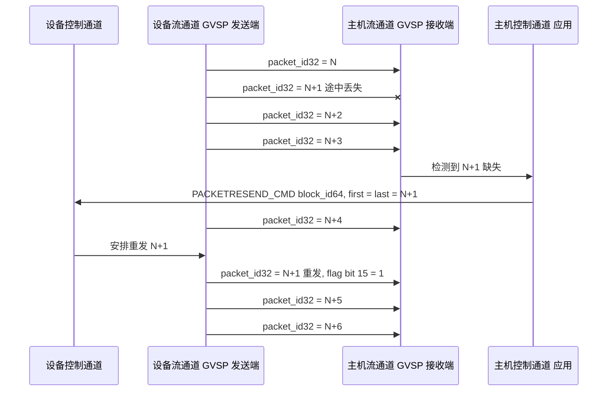
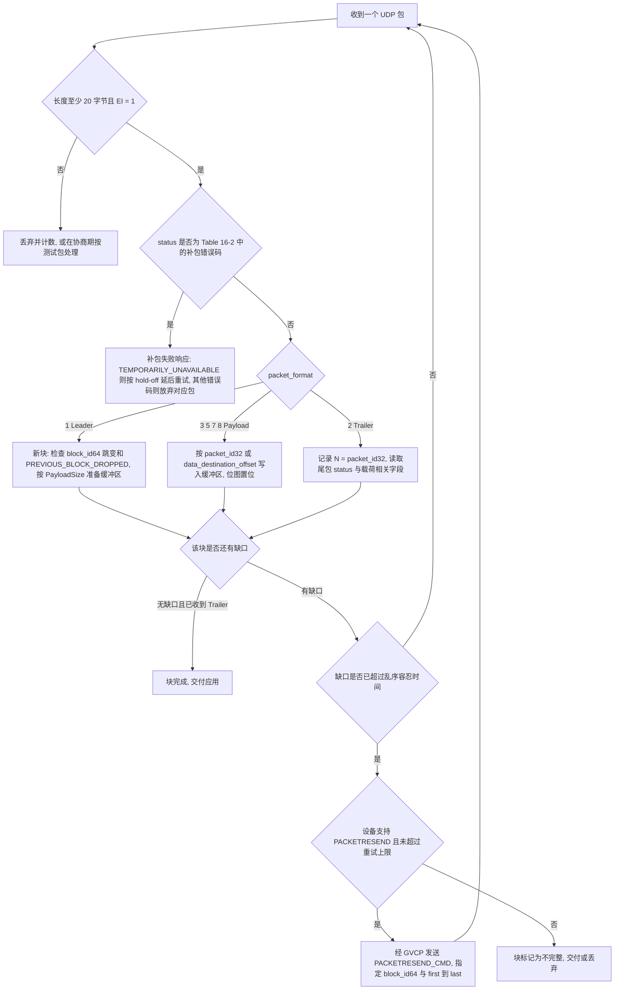
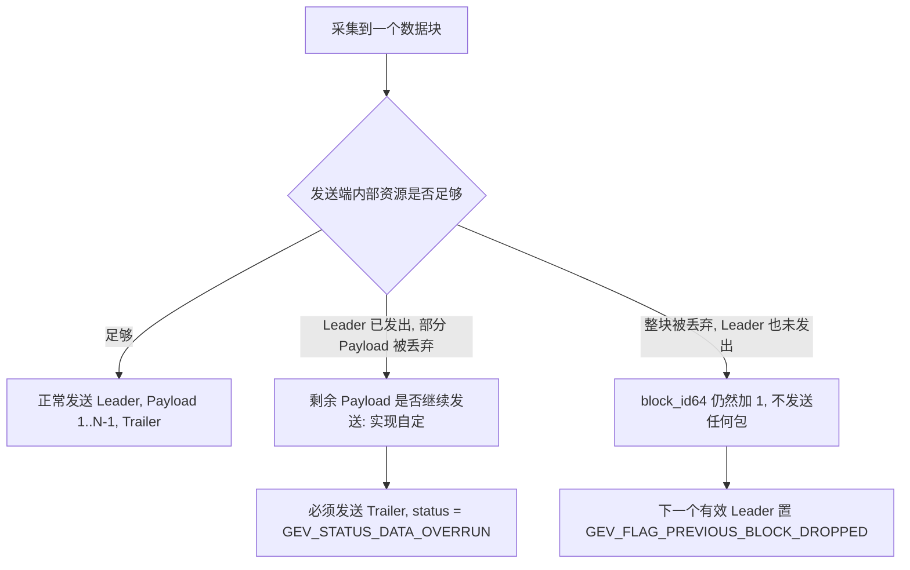
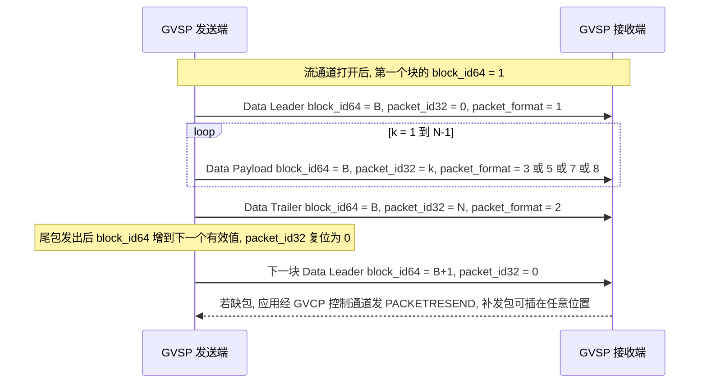
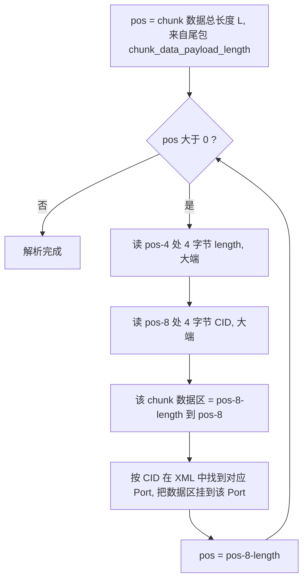

# GVSP 传输考量与数据块（GigE Vision 3.0 第 22–24 章）

> **覆盖范围**：Chapter 22 GVSP Summary（§22.1–22.3，p.164）；Chapter 23 GVSP Transport Protocol Considerations（§23.1–23.1.6，p.165–169）；Chapter 24 GVSP Data Block（第 24 章引言、§24.1–24.5.1，p.170–185）。本文所有页码均为 **PDF 页码**（= 印刷页码 + 1）。
>
> **一句话总结**：GVSP 是跑在 UDP/IPv4 上的单向流协议；每个数据块（Data Block）由 1 个数据前导包（Data Leader，packet_id32 = 0）+ 若干数据载荷包（Data Payload，packet_id32 = 1…N−1）+ 1 个数据尾包（Data Trailer，packet_id32 = N）组成，所有包共用一个 20 字节的大端包头（status / flag / EI / packet_format / block_id64 / packet_id32）；可靠性依靠 packet_id32 检测缺包 + GVCP 的 PACKETRESEND 补包来实现。
>
> **本文目录**
> - 阅读约定（位序、字节序、偏移基准）
> - 核心要点
> - 22 GVSP 概述（22.1 Overview / 22.2 Goals / 22.3 Scope）
> - 23 GVSP 传输协议考量：23.1 UDP、23.1.1 分片、23.1.2 包大小、23.1.3 可靠性与补包、23.1.4 流控、23.1.5 端到端连接、23.1.6 采集/传输期间的设备错误处理
> - 24 GVSP 数据块：多 ROI 与隔行；24.1 块传输；24.2 包头（含 24.2.1 状态标志）；24.3 前导/载荷/尾包；24.4 Chunk 数据（含字节序示例与 GenICam 定义示例）；24.5 测试包（含 24.5.1 LFSR）
> - 实现要点与易错点（流发送端 / 流接收端 / 管理实体）
> - 相关章节
> - 自测题

---

## 阅读约定（务必先读）

| 约定 | 说明 | 出处 |
|---|---|---|
| 位编号 | 规范采用 **MSB-first** 编号：bit 0 = 字段（或 32 位字）的**最高有效位**。例如 16 位 flag 字段中的 "bit 15" 是**最低位**（数值 0x0001）。寄存器同理：SCPSx 的 bit 0（fire_test_packet）= 0x80000000、bit 1（do_not_fragment）= 0x40000000、bit 16–31（packet_size）= 低 16 位；SCCFGx 的 bit 26 = 0x00000020。本文所有位号均照抄规范；表中"掩码"列是按此约定换算出的数值（💡 解读）。 | §15.3, p.115；§24.2, p.173–174 |
| 字节序 | GVSP 包头、数据前导、数据尾一律为网络字节序（大端）（[R-257s]）。**但像素数据是小端**（[R-344st]）；chunk 的 CID/length 标签是大端（[CR-276s]）。 | p.173 / p.202 / p.179 |
| 字节偏移基准 | 本文所有"字节偏移（Offset）"都从 **GVSP 头的第一个字节**（= UDP 载荷第 0 字节）算起，**不含** IP 头（固定 20 字节，GVSP 禁止 IP 选项，[R-246s]）和 UDP 头（8 字节）。若从以太网帧头起算（无 VLAN 标签），需再加 14 + 20 + 8 = 42 字节（💡 解读）。 | p.165 |
| "包大小" | SCPSx / GevSCPSPacketSize 中的 packet_size 指 **IP 数据报总长**：IP 头 20 + UDP 头 8 + GVSP 头 + 数据；不含以太网帧头与 FCS。 | §36.58, p.324；§24.5, p.183 |
| ID 模式 | v3.0 只保留**扩展 ID 模式**（EI = 1：64 位 block_id64 + 32 位 packet_id32）。16 位 block ID（旧"标准 ID 模式"）已被移除，需要了解请查 GigE Vision 2.0。 | §24.2, p.174；附录 D, p.416 |
| ASCII 图 | 包格式图每行 32 位，左侧数字为该行首字节的偏移；图中字段名保持英文。 | — |

---

## 核心要点

- GVSP 基于 UDP/IPv4（[R-245s]），**不得使用任何 IP 选项**，IP 头固定 20 字节（[R-246s]）；接收端必须能处理乱序到达的包（[R-247sr]）（p.165）。
- 一个数据块 = 1 个 Data Leader（packet_id32 = 0）+ 一个或多个 Data Payload（packet_id32 = 1…N−1）+ 1 个 Data Trailer（packet_id32 = N）（Figure 24-1, p.172；[R-256s]）。块必须顺序发送：当前块的尾包发出之前不得发送下一块的前导包，PACKETRESEND 补发除外（[R-251st], p.170）。
- 所有 GVSP 包共用 **20 字节**包头：status(16) | flag(16) | EI(1)+reserved(3)+packet_format(4)+reserved(24) | block_id64(64) | packet_id32(32)（Figure 24-2, p.173）。**包头里没有长度字段**，长度取自 UDP length。
- v3.0 中 EI 位必须置 1，16 位 block ID 已删除（p.174, p.416）。block_id64 从 1 开始，流通道打开时复位为 1，0 保留给测试包（[R-259st]）。
- packet_format：1 = Leader，2 = Trailer，3 = Generic 载荷，5 = H.264 载荷，7 = Multi-part 载荷，8 = GenDC 载荷，其余保留（p.174）。
- flag 字段：bit 0–7 设备自定义；bit 13 = GEV_FLAG_RESEND_RANGE_ERROR，bit 14 = GEV_FLAG_PREVIOUS_BLOCK_DROPPED，bit 15 = GEV_FLAG_PACKET_RESEND（Table 24-1, p.175）。按 MSB-first 换算为 flag 值 0x0004 / 0x0002 / 0x0001（💡）。
- 前导包、尾包默认必须装进 **≤ 576 字节**的 IP 包（含 IP/UDP/GVSP 头）；仅当 SCCFGx 的 large_leader_trailer_enable（bit 26）置 1 时，上限改为 SCPSx（[R-261st][R-267st]）。前导/尾包**不允许填充**。
- Generic 载荷（packet_format 3）：除最后一包外，所有载荷包长度都必须等于 SCPSx 的 packet_size（[R-263st]），每包数据量 = packet_size − 20 − 8 − 20；最后一包可以更短，也可以填充到等长，但填充不属于 PayloadSize，接收端必须丢弃超出 PayloadSize 的数据（[R-568sr]）。
- 采集出错时：只要该块已发出任一包，就必须发送尾包（[R-248st]）；块内有载荷包被丢弃 → 尾包 status = GEV_STATUS_DATA_OVERRUN（[R-249st]）；整块被丢弃 → block_id64 照常计数，并在下一个有效前导包中置 GEV_FLAG_PREVIOUS_BLOCK_DROPPED（[R-250st]）。
- 流控手段：SCPDx 包间延时（单位为时间戳 tick，从前一包结束量到后一包开始）+ IEEE 802.3 PAUSE 帧（按网口配置，Table 23-1）。
- Chunk 数据：每个 chunk = 数据（K 字节，4 字节对齐）+ **尾随标签** CID(4) + length(4)，标签为大端；解析器从块末尾向前遍历（§24.4, p.179–181）。
- 测试包沿用 1.x 风格的 8 字节头（第 0 个 32 位字的低 16 位 = 0），payload 可由 16 位 LFSR 生成：右移、初值 0xFFFF、多项式 0x8016、每输出 1 字节时钟 1 次、取寄存器低字节，首字节 = 0xFF（§24.5, p.183–185）。

---

## 22 GVSP 概述（§22, p.164）

### 22.1 Overview（概述）

- GVSP（GigE Vision Streaming Protocol，GigE Vision 流协议）是依赖 UDP 传输层的**应用层协议**，让 GVSP 接收端（GVSP receiver）从 GVSP 发送端（GVSP transmitter）接收图像数据、图像信息或其他信息。
- GVSP 包**总是从发送端流向接收端**（单向）。
- 当前版本使用 UDP over IPv4。由于 UDP 不可靠，GVSP 提供：① 保证包传输可靠性的机制（**通过 GVCP**，即 PACKETRESEND 补包）；② 最低限度的流控。

### 22.2 Goals（设计目标）

1. 定义发送端向接收端发送图像数据、图像状态或其他数据的机制；
2. 支持**自描述数据**（self-describing data）；
3. 尽量降低 GigE Vision 实体中 IP 协议栈的复杂度；
4. 尽量降低网络带宽开销。

💡 解读：目标 2 体现为"数据前导包携带解码所需的全部信息"（如 Image 载荷的 pixel_format、size_x/size_y），接收端不必查询设备寄存器就能解码；目标 3 体现为"禁止 IP 选项、固定头长、无长度字段"等设计，方便用 FPGA 做 UDP/IP 卸载。

### 22.3 Scope（范围）

本部分（PART 3 – GVSP）提供：流协议规范；各种包类型的包头；GigE Vision 支持的非 PFNC 像素格式列表。

> ⚠️ 规范一致性提示：v3.0 附录 D 写明 "Pruned 'GEV-only' pixel format text"（p.416），第 26 章已经**没有**非 PFNC 像素格式清单（只在 Figure 26-1 中用 Mono10Packed 举例）。§22.3 的 scope 描述属于遗留文字，与实际内容不完全一致。

💡 背景：v3.0 新增了基于 RoCEv2 的 GVRSP 流协议（只支持 GenDC 载荷，见 [GVRSP 一文](../04_gvrsp/01_rocev2_and_streaming_model.md)），但 GVSP 仍是正式的流协议。v3.0 的 GVSP 包与 2.x 接收端兼容，而 1.x 接收端与 v3.0 GVSP 发送端**不兼容**（§11.4, p.83）。

---

## 23 GVSP 传输协议考量（§23, p.165–169）

- **[R-245s]** GVSP 流协议必须使用 UDP + IPv4。
- **[R-246s]** GVSP 发送端和接收端都**不得**在 GVSP 的 IP 数据报中使用任何 IP 选项，使 IP 头固定为 20 字节——目的是便于用硬件实现 UDP/IP 卸载引擎（p.165）。

### 23.1 UDP（§23.1, p.165）

UDP 是无连接协议，不给 IP 增加任何可靠性、流控或错误恢复。因此 GVSP 对流通道（stream channel）的处理施加了一些限制。

- **[R-247sr]** 由于 UDP 不保证投递顺序，GVSP 接收端**必须**能接受乱序到达的包。

#### 23.1.1 分片（Fragmentation）（p.165）

- 流通道总是由发送端发往接收端，所以"是否支持 IP 分片"由**接收端**决定。
- 发送端侧：SCPSx 寄存器的 **do_not_fragment** 位（bit 1）会被复制到该流通道每个包的 IP 头 "Don't Fragment" 位（§36.58, p.324–325）。
- 接收端侧：SCCx 能力寄存器的 **IP_reassembly_supported** 位（bit 1）通告是否支持 IP 重组（§36.62, p.329）。
- 由系统的**管理实体**（management entity）负责让发送端的配置与接收端能力相匹配。**拿不准时不要使用 IP 分片。**

#### 23.1.2 包大小要求（Packet Size Requirements）（p.165）

- 与 GVCP 不同，GVSP 包长**不要求是 32 位的倍数**，分辨率为 1 字节。
- 可以通过发射测试包（test packet）来探测传输介质的 MTU。参见 SCPSx 寄存器和 GevSCPSPacketSize 特性（协商流程见 §11.7, p.84–85；GevSCPSPacketSize 取值范围 46–65535，[CR-520st]，§37.5.4, p.362）。
- SCPSx 请求的包大小只约束**数据载荷包**，不约束数据前导包和数据尾包——除非 SCCFGx 寄存器的 **large_leader_trailer_enable（bit 26）** 置位；否则前导包与尾包必须装在 **576 字节**的包内。
- NOTE：大前导/尾包是 GigE Vision 2.1 为支持 multi-part 载荷类型引入的；其他载荷类型使用常规的 576 字节前导/尾包已足够。

💡 解读：576 字节是 IPv4 规定所有主机都必须能接收的最小数据报长度（RFC 791），以它作为前导/尾包默认上限，可以保证这两类关键包在任何路径上都无需分片，且与 2.0 及更早的接收端兼容（SCCx 的 LLT 位为 0 即表示 576 字节上限，§36.62, p.330）。

#### 23.1.3 可靠性与错误恢复（Reliability and Error Recovery）（p.165–166）

- GVSP 通过**监视 packet_id32 字段**、校验组成一个块的所有包是否都已收到来提供可靠性。若有缺包，与 GVSP 接收端关联的**主应用**（primary application）可以用 **PACKETRESEND** 命令请求补发（前提是发送端支持该命令）。
- 同一块内相继的包，packet_id32 依次加 1。
- **UDP 校验和（checksum）不是强制要求。**
- Figure 23-1（Data Resend Flowchart, p.166）给出了典型的丢包补发过程：设备侧依次发送 N、N+1（途中丢失）、N+2、N+3；主机侧（控制通道）检测到 N+1 缺失后发出 PACKETRESEND；设备侧控制通道收到请求后，流通道在发送 N+4 之后插入"重发 N+1"，然后继续 N+5、N+6。规范强调：接收端及其应用对缺包作出反应所需的时间**取决于实现**；且 UDP 不保证包按发送顺序到达。

下面用时序图重绘 Figure 23-1（packet id 即 packet_id32）：



##### 流端视角的补包细节（摘自 §16.7；完整命令格式见 [GVCP 消息格式](../02_gvcp/03_message_formats.md)）

PACKETRESEND 是 GVCP 命令，但其"执行结果"完全体现在 GVSP 流上。流接收端需要理解以下行为（§16.7–16.7.3, p.136–142）：

| 主题 | 要点 | 出处 |
|---|---|---|
| 能力前提 | 发送端**应**支持 PACKETRESEND（[O-196cd]）；应用只有在 GVCP Capability 寄存器（0x0934）bit 29 置位时才能发送 PACKETRESEND_CMD（[R-197ca]）。该命令可**异步**发出（即使上一条命令的 ACK 尚未返回）。主、次应用都可以请求，发送端都必须响应（[CR-199cd]）。 | §16.7, p.136–137 |
| 请求内容 | PACKETRESEND_CMD 携带 stream_channel_index、block_id64（不能为 0）、first_packet_id / last_packet_id（各 32 位）。last_packet_id = 0xFFFF FFFF 表示"一直重发到并包括尾包"，适合可变大小的块。 | §16.7.1, p.137–138 |
| 无 ACK | 应用必须清除 GVCP 头的 ACKNOWLEDGE 位（[CR-198ca]）；**不存在 PACKETRESEND_ACK**（[CR-201cd]），执行结果直接在流通道上验证。 | p.137–138 |
| 重发目的地 | 默认发往 SCDAx；若 SCCx bit 28（PRD）支持且 SCCFGx bit 28 置位，则改为发往 PACKETRESEND_CMD 的源 IP（适合多播场景下单播补包）。 | p.137；§36.62–36.63, p.331–333 |
| 重发标记 | 重发的包必须置 flag 的 **GEV_FLAG_PACKET_RESEND（bit 15）**（[CR-204st]）；status 可用 GEV_STATUS_PACKET_RESEND（0x0100），它比 GEV_STATUS_SUCCESS 更推荐（Table 19-1, p.157）。有了 flag 位，重发包也可以携带其他 status。 | p.138, p.157 |
| 无法重发 | 发送端必须回一个**只有包头、不带数据**的 GVSP 包，packet_format 为 don't care，status 取 Table 16-2 中的错误码（[CR-205st]）。 | p.139 |
| 区间错误 | 若一段连续包因同一原因都无法重发，**应**置 GEV_FLAG_RESEND_RANGE_ERROR（bit 13），packet_id32 = 区间首包，并追加 last_packet_id32 = 区间末包（[CO-206st]）；也允许逐包发送错误包。支持区间重发的接收端**必须**能接收这种包（[CR-207sr]）。 | p.140 |
| 暂时不可用 | status = GEV_STATUS_PACKET_TEMPORARILY_UNAVAILABLE 时，包头末尾必须追加 32 位 hold-off 信息（[CR-208st]），建议应用等待后再请求。 | p.140–141 |
| 接收端策略 | 发送端内存有限，应用应**尽快**发出 PACKETRESEND；包可能乱序，单纯看 packet_id32 是否连续并非万无一失；在保证有序的拓扑（如直连）中可以"一发现跳号就立即请求"，并用超时检测尾包丢失；无序拓扑中需要基于超时等方案，属实现质量（quality of implementation）。 | §16.7.3, p.142 |

"返回错误的 GVSP 包"布局（Figure 16-14, p.140；偏移从 GVSP 头起算，方括号为可选字段）：

```text
        0             7 8            15 16           23 24           31
       +-------------------------------+-------------------------------+
    0  |      status (error code)      |    flag (bit 13 may be set)   |
       +-+-----+-------+---------------+-------------------------------+
    4  |1| rsv | (any) |                    reserved                   |
       +-+-----+-------+-----------------------------------------------+
    8  |                     block_id64 (high part)                    |
       +---------------------------------------------------------------+
   12  |                     block_id64 (low part)                     |
       +---------------------------------------------------------------+
   16  |              packet_id32 (first or single packet)             |
       +---------------------------------------------------------------+
   20  |        [last_packet_id32] (only if RESEND_RANGE_ERROR)        |
       +-------------------------------+-------+-----------------------+
20/24  |           [reserved]          |[HO_sh]|    [hold_off] (us)    |
       +-------------------------------+-------+-----------------------+
```

| 字节偏移(Offset) | 字段 | 长度 | 说明 |
|---|---|---|---|
| 0–19 | 标准 GVSP 头 | 20 B | status 取 Table 16-2 的错误码；packet_format 为 don't care；packet_id32 = 无法重发的（首个）包 |
| 20–23 | [last_packet_id32] | 4 B | 仅当 flag 的 GEV_FLAG_RESEND_RANGE_ERROR 置位时存在（包长 +4） |
| 20–21（无区间）或 24–25（有区间） | [reserved] | 16 bit | 仅当 status = GEV_STATUS_PACKET_TEMPORARILY_UNAVAILABLE 时存在 |
| 22（或 26）字节的高 4 位 | [HO_shift] | 4 bit | hold-off 左移位数（扩大取值范围） |
| 22–23（或 26–27）的低 12 位 | [hold_off] | 12 bit | 建议等待时间，单位 µs |

💡 解读：两种可选字段相互独立，可单独或同时出现，接收端必须结合 status 与 flag 判断包长。按字面理解，建议等待时间 ≈ hold_off × 2^HO_shift µs（最大约 4095 × 2^15 µs ≈ 134 s）。注意 Figure 16-14 中 HO_shift / hold_off 的分界线画在 bit 24 处，与字段表（4 位 + 12 位）不一致，应以字段表为准。

与流相关的常见状态码（Table 19-1, p.157–159）。status 字段本身的布局为：bit 0 severity（0 = info，1 = error）、bit 1 device_specific_flag、bit 2–3 reserved、bit 4–15 status_value（§19, p.156）。

| 状态码 | 值 | 在 GVSP 中的用途 |
|---|---|---|
| GEV_STATUS_SUCCESS | 0x0000 | 数据正确 |
| GEV_STATUS_PACKET_RESEND | 0x0100 | 该包是重发包（info 级，优先于 SUCCESS 使用） |
| GEV_STATUS_PACKET_UNAVAILABLE | 0x800C | 请求的包已不可用（附录 B.10 建议优先使用下面更具体的码，p.403–404） |
| GEV_STATUS_DATA_OVERRUN | 0x800D | 发送端内部内存溢出、块内数据被截断，放在尾包（[R-249st]） |
| GEV_STATUS_PACKET_NOT_YET_AVAILABLE | 0x8010 | 请求的包尚未采集（如线阵触发慢于应用的补包超时） |
| GEV_STATUS_PACKET_AND_PREV_REMOVED_FROM_MEMORY | 0x8011 | 该包及之前所有包都已从发送端内存删除，不要再请求 |
| GEV_STATUS_PACKET_REMOVED_FROM_MEMORY | 0x8012 | 该包已删除，但不代表更早的包也不可用 |
| GEV_STATUS_PACKET_TEMPORARILY_UNAVAILABLE | 0x8014 | 带宽暂时不足，稍后再请求（附带 hold-off） |
| GEV_STATUS_LEADER_TRAILER_OVERFLOW | 0x8017 | 前导/尾包容量不足以放下全部信息（用于 multi-part，附录 B.20, p.405–406） |
| GEV_STATUS_ERROR | 0x8FFF | 通用错误；发送端无法给出更具体的码时至少返回它（[R-242st]） |

💡 解读：接收端"缺包检测 → 补包决策"的参考流程（规范把具体策略留作实现质量，以下为常见做法，非规范内容）：



#### 23.1.4 流控（Flow Control）（p.167–168）

**① 包大小 + 包间延时（inter-packet delay）**

- 规范通过控制流的**包大小**来优化带宽利用率，并通过控制**包间延时**提供一种"粗糙的"流控机制。
- **SCPDx** 寄存器给出包间延时：同一流通道的两个流包在**同一条物理链路**上发送时，两者之间最少要等待的时间，单位是**时间戳计数器 tick**；从**前一包结束**量到**后一包开始**。时间戳计数器通常是设备上粒度最细的定时器；**设备没有时间戳计数器时，SCPDx 无法用于流控**。
- SCPDx 细节（§36.59, p.326–327）：地址 0x0D08 + 0x40·x，出厂默认 0；规范指出这意味着**每个网口对每个流都要有独立的定时器**；GVSP 设备必须实现（[CR-491cd]）。对应 SFNC 特性 GevSCPD。
- 这些机制可以减少接收端溢出和补包次数，但受当前以太网控制器设计所限，**可能不足以**有效调节收发节奏。

💡 解读（粗略估算 SCPD，非规范内容）：设链路速率为 R、包在线上占用 B 字节（IP 包长 + 以太网头 14 + FCS 4 + 前导码 8 + 帧间隙 12），单包线上时间 T = B×8/R；若想把该流的平均带宽限制到占空比 η，则额外间隔 ≈ T×(1/η − 1)，再乘以时间戳频率得到 tick 数。例：1 GbE、packet_size = 1500 → B = 1538 字节，T ≈ 12.3 µs；η = 50% → 间隔 ≈ 12.3 µs；若时间戳频率为 1 GHz，SCPD ≈ 12 300 tick。设备如何计入帧间隙等细节因实现而异，应以实测为准。

**② 以太网 PAUSE 帧（IEEE 802.3 流控）**

- 很多以太网控制器的本地接收缓存很小：包先存在本地，再通过 DMA 送到主机协议栈。若某些系统状况使 DMA 长时间无法搬运，本地缓存耗尽就会丢包——**即使带宽利用率很低也可能发生**。
- 因此很多情况下可以使用标准以太网流控：在接收本地缓存耗尽之前，MAC 子层发出 MAC Control 请求，其中 **PAUSE** 请求可让对端在一段时间内暂停发送，给本地控制器时间把缓存中的包搬到协议栈。规范指出，迈向 10 Gbps 时这种情况可能更普遍，因此需要流控。
- 规范引用 IEEE 802.3-2008：**Clause 31**（MAC Control，可选的 MAC 控制子层）、**Annex 31A**（MAC Control 操作码）、**Annex 31B**（MAC Control PAUSE 操作）。
- PAUSE 在 OSI 数据链路层处理，对上层透明，因此 GigE Vision 的控制、流、消息通道都可以"透明地"受益。但可能需要把**背压**信息传给上层：例如网口被通知暂停发送时，GVSP 发送端可能需要**在帧边界开始丢图**，以防 GVSP 所在层发生数据溢出。
- 多网口实体各网口能力可能不同，因此**必须按网口**实现 PAUSE 能力与控制。
- NOTE：链路聚合（LAG）时，同一聚合器内所有物理 MAC 使用相同的 PAUSE 配置（对外呈现为一条逻辑链路）。

**Table 23-1：PAUSE 协商**（p.168）——网口能力/配置寄存器（§36.4/§36.5）中的 PAUSE_reception、PAUSE_generation 配置位，与链路自协商时通告的 PAUSE / ASM_DIR 位之间的映射：

| PAUSE_reception Enable | PAUSE_generation Enable | 通告 PAUSE | 通告 ASM_DIR | 含义（💡 解读） |
|:-:|:-:|:-:|:-:|---|
| 0 | 0 | 0 | 0 | 不支持 PAUSE |
| 0 | 1 | 0 | 1 | 只发送 PAUSE（非对称） |
| 1 | 0 | 1 | 1 | 只接收 PAUSE：同时以"对称伙伴 + 可接收 PAUSE 的非对称伙伴"身份通告 |
| 1 | 1 | 1 | 1 | 收发都支持 |

- 由此可见，GigE Vision 网口**永远不会**把自己表现为"只支持对称 PAUSE"的接口。只想接收 PAUSE 的网口会通告 PAUSE = 1、ASM_DIR = 1，从而能接收来自对称和非对称伙伴的 PAUSE 帧，而自己无需产生 PAUSE 帧。
- 统计：应用最好能按网口查询收发 PAUSE 帧数量。可查询 MAC 的 oMACControlFunctionEntity 管理对象类中推荐（但可选）的 **aPAUSEMACCtrlFramesTransmitted** 与 **aPAUSEMACCtrlFramesReceived** 属性；这些属性**应**通过 XML 设备描述文件提供，或用 SNMP 等其他标准方法获取（若设备支持）。

#### 23.1.5 端到端连接（End-to-End Connection）（p.168）

- 连接由 **GVCP** 管理，GVCP 心跳（heartbeat）监视设备与应用是否在线。
- **GVSP 本身没有端到端连接机制。** 若应用断开，GVCP 心跳超时后设备会**自动复位**其 GVSP 发送端的流连接——除非流通道被配置为继续发送（**无条件流 unconditional streaming**，§11.13, p.88；SCCFGx bit 30 unconditional_streaming_enable）。
- 默认情况下，若设备断开，GVSP 接收端将收不到该设备 GVSP 发送端的流包。

#### 23.1.6 采集与传输期间的设备错误处理（p.168–169）

- **[R-248st]** 若发送端发生采集错误，可能无法发出某块的全部数据包；**但只要已经为该块发出过至少一个包，就必须发送对应的数据尾包，并带上合适的状态码**。
- 最典型的情形是"采集比发送快"：一些包在发送端内部就丢了，还没来得及上流通道。例如链路速率低于预期、包间延时太长、链路上 IEEE 802.3 PAUSE 帧太多。**若整个块都丢了，上述要求不适用**（因为一个包都没发）。

需要处理两种场景：

| 场景 | 情形 | 发送端必须做的事 |
|---|---|---|
| 1）块内丢包 | 数据前导包已发出，但部分数据载荷包被丢弃 | **[R-249st]** 因内部内存不足丢弃载荷包时，必须把对应**尾包的 status** 设为 **GEV_STATUS_DATA_OVERRUN（0x800D）**。剩余载荷包是否继续发送属实现质量；但按 [R-248st]，**不得丢弃尾包**。 |
| 2）整块丢失 | 一个或多个块（含前导包）在内部被整块丢弃：接收端没收到任何前导包，但该块确实被采集且接收端在等它 | **[R-250st]** 被丢弃的已采集块**必须照样计入 block_id64 计数器**，并在链路上发出的**下一个有效前导包**中置 **GEV_FLAG_PREVIOUS_BLOCK_DROPPED**（flag bit 14）。 |

- 场景 2 中，下一个有效前导包带着该标志，并使用"假设所有块都已发送"时应有的 block_id64，接收端由 block_id64 的跳变即可算出丢了几块（附录 B.11 亦说明：截断用 DATA_OVERRUN，整块丢弃用该标志，p.404）。



💡 例：接收端依次收到 block_id64 = 1、2 的完整块，下一个前导包 block_id64 = 5 且 flag bit 14 = 1 → 丢失块数 = 5 − 2 − 1 = 2（即块 3、4 在发送端内部被丢弃）。若收到 block_id64 跳变但**没有**该标志，则更可能是网络丢失了前导包（及整块），可考虑对该块发起补包或直接计为网络丢块。

---

## 24 GVSP 数据块（第 24 章引言, p.170–171）

**数据块（Data Block）** 被划分为若干元素，为接收端提供解码所需的信息：

- **数据前导（Data Leader）**：开启一个块，给出该块的**载荷类型（payload type）**，并可附带帮助解码的其他信息；
- **数据载荷（Data Payload）**：通常紧随前导，承载真正要传的数据；
- **数据尾（Data Trailer）**：标志块结束。

块内的数据载荷包必须**顺序**发送（packet_id32 逐包加 1）。同一流通道上的数据块也是顺序发送的：

- **[R-251st]** 发送端必须顺序发送数据块：**当前块的数据尾包发出之前，不允许发送下一块的数据前导包**。唯一例外是 PACKETRESEND——它可以请求当前块或之前块中的任意包。

### 多 ROI（多感兴趣区域）的四种传输方式（p.170）

对 Image 类载荷，同一帧的多个 ROI 可以这样传：

| 方式 | 做法 | 要点 |
|---|---|---|
| 1. GenDC 载荷类型（§25.4） | 一次采集的所有 ROI 放进**一个块 / 一个 GenDC 容器** | 接收端无需判断哪些 ROI 属于同一组；容器内 ROI 可来自一次或多次曝光。收发双方都支持 GVSP GenDC 时的**推荐方式之一** |
| 2. Multi-part 载荷类型 | 一帧的所有 ROI 放进**一个块** | 收发双方都支持 multi-part 时的**推荐方式之一** |
| 3. 单个流通道 | 每个 ROI 用**不同的 block ID** 发送 | 必须使用**相同的时间戳**以便匹配到同一次曝光（[CR-253st]）；只需配置一个流通道 |
| 4. 多个流通道（每通道一个 ROI） | 各 ROI **应**使用相同的 block ID 便于匹配 | 时间戳仍可用于匹配；可把不同 ROI 发往不同目的地 |

- 无论哪种方式，数据前导包都要正确反映 ROI 在原始图像中的位置（如 Image leader 的 offset_x/offset_y）。
- **[CR-252st]** 若图像源用 GVSP 载荷支持多 ROI，则多个 ROI 的**重叠数据必须随每个 ROI 重复传输**，使每幅图像在其块中都是完整的。
- **[CR-253st]** 若设备支持多 ROI、且每个 ROI 用不同 GVSP 块传输，则同一次曝光的不同 ROI **必须使用相同的时间戳**。NOTE：使用 multi-part 时该要求自然满足（p.171）。

### 隔行（多场）图像源（p.171）

- 对隔行扫描图像源（或其推广：多场 multi-field 图像源），规范把**每一场（field）当作一个独立的数据块**。数据前导包提供额外信息，使接收端能确定场数和该块的场序号（Image leader 的 field_count / field_id，见 [载荷类型一文](./02_payload_types_and_pixel_layouts.md)），必要时由接收端去隔行。
- 发送端也可以在发送前自行去隔行，使接收端看到的是逐行图像。
- **[CR-254st]** 若发送端提供隔行数据传输模式，则**必须同时支持去隔行（de-interlaced）传输模式**。
- NOTE：GVSP **不报告场顺序（field ordering）**；场顺序配置留作去隔行器的控制参数。

### 24.1 GVSP 数据块传输（§24.1, p.171–173）

GVSP 传输中，数据前导、数据载荷和数据尾被拆到**不同的包**中；前导与尾包为载荷划定边界，也给相邻数据块提供清晰的分隔点。组成一个块的三种包：

1. 数据前导包（Data Leader Packet）
2. 数据载荷包（Data Payload Packet）
3. 数据尾包（Data Trailer Packet）

Figure 24-1（p.172，图中未画以太网/IP/UDP 头）：每个包都以"数据包头（Data Packet Header）"开头；前导包 packet id = 0，载荷包 packet id = 1、2、…、N−2、N−1，尾包 packet id = N。

```text
packet_id32:      0           1           2                N-1          N
             +---------+ +---------+ +---------+       +---------+ +---------+
             | header  | | header  | | header  |       | header  | | header  |
             +---------+ +---------+ +---------+  ...  +---------+ +---------+
             | Leader  | | Payload | | Payload |       | Payload | | Trailer |
             +---------+ +---------+ +---------+       +---------+ +---------+
              1 packet    <------- one or more payload packets ------>  1 packet
```

- **[R-256s]** 一个块的 GVSP 传输**必须**包含三类元素：① 1 个数据前导包（标志新块开始）；② 1 个或多个数据载荷包（承载当前块的实际信息）；③ 1 个数据尾包（标志块结束）。

> ⚠️ 规范一致性提示：[R-256s] 说"一个或多个"载荷包，但 §24.3.2（p.176）又允许 Raw、File、Chunk-data、Device-specific 载荷类型的块**没有任何载荷包**（前导包后直接跟尾包）。实现时以 §24.3.2 的宽松规则为准更安全：接收端要能处理"0 个载荷包"的块。



### 24.2 数据块包头（Data Block Packet Header）（§24.2, p.173–175）

- **所有 GVSP 包共享同一个基本包头。GVSP 协议头不含 length 字段**：接收端用 **UDP 长度**确定包大小。
- 系统的管理实体负责优化包大小（例如借助测试包）。固定的包大小也便于接收端在有包缺失时，仍能把后续数据定位到缓冲区的正确位置。
- **[R-257s]** 所有 GVSP 包头、数据前导、数据尾**必须**使用网络字节序（大端）。
- **[R-258s]** Figure 24-2 所示的数据包头**必须**出现在**所有** GVSP 包中（测试包例外，见 §24.5）。

Figure 24-2 GVSP Packet Header（p.173；v3.0 中 EI 固定为 1）：

```text
        0             7 8            15 16           23 24           31
       +-------------------------------+-------------------------------+
    0  |             status            |              flag             |
       +-+-----+-------+---------------+-------------------------------+
    4  |1| rsv |pkt_fmt|               reserved (24 bits)              |
       +-+-----+-------+-----------------------------------------------+
    8  |                     block_id64 (high part)                    |
       +---------------------------------------------------------------+
   12  |                     block_id64 (low part)                     |
       +---------------------------------------------------------------+
   16  |                          packet_id32                          |
       +---------------------------------------------------------------+
   20  |      ... (leader / payload / trailer specific content) ...    |
```

| 字节偏移(Offset) | 字段 | 长度 | 规范位号 | 说明 |
|---|---|---|---|---|
| 0–1 | status | 16 bit | 字 0 的 bit 0–15 | 流操作的状态（见第 19 章状态码） |
| 2–3 | flag | 16 bit | 字 0 的 bit 16–31（字段内 bit 0–15） | GVSP 流状态标志。高 8 位（msb，bit 0–7）设备自定义；低 8 位（lsb，bit 8–15）由 GigE Vision 定义：bit 8–12 保留，bit 13 GEV_FLAG_RESEND_RANGE_ERROR，bit 14 GEV_FLAG_PREVIOUS_BLOCK_DROPPED，bit 15 GEV_FLAG_PACKET_RESEND。未用位发送置 0、接收忽略 |
| 4（最高位） | EI | 1 bit | 字 1 的 bit 0 | Extended ID 标志，**必须为 1**，告知接收端 block ID 为 64 位（16 位 block ID 见 GigE Vision 2.0）。💡 字节 4 & 0x80 |
| 4（bit 6–4） | reserved | 3 bit | 字 1 的 bit 1–3 | 发送置 0，接收忽略。💡 字节 4 & 0x70 |
| 4（低 4 位） | packet_format | 4 bit | 字 1 的 bit 4–7 | 1 = DATA_LEADER_FORMAT；2 = DATA_TRAILER_FORMAT；DATA_PAYLOAD_FORMAT：3 = Generic，5 = H.264，7 = Multi-part，8 = GenDC；其余保留。💡 字节 4 & 0x0F |
| 5–7 | reserved | 24 bit | 字 1 的 bit 8–31 | 发送置 0，接收忽略 |
| 8–15 | block_id64 | 64 bit | 字 2–3 | 数据块 ID：从 1 开始顺序递增；**0 保留给测试包**；流通道打开时复位为 1。高 32 位在前（大端） |
| 16–19 | packet_id32 | 32 bit | 字 4 | 块内包 ID：每个块开始时复位为 0，因此 packet_id32 = 0 就是当前 block_id64 的前导包 |

💡 解读：字节 4 的典型取值（EI = 1，保留位为 0）：前导包 **0x81**、尾包 **0x82**、Generic 载荷 **0x83**、H.264 载荷 0x85、Multi-part 载荷 0x87、GenDC 载荷 **0x88**。抓包时看到字节 4 不是 0x8X，要么是测试包（EI don't care），要么是旧的 16 位 block ID 设备。

- **[R-259st]** 流通道被打开时，发送端**必须**把该流通道的 block_id64 复位为 1（SCPx 的 host_port 字段描述中同样要求，§36.57, p.324）。目的：让接收端在新连接开始时就能判断是否丢了块——主应用连接设备、配置并打开流通道后，发出的第一个块必然是 block_id64 = 1（p.174–175）。

#### 标准 ID 模式与扩展 ID 模式（EI 标志）

| 项目 | 扩展 ID 模式（EI = 1）——v3.0 唯一模式 | 16 位 block ID 模式——v3.0 已删除 |
|---|---|---|
| block ID | block_id64，64 位，字节 8–15 | 16 位 block ID（具体布局见 GigE Vision 2.0，本知识库不展开） |
| packet ID | packet_id32，32 位，字节 16–19 | 见 GigE Vision 2.0 |
| 头长度 | 20 字节 | 见 GigE Vision 2.0 |
| 版本沿革 | 2.0 引入 block_id64 + EI 标志与 32 位 packet_id32（附录 D, p.411–412）；3.0 把扩展 ID 定为"主要/唯一"引用的 GVSP 模式（p.416） | 2.0 为兼容保留；3.0 "Removed 16-bit Block ID support"（p.416）；Streaming Capability 寄存器 bit 1 原为 legacy_16bit_block_id_supported，现为 deprecated（§36.27, p.290） |

- GVCP 一侧也同步：PACKETRESEND_CMD 的 flag bit 3（Extended ID）发送时置 1，并携带 block_id64（§16.7.1, p.138）。
- 测试包是唯一例外：它保持 1.x 风格，EI 位 don't care（§24.5）。
- 💡 若接收端还要兼容仍工作在 16 位 block ID 模式的老设备，需要按 GigE Vision 2.0 解析 EI = 0 的包；v3.0 本身不再定义该格式。

#### ID 的取值范围与回绕（💡 解读）

- v3.0 正文**没有**专门描述 block_id64 的回绕。[R-268st] 要求尾包发出后 block_id64 "递增到下一个**有效**值"，而 0 保留给测试包，因此若真的回绕，应跳过 0（0xFFFF FFFF FFFF FFFF 之后是 1）。实际上按每秒 100 万个块计算，回绕需要约 58 万年，可以视为不会回绕（这正是 2.0 引入 64 位 ID 的原因之一：16 位 ID 在高帧率下很快回绕）。
- packet_id32 每块从 0 重新开始，不存在跨块回绕。§24.3.2 说每块"最多 2^32 个载荷包"（p.176），严格来说前导占 0、尾包占 N，且 PACKETRESEND 把 last_packet_id = 0xFFFF FFFF 用作"直到尾包"的特殊值，所以实际可用的载荷包数略少于 2^32。SCMPCx（§36.64, p.334）给出当前包大小下一个块最多用多少个包（**含**前导和尾包），接收端可据此确定上界。

#### 24.2.1 GVSP 状态标志（GVSP Status Flags）（p.175）

Table 24-1 List of GVSP Status Flags（"掩码"列为按 MSB-first 换算的 16 位 flag 字段值，💡）：

| Status Value | 说明 | 规范位号 | 掩码（flag 字段） |
|---|---|---|---|
| Device-specific | 由设备厂商定义 | 0–7 | 0xFF00（即字节 2） |
| Reserved | 发送置 0，接收忽略 | 8–12 | 0x00F8 |
| GEV_FLAG_RESEND_RANGE_ERROR | 表示该 GVSP 包携带的是"**一段**包"的错误状况（见 [CO-206st]） | 13 | 0x0004 |
| GEV_FLAG_PREVIOUS_BLOCK_DROPPED | 之前有一个或多个数据块被丢弃时置 1；用 block_id64 判断丢了几块 | 14 | 0x0002 |
| GEV_FLAG_PACKET_RESEND | 当前包是 PACKETRESEND 请求的结果时置 1 | 15 | 0x0001 |

💡 解读：这三个标志都位于字节 3（flag 的低字节）：字节 3 & 0x04 / 0x02 / 0x01。最常见的位序错误是把 "bit 15" 当成 0x8000——那其实是设备自定义区的最高位。

### 24.3 GVSP 包（GVSP Packets）（§24.3, p.175–179）

本节定义三种通用（generic）包格式；具体载荷类型（Image、Chunk Data、GenDC 等）在此基础上追加自己的字段，见 [载荷类型一文](./02_payload_types_and_pixel_layouts.md)。

#### 24.3.1 GVSP 数据前导包（Data Leader Packet）（p.175–176）

- **[R-260st]** 数据前导包**必须**是块的第一个包。
- **[R-261st]** 数据前导包必须**单独成包**，packet_id32 = 0；必须能装进**最多 576 字节**的包（**含** IP、UDP 与 GVSP 头）——除非 SCCFGx 的 large_leader_trailer_enable 位置位，此时前导包最大长度由 SCPSx 给出。
- **[R-262s]** 数据前导包必须遵循 Figure 24-3 的布局；不同载荷类型可在此头之后追加附加信息。
- NOTE：接收端可以用 UDP 长度来解码载荷类型相关部分，**因此发送端不得填充（pad）前导包**。

Figure 24-3 Generic Data Leader Packet（p.176）：

```text
        0             7 8            15 16           23 24           31
       +-------------------------------+-------------------------------+
    0  |             status            |              flag             |
       +-+-----+-------+---------------+-------------------------------+
    4  |1| rsv | fmt=1 |                    reserved                   |
       +-+-----+-------+-----------------------------------------------+
    8  |                     block_id64 (high part)                    |
       +---------------------------------------------------------------+
   12  |                     block_id64 (low part)                     |
       +---------------------------------------------------------------+
   16  |                          packet_id32                          |
       +-------------------------------+-------------------------------+
   20  |     payload_type_specific     |          payload_type         |
       +-------------------------------+-------------------------------+
   24  |          additional info (payload type specific) ...          |
       +---------------------------------------------------------------+
```

| 字节偏移(Offset) | 字段 | 长度 | 说明 |
|---|---|---|---|
| 0–19 | GVSP 包头 | 20 B | packet_format = 1（字节 4 = 0x81），packet_id32 = 0 |
| 20–21 | payload_type_specific | 16 bit | 由各载荷类型自行定义（如 Image 的 field_id/field_count；Chunk Data、GenDC 中为 reserved） |
| 22–23 | payload_type | 16 bit | 载荷类型 ID，取值见 Table 25-1。**bit 0（msb）** 表示设备自定义载荷类型；**bit 1** 表示 Extended Chunk 模式（0 = 关闭，1 = 开启，见 §25.1） |
| 24– | additional info | 可变 | 载荷类型相关的附加信息，长度由 UDP length 推出 |

💡 解读：
- payload_type 的 bit 0 / bit 1 按 MSB-first 对应数值 **0x8000 / 0x4000**——这正是 Table 25-1 中设备自定义类型 "≥ 0x8000"、扩展 chunk 变体 "0x4001、0x4006…" 的由来。对标准类型（bit 0 = 0），清掉 0x4000 即得基本类型（如 0x4001 → 0x0001 Image）。
- 在 576 字节限制下，前导包留给 additional info 的空间最多为 576 − 20（IP）− 8（UDP）− 24 = **524 字节**。

#### 24.3.2 GVSP 数据载荷包（Data Payload Packet）（p.176–178）

- 数据载荷包把实际信息传给接收端；每个块**最多可有 2^32 个**数据载荷包，通常有一个或多个。
- 对 Raw、File、Chunk-data 或 Device-specific 载荷类型，块可以**没有**数据载荷包。例如某次曝光的处理没有产生结果：发送"前导包 + 尾包"来报告"图像中未发现缺陷"是合法的。
  - 💡 注意：Raw、File 并不在 v3.0 Table 25-1 的规范性载荷类型中（属于 2.x 的类型），此处是遗留表述。
- GVSP 定义了多种载荷包格式（packet_format）以适应不同载荷类型（p.177 的表）：

| packet_format | 名称 | 说明 |
|:-:|---|---|
| 3 | Generic | 最初的载荷包格式，被多种载荷类型使用（v3.0 中 Image、Chunk Data 即用它）。块数据被切成若干载荷包，每包含 **(SCPS 包大小 − IP 头 − UDP 头 − GVSP 头)** 字节；载荷包顺序发送，用 packet_id32 确定数据位置。除最后一包可能更小（以匹配载荷总量）外，所有载荷包大小相同；也允许把最后一包填充到与其他包同样大小。 |
| 5 | H.264 | 与 H.264 载荷类型配合使用，满足 "H.264 Payload Type" 的要求（定义在 GigE Vision 2.2） |
| 7 | Multi-Part | 与 Multi-part 载荷类型配合使用（定义在 GigE Vision 2.2） |
| 8 | GenDC | 与 GenDC 载荷类型配合使用，见 §25.4 |

- 不要求最后一包变小时，最后一包可以携带**填充（padding）**；此时填充**不属于 PayloadSize**，接收端必须注意不要把 PayloadSize 之外的数据拷进目标缓冲区。
- **[R-263st]** 使用 Generic 传输（载荷包格式 3）时，**除最后一个外**的所有数据载荷包都必须使用 SCPSx 请求的 packet_size。（附录 D 说明 v2.2 已把 R-263st 的适用范围澄清为仅格式 3，并新增了配套要求，p.415。）
- **[R-573st]** 任何 GVSP 载荷包的大小都**不得超过** SCPSx 的 packet_size。
- **[R-568sr]** 接收端必须丢弃所有超出 PayloadSize 的已接收 GVSP 载荷数据。
- **[R-264st]** 数据载荷包必须使用顺序的 packet ID，逐包加 1。
- **[R-265s]** 数据载荷包头必须遵循 Figure 24-4。

Figure 24-4 Generic Data Payload Packet（p.178）：

```text
        0             7 8            15 16           23 24           31
       +-------------------------------+-------------------------------+
    0  |             status            |              flag             |
       +-+-----+-------+---------------+-------------------------------+
    4  |1| rsv |  fmt  |                    reserved                   |
       +-+-----+-------+-----------------------------------------------+
    8  |                     block_id64 (high part)                    |
       +---------------------------------------------------------------+
   12  |                     block_id64 (low part)                     |
       +---------------------------------------------------------------+
   16  |                          packet_id32                          |
       +---------------------------------------------------------------+
   20  |   additional payload info (specific to packet_format) ...     |
       +---------------------------------------------------------------+
 20+n  |                        data payload ...                       |
       +---------------------------------------------------------------+
```

| 字节偏移(Offset) | 字段 | 长度 | 说明 |
|---|---|---|---|
| 0–19 | GVSP 包头 | 20 B | packet_format = 3 / 5 / 7 / 8；packet_id32 = 1…N−1 |
| 20 – 20+n−1 | additional payload info | n 字节 | 与 packet_format 相关：**格式 3 时 n = 0**（数据紧跟包头，见 Figure 25-3）；**格式 8（GenDC）时 n = 16**（data_size、data_destination_offset、data_flag、flow_flag、flow_id，见 Figure 25-9）；格式 5、7 的附加字段定义在 GigE Vision 2.2 |
| 20+n – 包尾 | data payload | 可变 | 实际数据，长度 = UDP 长度 − 8 − 20 − n |

> ⚠️ 规范一致性提示：Figure 24-4 中写的是 "packet_format = 3, 5, 6, 7 or 8"，但 §24.2 的字段表只定义了 3、5、7、8 并声明"其余值保留"。v3.0 中 **6 没有定义**，Figure 24-4 中的 "6" 疑为旧版本遗留，实现时应以字段表为准。

💡 解读（Generic 格式的定位公式）：设 P = SCPSx.packet_size，则每个满包携带 D = P − 20 − 8 − 20 = **P − 48** 字节数据；packet_id32 = k（k ≥ 1）的包，其数据在块缓冲区中的起始偏移为 **(k − 1) × D**。§25.2 中"用 SCPSx 包大小乘以 (packet_id32 − 1)"的说法，其中的"包大小"应理解为这个 D（每包有效数据量），否则会算出空洞。因此即使中间丢包，后续包也能直接放到正确位置。

#### 24.3.3 GVSP 数据尾包（Data Trailer Packet）（p.178–179）

- **[R-266st]** 数据尾包**必须**是块的最后一个包。
- **[R-267st]** 数据尾包必须**单独成包**，且能装进**最多 576 字节**的包（含 IP、UDP 与 GVSP 头）——除非 SCCFGx 的 large_leader_trailer_enable 位置位，此时最大长度由 SCPSx 给出。
- **[R-268st]** 尾包发出后，block_id64 **必须**递增到下一个有效值，packet_id32 **必须**复位为 0 供下一块使用。
- **[R-269s]** 尾包必须遵循 Figure 24-5；不同载荷类型可在此头之后追加附加信息。
- NOTE：接收端可用 UDP 长度解码载荷相关部分，**因此发送端不得填充尾包**（p.178–179）。

Figure 24-5 Generic Data Trailer Packet（p.178）：

```text
        0             7 8            15 16           23 24           31
       +-------------------------------+-------------------------------+
    0  |             status            |              flag             |
       +-+-----+-------+---------------+-------------------------------+
    4  |1| rsv | fmt=2 |                    reserved                   |
       +-+-----+-------+-----------------------------------------------+
    8  |                     block_id64 (high part)                    |
       +---------------------------------------------------------------+
   12  |                     block_id64 (low part)                     |
       +---------------------------------------------------------------+
   16  |                          packet_id32                          |
       +-------------------------------+-------------------------------+
   20  |            reserved           |          payload_type         |
       +-------------------------------+-------------------------------+
   24  |          additional info (payload type specific) ...          |
       +---------------------------------------------------------------+
```

| 字节偏移(Offset) | 字段 | 长度 | 说明 |
|---|---|---|---|
| 0–19 | GVSP 包头 | 20 B | packet_format = 2（字节 4 = 0x82），packet_id32 = N（= 载荷包数 + 1）；status 反映整块结果（如 DATA_OVERRUN） |
| 20–21 | reserved | 16 bit | 发送置 0，接收忽略 |
| 22–23 | payload_type | 16 bit | 与前导包的 payload_type 相同 |
| 24– | additional info | 可变 | 载荷类型相关（如 Image 的 size_y；Extended Chunk 模式下还要追加 chunk_data_payload_length 与 chunk_layout_id） |

💡 解读：尾包的 packet_id32 = N 恰好告诉接收端"本块共有 N−1 个载荷包"。对于"可变高度"或"数据量可变"的块，接收端只有收到尾包才能确定期望的包总数——这也是 PACKETRESEND 允许 last_packet_id = 0xFFFF FFFF（"直到尾包"）的原因。

### 24.4 GVSP Chunk 数据（GVSP Chunk Data）（§24.4, p.179–181）

**Chunk** 是带标签的数据块，可以编组在一个 GVSP 数据块内用于发送元数据（metadata）。chunk 的例子：图像本身、从图像中提取的数据、ROI / 像素格式、I/O 引脚状态、曝光序号。

- 每个 chunk 由 **chunk 数据** + **尾随标签（trailing tag）**组成——标签是放在 chunk 末尾的"头"。
- Figure 24-6（p.179）对比了"纯图像"与"带 2 个附加 chunk 的图像"：后者在图像数据之后依次是图像 chunk 的标签（Image chunk header）、Chunk1 数据 + Chunk1 标签、Chunk2 数据 + Chunk2 标签。
- 标签包含：① 唯一的 **chunk 标识符（CID）**，它标识 chunk 数据的结构以及与之关联的 chunk 特性（chunk feature）；② chunk 数据的**长度**。
- 由于 CID 和 length 是嵌在 chunk 格式块载荷中的"头"，它们是大端：
  - **[CR-276s]** 若支持包含 Chunk Data 的 GVSP 载荷，则所有 chunk 标签**必须**使用网络字节序（大端）。
- chunk 数据本身的字节序由 XML 设备描述文件定义（如果该数据类型涉及字节序）。特殊情况：chunk 数据中包含图像时，为与 Image 载荷类型保持一致，像素信息应以小端传输：
  - **[CR-277s]** 若支持包含 Chunk Data 的 GVSP 载荷，则载荷包中使用多字节的 chunk **图像**数据**默认必须是小端**。

**Table 24-2 Chunk Data Content（单个 chunk 的通用结构，p.180）**

| 位置（相对 chunk 起点） | 格式 | 说明 |
|---|---|---|
| 0 | data [K 字节] | chunk 承载的数据。**必须是 4 字节的倍数**；若不是，用 0 填充到 4 的倍数（使 K 为 4 的倍数），保证 CID 与 length 在 chunk 内 32 位对齐 |
| K | CID [4 字节] | chunk 标识符 |
| K+4 | length [4 字节] | 数据长度（字节数，**必须是 4 的倍数**，即 K） |

```text
        0             7 8            15 16           23 24           31
       +---------------------------------------------------------------+
    0  |           data (K bytes, zero-padded to multiple of 4)        |
       |                              ...                              |
       +---------------------------------------------------------------+
    K  |                   CID (chunk ID, big-endian)                  |
       +---------------------------------------------------------------+
  K+4  |                 length = K (bytes, big-endian)                |
       +---------------------------------------------------------------+
```

- 标签放在数据**之后**的结构，使发送端即使面对可变长度数据（如线阵应用）也能以"流"的方式输出 chunk 格式数据（先发数据，最后才写长度）。
- 一个 chunk 数据块就是若干 chunk 依次排列（Figure 24-7, p.180）：`[data | CID | length][data | CID | length]...[data | CID | length]`。
- **[CR-278st]** 若使用包含 Chunk Data 的 GVSP 载荷，流输出**必须**采用 Figure 24-7 所述的 chunk 数据格式。
- chunk 格式的块由 **GenICam chunk 解析器（chunk parser）**解码。为区分多个已使能 chunk 特性加入的 chunk，每个 chunk 都带 CID；CID 紧挨在该 chunk 的 length 之前传输。
- **[CO-279st]** 若支持 Chunk Data，chunk **应**在 XML 设备描述文件中定义。
- chunk 解析器**从最后收到的数据开始，向块的开头方向**解码；解析出的 chunk 数据以**只读特性**的形式暴露给应用。



#### 24.4.1 GVSP Chunk 数据的字节序示例（p.181）

假设：图像 ROI 为 2 × 4（ChunkOffsetX = 3，ChunkOffsetY = 6，Mono8 灰度值均为 0x83），另有一个值为 0x00000008 的 32 位帧计数器。规范给出的该块载荷逐字节分解如下（按传输顺序，每行 4 字节）：

| Chunk | Byte 0 | Byte 1 | Byte 2 | Byte 3 | 说明 |
|---|---|---|---|---|---|
| Image chunk | 0x83 | 0x83 | 0x83 | 0x83 | 图像数据 + 填充字节 |
| | 0x83 | 0x83 | 0x83 | 0x83 | （同上） |
| | 0x61 | 0x7d | 0x18 | 0xdb | 图像数据的 chunk id（大端） |
| | 0x00 | 0x00 | 0x00 | 0x08 | chunk 长度（大端） |
| Frame counter chunk | 0x08 | 0x00 | 0x00 | 0x00 | 帧计数器（**小端**） |
| | 0x8c | 0x0f | 0x1c | 0xd8 | 帧计数器的 chunk id（大端） |
| | 0x00 | 0x00 | 0x00 | 0x04 | chunk 长度（大端） |
| Image info chunk | 0x03 | 0x00 | 0x06 | 0x00 | ChunkOffsetX, ChunkOffsetY |
| | 0x02 | 0x00 | 0x04 | 0x00 | ChunkWidth, ChunkHeight |
| | 0x23 | 0x0f | 0x1c | 0x23 | image info 的 chunk id（大端） |
| | 0x00 | 0x00 | 0x00 | 0x08 | chunk 长度（大端） |

💡 解读——按"从尾向前"规则手工解析（偏移相对 chunk 数据区起点，总长 L = 16 + 12 + 16 = 44 字节）：

| 步骤 | 读取位置 | 读到的值 | 结论 |
|---|---|---|---|
| 1 | 40–43（length） | 0x00000008 | 最后一个 chunk 的数据长 8 字节 |
| 2 | 36–39（CID） | 0x230F1C23 | Image info chunk；数据在 28–35 |
| 3 | 24–27（length） | 0x00000004 | 前一个 chunk 数据长 4 字节 |
| 4 | 20–23（CID） | 0x8C0F1CD8 | 帧计数器 chunk；数据在 16–19（小端 → 8） |
| 5 | 12–15（length） | 0x00000008 | 再前一个 chunk 数据长 8 字节 |
| 6 | 8–11（CID） | 0x617D18DB | 图像 chunk；数据在 0–7 |
| 7 | 位置回到 0 | — | 解析结束 |

注意 ROI 是 2 × 4 的 Mono8，共 8 字节，恰好是 4 的倍数，所以这个例子里图像 chunk 其实不需要填充；L = 44 也满足"4 的倍数"要求。

#### 24.4.2 GenICam Chunk 定义示例（p.182–183）

规范给出了上例中 ImageInfo chunk 的 GenICam XML 片段：四个 `MaskedIntReg`（ChunkOffsetXValue、ChunkOffsetYValue、ChunkWidthValue、ChunkHeightValue）都是 `Length = 4`、`AccessMode = RO`、`Sign = Unsigned`、`Endianess = LittleEndian`，并通过 `pPort` 指向名为 `ImageInfoPort` 的 `Port`；该 Port 用 `<ChunkID>230f1c23</ChunkID>` 与 chunk 的 CID 绑定。节选（保持原样）：

```xml
<MaskedIntReg Name="ChunkOffsetXValue">
    <Address>0x00</Address>
    <Length>4</Length>
    <AccessMode>RO</AccessMode>
    <pPort>ImageInfoPort</pPort>
    <LSB>16</LSB>
    <MSB>31</MSB>
    <Sign>Unsigned</Sign>
    <Endianess>LittleEndian</Endianess>
</MaskedIntReg>
<!-- ChunkOffsetYValue: Address 0x00, LSB 0,  MSB 15 -->
<!-- ChunkWidthValue:   Address 0x04, LSB 16, MSB 31 -->
<!-- ChunkHeightValue:  Address 0x04, LSB 0,  MSB 15 -->
<Port Name="ImageInfoPort">
    <ChunkID>230f1c23</ChunkID>
</Port>
```

更多内容参考 GenICam 规范中关于 Chunk Data 的部分（p.183）。

> ⚠️ 疑似不一致（💡 解读）：按 GenICam 对 LittleEndian 寄存器的位编号约定（bit 0 为最低有效位），`LSB=16, MSB=31` 选中的是 32 位小端值的**高 16 位**，即字节 2–3。对 24.4.1 中的字节 `0x03 0x00 0x06 0x00`，这会得到 ChunkOffsetX = 6、ChunkOffsetY = 3（同理 Width = 4、Height = 2），与示例声明的 ChunkOffsetX = 3、ChunkOffsetY = 6 正好相反。规范的 XML 片段与字节表之间存在矛盾；实际开发中应以设备自带 XML 为准，并用已知值验证。

### 24.5 GVSP 测试包（GVSP Test Packet）（§24.5, p.183）

- 管理实体可以用测试包来发现连接的 MTU（流程见 §11.7）。该操作通过流通道寄存器，**在与 GVSP 发送端关联的每个网口上**进行。
- 测试包虽然从同一个流通道端口发出，但其内容**不遵循**常规 GVSP 包布局；它更接近 GigE Vision 1.x 的包风格，因为 **Extended ID 位是 don't care**。
- **[CR-280st]** 若发送端在 GVCP Capability 寄存器中支持 **test_data** 能力（bit 6，§36.29, p.293），则**必须**用 §24.5.1 的 LFSR 生成器输出填充测试包的 payload_data；此时**第一个字节等于 LFSR 初值的 LSB，即 0xFF**。否则 payload 内容为 "don't care"。与该发送端关联的**所有网口**都必须如此。
- **[CO-281sr]** 若发送端支持 test_data 并发射了测试包，请求该测试包的接收端及其应用**应**把 payload 与 LFSR 生成的数据进行比较。
- **[R-282s]** 测试包必须遵循 Figure 24-8 的布局。

Figure 24-8 Test Packet（p.183）：

```text
        0             7 8            15 16           23 24           31
       +-------------------------------+-------------------------------+
    0  |           don't care          |        0 (test packet)        |
       +-------------------------------+-------------------------------+
    4  |                           don't care                          |
       +---------------------------------------------------------------+
    8  |          payload_data (don't care or LFSR output) ...         |
       +---------------------------------------------------------------+
```

| 字节偏移(Offset) | 字段 | 长度 | 说明 |
|---|---|---|---|
| 0–1 | don't care | 16 bit | 不定义 |
| 2–3 | 0 | 16 bit | 测试包标识，必须为 0（💡 对应 1.x 风格头中 16 位 block ID 的位置；与"block_id64 = 0 保留给测试包"一脉相承） |
| 4–7 | don't care | 32 bit | 不定义（EI 位也在此处，对测试包无意义） |
| 8– | payload_data | 最多到包大小 | don't care 数据或 LFSR 输出。总长须满足：IP 头（20）+ UDP 头（8）+ GVSP 头 + payload_data = 发送端 SCPSx 中指定的包大小；IP 头的 **Don't Fragment 位必须置 1** |

- NOTE：测试包格式是为了与 1.x 兼容而定义的。由于其 Extended ID 字段没有定义，**接收端必须事先被配置为"预期会有测试包到来"，并据此解码**。

💡 解读：
- 按 Figure 24-8，测试包的 GVSP 头为 8 字节，故 payload_data 长度 = packet_size − 20 − 8 − 8 = **packet_size − 36** 字节。例如 packet_size = 9000 时 payload_data 为 8964 字节。
- 仅凭包头无法可靠地区分测试包与普通包（普通包字节 2–3 是 flag，也可能为 0），所以必须依赖"上下文"：按 §11.7，测试包只在流通道打开之后、正式流开始之前的包大小协商阶段发射（[R-567s], p.85），此时不会有常规流包。
- 测试包与包大小协商的寄存器操作（详见 [GVCP 传输与通道](../02_gvcp/01_transport_and_channels.md)）：写 SCPSx 的 packet_size（bit 16–31）→ 读回发送端取整后的值 → 同时置 **fire_test_packet（bit 0，自清零）** 与 **do_not_fragment（bit 1）** 写入以发射一个测试包 → 根据是否收到来增大/减小包大小（二分查找）。发送端不支持请求的大小时**不得**发射测试包，并须把 packet_size 向下取整到最近的支持值（[R-093st][R-562st], p.85, p.326）。

#### 24.5.1 LFSR 生成器（LFSR Generator）（p.184–185）

测试包数据由一个**最大长度序列 16 位 LFSR**（线性反馈移位寄存器）生成，以便发送端用最少的资源实现：

| 属性 | 取值 |
|---|---|
| 位宽 / 方向 | 16 位，**右移**（right-shifted） |
| 初值 | **0xFFFF** |
| 多项式（反馈连接） | **0x8016** |
| 周期 | 2^16 − 1 = 65535 |
| 时钟 | 每生成 1 个输出字节，LFSR 时钟 1 次 |
| 输出 | 每个字节取移位寄存器的 **LSB 字节**（低 8 位） |

规范给出了 VHDL 与 C 两种"伪实现"。VHDL 版本：`iStart = '1'` 时载入 INIT_VALUE；`iEnable = '1'` 时，若当前寄存器 bit 0 为 1，则先右移一位（高位补 0）再与 POLYNOMIAL 异或，否则只右移；`oData <= ShiftRegister(7 downto 0)`。C 版本的核心循环（p.185）：

```c
unsigned short POLYNOMIAL = 0x8016;
unsigned short INIT_VALUE = 0xFFFF;
unsigned short lfsr = INIT_VALUE;   /* reset to init value */
unsigned char  databyte;

/* loop kernel for each databyte */
databyte = (lfsr & 0xff);                              /* LSB byte of lfsr */
lfsr = ((lfsr >> 1) ^ (-(lfsr & 1) & POLYNOMIAL));     /* next lfsr state  */
```

💡 解读：
- 这是 Galois 型（内部异或）右移 LFSR：当移出的最低位为 1 时把多项式异或进寄存器。C 代码里 `-(lfsr & 1)` 在 lfsr 最低位为 1 时得到全 1 掩码，等价于 `if (lfsr & 1) lfsr ^= POLYNOMIAL`（先右移）。
- 下面是等价的 Python 参考实现，可用于接收端按 [CO-281sr] 校验测试包内容：

```python
def gvsp_test_payload(n: int, poly: int = 0x8016, init: int = 0xFFFF) -> bytes:
    lfsr, out = init, bytearray()
    for _ in range(n):
        out.append(lfsr & 0xFF)          # 输出寄存器的 LSB 字节
        lfsr = (lfsr >> 1) ^ (poly if (lfsr & 1) else 0)
    return bytes(out)

# 校验：payload == gvsp_test_payload(len(payload))
```

- 按规范的 C 伪代码计算，序列前 32 字节为（已用程序验证，且确认周期确为 65535）：
  `FF E9 E2 F1 EE F7 ED E0 F0 F8 FC 7E BF 49 B2 D9 7A 3D 08 04 02 81 D6 6B A3 47 B5 4C 26 13 9F 59`
  首字节 0xFF 与 [CR-280st] 的描述一致。由于周期 65535 大于任何可能的测试包载荷长度，一个测试包内序列不会重复。

---

## 实现要点与易错点

### 流发送端（GVSP transmitter）

1. **包头**：EI 必须置 1、保留位清零、所有头字段大端；字节 4 = 0x80 | packet_format（0x81/0x82/0x83/0x88…）。IP 头不得带选项（[R-246s]），DF 位跟随 SCPSx.do_not_fragment，测试包必须置 DF。
2. **block_id64**：流通道打开（SCPx.host_port 由 0 变为非 0）时复位为 1（[R-259st]）；永远不要用 0；内部整块丢弃也要计数，并在下一个有效前导包置 GEV_FLAG_PREVIOUS_BLOCK_DROPPED（[R-250st]）。
3. **前导/尾包**：单独成包，默认 ≤ 576 字节（含 IP/UDP 头），只有 SCCFGx.large_leader_trailer_enable = 1 时才可用到 SCPSx 大小（[R-261st][R-267st]）；**不得填充**前导/尾包。
4. **Generic 载荷包**：除最后一包外长度必须严格等于 packet_size（[R-263st]）；任何载荷包都不得超过 packet_size（[R-573st]）；packet_size 只有在应用写 SCPSx 时才能改变，不能因宽度/像素格式变化而自行改变（[R-490st], p.326）。
5. **顺序**：块内 packet_id32 逐包加 1（[R-264st]），块与块之间严格串行（[R-251st]）；补发包可以穿插，但必须置 flag bit 15（[CR-204st]）。
6. **错误收尾**：只要某块发出过任一包，就必须发尾包（[R-248st]）；内部溢出导致载荷包被丢弃 → 尾包 status = GEV_STATUS_DATA_OVERRUN（[R-249st]）。无法给出更具体的状态码时至少用 GEV_STATUS_ERROR（[R-242st]）。
7. **关闭通道**：不得发送不完整的包（[R-092st], p.85）；通道在块传输中途被关闭时可以不发尾包（视同中止，p.86）。
8. **字节序**：多字节像素数据小端（[R-344st]），chunk 标签大端（[CR-276s]），chunk 数据按 4 字节补零对齐。
9. **多 ROI**：重叠区域要随每个 ROI 重复发送（[CR-252st]）；同一次曝光的不同块使用相同 timestamp（[CR-253st]）。
10. **SCPD**：包间延时按"每个物理链路、每个流"独立计时（§36.59, p.326）；设备无时间戳计数器时 SCPD 无效。

### 流接收端（GVSP receiver）

1. **解析顺序**：先检查 UDP 载荷长度 ≥ 20 字节且 EI = 1，再按 packet_format 分派；遇到保留的 packet_format 值应丢弃并计数，而不是崩溃。
2. **位序陷阱**：flag 的 bit 13/14/15 对应 0x0004/0x0002/0x0001，**不是** 0x2000/0x4000/0x8000；payload_type 的 bit 0/bit 1 对应 0x8000/0x4000。
3. **乱序**：不能假设按序到达（[R-247sr]）。建议用位图记录已收到的 packet_id32；在可能乱序的网络中，用"超时 + 缺口"触发补包，而不是一看到跳号就立刻请求。
4. **定位**：Generic 载荷按 (packet_id32 − 1) × (packet_size − 48) 放置；GenDC 载荷必须用 data_destination_offset（[R-582sr]），不能靠顺序推断。
5. **边界**：丢弃超出 PayloadSize 的数据（[R-568sr]）——最后一包可能带填充；缓冲区按 PayloadSize（最坏情况值，§37.5.3, p.361）分配。
6. **块完成判定**：尾包的 packet_id32 = N 给出载荷包总数（N − 1）；尾包 status 非 SUCCESS（如 DATA_OVERRUN）时，即使包都收齐，块也是不完整的。要支持"0 个载荷包"的块。
7. **丢块判定**：block_id64 跳变 + GEV_FLAG_PREVIOUS_BLOCK_DROPPED = 1 → 发送端内部丢块（无须补包）；跳变但无此标志 → 可能是网络丢了整块（含前导包）。新连接的第一块应为 block_id64 = 1。
8. **前导包也可能丢**：先收到载荷包/尾包而缺前导包时，可以用 PACKETRESEND 请求 packet_id32 = 0（[R-251st] 允许请求当前或之前块的任意包）。
9. **补包响应**：重发包 flag bit 15 = 1，status 可能是 GEV_STATUS_PACKET_RESEND；错误响应包只有包头（可能附加 last_packet_id32 和 hold-off），要按 status + flag 计算其长度；收到 PACKET_TEMPORARILY_UNAVAILABLE 时按 hold-off 延后重试，收到 ..._REMOVED_FROM_MEMORY 时停止对相应包的请求。
10. **测试包**：只在包大小协商期间期待测试包；按 8 字节头解析，EI 无意义；支持 test_data 时用 LFSR 校验内容（[CO-281sr]）。
11. **NIC 缓存**：高帧率下即使带宽不高也可能因主机网卡缓存溢出而丢包，可考虑启用 PAUSE 生成（网口配置寄存器）或增大 SCPD。

### 管理实体 / 应用

1. 包大小协商必须在流通道打开之后、正式流开始之前完成（[R-567s]）；正式流开始后不能改包大小，直到通道关闭再重新打开（§11.7, p.84）。
2. 若接收端不支持 IP 重组（SCCx bit 1 = 0），确保 SCPSx.do_not_fragment = 1 且包大小不超过路径 MTU；拿不准时不要分片（§23.1.1）。
3. 使用 multi-part 等大前导/尾包时，先确认双方 SCCx bit 26（LLT）能力，再置 SCCFGx bit 26。
4. 不支持 PACKETRESEND（GVCP Capability bit 29 = 0）的设备上不要发补包请求（[R-197ca]）。

---

## 相关章节

- [GVSP 载荷类型与像素布局（第 25–26 章）](./02_payload_types_and_pixel_layouts.md)
- [GVCP 传输与通道（流通道打开/关闭、包大小协商、无条件流）](../02_gvcp/01_transport_and_channels.md)
- [GVCP 高级概念（IEEE 1588 时间戳等）](../02_gvcp/02_advanced_concepts.md)
- [GVCP 消息格式（含 PACKETRESEND_CMD）](../02_gvcp/03_message_formats.md)
- [命令值、状态码与事件（第 18–21 章、附录 B）](../02_gvcp/04_command_values_status_events.md)
- [设备与网络寄存器（GVCP Capability、Streaming Capability、网口 PAUSE 配置）](../05_bootstrap_registers/02_device_and_network_registers.md)
- [通道寄存器（SCPx / SCPSx / SCPDx / SCCx / SCCFGx / SCMPCx / SCMBSx）](../05_bootstrap_registers/03_channel_registers.md)
- [互操作与测试（PayloadSize、GevSCPSPacketSize 等标准特性）](../06_interoperability/interoperability_and_testing.md)
- [GVRSP：基于 RoCEv2 的新流协议](../04_gvrsp/01_rocev2_and_streaming_model.md)
- [术语表](../00_overview/02_glossary.md)｜[版本历史与 v3 变化](../00_overview/03_version_history_and_v3_changes.md)｜[需求索引](../reference/requirements_index.md)｜[已弃用需求](../reference/deprecated_requirements.md)

---

## 自测题

**1.** GVSP 包头有多长？它为什么不需要长度字段？v3.0 中 EI 位应取什么值？

<details><summary>答案</summary>

20 字节：status(2) + flag(2) + EI/reserved/packet_format/reserved(4) + block_id64(8) + packet_id32(4)。GVSP 头不含 length 字段，接收端用 UDP 长度确定包大小（§24.2, p.173）。v3.0 中 EI 必须为 1（64 位 block ID），16 位 block ID 已删除（p.174, p.416）。

</details>

**2.** 抓到一个 GVSP 包：字节 4 = 0x83，字节 2–3 = 0x00 0x01，status = 0x0100。这是什么包？

<details><summary>答案</summary>

字节 4 = 0x83 → EI = 1、packet_format = 3（Generic 数据载荷包）；flag = 0x0001 → 按 MSB-first 是 bit 15 = GEV_FLAG_PACKET_RESEND；status 0x0100 = GEV_STATUS_PACKET_RESEND。所以这是一个**响应 PACKETRESEND 而重发的 Generic 载荷包**（[CR-204st]）。

</details>

**3.** SCPSx.packet_size = 1500，使用 Generic 载荷格式。每个满载荷包携带多少字节数据？packet_id32 = 100 的包，其数据从块缓冲区的哪个偏移开始？

<details><summary>答案</summary>

每包数据 = 1500 − 20（IP）− 8（UDP）− 20（GVSP）= 1452 字节。packet_id32 = 100 的数据起始偏移 = (100 − 1) × 1452 = 143 748 字节（packet_id32 = 0 是前导包，不携带块数据）。

</details>

**4.** 发送端在发送块 7 时因内存不足丢掉了若干载荷包；随后块 8 在内部被整块丢弃（一个包也没发）。发送端应如何处理？接收端如何得知？

<details><summary>答案</summary>

块 7：已经发出过包，所以**必须**发送尾包（[R-248st]），且尾包 status = GEV_STATUS_DATA_OVERRUN（[R-249st]）；剩余载荷包是否继续发由实现决定。块 8：block_id64 仍要计数（[R-250st]），下一个有效前导包（block_id64 = 9）置 GEV_FLAG_PREVIOUS_BLOCK_DROPPED；接收端从 9 − 7 − 1 = 1 得知丢了 1 块。

</details>

**5.** 数据前导包最大可以多大？什么条件下可以更大？发送端能否为了对齐而填充前导包？

<details><summary>答案</summary>

默认必须装进 576 字节的包（含 IP、UDP 与 GVSP 头）（[R-261st]）；当 SCCFGx 的 large_leader_trailer_enable（bit 26）置位时，上限为 SCPSx 的 packet_size（需 SCCx bit 26 能力支持）。不能填充：接收端要用 UDP 长度来解码载荷类型相关部分（p.176 NOTE）。尾包同理（[R-267st]）。

</details>

**6.** chunk 的标签为什么放在数据**之后**？标签和 chunk 图像数据分别是什么字节序？解析器从哪里开始解析？

<details><summary>答案</summary>

标签（CID + length）放在数据之后，发送端可以先流式输出可变长度的数据（如线阵），最后再写出长度（p.180）。标签是大端（[CR-276s]）；chunk 中的多字节图像数据默认小端（[CR-277s]），其他 chunk 数据的字节序由 XML 定义。解析器从块中最后收到的数据开始，向块开头方向逐个解析（p.181）。

</details>

**7.** 测试包的头是什么样的？接收端如何识别测试包？启用 test_data 时 payload 的前 4 个字节是什么？

<details><summary>答案</summary>

测试包是 1.x 风格的 8 字节头：字节 0–1 don't care，字节 2–3 必须为 0，字节 4–7 don't care（EI 无定义），之后是 payload_data（Figure 24-8, p.183）。由于 EI 无定义，接收端必须事先被配置为"预期测试包"并据此解码（在包大小协商阶段）。启用 test_data（GVCP Capability bit 6）时 payload 由 LFSR（初值 0xFFFF、多项式 0x8016、右移、取低字节）生成，前 4 字节为 0xFF、0xE9、0xE2、0xF1（首字节 0xFF 为规范所述，后续字节按规范伪代码推算）。

</details>

**8.** 为什么说"Generic 载荷包大小固定"对接收端很重要？它和 PACKETRESEND 有什么关系？

<details><summary>答案</summary>

因为除最后一包外所有载荷包都等于 packet_size（[R-263st]），接收端仅凭 packet_id32 就能算出数据在缓冲区中的位置；即使中间丢包，后续包也能直接写入正确位置，缺失部分留空等补包填补（§24.2, p.173 指出这便于有包缺失时定位数据）。补包到达时同样按 packet_id32 定位，无须额外的偏移信息。GenDC 载荷则不同，必须使用包内的 data_destination_offset。

</details>

