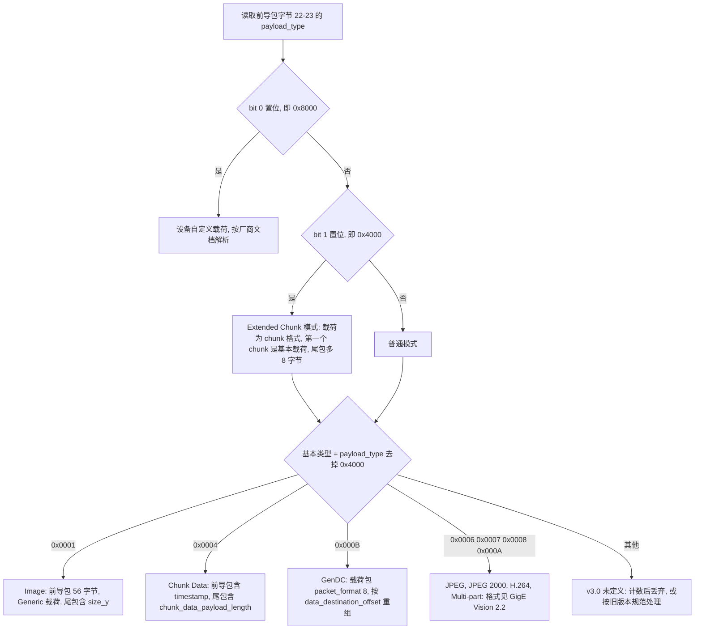
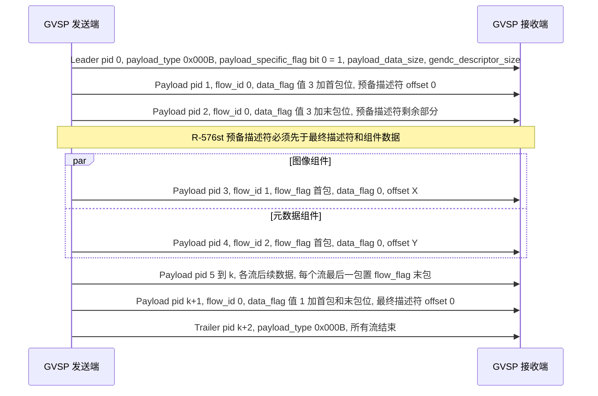
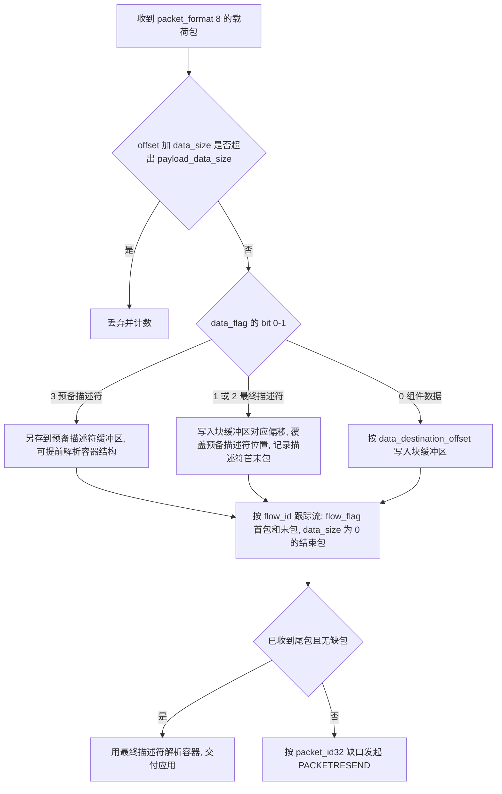

# GVSP 载荷类型与像素布局（GigE Vision 3.0 第 25–26 章）

> **覆盖范围**：Chapter 25 GVSP Payload Types（第 25 章引言与 Table 25-1、§25.1 Extended Chunk Mode、§25.2 Image、§25.3 Chunk Data、§25.4 GenDC，p.186–201）；Chapter 26 Pixel Layouts（§26 引言、§26.1–26.3.1，p.202–204）。本文所有页码均为 **PDF 页码**（= 印刷页码 + 1）。
>
> **一句话总结**：v3.0 只"重新定义"了 Image（0x0001 / 0x4001）、Chunk Data（0x0004）与 GenDC（0x000B）三种载荷类型，JPEG / JPEG 2000 / H.264 / Multi-part 仍然有效但格式要查 GigE Vision 2.2；Image 的 56 字节前导包携带 timestamp、pixel_format、尺寸/偏移/填充，载荷按光栅顺序传小端像素，尾包给出实际 size_y；GenDC 用 packet_format 8 和"目的偏移 + 流（flow）"实现乱序/多流传输；像素格式遵循 GenICam PFNC。
>
> **本文目录**
> - 阅读约定
> - 核心要点
> - 25 载荷类型总览（Table 25-1、v3.0 中各类型的状态、已弃用/已删除项）
> - 25.1 Extended Chunk 模式（含 multi-part 的扩展 chunk 与 Table 25-2 示例）
> - 25.2 Image 载荷类型：25.2.1 前导包 / 25.2.2 载荷包 / 25.2.3 尾包 / 💡 分包与填充计算实例
> - 25.3 Chunk Data 载荷类型：25.3.1–25.3.3
> - 25.4 GenDC 载荷类型：25.4.1 原则 / 25.4.2 前导包 / 25.4.3 载荷包 / 25.4.4 尾包 / 与 SCGDAx 等寄存器及第 38 章的关系
> - 26 像素布局：26.1 像素对齐（小端）/ 26.2 行与图像边界 / 26.3 像素格式与 PFNC / 26.3.1 Bayer 说明
> - 实现要点与易错点（流发送端 / 流接收端）
> - 相关章节
> - 自测题

---

## 阅读约定

- **字节偏移**一律从 GVSP 头第一个字节（= UDP 载荷起点）算起，不含 IP 头（20 字节）与 UDP 头（8 字节）。0–19 字节是所有 GVSP 包共用的 20 字节包头（status、flag、EI/packet_format、block_id64、packet_id32），细节见 [GVSP 传输与数据块](./01_transport_and_data_block.md) 的 §24.2。v3.0 只有扩展 ID 模式（EI = 1），没有"标准 ID 模式"的另一套偏移。
- **包头里的位编号是 MSB-first**：bit 0 = 字段的最高位（§15.3, p.115）。因此 payload_type 的 bit 0 / bit 1 = 0x8000 / 0x4000；8 位标志字段（如 GenDC 的 data_flag）的 bit 0 = 0x80。本文给出的"掩码"均为按此约定换算的 💡 解读。
- **但第 26 章的像素图示正好相反**：按 PFNC 惯例采用小端画法，每个字节内 **bit 7（msb）在左、bit 0（lsb）在右**，Byte 0 画在最右边（p.202 NOTE）。读包头和读像素图时千万别混用这两套位号。
- 多字节**头字段为大端**（[R-257s]），多字节**像素数据为小端**（[R-344st]）。

---

## 核心要点

- v3.0 Table 25-1 列出的规范性载荷类型：Image 0x0001/0x4001、Chunk data 0x0004、JPEG 0x0006/0x4006、JPEG 2000 0x0007/0x4007、H.264 0x0008/0x4008、Multi-part 0x000A/0x400A、GenDC 0x000B、Device-specific ≥ 0x8000（p.186）。其中**只有 Image、Chunk Data、GenDC 在 v3.0 正文中重新定义**，其余类型的格式仍以 GigE Vision 2.2 为准（p.186–187）。
- 支持 GVSP 的设备必须至少支持 Table 25-1 中的一种载荷类型（[R-606s], §36.27, p.291）；其他 2.2 载荷类型只能作为"附加"可选支持，且必须遵守 §24.3 的通用包规则（p.186）。
- payload_type 的 **bit 1（0x4000）= Extended Chunk 模式**：前导包不变（仅该位不同）；载荷变成 chunk 格式且**第一个 chunk 就是基本载荷**；尾包末尾追加 chunk_data_payload_length 与 chunk_layout_id 两个 32 位字段（§25.1, p.187–188）。GenDC 不允许 Extended Chunk。
- **Image 前导包共 56 字节**：field_id/field_count、payload_type、timestamp(64)、pixel_format、size_x、size_y、offset_x、offset_y（各 32 位）、padding_x、padding_y（各 16 位）（Figure 25-2, p.191）。
- Image 载荷必须是**光栅扫描顺序**（[CR-284st]），像素位置 = (packet_id32 − 1) × 每包数据量，数据中没有空洞；多抽头（multi-tap）数据要么在发送端重组，要么每个抽头用一个流通道（[CR-286st][CR-287st]）。
- **Image 尾包的 size_y 是实际行数**，用于可变帧高（只有高度可以变）；padding_y 字节即便在实际行数变少时也必须照发（p.193, p.195）。
- Chunk Data 载荷（0x0004）：前导包含 timestamp，载荷为纯 chunk 序列（第一个 chunk 任意），尾包含 chunk_data_payload_length（§25.3, p.195–196）。
- **GenDC 载荷（0x000B）**：一个块承载一个完整 GenDC 容器；载荷包（packet_format 8）自带 data_size 与 64 位 data_destination_offset，可**乱序**发送，接收端**必须按偏移放置**（[R-582sr]），不能靠发送顺序；可用 flow_id / flow_flag 描述多个数据流；描述符（含预备描述符）只走 flow 0（[R-581st]）（§25.4, p.197–201）。
- 像素格式由 GenICam PFNC 定义；自定义格式把 pixel_format 的最高位置 1（p.203）。采用 PFNC 的 **Image Padding**：行末不插入人为填充，打包格式可能出现"跨行共用字节"（Figure 26-1, p.202）。
- Bayer：PixelFormat 与前导包 pixel_format 必须描述**整幅图像**的 Bayer 排列（[CR-357st]）；接收端根据 offset_x/offset_y 的奇偶性调整 ROI 的 Bayer 相位（p.203–204）。

---

## 25 GVSP 载荷类型总览（第 25 章引言, p.186–187）

为高效传输信息，GVSP 定义了多种可由发送端输出的载荷类型。**对 GigE Vision 3.0 而言，只有下表列出的载荷类型在本规范中是规范性的（normative）。** 其他 GigE Vision 2.2 载荷类型可以在支持表中某一类型的**基础上**额外可选支持，前提是其使用和格式完全符合 §24.3 的规则。

**Table 25-1 GVSP Payload Types（p.186）**

| Payload Type | Value | 说明 | v3.0 中的格式定义位置 |
|---|---|---|---|
| Image | **0x0001**<br>**0x4001** | 未压缩图像数据。允许 Image 扩展 chunk 数据，此时 Image 必须是第一个 chunk | 本规范 §25.2 |
| Chunk data | **0x0004** | 带标签的数据块，按 GenICam 规范 | 本规范 §25.3 |
| JPEG | **0x0006**<br>**0x4006** | JPEG 压缩图像（ITU-T Rec. T.81）。允许扩展 chunk，此时 JPEG 压缩图像必须是第一个 chunk | GigE Vision 2.2 |
| JPEG 2000 | **0x0007**<br>**0x4007** | JPEG 2000 码流（ITU-T Rec. T.800）。允许扩展 chunk，此时 JPEG 2000 码流必须是第一个 chunk | GigE Vision 2.2 |
| H.264 | **0x0008**<br>**0x4008** | H.264 访问单元（ITU-T Rec. H.264）。允许扩展 chunk，此时 H.264 访问单元必须是第一个 chunk；使用专用 packet_format 5 | GigE Vision 2.2 |
| Multi-part | **0x000A**<br>**0x400A** | 来自同一采集时刻的图像或其他数据的多个元素（称为 part）。允许扩展 chunk，方法是**增加一个额外的数据 part**，此时 Multi-part 数据必须是第一个 chunk；使用专用 packet_format 7 | GigE Vision 2.2（扩展 chunk 规则见本规范 §25.1） |
| GenDC | **0x000B** | 一个 GenICam GenDC 容器。**不允许** GenDC 扩展 chunk——chunk 数据应作为 GenDC 容器的一部分 | 本规范 §25.4 |
| Device-specific | **≥ 0x8000** | 设备厂商自定义的载荷类型 | 厂商文档 |

- NOTE（p.186–187）：GigE Vision 3.0 只重新定义了解释协议行为所需的 GVSP 载荷类型（Image、Chunk Data、GenDC）。其他受支持的 GVSP 载荷类型只在 GigE Vision 2.2 中定义（如 JPEG、JPEG 2000、H.264、Multi-part），它们**仍然有效且仍是规范性的**，只是为避免重复而不在 3.0 中重述。
- 附录 D 对此的描述：3.0 "Remove majority of GVSP payload type definition and refer to previous version of the specification"、"Pruned older/unused payload types"，并新增了"支持 GVSP 的设备至少支持一种 3.0 载荷类型"的要求（p.415–416），即 **[R-606s]**：Streaming Capability 寄存器的 gvsp_mode_not_supported 位未置位时，发送端/接收端/收发器设备**必须**支持 Table 25-1 中至少一种 GVSP 载荷（§36.27, p.291）。

### v3.0 中未列入 Table 25-1 / 已弃用的相关项

| 项目 | v3.0 中的状态 | 出处 |
|---|---|---|
| 0x0005 "extended chunk data" 载荷类型 | 明确称为 **deprecated**：SCCx / SCCFGx 的 bit 31（EC）仍用于"支持/启用已弃用的 extended chunk data payload type (0x0005)" | §36.62, p.331；§36.63, p.333 |
| Raw、File 载荷类型 | Table 25-1 中**没有**；§24.3.2 仍按名字提到它们（"可以没有载荷包"），属遗留表述。v3.0 未给出其取值，需要时查 GigE Vision 2.2 | p.176 |
| Multi-zone（多区域）图像 | 2.0 引入、2.1 被 Multi-part 取代；SCCx / SCCFGx bit 27 现为 deprecated（原 multi_zone_supported / multi_zone_enabled） | 附录 D, p.412；p.330, p.333 |
| All-in 传输模式（前导+载荷+尾放在一个包） | 2.0 定义的可选模式；SCCx / SCCFGx bit 29 现为 deprecated（原 all_in_transmission_supported / _enabled） | 附录 D, p.412；p.331, p.333 |
| 本区段被弃用的需求编号 | 3.0 弃用：R-255s、CR-270st–CR-275s、CR-283st、CR-291s–CR-304st、CR-308s–CR-342s、CR-539st–CR-557st；2.1 弃用：CR-346s–CR-356s、CR-358s–CR-412s | 附录 A 弃用表, p.394–401 |

💡 解读：从编号位置推测，CR-291s–CR-304st、CR-308s–CR-342s 对应被移出 3.0 正文的载荷类型定义（如 Raw/File/JPEG/H.264 等），CR-539st–CR-557st（均为 2.1 引入、紧跟在 §25.1 的 [CR-538st] 之后）可能对应 multi-part 的定义，CR-346s 起的 2.1 弃用项对应旧版 GigE Vision 自有像素格式定义（已由 PFNC 取代）。这只是根据编号顺序的推测，规范未逐条说明；完整清单见 [已弃用需求](../reference/deprecated_requirements.md)。

### payload_type 的分派（💡 接收端参考流程）



---

## 25.1 GVSP Extended Chunk 模式（§25.1, p.187–189）

可以通过置位 payload_type 字段的 **bit 1（Extended Chunk 模式位）**，给某些 GVSP 载荷类型附加元数据；这些元数据按 §24.4 的规则以 Chunk Data 形式附加。哪些载荷类型支持 Extended Chunk 模式，见 Table 25-1（Image、JPEG、JPEG 2000、H.264、Multi-part 支持；Chunk data 本身就是 chunk；GenDC 不允许）。

当 Extended Chunk 模式位置位时（p.187）：

1. **数据前导包**与该载荷类型的标准前导包相同，**唯一区别是 Extended Chunk 模式位**。
2. **数据载荷包**承载 chunk 数据，其中**第一个 chunk 等价于所选的基本载荷格式**（例如 Image 的像素数据）。所有数据载荷包的 packet_format 必须相同，并与基本载荷类型所规定的一致——这对**定义了专用 packet_format 的 H.264 和 Multi-part** 尤其重要。
3. **数据尾包**末尾追加 2 个字段：a. chunk_data_payload_length；b. chunk_layout_id。

Figure 25-1 Data Trailer Packet with Chunk Data（p.187；M 为该载荷类型自身的尾包附加信息长度，如 Image 的 M = 4）：

```text
        0             7 8            15 16           23 24           31
       +-------------------------------+-------------------------------+
    0  |             status            |              flag             |
       +-+-----+-------+---------------+-------------------------------+
    4  |1| rsv | fmt=2 |                    reserved                   |
       +-+-----+-------+-----------------------------------------------+
    8  |                     block_id64 (high part)                    |
       +---------------------------------------------------------------+
   12  |                     block_id64 (low part)                     |
       +---------------------------------------------------------------+
   16  |                          packet_id32                          |
       +-------------------------------+-------------------------------+
   20  |            reserved           |    payload_type (bit 1 = 1)   |
       +-------------------------------+-------------------------------+
   24  |        additional info (payload type specific, M bytes)       |
       +---------------------------------------------------------------+
 24+M  |                   chunk_data_payload_length                   |
       +---------------------------------------------------------------+
 28+M  |                        chunk_layout_id                        |
       +---------------------------------------------------------------+
```

| 字节偏移(Offset) | 字段 | 长度 | 说明 |
|---|---|---|---|
| 0–19 | GVSP 包头 | 20 B | packet_format = 2 |
| 20–21 | reserved | 16 bit | 置 0 |
| 22–23 | payload_type | 16 bit | **bit 1 = 1**（Extended Chunk 模式），如 0x4001 |
| 24 – 24+M−1 | 载荷类型相关的尾包信息 | M 字节 | 如 Image 为 size_y（M = 4）；Multi-part 为各 part 的信息（见 Table 25-2） |
| 24+M – 27+M | chunk_data_payload_length | 32 bit | 所有 chunk 数据载荷长度之和（字节），**必须是 4 的倍数**（bit 30、31 必须为 0——按 MSB-first 即最低两位）。放在这里是为了让接收端即使在最后一个载荷包被填充的情况下也能找到 chunk 数据载荷的结尾 |
| 28+M – 31+M | chunk_layout_id | 32 bit | chunk 布局变化指示，见下 |

**chunk_layout_id 规则**（p.188）：

- 它指示 chunk 布局（各个 chunk 是否存在及其位置）是否变化，接收端据此决定是否需要重新解析缓冲区中的 chunk 布局。
- 自上一个块以来 chunk 布局变化时，发送端**必须**改变 chunk_layout_id；布局保持不变期间，发送端**必须**保持 ID 不变。
- 切换回以前用过的布局时，发送端可以沿用当时的 ID，也可以用新 ID。
- **0 是无效值**，保留给不支持 layout ID 功能的发送端：不支持该功能的发送端**必须**对所有块都填 0。
- ID 的计算算法属于实现质量（quality of implementation）。

💡 解读：
- chunk_data_payload_length 的作用是"定位 chunk 数据的结尾"，因此它应包含各 chunk 的 CID/length 标签在内（即 chunk 格式数据的总字节数）；在 §24.4.1 的例子中它等于 44。
- 接收端可以把"chunk_layout_id 不变"作为缓存解析结果的依据：ID 不变就沿用上次的 chunk 偏移表，ID 变化（或为 0）就从尾部重新解析一遍。
- 以 Image + Extended Chunk（0x4001）为例：前导包与普通 Image 相同（payload_type 为 0x4001）；载荷为 `[像素数据(补零到 4 的倍数)][图像 CID][长度][chunk A 数据][CID A][长度 A]…`；尾包共 36 字节：size_y（24–27）、chunk_data_payload_length（28–31）、chunk_layout_id（32–35）。

### Multi-part 的 Extended Chunk（p.188–189）

Multi-part 载荷的数据被分成多个 part，为便于取回 chunk 信息，需要**额外定义一个 part**，专门承载**第一个 chunk 的标签以及所有附加 chunk**。因此 multi-part 的 extended chunk 至少需要两个 part。

- **[CR-538st]** 若使用 GVSP Multi-part 载荷且启用 Extended Chunk，则**必须**用一个额外的（**最后一个**）part 来承载第一个 chunk 的标签（它界定了载荷中的各数据 part）以及所有附加 chunk。

**Table 25-2 Multi-part 数据尾包内容示例（extended chunk 模式, p.188–189）**——假设：part 0 为 "3D image"（3D 坐标）、part 1 为 "2D image"（每个 3D 点对应的强度）、part 2 为 "Confidence map"（每个 3D 像素的置信度）、因启用 extended chunk 而追加的 part 3（总是最后一个）为 "Chunk data"：

| 字节 | 内容 |
|---|---|
| 0..23（24 字节） | 标准 GVSP 数据尾包头：packet_format = 2，payload_type = **0x400A**（multi-part + extended chunk） |
| 24..39（16 字节） | part 0 相关字段：data_type = 0x0005（3D image）；data type 相关字段为 size_y 和一个 reserved 字段 |
| 40..55（16 字节） | part 1 相关字段：data_type = 0x0001（2D image）；size_y + reserved |
| 56..71（16 字节） | part 2 相关字段：data_type = 0x0009（Confidence map）；size_y + reserved |
| 72..87（16 字节） | part 3 相关字段：data_type = 0x000A（Chunk data）；两个 reserved 字段 |
| 88..95（8 字节） | extended chunk 模式要求的附加字段（Figure 25-1）：chunk_data_payload_length、chunk_layout_id |

💡 解读：这个例子同时印证了 GVSP 头为 20 字节（0..23 = 20 字节头 + reserved 2 + payload_type 2）。每个 part 在尾包中占 16 字节、data_type 的取值与含义都属于 GigE Vision 2.2 的 multi-part 定义，3.0 只在此示例中出现。尾包共 96 字节（IP 包 124 字节），仍在 576 字节以内；part 数量很多时就需要 large leader/trailer（SCCFGx bit 26）。

---

## 25.2 GVSP Image 载荷类型（§25.2, p.189–195）

该载荷类型用于传输**未压缩图像**。

- **[CR-284st]** 若支持 Image 载荷，使用该类型的流必须让每个数据载荷包中的数据处于**光栅扫描（raster-scan）格式**。即图像在发送端内存中先重组好，再按"从左到右、从上到下"的顺序发送——这对单抽头（single-tap）传感器很典型。
  - NOTE：GigE Vision 2.2 引入了可选的 GenDC 载荷类型，以便传输来自多抽头传感器的图像数据（见 §25.4）。
- 某个数据包中第一个像素的位置 = "包大小（SCPSx）×（packet_id32 − 1）"，即**图像数据中没有空洞**（p.190）。💡 这里的"包大小"应理解为每个载荷包的有效数据量 SCPSx.packet_size − 48，见下文计算实例。
- **[CR-285st]** 若支持 Image 载荷，发送端必须**顺序**发送数据载荷包（按 Figure 24-1，从 1 到 N−1）。
- 若有包丢失，接收端及其应用可用 PACKETRESEND（若发送端支持）请求**一组连续的包**。
- **[CR-286st]** 若用 Image 载荷在**单个流通道**上传输多抽头（multi-tap）数据，发送端**必须在本地重组图像**，使其能以顺序的 packet ID 发送。
- **[CR-287st]** 若用 Image 载荷传输多抽头数据、而发送端无法在发送前重组图像，则**应**（条文原文为 SHOULD）为**每个抽头使用单独的流通道**。（条文内 NOTE：Multi-part 载荷类型可以在单个流通道上传多抽头数据，而无需在相机内重组。）采用"每抽头一个流通道"时，由接收端来重组图像（代价是更多处理时间和资源）；抽头配置及其与流通道的对应关系**应**在 XML 设备描述文件或产品文档中给出（p.190）。
- 规范**建议**传输图像的产品在发送前把图像重组为光栅扫描格式。

### 25.2.1 Image 数据前导包（Image Data Leader Packet）（p.190–193）

- **[CR-288s]** 若支持 Image 载荷，其数据前导包必须遵循 Figure 25-2。

Figure 25-2 Image Data Leader Packet（p.191）：

```text
        0             7 8            15 16           23 24           31
       +-------------------------------+-------------------------------+
    0  |             status            |              flag             |
       +-+-----+-------+---------------+-------------------------------+
    4  |1| rsv | fmt=1 |                    reserved                   |
       +-+-----+-------+-----------------------------------------------+
    8  |                     block_id64 (high part)                    |
       +---------------------------------------------------------------+
   12  |                     block_id64 (low part)                     |
       +---------------------------------------------------------------+
   16  |                          packet_id32                          |
       +-------+-------+---------------+-------------------------------+
   20  | fld_id|fld_cnt|    reserved   |   payload_type=0x0001/0x4001  |
       +-------+-------+---------------+-------------------------------+
   24  |                     timestamp (high part)                     |
       +---------------------------------------------------------------+
   28  |                      timestamp (low part)                     |
       +---------------------------------------------------------------+
   32  |                          pixel_format                         |
       +---------------------------------------------------------------+
   36  |                             size_x                            |
       +---------------------------------------------------------------+
   40  |                             size_y                            |
       +---------------------------------------------------------------+
   44  |                            offset_x                           |
       +---------------------------------------------------------------+
   48  |                            offset_y                           |
       +-------------------------------+-------------------------------+
   52  |           padding_x           |           padding_y           |
       +-------------------------------+-------------------------------+
```

| 字节偏移(Offset) | 字段 | 长度 | 说明 |
|---|---|---|---|
| 0–19 | GVSP 包头 | 20 B | packet_format = 1，packet_id32 = 0 |
| 20（高 4 位） | field_id | 4 bit | 隔行数据中该场在图像中的序号。逐行：恒为 0；2 场隔行：Field 1 = 0、Field 2 = 1；3 场隔行：Field 1 = 0、Field 2 = 1、Field 3 = 2；其他值保留。不能去隔行的接收端**应**忽略此字段。NOTE：去隔行图像的第 1 行来自 Field 1 的第 1 行，第 2 行来自 Field 2 的第 1 行，依此类推 |
| 20（低 4 位） | field_count | 4 bit | 隔行数据的场总数 **减 1**。逐行：0；2 场隔行：1；3 场隔行：2；其他值保留。不能去隔行的接收端应忽略 |
| 21 | reserved | 8 bit | 发送置 0，接收忽略 |
| 22–23 | payload_type | 16 bit | 0x0001（Image）或 0x4001（Image + Extended Chunk），见 Table 25-1 |
| 24–31 | timestamp | 64 bit | 表示该数据块**生成时刻**的 64 位时间戳。时间戳可选，不支持时**应**为 0。同一次曝光的不同 ROI 必须用相同时间戳（[CR-253st]）。NOTE：GenICam 支持 64 位**有符号**整数而此字段为 64 位无符号，故通过 GenICam 接口只能用 63 位 |
| 32–35 | pixel_format | 32 bit | 载荷数据的像素格式（见第 26 章，PFNC 值） |
| 36–39 | size_x | 32 bit | 本块数据载荷中图像的宽度（像素）。NOTE：某些像素格式（如 3D 点云）的像素可能不是按行组织的矩阵，而是无组织的像素集合；此时**建议** size_x = 1，用 size_y 表示无组织像素的个数——这样像素数逐块变化时可以复用尾包的 size_y |
| 40–43 | size_y | 32 bit | 图像高度（行数，逐行扫描）或场高度（隔行扫描）。隔行时表示一场的高度（每场是一个块）。在**可变帧大小**下，发送端可以发送少于此值的行，此时由**尾包的 size_y** 给出实际值 |
| 44–47 | offset_x | 32 bit | 相对图像原点的像素偏移，用于 ROI；无 ROI 时**必须**为 0。对 CFA（彩色滤镜阵列）**建议** offset_x 以整个 CFA 宽度为步进，以保证 pixel_format 与应用配置的 PixelFormat 特性一致；其他像素格式也可能对此字段取值有限制 |
| 48–51 | offset_y | 32 bit | 相对图像原点的行偏移，用于 ROI；无 ROI 时必须为 0。对 CFA 建议以整个 CFA 高度为步进 |
| 52–53 | padding_x | 16 bit | **水平填充（字节）**：每行末尾额外传输的字节数，便于缓冲区中的行对齐（典型用途：32 位对齐的行），类似模拟相机的水平消隐。不用时置 0。若 padding_x ≠ 0，则行最后一个像素在必要时先被填充（PFNC 中称为 **line padding**），**然后**再追加 padding_x 个字节 |
| 54–55 | padding_y | 16 bit | **垂直填充（字节）**：图像末尾额外传输的字节数，便于缓冲区按块对齐（如 4 KB），类似垂直消隐。不用时置 0。NOTE 1：用于可变帧大小时，即使尾包报告的实际 size_y 与前导包不同，发送端**也必须**发送 padding_y 指示的字节数。NOTE 2：若最后一个载荷包因包大小限制而有额外填充，该填充**不属于** padding_y，也不计入 PayloadSize（见 §24.3.2） |

💡 解读：
- 前导包 GVSP 部分共 **56 字节**（IP 包 84 字节），远小于 576 字节上限。
- 字节 20 = (field_id << 4) | field_count。例：逐行图像 = 0x00；2 场隔行的第 2 场 = 0x11；3 场隔行的第 1 场 = 0x02。
- timestamp 的单位/频率由 Timestamp Tick Frequency 寄存器决定（§36.31），IEEE 1588 启用时的时间域行为见 [GVCP 高级概念](../02_gvcp/02_advanced_concepts.md)。
- 扩展 chunk（0x4001）时前导包字段与 0x0001 完全相同。

### 25.2.2 Image 数据载荷包（Image Data Payload Packet）（p.193–194）

- **[CR-289s]** 若支持 Image 载荷，其数据载荷包必须遵循 Figure 25-3。

Figure 25-3 Image Data Payload Packet（p.194）：

```text
        0             7 8            15 16           23 24           31
       +-------------------------------+-------------------------------+
    0  |             status            |              flag             |
       +-+-----+-------+---------------+-------------------------------+
    4  |1| rsv | fmt=3 |                    reserved                   |
       +-+-----+-------+-----------------------------------------------+
    8  |                     block_id64 (high part)                    |
       +---------------------------------------------------------------+
   12  |                     block_id64 (low part)                     |
       +---------------------------------------------------------------+
   16  |                          packet_id32                          |
       +---------------------------------------------------------------+
   20  |               data (pixel data, raster-scan) ...              |
       +---------------------------------------------------------------+
```

| 字节偏移(Offset) | 字段 | 长度 | 说明 |
|---|---|---|---|
| 0–19 | GVSP 包头 | 20 B | packet_format = 3（Generic），packet_id32 = 1…N−1 |
| 20– | data | 最多到包大小 | 按前导包 pixel_format 编排的图像数据。IP 头 + UDP 头 + GVSP 头 + data **必须等于** SCPSx 指定的包大小；唯一例外是最后一个载荷包，可以更小；也可以把最后一包填充到与其他包相同大小 |

### 25.2.3 Image 数据尾包（Image Data Trailer Packet）（p.194–195）

- **[CR-290s]** 若支持 Image 载荷，其数据尾包必须遵循 Figure 25-4。

Figure 25-4 Image Data Trailer Packet（p.194；方括号两行仅在 payload_type = 0x4001 时按 §25.1 追加）：

```text
        0             7 8            15 16           23 24           31
       +-------------------------------+-------------------------------+
    0  |             status            |              flag             |
       +-+-----+-------+---------------+-------------------------------+
    4  |1| rsv | fmt=2 |                    reserved                   |
       +-+-----+-------+-----------------------------------------------+
    8  |                     block_id64 (high part)                    |
       +---------------------------------------------------------------+
   12  |                     block_id64 (low part)                     |
       +---------------------------------------------------------------+
   16  |                          packet_id32                          |
       +-------------------------------+-------------------------------+
   20  |            reserved           |   payload_type=0x0001/0x4001  |
       +-------------------------------+-------------------------------+
   24  |                             size_y                            |
       +---------------------------------------------------------------+
   28  |           [chunk_data_payload_length] (only 0x4001)           |
       +---------------------------------------------------------------+
   32  |                [chunk_layout_id] (only 0x4001)                |
       +---------------------------------------------------------------+
```

| 字节偏移(Offset) | 字段 | 长度 | 说明 |
|---|---|---|---|
| 0–19 | GVSP 包头 | 20 B | packet_format = 2，packet_id32 = N |
| 20–21 | reserved | 16 bit | 发送置 0，接收忽略 |
| 22–23 | payload_type | 16 bit | 0x0001 或 0x4001 |
| 24–27 | size_y | 32 bit | 该数据块的**实际高度（行数）**。用于支持可变帧大小的图像源：在实际传输行数确定之后给出。**只有图像高度可以变化**。隔行图像时为一场的高度 |
| 28–31 | [chunk_data_payload_length] | 32 bit | 仅 0x4001：见 §25.1 |
| 32–35 | [chunk_layout_id] | 32 bit | 仅 0x4001：见 §25.1 |

💡 Image 尾包 GVSP 部分为 28 字节（0x0001）或 36 字节（0x4001）。

### 💡 解读：分包与填充计算实例（规范未给出数值示例，以下为按规范规则推算）

公共前提：Generic 载荷每个满包的数据量 **D = SCPSx.packet_size − 20（IP）− 8（UDP）− 20（GVSP）**；载荷包数 = ⌈块数据字节数 / D⌉；packet_id32：前导 0，载荷 1…n，尾包 n+1。

**例 1：Mono8，1920 × 1080，无填充**

| 项目 | packet_size = 1500 | packet_size = 9000（巨帧） |
|---|---|---|
| 每包数据 D | 1500 − 48 = **1452** | 9000 − 48 = **8952** |
| 块数据量 | 1920 × 1080 × 1 = **2 073 600** 字节 | 同左 |
| 载荷包数 n | ⌈2 073 600 / 1452⌉ = **1429**（前 1428 包共 2 073 456 字节，最后一包 **144** 字节） | ⌈2 073 600 / 8952⌉ = **232**（前 231 包共 2 067 912 字节，最后一包 **5688** 字节） |
| 每块总包数 | 1 + 1429 + 1 = **1431**；尾包 packet_id32 = **1430** | 1 + 232 + 1 = **234**；尾包 packet_id32 = **233** |
| 载荷包线路效率（含以太网头 14、FCS 4、前导码 8、帧间隙 12） | 1452 / 1538 ≈ 94.4 % | 8952 / 9038 ≈ 99.0 % |

像素定位：像素 (x = 100, y = 500) 在块内的字节偏移 = 500 × 1920 + 100 = 960 100；960 100 = 661 × 1452 + 328 → 位于 **packet_id32 = 662**、包内数据偏移 328（即 UDP 载荷偏移 20 + 328 = 348）。

**例 2：Mono8，641 × 480，padding_x = 3，padding_y = 2176，packet_size = 1500**

- 每行传输 641 + 3 = **644** 字节（4 字节对齐）；像素 (x, y) 偏移 = y × 644 + x。
- 图像部分 644 × 480 = 309 120 字节；309 120 mod 4096 = 1920，为使整个块按 4 KB 对齐取 padding_y = 4096 − 1920 = **2176** → 块数据量 311 296 = 76 × 4096 字节（padding_x、padding_y 字节都实际在载荷中传输）。
- 载荷包数 = ⌈311 296 / 1452⌉ = **215**（前 214 包 310 728 字节，最后一包 568 字节）；尾包 packet_id32 = 216。
- 若发送端把最后一包也补到 1452 字节，多出的 884 字节既不属于 padding_y，也不计入 PayloadSize，接收端必须丢弃（[R-568sr]）。

**例 3：打包格式的奇数宽度（对应 Figure 26-1）——Mono10Packed（每 2 个像素占 3 字节），641 × 480**

- padding_x = 0 时使用 PFNC 的 **Image Padding**：行末不填充。第 0 行的像素 0…640 中，像素 640 与第 1 行的像素 0 组成一对，占用块内字节 **960、961、962**（字节 960 = 第 0 行末像素的 bit 9..2，字节 962 = 第 1 行首像素的 bit 9..2，字节 961 存两者的低 2 位）——这正是 Figure 26-1 的情形。
- 块数据量 = 641 × 480 × 1.5 = **461 520** 字节；packet_size = 1500 时载荷包数 = ⌈461 520 / 1452⌉ = **318**（最后一包 1236 字节）。
- 若改用 padding_x = 1：先做 line padding（最后一个像素补齐到完整的 3 字节组）→ 每行 ⌈641 / 2⌉ × 3 = 963 字节，再追加 1 字节 → 每行 **964** 字节（4 字节对齐），块数据量 964 × 480 = 462 720 字节。

**例 4：可变帧高——前导包 size_y = 1080，尾包 size_y = 700（Mono8，宽 1920，packet_size = 1500）**

- 实际数据 1920 × 700 = 1 344 000 字节 → 载荷包 ⌈1 344 000 / 1452⌉ = **926** 个（最后一包 900 字节），尾包 packet_id32 = **927**。接收端在收到尾包前只知道上限（按前导包或 PayloadSize 估计），收到尾包后才知道实际包数与行数。
- 若 padding_y ≠ 0，发送端在 700 行之后仍要发送全部 padding_y 字节（§25.2.1 NOTE）。

**接收端通用公式（💡）**

- padding_x = 0（Image Padding）：图像字节数 = ⌈size_x × size_y × 每像素位数 / 8⌉，再加 padding_y。
- padding_x ≠ 0（Line Padding）：图像字节数 = size_y × (每行按像素组补齐后的字节数 + padding_x) + padding_y。
- 每像素位数由 pixel_format 决定（查 PFNC 值表）。例如 PFNC 中 Mono8 的值为 0x01080001，其中 0x08 表示每像素占 8 位（💡 此数值来自 GenICam PFNC 值表，非本规范正文）。

---

## 25.3 GVSP Chunk Data 载荷类型（§25.3, p.195–196）

该载荷类型用于传输 chunk。它类似 Extended Chunk 模式，但**没有主载荷类型**，因此**第一个 chunk 可以是任何东西**。

### 25.3.1 Chunk Data 前导包（p.195）

- **[CR-305s]** 若支持 Chunk Data 载荷，其数据前导包必须遵循 Figure 25-5。

```text
        0             7 8            15 16           23 24           31
       +-------------------------------+-------------------------------+
    0  |             status            |              flag             |
       +-+-----+-------+---------------+-------------------------------+
    4  |1| rsv | fmt=1 |                    reserved                   |
       +-+-----+-------+-----------------------------------------------+
    8  |                     block_id64 (high part)                    |
       +---------------------------------------------------------------+
   12  |                     block_id64 (low part)                     |
       +---------------------------------------------------------------+
   16  |                          packet_id32                          |
       +-------------------------------+-------------------------------+
   20  |            reserved           |      payload_type=0x0004      |
       +-------------------------------+-------------------------------+
   24  |                     timestamp (high part)                     |
       +---------------------------------------------------------------+
   28  |                      timestamp (low part)                     |
       +---------------------------------------------------------------+
```

| 字节偏移(Offset) | 字段 | 长度 | 说明 |
|---|---|---|---|
| 0–19 | GVSP 包头 | 20 B | packet_format = 1 |
| 20–21 | reserved | 16 bit | 发送置 0，接收忽略 |
| 22–23 | payload_type | 16 bit | 0x0004 |
| 24–31 | timestamp | 64 bit | 含义同 §25.2（规范原文 "See Section 25.2>"，多了一个 ">"，属排版错误） |

💡 前导包共 32 字节。

### 25.3.2 Chunk Data 载荷包（p.195–196）

- **[CR-306s]** 若支持 Chunk Data 载荷，其数据载荷包必须遵循 Figure 25-6（标题原文为 "Chunk Data Data Payload Packet"）。

```text
        0             7 8            15 16           23 24           31
       +-------------------------------+-------------------------------+
    0  |             status            |              flag             |
       +-+-----+-------+---------------+-------------------------------+
    4  |1| rsv | fmt=3 |                    reserved                   |
       +-+-----+-------+-----------------------------------------------+
    8  |                     block_id64 (high part)                    |
       +---------------------------------------------------------------+
   12  |                     block_id64 (low part)                     |
       +---------------------------------------------------------------+
   16  |                          packet_id32                          |
       +---------------------------------------------------------------+
   20  |                     data (chunk data) ...                     |
       +---------------------------------------------------------------+
```

| 字节偏移(Offset) | 字段 | 长度 | 说明 |
|---|---|---|---|
| 0–19 | GVSP 包头 | 20 B | packet_format = 3 |
| 20– | data | 最多到包大小 | chunk 数据（§24.4 的 chunk 格式）。IP 头 + UDP 头 + GVSP 头 + data 必须等于 SCPSx 包大小；最后一包可以更小，也可以填充到相同大小 |

### 25.3.3 Chunk Data 尾包（p.196）

- **[CR-307s]** 若支持 Chunk Data 载荷，其数据尾包必须遵循 Figure 25-7。

```text
        0             7 8            15 16           23 24           31
       +-------------------------------+-------------------------------+
    0  |             status            |              flag             |
       +-+-----+-------+---------------+-------------------------------+
    4  |1| rsv | fmt=2 |                    reserved                   |
       +-+-----+-------+-----------------------------------------------+
    8  |                     block_id64 (high part)                    |
       +---------------------------------------------------------------+
   12  |                     block_id64 (low part)                     |
       +---------------------------------------------------------------+
   16  |                          packet_id32                          |
       +-------------------------------+-------------------------------+
   20  |            reserved           |      payload_type=0x0004      |
       +-------------------------------+-------------------------------+
   24  |                   chunk_data_payload_length                   |
       +---------------------------------------------------------------+
```

| 字节偏移(Offset) | 字段 | 长度 | 说明 |
|---|---|---|---|
| 0–19 | GVSP 包头 | 20 B | packet_format = 2 |
| 20–21 | reserved | 16 bit | 发送置 0，接收忽略 |
| 22–23 | payload_type | 16 bit | 0x0004 |
| 24–27 | chunk_data_payload_length | 32 bit | chunk 数据载荷的总长度（字节），**必须是 4 的倍数**（bit 30、31 必须为 0，按 MSB-first 即最低两位）。用于帮助接收端找到 chunk 数据载荷的结尾 |

💡 解读：Chunk Data 尾包（28 字节）**没有** chunk_layout_id——该字段只在 Extended Chunk 模式（§25.1）中出现。接收端拿到 chunk_data_payload_length 后，即可按 §24.4 的方法从尾部向前解析。

---

## 25.4 GVSP GenDC 载荷类型（§25.4, p.197–201）

本节描述用于传输 **GenICam GenDC 容器**（Generic Data Container，通用数据容器）的 GVSP 载荷类型。

- **[R-574st]** 要使用 GVSP GenDC 载荷类型，载荷**必须**符合 GenICam GenDC 规范。

### 25.4.1 GVSP GenDC 原则（GVSP GenDC Principles）（p.197）

- **一个 GVSP 块传输一个完整的 GenDC 容器**，包括描述符（descriptor）和所有组件（component）。容器被切分成若干载荷包，可以**顺序或乱序**发送。
- 每个数据载荷包都带有其载荷在容器内的**目的偏移和大小**；单个载荷包内部的数据是连续的（光栅扫描）。
- **[R-575st]** GenDC 组件的每个字节**不得**出现在一个以上的 GVSP 载荷包中。
- packet_id32 **只**用于监视缺包和请求补包；其值按**发送顺序**依次递增。
- GenDC 容器 = 描述符 + 一个或多个组件。描述符包含解码各组件载荷数据所需的信息。有时在块开始传输时还无法知道描述符的最终内容，此时 GVSP 允许发送端在块开始时先发送一个**预备描述符（preliminary descriptor）**，使接收端在传输过程中就能了解块（GenDC 容器）的内容；**最终描述符（final descriptor）**在块传输期间稍后发送。GenDC 标准建议：尽早发送最终描述符，只有在一开始无法完全确定描述符内容时才使用预备描述符。
- **[R-576st]** 当 GVSP 块包含预备描述符（payload_specific_flag 的 bit 0 置位）时，所有承载预备描述符数据的包**必须**先于任何承载最终描述符或组件数据的包发送。
- **[R-577st]** 在 GVSP GenDC 传输中，预备描述符**必须**与最终描述符格式相同。
- **[R-578s]** 预备描述符中标记为可变（variable）的字段可以在最终描述符中取不同值；其他所有字段在预备描述符和最终描述符中**必须**完全相同。
- 第 38 章给出在 GigE Vision 实现中使用 GenDC 的更多信息（见下文"与寄存器及第 38 章的关系"）。

### 25.4.2 GVSP GenDC 前导包（GenDC Leader Packet）（p.198–199）

- **[CR-579s]** 若使用 GVSP GenDC 载荷，其数据前导包必须遵循 Figure 25-8。

Figure 25-8 GenDC Leader Packet（p.198）：

```text
        0             7 8            15 16           23 24           31
       +-------------------------------+-------------------------------+
    0  |             status            |              flag             |
       +-+-----+-------+---------------+-------------------------------+
    4  |1| rsv | fmt=1 |                    reserved                   |
       +-+-----+-------+-----------------------------------------------+
    8  |                     block_id64 (high part)                    |
       +---------------------------------------------------------------+
   12  |                     block_id64 (low part)                     |
       +---------------------------------------------------------------+
   16  |                          packet_id32                          |
       +-------------------------------+-------------------------------+
   20  |            reserved           |      payload_type=0x000B      |
       +-------------------------------+-------------------------------+
   24  |                     timestamp (high part)                     |
       +---------------------------------------------------------------+
   28  |                      timestamp (low part)                     |
       +---------------------------------------------------------------+
   32  |                 payload_data_size (high part)                 |
       +---------------------------------------------------------------+
   36  |                  payload_data_size (low part)                 |
       +---------------+-----------------------------------------------+
   40  |  pl_spec_flag |                  reserved = 0                 |
       +---------------+-----------------------------------------------+
   44  |                     gendc_descriptor_size                     |
       +---------------------------------------------------------------+
```

| 字节偏移(Offset) | 字段 | 长度 | 说明 |
|---|---|---|---|
| 0–19 | GVSP 包头 | 20 B | EI = 1，packet_format = 1，packet_id32 = 0 |
| 20–21 | reserved | 16 bit | 发送置 0，接收忽略 |
| 22–23 | payload_type | 16 bit | **0x000B** |
| 24–31 | timestamp | 64 bit | 含义同 §25.2 |
| 32–39 | payload_data_size | 64 bit | 载荷数据的**最大**字节数。NOTE：这是**包含描述符在内的整个容器**的大小 |
| 40 | payload_specific_flag（图中 pl_spec_flag） | 8 bit | GenDC 数据专用标志，可按位或组合，用于帮助解码和分离数据。**bit 0**：置位表示块传输开始时会先发送预备描述符，最终描述符稍后发送；清零表示只发送最终描述符，且尽早发送。**bit 1–7**：保留，发送置 0，接收忽略。💡 按 MSB-first，bit 0 = 字节 40 的 0x80 |
| 41–43 | reserved | 24 bit | 发送置 0，接收忽略（图中标为 "reserved = 0"） |
| 44–47 | gendc_descriptor_size | 32 bit | GenDC 描述符及预备描述符（若本块传输中有）的**最大**大小 |

💡 GenDC 前导包 GVSP 部分共 48 字节（IP 包 76 字节）。注意 payload_data_size 与 gendc_descriptor_size 都是"最大值"，实际值要看最终描述符。

### 25.4.3 GVSP GenDC 数据载荷包（GenDC Data Payload Packet）（p.199–201）

GVSP GenDC 数据载荷的"随机传输"允许发送端在数据就绪时立即发送。每个载荷包都包含大小和偏移信息。当一个块的传输由多个数据**流（flow）**组成时，发送端可通过 flow_id 和 flow_flag 字段告知接收端不同的流。

- **[R-580st]** 发送端**必须**用 flow_id 和 flow_flag 字段报告所有与流相关的信息。
- NOTE：若发送端无法报告全部流信息（例如流结束标志），则必须**按照整个块只在 flow 0 上传输**的方式来发送数据——即使它内部使用了多个流。
- **[R-581st]** 发送端发送 GenDC 描述符（无论是否预备描述符）时，flow_id **必须**为 0。
- **[R-582sr]** 接收端**必须**使用 data_destination_offset 来确定载荷数据在 GVSP 块中的位置。
- NOTE：对 GVSP GenDC 数据载荷，接收端**不能**用传输顺序推断数据位置。
- 预备描述符与（最终）描述符位于**相同的偏移**。载荷头中的 data_flag 指示该载荷包含的是描述符还是预备描述符，以便接收端分别处理。
- **[CR-583s]** 若使用 GVSP GenDC 数据载荷，其数据载荷包必须遵循 Figure 25-9。

Figure 25-9 GenDC Data Payload Packet（p.200）：

```text
        0             7 8            15 16           23 24           31
       +-------------------------------+-------------------------------+
    0  |             status            |              flag             |
       +-+-----+-------+---------------+-------------------------------+
    4  |1| rsv | fmt=8 |                    reserved                   |
       +-+-----+-------+-----------------------------------------------+
    8  |                     block_id64 (high part)                    |
       +---------------------------------------------------------------+
   12  |                     block_id64 (low part)                     |
       +---------------------------------------------------------------+
   16  |                          packet_id32                          |
       +---------------------------------------------------------------+
   20  |                           data_size                           |
       +---------------------------------------------------------------+
   24  |              data_destination_offset (high part)              |
       +---------------------------------------------------------------+
   28  |               data_destination_offset (low part)              |
       +---------------+---------------+-------------------------------+
   32  |   data_flag   |   flow_flag   |            flow_id            |
       +---------------+---------------+-------------------------------+
   36  |                   data (data_size bytes) ...                  |
       +---------------------------------------------------------------+
```

| 字节偏移(Offset) | 字段 | 长度 | 说明 |
|---|---|---|---|
| 0–19 | GVSP 包头 | 20 B | EI = 1，**packet_format = 8（GenDC）**（字节 4 = 0x88），packet_id32 按发送顺序递增 |
| 20–23 | data_size | 32 bit | 本包有效数据大小（字节） |
| 24–31 | data_destination_offset | 64 bit | 本包数据在块（容器）中的目的位置。（Figure 25-9 中写作 "data_destination (high/low part)"，字段表与 [R-582sr] 称 data_destination_offset，二者为同一字段） |
| 32 | data_flag | 8 bit | 描述包内数据内容的标志，见下表 |
| 33 | flow_flag | 8 bit | 标记流边界的标志，见下表 |
| 34–35 | flow_id | 16 bit | 本包数据所属流的标识 |
| 36 – 36+data_size−1 | data | data_size 字节 | 容器数据（描述符或组件数据），包内为连续数据 |

**data_flag（p.200）**——一个包可以包含"最终描述符数据 + 其后的非描述符数据"；**预备描述符数据不能与任何其他类型的数据共用一个包**：

| 规范位号 | 💡 掩码（字节 32） | 含义 |
|---|---|---|
| bit 0–1（2 位字段） | 0xC0（取值 = (byte >> 6) & 3） | 0：载荷不含描述符数据；1：含**最终**描述符数据；2：含最终描述符数据**与非描述符数据的混合**；3：含**预备**描述符数据 |
| bit 2 | 0x20 | 当 bit 0–1 ≠ 0 时，标记**第一个**含预备/最终描述符数据的载荷包 |
| bit 3 | 0x10 | 当 bit 0–1 ≠ 0 时，标记**最后一个**含预备/最终描述符数据的载荷包 |
| bit 4–7 | 0x0F | 保留：发送置 0，接收忽略 |

**flow_flag（p.201）**：

| 规范位号 | 💡 掩码（字节 33） | 含义 |
|---|---|---|
| bit 0 | 0x80 | 以当前 flow_id 发送的**第一个**包 |
| bit 1 | 0x40 | 以当前 flow_id 发送的**最后一个**包 |
| bit 2–7 | 0x3F | 保留：发送置 0，接收忽略 |

- 若某个流的最后一个数据包发出时**没有**标记流结束，发送端必须用以下方式之一补发流结束信号：① 发送一个新的数据包，置流结束标志且 **data_size = 0**；② 若流的结束接近 GVSP 块的结束，则由**数据尾包标志所有流的结束**（p.201）。

💡 解读：
- 上表掩码按规范的 MSB-first 位号换算（bit 0 = 0x80）。这一点很容易被实现成 LSB-first（bit 0 = 0x01），与对端互通时务必核对。
- GenDC 载荷包长度**不要求**等于 packet_size（[R-263st] 只约束格式 3），但仍不得超过 SCPSx 的 packet_size（[R-573st]）；每包最多 packet_size − 20 − 8 − 36 = **packet_size − 64** 字节数据。
- 由于包长可变，无法由块大小推算包数——这正是 SCMPCx（每块最大包数）存在的原因（§36.64, p.334），且支持 GenDC 的通道必须支持 SCMPCx（[CR-589cd], p.331）。

### 25.4.4 GVSP GenDC 数据尾包（GenDC Data Trailer Packet）（p.201）

- **[CR-584s]** 若使用 GVSP GenDC 载荷，其数据尾包必须遵循 Figure 25-10。

```text
        0             7 8            15 16           23 24           31
       +-------------------------------+-------------------------------+
    0  |             status            |              flag             |
       +-+-----+-------+---------------+-------------------------------+
    4  |1| rsv | fmt=2 |                    reserved                   |
       +-+-----+-------+-----------------------------------------------+
    8  |                     block_id64 (high part)                    |
       +---------------------------------------------------------------+
   12  |                     block_id64 (low part)                     |
       +---------------------------------------------------------------+
   16  |                          packet_id32                          |
       +-------------------------------+-------------------------------+
   20  |            reserved           |      payload_type=0x000B      |
       +-------------------------------+-------------------------------+
```

| 字节偏移(Offset) | 字段 | 长度 | 说明 |
|---|---|---|---|
| 0–19 | GVSP 包头 | 20 B | packet_format = 2 |
| 20–21 | reserved | 16 bit | 发送置 0，接收忽略 |
| 22–23 | payload_type | 16 bit | 0x000B |

💡 GenDC 尾包只有 24 字节，没有附加字段；它的到达同时意味着**所有流结束**。块的实际内容（各组件大小等）以最终描述符为准。

### GVSP GenDC 传输示例（💡 示意，非规范内容）



接收端处理 GenDC 载荷包的参考流程（💡）：



### 与寄存器及第 38 章的关系（§36.62–36.70, p.329–341；§38, p.365–366）

| 寄存器 / 位 | 地址 | 与 GenDC 的关系 |
|---|---|---|
| SCCx bit 24 gendc_supported (GDC) | 0x0D20 + 0x40·x | 该流通道支持 GenDC 流 |
| SCCx bit 23 scmpcx_supported (PC) | 同上 | 支持 GenDC 时必须支持 SCMPCx（[CR-589cd]） |
| SCCFGx bit 24 gendc_enable (GDC) | 0x0D24 + 0x40·x | **允许**发送端在该通道使用 GenDC 载荷类型（不强制始终使用，具体载荷类型取决于上下文与配置） |
| SCMPCx | 0x0D30 + 0x40·x | 当前包大小下传输一个块最多所需的包数（含前导和尾包）；正式流期间不得改变（[R-592st]） |
| SCMBSx（高/低） | 0x0D34 / 0x0D38 + 0x40·x | 块最大字节数（对应 SFNC PayloadSize）；使用 GenDC 时，流映射表中各流大小之和给出同样的信息 |
| SCEBAx | 0x0D3C + 0x40·x | 该通道扩展 bootstrap 区的起始地址（32 位对齐） |
| SCGDAx | SCEBA(x) + 0x0 | GenDC **预取描述符（prefetch descriptor）**的地址；设备不在该通道发 GenDC 或无法预取时为 0；正式流期间描述符内容不得改变（[R-597st]） |
| SCGDSx | SCEBA(x) + 0x4 | 预取描述符的大小 |
| SCGFTAx | SCEBA(x) + 0x8 | GenDC **流映射表（flow mapping table）**的地址；正式流期间不得改变（[R-600st]） |
| SCGFTSx | SCEBA(x) + 0xC | 流映射表的大小 |

第 38 章（Using GenDC Streams, p.365–366）要点：

- GenDC 定义"传什么"（容器），本规范定义"怎么传"——GVSP GenDC 载荷类型以及 GVRSP 协议。
- **预取描述符**描述设备将要发送的容器的结构与内容，接收端可在开始取流前通过 SCGDAx/SCGDSx 读取，从而不必解析实时数据就能理解容器布局。**流映射表**描述容器如何被划分并经一个或多个流传输，接收端据此把到来的数据映射到重建容器中的正确位置。二者使主机能提前配置缓冲区和解析器。
- 设置 TLParamsLocked 后，预取描述符与流映射表的内容必须冻结（[CR-613st][CR-614st]）。但这并不意味着容器格式固定不变：例如图像尺寸可逐块变化，可变性通过预取描述符的 VariableFields 字段标明；每个流上的数据量可以逐块变化，只要不超过流映射表规定的最大值。
- 即使有预取描述符，**容器描述符仍总是在承载数据的块内传输**；描述符可能以"预备/最终"两种形式出现，**每个块至少传输一次最终描述符**。
- 何时使用多流：并行传输（如图像与元数据各走一个流）、可变的 part 大小（避免填充）、独立监视各流。规范特别指出：**使用 GVSP GenDC 载荷类型时，前两项无需多流即可实现**（因为 GVSP GenDC 本身支持按偏移乱序写入）。

💡 解读：按第 38 章"块中先是容器描述符、后跟容器数据"的描述，描述符位于容器起始处；预备描述符与最终描述符共用同一偏移，因此接收端若想利用预备描述符，应把它另存一份，避免被随后到达的最终描述符覆盖。

---

## 26 像素布局（Pixel Layouts）（第 26 章, p.202–204）

本章描述 GigE Vision 支持的各种像素与图像布局。**自 GigE Vision 2.0 起，这些布局以 GenICam 像素格式命名约定（PFNC，Pixel Format Naming Convention）为基础。**

- NOTE（p.202）：本章图示采用**小端画法、Byte 0 在右**，与 PFNC 一致；因此每个字节内 **msb（bit 7）在左、lsb（bit 0）在右**。⚠️ 这与 GVSP 包头图（bit 0 = msb）的位号约定**相反**。
- **[O-343st]** 提供大于 8 位像素深度的发送端**应**同时提供 **8 位传输模式**，以方便接收端显示图像；该模式通过**截掉最低有效位**实现。
- 选择像素深度和像素格式的机制由 XML 设备描述文件提供（即 PixelFormat 等特性）。

### 26.1 像素对齐（Pixel Alignment）（p.202）

- **[R-344st]** 载荷数据包中使用多字节的像素数据**必须是小端（little-endian）**。
- 在本章图示中，Byte 0 最先在线路上发送，然后是 Byte 1，依此类推，以体现小端传输。

💡 解读：例如 Mono16 像素值 0x0ABC 在线路上的字节顺序是 0xBC、0x0A。同一个包里，**GVSP 头是大端、像素数据是小端**——这是解析器最常见的坑之一。chunk 中的多字节图像数据同样默认小端（[CR-277s]）。

### 26.2 行与图像边界（Line and Image Boundaries）（p.202–203）

- GigE Vision 使用 GenICam PFNC 中定义的 **Image Padding（图像填充）**：**不在行末插入人为填充**。
- 因此对某些分组（grouped）和打包（packed）像素格式，**不同行的像素可能被合并在同一些字节中**。例如宽度为奇数（如 Width = 641）而像素两两打包时，第一行的最后一个像素会与第二行的第一个像素组合在一起，如 Figure 26-1 所示。

Figure 26-1 Mono10Packed at an Odd Line Boundary（p.202，按规范的小端画法：Byte 0 在右、每字节 bit 7 在左）：

```text
     Byte 2 (sent 3rd)         Byte 1 (sent 2nd)         Byte 0 (sent 1st)
msb                                                                         lsb
+-------------------------+-------------------------+-------------------------+
| 9  8  7  6  5  4  3  2  | x  x  1  0  x  x  1  0  | 9  8  7  6  5  4  3  2  |
+-------------------------+-------------------------+-------------------------+
  first pixel of line 2     bits 5-4: line 2 pixel     last pixel of line 1
       (bits 9..2)          bits 1-0: line 1 pixel         (bits 9..2)
```

- 图中数字表示像素的位号：Byte 0 装第 1 行最后一个像素的 bit 9..2；Byte 2 装第 2 行第一个像素的 bit 9..2；Byte 1 的 bit 1..0 是第 1 行末像素的低 2 位，bit 5..4 是第 2 行首像素的低 2 位，bit 7..6 和 bit 3..2（x）未用。
- 另一个例子：使用 **Mono1p** 且图像宽度不是 8 的倍数时，一个字节需要 8 个像素才能填满，所以行的最后一个像素可能不在字节边界上。
- NOTE（p.203）：为避免不同行的像素被组合在一起，相机可以为 Width 标准特性选择更粗的步进（见 §37.5.1；例如 Mono1p 时把 Width 增量限制为 8，p.360）。

💡 解读：Image Padding 只在 padding_x = 0 时适用；若 Image 前导包的 padding_x ≠ 0，则每行先做 PFNC 的 line padding（把末像素补齐到完整的组），再追加 padding_x 字节（§25.2.1）。打包格式的奇数宽度计算见上文"例 3"。

### 26.3 像素格式（Pixel Formats）（p.203）

像素格式由 GenICam **PFNC** 文档定义，每个像素格式由 5 个特征描述：

1. 分量及其位置（Components and Location），如 Mono、RGB、BayerRG；
2. 位数（# bits），如 8、10、12；
3. 符号指示（Sign indicator，可选）；
4. 打包方式（Packing Style，可选），如 Mono10p 中的 "p"（packed）；
5. 接口相关（Interface-specific，可选）。

- **[O-345s]** GVSP 发送端或接收端**应**支持 GenICam Pixel Format Values 文档所列像素格式的一个子集。
- PFNC 文档说明了如何创建新的像素格式；GenICam 委员会维护一份为每种像素格式分配 **32 位值**的文档。Pixel Format Values 文档定义的其他像素格式以及自定义像素格式也可以被 GVSP 发送端或接收端使用。
- **自定义像素格式**：按 Pixel Format Values 文档中关于 32 位像素格式 ID 的规则，把 pixel_format 值的**最高有效位置 1**，其余 31 位由厂商自定义。自定义格式会妨碍互操作，只应在没有标准格式时使用。
- 相关要求：PixelFormat 特性的枚举项若使用 "GenICam Pixel Format Values" 中的名称，就必须使用对应的值（[CR-514st], §37.5.2, p.361）。

💡 解读：判断自定义格式只需看 `pixel_format & 0x80000000`。Image 前导包里的 pixel_format（字节 32–35）按大端读出后即是 PFNC 的 32 位值，例如 PFNC 中 Mono8 = 0x01080001（该数值来自 GenICam PFNC 值表，非本规范正文；具体请以 PFNC 最新版本为准）。

#### 26.3.1 关于 Bayer 像素格式的说明（A Note about Bayer Pixel Formats）（p.203–204）

- **[CR-357st]** 所有 Bayer 像素格式（PixelFormat 特性）**必须**表示**整幅图像（无 ROI）**的 Bayer 排列。
- GVSP 数据前导包的 pixel_format 字段包含的是**整幅图像**实际的 Bayer 像素格式。启用 ROI 时，接收端可以查看 offset_x 和 offset_y，判断是否需要相对 ROI 左上角调整 Bayer 拼块（tile）后再解码。
- NOTE（p.203–204）：
  - GVSP 数据必须是**自描述**的，任何接收端都要能解码图像流。因此，如果某些特性修改了原始图像数据、使解码需要不同的像素格式，就必须确保 pixel_format 字段和 PixelFormat 特性都被相应设置。
  - 为使 PixelFormat 特性与 Image 前导包的 pixel_format 字段一致，**建议**把 ROI 的偏移对齐到 Bayer 拼块大小——通常让 OffsetX、OffsetY 特性（GenICam SFNC）以 **2 像素**为步进。
  - 实现图像翻转（SFNC 的 ReverseX、ReverseY）时，设备**应**在内部补偿翻转对 Bayer 拼块造成的镜像效应：在翻转方向上把图像采集**平移 1 个像素**。
  - 上述原则同样适用于任何彩色滤镜阵列（CFA）模式。

💡 解读：若整幅图像为 BayerRG（第 0 行 R G R G…，第 1 行 G B G B…），ROI 起点的奇偶性决定 ROI 内的实际相位：

| offset_x mod 2 | offset_y mod 2 | ROI 左上 2×2 拼块 | ROI 实际按此格式解码 |
|:-:|:-:|---|---|
| 0 | 0 | R G / G B | BayerRG（与 pixel_format 一致） |
| 1 | 0 | G R / B G | BayerGR |
| 0 | 1 | G B / R G | BayerGB |
| 1 | 1 | B G / G R | BayerBG |

由于 pixel_format 仍报告 BayerRG（整幅图像的排列），接收端必须结合 offset_x/offset_y 自行换算相位；这正是规范建议偏移按 2 像素对齐的原因。

---

## 实现要点与易错点

### 流发送端（GVSP transmitter）

1. **只用规范性载荷类型**：至少支持 Table 25-1 中的一种（[R-606s]）；不要再发送 0x0005 等已弃用类型（除非 SCCFGx bit 31 被应用显式启用）。Device-specific 类型用 ≥ 0x8000。
2. **Image**：载荷按光栅扫描（[CR-284st]）、packet_id32 连续（[CR-285st]）；多抽头数据要么在本地重组（[CR-286st]），要么每抽头一个流通道（[CR-287st]）或改用 Multi-part/GenDC。前导包字段：无 ROI 时 offset_x/offset_y 必须为 0；不支持时间戳时 timestamp 填 0；无填充时 padding_x/padding_y 填 0。
3. **可变帧高**：前导包 size_y 写最大值，尾包 size_y 写实际值；padding_y 仍须全部发送（p.193）。
4. **padding_x ≠ 0** 时先做 line padding 再追加 padding_x 字节；最后一个载荷包的凑整填充不能算进 padding_y，也不计入 PayloadSize。
5. **Extended Chunk**：第一个 chunk 必须是基本载荷（如图像）；所有载荷包的 packet_format 与基本类型一致；尾包追加 chunk_data_payload_length（4 的倍数）与 chunk_layout_id（布局变就必须变、不变就必须不变；不支持该功能就恒填 0——不能填一个固定的非 0 值却在布局变化时不更新）。GenDC 不允许 Extended Chunk。
6. **Chunk Data（0x0004）**：前导包带 timestamp，尾包只有 chunk_data_payload_length（没有 chunk_layout_id）。
7. **GenDC**：前导包的 payload_data_size（含描述符的容器最大大小）与 gendc_descriptor_size 都填最大值；使用预备描述符时置 payload_specific_flag bit 0，且预备描述符必须先于最终描述符和所有组件数据发出（[R-576st]），二者格式相同、只有 variable 字段可不同（[R-577st][R-578s]）；描述符一律走 flow_id 0（[R-581st]）；组件的任一字节不得出现在多个载荷包中（[R-575st]）；预备描述符不能与其他数据同包；流结束未标记时补发 data_size = 0 的结束包或依赖尾包；无法报告流信息时就全部按 flow 0 发送。
8. **寄存器一致性**：正式流期间不得改变 SCMPCx、SCMBSx、预取描述符、流映射表（[R-592st][R-594st][R-597st][R-600st]）。
9. **像素**：多字节像素小端（[R-344st]）；> 8 位的格式应提供 8 位截断模式（[O-343st]）；Bayer/CFA：pixel_format 描述整幅图像（[CR-357st]），ROI 偏移建议按拼块对齐，翻转时内部平移 1 像素补偿。

### 流接收端（GVSP receiver）

1. **按 payload_type 分派**：bit 0（0x8000）= 厂商自定义；bit 1（0x4000）= Extended Chunk；未定义的值计数后丢弃。不要把 MSB-first 的位号当成 LSB-first。
2. **Image 尺寸以尾包为准**：前导包 size_y 只是上限，真正行数看尾包 size_y；注意 size_x = 1 时 size_y 可能表示"无组织点数"（3D 点云）。
3. **填充**：每行跨度 = 行像素字节 + padding_x；块末有 padding_y；最后一个包可能还有凑整填充，超出 PayloadSize 的数据必须丢弃（[R-568sr]）。
4. **隔行**：field_count + 1 = 场数，field_id = 场序号；不能去隔行的接收端忽略这两个字段；GVSP 不报告场顺序。
5. **Extended Chunk / Chunk Data**：用尾包的 chunk_data_payload_length 定位 chunk 数据结尾（不要用"实际收到的字节数"，最后一包可能有填充），再从尾部向前解析；可按 chunk_layout_id 缓存解析结果（ID 为 0 表示每块都要重新解析）。
6. **GenDC**：必须按 data_destination_offset 放置数据（[R-582sr]），并检查 offset + data_size 不越界；预备描述符要另存（它与最终描述符同偏移）；最终描述符可能最后才到；按 flow_id 跟踪 flow_flag 首/末包与 data_size = 0 的结束包；尾包表示所有流结束；packet_id32 只用于补包。
7. **像素解码**：多字节像素按小端读取；pixel_format 最高位为 1 表示自定义格式；Bayer 图像结合 offset_x/offset_y 奇偶性确定相位。

---

## 相关章节

- [GVSP 传输考量与数据块（第 22–24 章：包头、前导/载荷/尾包通用格式、chunk、测试包）](./01_transport_and_data_block.md)
- [GVCP 高级概念（时间戳、IEEE 1588 等）](../02_gvcp/02_advanced_concepts.md)
- [GVCP 消息格式（PACKETRESEND 等）](../02_gvcp/03_message_formats.md)
- [通道寄存器（SCCx / SCCFGx / SCMPCx / SCMBSx / SCEBAx / SCGDAx / SCGDSx / SCGFTAx / SCGFTSx）](../05_bootstrap_registers/03_channel_registers.md)
- [设备与网络寄存器（Streaming Capability、Timestamp Tick Frequency 等）](../05_bootstrap_registers/02_device_and_network_registers.md)
- [GVRSP：基于 RoCEv2、只支持 GenDC 的新流协议](../04_gvrsp/01_rocev2_and_streaming_model.md)
- [互操作与测试（Width/PixelFormat/PayloadSize 等标准特性、第 38 章 GenDC 使用）](../06_interoperability/interoperability_and_testing.md)
- [版本历史与 v3 变化（被裁剪的载荷类型、16 位 block ID 删除等）](../00_overview/03_version_history_and_v3_changes.md)
- [术语表](../00_overview/02_glossary.md)｜[需求索引](../reference/requirements_index.md)｜[已弃用需求](../reference/deprecated_requirements.md)

---

## 自测题

**1.** v3.0 Table 25-1 中有哪些载荷类型？哪些在 v3.0 正文中有完整定义？JPEG 是否已被废弃？

<details><summary>答案</summary>

Image（0x0001/0x4001）、Chunk data（0x0004）、JPEG（0x0006/0x4006）、JPEG 2000（0x0007/0x4007）、H.264（0x0008/0x4008）、Multi-part（0x000A/0x400A）、GenDC（0x000B）、Device-specific（≥ 0x8000）。v3.0 只重新定义了 Image、Chunk Data、GenDC；JPEG、JPEG 2000、H.264、Multi-part 没有被废弃，"仍然有效且仍是规范性的"，只是格式定义要查 GigE Vision 2.2（p.186–187）。真正被标为 deprecated 的是 0x0005 extended chunk data 载荷类型（§36.62/36.63）。

</details>

**2.** payload_type = 0x4001 表示什么？与 0x0001 相比，前导包、载荷包、尾包各有什么不同？

<details><summary>答案</summary>

0x4001 = Image + Extended Chunk 模式（bit 1，即 0x4000）。前导包除该位外完全相同；载荷包变为 chunk 格式，第一个 chunk 是图像数据（带 CID/length 标签），后面跟其他 chunk，packet_format 仍为 3；尾包在 size_y 之后追加 chunk_data_payload_length（28–31）和 chunk_layout_id（32–35），总长 36 字节（§25.1, p.187–188）。

</details>

**3.** Image 前导包中 pixel_format、size_y、padding_x 分别位于哪个字节偏移？2 场隔行图像的第 2 场，字节 20 的值是多少？

<details><summary>答案</summary>

pixel_format 在 32–35，size_y 在 40–43，padding_x 在 52–53（偏移从 GVSP 头起算；整个前导包 56 字节）。2 场隔行：field_count = 场数 − 1 = 1，第 2 场 field_id = 1，字节 20 = (1 << 4) | 1 = 0x11（Figure 25-2, p.191）。

</details>

**4.** 一台线阵相机使用可变帧高：前导包 size_y = 4096，但这一块实际只采到 1000 行，且 padding_y = 512。发送端和接收端分别应该怎么做？

<details><summary>答案</summary>

发送端：只发送 1000 行像素数据，但仍必须发送全部 512 字节 padding_y（§25.2.1 NOTE, p.193），并在尾包的 size_y 中填 1000（§25.2.3, p.195）。接收端：以尾包 size_y = 1000 为准解释缓冲区内容，尾包的 packet_id32 给出实际载荷包数；PayloadSize 按最大帧（4096 行）分配缓冲区。

</details>

**5.** GVSP GenDC 载荷中，接收端能否像 Image 一样用 (packet_id32 − 1) × 包数据量来定位数据？描述符必须走哪个流？预备描述符有什么顺序约束？

<details><summary>答案</summary>

不能。GenDC 载荷包可以乱序发送、长度可变，接收端必须使用包内的 data_destination_offset 定位（[R-582sr]），packet_id32 只用于缺包检测和补包。所有描述符（预备或最终）的 flow_id 必须为 0（[R-581st]）。若使用预备描述符（前导包 payload_specific_flag bit 0 置位），所有预备描述符包必须先于任何最终描述符包和组件数据包发送（[R-576st]），且预备描述符格式与最终描述符相同（[R-577st]）。

</details>

**6.** 某 GenDC 载荷包字节 32 = 0xF0、字节 33 = 0x80。请解释（按规范的 MSB-first 位号）。

<details><summary>答案</summary>

data_flag = 0xF0：bit 0–1 = (0xF0 >> 6) & 3 = 3 → 含**预备描述符**数据；bit 2（0x20）= 1 → 第一个含描述符数据的包；bit 3（0x10）= 1 → 也是最后一个含描述符数据的包（即预备描述符一包装完）；bit 4–7 = 0。flow_flag = 0x80：bit 0 = 1 → 当前 flow_id 的第一个包（按 [R-581st]，此时 flow_id 应为 0）。

</details>

**7.** Mono16 像素值 0x1234 在载荷中的字节顺序是什么？同一个包中 block_id64 = 5 的字节顺序呢？

<details><summary>答案</summary>

像素数据小端（[R-344st]）：先 0x34 后 0x12。GVSP 头大端（[R-257s]）：block_id64 在字节 8–15 依次为 00 00 00 00 00 00 00 05。

</details>

**8.** 整幅图像为 BayerRG，ROI 的 offset_x = 101、offset_y = 50。前导包的 pixel_format 应报告什么？接收端应按什么相位解码？规范建议如何避免这种情况？

<details><summary>答案</summary>

pixel_format 必须报告整幅图像的 Bayer 排列，即 BayerRG（[CR-357st]）。offset_x 为奇数、offset_y 为偶数，ROI 左上拼块为 G R / B G，接收端应按 BayerGR 相位解码。规范建议把 OffsetX/OffsetY 的步进设为 Bayer 拼块大小（通常 2 像素），使 ROI 相位与 pixel_format 一致（p.203–204）。

</details>

