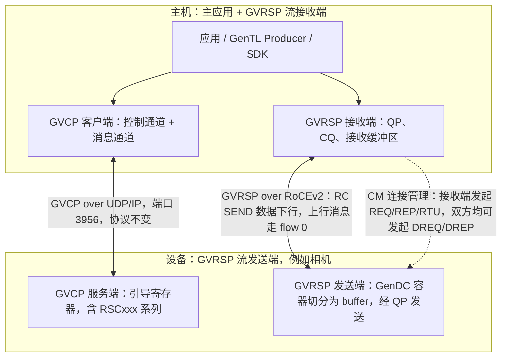
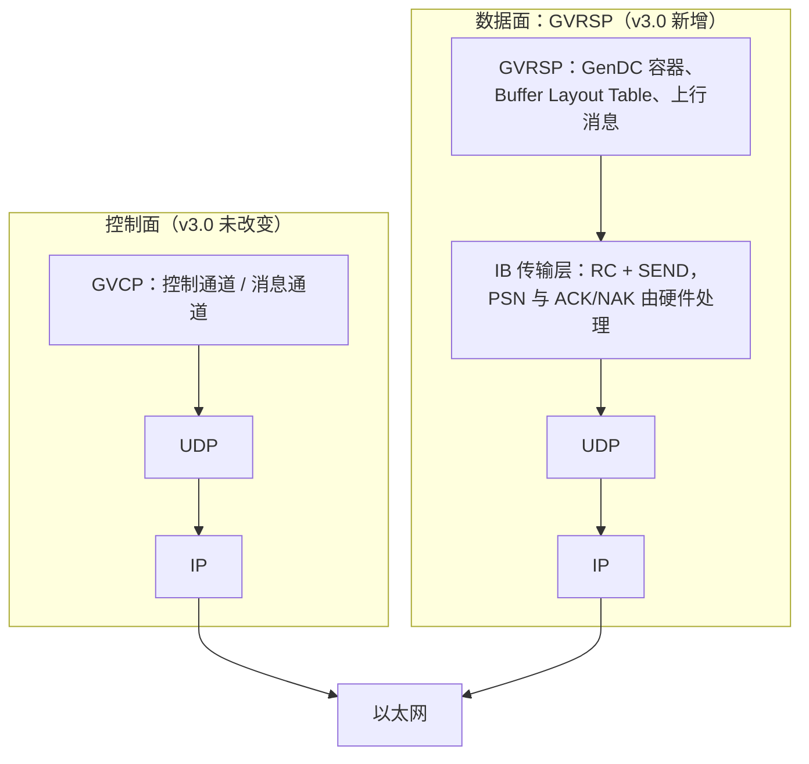
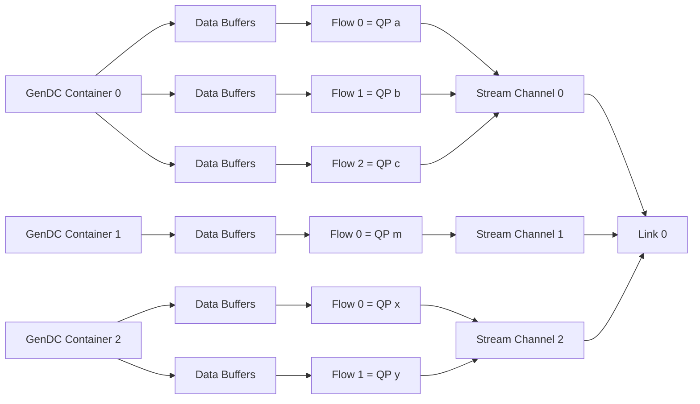
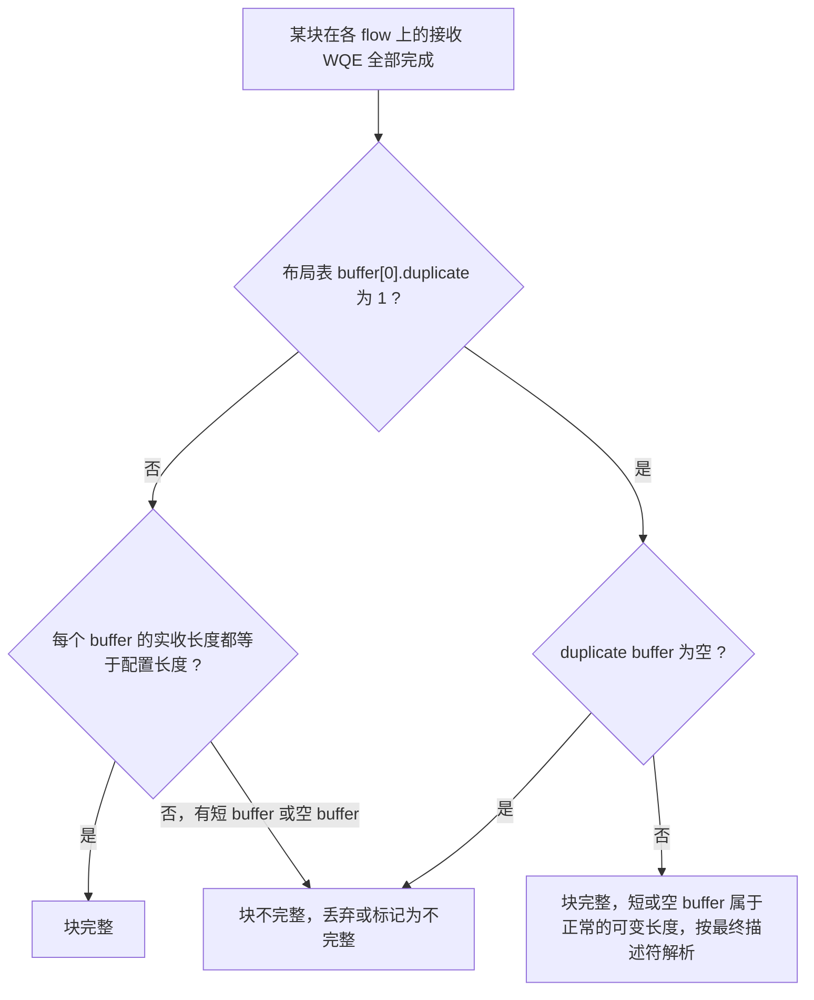
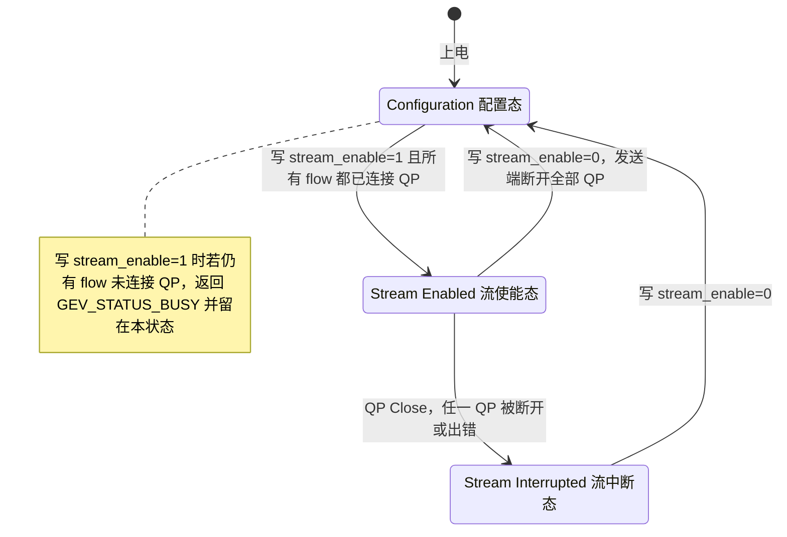
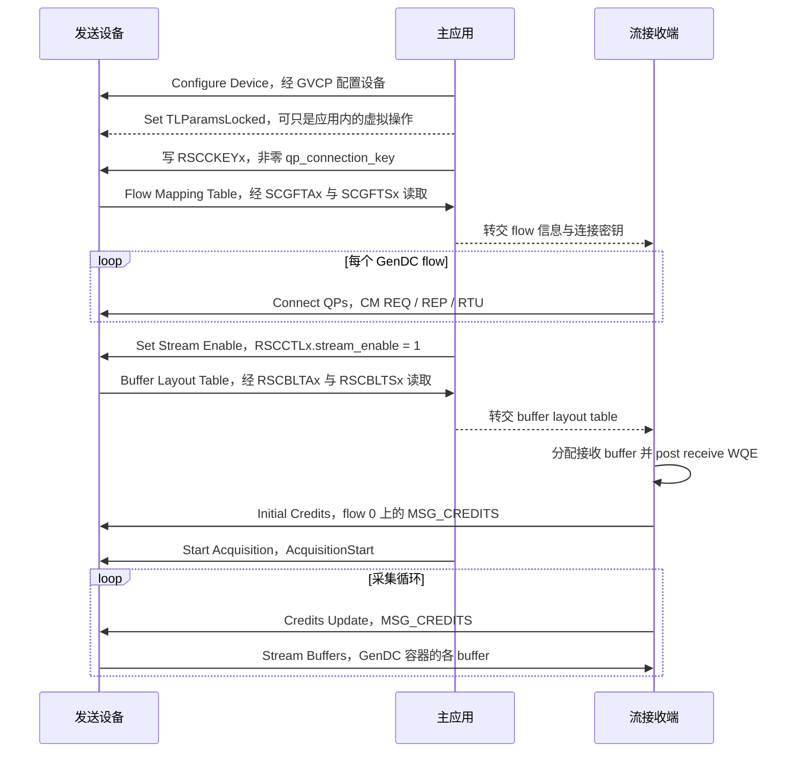
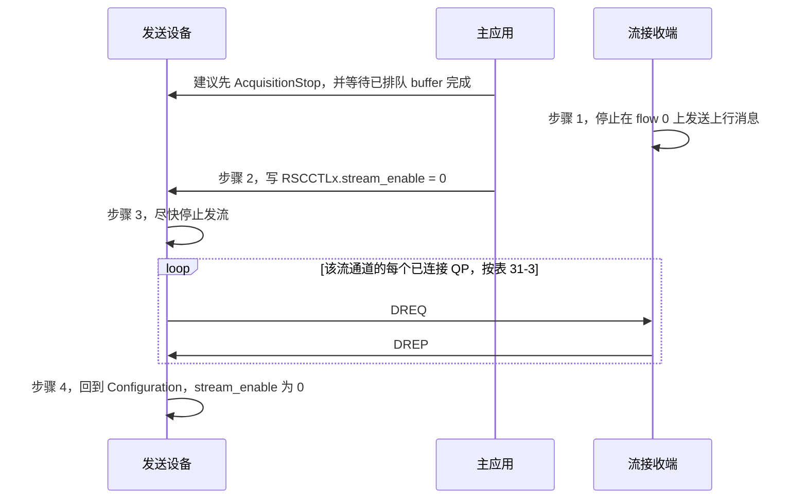

# GVRSP（一）：RoCEv2 基础与 GVRSP 流模型

> **覆盖范围**：第 27 章 GVRSP Summary（PDF p.206–207）、第 28 章 RoCEv2 Overview（p.208–210）、第 29 章 GVRSP Streaming（p.211–219）、第 30 章 GVRSP Stream Channel（p.220–222）。为便于理解，少量引用了 §10.4、§11.1–11.2、§11.12–11.13、§23.1、§36.23/36.27/36.38/36.66–36.78、§37.4.3、第 38 章（均注明页码）。
>
> **页码约定**：全文引用的都是 **PDF 页码**（PDF 页脚印刷页码 = PDF 页码 − 1）。
>
> **位编号约定**：本规范的位编号是 **MSB-first**——bit 0 是字段 / 32 位寄存器的**最高位**，bit 31 是最低位；多字节字段一律为**大端序（网络字节序）**。
>
> **一句话总结**：GVRSP（GigE Vision RDMA Streaming Protocol）是 GigE Vision 3.0 新增的流协议——在 RoCEv2 的 RC（可靠连接）+ SEND 之上，以"一个块 = 一个 GenDC 容器、一个 GenDC flow = 一个 QP"为模型，用 **buffer layout table** 取代 GVSP 的包头 / leader / trailer，由网卡硬件保证可靠、有序交付，不再需要应用层重传。
>
> **本文目录**
> - 核心要点
> - 27 GVRSP 概述（27.1 概述 / 27.2 目标 / 27.3 范围）
> - 28 RoCEv2 概述（28.1 简介 / 28.2 RoCEv2 传输服务）
> - 29 GVRSP 流传输（29.1 抽象层模型 / 29.2 块布局与传输 / 29.3 Buffer Layout Table / 29.3.1 示例 / 29.3.2 引导寄存器 / 29.4 检测不完整块）
> - 30 GVRSP 流通道（状态机 / 30.1 打开 / 30.2 关闭）
> - GVSP 与 GVRSP 对比
> - 附：GVRSP 相关引导寄存器速查
> - 实现要点与易错点 / 相关章节 / 自测题

---

## 核心要点

1. **GVRSP 是 v3.0 新增的应用层流协议，传输层为 RoCEv2**；GVCP（控制通道 / 消息通道）保持原有 UDP 实现不变（§27.1, p.206）。
2. **只用 RoCEv2 的一种组合：Reliable Connection（RC）传输服务 + SEND 传输功能**。分包、确认（ACK/NAK）、重传、有序交付全部由网卡硬件完成，因此**不需要 GigE Vision 应用层包重传**（§28.1–28.2, p.208–209；§27.2, p.206）。
3. **SEND 是"双边"操作**：接收端必须事先把接收缓冲区以 WQE 的形式 post 到接收队列，到达的消息按 post 顺序依次填入；一个 RoCEv2 消息 = 一个数据 buffer（§28.2, p.210；§29, p.211）。
4. **GVRSP 只支持 GenDC 负载**（CR-617s）。一个块（block）恰好是一个 GenDC 容器，没有 GVSP 头、leader、trailer；块用 GenDC 容器 `Id` 标识：建立连接时为 0，每个容器 +1，丢弃的容器跳号（§29.2, p.212）。
5. **抽象层次：Link → Stream Channel → GenDC Flow（= QP，1:1）→ Data Buffers**。流通道只是逻辑分组，地址 / 端口等物理网络属性全部落在 QP 上（§29.1, p.211–212）。
6. **Buffer Layout Table** 规定一个块被切成哪些传输 buffer、每个 buffer 的大小和所走的 flow；它是收发双方的"契约"，`stream_enable=1` 期间必须冻结（CR-620st），所有字段大端序（R-627s）。
7. **发送端每个块必须用满布局表里的全部 buffer**：数据不够时用不完整 / 空 buffer 补齐（CR-618st），任何 buffer 都不得超长（CR-619st）。
8. **首 buffer 可设 duplicate 标志**：它必在 flow 0 上（R-624s），在块末尾再发一次（R-626st），常用于用最终描述符覆盖初步描述符；容器大小可变时必须使用（CR-628s）；用"空的 duplicate buffer"表示该块被中止（CR-629st）。
9. **流通道三态**：Configuration → Stream Enabled → Stream Interrupted，由 `RSCCTLx.stream_enable` 控制。只要有 flow 尚未连接 QP，写 `stream_enable=1` 就返回 `GEV_STATUS_BUSY`（CR-632st）；写 0 时发送端断开全部 QP（CR-633st）。
10. **打开流程**：配置并锁定（TLParamsLocked）→ 读 flow mapping table → 凭 `RSCCKEYx` 密钥逐 flow 连接 QP → 置 `stream_enable` → 读 buffer layout table → post 接收缓冲并发初始 credit → AcquisitionStart（§30.1, p.221–222）。

---

## 27 GVRSP 概述（§27, p.206–207）

### 27.1 概述（§27.1, p.206）

- **定位**：GVRSP 是建立在传输层协议 **RoCEv2** 之上的**应用层协议**。GVRSP 接收端（receiver）借助它从 GVRSP 发送端（transmitter）接收图像数据、图像信息或其他信息；发送端还可以通过**独立于 GVCP 连接的 RoCEv2 QP 连接**接收**上行通信（upstream communication）**（§27.1, p.206，上行通信详见第 32 章）。
- **动机**：RoCEv2 能提供**可靠、有序**的数据交付，并且许多网卡（NIC）对其包处理做了**硬件加速**。对 GigE Vision 来说，"包处理"一直是难点，以太网速率越高这一点越重要（§27.1, p.206）。
- **控制面不变**：RoCEv2 基于 InfiniBand（IB）规范，用 UDP 承载 IB 格式的包。理论上控制连接也可以用这种机制，但规范明确：**GVCP（控制通道与消息通道）的实现不会改用该连接协议**，现有基于 UDP 的 GVCP 已能可靠地传递控制与消息（§27.1, p.206）。第 1 章也指出：除新增用于控制 GVRSP 和改善兼容性的引导寄存器外，控制与消息协议不受影响（§1, p.30）。

下图是 GVRSP 设备与主机的分层关系（根据 §27.1、§28.1 的描述绘制）：



协议栈对照（左：控制面，右：v3.0 新增的数据面）：



> 💡 解读：RoCEv2 包在线路上通常是 `Ethernet / IP / UDP（目的端口 4791，IANA 为 RoCEv2 分配）/ IB BTH（Base Transport Header）及扩展头 / 负载 / ICRC`。规范正文没有展开这些封装细节（明确说 IB/RoCEv2 传输层细节超出本规范范围，§29, p.211），以上为 IBTA 背景知识，实际以 InfiniBand Architecture Specification 为准。

### 27.2 目标（§27.2, p.206）

| # | 目标（意译） |
|---|---|
| 1 | 定义 GVRSP 发送端向 GVRSP 接收端发送图像数据、图像状态或其他数据的机制。 |
| 2 | 给出 GVRSP 所需的 RoCEv2 协议实现细节。 |
| 3 | 提供一种最能支持**可靠图像交付**的 RoCEv2 模式，**消除应用层包重传**的必要。 |
| 4 | 把 GVRSP 支持的负载类型**限定为 GenDC**——一种自描述数据的机制。 |
| 5 | 为发送设备提供 InfiniBand 协议基础设施的实现方式，**使对设备实现的影响最小**。 |

### 27.3 范围（§27.3, p.206–207）

Part 4（GVRSP）包含以下内容，对应到本知识库：

| 范围条目（§27.3） | 规范章节 | 本知识库位置 |
|---|---|---|
| RoCEv2 协议简介及用于实现 GVRSP 的 **RC Send** 传输功能 | 第 28 章 | 本文 §28 |
| 连接创建与维护 | 第 31 章 | [02_connection_and_flow_control.md](./02_connection_and_flow_control.md) |
| 上行通信通道 | 第 32 章 | 同上 |
| 应用层流控要求 | 第 33 章 | 同上 |
| Buffer layout 细节 | §29.3 | 本文 §29.3 |

---

## 28 RoCEv2 概述（§28, p.208–210）

### 28.1 简介（§28.1, p.208–209）

- **RDMA**（Remote Direct Memory Access，远程直接内存访问）：一台计算机直接读写另一台计算机的内存，**无需远端 CPU 参与**（§28.1, p.208）。
- **RoCEv2**（RDMA over Converged Ethernet version 2）是最流行的 RDMA 协议之一，作为 InfiniBand Architecture Specification 的一部分而标准化。它把 InfiniBand 架构搬到以太网基础设施上——按规范原文的说法，用"以太网和 UDP/IP"取代了 IB 的物理层和链路层（§28.1, p.208）。
- RoCEv2 提供**硬件卸载、零拷贝**的数据传输，主要特性如下（§28.1, p.208）：

| 类别 | 特性 |
|---|---|
| 高性能与高效 | 传输协议完全由硬件卸载；采用 DMA 的内核旁路（kernel bypass）技术 |
| 可靠性与数据一致性 | 可靠的包交付；包与 buffer **按序交付**；**不需要 GigE Vision 应用层包重传** |
| 低时延 | 基于 UDP；（可选的）重传由硬件处理，延迟最小 |
| 可扩展性 | 与以太网速率完全无关；性能与效率随链路速率扩展 |
| 业界成熟标准 | 已在数据中心和高性能计算中部署多年；主流 NIC 厂商均采用并支持；有与 NIC 厂商无关的标准化软件 API |

**图 28-1：套接字传输与 RDMA 零拷贝的对比**（p.209）。左半部分是传统套接字方式：数据在发起方（Initiator）要依次经过 Application → Sockets → Transport Protocol Driver 各层 buffer 的拷贝，再经 NIC Driver 和网卡发出；目标方（Target）反向逐层拷贝上来。右半部分是 RDMA：Sockets 与 Transport Protocol Driver 两层被旁路（图中为灰色），网卡直接对应用 buffer 做 DMA。

```
          套接字方式（逐层拷贝）                         RDMA 零拷贝
   Initiator               Target               Initiator               Target
 [Application|Buf]     [Buf|Application]    [Application|Buf]     [Buf|Application]
        | 拷贝              ^ 拷贝                 |                       ^
 [Sockets    |Buf]     [Buf|Sockets    ]     (Sockets 旁路)          (Sockets 旁路)
        | 拷贝              ^ 拷贝                 |                       |
 [Transport  |Buf]     [Buf|Transport  ]     (Transport 旁路)        (Transport 旁路)
        |                   ^                      |                       |
 [NIC Driver     ]     [     NIC Driver]     [NIC Driver     ]     [     NIC Driver]
        v                   |                      v DMA              DMA  |
     [ NIC ] ------------> [ NIC ]              [ NIC ] -------------> [ NIC ]
```

### 28.2 RoCEv2 传输服务（§28.2, p.209–210）

**基本概念**（§28.2, p.209）：

- RoCEv2 传输层通过**队列对（Queue Pair, QP）**与**通道适配器（channel adapter）**通信。QP 由一个**发送工作队列（Send Work Queue）**和一个**接收工作队列（Receive Work Queue）**组成。
- 客户端把 buffer 或命令 post 到这些队列中，通道适配器硬件用 **DMA** 从这些 buffer 读出或向其写入数据。
- 工作队列中的一项称为**工作队列元素（Work Queue Entry, WQE）**，一个 WQE 指向一个发送或接收 buffer。
- 每个 QP 关联一种**传输服务类型（transport service type）**，它描述可靠性程度以及 QP 传什么、怎么传；每种传输服务支持**传输功能（transport function）**的一个子集，传输功能定义请求方（requester）与响应方（responder）之间的实际数据传输。
- **GigE Vision 使用 Reliable Connection（RC）传输服务类型 + SEND 传输功能**，作为流通道数据的传输层协议。

**RC（可靠连接）的特性**（§28.2, p.209）：

- 结合**序列号**与**确认消息（ACK/NAK）**来校验包的交付顺序、防止重复包和乱序包、检测丢失的包；
- 实现了用于（可选）错误恢复的**重传机制**；
- RC 是**面向连接**的服务：客户端把本地 QP 连接到**唯一一个**远端 QP，**这对 QP 上不承载其他流量**。

**图 28-2：已连接 QP 的基本原理**（p.209）——两端各有一个 QP，各自的 Send Work Queue 与对端的 Receive Work Queue 对应，"请求（Request）"沿蓝线发出，"响应（Response）"沿红线返回：

```
        Queue Pair (A)                                     Queue Pair (B)
   +-------------------------+                       +-------------------------+
   | Send Work Queue         |  ---- Request ---->   | Receive Work Queue      |
Send() -> [WQE n ... WQE 1 WQE 0] <--- Response ---- | [WQE n ... WQE 1 WQE 0] -> Recv()
   |                         |                       |                         |
   | Receive Work Queue      |  <--- Request -----   | Send Work Queue         |
Recv() <- [WQE 0 WQE 1 ... WQE n] ---- Response ---> | [WQE 0 WQE 1 ... WQE n] <- Send()
   +-------------------------+                       +-------------------------+
```

**消息与包**（§28.2, p.209–210）：

- IBA/RoCEv2 通信是**面向消息**的。每个操作包含一个请求消息；使用 RC 时还有一个对应的响应消息。
- 一个请求消息由一个或多个 IBA 包组成，称为**请求包**。
- 对 GigE Vision 所用 SEND 功能的响应（也叫确认，acknowledge）**恰好是一个包**，它可以一次确认一个或多个已收到的包。

**SEND 的"双边"语义**（§28.2, p.210）：

- 基于 SEND 的数据传输，发起方把数据**推（push）**给远端 QP，发起方**不知道**数据会放在远端何处；
- 远端节点把数据放入该已连接 QP 的**下一个可用接收 buffer**，即接收队列**队首 WQE** 所指向的 buffer；
- 因为发起方和目的方都必须参与 SEND 事务，这种方式有时被称为**双边（two-sided）**操作。

> 💡 解读（IBTA 背景知识，非本规范内容）：IB/RoCEv2 常见的传输服务有 RC（可靠连接）、UC（不可靠连接）、UD（不可靠数据报）等；传输功能有 SEND（可带 immediate data）、RDMA WRITE、RDMA READ、原子操作等。GVRSP **只**使用 RC + SEND（规范未用到 RDMA WRITE / READ、immediate data、UC/UD 进行数据流传输）。选择 SEND 的直观好处是：接收端完全掌控"数据落在哪个 buffer"——它只需按规则 post 接收 WQE，无需像 RDMA WRITE 那样把自己的内存地址和 rkey 暴露给相机；同时 RC 提供可靠有序。代价是接收端必须**提前**准备好接收 WQE，否则硬件会回 RNR NAK（Receiver Not Ready），这正是第 33 章 credit 流控要解决的问题。

> 💡 解读：几个后文会用到的 Verbs 术语——**CQ（Completion Queue，完成队列）**：WQE 处理完成后，硬件向 CQ 写入一个 **WC（Work Completion，工作完成）**，其中包含状态与实际接收字节数等信息；规范在表 31-2/31-3 中提到"collect all errors from the completion queues"，图 33-1 中出现 WC。**PSN（Packet Sequence Number）**：RC 包序号，连接建立时由 CM 交换起始值（见表 31-1）。

---

## 29 GVRSP 流传输（§29, p.211–219）

GigE Vision 流的 RoCEv2 传输基于 **RC SEND** 传输功能，这意味着发送端和接收端都必须配合，流通道数据才能正确传送（§29, p.211）：

- 流接收端必须准备一个**接收缓冲区队列**，供已连接的流发送端把数据 buffer 发进来；
- 通信是**面向消息**的，**每个消息代表一个数据 buffer**。

**图 29-1：数据 buffer 的 RC SEND 传输**（p.211）：

```
            发送端 Transmitter                                  接收端 Receiver
                    Send Work Queue                     Recv Work Queue
 Send Buffer 0 <---- [WQE 0] =====================================> [WQE 0] ----> Recv Buffer 0
 Send Buffer 1 <---- [WQE 1]            RC SEND（逐个消息）          [WQE 1] ----> Recv Buffer 1
      ...            [ ... ]                                         [ ... ]           ...
 Send Buffer n <---- [WQE n]                                         [WQE n] ----> Recv Buffer n
                        ^ New WQEs                                      ^ New WQEs
```

- **顺序**：发送端的数据 buffer 按其 post 到发送工作队列的**顺序**发出；接收端到达的消息按接收 buffer post 到接收工作队列的**顺序**依次填入（§29, p.211）。
- **只在已连接 QP 之间传送**；QP 的连接与断开见 §31.2（§29, p.211）。
- **包层面**：RoCEv2 消息在更底层以一串包传送。RC SEND 实际用到的传输层包类型是 **SEND First、SEND Middle、SEND Last 或 SEND Only**；但 RoCEv2 传输层**完全由网络硬件处理**，应用和操作系统都不在包层面与传输交互；IB/RoCEv2 传输层的详细描述不在本规范范围内（§29, p.211）。

> 💡 解读：一个 SEND 消息若不超过路径 MTU（Path MTU，在连接建立时协商，见表 31-1），就以单个 SEND Only 包发送；否则拆成 SEND First + 若干 SEND Middle + SEND Last。GVRSP 的"buffer"是消息级概念，与 GVSP 的"包"不是一回事——一个 buffer 可以有几 MB，拆包与重组由网卡完成。

### 29.1 抽象层模型（§29.1, p.211–212）

- RoCEv2 把 **QP** 的概念引入 GigE Vision，在原有的 *link → stream channel* 层次上又增加了一层抽象（§29.1, p.211）。
- 由于基于 RoCEv2 的流**只支持 GenDC 负载**，**QP 可以与 GenDC flow 一一（1:1）对应**（§29.1, p.211）。

**图 29-2：GVRSP 抽象层模型**（p.212）：



要点（§29.1, p.212）：

- 流通道**只是在逻辑上把一个 GenDC 容器的各个 GenDC flow 归为一组**；
- 与 GVSP 不同，GVRSP 的流通道**不定义地址、端口等物理网络属性**，所有物理网络信息都由 **RoCEv2 QP** 维护；
- QP 直接映射到 GenDC flow，因此 GenDC flow 由**物理网络实体**表示，而不是像 GVSP 中那样只是**虚拟**概念。

| 层级 | GVSP | GVRSP |
|---|---|---|
| Link（链路） | 物理网络接口 | 物理网络接口 |
| Stream Channel（流通道） | 带物理网络属性：目的地址 / 端口（SCDAx/SCPx）、包大小（SCPSx）等 | **纯逻辑分组**：一个 GenDC 容器的若干 flow；无地址 / 端口 |
| GenDC Flow | 虚拟划分（GVSP GenDC 负载内部的逻辑概念） | **物理实体**：每个 flow 对应一个 RoCEv2 RC QP |
| 数据单元 | 包（packet，含 GVSP 头） | buffer（一个 RoCEv2 SEND 消息，无额外协议头） |

### 29.2 块布局与传输（§29.2, p.212–214）

**块 = GenDC 容器**（§29.2, p.212）：

- 与 GVSP 类似，GVRSP 流通道数据也组织成**块（block）**；但在 GVRSP 中，**一个块恰好就是一个 GenDC 容器，没有额外的协议开销**。
- 每个 GenDC 容器用**一个或多个 buffer** 传送。
- RoCEv2 传输**不使用** GVSP 协议头，也**不使用** leader 包和 trailer 包：GVSP 包头中的信息全部由 RoCEv2 协议的原生特性替代；GVSP leader 中的数据可在 **GenDC 容器描述符（container descriptor）**中找到；对于块意外提前结束或更新初步 leader 信息这两种情况，也不需要 trailer（后文解释）。

> **[CR-617s]** 使用 GVRSP 流模式时，负载数据**必须**按 GenICam GenDC version 1 的定义格式化，允许任意 minor 版本（§29.2, p.212）。

**GenDC 容器标识符 `Id`**（参见 GenICam GenDC 1.2）的作用类似 GVSP 的 block ID，用来标识流通道的块。由流发送端按以下规则分配（§29.2, p.212）：

1. **打开流通道时初始化为 0**——也就是**连接流通道的 QP 时**；
2. 每个后续容器**加 1**；
3. 当发送端**丢弃**一个容器（例如带宽不足或接收端缓冲区不够）时，**应当跳过**该容器对应的 Id，让接收端能检测到丢失。

**描述符更新**（§29.2, p.213）：若需要在传输过程中更新最初的 GenDC 容器描述符信息，可以组合使用**初步描述符（preliminary descriptor）**和**最终描述符（final descriptor）**，机制见 GenICam GenDC 1.2。

**三种传送方式**（§29.2, p.213）：块可以作为一个紧凑 buffer 传送，也可以拆成多个 buffer；多个 buffer 既可以经由一个 QP（GenDC flow）**顺序**传送，也可以经由多个 QP（GenDC flow）**并行**传送。

**图 29-3：一个块用单 buffer、多 buffer 顺序、多 buffer 并行三种方式传送**（p.213）：

```
(a) 单 buffer
    Transmitter QP x --Flow 0-->  [            GenDC Container            ]  --> Receiver QP y

(b) 多 buffer，同一 flow 顺序发送（虚线框 = 可选的 duplicate 描述符）
    Transmitter QP x --Flow 0-->  [Descriptor] [Payload Buffer 0] [Payload Buffer 1] [Descriptor]?  --> Receiver QP y

(c) 多 buffer，多个 flow 并行发送
    Transmitter QP a --Flow 0-->  [Descriptor] ................................. [Descriptor]?  --> Receiver QP x
    Transmitter QP b --Flow 1-->           [Part 0 Payload] [ ... ]                           --> Receiver QP y
    Transmitter QP c --Flow 2-->           [Part 1 Payload] [ ... ]                           --> Receiver QP z
                                  ------------------------------------------------> 时间
```

**顺序规则**（§29.2, p.213）：经由**同一个 QP（GenDC flow）**传送的数据 buffer，**必须**始终按它们在块中的组织顺序发送；只有利用**多个 QP 并行传送**时，块内才可能出现乱序。

**提前结束与"补齐"**（§29.2, p.213）：

- 为了保持发送端和接收端同步，**GenDC 容器的所有 buffer 必须总是被传送**。
- 但发送端有时需要比预期更早结束传输，典型场景：**线扫相机提前结束一帧**，或高速发送端发生**意外的 buffer 溢出**。
- 此时发送端为该容器余下部分发送**不完整（incomplete）和 / 或空（empty）的 buffer**——RoCEv2 原生支持这种做法。接收端仍按预期收到该容器的全部 buffer，同时还能得知每个 buffer 的**实际大小**。

> **[CR-618st]** 发送端工作在 GVRSP 模式时，对每个传送的块**必须**使用 buffer layout table 中配置的**全部 buffer**；若要发送的负载数据少于接收端预期，**必须**用不完整和 / 或空的传输补齐尚未发送的 buffer（§29.2, p.213）。
>
> **[CR-619st]** 发送端工作在 GVRSP 模式时，任何一个 buffer 传送的数据**都不得超过** buffer layout table 中为它配置的大小（§29.2, p.214）。

> 💡 解读：在 Verbs 层面，"空 buffer"就是一个长度为 0 的 SEND 消息；接收端对应 WC 中的实际字节数（如 libibverbs 的 `ibv_wc.byte_len`）为 0。"不完整 buffer"是长度小于配置值的 SEND。因为 SEND 消息总会消耗接收端队首的一个接收 WQE，所以"每块总是发满 buffer 个数"能保证接收队列中的 WQE 与块边界始终对齐——一旦少发一个，后续所有块都会错位，这正是 CR-618st 的意义。若超长（违反 CR-619st），接收端 buffer 放不下，RC 会报错并可能使 QP 进入错误状态。

更多 GenDC 使用说明见第 38 章（§29.2, p.214；另见 [../06_interoperability/interoperability_and_testing.md](../06_interoperability/interoperability_and_testing.md)）。

### 29.3 Buffer Layout Table（缓冲区布局表）（§29.3, p.214–216）

**定义与作用**（§29.3, p.214）：

- Buffer layout table 定义了**某个流通道上**，一个 GVRSP 块（即一个 GenDC 容器）如何被划分为**有序的一串传输 buffer**。
- 每个条目给出 **buffer 大小**和**所走的 GenDC flow**。
- 块内偏移是**隐含**的：buffer[0] 从偏移 0 开始，之后每个 buffer 的起始偏移 = 前一个 buffer 的偏移 + 前一个 buffer 的大小；所有 buffer 大小之和 = 块总大小（SFNC `PayloadSize`）。
- 为了正确重组块，接收端需要按发送端的布局**分配匹配的接收 buffer，并 post 对应的工作队列元素（WQE）**。

**"稳定契约"**（§29.3, p.214）：

- 布局在一次流会话（streaming session）期间是稳定的契约：不同会话之间可以因设备配置不同而变化，但**一旦流处于活动状态就保持不变**。
- buffer layout table 必须**始终有效、随时可用于流传输**，因此它通过**设备配置**来调整（而不是由应用写入）。
- **NOTE**：buffer layout table **随时可读**；读操作必须总是返回**完整且有效**的表，绝不能暴露更新到一半或其他无效内容；返回的表反映读操作发生时设备的当前配置。
- 会影响布局的特性（例如图像分辨率、像素格式、flow 数量、Sequencer 配置）在 GVRSP 流通道**打开期间不能修改**。使用 GenApi 时，通过 SFNC `TLParamsLocked` 在流期间锁定这些特性或限制其有效范围；设备也可以用**填充（padding）**等手段维持现有布局，从而让其中一些特性在流期间仍可配置。

> **[CR-620st]** 发送端工作在 GVRSP 模式时，只要 `RSCCTLx` 寄存器的 `stream_enable` 位为 1，就**必须冻结** buffer layout table 的内容（§29.3, p.214）。

**duplicate（重复发送）标志的由来**（§29.3, p.214）：当块被拆成多个传输 buffer 时，**第一个 buffer 往往充当块标记（block marker）**，通常包含 GenDC 描述符。这个 buffer 可以被标为 **duplicated**，即被发送**两次**：先在块开始时发一次，之后再发一次以**完成该块**。接收端需要检查 duplicate 标志，以便**为这个额外的 buffer 多排队一个接收缓冲**。

#### 表结构（图 29-4，p.214；字段表 p.215）

下表偏移相对于 `RSCBLTAx` 给出的表起始地址；x = 0 … n−1；**位号为 MSB-first**（bit 0 = 32 位字的最高位）。

| 字节偏移(Offset) | 字段 | 长度 | 说明 |
|---|---|---|---|
| 0x00 | `buffer_count` | 32 bit（4 字节） | 布局表中**有效条目数** n；至少要有一个 buffer 条目（R-621s：≥ 1） |
| 0x04 + 8·x | `buffer[x].size` | 32 bit（4 字节） | buffer x 的字节数。**最大有效长度为 2^31 字节**（pdftotext 文本中显示为"231"，PDF 原文是上标 2³¹，已核对） |
| 0x08 + 8·x，bit 0–15 | `buffer[x].flow_id` | 16 bit | 承载 buffer x 的 **GenDC Flow ID**；buffer[0] 必须为 0（R-624s） |
| 0x08 + 8·x，bit 16–30 | reserved | 15 bit | 保留。字段表未单列；宽度由图 29-4 的分隔线位置推得（flow_id 占 bit 0–15，d 占 bit 31） |
| 0x08 + 8·x，bit 31 | `buffer[x].duplicate`（d） | 1 bit | 置 1 表示该 buffer 会被**重复发送**，即在第一轮 buffer 之后再发送一次；重复的那次与原 buffer 的 size 和 flow_id 相同，可用于**用最终 GenDC 描述符覆盖初步描述符**；**只有布局表的第一个 buffer 可以置此标志** |

- 每个条目 8 字节，表的有效长度 = **4 + 8·n 字节**（💡 由图 29-4 推得；与 `RSCBLTSx` ≥ 4 + 8 = 12 字节、即"buffer_count + 至少一个条目"的要求 CR-676cd 相互印证，§36.73, p.342）。
- 图 29-4 中 buffer[n−1] 那一行没有画出 d 位，因为只有 buffer[0] 可以置 duplicate；按字段表，每个条目都有该位（其余条目应为 0）。

```
bit(MSB-first) 0                      15 16                 30  31
              +---------------------------------------------------+
0x00          |                 buffer_count = n                  |
              +---------------------------------------------------+
0x04          |                  buffer[0].size                   |
              +-------------------------+---------------------+---+
0x08          |    buffer[0].flow_id    |      reserved       | d |
              +-------------------------+---------------------+---+
              |                        ...                        |
              +---------------------------------------------------+
0x04+8(n-1)   |                 buffer[n-1].size                  |
              +-------------------------+-------------------------+
0x08+8(n-1)   |   buffer[n-1].flow_id   |        reserved         |
              +-------------------------+-------------------------+
```

> 💡 解读（按 MSB-first 位号推导，非规范原文）：在偏移 0x08+8·x 处按大端读出 32 位字 `w`，则 `flow_id = w >> 16`，`duplicate = w & 0x00000001`（即该条目第 8 个字节、偏移 0x0B+8·x 的最低位）。千万不要把"bit 31"理解成 `0x80000000`。

#### 布局表规则（§29.3, p.215）

| 编号 | 规则（意译） |
|---|---|
| **R-621s** | `buffer_count` **必须 ≥ 1**。 |
| **R-622s** | 布局表中属于 flow X 的所有 `buffer[n].size` 之和**必须等于**对应 GenDC flow mapping table 中 flow X 的 `FlowSize`。 |
| **R-623s** | 布局表中所有 `buffer[n].size` 之和**必须等于** SFNC 特性 `PayloadSize`。 |
| **R-624s** | 布局表的第一个 buffer **必须**经由 GenDC flow 0 传送（`buffer[0].flow_id = 0`）。 |
| **R-625s** | duplicate 位**只能**在布局表第一个 buffer 上置位（`buffer[0].duplicate = 1`）。 |
| **R-626st** | 当第一个 buffer 的 duplicate 位置位时，该 buffer 应在指定的 flow 上**作为块的最后一个 buffer 重发**。 |
| **R-627s** | 布局表所有字段**必须**使用网络字节序（大端）。 |

**偏移规则**（§29.3, p.215）：buffer[0] 必须从 GenDC 容器偏移 0 开始；对其后的每个 buffer[n]，其在容器中的偏移必须等于 buffer[n−1] 的偏移 + buffer[n−1].size。

**何时必须用 duplicate**（§29.3, p.215–216）：

- 首个传输 buffer 的重复发送，典型用途是传送同时带有**初步描述符和最终描述符**的 GenDC 容器。
- 当传送 GenDC 容器需要更新描述符（因而要同时发送初步与最终描述符）时，可通过引导寄存器访问的 **GenDC prefetch descriptor（预取描述符）中的 `VariableFields` 非零**；此时对应的 buffer layout table **必须**使用 duplicate 标志。
- 重复的 buffer 与原 buffer 具有**相同的大小、GenDC flow ID 和偏移**。

> 💡 解读：prefetch descriptor 的位置由 `SCGDAx`/`SCGDSx`（SCEBA(x)+0x00/+0x04，§36.67–36.68, p.337–339）给出，详见 [../05_bootstrap_registers/03_channel_registers.md](../05_bootstrap_registers/03_channel_registers.md) 和第 38 章。因为 duplicate 与原 buffer 的偏移相同（都在偏移 0），接收端既可以把重复的那次直接接收到原位置（让最终描述符覆盖初步描述符），也可以收到另一块缓冲后再比较 / 拷贝——规范只规定"偏移相同"，具体做法属于实现选择。另外，duplicate 不是布局表中的独立条目，所以 R-622s/R-623s 的求和**不包含**这次重发；但接收端每块要**多 post 一个**同样大小的接收 WQE。

**块边界与完整性的判定方式**（§29.3, p.216）：RoCEv2 流没有显式的 leader/trailer 标记块边界，接收端通过**把收到的 buffer 与配置的 buffer layout table 逐一对应**来验证块是否传完：

- 接收端总是按**当前**布局表把该块的全部接收 buffer 入队到 RoCEv2 接收队列；
- **当一个块的所有 buffer 都已收到，就认为该块已传送完毕**；
- 要判断一个已传送的块是否**完整**，接收端必须跟踪设备发来的**每个 buffer 的实际大小**（见 §29.4）。

#### 29.3.1 Buffer Layout 示例（§29.3.1, p.216–218）

所有示例都假设：GenDC 容器总大小 **10,000 字节** = **1,000 字节描述符** + **9,000 字节负载**（§29.3.1, p.216）。

**示例 1：完整容器放在单个 buffer 中**（p.216）

```
buffer_count = 1;
buffer[0].size = 10000;  buffer[0].flow_id = 0;  buffer[0].duplicate = 0;

Flow 0  ....[                10,000 bytes                ]....    时间 -->
```

- 整个容器（描述符 + 负载）作为一个 SEND 消息发出；接收端每块在 flow 0 的 QP 上 post **1 个** 10,000 字节的接收 WQE。
- 💡 解读：这种方式最简单，但描述符和图像数据挤在同一个 buffer 里，图像数据不会从用户 buffer 的偏移 0 开始。

**示例 2：描述符与负载放在同一 GenDC flow 上的不同 buffer 中**（p.216）

```
buffer_count = 2;
buffer[0].size = 1000;  buffer[0].flow_id = 0;  buffer[0].duplicate = 0;
buffer[1].size = 9000;  buffer[1].flow_id = 0;  buffer[1].duplicate = 0;

Flow 0  ....[1,000 bytes]......[          9,000 bytes          ]....    时间 -->
```

- flow 0 上**顺序**发送两个消息；接收端每块 post 2 个 WQE（1,000 + 9,000），**顺序必须与布局表一致**。
- 💡 解读：这样主机端可把描述符收进 SDK 内部缓冲、把 9,000 字节负载直接收进应用的图像 buffer（偏移 0 起），与 §35.2.2 对 GenTL Producer 的建议一致。

**示例 3：初步与最终 GenDC 描述符**（p.217）

```
buffer_count = 2;
buffer[0].size = 1000;  buffer[0].flow_id = 0;  buffer[0].duplicate = 1;
buffer[1].size = 9000;  buffer[1].flow_id = 0;  buffer[1].duplicate = 0;

Flow 0  ....[1,000 bytes]..[        9,000 bytes        ]..[1,000 bytes]....    时间 -->
             初步描述符                                     duplicate：最终描述符
```

- buffer[0] 的 d = 1：块开头发 1,000 字节（通常是初步描述符），负载之后在 flow 0 上**再发一次** 1,000 字节（通常是最终描述符），见 R-626st。
- 接收端每块在 flow 0 上 post **3 个** WQE：1,000 → 9,000 → 1,000。

**示例 4：并行传送，负载拆成两个 buffer**（p.217）

```
buffer_count = 3;
buffer[0].size = 1000;  buffer[0].flow_id = 0;  buffer[0].duplicate = 0;
buffer[1].size = 4500;  buffer[1].flow_id = 1;  buffer[1].duplicate = 0;
buffer[2].size = 4500;  buffer[2].flow_id = 1;  buffer[2].duplicate = 0;

Flow 0  ....[1,000 bytes]..........................................    时间 -->
Flow 1  ...........[  4,500 bytes  ]......[  4,500 bytes  ].........
```

- 描述符走 flow 0，两个 4,500 字节的负载 buffer 都走 **flow 1**（pdftotext 文本把第二个 4,500 排到了 flow 0 那一行，已按 PDF 图核对，两者都在 flow 1）。
- 规范特别说明：flow 1 上的负载可以在**任意时刻**开始——与 flow 0 上的描述符**同时**甚至**更早**开始发送都完全合法（p.217）。
- 接收端：flow 0 的 QP post 1 个 WQE（1,000），flow 1 的 QP **按顺序** post 2 个 WQE（4,500、4,500）。

**示例 5：并行传送 + 初步 / 最终描述符**（p.217–218）

```
buffer_count = 3;
buffer[0].size = 1000;  buffer[0].flow_id = 0;  buffer[0].duplicate = 1;
buffer[1].size = 4000;  buffer[1].flow_id = 1;  buffer[1].duplicate = 0;
buffer[2].size = 5000;  buffer[2].flow_id = 2;  buffer[2].duplicate = 0;

Flow 0  ....[1,000 bytes]...............................[1,000 bytes]....    时间 -->
                                                         (duplicate)
Flow 1  ........[      4,000 bytes      ]...............................
Flow 2  .......[         5,000 bytes         ]..........................
```

- 三个 flow 并行；flow 0 上的 duplicate **只要发送端能保证整个块的交付，就可以发送**（p.218；对应 CR-630st）。
- 接收端：flow 0 post 2 个 WQE（1,000 + 1,000），flow 1 post 1 个（4,000），flow 2 post 1 个（5,000）。

**示例汇总**（"各 flow 合计"与"偏移"两列为 💡 按 R-622s 和偏移规则推导）：

| 示例 | buffer_count | 条目（size / flow / d） | 容器内偏移 | 各 flow 合计（应等于 FlowSize） | 接收端每块需 post 的 WQE |
|---|---|---|---|---|---|
| 1 | 1 | 10000/0/0 | 0 | flow0 = 10000 | flow0 × 1 |
| 2 | 2 | 1000/0/0，9000/0/0 | 0，1000 | flow0 = 10000 | flow0 × 2 |
| 3 | 2 | 1000/0/**1**，9000/0/0 | 0，1000（duplicate 也在 0） | flow0 = 10000 | flow0 × 3 |
| 4 | 3 | 1000/0/0，4500/1/0，4500/1/0 | 0，1000，5500 | flow0 = 1000，flow1 = 9000 | flow0 × 1，flow1 × 2 |
| 5 | 3 | 1000/0/**1**，4000/1/0，5000/2/0 | 0，1000，5000 | flow0 = 1000，flow1 = 4000，flow2 = 5000 | flow0 × 2，flow1 × 1，flow2 × 1 |

所有示例的条目之和都是 10,000 = `PayloadSize`（R-623s）。

#### 29.3.2 引导寄存器（§29.3.2, p.218）

Buffer layout table 以**数组形式**存在于设备引导寄存器地址空间中，其地址和大小由以下两个**只读**寄存器给出（详见第 36 章）：

| 寄存器 | 地址 | 访问 | 说明 | 出处 |
|---|---|---|---|---|
| GVRSP Stream Channel Buffer Layout Table Address（**RSCBLTAx**） | SCEBA(x) + 0x34 | R | `gvrsp_blt_address`（bit 0–31）：流通道 x 的 buffer layout table 地址；位图中 bit 30–31 固定为 0 | §36.72, p.342；CR-674cd |
| GVRSP Stream Channel Buffer Layout Table Size（**RSCBLTSx**） | SCEBA(x) + 0x38 | R | `gvrsp_blt_size`：为布局表**分配的内存区域**最大字节数；设备可以只用其中一部分，但整个区域必须始终可读；有效部分由 `buffer_count` × 条目大小确定；值必须 ≥ 12 字节 | §36.73, p.342–343；CR-675cd、CR-676cd |

- `SCEBAx`（Stream Channel Extended Bootstrap Address）位于 **0x0D3C + 0x40·x**，只读，给出流通道 x 扩展引导寄存器区的起始地址（4 字节对齐）（§36.66, p.336–337）。
- GVRSP 引导寄存器只有在 Streaming Configuration 的 `streaming_protocol` = 1（GVRSP 模式）时才可用，否则设备返回 `GEV_STATUS_ACCESS_DENIED` 或 `GEV_STATUS_INVALID_ADDRESS`（§11.12, p.87）。

> 💡 解读（读取策略）：先读 `RSCBLTAx`、`RSCBLTSx`，再用 READMEM 从 `RSCBLTAx` 读出 `buffer_count`，然后读取 4 + 8·n 字节（不超过 `RSCBLTSx`）。若表较大，单次 READMEM 的长度受 GVCP 最大包长限制，需要分段读取（参见 [../02_gvcp/03_message_formats.md](../02_gvcp/03_message_formats.md)）。因为规范保证"读到的总是完整有效的表"（p.214 NOTE），但分段读取跨越了多次读操作，最稳妥的做法是在 `stream_enable=1`（表已冻结，CR-620st）之后再读，或读完后再读一次比对。

### 29.4 检测不完整块（§29.4, p.218–219）

不完整的块传输可能由多种原因引起，例如发送端因 buffer 溢出需要中止传输。无论原因如何，接收端都必须能检测出不完整的块，以免处理无效数据（§29.4, p.218）。

**判定方法**——接收端对照 buffer layout table 中的条目监视 buffer 的接收（§29.4, p.218）：

1. **只发一次描述符**（布局表的 duplicate 标志为 0）：接收端期望**所有 buffer 都以配置的大小到达**；只要有任何**负载 buffer 比预期短或为空**，就判定该块传输**不完整**。
2. **容器大小逐块可变**：发送端需要把布局表的 duplicate 标志置 1，**复制第一个 buffer**。使用 duplicate 时，短的和 / 或空的 buffer **不一定**意味着块不完整；接收端改用 **duplicate buffer** 来确认块的完整性。发送端通过**用一个空 buffer 代替 duplicate buffer** 来表示块不完整。
3. **NOTE**：取决于发送端配置，即使使用了 duplicate buffer，第一个 buffer 携带的也可能是**初步描述符**，也可能是**最终描述符**。

> **[CR-628s]** 发送端工作在 GVRSP 模式，且容器大小可能逐个容器变化时，发送端**必须**使用第一个 buffer 的 duplicate（§29.4, p.219）。
>
> **[CR-629st]** 发送端在 GVRSP 模式下使用首 buffer duplicate，若在发出块的第一个 buffer 之后中止了块传输，**必须**发送一个**空的 duplicate buffer** 来表示块不完整（§29.4, p.219）。
>
> **[CR-630st]** 发送端在 GVRSP 模式下启用首 buffer duplicate 时，**只有**在满足以下条件之一后才能发送 duplicate buffer：（1）发送端能**保证整个块的交付**；（2）发送端需要**中止**块传输（此时 duplicate buffer 为空）（§29.4, p.219）。

接收端判定逻辑（根据 §29.3–29.4 整理）：



> 💡 解读：
> - 另一类"丢块"是发送端整块**丢弃**（例如没有 credit 或带宽不足）。此时该块的 buffer 一个都不会发出，接收端已 post 的 WQE 会被下一个块使用，接收端应依靠 GenDC 容器 `Id` 的**跳号**发现丢失（§29.2, p.212）。
> - CR-630st 的意义：duplicate 是"块成功"的确认信号，所以发送端必须等到确定整块能交付（例如所有 flow 上的数据都已提交给硬件、不会再中止）才发；若中途出错，就把 duplicate 发成空消息。

---

## 30 GVRSP 流通道（§30, p.220–222）

**组成**：GVRSP 流通道用于经由 RoCEv2 QP **一次一个**地传送 GenDC 容器；一个 GVRSP 流通道由**一个或多个 RoCEv2 QP** 组成（§30, p.220）。

**状态机**（§30, p.220；图 30-1）：

- **上电后**，流通道处于 **Configuration（配置）**态；此态下可以按需连接 QP。
- 为了让发送设备准备好流传输，向 `RSCCTLx` 的 `stream_enable` 位**写 1**，流通道从 Configuration 切换到 **Stream Enabled（流使能）**态。**只要有任何一个 GenDC flow 还没有连接 QP，设备就保持在 Configuration 态**（并返回 BUSY，见 CR-632st）。
- 在 Stream Enabled 态下，如果流接收端**断开了**该流通道的某个 QP（或某个 QP **进入错误状态**），流通道进入 **Stream Interrupted（流中断）**态。**只能**通过向 `stream_enable` **写 0** 离开该状态。
- 向 `stream_enable` **写 0**，流通道回到 Configuration 态；此时发送设备已经断开了该流通道所有仍打开的 QP。



各状态汇总（"允许 / 发生的事"一列综合了第 29–33 章的相关要求）：

| 状态 | 进入条件 | 允许 / 发生的事 | 离开方式 |
|---|---|---|---|
| Configuration | 上电；写 `stream_enable=0`；心跳超时后发送端复位 `RSCCTLx`（§31.5.3） | 可以连接 / 断开 QP；布局表随设备配置变化（受 TLParamsLocked 约束）；credit 计数器为 0（CR-655st）；**不得发流**（CR-631st） | 写 `stream_enable=1` 且所有 flow 都已有连接的 QP |
| Stream Enabled | 见左 | **拒绝新的 QP 连接请求**（CR-638st）；布局表及其他 GVRSP 流通道寄存器锁定（CR-620st，§30.1 步骤 5）；按 credit 发流 | 写 0 → Configuration；QP 被断开或出错 → Stream Interrupted |
| Stream Interrupted | Stream Enabled 时 QP 被断开或出错；发送端自己发起 DREQ 前也会先进入此态（表 31-3） | 停止在该流通道所有 QP 上发数据；忽略 flow 0 上的上行消息；清除全部 credit（表 31-2/31-3） | **只能**写 `stream_enable=0` → Configuration |

### 30.1 打开 GVRSP 流通道（§30.1, p.220–222）

本节概括在流发送端和流接收端之间建立流连接所需的步骤。规范图 30-2 的参与者有三个：**发送设备（Transmitter Device）**、**主应用（Primary Application）**、**流接收端（Stream Receiver）**。主应用和接收端通常是同一个程序，但规范允许接收端是另一个（次级）应用或设备；此时主应用如何把连接相关信息转交给接收端，属于实现质量问题（§11, p.81）。

**图 30-2：GVRSP 流通道打开流程**（p.221，下图虚线表示"经主应用转交给接收端"）：



图注 (*)：设置 TLParamsLocked **不一定是对发送设备的真实写访问**，也可以只是应用内部基于设备 GenICam XML 文件的一个"虚拟操作"（p.221）。写 `RSCCKEYx` 在图 30-2 中没有单独画出，规范在步骤 3 中说明"由主应用**事先**写入"。

**步骤详解**（§30.1, p.221–222）：

| 步骤 | 执行者 | 动作（意译） | 涉及寄存器 / 消息 |
|---|---|---|---|
| 前提（💡 综合自其他章节） | 主应用 | 取得控制权；确认 Streaming Capability（0x092C）bit 5 `gvrsp_mode_supported` = 1，并把 Streaming Configuration（0x0960）bits 4–5 `streaming_protocol` 设为 1；按需配置设备并（实际或虚拟地）设置 TLParamsLocked | CCP；0x092C；0x0960（§36.27, p.290–291；§36.38, p.304–306）；SFNC `TLParamsLocked` |
| 1 | 接收端 | 从发送端的 **Stream Channel GenDC Flow Mapping Table Address** 获取下一次流会话涉及的 GenDC flow 信息 | `SCGFTAx`（SCEBA(x)+0x08）、`SCGFTSx`（+0x0C）；flow 数取自表中的 `FlowCount`（§31.6, p.233） |
| 2 | 发送端 / 接收端 | GenDC flow 结构可能取决于设备配置（例如启用 / 禁用某些数据组件），因此**每次流会话前都应重新读取**。在发送端 node map 中锁定 SFNC `TLParamsLocked` 后，只要 TLParamsLocked 保持置位，发送端就禁止任何会影响 flow mapping table 的配置，flow mapping table 保持不变 | `TLParamsLocked`（另见 CR-614st，§38, p.365） |
| 3 | 接收端 | 知道 flow 结构后，为该流通道连接全部 QP，**每个 GenDC flow 一个 QP**。连接时，接收端必须知道主应用**事先写入 `RSCCKEYx`** 的有效 `qp_connection_key` | `RSCCKEYx`（SCEBA(x)+0x4C，只写）；CM REQ/REP/RTU（见 [02_connection_and_flow_control.md](./02_connection_and_flow_control.md) §31.2–31.3） |
| 4 | 主应用 | 置位发送端 `RSCCTLx` 的 `stream_enable` 位，使能流。**置位后就不能再连接 QP** | `RSCCTLx`（SCEBA(x)+0x30）bit 0 |
| 5 | 接收端 | 如果还不知道，就从发送端的 GVRSP Stream Channel Buffer Layout Table Address 获取 buffer 布局信息。流使能后，发送端会**锁定 buffer layout table 以及其他 GVRSP 流通道引导寄存器**；只要流保持使能，所有可写的 GVRSP 流通道寄存器都保持不变 | `RSCBLTAx`、`RSCBLTSx` |
| 6 | 接收端 | 知道布局表后，分配接收 buffer，开始 **post 接收请求**，并向发送端**发放块 credit** | receive WQE；`MSG_CREDITS`（flow 0，见第 32–33 章） |
| 7 | 主应用 | 开始采集 | SFNC `AcquisitionStart` |

> **[CR-631st]** 发送端工作在 GVRSP 模式时，流通道状态不是"使能"（`RSCCTLx` 的 `stream_enable` 位未置位）时，**不得**在该流通道上发流（§30.1, p.222）。
>
> **[CR-632st]** 发送端工作在 GVRSP 模式时，若该流通道有任何 GenDC flow 没有关联的已连接 QP，对 Stream Enable 请求（置位 `stream_enable`）**必须**以状态码 `GEV_STATUS_BUSY` 响应，并保持在 Configuration 态（§30.1, p.222）。

> 💡 解读：
> - 第 37 章用例 #3（仅支持 GVRSP 的相机）给出的 11 步流程与本节一致：配置 → TLParamsLocked → 分配缓冲 → 读 flow mapping table → 逐 flow 建立 QP → 使用连接密钥 → 置 `stream_enable` → 读布局表 → post 传输 buffer 并发初始 credit → AcquisitionStart → 维护 credit（§37.4.3, p.356–357）。
> - **初始 credit 一定要在 `stream_enable=1` 之后发**：CR-655st 要求 Configuration 态下 credit 计数器为 0，在此之前发出的 credit 很可能被清掉，导致发送端永远等不到 credit。
> - 写 `stream_enable=1` 收到 `GEV_STATUS_BUSY`，首先检查是否每个 flow 都已建立 QP（flow 数以 flow mapping table 的 `FlowCount` 为准）。

### 30.2 关闭 GVRSP 流通道（§30.2, p.222）

关闭 GVRSP 流通道必须依次发生以下步骤（§30.2, p.222）：

1. 流接收端**停止**在 GenDC Flow 0 上向流发送端**发送上行消息**；
2. 主应用向 `RSCCTLx` 的 `stream_enable` 位**写 0**；
3. 收到该写命令后，流发送端**尽快停止发流**，并按**表 31-3**（由发送端发起的 DREQ 流程）**断开**该流通道所有已连接的 QP；
4. 断开全部 QP 后，流发送端把流通道设回 **Configuration** 态，并把 `RSCCTLx` 的 `stream_enable` 位置为 0。

**建议**：为了在**块边界**停止流，主应用应当先使用 SFNC `AcquisitionStop` 命令和 / 或等待所有已排队的 buffer 完成，**然后**再向 `stream_enable` 写 0 或断开任何 QP（§30.2, p.222）。

> **[CR-633st]** 发送端工作在 GVRSP 模式时，当向 GVRSP Stream Channel Control 寄存器的 `stream_enable` 位写入 '0' 时，**必须**断开相应流的所有已打开 QP（§30.2, p.222）。



> ⚠️ 规范含糊之处：步骤 2 由主应用写 0，步骤 4 又说发送端"在断开全部 QP 后"把 `stream_enable` 置 0。这暗示从写 0 到断开完成之间，读回值可能仍为 1，但规范没有明确写 0 的 WRITEREG 应在何时应答、读回值在过渡期是多少。实现时建议主应用在写 0 后轮询 `RSCCTLx`，直到读回 0 再进行下一次配置。

---

## GVSP 与 GVRSP 对比

| 维度 | GVSP（第 22–26 章） | GVRSP（第 27–35 章） |
|---|---|---|
| 传输层 | UDP over IPv4（R-245s，§23, p.165） | RoCEv2：IB 传输层承载于 UDP/IP 之上（§27.1, p.206；§28.1, p.208） |
| 连接模型 | 无连接；由 `SCDAx`/`SCPx` 指定目的 IP / 端口（§11.3, p.82–83） | RC 面向连接，一个本地 QP 只连一个远端 QP（§28.2, p.209）；每个 GenDC flow 一个 QP（§29.1, p.211） |
| 可靠性 | UDP 不可靠；接收端靠 `packet_id32` 检测丢包（§23.1.3, p.165–166） | 硬件 PSN + ACK/NAK，检测丢包、重复和乱序，按序交付（§28.2, p.209） |
| 重传 | 应用层 `PACKETRESEND_CMD`（经 GVCP）（§23.1.3, p.166） | 不需要应用层重传（§27.2, p.206；§28.1, p.208），重传由硬件完成；仅支持 GVRSP 的设备不得声明 PACKETRESEND（CR-666cd，§36.29, p.294） |
| 流控 | 粗粒度：`SCPDx` 包间延时 + IEEE 802.3 PAUSE（§23.1.4, p.167） | 应用层容器 credit（`MSG_CREDITS`）+ RC 原生端到端流控（第 33 章, p.238） |
| CPU 负载 / 包处理 | 主机逐包处理，套接字逐层拷贝（图 28-1 左；§27.1 称包处理"一直是难点"） | 传输层硬件卸载、零拷贝、内核旁路（§28.1, p.208） |
| 块标识与边界 | GVSP 头中的 block_id + leader / payload / trailer 包（第 24 章） | GenDC 容器 `Id` + buffer layout table；无协议头、无 leader/trailer（§29.2–29.3, p.212–216） |
| 包大小 | `SCPSx` 协商（第 11 章） | 连接建立时由 CM 协商 Path MTU（表 31-1；§8.1.1, p.61） |
| 组播 | 支持：`SCDAx` 写组播地址（§11.9, p.86） | 规范未定义；RC 是点对点连接（§28.2, p.209）——💡 实际上无法组播 |
| 负载类型 | 第 25 章的全部负载类型，含 GenDC（§11.2, p.82） | **仅 GenDC**（CR-617s；§11.2, p.82） |
| 上行通道 | 无（重传请求经 GVCP） | 有：flow 0 QP 上的上行消息（credit、trigger、设备自定义）（第 32 章） |
| 无条件流 | 可选支持（§11.13, p.88） | **不支持**（CR-616cd，§11.13, p.88） |
| 控制通道关闭时 | 停止流，除非启用了无条件流（R-072cd，§10.4, p.74） | 必须停止流、断开所有 QP、清 `stream_enable`（R-072cd，§10.4, p.74；§31.5.3, p.233） |
| 专用寄存器 | SCPx、SCPSx、SCPDx、SCDAx、SCSPx、SCCx、SCCFGx、SCMPCx、SCMBSx（§11.3） | RSCCTLx、RSCBLTAx、RSCBLTSx、RSCCMAXx、RSCCCNTx、RSCUCAPx、RSCUMAXx、RSCCKEYx（§11.12, p.87–88） |
| 主机要求 | 普通 UDP 协议栈 | 支持 RoCEv2 的网卡与 OS：Windows NDSPI、Linux IBVerbs；macOS 不支持（§35.1, p.242） |
| 设备角色 | 发送端 / 接收端 / 收发器 | 支持 GVRSP 的设备必须是 Transmitter（CR-663cd，§36.27, p.291）；接收端 / 收发器的寄存器接口留待未来版本（附录 C, p.408） |
| 链路聚合 | §3.3 有定义 | 技术委员会尚未完全评估（§3.3.4, p.38） |

两种协议在同一设备上**同一时刻只能启用一种**，由 Streaming Configuration 的 `streaming_protocol` 选择，所有流通道使用同一协议（§11.1, p.82）；接收端（应用）则必须同时支持 GVSP 和 GVRSP（R-615ca，§11.1, p.82）。寄存器层面的兼容规则见 [02_connection_and_flow_control.md 的附录 C 部分](./02_connection_and_flow_control.md)。

---

## 附：GVRSP 相关引导寄存器速查

（摘自第 36 章，详见 [../05_bootstrap_registers/03_channel_registers.md](../05_bootstrap_registers/03_channel_registers.md) 与 [../05_bootstrap_registers/02_device_and_network_registers.md](../05_bootstrap_registers/02_device_and_network_registers.md)。RSC 系列寄存器的支持级别为 M[2][4]：只对发送设备、且在支持 GVRSP 时为必需，p.261–262、p.269。**位号均为 MSB-first**。）

| 寄存器 | 地址 | 访问 | 出厂值 | 关键内容 | 出处 |
|---|---|---|---|---|---|
| Number of Stream Channels | 0x0904 | R | 设备相关 | 支持的流通道数（0–512），不随流协议或配置变化 | §36.23, p.287；R-605cd |
| Streaming Capability | 0x092C | R | 设备相关 | bit 0 `SCSPx_supported`（仅支持 GVRSP 时不得置位）；bit 3 `SCEBAx_supported`（支持 GVRSP 时必须置位）；bit 4 `gvsp_mode_not_supported`；bit 5 `gvrsp_mode_supported` | §36.27, p.290–291；CR-664cd、CR-665cd |
| Streaming Configuration | 0x0960 | R/W | 支持 GVSP 时为 0；仅支持 GVRSP 时为 1 | bits 4–5 `streaming_protocol`：0 = GVSP，1 = GVRSP；任一 GVSP 流通道打开或任一 GVRSP 流使能时禁止写入（返回 BUSY） | §36.38, p.304–306；R-667cd、R-668cd、CR-669cd、CR-670cd |
| SCEBAx | 0x0D3C + 0x40·x | R | 设备相关 | 流通道 x 扩展引导区起始地址（4 字节对齐） | §36.66, p.336–337 |
| SCGDAx / SCGDSx | SCEBA(x)+0x00 / +0x04 | R | 设备相关 | GenDC prefetch descriptor 的地址 / 大小 | §36.67–36.68, p.337–339 |
| SCGFTAx / SCGFTSx | SCEBA(x)+0x08 / +0x0C | R | 设备相关 | GenDC flow mapping table 的地址 / 大小 | §36.69–36.70, p.339–341 |
| （保留） | SCEBA(x)+0x10 | R | — | 32 字节，留给 GenDC 寄存器的可选扩展 | p.261 |
| **RSCCTLx** | SCEBA(x)+0x30 | R/W | 0 | bit 0 `stream_enable`（SE）；bit 1–31 保留 | §36.71, p.341；CR-672cd、CR-673cd |
| **RSCBLTAx** | SCEBA(x)+0x34 | R | 设备相关 | buffer layout table 地址 | §36.72, p.342；CR-674cd |
| **RSCBLTSx** | SCEBA(x)+0x38 | R | 设备相关 | 布局表区域大小，≥ 12 字节 | §36.73, p.342–343；CR-675cd、CR-676cd |
| **RSCCMAXx** | SCEBA(x)+0x3C | R | 设备相关 | credit 计数器最大值，≥ 1 | §36.74, p.343–344；CR-677cd、CR-678cd |
| **RSCCCNTx** | SCEBA(x)+0x40 | R | 设备相关 | credit 计数器当前值，不超过 RSCCMAXx；**仅供参考** | §36.75, p.344–345；CR-679cd |
| **RSCUCAPx** | SCEBA(x)+0x44 | R | 设备相关 | bit 0 `msg_trigger_supported`（TRG） | §36.76, p.345；CR-680cd |
| **RSCUMAXx** | SCEBA(x)+0x48 | R | 设备相关 | 支持的最大上行消息字节数，4 … 2^31 | §36.77, p.345–346；CR-681cd、CR-682cd |
| **RSCCKEYx** | SCEBA(x)+0x4C | **W（只写）** | 0 | QP 连接密钥；0 为无效值；控制通道关闭时复位为 0 | §36.78, p.346–347；CR-683cd–CR-687st |

> 💡 解读：按 MSB-first 位号，`RSCCTLx.stream_enable`（bit 0）和 `RSCUCAPx.msg_trigger_supported`（bit 0）对应 32 位寄存器值的掩码都是 **0x80000000**；Streaming Capability 的 bit 5 `gvrsp_mode_supported` 对应 **0x04000000**，bit 4 `gvsp_mode_not_supported` 对应 0x08000000；Streaming Configuration 的 `streaming_protocol`（bits 4–5）对应 `(reg >> 26) & 0x3`。用 GenApi 访问时一般无需关心这些，但直接读写引导寄存器时极易弄错。

---

## 实现要点与易错点

### 流发送端 / 设备

1. **容器 `Id` 管理**：在 QP 连接（打开流通道）时归零，每个容器 +1；因带宽不足或缺少接收缓冲而丢弃容器时**跳过**对应 Id（§29.2, p.212）。不要在每次 AcquisitionStart 时随意归零——规范把归零时刻定义为"连接流通道 QP 时"。
2. **每块发满布局表的 buffer 个数**（含 duplicate）：数据不够时发短 buffer 或零长度 buffer 补齐（CR-618st）；任何 buffer 都不得超过配置大小（CR-619st）。少发一个 buffer 会让接收端 WQE 与块边界永久错位。
3. **同一 flow 内严格按布局表顺序发送**；不同 flow 之间可以并行、乱序（§29.2, p.213）。
4. **布局表"随时可读且总是完整有效"**（p.214 NOTE）：设备内部更新布局表时要做原子切换（例如双缓冲后切指针）；`stream_enable=1` 期间冻结（CR-620st）。`buffer_count ≥ 1`、各 flow 求和等于 `FlowSize`、总和等于 `PayloadSize`、buffer[0] 走 flow 0、只有 buffer[0] 可置 d、字段大端（R-621s～R-627s）——建议在设备固件中加自检。
5. **duplicate 的一致性**：prefetch descriptor 的 `VariableFields` 非零（容器大小可变）时，必须在布局表中置 duplicate（§29.3, p.215–216；CR-628s）；duplicate 只在"能保证整块交付"或"要中止"时发送（CR-630st），中止时发**空** duplicate（CR-629st）。
6. **状态机**：写 `stream_enable=1` 时检查**每个** flow 是否都有已连接 QP，否则回 `GEV_STATUS_BUSY` 并留在 Configuration（CR-632st）；非使能状态下绝不发流（CR-631st）；写 0 时尽快停流并断开全部 QP（CR-633st），完成后才回到 Configuration。
7. **寄存器实现**：`RSCBLTSx` ≥ 12 且整个区域可读（CR-676cd，§36.73）；GVSP 模式下访问 `RSCCTLx`/`RSCCKEYx` 返回 `GEV_STATUS_ACCESS_DENIED`（CR-673cd、CR-684cd）。
8. 💡 解读：RC 传输层（PSN、ACK/NAK、超时重传、RNR 处理）通常由支持 RoCEv2 的网卡或 FPGA IP 核实现；§27.2 的目标 5 正是"把对设备实现的影响降到最低"。设备固件主要负责：GVRSP 寄存器、CM 连接管理（第 31 章）、按布局表把 GenDC 容器切成 SEND 消息、上行消息和 credit 处理（第 32–33 章）。

### 流接收端 / 主机应用

1. **按布局表 post 接收 WQE**：每个 flow 的 QP **各自按布局表中该 flow 的顺序** post；duplicate 置位时在 flow 0 上**多 post 一个**同样大小的 WQE（§29.3, p.214）。这一步必须在发 credit 之前完成（CR-661sr，见 02 文件）。
2. **每个 WC 都要检查实际字节数**，按 §29.4 判定块完整性：无 duplicate 时任何短 / 空的负载 buffer 都表示不完整；有 duplicate 时以 duplicate 是否为空为准。再用容器 `Id` 是否连续来发现整块丢失。
3. **多 flow 时**，一个块要等**所有 flow** 上属于该块的 buffer 都完成才算收齐；各 flow 的完成先后不确定，flow 1 的数据甚至可能先于 flow 0 的描述符到达（示例 4，p.217）。
4. **每次流会话前重新读取 flow mapping table**（§30.1 步骤 2），`stream_enable=1` 之后再读（或复核）buffer layout table（步骤 5）。
5. **初始 credit 要在 `stream_enable=1` 之后发**（💡 由 CR-655st 推出），并且只能经 flow 0 发送（CR-650sr）。
6. **关闭时先在块边界停下**：先 AcquisitionStop 和 / 或等待已排队 buffer 完成，再停发上行消息、写 `stream_enable=0`（§30.2, p.222）。
7. **不要在 GVRSP 模式下访问 GVSP 寄存器**（`SCPx`、`SCPSx`、`SCDAx` 等），GVRSP 流通道没有 IP / 端口寄存器（附录 C；R-671cd，§36.57, p.322）。
8. **主机环境检查**：若 OS 或网卡不支持 RoCEv2，而设备只支持 GVRSP，必须明确提示用户该设备无法使用（§11.1, p.82；R-615ca）。

---

## 相关章节

- [02_connection_and_flow_control.md](./02_connection_and_flow_control.md)：第 31–35 章与附录 C——CM 连接（REQ/REP/RTU/REJ/DREQ/DREP）、私有数据格式、上行消息、credit 流控、SRQ、主机注意事项、寄存器兼容性
- [../00_overview/01_introduction_and_architecture.md](../00_overview/01_introduction_and_architecture.md)：整体架构、设备类别（第 1 章）
- [../00_overview/02_glossary.md](../00_overview/02_glossary.md)：术语与缩写（GVRSP、RoCEv2、QP 等）
- [../00_overview/03_version_history_and_v3_changes.md](../00_overview/03_version_history_and_v3_changes.md)：v3.0 新增 GVRSP 的变更记录
- [../02_gvcp/01_transport_and_channels.md](../02_gvcp/01_transport_and_channels.md)：§10.4 控制通道关闭、§11.1–11.2 流协议支持、§11.12 GVRSP 流通道寄存器、§11.13 无条件流
- [../03_gvsp/01_transport_and_data_block.md](../03_gvsp/01_transport_and_data_block.md)：GVSP 传输与数据块（对比阅读）
- [../03_gvsp/02_payload_types_and_pixel_layouts.md](../03_gvsp/02_payload_types_and_pixel_layouts.md)：GVSP 上的 GenDC 负载类型
- [../05_bootstrap_registers/03_channel_registers.md](../05_bootstrap_registers/03_channel_registers.md)：SCEBAx、SCGDAx、SCGFTAx、RSCCTLx～RSCCKEYx 的完整寄存器定义
- [../05_bootstrap_registers/02_device_and_network_registers.md](../05_bootstrap_registers/02_device_and_network_registers.md)：Streaming Capability / Streaming Configuration
- [../06_interoperability/interoperability_and_testing.md](../06_interoperability/interoperability_and_testing.md)：第 37 章用例 #3（仅 GVRSP 相机）、第 38 章使用 GenDC 流
- [../reference/requirements_index.md](../reference/requirements_index.md)：全部需求条目（本文涉及 CR-617s～CR-633st、R-621s～R-627s）

---

## 自测题

**1. GigE Vision 选用了 RoCEv2 的哪种传输服务和哪种传输功能？这对接收端提出了什么要求？**

<details><summary>答案</summary>

Reliable Connection（RC）传输服务 + SEND 传输功能（§28.2, p.209）。SEND 是"双边"操作：发起方不知道数据放在远端何处，远端把数据放进接收队列队首 WQE 指向的下一个可用 buffer（p.210）。所以接收端必须事先按 buffer layout table 准备好接收 buffer 并 post 接收 WQE，数据按 post 顺序依次填入（§29, p.211）。

</details>

**2. buffer layout table 每个条目占多少字节？`duplicate` 位在哪里？读到 32 位字 0x00010001 表示什么？**

<details><summary>答案</summary>

每个条目 8 字节：先是 32 位 `size`，再是一个 32 位字，其中 bit 0–15 为 `flow_id`、bit 16–30 保留、bit 31 为 `duplicate`（图 29-4，p.214；MSB-first 位号）。0x00010001 按 MSB-first 解析：`flow_id = 0x0001 = 1`，`duplicate = 1`。但 R-624s/R-625s 规定只有 buffer[0] 可以置 duplicate，而 buffer[0] 必须走 flow 0，所以 flow_id=1 且 d=1 的条目是**非法**的。

</details>

**3. 示例 3（buffer[0] = 1000 字节 d=1，buffer[1] = 9000 字节）中，接收端每块要 post 几个接收 WQE？R-623s 的求和结果是多少？**

<details><summary>答案</summary>

flow 0 上按顺序 post 3 个：1,000、9,000、1,000（最后一个用于 duplicate）。R-623s 只对布局表条目求和：1000 + 9000 = 10000 = PayloadSize；duplicate 不是独立条目（💡 规则措辞的推论）。

</details>

**4. 不使用 duplicate 和使用 duplicate 两种情况下，接收端分别怎样判断块不完整？**

<details><summary>答案</summary>

不使用 duplicate（d=0）：所有 buffer 都应以配置的大小到达，只要有负载 buffer 短了或为空，就说明块不完整。使用 duplicate（d=1，容器大小可变时必须使用，CR-628s）：短 / 空 buffer 不一定表示不完整，以 duplicate buffer 为准——发送端用**空的** duplicate buffer 表示块被中止（§29.4, p.218–219；CR-629st）。

</details>

**5. 主应用写 `RSCCTLx.stream_enable = 1` 却收到 `GEV_STATUS_BUSY`，最可能的原因是什么？此后流通道处于什么状态？**

<details><summary>答案</summary>

该流通道至少有一个 GenDC flow 还没有关联已连接的 QP（CR-632st，§30.1, p.222）。流通道保持在 Configuration 态。应检查 flow mapping table 的 `FlowCount`，并确认每个 flow 的 CM REQ/REP/RTU 都已完成。

</details>

**6. 流通道怎样进入 Stream Interrupted 态？怎样离开？**

<details><summary>答案</summary>

在 Stream Enabled 态下，若流接收端断开了该流通道的某个 QP，或某个 QP 进入错误状态，就进入 Stream Interrupted；发送端自己发起 DREQ 之前也会先把流通道置为 Stream Interrupted（表 31-3）。离开的**唯一**方式是向 `stream_enable` 写 0，回到 Configuration（§30, p.220）。

</details>

**7. GenDC 容器 `Id` 何时归零？发送端丢弃一个容器时应怎么做，为什么？**

<details><summary>答案</summary>

在打开流通道、即连接流通道 QP 时初始化为 0，之后每个容器加 1。丢弃容器时应**跳过**对应 Id，让接收端从 Id 不连续发现丢失（§29.2, p.212）。被丢弃的容器一个 buffer 都不发，接收端无法从 buffer 层面察觉，只能靠 Id 跳号。

</details>

**8. 与 GVSP 相比，GVRSP 的"流通道"在网络属性上有什么根本区别？**

<details><summary>答案</summary>

GVSP 流通道带有目的 IP / 端口、包大小等物理网络属性（SCDAx/SCPx/SCPSx 等）。GVRSP 流通道只是对一个 GenDC 容器的各 flow 做**逻辑分组**，不定义地址或端口；所有物理网络信息都由 RoCEv2 QP 维护，每个 GenDC flow 对应一个真实的 QP，即物理网络实体（§29.1, p.212）。

</details>
