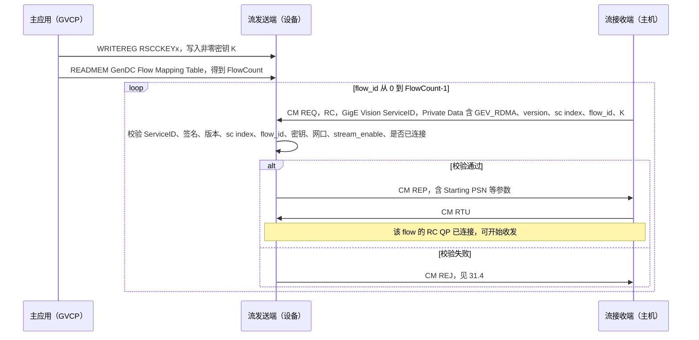
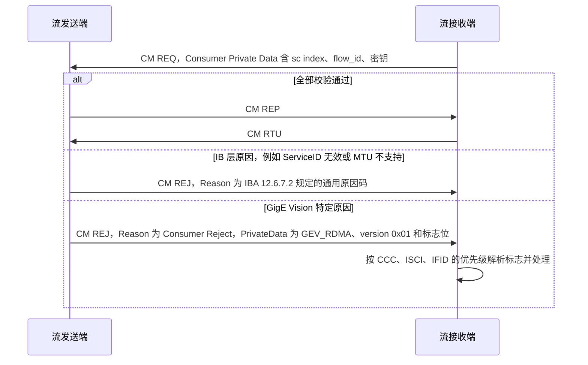
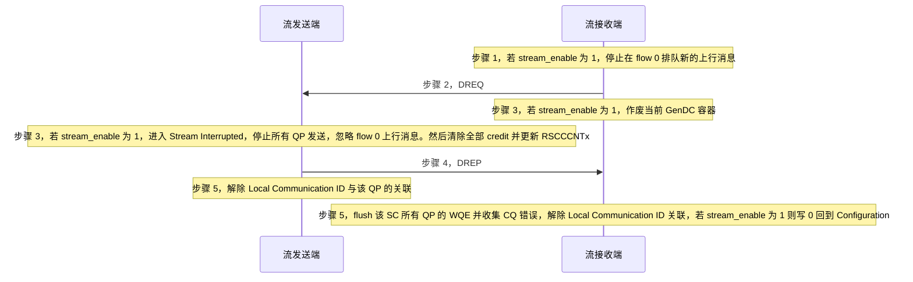
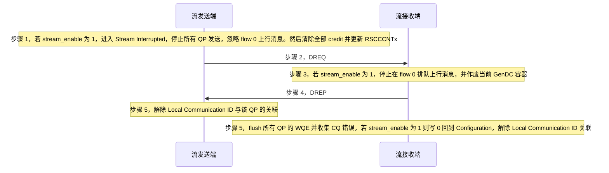
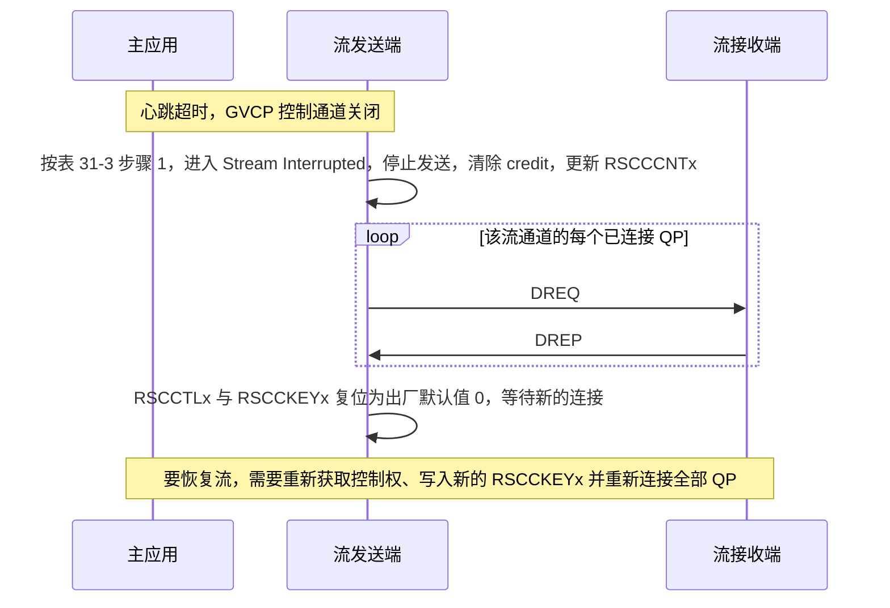
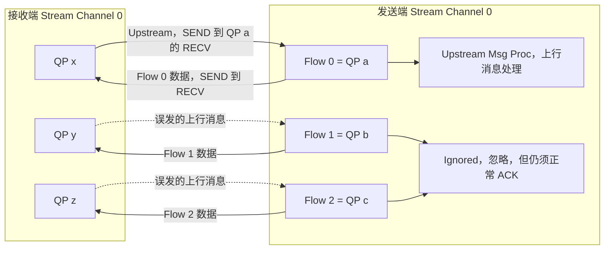
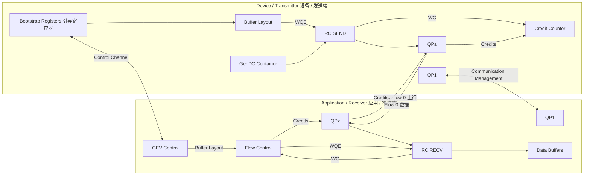
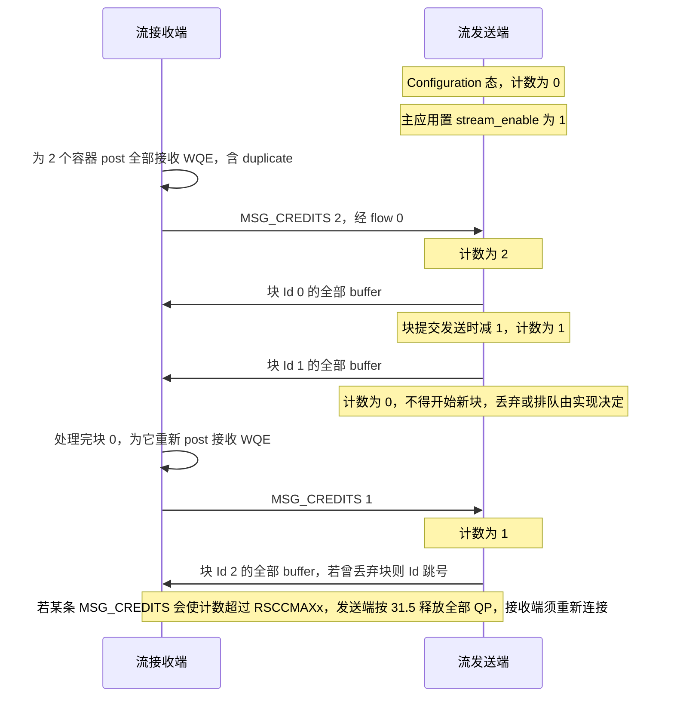

# GVRSP（二）：连接管理、上行通信与应用层流控

> **覆盖范围**：第 31 章 GVRSP Connection Maintenance（PDF p.223–233）、第 32 章 Upstream Communication（p.234–237）、第 33 章 Application-Level Flow Control（p.238–240）、第 34 章 Shared Receive Queues（p.241）、第 35 章 GVRSP Host Application Considerations（p.242–244）、附录 C GVSP and GVRSP Bootstrap Register Compatibility（p.407–408）。补充引用了 §10.4、§11.1、§11.12–11.13、§36.27/36.29/36.38/36.71–36.78（均注明页码）。
>
> **页码约定**：全文引用的都是 **PDF 页码**（PDF 页脚印刷页码 = PDF 页码 − 1）。
>
> **位编号约定**：本规范的位编号是 **MSB-first**——bit 0 是字段 / 32 位字的**最高位**；CM 私有数据和上行消息都按**大端序**传送（§31.3, p.228；§31.4, p.230；CR-646s）。
>
> **一句话总结**：流接收端作为 CM 主动方，用 GigE Vision ServiceID（TCP 端口 3956）和以 "GEV_RDMA" 开头的私有数据（流通道号、flow_id、连接密钥），为每个 GenDC flow 建立一条 RC 连接；数据经各 flow 下行，flow 0 的反方向承载上行消息（credit、trigger）；发送端凭"容器 credit"发块；连接释放、心跳超时和 credit 溢出都有严格的处理步骤；附录 C 规定了 GVSP 与 GVRSP 寄存器的互斥关系。
>
> **本文目录**
> - 核心要点
> - 31 GVRSP 连接维护（31.1 ServiceID / 31.2 连接 QP / 31.3 QP 与流通道及 flow 的映射 / 31.4 拒绝 REQ 或 REP / 31.5 释放已连接 QP / 31.6 引导寄存器）
> - 32 上行通信（32.1 MSG_CREDITS / 32.2 MSG_TRIGGER / 32.3 设备自定义消息 / 32.4 引导寄存器）
> - 33 应用层流控（33.1 机制 / 33.2 引导寄存器）
> - 34 共享接收队列
> - 35 主机应用注意事项（35.1 OS 与硬件支持 / 35.2 遗留接收端）
> - 附录 C GVSP 与 GVRSP 引导寄存器兼容性
> - 实现要点与易错点 / 相关章节 / 自测题

---

## 核心要点

1. **流开始前，发送端的所有 QP 都必须与接收端的 QP 建立连接**，过程即 InfiniBand 规范第 12 章的通信管理（Communication Management, CM）（§31, p.223）。
2. **ServiceID** = 固定前缀 + IP 协议号 + 知名端口；GigE Vision 使用 **TCP 端口 3956**（IANA 为 GVCP 注册的端口），按 IBA A11.5 构造。接收端发 REQ 时必须使用 RC 和该 ServiceID（CR-634sr），ServiceID 无效时发送端必须拒绝（CR-635st）。
3. **角色固定**：流接收端是**主动方**（发 REQ，接受 REP 后发 RTU），流发送端是**被动方**（必须回 REP 或 REJ，CR-636st）。每个 GenDC flow 一个 QP、一个 REQ（CR-639sr）。
4. **REQ 的 Consumer Private Data 共 20 字节**："GEV_RDMA" 签名、`version`=0x01、9 位 `stream_channel_index`、16 位 `flow_id`、32 位 `qp_connection_key`，大端序（图 31-2, p.227）。
5. **`qp_connection_key` 必须等于主应用写入 `RSCCKEYx` 的值**：该寄存器只写、出厂值 0；0 永远无效；控制通道关闭时复位为 0（§31.3, p.226–227；CR-685st～CR-687st）。
6. **拒绝**：IB 通用原因按 IBA 12.6.7.2 填写；GigE Vision 特定原因必须用 Reason = **Consumer Reject**，并在 12 字节 PrivateData 中置 9 个标志位之一或多个（INI/CCC/ISIG/ICKEY/STENA/QPAC/IVER/ISCI/IFID）（CR-645s，图 31-3）。
7. **释放**：每个 QP 单独做 DREQ/DREP。表 31-2（接收端发起）和表 31-3（发送端发起）规定了双方的动作顺序：停发上行消息 → 进入 Stream Interrupted、停止发送 → 清除 credit 并更新 `RSCCCNTx` → flush WQE → `stream_enable` 归 0。心跳超时按表 31-3 处理，并复位 `RSCCTLx`/`RSCCKEYx`（§31.5, p.230–233）。
8. **上行消息**：4 字节头（8 位 `opcode` + 24 位 `opcode_specific`）+ 可选数据；`MSG_CREDITS`(0x01) 收发两端都必须支持，`MSG_TRIGGER`(0x02) 是否支持由 `RSCUCAPx` 声明，0x80–0xFF 留给设备自定义。**只能经 flow 0 发送**；发送端必须对不超过 `RSCUMAXx` 的任何上行消息正常确认，错误经消息通道带外报告（§32, p.234–237）。
9. **容器 credit**：发送端每个流通道一个计数器，收到 `MSG_CREDITS` 时增加，块提交发送时减少；计数不大于 0 时不得开始新块；Configuration 态下为 0；若 credit 溢出（超过 `RSCCMAXx`），发送端释放全部 QP；接收端必须**先 post 好接收 WQE 再发 credit**（§33, p.238–239）。
10. **接收端不得使用共享接收队列（SRQ）**（CR-662sr）。主机侧 Windows 用 NDSPI、Linux 用 IBVerbs，macOS 不支持 RoCEv2；遗留接收端通过升级 GenTL Producer / SDK（必要时把 GenDC 翻译成普通图像）过渡（§35, p.242–244）。
11. **附录 C**：GVSP 专用寄存器只在 `streaming_protocol = 0` 时可用；仅支持 GVRSP 的设备不得置 `SCSPx_supported`、`PACKETRESEND` 等位，必须置 `SCEBAx_supported`（p.407–408）。

---

## 31 GVRSP 连接维护（§31, p.223–233）

在流发送端能向流接收端发流之前，**发送端上的所有 QP 都必须与接收端上对应的 QP 连接**。InfiniBand 规范把这个过程称为**通信管理（Communication Management）**，并定义了双方在建立和释放连接时交换的各种消息，见 InfiniBand Architecture Specification 第 12 章（§31, p.223）。

> 💡 解读（IBTA / 软件栈背景，非本规范内容）：
> - CM 消息是 MAD（Management Datagram，管理数据报），收发两端都经由各自的 **QP1**（GSI，通用服务接口）传送。规范图 33-1 中两侧的 "QP1 ↔ QP1：Communication Management" 正对应于此（p.239）。
> - 主机侧通常不必手写 CM 报文：Linux 上用 librdmacm（`rdma_cm`）的 `rdma_connect()` / `rdma_accept()` / `rdma_reject()` / `rdma_disconnect()`，Windows 上用 NDSPI 的 Connector 接口完成 REQ/REP/RTU/REJ/DREQ/DREP。设备侧（FPGA / 嵌入式）则可能需要自己实现 CM 状态机。

### 31.1 GigE Vision 的 ServiceID（§31.1, p.223）

- 连接 QP 时，RoCEv2 客户端必须发送一个携带 **ServiceID** 的连接请求；ServiceID 用来区分 RoCEv2 服务器上提供的不同服务。
- ServiceID 由**固定前缀 + IP 协议号 + 该服务的知名协议端口**组成。对 GigE Vision 服务，端口是 **TCP 端口 3956**——即 IANA 为 GigE Vision Control Protocol 注册的 TCP 端口。
- ServiceID 必须按照 InfiniBand Architecture Specification **A11.5** 设置。

> **[CR-634sr]** 接收端若通过发送连接请求消息（CM REQ）来发起 RoCEv2 连接，**必须**使用传输服务类型 Reliable Connection，以及 GigE Vision 服务对应的 ServiceID（TCP 端口 3956）（§31.1, p.223）。
>
> **[CR-635st]** 发送端工作在 GVRSP 模式时，若 CM REQ 中的 ServiceID 对 GigE Vision 服务无效，**必须**拒绝该请求（见 §31.4）（§31.1, p.223）。

> 💡 解读（数值不是规范给出的，请以 IBTA A11.5 原文为准）：按 IBTA Annex A11（RDMA IP CM Service）的格式，ServiceID 为 64 位值 `0x0000 0000 01 PP pppp`，其中 `PP` 为 IP 协议号、`pppp` 为端口号。TCP 的协议号是 0x06，3956 = 0x0F74，所以 GigE Vision 的 ServiceID 应为 **`0x0000000001060F74`**。使用 librdmacm 时，以端口空间 `RDMA_PS_TCP` 和端口 3956 建立连接，库会自动生成这个 ServiceID。注意规范写的是 **TCP** 端口 3956，虽然 GVCP 本身走的是 UDP 3956，ServiceID 里的协议号仍应是 TCP。

### 31.2 连接队列对（§31.2, p.223–226）

- 每个 GenDC flow 映射到一个独立的 QP（§29.1）。连接到流发送端时，流接收端必须使用 §31.1 规定的 GigE Vision ServiceID，**与发送端上的每个 QP 分别建立一条 Reliable Connection**（§31.2, p.223）。
- 建立连接时，**流接收端是主动方（active side）**（IBA 12.9.5），向它要连接的流发送端发送 **REQ** 消息发起连接；**流发送端是被动方（passive side）**（IBA 12.9.6），回复 **REP** 消息表示接受，或回复 **REJ** 消息表示拒绝。最后，如果接收端接受 REP 中携带的参数，就发送 **RTU**（Ready To Use）消息（§31.2, p.223）。

**图 31-1：在接收端 QP 与发送端 QP 之间建立连接的典型握手**（p.224），这里扩展为"为每个 flow 建立一条连接"：



> **[CR-636st]** 发送端工作在 GVRSP 模式时，作为 CM 响应方，对 CM REQ **必须总是**回答 CM REP 或 CM REJ（§31.2, p.224）。
>
> **[CR-637st]** 发送端工作在 GVRSP 模式时，若**控制通道已关闭**，**必须**拒绝 CM REQ（见 §31.4）（§31.2, p.224）。

**表 31-1：连接建立期间交换的信息**（p.224–226）——规范列出的最重要字段如下：

| 字段（Field Name） | 所在消息 | 说明（意译） | IBA 参考 |
|---|---|---|---|
| Local / Remote Communication ID | 全部 CM 消息 | 标识用于传送 CM 消息的通道。双方各自定义自己的 Local Communication ID；对端向本端发 CM 消息时，把它填进 Remote Communication ID。每对 Local/Remote Communication ID 与该连接绑定，双方在连接的整个生命周期内都必须沿用 | 12.7.1、12.7.2 |
| ServiceID | REQ | REQ 发送方所请求的服务；GigE Vision 流接收端必须使用为 GigE Vision 定义的 ServiceID 来连接 QP（§31.1） | A11.5 |
| Transport Service Type | REQ | 请求的连接类型。GigE Vision 流接收端在 REQ 中**必须置 0**，以请求建立 Reliable Connection；其他值在 GigE Vision 中无效 | 12.7.6 |
| Path Packet Payload MTU | REQ | 每个包中 RoCEv2 负载的最大大小，由接收端在 REQ 中给出；发送端如果**无法支持**该值，必须拒绝 REQ | 12.7.28 |
| Starting PSN | REQ、REP | 连接建立后，双方在各自方向上经 RC 发出的**第一个包**必须使用所交换的起始包序号（Packet Sequence Number, PSN），之后每发一个包 PSN 加 1 | 12.7.31 |
| Private Data | 全部 | 在连接建立和释放时传递与 RoCEv2 本身无关的应用数据。RoCEv2 中 REQ 的 Private Data 格式由 IBA **A11.4** 定义，应用数据必须放在其中的 **Consumer Private Data** 字段，**最多 56 字节**；IBA 没有为 REP、REJ 等其他消息定义特定的 Private Data 格式。GigE Vision 用（Consumer）Private Data 在收发两端之间交换 GigE Vision 专用数据（图 31-2、图 31-3） | A11.4 |
| Local ACK Timeout | REQ | 流发送端等待流接收端 ACK 的预期时间 | 12.7.34 |
| Target ACK Delay | REP | 流发送端处理一条入站消息、再发出 ACK 或 NAK 所应花费的最长时间 | 12.7.33 |
| Remote CM Response Timeout | REQ | 流接收端发出一条 CM 消息后，等待流发送端响应的时间；发送端可据此判断是否需要发送 **MRA** 消息 | 12.7.4 |
| Local CM Response Timeout | REQ | 流发送端发出一条 CM 消息后，应等待流接收端响应的时间 | 12.7.5 |
| Retry Count | REQ | 流发送端遇到超时、包序列错误等错误时应重试的次数 | 12.7.38 |
| RNR Retry Count | REQ、REP | 收到 RNR NAK 后，在把 QP 转入错误状态之前应重试的次数：放在 REQ 中时针对**流发送端**，放在 REP 中时针对**流接收端** | 12.7.39 |
| Max CM Retries | REQ | 流接收端或发送端在终止连接管理协议之前，最多可重发 REQ、REP 或 DREQ 的次数 | 12.7.27 |
| End-To-End Flow Control | REQ、REP | REQ 或 REP 的发送方是否支持端到端流控；端到端流控必须在流发送端和流接收端两侧都得到支持 | 12.7.26 |

> 💡 解读（IBTA 背景，编码细节请以 IBA Vol.1 第 12 章为准）：
> - **Path MTU** 是枚举值：1 = 256、2 = 512、3 = 1024、4 = 2048、5 = 4096 字节。普通 1500 字节以太网 MTU 下 RoCEv2 一般用 1024；开启巨帧后可用 4096。这就是 GVRSP 的"包大小"——第 8 章说"GVRSP 的包大小在连接建立时指定"（§8.1.1, p.61）。
> - **PSN** 为 24 位。**Local ACK Timeout**、**CM Response Timeout** 都是 5 位指数编码，时间 ≈ 4.096 µs × 2^值。**Retry Count**、**RNR Retry Count** 各 3 位，其中 RNR Retry Count = 7 表示无限重试。
> - **MRA**（Message Receipt Acknowledgment）：被动方告诉主动方"消息已收到，但需要更多时间处理"，以免对方超时重发。
> - **RNR NAK**（Receiver Not Ready）：SEND 到达时对方没有可用的接收 WQE。在 GVRSP 里，第 33 章的 credit 机制保证"先 post WQE 再给 credit"（CR-661sr），正常情况下下行数据不应触发 RNR；上行方向则依赖发送端始终准备好接收缓冲（CR-653st）。

### 31.3 QP 与 GVRSP 流通道及 GenDC Flow ID 的映射（§31.3, p.226–228）

**映射方式**（§31.3, p.226）：

- 流接收端必须**为每个 GenDC flow 连接一个独立的 QP**。`flow_id` 和 `stream_channel_index` 都放在 REQ 消息的 **Consumer Private Data** 字段中传送，流发送端据此分配对应的 QP。
- 接收端可以读取 GVCP 引导寄存器 **Number of Stream Channels**（0x0904，§36.23, p.287）确定发送设备支持的流通道数；有效的 flow ID 可以读取每个流通道的 **GenDC Flow Mapping Table** 确定，其地址由 **Stream Channel GenDC Flow Mapping Table Address**（`SCGFTAx`）引导寄存器给出。

**连接密钥 `qp_connection_key`**（§31.3, p.226–227）：

- 除 `flow_id` 和 `stream_channel_index` 外，Consumer Private Data 还必须包含有效的 **`qp_connection_key`**。它是一种**基本的校验机制**：确保由**主应用**掌控接收端与发送端之间的流通道连接，并防止网络中其他实体意外连上。
- 只有当 `qp_connection_key` 等于发送端该流通道 **GVRSP Stream Channel QP Connection Key（`RSCCKEYx`）**寄存器中的值时，连接请求才有效；否则发送端必须拒绝连接。主应用要在 QP 连接**之前**配置好发送端的 `RSCCKEYx`。
- **0 不是有效的 `qp_connection_key`**，任何 QP 连接请求都不能使用 0。注意 0 正是 `RSCCKEYx` 的**出厂默认值**；**控制通道一旦关闭，所有 `RSCCKEYx` 都会复位为这个默认值**。因此主应用每次连接 QP 之前，都必须先向 `RSCCKEYx` 写入一个有效的**非零**值。

**多网络接口**（§31.3, p.227）：

- 若发送端支持多个网络接口，QP 必须在**收到对应 REQ 的那个网络接口**上连接。网络接口是**隐式**确定的，因此 Consumer Private Data 中不包含网络接口字段。
- 接收端必须明白：发送端**不必**在每个网络接口上都支持所有 GenDC flow 和流通道。如果 `flow_id`、`stream_channel_index` 与 REQ 到达的物理网络接口这三者的组合不被支持，发送端会拒绝连接请求。

#### REQ 的 Consumer Private Data 布局（图 31-2，p.227；字段表 p.227–228）

下表偏移相对于 Consumer Private Data 的起始位置；**位号为 MSB-first**，指对应 32 位字内的位置。

| 字节偏移(Offset) | 字段 | 长度 | 说明 |
|---|---|---|---|
| 0x00 | `signature` | 64 bit（8 字节） | ASCII 字符串 **`GEV_RDMA`**（'G','E','V','_','R','D','M','A'），用于识别 GigE Vision RoCEv2 CM 消息 |
| 0x08 | `version` | 8 bit | Private Data 字段的版本，布局改变时递增；**当前布局为 0x01** |
| 0x09 | Reserved | 24 bit | 保留，所有位置 0 |
| 0x0C（字内 bit 0–6） | Reserved | 7 bit | 保留，所有位置 0 |
| 0x0C（字内 bit 7–15） | `stream_channel_index` | 9 bit | 流通道索引；与 `flow_id` 一起确定接收端要连接的发送端 QP |
| 0x0E（字内 bit 16–31） | `flow_id` | 16 bit | GenDC flow 的 ID；与 `stream_channel_index` 一起确定要连接的 QP |
| 0x10 | `qp_connection_key` | 32 bit（4 字节） | 授予连接发起方连接该 QP 的权利的密钥；只有等于主应用**最后一次写入** `RSCCKEYx` 的值时才批准连接；**0 不是有效值** |

- Consumer Private Data 按**大端字节序**传送（IBA 1.5.1）（§31.3, p.228）。
- 💡 合计 20 字节，不超过 Consumer Private Data 的 56 字节上限（表 31-1）。9 位的 `stream_channel_index` 正好覆盖 0–511，对应规范允许的最多 512 个流通道（R-079s，§11, p.81）。

```
bit(MSB-first) 0           7 8          15 16         23 24         31
              +-------------+-------------+-------------+-------------+
0x00          |     'G'     |     'E'     |     'V'     |     '_'     |
              +-------------+-------------+-------------+-------------+
0x04          |     'R'     |     'D'     |     'M'     |     'A'     |
              +-------------+-------------+-------------+-------------+
0x08          |   version   |                Reserved                 |
              +----------+--+-------------+---------------------------+
0x0C          | Reserved |stream_channel_ |          flow_id          |
              |  (0-6)   |  index (7-15)  |          (16-31)          |
              +----------+----------------+---------------------------+
0x10          |                   qp_connection_key                   |
              +-------------------------------------------------------+
```

> 💡 解读（示例字节流，非规范内容）：流通道 0、flow 1、密钥 0x12345678 的 Consumer Private Data 为
> `47 45 56 5F 52 44 4D 41 | 01 | 00 00 00 | 00 00 | 00 01 | 12 34 56 78`。
> 偏移 0x0C 处的 16 位大端值 = `stream_channel_index`（高 7 位为保留位 0），例如流通道 300 写作 `01 2C`。用 librdmacm 时，这 20 字节作为 `rdma_conn_param.private_data` 传入，库会自动在前面加上 A11.4 规定的 IP 寻址头。

**相关需求**（§31.3, p.228；以及第 36 章）：

| 编号 | 要求（意译） |
|---|---|
| **CR-638st** | 发送端在 GVRSP 模式下，当该流的 `stream_enable` 位为 '1' 时，**必须拒绝**该流的**所有** CM REQ |
| **CR-639sr** | 接收端在 GVRSP 模式下必须**为每个 GenDC flow 连接一个独立 QP**；每个 flow 都要发一个 CM REQ，其 Consumer Private Data 按图 31-2 填写对应的 `flow_id`、`stream_channel_index` 和正确的 `qp_connection_key` |
| **CR-640st** | `stream_channel_index` 与 `flow_id` 的组合无效时，发送端必须拒绝 REQ |
| **CR-641st** | 签名无效时，发送端必须拒绝 REQ |
| **CR-642st** | 版本不受支持时，发送端必须拒绝 REQ |
| **CR-643st** | 某个 GenDC flow 已分配了一个打开的 QP 时，发送端必须拒绝针对该 flow 的 REQ |
| **CR-644st** | 支持多网络接口的发送端，若 `stream_channel_index` 或 `flow_id` 无法映射到 REQ 到达的物理网络接口，必须拒绝 REQ |
| **CR-686st** | 发送端在 GVRSP 模式下必须拒绝 `qp_connection_key` 不等于对应流通道 `RSCCKEYx` 值的 REQ（§36.78, p.347） |
| **CR-687st** | 发送端在 GVRSP 模式下必须拒绝 `qp_connection_key` 等于 0 的 REQ（§36.78, p.347） |

### 31.4 拒绝 REQ 或 REP 消息（§31.4, p.228–230）

**两类拒绝原因**（§31.4, p.228–229）：

- 流发送端或接收端都可能出于各种原因拒绝 REQ 或 REP。InfiniBand 规范在 **REJ** 消息中定义了 **Reason** 和 **Additional Reject Information** 两个字段，用来把拒绝原因告诉 REQ/REP 的发送方。
- **IB/RoCEv2 通用原因**：IBA 已为若干常见原因（例如 Invalid Communication ID、Invalid Service ID、Timeout）定义了这两个字段的内容。对这类通用原因，收发两端都**必须**按 **IBA 12.6.7.2** 填写。
- **GigE Vision 特定原因**：REJ 还有一个 **PrivateData** 字段，可用来报告超出 IBA 范围的应用层拒绝原因。为此 IBA 建议在 Reason 字段中使用 **Consumer Reject** 代码。GigE Vision 用这种方式报告自己的拒绝原因，例如无效的流通道索引或无效的 GenDC flow ID。

> **[CR-645s]** 流发送端或接收端因 GigE Vision 特定原因生成的所有 REJ 消息，**必须**在 Reason 字段中使用 **Consumer Reject** 代码，并**必须**按图 31-3 在 PrivateData 字段中提供附加错误信息（§31.4, p.229）。

> 💡 解读（数值来自 IBTA 规范 / Linux `ib_cm` 的定义，不是本规范给出的）：Consumer Reject 的原因码是 **28**；Invalid Service ID 为 8，Invalid Path MTU 为 26。用 librdmacm 的 `rdma_reject(id, private_data, len)` 拒绝时，库发出的 REJ 原因码就是 Consumer Reject，`private_data` 即填入下面的 12 字节结构。

#### REJ 的 PrivateData 布局（图 31-3，p.229；字段表 p.229–230）

| 字节偏移(Offset) | 字段 | 长度 | 说明 |
|---|---|---|---|
| 0x00 | `signature` | 64 bit（8 字节） | ASCII 字符串 **`GEV_RDMA`**，用于识别 GigE Vision RoCEv2 CM 消息 |
| 0x08 | `version` | 8 bit | Private Data 字段版本，布局改变时递增；**当前布局为 0x01** |
| 0x09（0x08 处 32 位字的 bit 8–22） | Reserved | 15 bit | 保留，所有位置 0 |
| 0x0A 最低位（字内 bit 23） | `invalid_network_interface`（INI） | 1 bit | 见下方标志表 |
| 0x0B（字内 bit 24–31） | CCC、ISIG、ICKEY、STENA、QPAC、IVER、ISCI、IFID | 各 1 bit | 见下方标志表 |

- PrivateData 按**大端字节序**传送（IBA 1.5.1）（§31.4, p.230）。💡 GigE Vision 定义的部分合计 12 字节。
- 位位置已用 PDF 图 31-3 的坐标核对过：Reserved 占 bit 8–22，9 个标志依次占 bit 23–31。

```
bit(MSB-first) 0           7 8          15 16         23 24         31
              +-------------+-------------+-------------+-------------+
0x00          |     'G'     |     'E'     |     'V'     |     '_'     |
              +-------------+-------------+-------------+-------------+
0x04          |     'R'     |     'D'     |     'M'     |     'A'     |
              +-------------+-------------+----------+--+-------------+
0x08          |   version   |    Reserved (8-22)     | flags (23-31)  |
              +-------------+------------------------+----------------+

flags 展开（0x08 处 32 位字内的位号，mask 为 💡 按 MSB-first 推导的 32 位字掩码）：
bit    23    24     25     26      27      28     29     30     31
     +-----+-----+------+-------+-------+------+------+------+------+
     | INI | CCC | ISIG | ICKEY | STENA | QPAC | IVER | ISCI | IFID |
     +-----+-----+------+-------+-------+------+------+------+------+
mask  0x100 0x80   0x40   0x20    0x10    0x08   0x04   0x02   0x01
```

**标志位定义**（p.229–230）：

| 字内 bit | 缩写 | 全名 | 置 1 的含义 | 何时忽略此标志 |
|---|---|---|---|---|
| 23 | **INI** | `invalid_network_interface` | REQ Private Data 中的 `stream_channel_index` 或 `flow_id` **不能在 REQ 到达的网络接口上使用** | — |
| 24 | **CCC** | `control_channel_closed` | **控制通道已关闭** | — |
| 25 | **ISIG** | `invalid_signature` | REQ Private Data 中的 `signature` 无效 | — |
| 26 | **ICKEY** | `invalid_qp_connection_key` | REQ 中的 `qp_connection_key` 无效，即**为 0 或与所请求 `stream_channel_index` 的 `RSCCKEYx` 不符** | CCC 或 ISCI 置位时忽略 |
| 27 | **STENA** | `stream_enabled` | 指定流通道的流**已使能**（见 `RSCCTLx`），因此发送端不允许接受其他连接 | CCC 或 ISCI 置位时忽略 |
| 28 | **QPAC** | `qp_already_connected` | 由 `stream_channel_index` 和 `flow_id` 指定的 QP **已经连接** | CCC、ISCI 或 IFID 置位时忽略 |
| 29 | **IVER** | `invalid_version` | REQ Private Data 中的 version 无效 | — |
| 30 | **ISCI** | `invalid_stream_channel_index` | REQ 中的 `stream_channel_index` 无效 | CCC 置位时忽略 |
| 31 | **IFID** | `invalid_flow_id` | REQ 中的 `flow_id` 无效 | CCC 或 ISCI 置位时忽略 |

**忽略规则的含义**：CCC 优先级最高（控制通道关了，其他检查都没有意义）；ISCI 次之（流通道都不存在，就谈不上密钥、使能状态和 flow）；IFID 置位时 QPAC 无意义。💡 由此可以推断，一个 REJ 中可以**同时**置多个标志，接收端解析时应先看 CCC，再看 ISCI，再看 IFID，最后看其余标志。

**拒绝场景与 REJ 内容对照**（💡 由 §31.1–31.4 及 §36.78 的需求整理）：

| 拒绝场景 | 依据 | REJ 的 Reason | PrivateData 标志 |
|---|---|---|---|
| ServiceID 对 GigE Vision 服务无效 | CR-635st | IBA 通用原因（§31.4 把 Invalid Service ID 列为通用原因的例子） | 不适用 |
| Path Packet Payload MTU 不受支持 | 表 31-1 | IBA 通用原因（💡 IBA 有 Invalid Path MTU 原因码） | 不适用 |
| 控制通道已关闭 | CR-637st | Consumer Reject | CCC |
| 签名无效 | CR-641st | Consumer Reject | ISIG |
| 版本不受支持 | CR-642st | Consumer Reject | IVER |
| 流通道索引 / flow_id 组合无效 | CR-640st | Consumer Reject | ISCI 和 / 或 IFID |
| 流通道或 flow 不能映射到 REQ 到达的网口 | CR-644st | Consumer Reject | INI |
| 密钥为 0 或与 `RSCCKEYx` 不符 | §31.3；CR-686st、CR-687st | Consumer Reject | ICKEY |
| 该流通道的 `stream_enable` = 1 | CR-638st | Consumer Reject | STENA |
| 该 flow 已有打开的 QP | CR-643st | Consumer Reject | QPAC |



> ⚠️ 规范未明确之处：§31.4 说收发两端都可能拒绝 REQ **或 REP**，CR-645s 也同时约束了接收端；但图 31-3 的标志全部针对 **REQ** 中的字段，规范没有说明**接收端拒绝 REP** 时应设置哪些 GigE Vision 标志。实践中接收端拒绝 REP 多半出于 IB 层原因（例如参数不可接受），此时应使用 IBA 通用原因码。

### 31.5 释放已连接的队列对（§31.5, p.230–233）

**基本规则**（§31.5, p.230）：

- 两个 QP 之间的连接（不论由流接收端还是发送端发起释放）都通过**发送 DREQ 消息、并以 DREP 消息回复**来释放。DREQ 和 DREP 中使用的 Local/Remote Communication ID 必须与**建立该连接时**使用的相同。
- 一个流通道可以包含多个 QP（§29.1）。要完全断开一个流通道，**与它关联的每个 QP 都必须各自发送 DREQ 断开**。
- 如果在流传输中途释放了其中某个 QP，或者控制通道被关闭（例如心跳超时），GenDC 容器就无法再完整传送，**容器 credit 也可能失去同步**。为避免这种情况，发送端和接收端必须遵循 §31.5.1、§31.5.2、§31.5.3 规定的步骤。

#### 31.5.1 由流接收端发送 DREQ（表 31-2，p.231–232）

| 步骤 | 流发送端 | 流接收端 |
|---|---|---|
| 1 | — | **发送 DREQ 之前**必须：若 `RSCCTLx.stream_enable` = 1，**停止在 GenDC Flow 0 上排队新的上行消息** |
| 2 | — | 为该 QP **发送 DREQ** |
| 3 | **收到 DREQ 后**必须：<br>• 若 `stream_enable` = 1：① 把该流通道（SC）置为 **"Stream Interrupted"** 状态；② **停止**在该 SC 的所有 QP 上发送数据；③ **忽略**该 SC 的 GenDC Flow 0 上的入站上行消息<br>• **清除**该 SC 的全部容器 credit<br>• **更新 `RSCCCNTx`** 寄存器 | **发送 DREQ 之后**必须：若 `stream_enable` = 1，**作废当前 GenDC 容器** |
| 4 | **发送 DREP** | — |
| 5 | **发送 DREP 之后**必须：不再把 DREP 消息中使用的 Local Communication ID 与该 QP 关联 | **收到 DREP 之后**必须：<br>• 删除该 SC **所有 QP** 上排队的全部 send/receive WQE（有时称 **"flush QP"**），并从完成队列（CQ）收集所有错误<br>• 不再把 DREQ 消息中使用的 Local Communication ID 与该 QP 关联<br>• 若 `stream_enable` = 1：把 `RSCCTLx` 的 `stream_enable` 位写 0，使 SC 回到 **"Configuration"** 状态 |

注意：步骤 3 中"清除 credit"和"更新 `RSCCCNTx`"两项**不以** `stream_enable` = 1 为条件（PDF 表格中它们与"若 stream_enable…"条目处于同一级），已对照 PDF 原图核实。



#### 31.5.2 由流发送端发送 DREQ（表 31-3，p.232–233）

| 步骤 | 流发送端 | 流接收端 |
|---|---|---|
| 1 | **发送 DREQ 之前**必须：<br>• 若 `RSCCTLx.stream_enable` = 1：① 把 SC 置为 **"Stream Interrupted"**；② **停止**在该 SC 所有 QP 上发送数据；③ **忽略**该 SC 的 GenDC Flow 0 上的入站上行消息<br>• **清除**该 SC 的全部容器 credit<br>• **更新 `RSCCCNTx`** 寄存器 | — |
| 2 | **发送 DREQ** | — |
| 3 | — | **收到 DREQ 之后**必须：若 `stream_enable` = 1：① **停止**在 GenDC Flow 0 上排队新的上行消息；② **作废当前 GenDC 容器** |
| 4 | — | **发送 DREP** |
| 5 | **收到 DREP 之后**必须：不再把 DREP 消息中使用的 Local Communication ID 与该 QP 关联 | **发送 DREP 之后**必须：<br>• 删除该 SC **所有 QP** 上排队的全部 send/receive WQE（"flush QP"），并从完成队列收集所有错误<br>• 若 `stream_enable` = 1：把 `RSCCTLx` 的 `stream_enable` 位写 0，使 SC 回到 **"Configuration"** 状态<br>• 不再把 DREQ 消息中使用的 Local Communication ID 与该 QP 关联 |



> 💡 解读：
> - **何时由发送端发起**：主应用向 `stream_enable` 写 0（§30.2 步骤 3）、控制通道关闭 / 心跳超时（§31.5.3）、credit 溢出（CR-660st），以及设备自身的错误处理。
> - 两张表对"解除关联"的措辞不完全对称（表 31-2 中双方各指自己发出的那条消息，表 31-3 中双方各指自己收到的那条消息），但含义相同：该连接的 Communication ID 对作废，不再与 QP 关联。
> - 表中"把 `stream_enable` 写 0"是**流接收端**的动作，而 GVCP 写寄存器需要控制权限。如果接收端不是主应用（次级应用或独立设备），它无法写 `RSCCTLx`，需要由主应用代为完成——规范没有专门讨论这种情况。
> - 只要流通道处于 Stream Interrupted，就必须写 0 才能回到 Configuration（§30, p.220），之后再按 §30.1 重新连接全部 QP、使能流、重新发放 credit。

#### 31.5.3 心跳超时（§31.5.3, p.233）

- 如果 GVCP 控制通道因**心跳超时**而关闭，已连接的 QP 需要**由流发送端释放**，步骤按**表 31-3**。
- 此外，流发送端必须把 **`RSCCTLx` 和 `RSCCKEYx` 复位为出厂默认值**（两者出厂值都是 0，§36.71, p.341；§36.78, p.347），并让自己可以接受下一次连接。
- 与之呼应的其他条款：控制通道关闭时设备必须清除 GVRSP 发送端 `RSCCTLx` 的 `stream_enable` 位并断开所有打开的 QP（R-072cd，§10.4, p.74）；GVRSP 不允许无条件流（CR-616cd，§11.13, p.88）；控制通道关闭时 `RSCCKEYx` 复位为 0（CR-685st，§36.78, p.347），新的 REQ 会因 CCC 被拒绝（CR-637st）。



### 31.6 引导寄存器（§31.6, p.233）

- 支持 RoCEv2 的 GigE Vision 设备必须提供**每个流通道可用 QP 的数量**。这通过 GenDC flow mapping table 中已有的 **`FlowCount`** 字段实现（§31.6, p.233）。
- 与连接维护直接相关的寄存器（定义见第 36 章；**位号 MSB-first**）：

| 寄存器 | 地址 | 访问 / 出厂值 | 字段与规则 | 出处 |
|---|---|---|---|---|
| **GVRSP Stream Channel QP Connection Key（RSCCKEYx）** | SCEBA(x)+0x4C | **只写（Write-Only）** / 0 | bit 0–31 `gvrsp_qp_connection_key`。设为只写是为了**对次级应用隐藏密钥**；用途是控制谁能连接流通道的 QP，尤其当流接收端是（或可能是）主应用之外的实体时——主应用或更高层的系统管理实体可以把密钥发给需要请求连接的接收端。默认值 0 表示目前没有任何接收端能连接（相应请求都会被拒绝）；写入有效密钥后，只接受私有数据中携带相同密钥的连接请求 | §36.78, p.346–347；CR-683cd～CR-687st |
| **GVRSP Stream Channel Control（RSCCTLx）** | SCEBA(x)+0x30 | R/W / 0 | bit 0 `stream_enable`（SE）：使能 GVRSP 流（💡 32 位掩码 0x80000000）；bit 1–31 保留 | §36.71, p.341；CR-672cd、CR-673cd |
| Stream Channel GenDC Flow Mapping Table Address / Size（SCGFTAx / SCGFTSx） | SCEBA(x)+0x08 / +0x0C | R | flow mapping table 的位置和大小；表格式由 GenICam GenDC 规范定义（含 `FlowCount`、`FlowSize`） | §36.69–36.70, p.339–341 |
| Number of Stream Channels | 0x0904 | R | 设备支持的流通道数 | §36.23, p.287 |

- 支持 GVSP 和 GVRSP 两种模式的设备，在 GVSP 模式（`streaming_protocol` = 0）下必须禁止访问 `RSCCTLx` 和 `RSCCKEYx`，对任何读写都返回 `GEV_STATUS_ACCESS_DENIED`（CR-673cd、CR-684cd）。
- 💡 因为 `RSCCKEYx` 只写，应用无法回读确认；主应用应把写入的密钥保存在自己这里，并通过可信渠道交给接收端。

---

## 32 上行通信（§32, p.234–237）

**概念**（§32, p.234）：与已连接 QP 相关联的**上行通信通道（upstream communication channel）**用来把消息从 GigE Vision 流接收端送到流发送端，包括**应用层流控消息**和**触发（trigger）**。上行消息的格式是可扩展的，将来可以增加新的消息类型。GVRSP 上行消息以 **RoCEv2 RC SEND 消息**传送，布局如图 32-1。另见 §11.12：上行通信路径独立于 GVCP 控制 / 消息通道，**只在 RoCEv2 QP 连接之后才存在**（p.87）。

#### 通用上行消息格式（图 32-1，p.234）

| 字节偏移(Offset) | 字段 | 长度 | 说明 |
|---|---|---|---|
| 0x00 | `opcode` | 8 bit | 标识操作类型的代码（容器 credit、trigger 等） |
| 0x01 | `opcode_specific` | 24 bit | 扩展 opcode，或该操作的内联数据 |
| 0x04 | `message_specific` | 可选，最长到包大小（up to packet size） | 特定消息需要的可选数据 |

```
bit(MSB-first) 0           7 8          15 16         23 24         31
              +-------------+-----------------------------------------+
0x00          |   opcode    |             opcode_specific             |
              +-------------+-----------------------------------------+
0x04 ...      |    message_specific (optional, up to packet size)     |
              +-------------------------------------------------------+
```

**表 32-1：GVRSP 上行消息操作码**（p.234）

| Opcode | 值 | 说明 | 支持要求 |
|---|---|---|---|
| `MSG_NOP` | 0x00 | 保留，无操作 | — |
| `MSG_CREDITS` | 0x01 | 流控 credit | 收发两端**必须**支持（CR-647sr、CR-648st） |
| `MSG_TRIGGER` | 0x02 | GVRSP 触发 | 可选，由 `RSCUCAPx` bit 0 声明（CR-649st） |
| — | 0x03–0x7F | 保留，供将来使用 | — |
| — | 0x80–0xFF | 保留给**设备自定义**消息 | 实现质量问题（§32.3） |

> **[CR-646s]** GVRSP 上行消息的所有字段**必须**使用网络字节序（大端）（p.234）。
>
> **[CR-647sr]** 流接收端在 GVRSP 模式下**必须**支持 `MSG_CREDITS` 消息（p.234）。
>
> **[CR-648st]** 流发送端在 GVRSP 模式下**必须**支持 `MSG_CREDITS` 消息（p.234）。
>
> **[CR-649st]** 流发送端在 GVRSP 模式下，**必须**用设备引导寄存器 `RSCUCAPx` 中相应的能力位，声明自己支持哪些**可选**上行消息类型（设备自定义类型除外）（p.235）。

#### 只走 GenDC flow 0（§32, p.235；图 32-2）

上行消息必须经由 **GenDC flow 0 的已连接 QP** 传送；对于一个流通道其他所有 GenDC flow 上收到的上行消息，流发送端应当忽略。



图中每个 QP 都同时有 SEND 和 RECV 两个方向：数据从发送端 QP 的 SEND 流向接收端 QP 的 RECV；上行消息从接收端 QP x（flow 0）的 SEND 流向发送端 QP a 的 RECV，交给"上行消息处理"；flow 1、flow 2 的 RECV 方向即使收到消息也被忽略（p.235）。

> **[CR-650sr]** 流接收端在 GVRSP 模式下，**只能**经由相应流通道 **GenDC flow 0** 的已连接 QP 发送上行消息（p.235）。
>
> **[CR-651st]** 流发送端在 GVRSP 模式下，**只能**接受经由 GenDC flow 0 已连接 QP 到来的上行消息，不处理该流通道其他所有 GenDC flow 上收到的上行消息；并且收到这类消息时**不得**产生任何 InfiniBand/RoCEv2 传输层错误（p.235）。

#### 消息大小与"总是确认"原则（§32, p.235–236）

- 流发送端可以用设备引导寄存器 **`RSCUMAXx`** 声明自己支持的**最大上行消息大小**；超过该最大值的入站消息不得处理（p.235）。
- 流发送端必须**始终**准备好接受并**正面确认（positively acknowledge）**所有入站上行消息，包括**不支持的消息类型**和在 **flow 0 以外**收到的消息。错误应当通过 GigE Vision **消息通道**（第 12 章）**带外**报告，例如不支持的操作或不支持的消息大小。这样可以**避免 RoCEv2 QP 被迫进入错误状态**（p.235）。

> **[CR-652sr]** 流接收端在 GVRSP 模式下，**不得**发送大于 GVRSP Stream Channel Upstream Maximum Supported Message Size 寄存器（`RSCUMAXx`）所规定大小的上行消息（p.236）。
>
> **[CR-653st]** 流发送端在 GVRSP 模式下，必须**始终**准备好接收、接受并正面确认任何**不大于** `RSCUMAXx` 的上行消息，**即使消息无效**也**不得**产生任何 IB/RoCEv2 传输层错误。这包括：收到不支持的上行消息类型、在 flow 0 以外的 GenDC flow 上收到上行消息，或消息指定的操作无法执行（p.236）。

> 💡 解读：在 RC 上，SEND 到达时如果对端没有 post 接收 WQE，会回 RNR NAK；如果消息比对端 post 的接收 buffer 还大，会触发远端访问 / 请求错误并可能把 QP 打入错误状态，从而中断整个流通道（§30 的 Stream Interrupted）。所以发送端实现 CR-653st 的常规做法是：在**每个** flow 的 QP 上（包括 flow 1…n）都始终保持若干个大小 ≥ `RSCUMAXx` 的接收 WQE，处理完立即重新 post；flow 0 以外收到的消息直接丢弃并补回 WQE。接收端则必须严格遵守 `RSCUMAXx`（CR-652sr）。

### 32.1 流控 credit 消息 MSG_CREDITS（§32.1, p.236）

```
bit(MSB-first) 0           7 8          15 16         23 24         31
              +-------------+-----------------------------------------+
0x00          |    0x01     |       number of credits (24-bit)        |
              +-------------+-----------------------------------------+
```

| 字节偏移(Offset) | 字段 | 长度 | 说明 |
|---|---|---|---|
| 0x00 | `opcode` | 8 bit | `MSG_CREDITS` = 0x01 |
| 0x01 | `opcode_specific` | 24 bit | 发放给对应流通道、用于发送**完整块（即 GenDC 容器）**的**容器 credit 数**；流控机制见第 33 章 |

- 该消息只有 4 字节，这也是 `RSCUMAXx` 最小值为 4 的原因（CR-682cd，§36.77, p.346）。
- 💡 示例：发放 5 个 credit 的消息字节为 `01 00 00 05`。单条消息理论上最多 2^24 − 1 个 credit，但实际受 `RSCCMAXx` 约束（CR-659sr）。

### 32.2 GVRSP 触发 MSG_TRIGGER（§32.2, p.236）

```
bit(MSB-first) 0           7 8          15 16         23 24         31
              +-------------+-----------------------------------------+
0x00          |    0x02     |          LT23 LT22 ... LT1 LT0          |
              +-------------+-----------------------------------------+
```

| 字节偏移(Offset) | 字段 | 长度 | 说明 |
|---|---|---|---|
| 0x00 | `opcode` | 8 bit | `MSG_TRIGGER` = 0x02 |
| 0x01 | `opcode_specific` | 24 bit | 24 个触发信号的位掩码，直接映射到 GenICam SFNC 定义的 **LinkTrigger0 … LinkTrigger23**：消息的 **bit 31 → LinkTrigger0**，**bit 30 → LinkTrigger1**，依此类推（💡 即 bit (31 − k) → LinkTrigger k，bit 8 → LinkTrigger23） |

- 置 1 的位在**收到 trigger 消息时立即**触发对应的 LinkTrigger 信号；设备没有实现的 LinkTrigger 位被**静默忽略**（p.236）。
- 是否支持由 `RSCUCAPx` 的 bit 0 `msg_trigger_supported`（TRG）声明（§36.76, p.345；CR-649st）。
- 💡 示例（按 MSB-first 推导）：只触发 LinkTrigger0，整个 32 位字为 `0x02000001`（字节 `02 00 00 01`）；同时触发 LinkTrigger0 和 LinkTrigger2，为 `0x02000005`。即 LinkTrigger k 对应 32 位字掩码 `1 << k`。

### 32.3 设备自定义消息（§32.3, p.237）

```
bit(MSB-first) 0           7 8          15 16         23 24         31
              +-+-----------+-----------------------------------------+
0x00          |1|  opcode   |         custom_opcode_specific          |
              +-+-----------+-----------------------------------------+
0x04 ...      |          custom_message_specific (optional)           |
              +-------------------------------------------------------+
```

| 字节偏移(Offset) | 字段 | 长度 | 说明 |
|---|---|---|---|
| 0x00 | `opcode` | 8 bit | 0x80–0xFF 保留给设备自定义上行消息；图 32-5 中 bit 0 固定画为 1 |
| 0x01 | `opcode_specific`（图中为 `custom_opcode_specific`） | 24 bit | 扩展 opcode 或该操作的内联数据 |
| 0x04 | `message_specific`（图中为 `custom_message_specific`） | 可选，最长到包大小 | 特定消息所需的可选数据 |

- 设备自定义上行消息的 `opcode` **最高位必须置 1**；如何使用设备自定义消息属于实现质量问题（p.237）。
- 设备自定义消息不需要在 `RSCUCAPx` 中声明（CR-649st 把它们排除在外）；若设备支持带数据的自定义消息，`RSCUMAXx` 可以大于 4（CR-682cd）。

> **[CR-654sr]** 流接收端在 GVRSP 模式下发送设备自定义上行消息时，**必须**把 `opcode` 字段的最高位置 1（p.237）。

### 32.4 引导寄存器（§32.4, p.237）

上行通道由以下**流通道专属**的只读引导寄存器控制（详见第 36 章；**位号 MSB-first**）：

| 寄存器 | 地址 | 访问 | 字段与规则 | 出处 |
|---|---|---|---|---|
| GVRSP Stream Channel Upstream Maximum Supported Message Size（**RSCUMAXx**） | SCEBA(x)+0x48 | R | `gvrsp_upstream_max_msg_size`：发送端在该流通道上能接收的最大上行消息字节数；接收端不得发送更大的消息。**最小 4**（即必选 `MSG_CREDITS` 的大小），**最大 2^31**（pdftotext 显示为"231"，PDF 为上标，已核对） | §36.77, p.345–346；CR-681cd、CR-682cd |
| GVRSP Stream Channel Upstream Capability（**RSCUCAPx**） | SCEBA(x)+0x44 | R | bit 0 `msg_trigger_supported`（TRG）：设备支持 GVRSP trigger 消息（💡 32 位掩码 0x80000000）；bit 1–31 保留 | §36.76, p.345；CR-680cd |

---

## 33 应用层流控（§33, p.238–240）

**概念**（§33, p.238）：

- GigE Vision 流接收端提供一种**容器 credit（container credits）机制**，允许流发送端在传输过程中继续发送更多 buffer。
- RoCEv2 RC **原生的端到端流控仍在这一机制之下继续生效**。应用层流控提供的是一种在 **GigE Vision 协议层面**控制流传输的方法。
- 流控消息（容器 credit）由流接收端在流通道的 **GenDC flow 0** 上发给流发送端（图 33-1）。

### 33.1 流控机制（§33.1, p.238–239）

- 流发送端为**每个流通道**维护一个**容器 credit 计数器**：收到流接收端的 credit 消息时**增加**；成功发出一个块（GenDC 容器）的**最后一个 buffer** 时**减少**。
- 流通道每次按 §31.5 断开时，容器 credit 计数器都必须初始化（即**清零**）（p.238）。

| 编号 | 要求（意译） |
|---|---|
| **CR-655st** | 发送端处于 **Configuration** 态（对应流通道 `RSCCTLx.stream_enable` = 0）时，credit 计数器**必须为 0** |
| **CR-656st** | 发送端每收到一个**有效的** `MSG_CREDITS` 上行消息，就必须把计数器**加上**消息中指定的 credit 数 |
| **CR-657st** | 当一个块（GenDC 容器）**被提交发送**时，发送端必须把计数器**减 1**，最晚不迟于该块最后一个字节发出时 |
| **CR-658st** | 计数器**不大于 0** 时，发送端**不得开始发送新块** |

- 若新块可发时计数器为 0，发送端怎么做属于**实现质量问题**：例如**丢弃**该块，或**排队**到收到新 credit 后再发（p.238）。（💡 丢弃时按 §29.2 跳过容器 Id。）
- 收发双方都必须确保 credit 数**在任何时刻都不超过 `RSCCMAXx`** 规定的最大值。双方都应能通过观察"接收端发出的 credit"和"发送端发出的块"来掌握当前 credit 数（p.238）。

> 💡 注意措辞差异：§33.1 正文说计数器在"成功发出块的最后一个 buffer"时减少，而 CR-657st 允许在块"**提交发送**时"就减少，只要不晚于最后一个字节发出。实现时以 CR-657st 为准：可以在开始发某块时就扣 credit。

| 编号 | 要求（意译） |
|---|---|
| **CR-659sr** | 接收端**不得**发送会使发送端 credit 计数器**溢出**的 `MSG_CREDITS`；计数器最大值由 `RSCCMAXx` 定义（p.239） |
| **CR-660st** | 发送端若收到会使 credit 计数器溢出的 `MSG_CREDITS`，**必须按 §31.5 释放所有已连接 QP**，以保证收发双方在 credit 计数上始终同步；出现这种错误后，接收端必须重新建立连接（p.239） |
| **CR-661sr** | 接收端在为某个 GenDC 容器发放 credit **之前**，必须为该容器对应的**全部 buffer** post 好 QP 接收请求；一次发放多个 credit 时，必须保证这些容器的全部 buffer 都已 post 好接收请求（p.239） |

- 此外，发送端**可以**通过 GigE Vision 消息通道带外报告 credit 计数器溢出（p.239）。
- 收发双方都必须知道**当前实际的 Buffer Layout Table**，它规定了块如何划分为传输 buffer 以及各 buffer 的大小（§29.3）（p.239）。

**图 33-1：应用层流控模型**（p.239）：



读图要点：发送端按 Buffer Layout 生成发送 WQE，WC（发送完成）驱动 credit 计数器递减；接收端的 Flow Control 模块按 Buffer Layout post 接收 WQE，收到 WC 后再生成 credit，经 QPz → QPa（flow 0）回送到发送端的 credit 计数器。CM 走两端的 QP1，寄存器访问走 GVCP 控制通道。

**credit 流控时序示例**（💡 示意，假设 `RSCCMAXx` = 4）：



> 💡 解读（接收端 credit 记账建议）：维护 `outstanding = 已发出的 credit 总数 − 已完整收到所有 buffer 的块数`（被中止、带空 duplicate 的块也算"收到"，因为发送端已为它扣过 credit）。发送端的计数 = 已收到的 credit − 已提交的块，而"已提交 ≥ 已收齐"、"已收到的 credit ≤ 已发出的 credit"，所以发送端计数 ≤ 接收端的 `outstanding`。只要每次发 `MSG_CREDITS(k)` 前保证 `outstanding + k ≤ RSCCMAXx`，并且这 k 个容器的接收 WQE 已经全部 post（CR-661sr），就既不会溢出（CR-659sr），也不会触发 RNR。被发送端整块丢弃的容器不消耗 credit（没有被提交）。

### 33.2 引导寄存器（§33.2, p.239–240）

应用层流控由以下只读引导寄存器控制（详见第 36 章）：

| 寄存器 | 地址 | 访问 | 字段与规则 | 出处 |
|---|---|---|---|---|
| GVRSP Stream Channel Credits Counter Maximum Supported Value（**RSCCMAXx**） | SCEBA(x)+0x3C | R | `gvrsp_credits_count_max_value`：发送端 credit 计数器对流通道 x 支持的最大容器 credit 数；**必须 ≥ 1** | §36.74, p.343–344；CR-677cd、CR-678cd |
| GVRSP Stream Channel Credits Counter Current Value（**RSCCCNTx**） | SCEBA(x)+0x40 | R | `gvrsp_credits_count_current_value`：发送端流通道 x 当前的容器 credit 数，不得超过 `RSCCMAXx`。**NOTE**：其内容受"发送端完成一个 GenDC 容器"和"接受一条上行消息"等并发异步事件影响，**仅供参考**，实际的数据传输或流控算法**不应依赖**该值 | §36.75, p.344–345；CR-679cd |

释放连接时（表 31-2、31-3）发送端要"清除全部 credit 并更新 `RSCCCNTx`"，所以断开后读 `RSCCCNTx` 应为 0。

---

## 34 共享接收队列（§34, p.241）

- InfiniBand 规范引入了一种可被**多个接收 QP 共享**的特殊接收队列，称为**共享接收队列（Shared Receive Queue, SRQ）**。SRQ 中的 WQE 可用于接收与该 SRQ 关联的**任意 QP** 上到达的数据；每条入站消息的负载被存入共享 WQE 池中的**下一个可用 buffer**。因此**无法可靠地**按正确顺序把发送 buffer 和接收 buffer 一一对应（§34, p.241）。

> **[CR-662sr]** 接收端在 GVRSP 模式下，**不得**为流通道 QP 使用共享接收队列，以防 buffer 乱序接收（§34, p.241）。

> 💡 解读：GVRSP 的块重组完全依赖"每个 flow 的 QP 有自己的接收队列，并按布局表中该 flow 的条目顺序 post WQE"（§29.3）。如果多个 flow 共用一个 SRQ，flow 1 的 4,500 字节负载可能落进本该给 flow 0 描述符的 1,000 字节 buffer，导致截断错误或数据错位。主机端每个 flow 应使用独立的 RQ；CQ 可以按需共享，以 WC 中的 QP 号区分 flow。

---

## 35 GVRSP 主机应用注意事项（§35, p.242–244）

### 35.1 RoCEv2 操作系统与硬件支持（§35.1, p.242）

使用 RoCEv2 需要调用与操作系统相关的不同库。

**表 35-1：不同操作系统上的 RoCEv2 支持与库**（p.242）

| 操作系统 | RoCEv2 支持 | API / 库 |
|---|---|---|
| Windows | 是 | NetworkDirect Service Provider Interface（**NDSPI**） |
| Linux | 是 | **IBVerbs** |
| macOS | 否 | — |

**表 35-2：不同操作系统下网卡驱动的 RoCEv2 支持**（p.242；规范注明这是**撰写时**的情况，之后可能有更多产品可用）

| 网卡 | Linux | Windows Server | Windows Client | 备注 |
|---|---|---|---|---|
| NVIDIA ConnectX | 是 | 是 | 是 | |
| Broadcom P150P | 是 | 是 | 是 | |
| Intel E810 | 是 | 是 | 否 | 目前 Windows Client 不支持 NDSPI |
| Marvell QL45611 | 是 | 否 | 否 | 目前不支持 NDSPI |

相关要求：接收端（应用）必须同时支持 GVSP 和 GVRSP，但能否工作在 GVRSP 模式受主机 OS 和网卡限制；如果主机不支持 RoCEv2 却发现了一台**只支持 GVRSP** 的设备，必须明确告知用户该设备因 OS 或硬件限制无法使用（R-615ca，§11.1, p.82）。

> 💡 解读：Linux 上 IBVerbs 即 rdma-core 提供的 libibverbs（通常配合 librdmacm 做连接管理）；Windows 上 NDSPI 是 NetworkDirect v2 接口。RoCEv2 还要求交换网络正确处理 RoCE 流量（例如必要时配置 PFC/ECN），这一点规范没有讨论。

### 35.2 遗留接收端的支持考虑（§35.2, p.242–244）

GVRSP 流传输有两方面与遗留接收端**不直接兼容**（§35.2, p.242）：

1. RoCEv2 模式的**工作模型不同**，需要更新接收端实现；
2. **GenDC** 在遗留接收端中**并不常用**。

下面几节简述在典型场景中，为了在这些不兼容的情况下平滑过渡需要做什么。

| 场景（小节） | 需要升级的部分 | 其余遗留接收端 | 要点 |
|---|---|---|---|
| 35.2.1 能处理 GenDC、使用 GenTL Producer 的接收端 | **只需升级 GenTL Producer** 以支持 GVRSP | 保持不变 | — |
| 35.2.2 不能处理 GenDC、使用 GenTL Producer 的接收端 | **只需升级 GenTL Producer** 以支持 GVRSP，并能把收到的 GenDC 容器**翻译成标准图像 buffer** | 保持不变 | 遵循下面的指导原则 |
| 35.2.3 基于专有 SDK 的接收端 | **专有 SDK 需要升级**以支持 GVRSP | — | SDK 可以在较低层按上述方式把 GenDC 翻译成遗留图像格式，也可以把整个接收栈升级到能处理 GenDC |

#### 35.2.1 GenDC 能力接收端 + GenTL Producer（§35.2.1, p.243）

只需要升级 GenTL Producer 以支持 GVRSP 流；遗留接收端的其余部分可以保持不变。

#### 35.2.2 非 GenDC 接收端 + GenTL Producer（§35.2.2, p.243）

只需要升级 GenTL Producer 以支持 GVRSP 流；此外它还必须能把收到的 GenDC 容器**翻译**成标准图像 buffer，之后遗留接收端的其余部分可以保持不变。GenTL 1.6 规范第 5.5 章 *Data Payload Delivery* 描述了 GenTL Producer 如何在不同数据格式之间翻译。对于通用的"翻译型" GenTL Producer，**建议**遵循以下指导原则：

1. GenDC 容器只能包含**单个图像组件（component），且只有一个 part**。
2. GenDC 容器**可以**包含一个 **chunk 组件**。chunk 数据必须紧跟在图像数据之后，中间插入若干附加字节，构成描述该图像的 chunk tag（由 chunk ID 和长度组成）。（原文这句较含糊，以上为直译。）
3. GenTL 允许用多种方法确定图像 buffer 大小，这些方法都可行，但 GenDC 描述符与实际负载数据之间**可能出现填充字节**。这里假定只需支持**连续 buffer**，因为重点主要是简单的遗留接收端。
4. 发送端必须能用"**引导寄存器配置 + GEV 2.2 的必选特性**"发送 GenDC 流；GenTL Producer 必须被配置为把 GenDC 翻译成遗留图像数据格式。可能的实现方式包括：
   - 全局配置项，例如 Windows 注册表；
   - GenTL SFNC 特性；
   - 用包装器（wrapper）创建一个专用的 GenTL Producer；
   - 默认进行翻译，需要时再配置为输出 GenDC 容器；
   - 接收应用直接设置 GVRSP 流传输；
   - 专用的 GenTL Producer。
5. GenTL Producer **应当**把所有 GenDC 头数据导入**它自己的 buffer**，让图像数据从**用户 buffer 的偏移 0** 开始。
6. GenTL Producer **应当**能接受初步与最终 GenDC 容器描述符的**所有组合**。
7. GenTL Producer **不必**接受多个 GenDC flow，因为重点主要是简单用例。

> 💡 解读：第 5 条与 [01 文件](./01_rocev2_and_streaming_model.md) §29.3.1 示例 2/3 的布局天然契合——描述符单独占一个 buffer（由 Producer 内部 buffer 接收），负载 buffer 直接 post 到用户图像 buffer，实现零拷贝"翻译"。若设备把描述符和图像放在同一个 buffer 里（示例 1），Producer 就必须拷贝，或者让用户 buffer 带一段偏移。

#### 35.2.3 基于专有 SDK 的接收端（§35.2.3, p.243–244）

专有 SDK 需要升级以支持 GVRSP。SDK 可以选择在较低层按上述方式把 GenDC 翻译成遗留图像格式，也可以把整个接收栈升级到能处理 GenDC。

---

## 附录 C GVSP 与 GVRSP 引导寄存器兼容性（Appendix C, p.407–408）

- 由于 RoCEv2 协议的特性，**GVRSP 流与 GVSP 流互不兼容**，需要根据设备支持或启用了哪种流接口，对各自的设置加以限制（p.407）。
- **所有 GVSP 专用引导寄存器只有在 Streaming Configuration 引导寄存器的 `streaming_protocol` 字段为 0 时才可用**（p.407）。反过来，所有 GVRSP 引导寄存器只有在 `streaming_protocol` = 1 时才可用，否则设备返回 `GEV_STATUS_ACCESS_DENIED` 或 `GEV_STATUS_INVALID_ADDRESS`（§11.12, p.87）。

**表 42-1：为支持 GVRSP 而对现有引导寄存器所做的修改**（p.407–408；方括号内为位号，**MSB-first**）

> pdftotext 生成的文本把这张表的行错位了（把 [5] `gvrsp_mode_supported` 排到了 GVCP Capability 下，把 [29] `PACKETRESEND` 排到了 Streaming Configuration 下）。下表已按 PDF 原图逐行核对。

| 地址 | 名称 | 支持 | 类型 | 长度（字节） | 修改说明 |
|---|---|---|---|---|---|
| 0x092C | Streaming Capability | M | R | 4 | [0] `SCSPx_supported`：**仅支持 GVRSP 时不得置位**<br>[1] `legacy_16bit_block_id_supported`：**仅支持 GVRSP 时不得置位**<br>[3] `SCEBAx_supported`：**支持 GVRSP 时必须置位**<br>[4] `gvsp_mode_not_supported`：设备不支持 GVSP 流传输协议<br>[5] `gvrsp_mode_supported`：设备支持 GVRSP 流传输协议 |
| 0x0934 | GVCP Capability | M | R | 4 | [29] `PACKETRESEND`：**仅支持 GVRSP 时不得置位** |
| 0x0960 | Streaming Configuration | M | R/W | 4 | [1] `64bit_block_id_enable`：GVRSP 流中**忽略**<br>[4–5] `streaming_protocol`：选择当前使用的流协议，**0 = GVSP，1 = GVRSP** |
| 0x0D00 | GVSP Stream Channel Port 0 | M | RW | 4 | GVRSP 流**不可用** |
| 0x0D04 | GVSP Stream Channel Packet Size | M | RW | 4 | GVRSP 流不可用 |
| 0x0D08 | GVSP Stream Channel Packet Delay | M | RW | 4 | GVRSP 流不可用 |
| 0x0D18 | GVSP Stream Channel Destination Address | M | RW | 4 | GVRSP 流不可用 |
| 0x0D1C | GVSP Stream Channel Source Port | O | R | 4 | GVRSP 流不可用 |
| 0x0D20 | GVSP Stream Channel Capability | O | R | 4 | GVRSP 流不可用 |
| 0x0D24 | GVSP Stream Channel Configuration | O | R/W | 4 | GVRSP 流不可用 |
| 0x0D30 | GVSP Stream Channel Max Packet Count | M | R | 4 | GVRSP 流不可用 |
| 0x0D34 | GVSP Stream Channel Max Block Size | M | R | 8 | GVRSP 流不可用 |

- 表中只列出了流通道 0 的地址。💡 按照"所有 GVSP 专用寄存器仅在 `streaming_protocol` = 0 时可用"的总原则，其他流通道的对应寄存器（0x0D00 + 0x40·x 起）同样不可用。
- **结束语**（p.408）：当前规范**完整定义了作为发送端（transmitter）的 GVRSP 流设备**的引导寄存器接口；把定义扩展到**接收端或收发器设备**留作未来版本的选项。与此一致，CR-663cd 规定支持 GVRSP 的设备必须是 Transmitter（§36.27, p.291）。

> ⚠️ 规范内部不一致（不影响行为）：附录 C 中两个 [1] 位用的还是旧名字，而第 36 章已把它们标为 **deprecated**——Streaming Capability bit 1"始终为 0，以前用于 legacy_16bit_block_id_supported"（§36.27, p.290）；Streaming Configuration bit 1"始终为 1，以前用于 64bit_block_id_enable"（§36.38, p.305）。两处结论兼容：仅支持 GVRSP 时该能力位本来就是 0，而 GVRSP 会忽略 bit 1。

**与附录 C 配套的第 36 章规则**（便于集中查阅）：

| 编号 | 内容（意译） | 出处 |
|---|---|---|
| R-607s | 发送端、接收端、收发器至少支持一种流协议：`gvsp_mode_not_supported` 未置位表示支持 GVSP，`gvrsp_mode_supported` 置位表示支持 GVRSP | §36.27, p.291 |
| CR-663cd | 支持 GVRSP 的设备必须是 Transmitter（Device Mode 的 `device_class`） | §36.27, p.291 |
| CR-664cd | 仅支持 GVRSP 的设备不得置 `SCSPx_supported` | §36.27, p.291 |
| CR-665cd | 支持 GVRSP 的设备必须置 `SCEBAx_supported` | §36.27, p.291 |
| CR-666cd | 仅支持 GVRSP 的设备不得置 GVCP Capability 的 `PACKETRESEND` 位 | §36.29, p.294 |
| R-667cd | 任一 GVSP 流通道打开（某个 SCPx 非零）或任一 GVRSP 流使能（某个 RSCCTLx 的 `stream_enable` 置位）时，必须禁止写 Streaming Configuration，并返回 `GEV_STATUS_BUSY` | §36.38, p.305 |
| R-668cd | 对 `streaming_protocol` 的写入必须遵循表 36-2（见下） | §36.38, p.305 |
| CR-669cd / CR-670cd | 支持 GVSP 的设备 `streaming_protocol` 出厂默认值为 0；仅支持 GVRSP 的设备出厂默认值为 1 | §36.38, p.306 |
| R-671cd | 设备工作在 GVRSP 模式时，访问 SCPx 返回 `GEV_STATUS_ACCESS_DENIED` | §36.57, p.322 |
| CR-673cd / CR-684cd | 同时支持两种模式的设备在 GVSP 模式下访问 RSCCTLx / RSCCKEYx 返回 `GEV_STATUS_ACCESS_DENIED` | §36.71, p.341；§36.78, p.346 |
| CR-616cd | 仅支持 GVRSP 的设备不得置 `unconditional_streaming_supported` | §11.13, p.88 |

**表 36-2：`streaming_protocol` 字段的写入行为**（§36.38, p.305–306）

| `gvsp_mode_not_supported` | `gvrsp_mode_supported` | 写入的 `streaming_protocol` | 设备行为 |
|---|---|---|---|
| 0 | x | 0 | 启用 GVSP 模式，返回 `GEV_STATUS_SUCCESS` |
| x | 1 | 1 | 启用 GVRSP 模式，返回 `GEV_STATUS_SUCCESS` |
| x | 0 | 1 | 返回 `GEV_STATUS_INVALID_PARAMETER` |
| 1 | x | 0 | 返回 `GEV_STATUS_INVALID_PARAMETER` |
| x | x | 2 或 3 | 返回 `GEV_STATUS_INVALID_PARAMETER` |

- NOTE（p.305）：实现更早版本规范的设备会忽略对该字段的写入，读回始终为 0。
- NOTE（p.306）：上述向后兼容处理**不能保证**所有 GEV 2.x 应用都能使用（也）支持 GVSP 模式的 GEV 3.0 设备，因为应用可能检查 GEV 版本号，并因版本未知 / 不受支持而报错。

---

## 实现要点与易错点

### 流发送端 / 设备

1. **作为 CM 被动方，每个 REQ 都必须回 REP 或 REJ**（CR-636st），不能静默丢弃，否则接收端只能等 CM 超时。
2. **REQ 校验清单**：ServiceID / Transport Service Type = RC / Path MTU（IB 层原因）→ 控制通道是否打开（CCC）→ 签名 `GEV_RDMA`（ISIG）→ version（IVER）→ 流通道索引（ISCI）→ flow_id（IFID）→ 网口映射（INI）→ 密钥非零且等于 `RSCCKEYx`（ICKEY）→ `stream_enable` 是否为 0（STENA）→ 该 flow 是否已有 QP（QPAC）。💡 这个顺序是建议，规范只规定了各标志之间的"忽略"关系；可以同时置多个标志。
3. **REJ 格式**：GigE Vision 原因一律 Reason = Consumer Reject + 12 字节 PrivateData（大端，version 0x01，标志位 bit 23–31）（CR-645s）。注意 MSB-first 位号：IFID（bit 31）对应 32 位字掩码 0x00000001，CCC（bit 24）对应 0x00000080，而不是 0x80000000 一类的值。
4. **`RSCCKEYx`**：只写；出厂值 0；0 永远拒绝（CR-687st）；控制通道关闭时复位为 0（CR-685st）；GVSP 模式下访问返回 ACCESS_DENIED（CR-684cd）。
5. **多网口**：QP 必须绑定到 REQ 实际到达的网口；不支持的组合用 INI 拒绝（CR-644st）。
6. **释放流程按表 31-3 的顺序**：先置 Stream Interrupted、停发、忽略 flow 0 上行、清 credit、更新 `RSCCCNTx`，**然后**才发 DREQ。心跳超时时另外复位 `RSCCTLx`、`RSCCKEYx`（§31.5.3）。
7. **上行接收永不出错**：每个 flow 的 QP 都要保持足够的、大小 ≥ `RSCUMAXx` 的接收 WQE；对 ≤ `RSCUMAXx` 的任何消息都正常 ACK（CR-653st）；flow 0 以外的消息和未知 opcode 一律忽略（CR-651st）；错误经消息通道带外报告。
8. **credit 计数器**：Configuration 态清零（CR-655st）；只为**有效**的 `MSG_CREDITS` 加（CR-656st）；块提交时减（CR-657st）；不大于 0 时不开新块（CR-658st）；溢出时释放全部 QP（CR-660st），可同时发消息通道事件。
9. **`RSCUCAPx` 如实声明** trigger 支持（CR-649st）；对未实现的 LinkTrigger 位静默忽略（§32.2）。
10. **寄存器约束**：`RSCCMAXx` ≥ 1，`RSCUMAXx` ≥ 4（CR-678cd、CR-682cd）；附录 C 中仅支持 GVRSP 时不得置位的能力位（SCSPx_supported、PACKETRESEND、unconditional_streaming_supported）。

### 流接收端 / 主机应用

1. **每个 GenDC flow 一个 RC QP**（CR-639sr）：Transport Service Type = 0（RC），ServiceID 对应 TCP 端口 3956（CR-634sr）；Consumer Private Data 20 字节、大端、version 0x01、密钥非零。
2. **先由主应用写 `RSCCKEYx`，再发 REQ**；控制通道断开（包括心跳超时）后旧密钥已被清 0，重新连接前必须写入新密钥。
3. **全部 flow 连好后再置 `stream_enable`**；置位后再也无法新增 QP（CR-638st）。若收到 BUSY，检查是否漏连了某个 flow（CR-632st）。
4. **处理 REJ**：Reason = Consumer Reject 时解析 `GEV_RDMA` 私有数据，按 CCC → ISCI → IFID → 其他标志的优先级判断；其他 Reason 属于 IB 层问题（ServiceID、MTU、超时等）。
5. **Path MTU** 要选网络路径真正支持的值（例如 1500 字节以太网 MTU 时一般用 1024）；设备不支持时会拒绝 REQ（表 31-1）。
6. **上行消息**：只经 flow 0 发送（CR-650sr）；大小不超过 `RSCUMAXx`（CR-652sr）；设备自定义 opcode 最高位置 1（CR-654sr）；只有 `RSCUCAPx.TRG` = 1 时才使用 `MSG_TRIGGER`。
7. **credit 纪律**：先 post 接收 WQE、后发 credit（CR-661sr）；保证"未消耗的 credit + 新发 credit ≤ `RSCCMAXx`"（CR-659sr）；初始 credit 在 `stream_enable` = 1 之后发；不要依赖 `RSCCCNTx`，它仅供参考（§36.75）。
8. **不得使用 SRQ**（CR-662sr）；每个 flow 用独立的接收队列，并按布局表顺序 post WQE。
9. **被动断开（收到发送端的 DREQ）**：停发上行 → 作废当前容器 → 回 DREP → flush 所有 QP 的 WQE、收集 CQ 错误 → 把 `stream_enable` 写 0（需要主应用权限）。**主动断开**按表 31-2：先停发上行，再发 DREQ。
10. **主机环境**：Windows 用 NDSPI，Linux 用 IBVerbs，macOS 不支持；遇到只支持 GVRSP 的设备而主机不支持 RoCEv2 时，要明确提示用户（R-615ca）。

---

## 相关章节

- [01_rocev2_and_streaming_model.md](./01_rocev2_and_streaming_model.md)：第 27–30 章——RoCEv2 基础、抽象层模型、buffer layout table、不完整块检测、流通道状态机与打开 / 关闭流程、GVSP 与 GVRSP 对比
- [../02_gvcp/01_transport_and_channels.md](../02_gvcp/01_transport_and_channels.md)：§10.4 控制通道关闭与 §10.5 心跳、§11.1 流协议支持、§11.12 GVRSP 流通道寄存器、§11.13 无条件流、第 12 章消息通道（带外报告错误）
- [../02_gvcp/04_command_values_status_events.md](../02_gvcp/04_command_values_status_events.md)：`GEV_STATUS_BUSY`、`GEV_STATUS_ACCESS_DENIED`、`GEV_STATUS_INVALID_PARAMETER` 等状态码
- [../05_bootstrap_registers/02_device_and_network_registers.md](../05_bootstrap_registers/02_device_and_network_registers.md)：Streaming Capability（0x092C）、GVCP Capability（0x0934）、Streaming Configuration（0x0960）
- [../05_bootstrap_registers/03_channel_registers.md](../05_bootstrap_registers/03_channel_registers.md)：RSCCTLx、RSCBLTAx、RSCBLTSx、RSCCMAXx、RSCCCNTx、RSCUCAPx、RSCUMAXx、RSCCKEYx 的完整定义
- [../06_interoperability/interoperability_and_testing.md](../06_interoperability/interoperability_and_testing.md)：第 37 章用例 #3（仅支持 GVRSP 的相机）、第 38 章使用 GenDC 流
- [../00_overview/02_glossary.md](../00_overview/02_glossary.md)：术语与缩写
- [../reference/requirements_index.md](../reference/requirements_index.md)：全部需求条目（本文涉及 CR-634sr～CR-662sr，以及第 36 章的 CR-663cd～CR-687st）

---

## 自测题

**1. GigE Vision 的 ServiceID 由哪些部分组成？用的是哪个端口？**

<details><summary>答案</summary>

由固定前缀 + IP 协议号 + 服务的知名端口组成，按 IBA A11.5 构造；GigE Vision 使用 **TCP 端口 3956**（IANA 为 GVCP 注册的端口）（§31.1, p.223）。💡 按 A11 格式推算，数值应为 0x0000000001060F74（规范没有直接给出这个数）。接收端发 REQ 时必须同时使用 RC 传输服务（CR-634sr）。

</details>

**2. 接收端要连接流通道 1 的 flow 2，密钥是 0xA5A5A5A5。写出 REQ 的 Consumer Private Data（十六进制字节）。**

<details><summary>答案</summary>

`47 45 56 5F 52 44 4D 41`（"GEV_RDMA"）`01`（version）`00 00 00`（保留）`00 01`（7 位保留 + 9 位 stream_channel_index = 1）`00 02`（flow_id = 2）`A5 A5 A5 A5`（qp_connection_key），共 20 字节，大端（图 31-2, p.227）。

</details>

**3. 发送端收到 `qp_connection_key` = 0 的 REQ，应怎样回应？**

<details><summary>答案</summary>

必须拒绝（CR-687st，§31.3）：发 REJ，Reason = Consumer Reject，PrivateData 中置 **ICKEY**（bit 26）。如果同时存在控制通道关闭（CCC）或流通道索引无效（ISCI），则 ICKEY 被忽略（p.230）。

</details>

**4. REJ 中 CCC 置位时，哪些标志会被忽略？哪些标志没有任何忽略条件？**

<details><summary>答案</summary>

CCC 置位时，ICKEY、STENA、QPAC、ISCI、IFID 都被忽略。INI、ISIG、IVER 没有定义忽略条件（p.229–230）。此外，ISCI 置位时 ICKEY、STENA、QPAC、IFID 被忽略；IFID 置位时 QPAC 被忽略。

</details>

**5. 流接收端要主动断开一个 QP（流正在使能中），按表 31-2 它在 DREQ 之前、之后、收到 DREP 之后分别要做什么？**

<details><summary>答案</summary>

发 DREQ 之前：停止在 GenDC flow 0 上排队新的上行消息。发 DREQ 之后：作废当前 GenDC 容器。收到 DREP 之后：flush 该流通道所有 QP 上排队的 send/receive WQE 并收集 CQ 错误；不再把 Local Communication ID 与该 QP 关联；把 `RSCCTLx.stream_enable` 写 0，使流通道回到 Configuration（p.231–232）。与此同时，发送端在收到 DREQ 时进入 Stream Interrupted、停发、忽略上行、清 credit、更新 `RSCCCNTx`，然后回 DREP。

</details>

**6. 只触发 LinkTrigger0，`MSG_TRIGGER` 消息的 4 个字节是什么？**

<details><summary>答案</summary>

`02 00 00 01`。opcode = 0x02；按规范，消息的 bit 31 对应 LinkTrigger0（MSB-first 位号，bit 31 是最低位），所以 32 位字为 0x02000001（§32.2, p.236）。前提是 `RSCUCAPx` 的 TRG 位为 1。

</details>

**7. 发送端收到一条会使 credit 计数器超过 `RSCCMAXx` 的 `MSG_CREDITS`，必须怎么做？之后接收端要做什么？**

<details><summary>答案</summary>

发送端必须按 §31.5 释放全部已连接 QP（CR-660st，实际走表 31-3 的发送端发起流程），以保证双方 credit 同步；还可以经消息通道带外报告。接收端必须重新建立连接（p.239）——写 `stream_enable` = 0 回到 Configuration，再重新连接所有 QP、使能流、重新发放 credit。

</details>

**8. 为什么 GVRSP 接收端不能使用共享接收队列（SRQ）？为什么发送端必须对 flow 1 上误收的上行消息也正常 ACK？**

<details><summary>答案</summary>

SRQ 中的 WQE 由多个 QP 共享，消息落进"下一个可用 buffer"，无法保证发送 buffer 与接收 buffer 按布局表顺序一一对应（CR-662sr，§34, p.241）。至于正常 ACK：如果发送端在 RC 上不接受某条消息（没有接收 WQE，或消息超出 buffer），就会产生 RNR NAK 或传输错误，甚至让 QP 进入错误状态、中断整个流通道。因此规范要求发送端接受并确认任何不大于 `RSCUMAXx` 的上行消息，只是不处理它，错误经消息通道带外报告（CR-651st、CR-653st，p.235–236）。

</details>
