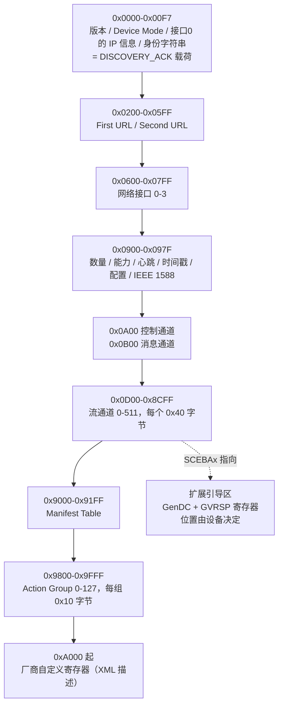
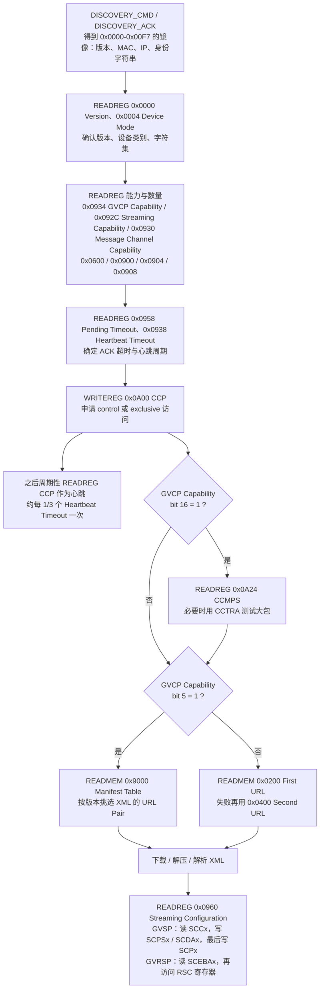

# 引导寄存器总览与寄存器映射（Bootstrap Registers Overview & Register Map）

> **覆盖范围**：Chapter 36 Bootstrap Registers 引言部分的全部通用规则（PDF p.246–248），以及 Table 36-1: Bootstrap Registers 寄存器映射表与表尾脚注（PDF p.248–269）。各寄存器的位定义见 [02_device_and_network_registers.md](02_device_and_network_registers.md)（§36.1–36.45）与 [03_channel_registers.md](03_channel_registers.md)（§36.46–36.81）。
>
> **一句话总结**：引导寄存器（Bootstrap Registers）是每台 GigE Vision 设备在固定地址 0x0000–0x9FFF 上提供的一组 32 位、大端序（big-endian）的标准寄存器——应用程序在拿到 XML 设备描述文件之前，只靠它们就能识别设备、查询能力、取得控制权、找到 XML、配置网络/消息/流通道；0xA000 以上留给厂商自定义寄存器（由 XML 描述）。
>
> **约定提醒**：
> - 页码均为 PDF 页码（打印页码 = PDF 页码 − 1）。
> - 位编号沿用规范的 MSB-first：bit 0 = 32 位寄存器的最高位（掩码 0x80000000），bit 31 = 最低位（掩码 0x00000001）。
> - 逐行原样的映射表见 [../reference/bootstrap_register_map.md](../reference/bootstrap_register_map.md)；本文按功能重新分组并附中文说明。
> - "💡 解读：" 标注的是本知识库的理解/推论，不是规范原文。
>
> **本文目录**
> - 核心要点
> - 1 引导寄存器是什么（§36 引言）
> - 2 通用规则：存在性与 XML / 对齐与字节序 / 访问命令 / 多寄存器访问顺序 / 字符串 / 可选寄存器与能力发现 / 保留字段 / 地址空间划分 / 访问错误与状态码
> - 3 地址空间全景
> - 4 Table 36-1 的读法（M/O、访问类型、脚注 [1]–[4]）
> - 5 按功能分组的寄存器映射（A 设备身份与版本 … L 保留区与厂商空间）
> - 6 映射表中的笔误与前后不一致
> - 7 💡 应用程序初始化时通常读取哪些寄存器
> - 实现要点与易错点
> - 相关章节
> - 自测题

---

## 核心要点

- **固定地址、强制存在**：所有必备（M）引导寄存器必须在每台合规设备上存在（[R-413cd]），并且 SHOULD 按 GenICam SFNC（GigE Vision 命名约定）写进 XML 设备描述文件（[O-414cd]），这样可以利用 XML 特征的 min/max/increment 信息做取值校验（§36, p.246）。
- **32 位对齐 + 大端序**：所有设备寄存器（引导寄存器和厂商寄存器）都必须 32 位对齐（[R-415cd]）；引导寄存器必须以大端序呈现（[R-416cd]）。厂商寄存器的字节序规范不作规定（p.246）。
- **地址空间划分**：0x0000–0x9FFF（含两端）整段保留给本规范定义的引导寄存器，厂商寄存器必须放在这段之后（[R-422cd]，p.247），映射表最后一行明确厂商空间从 **0xA000** 开始（p.269）。
- **访问命令**：数值寄存器用 READREG/WRITEREG；字符串用 READMEM/WRITEMEM（p.246–247，[O-424ca]）。
- **跨多个寄存器的值先访问低地址**：例如 "High/Low" 寄存器对，High 在低地址，必须先访问（[R-417ca]，p.246）。
- **字符串**：字符集由 Device Mode（0x0004）的 `character_set_index` 指定（1 = UTF-8，2 = ASCII）；必须以 NULL 结尾，除非字符串占满整个寄存器区——此时 NULL 是隐含的，应用需自行补 NULL（[R-418cd]，p.247）。
- **保留字段**：设备必须置 0（[R-419cd]），应用必须忽略（[R-420ca]）。
- **错误状态码**：访问不支持的引导寄存器 → `GEV_STATUS_INVALID_ADDRESS`（[R-421cd]）；读只写寄存器 → `GEV_STATUS_ACCESS_DENIED`、写只读寄存器 → `GEV_STATUS_WRITE_PROTECT`（[R-423cd]）；写入不支持的值 SHOULD 回 `GEV_STATUS_INVALID_PARAMETER` 且保持原值（[O-427cd]）；暂时无法执行 SHOULD 回 `GEV_STATUS_BUSY`（[O-428cd]）。
- **能力发现靠"数量寄存器 + 能力位"**：可选寄存器是否存在，要看 Number of Network Interfaces（0x0600）、Number of Message Channels（0x0900）、Number of Stream Channels（0x0904）等数量寄存器，以及 GVCP Capability（0x0934）、Streaming Capability（0x092C）、Message Channel Capability（0x0930）、每通道 SCCx 等能力位（p.247）。
- **三条地址规律**：网络接口 #1–#3 的寄存器块基址为 `0x0600 + 0x80·n`（n = 1..3），#0 的寄存器分散在 0x0008–0x0044 与 0x064C–0x0670；流通道 x 的寄存器块为 `0x0D00 + 0x40·x`（x = 0..511）；Action 组 x 为 `0x9800 + 0x10·x`（x = 0..127）。GenDC/GVRSP 扩展寄存器则通过 SCEBAx 读出的基址间接寻址。
- **v3.0 看点**：Streaming Capability/Configuration（旧称 GVSP Capability/Configuration）加入 GVSP/GVRSP 协议选择；新增 GVRSP 扩展寄存器（SCEBAx + 0x30…0x4C）、大控制包相关的 CCMPS（0x0A24）/CCTRA（0x0A28）、CCP 的 `connection_count`；多个旧能力位被"弃用并固定为 1 或 0"（详见 [02](02_device_and_network_registers.md)）。

---

## 1 引导寄存器是什么（§36 引言，p.246）

- 规范在**固定地址**上定义了一批引导寄存器，用于配置设备，对所有 GigE Vision 设备通用。
- 设备还可以在**从 0xA000 开始**的设备专用地址空间里分配非引导寄存器（厂商自定义寄存器，manufacturer-specific registers）。这些寄存器不由规范定义，通常通过 XML 设备描述文件公布。
- 所有设备寄存器都通过 **GVCP**（GigE Vision Control Protocol）访问；厂商寄存器位于引导寄存器地址空间之后。

💡 解读：可以把引导寄存器理解为 "GigE Vision 版的配置空间"——不管哪家厂商的相机，应用程序都能用同一套地址完成 "发现 → 建立控制 → 下载 XML" 的自举（bootstrap）过程；之后真正的相机功能（曝光、增益、触发……）由 XML 把 GenICam 特征映射到 0xA000 以上的厂商寄存器上。

---

## 2 通用规则（§36 引言，p.246–248）

### 2.1 存在性与 XML 描述

- [R-413cd]：所有必备引导寄存器必须在所有合规设备上存在（标注为可选的除外），清单即 Table 36-1（p.246）。
- [O-414cd]：引导寄存器 SHOULD 出现在 XML 设备描述文件中，并遵守 GenICam Standard Features Naming Convention（SFNC）中针对 GigE Vision 的规则（p.246）。
- 理由：XML 特征带有最小值、最大值、步进等信息，可做更全面的取值校验（p.246）。

💡 解读：大部分引导寄存器都有对应的 SFNC 特征名（如 0x0024 ↔ `GevCurrentIPAddress`、0x0938 ↔ `DeviceLinkHeartbeatTimeout`），在 [02](02_device_and_network_registers.md) 每个寄存器的说明中都列出了对应关系。GenICam 上层软件通常通过这些特征名而不是直接通过地址访问引导寄存器。

### 2.2 对齐与字节序

- [R-415cd]：所有设备寄存器（引导寄存器与厂商寄存器）必须 32 位对齐。
- [R-416cd]：所有引导寄存器必须以大端序呈现。
- NOTE：厂商寄存器的字节序不由本规范定义（p.246）。
- 历史背景：GigE Vision 1.x 允许设备通过 Device Mode 的 bit 0 声明引导寄存器的字节序；从 2.0 起该位弃用、恒为 1，引导寄存器一律大端（§36.2, p.270）。

💡 解读：例如 Version 寄存器的值 0x00030000，在 READREG_ACK 的数据区中依次是字节 `00 03 00 00`。x86/ARM 小端主机必须做 `ntohl()` 之类的转换后再按位解析；而规范的位编号（bit 0 = MSB）只是"命名"，与主机字节序无关。

### 2.3 访问命令的选择

- 引导寄存器应由应用程序使用 READREG/WRITEREG 访问，**字符串除外**——字符串应使用 READMEM/WRITEMEM（p.246）。
- [O-424ca]：应用 SHOULD 使用 READMEM 读取引导寄存器中的字符串（p.247）。
- 相关约束（§16.5，p.132）：READMEM 读取的字节数必须是 4 的倍数（[R-177c]），地址必须 32 位对齐（[R-179c]），否则设备返回 `GEV_STATUS_BAD_ALIGNMENT`（[R-178cd]）；单次 READMEM 最多可读 "Control Channel Max Packet Size − 40" 字节（默认 576 − 40 = 536 字节），因此 512 字节的 URL 可以一次读完（§14.1, p.95）。

💡 解读：所有字符串寄存器的长度（16、32、48、512 字节）都是 4 的倍数，起始地址也都 4 字节对齐，正好满足 READMEM 的对齐要求。

### 2.4 跨多个寄存器的数值：先访问低地址

- [R-417ca]：当信息跨越多个 32 位寄存器时，必须先访问地址最低的寄存器，然后依次访问，直到地址最高的寄存器（p.246）。
- 规范中成对出现的 "High"/"Low" 寄存器：High 表示高位字节、Low 表示低位字节；**High 总是在低地址，因此必须先访问**（p.246）。
- 目的：方便将来迁移到比 32 位更宽的存储架构（如 64 位）（p.246）。

规范中的多寄存器数值一览：

| 数据 | 先访问（低地址） | 后访问（高地址） | 章节 |
|---|---|---|---|
| Device MAC Address（接口 #0；#1–#3 同理） | High 0x0008 | Low 0x000C | §36.3 |
| Timestamp Tick Frequency（64 位） | High 0x093C | Low 0x0940 | §36.31 |
| Timestamp Value（64 位，锁存值） | High 0x0948 | Low 0x094C | §36.33 |
| GVSP Stream Channel Max Block Size（SCMBSx，64 位） | High 0x0D34 + 0x40·x | Low 0x0D38 + 0x40·x | §36.65 |
| Manifest Table 的 8 字节条目 | bit 0–31（低地址） | bit 32–63（高地址） | §36.79（p.348） |

💡 解读：顺序要求不等于原子性保证。Timestamp Value 的完整性靠"先向 Timestamp Control 写 latch 位，把 64 位计数器拷贝到锁存寄存器"来保证（[CR-466ca]，§36.33）。

### 2.5 字符串：字符集与 NULL 结尾（p.247）

- [R-418cd]：引导寄存器空间中的所有字符串必须使用 Device Mode 寄存器（0x0004）指定的字符集，并且以 NULL 结尾——**除非该字符串用满了寄存器的全部存储区**，此时 NULL 是隐含的。
- NOTE（p.247）：GigE Vision 1.x 要求字符串末尾必须有显式 NULL；从 GigE Vision 2.0 起放宽，若字符串占满分配给它的全部区域，由**应用程序**负责在末尾补 NULL。DISCOVERY_ACK 中的同名字段遵循同样规则（§16.1.2 NOTE，p.123）。
- 字符集取值（Device Mode bit 24–31 `character_set_index`，§36.2, p.271）：0 = 保留，1 = UTF-8，2 = ASCII（为与 GenICam 标准兼容，推荐 ASCII），其他 = 保留。

引导寄存器中的字符串一览：

| 地址 | 名称 | 长度（字节） | M/O | 访问 | 详见 |
|---|---|---|---|---|---|
| 0x0048 | Manufacturer Name | 32 | M | R | [§36.9](02_device_and_network_registers.md#sec-36-9) |
| 0x0068 | Model Name | 32 | M | R | [§36.10](02_device_and_network_registers.md#sec-36-10) |
| 0x0088 | Device Version | 32 | M | R | [§36.11](02_device_and_network_registers.md#sec-36-11) |
| 0x00A8 | Manufacturer Info | 48 | M | R | [§36.12](02_device_and_network_registers.md#sec-36-12) |
| 0x00D8 | Serial Number | 16 | O | R | [§36.13](02_device_and_network_registers.md#sec-36-13) |
| 0x00E8 | User-defined Name | 16 | O | R/W | [§36.14](02_device_and_network_registers.md#sec-36-14) |
| 0x0200 | First URL | 512 | M | R | [§36.15](02_device_and_network_registers.md#sec-36-15) |
| 0x0400 | Second URL | 512 | M | R | [§36.16](02_device_and_network_registers.md#sec-36-16) |
| 设备指定 | URL Pair（Manifest 条目引用，primary + secondary 各 512） | 1024 | 随 Manifest | R | §36.79.3（[03](03_channel_registers.md)） |

💡 解读：应用端读取字符串时，缓冲区应分配"寄存器长度 + 1"字节，读完后在末尾强制补 `'\0'`，这样无论设备是否写了显式 NULL 都能安全处理。

### 2.6 可选寄存器与能力发现（p.247）

- 部分寄存器在某些设备上可能不存在，它们在表中被标注为 "optional"。此时应用必须参考表示消息通道数、流通道数、网络接口数的设备能力寄存器（p.247）。
- 可选的 GVCP 命令由一个位域寄存器（GVCP Capability，0x0934）指示，每一位代表一个不同的可选功能（p.247）。

💡 解读：把"某可选寄存器/功能是否存在"与"看哪个寄存器判断"整理如下（依据各寄存器章节原文）：

| 可选对象 | 判断依据 |
|---|---|
| 网络接口 #1–#3 的寄存器 | Number of Network Interfaces（0x0600）> n |
| 消息通道寄存器（0x0B00–0x0B20） | Number of Message Channels（0x0900）= 1 |
| 流通道 x 的寄存器 | x < Number of Stream Channels（0x0904） |
| ACTION_GROUP_KEYx / MASKx | GVCP Capability bit 25（ACTION）且 x < Number of Action Signals（0x0908） |
| Serial Number / User-defined Name | GVCP Capability bit 1 / bit 0 |
| Link Speed | GVCP Capability bit 3 |
| Primary Application Port / IP Address | GVCP Capability bit 4 |
| Manifest Table | GVCP Capability bit 5 |
| Discovery ACK Delay（及其是否可写） | GVCP Capability bit 7（可写看 bit 8） |
| Control Switchover Key | GVCP Capability bit 10 |
| IEEE 1588 / PTP | GVCP Capability bit 12；IEEE 1588 Extended Capability 看 bit 15 |
| Scheduled Action Command Queue Size | GVCP Capability bit 14 |
| CCMPS / CCTRA（大控制包） | GVCP Capability bit 16 |
| Persistent IP 系列寄存器 | 对应接口 Network Interface Capability bit 31 |
| SCSPx / SCMBSx / SCEBAx | Streaming Capability bit 0 / bit 2 / bit 3 |
| MCSP / MCCFG | Message Channel Capability bit 0 / bit 1 |
| 时间戳计数器相关 | Timestamp Tick Frequency（0x093C/0x0940）≠ 0 |
| IEEE 1588 Supported / Selected Profile | IEEE 1588 Extended Capability（0x0974）bit 0 |

### 2.7 保留字段（p.247）

- [R-419cd]：引导寄存器中所有保留字段必须为 0。
- [R-420ca]：应用必须忽略引导寄存器中的保留字段。

💡 解读：v3.0 中有一类位不叫 "reserved" 而叫 "deprecated"，它们被固定为 1 或 0（例如 GVCP Capability 的 bit 9/13/26/30 恒为 1、Streaming Capability 的 bit 1 恒为 0），设备必须按规定的固定值返回。对 v3.0 设备来说这些位已不携带信息；但应用若要与旧版本设备互通，这些位在旧设备上仍按旧含义解释——例如 [O-186ca] 建议支持旧版本规范的应用检查 GVCP Capability bit 30 来确认设备是否支持 WRITEMEM（§16.6, p.134）。表中整段标为 "Reserved" 的地址没有寄存器，访问它们按 [R-421cd] 的精神应得到 `GEV_STATUS_INVALID_ADDRESS`（规范没有单独为 Reserved 地址写一条要求）。

### 2.8 地址空间划分

- [R-422cd]：设备必须把 0x0000 到 0x9FFF（含）的地址空间保留给本规范描述的引导寄存器，厂商寄存器必须分配在此范围之后（p.247）。
- Table 36-1 末行：0xA000 = "Start of manufacturer-specific register space"，这些寄存器不在规范范围内，SHOULD 通过 XML 设备描述文件报告（p.269）。

### 2.9 访问错误与状态码（p.247–248）

规范对地址与访问类型（读/写）有一组限制：

| 情形 | 设备应返回 | 状态码值 | 依据 |
|---|---|---|---|
| 访问设备不支持的引导寄存器 | `GEV_STATUS_INVALID_ADDRESS` | 0x8003 | [R-421cd] |
| 读取只写（W）寄存器 | `GEV_STATUS_ACCESS_DENIED` | 0x8006 | [R-423cd] |
| 写入只读（R）寄存器 | `GEV_STATUS_WRITE_PROTECT` | 0x8004 | [R-423cd] |
| 用 READMEM 读取设备不支持的可选字符串寄存器 | `GEV_STATUS_INVALID_ADDRESS`，且 ACK 报文头 `length` = 0 | 0x8003 | [CR-425cd] |
| 用 WRITEMEM 写入设备不支持的可选字符串寄存器 | `GEV_STATUS_INVALID_ADDRESS`，且 ACK 报文头 `index` = 0 | 0x8003 | [CR-426cd] |
| 应用写入设备不支持的值 | SHOULD 返回 `GEV_STATUS_INVALID_PARAMETER`，寄存器保持原值 | 0x8002 | [O-427cd]（p.248） |
| 设备暂时无法执行该请求 | SHOULD 返回 `GEV_STATUS_BUSY`；可作为 PENDING_ACK 之外的另一种做法（见 §10.7） | 0x8007 | [O-428cd]（p.248） |
| READMEM/WRITEMEM 的地址或长度不是 4 字节对齐 | `GEV_STATUS_BAD_ALIGNMENT` | 0x8005 | READMEM：[R-178cd]、[R-179c]（§16.5, p.132）；WRITEMEM：[R-188cd]、[R-189c]（§16.6, p.134） |

状态码数值取自 Chapter 19 的状态码表（p.157）。

此外，个别寄存器还有专属的状态码规则（详见各章节）：

- 任何 GVSP 流通道打开（SCPx ≠ 0）或任何 GVRSP 流使能时写 Streaming Configuration（0x0960）→ `GEV_STATUS_BUSY`（[R-667cd]，§36.38, p.305）。
- streaming_protocol = 1（GVRSP 模式）时访问 SCPx → `GEV_STATUS_ACCESS_DENIED`（[R-671cd]，§36.57, p.322）；双模设备在 GVSP 模式下访问 RSCCTLx → `GEV_STATUS_ACCESS_DENIED`（[CR-673cd]，§36.71, p.341）。
- 设备以 IEEE 1588 受控时钟运行时，试图通过 Timestamp Control 复位时间戳 → `GEV_STATUS_WRITE_PROTECT`（[CR-124cd]，§14.2.2, p.100）。
- 访问不存在的网络接口的寄存器 → `GEV_STATUS_INVALID_ADDRESS`（[R-431cd]–[R-436cd] 等，§36.3–36.8）。
- 有应用持有独占访问（exclusive access）时，次级应用（secondary application）的 READREG/READMEM → `GEV_STATUS_ACCESS_DENIED` 且 length = 0（[R-162cd]、[R-181cd]，§16.3/§16.5）。

---

## 3 地址空间全景

下表把 Table 36-1（p.248–269）按地址块汇总（"Reserved" 行只给出起始地址，区间一直延续到表中下一项的起始地址前）：

| 地址范围 | 内容 | 备注 |
|---|---|---|
| 0x0000–0x00F7 | Version、Device Mode、接口 #0 的 MAC / IP 配置 / 当前 IP、身份字符串（Manufacturer Name … User-defined Name） | 与 DISCOVERY_ACK 载荷逐字节对应（§16.1.2, p.122–123），见 5.A |
| 0x00F8–0x01FF | Reserved | |
| 0x0200–0x03FF | First URL（512 B） | |
| 0x0400–0x05FF | Second URL（512 B） | |
| 0x0600–0x067F | Number of Network Interfaces（0x0600）+ 接口 #0 的 Persistent IP/Subnet/Gateway 与 Link Speed（0x064C–0x0673） | 其余为 Reserved |
| 0x0680–0x06FF | 网络接口 #1 寄存器块 | |
| 0x0700–0x077F | 网络接口 #2 寄存器块 | |
| 0x0780–0x07F3 | 网络接口 #3 寄存器块 | 0x07F4–0x08FF 为 Reserved |
| 0x0900–0x097F | 设备级寄存器：通道/Action 数量、Active Links、三个能力寄存器、心跳、时间戳、Discovery ACK Delay、GVCP/Streaming 配置、Pending Timeout、Switchover Key、物理链路、IEEE 1588、Scheduled Action 队列 | 0x0914–0x092B 为 Reserved |
| 0x0980–0x09FF | Reserved | |
| 0x0A00–0x0A2B | 控制通道：CCP、Primary Application Port/IP、CCMPS、CCTRA | 0x0A2C–0x0AFF 为 Reserved |
| 0x0B00–0x0B23 | 消息通道：MCP、MCDA、MCTT、MCRC、MCSP、MCCFG | 0x0B24–0x0CFF 为 Reserved |
| 0x0D00–0x8CFF | 流通道 0–511，每个通道 0x40（64）字节 | 通道 x 起始 = 0x0D00 + 0x40·x |
| 0x8D00–0x8FFF | Reserved | 表中此行印作 "0x8CF0 Reserved"，疑为笔误，见第 6 节 |
| 0x9000–0x91FF | Manifest Table（512 B） | |
| 0x9200–0x97FF | Reserved | |
| 0x9800–0x9FFF | Action Group Key/Mask 0–127，每组 0x10（16）字节 | 每组后 8 字节为 Reserved |
| 0xA000 起 | 厂商自定义寄存器 | 由 XML 描述（p.269） |
| SCEBAx 所指位置 | 流通道 x 的扩展引导寄存器（GenDC + GVRSP） | 位置由设备决定，SCEBAx = 0 表示没有（§36.66） |

---

## 4 Table 36-1 的读法（p.248–269）

- **列**：Address | Name | Support | Type | Length (bytes) | Description。
- **Support 列**：`M` = 必须（Mandatory），`O` = 可选（Optional），`-` = 保留/不适用。方括号是脚注（p.269）：
  - `[1]` 仅对 transmitter（发送端）、receiver（接收端）、transceiver（收发端）设备强制，对 peripheral（外设）不适用；
  - `[2]` 仅对 transmitter 设备强制，对其他设备不适用；
  - `[3]` 支持 GVSP 协议时强制；
  - `[4]` 支持 GVRSP 协议时强制。
  - 💡 解读：组合标注表示条件同时成立，例如 `M[1][3]` = "发送/接收/收发设备且支持 GVSP 时必须"，`M[2][4]` = "发送端且支持 GVRSP 时必须"。
- **Type 列**：`R` 只读，`W` 只写，`R/W` 读写，`R/(W)` = 写访问是有条件/可选的（例如 Discovery ACK Delay 是否可写由 GVCP Capability bit 8 指示）。
- **Reserved 行**只列起始地址，区间延续到下一项。
- **重复结构只列代表项**：网络接口 #0–#3 逐个列出；流通道只列通道 0、1、511，中间用 "0x0D80 Other stream channels registers（每个通道 64 字节 / 0x40，只有支持的通道才存在）" 概括（p.265）；Action 只列组 0、1、127，中间用 "0x9820 Other action signals registers（每个 action 信号 16 字节 / 0x10，只有支持的才存在）" 概括（p.268）。
- **"SCEBAx + 偏移"**：相对于从 SCEBAx 寄存器（0x0D3C + 0x40·x）读出的基地址的偏移（p.261–268）。

---

## 5 按功能分组的寄存器映射

下面 12 张表（A–L）覆盖 Table 36-1 的全部条目。"详见" 列：§36.1–36.45 链接到 [02_device_and_network_registers.md](02_device_and_network_registers.md)，§36.46–36.81 链接到 [03_channel_registers.md](03_channel_registers.md)。访问/M-O 以映射表为准，与详细章节不一致处另行注明（汇总见第 6 节）。

### 5.A 设备身份与版本

| 地址 | 名称 | M/O | 访问 | 长度 | 一句话说明 | 详见 |
|---|---|---|---|---|---|---|
| 0x0000 | Version | M | R | 4 | 设备遵循的 GigE Vision 版本：高 16 位 major、低 16 位 minor；v3.0 设备读出 0x00030000 | [§36.1](02_device_and_network_registers.md#sec-36-1) |
| 0x0004 | Device Mode | M | R | 4 | bit 0 恒为 1（旧字节序位）、device_class（发送/接收/收发/外设）、当前物理链路配置 CLC、字符集 | [§36.2](02_device_and_network_registers.md#sec-36-2) |
| 0x0048 | Manufacturer Name | M | R | 32 | 厂商名字符串（= DISCOVERY_ACK 的 `manufacturer_name`） | [§36.9](02_device_and_network_registers.md#sec-36-9) |
| 0x0068 | Model Name | M | R | 32 | 型号字符串（= `model_name`） | [§36.10](02_device_and_network_registers.md#sec-36-10) |
| 0x0088 | Device Version | M | R | 32 | 设备版本字符串（= `device_version`），软/硬件任何 form-fit-function 变化都应使其改变 | [§36.11](02_device_and_network_registers.md#sec-36-11) |
| 0x00A8 | Manufacturer Info | M | R | 48 | 厂商附加信息（= `manufacturer_specific_info`） | [§36.12](02_device_and_network_registers.md#sec-36-12) |
| 0x00D8 | Serial Number | O | R | 16 | 序列号；GVCP Capability bit 1 指示是否支持，不支持时 DISCOVERY_ACK 该字段全 NULL | [§36.13](02_device_and_network_registers.md#sec-36-13) |
| 0x00E8 | User-defined Name | O | R/W | 16 | 用户可写的设备名，须非易失保存；GVCP Capability bit 0 指示 | [§36.14](02_device_and_network_registers.md#sec-36-14) |
| 0x0200 | First URL | M | R | 512 | XML 设备描述文件的首选位置（无 Manifest Table 时） | [§36.15](02_device_and_network_registers.md#sec-36-15) |
| 0x0400 | Second URL | M | R | 512 | XML 的备选位置（首选失败时使用） | [§36.16](02_device_and_network_registers.md#sec-36-16) |

**DISCOVERY_ACK 与 0x0000–0x00F7 的对应关系**：DISCOVERY_ACK 中除 GVCP 报文头以外的字段与最前面的这些引导寄存器完全一致（§16.1.2, p.122–123），载荷共 0xF8 = 248 字节：

| 载荷偏移 | DISCOVERY_ACK 字段 | 对应引导寄存器 |
|---|---|---|
| 0x00 | spec_version_major / spec_version_minor | 0x0000 Version |
| 0x04 | device_mode | 0x0004 Device Mode |
| 0x08 | reserved + device_MAC_address (high) | 0x0008 MAC High（接口 #0） |
| 0x0C | device_MAC_address (low) | 0x000C MAC Low（接口 #0） |
| 0x10 | IP_config_options | 0x0010 Network Interface Capability（#0） |
| 0x14 | IP_config_current | 0x0014 Network Interface Configuration（#0） |
| 0x18–0x23 | reserved ×3 | 0x0018 Reserved |
| 0x24 | current_IP | 0x0024 Current IP Address（#0） |
| 0x28–0x33 | reserved ×3 | 0x0028 Reserved |
| 0x34 | current_subnet_mask | 0x0034 Current Subnet Mask（#0） |
| 0x38–0x43 | reserved ×3 | 0x0038 Reserved |
| 0x44 | default_gateway | 0x0044 Current Default Gateway（#0） |
| 0x48 | manufacturer_name [32] | 0x0048 |
| 0x68 | model_name [32] | 0x0068 |
| 0x88 | device_version [32] | 0x0088 |
| 0xA8 | manufacturer_specific_information [48] | 0x00A8 |
| 0xD8 | serial_number [16] | 0x00D8 |
| 0xE8 | user_defined_name [16] | 0x00E8 |

💡 解读：设备端实现 DISCOVERY_ACK 时可以直接把引导寄存器 0x0000–0x00F7 的镜像拷进载荷；应用端也可以复用同一套解析代码。由于发现总在接口 #0 上进行，载荷里只有接口 #0 的网络信息（§16.1.2, p.123）。

### 5.B 网络接口与物理链路

设备级寄存器：

| 地址 | 名称 | M/O | 访问 | 长度 | 一句话说明 | 详见 |
|---|---|---|---|---|---|---|
| 0x0600 | Number of Network Interfaces | M | R | 4 | 网络接口数 1–4（LAG 聚合的多个物理口计为 1 个） | [§36.17](02_device_and_network_registers.md#sec-36-17) |
| 0x0910 | Number of Active Links | M | R | 4 | 当前已完成链路协商的物理链路数（≤ 接口数） | [§36.26](02_device_and_network_registers.md#sec-36-26) |
| 0x0964 | Physical Link Configuration Capability | M | R | 4 | 支持哪些物理链路配置：SL / ML / 静态 LAG / 动态 LAG | [§36.39](02_device_and_network_registers.md#sec-36-39) |
| 0x0968 | Physical Link Configuration | M | R/(W)（§36.40 写作 Read/Write） | 4 | 下次重启/上电时使用的主物理链路配置 | [§36.40](02_device_and_network_registers.md#sec-36-40) |

每个网络接口的寄存器（#0 为 M，#1–#3 为 O；接口不存在时访问返回 `GEV_STATUS_INVALID_ADDRESS`）：

| 寄存器 | #0 | #1 | #2 | #3 | 相对偏移 | 访问 | 长度 | M/O（#0 / #1–#3） | 详见 |
|---|---|---|---|---|---|---|---|---|---|
| Device MAC Address – High | 0x0008 | 0x0680 | 0x0700 | 0x0780 | +0x00 | R | 4 | M / O | [§36.3](02_device_and_network_registers.md#sec-36-3) |
| Device MAC Address – Low | 0x000C | 0x0684 | 0x0704 | 0x0784 | +0x04 | R | 4 | M / O | [§36.3](02_device_and_network_registers.md#sec-36-3) |
| Network Interface Capability | 0x0010 | 0x0688 | 0x0708 | 0x0788 | +0x08 | R | 4 | M / O | [§36.4](02_device_and_network_registers.md#sec-36-4) |
| Network Interface Configuration | 0x0014 | 0x068C | 0x070C | 0x078C | +0x0C | R/W | 4 | M / O | [§36.5](02_device_and_network_registers.md#sec-36-5) |
| Current IP Address | 0x0024 | 0x069C | 0x071C | 0x079C | +0x1C | R | 4 | M / O | [§36.6](02_device_and_network_registers.md#sec-36-6) |
| Current Subnet Mask | 0x0034 | 0x06AC | 0x072C | 0x07AC | +0x2C | R | 4 | M / O | [§36.7](02_device_and_network_registers.md#sec-36-7) |
| Current Default Gateway | 0x0044 | 0x06BC | 0x073C | 0x07BC | +0x3C | R | 4 | M / O | [§36.8](02_device_and_network_registers.md#sec-36-8) |
| Persistent IP Address | 0x064C | 0x06CC | 0x074C | 0x07CC | +0x4C | R/W | 4 | O / O | [§36.18](02_device_and_network_registers.md#sec-36-18) |
| Persistent Subnet Mask | 0x065C | 0x06DC | 0x075C | 0x07DC | +0x5C | R/W | 4 | O / O | [§36.19](02_device_and_network_registers.md#sec-36-19) |
| Persistent Default Gateway | 0x066C | 0x06EC | 0x076C | 0x07EC | +0x6C | R/W | 4 | O / O | [§36.20](02_device_and_network_registers.md#sec-36-20) |
| Link Speed | 0x0670 | 0x06F0 | 0x0770 | 0x07F0 | +0x70 | R | 4 | O / O | [§36.21](02_device_and_network_registers.md#sec-36-21) |

**地址规律**（💡 解读：由上表各行归纳，规范映射表本身是逐个列出的）：

- 接口 n = 1..3：`地址 = 0x0600 + 0x80·n + 相对偏移`（基址 0x0680 / 0x0700 / 0x0780）。
- 接口 #0 比较特殊：前 7 个寄存器（MAC … Default Gateway）位于 `0x0008 + 相对偏移`，以便与 DISCOVERY_ACK 载荷对齐；后 4 个（Persistent IP 三件套 + Link Speed）仍符合 `0x0600 + 0x80·0 + 相对偏移`（0x064C/0x065C/0x066C/0x0670）。接口 #0 块的 0x0600 处被 Number of Network Interfaces 占用。
- 每个接口块内的 Reserved 间隙：+0x10、+0x20、+0x30、+0x40、+0x50、+0x60 起各 12 字节，+0x74 起至块尾（#0 对应 0x0018/0x0028/0x0038 与 0x0604/0x0650/0x0660/0x0674；#1 为 0x0690/0x06A0/0x06B0/0x06C0/0x06D0/0x06E0/0x06F4，#2、#3 依此类推）。
- 只有接口 #0 支持 GVCP；其余接口只承载流通道（§36.17, p.282）。

### 5.C 设备能力与全局配置

| 地址 | 名称 | M/O | 访问 | 长度 | 一句话说明 | 详见 |
|---|---|---|---|---|---|---|
| 0x0900 | Number of Message Channels | M | R | 4 | 消息通道数，只能是 0 或 1 | [§36.22](02_device_and_network_registers.md#sec-36-22) |
| 0x0904 | Number of Stream Channels | M | R | 4 | 流通道数 0–512；不随所选流协议或其他配置变化 | [§36.23](02_device_and_network_registers.md#sec-36-23) |
| 0x092C | Streaming Capability | M[1] | R | 4 | 流通道可选特性（SCSPx/SCMBSx/SCEBAx 是否存在）+ 支持 GVSP/GVRSP 哪种协议；旧称 GVSP Capability | [§36.27](02_device_and_network_registers.md#sec-36-27) |
| 0x0930 | Message Channel Capability | M | R | 4 | MCSP、MCCFG 是否存在，是否支持事件拼接 | [§36.28](02_device_and_network_registers.md#sec-36-28) |
| 0x0934 | GVCP Capability | M | R | 4 | 所有可选 GVCP 命令与可选引导寄存器的"能力总表" | [§36.29](02_device_and_network_registers.md#sec-36-29) |
| 0x0954 | GVCP Configuration | O | R/W | 4 | 使能可选 GVCP 特性：PTP（bit 12）、无条件 ACTION（bit 28）、关闭心跳（bit 31） | [§36.35](02_device_and_network_registers.md#sec-36-35) |
| 0x0960 | Streaming Configuration | M | R/W | 4 | `streaming_protocol`：0 = GVSP，1 = GVRSP（表中描述仍是旧文字 "Configuration of the optional GVSP features"）；旧称 GVSP Configuration | [§36.38](02_device_and_network_registers.md#sec-36-38) |

### 5.D 心跳与超时

| 地址 | 名称 | M/O | 访问 | 长度 | 一句话说明 | 详见 |
|---|---|---|---|---|---|---|
| 0x0938 | Heartbeat Timeout | M | R/W | 4 | 心跳超时（ms），默认 3000；内部按心跳时钟取整，精度至少 100 ms，最小 500 ms | [§36.30](02_device_and_network_registers.md#sec-36-30) |
| 0x0950 | Discovery ACK Delay | O | R/(W) | 4 | 回 DISCOVERY_ACK 前的最大随机延时（ms），出厂值 ≤ 1000 | [§36.34](02_device_and_network_registers.md#sec-36-34) |
| 0x0958 | Pending Timeout | M | R | 4 | 发出 PENDING_ACK 前命令的最长执行时间（ms），应用据此设定 ACK 超时 | [§36.36](02_device_and_network_registers.md#sec-36-36) |

（关闭心跳由 GVCP Configuration bit 31 控制，见 5.C。）

### 5.E 时间戳与 IEEE 1588

| 地址 | 名称 | M/O | 访问 | 长度 | 一句话说明 | 详见 |
|---|---|---|---|---|---|---|
| 0x093C | Timestamp Tick Frequency – High | O | R | 4 | 64 位时间戳时钟频率（每秒 tick 数）高 32 位；为 0 表示不支持时间戳 | [§36.31](02_device_and_network_registers.md#sec-36-31) |
| 0x0940 | Timestamp Tick Frequency – Low | O | R | 4 | 同上，低 32 位；使用 IEEE 1588 时频率固定为 1 GHz | [§36.31](02_device_and_network_registers.md#sec-36-31) |
| 0x0944 | Timestamp Control | O | W | 4 | 写 1 执行锁存（bit 30）/复位（bit 31），无需再写 0 | [§36.32](02_device_and_network_registers.md#sec-36-32) |
| 0x0948 | Timestamp Value – High | M（§36.33 称 optional） | R | 4 | 锁存的时间戳高 32 位 | [§36.33](02_device_and_network_registers.md#sec-36-33) |
| 0x094C | Timestamp Value – Low | M（§36.33 称 optional） | R | 4 | 锁存的时间戳低 32 位 | [§36.33](02_device_and_network_registers.md#sec-36-33) |
| 0x096C | IEEE 1588 Status | O | R | 4 | IEEE 1588 时钟（PTP 端口）状态，未锁存 | [§36.41](02_device_and_network_registers.md#sec-36-41) |
| 0x0974 | IEEE 1588 Extended Capabilities | O | R | 4 | bit 0：Supported/Selected Profile 寄存器是否存在；GVCP Capability bit 15 指示本寄存器存在 | [§36.43](02_device_and_network_registers.md#sec-36-43) |
| 0x0978 | IEEE 1588 Supported Profiles | O | R | 4 | 支持的 PTP profile：默认 PTP（delay request-response）、IEEE 802.1AS | [§36.44](02_device_and_network_registers.md#sec-36-44) |
| 0x097C | IEEE 1588 Selected Profile | O | R/W | 4 | 当前使用的 profile（取值 = Supported Profiles 中对应位的位序号） | [§36.45](02_device_and_network_registers.md#sec-36-45) |

（PTP 使能位在 GVCP Configuration bit 12，能力位在 GVCP Capability bit 12，见 5.C。）

### 5.F 控制通道

| 地址 | 名称 | M/O | 访问 | 长度 | 一句话说明 | 详见 |
|---|---|---|---|---|---|---|
| 0x095C | Control Switchover Key | O | W | 4 | 主应用切换（primary application switchover）的认证密钥（低 16 位有效），只写以对次级应用隐藏 | [§36.37](02_device_and_network_registers.md#sec-36-37) |
| 0x0A00 | Control Channel Privilege (CCP) | M | R/W | 4 | 控制通道特权：exclusive/control 访问位、switchover 使能位、`connection_count`、switchover key 字段；写它即"申请/释放控制权" | §36.46 · [03](03_channel_registers.md) |
| 0x0A04 | Primary Application Port | O | R | 4 | 主应用控制通道的 UDP 源端口；无主应用时为 0（GVCP Capability bit 4） | §36.47 · [03](03_channel_registers.md) |
| 0x0A14 | Primary Application IP Address | O | R | 4 | 主应用的 IPv4 地址；无主应用时为 0（GVCP Capability bit 4） | §36.48 · [03](03_channel_registers.md) |
| 0x0A24 | Control Channel Max Packet Size (CCMPS) | O | R/W（§36.49 写作 Read） | 4 | 设备控制通道能处理的最大包长（含 IP/UDP/GVCP 头），至少 576、4 字节对齐（GVCP Capability bit 16） | §36.49 · [03](03_channel_registers.md) |
| 0x0A28 | Control Channel Test Region Address (CCTRA) | O | R/W（§36.50 写作 Read） | 4 | 控制通道测试区基地址，供应用试探可用的大包尺寸（GVCP Capability bit 16） | §36.50 · [03](03_channel_registers.md) |

（0x0A08–0x0A13、0x0A18–0x0A23、0x0A2C–0x0AFF 为 Reserved。）

### 5.G 消息通道（Message Channel）

仅当 Number of Message Channels（0x0900）= 1 时存在。

| 地址 | 名称 | M/O | 访问 | 长度 | 一句话说明 | 详见 |
|---|---|---|---|---|---|---|
| 0x0B00 | Message Channel Port (MCP) | O | R/W | 4 | 消息通道端口：`host_port` 非 0 = 打开、0 = 关闭；NII 字段恒为 0（只有接口 #0 支持 GVCP） | §36.51 · [03](03_channel_registers.md) |
| 0x0B10 | Message Channel Destination Address (MCDA) | O | R/W | 4 | 事件消息的目的 IPv4 地址（单播或组播） | §36.52 · [03](03_channel_registers.md) |
| 0x0B14 | Message Channel Transmission Timeout (MCTT) | O | R/W | 4 | 等待应用 ACK 的超时（ms）；0 = 不要求 ACK | §36.53 · [03](03_channel_registers.md) |
| 0x0B18 | Message Channel Retry Count (MCRC) | O | R/W | 4 | 超时后的重传次数 | §36.54 · [03](03_channel_registers.md) |
| 0x0B1C | Message Channel Source Port (MCSP) | O | R | 4 | 消息通道的 UDP 源端口，便于应用打通防火墙/NAT（Message Channel Capability bit 0） | §36.55 · [03](03_channel_registers.md) |
| 0x0B20 | Message Channel Configuration (MCCFG) | O | R/W | 4 | 消息通道可选配置，如 `MCEC_enable`（允许一个 EVENTDATA_CMD 拼接多个事件）（Message Channel Capability bit 1） | §36.56 · [03](03_channel_registers.md) |

（0x0B04–0x0B0F、0x0B24–0x0CFF 为 Reserved。打开顺序：先写 MCDA，再写 MCP 的 `host_port`，§12.2, p.90。）

### 5.H GVSP 流通道 x（x = 0..511）

地址公式：`0x0D00 + 0x40·x + 相对偏移`（各节属性表写作 "0x0D00 + 0x40 * x, with 0 ≤ x < 512" 等，如 §36.57, p.323）。映射表只逐项列出通道 0（p.259–261）、通道 1（p.262–263）、通道 511（p.265–267），其余由 "0x0D80 Other stream channels registers" 概括。

| 相对偏移 | 通道 0 | 通道 1 | 通道 511 | 名称 | M/O（x = 0） | M/O（x ≥ 1） | 访问 | 长度 | 一句话说明 | 详见 |
|---|---|---|---|---|---|---|---|---|---|---|
| +0x00 | 0x0D00 | 0x0D40 | 0x8CC0 | GVSP Stream Channel Port (SCPx) | M[1][3] | O | R/W | 4 | 打开/关闭流通道：`host_port` 非 0 = 打开、0 = 关闭；另含 direction、network_interface_index | §36.57 · [03](03_channel_registers.md) |
| +0x04 | 0x0D04 | 0x0D44 | 0x8CC4 | GVSP Stream Channel Packet Size (SCPSx) | M[1][3] | O | R/W | 4 | 流包大小（含 IP/UDP/GVSP 头）及 fire_test_packet、do_not_fragment 位 | §36.58 · [03](03_channel_registers.md) |
| +0x08 | 0x0D08 | 0x0D48 | 0x8CC8 | GVSP Stream Channel Packet Delay (SCPDx) | M[2][3] | O | R/W | 4 | 包间最小延时，单位为时间戳 tick | §36.59 · [03](03_channel_registers.md) |
| +0x0C | 0x0D0C | 0x0D4C | 0x8CCC | Reserved（至 +0x17） | - | - | - | - | — | — |
| +0x18 | 0x0D18 | 0x0D58 | 0x8CD8 | GVSP Stream Channel Destination Address (SCDAx) | M[1][3] | O | R/W | 4 | 流的目的 IPv4 地址（单播或组播） | §36.60 · [03](03_channel_registers.md) |
| +0x1C | 0x0D1C | 0x0D5C | 0x8CDC | GVSP Stream Channel Source Port (SCSPx) | O | O | R | 4 | 发送端的 UDP 源端口，便于打通防火墙/NAT（Streaming Capability bit 0） | §36.61 · [03](03_channel_registers.md) |
| +0x20 | 0x0D20 | 0x0D60 | 0x8CE0 | GVSP Stream Channel Capability (SCCx) | O | O | R | 4 | 本通道的可选能力：IP 重组、SCMPCx、GenDC、Multi-part、大 leader/trailer、PRD、无条件流、扩展 chunk | §36.62 · [03](03_channel_registers.md) |
| +0x24 | 0x0D24 | 0x0D64 | 0x8CE4 | GVSP Stream Channel Configuration (SCCFGx) | O | O | R/W | 4 | 本通道可选特性的使能位（与 SCCx 对应） | §36.63 · [03](03_channel_registers.md) |
| +0x28 | 0x0D28 | 0x0D68 | 0x8CE8 | 通道 0：**Deprecated**（长度 8，旧版用于 zone 寄存器）；其他通道：Reserved | - | - | - | 8（通道 0） | — | — |
| +0x2C | （含于通道 0 的 8 字节） | 0x0D6C | 0x8CEC | Reserved | - | - | - | - | — | — |
| +0x30 | 0x0D30 | 0x0D70 | 0x8CF0 | GVSP Stream Channel Max Packet Count (SCMPCx) | M[1][3] | O（表中印作 "0"） | R | 4 | 传输一个 GVSP 块（含 leader/trailer）最多需要的包数 | §36.64 · [03](03_channel_registers.md) |
| +0x34 | 0x0D34 | 0x0D74 | 0x8CF4 | GVSP Stream Channel Max Block Size – High (SCMBSx) | M[1][3] | O（"0"） | R | 4 | GVSP 块载荷最大字节数（64 位）的高 32 位（Streaming Capability bit 2） | §36.65 · [03](03_channel_registers.md) |
| +0x38 | 0x0D38 | 0x0D78 | 0x8CF8 | GVSP Stream Channel Max Block Size – Low (SCMBSx) | M[1][3] | O（"0"） | R | 4 | 同上，低 32 位 | §36.65 · [03](03_channel_registers.md) |
| +0x3C | 0x0D3C | 0x0D7C | 0x8CFC | Stream Channel Extended Bootstrap Address (SCEBAx) | M[1] | O（"0"） | R | 4 | 本通道扩展引导区的起始地址（0 = 无扩展寄存器）；GenDC/GVRSP 寄存器经它寻址（Streaming Capability bit 3） | §36.66 · [03](03_channel_registers.md) |

要点：

- 每个流通道占 64 字节（0x40），只有设备支持的通道才存在（p.265）。
- 所有 GVSP 专用引导寄存器只有在 Streaming Configuration 的 `streaming_protocol` = 0 时才可用（附录 C, p.407）；处于 GVRSP 模式时访问 SCPx 返回 `GEV_STATUS_ACCESS_DENIED`（[R-671cd]，p.322）。SCEBAx 名称中没有 "GVSP"，GVSP/GVRSP 两种模式都用它。
- SCPx 是打开通道时最后写的寄存器（为包大小协商写 SCPSx 除外），关闭时第一个写（§36.57, p.322）。

### 5.I 流通道 x 的扩展引导区（SCEBAx + 偏移：GenDC 与 GVRSP）

基址 = 从 SCEBAx（0x0D3C + 0x40·x）读出的值（必须 32 位对齐，0 表示没有扩展寄存器，§36.66, p.337）。映射表对通道 0（p.261–262）、通道 1（p.263–265）、通道 511（p.266–268）给出相同的偏移与 M/O：

| SCEBAx + 偏移 | 名称 | M/O | 访问 | 长度 | 一句话说明 | 详见 |
|---|---|---|---|---|---|---|
| +0x0000 | Stream Channel GenDC Descriptor Address (SCGDAx) | O | R | 4 | 本通道 GenDC 预取描述符（prefetch descriptor）的地址 | §36.67 · [03](03_channel_registers.md) |
| +0x0004 | Stream Channel GenDC Descriptor Size (SCGDSx) | O | R | 4 | GenDC 预取描述符的大小 | §36.68 · [03](03_channel_registers.md) |
| +0x0008 | Stream Channel GenDC Flow Mapping Table Address (SCGFTAx) | O | R | 4 | GenDC Flow Mapping Table 的地址 | §36.69 · [03](03_channel_registers.md) |
| +0x000C | Stream Channel GenDC Flow Mapping Table Size (SCGFTSx) | O | R | 4 | GenDC Flow Mapping Table 的大小 | §36.70 · [03](03_channel_registers.md) |
| +0x0010 | Reserved | O | R | 32 | 为 GenDC 寄存器的可选扩展预留（+0x10 – +0x2F） | — |
| +0x0030 | GVRSP Stream Channel Control (RSCCTLx) | M[2][4] | R/W | 4 | GVRSP 模式下的流控制（`stream_enable` 位） | §36.71 · [03](03_channel_registers.md) |
| +0x0034 | GVRSP Stream Channel Buffer Layout Table Address (RSCBLTAx) | M[2][4] | R | 4 | 本通道 GVRSP Buffer Layout Table 的地址 | §36.72 · [03](03_channel_registers.md) |
| +0x0038 | GVRSP Stream Channel Buffer Layout Table Size (RSCBLTSx) | M[2][4] | R | 4 | 分配给 Buffer Layout Table 的内存区大小（字节） | §36.73 · [03](03_channel_registers.md) |
| +0x003C | GVRSP Stream Channel Credits Counter Maximum Supported Value (RSCCMAXx) | M[2][4] | R | 4 | 发送端容器信用（container credits）计数器支持的最大值 | §36.74 · [03](03_channel_registers.md) |
| +0x0040 | GVRSP Stream Channel Credits Counter Current Value (RSCCCNTx) | M[2][4] | R | 4 | 发送端当前的容器信用计数值 | §36.75 · [03](03_channel_registers.md) |
| +0x0044 | GVRSP Stream Channel Upstream Capability (RSCUCAPx) | M[2][4] | R | 4 | 本通道的 GVRSP 上行（upstream）能力 | §36.76 · [03](03_channel_registers.md) |
| +0x0048 | GVRSP Stream Channel Upstream Maximum Supported Message Size (RSCUMAXx) | M[2][4] | R | 4 | 上行消息的最大尺寸 | §36.77 · [03](03_channel_registers.md) |
| +0x004C | GVRSP Stream Channel QP Connection Key (RSCCKEYx) | M[2][4] | W | 4 | 设置本通道的 QP（Queue Pair）连接密钥，只写 | §36.78 · [03](03_channel_registers.md) |

要点：

- 所有 GVRSP 引导寄存器只有在 `streaming_protocol` = 1 时可用，否则设备返回 `GEV_STATUS_ACCESS_DENIED` 或 `GEV_STATUS_INVALID_ADDRESS`（§11.12, p.87）。
- 支持 GVRSP 的设备必须置位 Streaming Capability 的 `SCEBAx_supported`（[CR-665cd]，p.291），因为 GVRSP 寄存器只能经 SCEBAx 找到。
- 名称前缀：`RSC…` 为数据流寄存器，`RSCU…` 为上行通信寄存器（§11.12, p.87）。

### 5.J Manifest Table

| 地址 | 名称 | M/O | 访问 | 长度 | 一句话说明 | 详见 |
|---|---|---|---|---|---|---|
| 0x9000 | Manifest Table | O | R | 512 | ManifestHeader（条目数 N，0 ≤ N ≤ 63）+ N 个 8 字节 ManifestEntry（XML 版本、Schema 版本、URL Pair 地址），用于从多个 XML 中挑选；GVCP Capability bit 5 指示是否存在 | §36.79 · [03](03_channel_registers.md) |

即使有 Manifest Table，First/Second URL 仍必须有效（[R-444cd]、[R-445cd]）；有 Manifest Table 时应用必须优先使用它（[R-122ca]，§14.1.4, p.98）。

### 5.K Action 命令相关

| 地址 | 名称 | M/O | 访问 | 长度 | 一句话说明 | 详见 |
|---|---|---|---|---|---|---|
| 0x0908 | Number of Action Signals | O | R | 4 | 设备支持的 action 信号数，0–128 | [§36.24](02_device_and_network_registers.md#sec-36-24) |
| 0x090C | Action Device Key | O | W | 4 | 校验 ACTION_CMD 的 `device_key`；只写，以免在非独占模式下被他人读走 | [§36.25](02_device_and_network_registers.md#sec-36-25) |
| 0x0970 | Scheduled Action Command Queue Size | O | R | 4 | 可同时排队的定时 ACTION 数量（GVCP Capability bit 14） | [§36.42](02_device_and_network_registers.md#sec-36-42) |
| 0x9800 + 0x10·x | Action Group Key x（ACTION_GROUP_KEYx） | O | R/W | 4 | ACTION_x 的组密钥，须与 ACTION_CMD 的 `group_key` 相等 | §36.80 · [03](03_channel_registers.md) |
| 0x9804 + 0x10·x | Action Group Mask x（ACTION_GROUP_MASKx） | O | R/W | 4 | ACTION_x 的组掩码，与 ACTION_CMD 的 `group_mask` 按位与须非 0（出厂 0 = 禁用） | §36.81 · [03](03_channel_registers.md) |
| 0x9808 + 0x10·x | Reserved | - | - | - | 每组后 8 字节保留 | — |

- x = 0..127（§36.80/§36.81 写作 "0x9800 + 0x10 * x with 0 ≤ x < 128"，p.351–352）。映射表列出：组 0 = 0x9800/0x9804（0x9808 Reserved），组 1 = 0x9810/0x9814（0x9818 Reserved），组 127 = 0x9FF0/0x9FF4（0x9FF8 Reserved）；中间以 "0x9820 Other action signals registers：每个 action 信号 16 字节（0x10），只有支持的才存在" 概括（p.268）。
- 设备断言 ACTION_x 的四个条件（§14.3 Table 14-2, p.104）：① 主控制通道已打开或已使能无条件 ACTION（GVCP Configuration bit 28）；② `device_key` = Action Device Key；③ `group_key` = ACTION_GROUP_KEYx；④ `group_mask` AND ACTION_GROUP_MASKx ≠ 0。

### 5.L 保留区与厂商空间

| Reserved 起始地址（映射表） | 区间（延续到下一项前） | 位置 |
|---|---|---|
| 0x0018、0x0028、0x0038 | 各 12 字节 | 接口 #0（对应 DISCOVERY_ACK 中的 reserved 字段） |
| 0x00F8 | 0x00F8–0x01FF | 身份字符串之后 |
| 0x0604 | 0x0604–0x064B | 接口 #0 第二部分 |
| 0x0650、0x0660 | 各 12 字节 | 接口 #0 |
| 0x0674 | 0x0674–0x067F | 接口 #0 块尾 |
| 0x0690、0x06A0、0x06B0、0x06C0、0x06D0、0x06E0、0x06F4 | 前 6 个各 12 字节；0x06F4–0x06FF | 接口 #1 |
| 0x0710、0x0720、0x0730、0x0740、0x0750、0x0760、0x0774 | 同上；0x0774–0x077F | 接口 #2 |
| 0x0790、0x07A0、0x07B0、0x07C0、0x07D0、0x07E0 | 各 12 字节 | 接口 #3 |
| 0x07F4 | 0x07F4–0x08FF | 接口 #3 之后 |
| 0x0914 | 0x0914–0x092B | 设备级寄存器之间 |
| 0x0980 | 0x0980–0x09FF | 设备级寄存器之后 |
| 0x0A08、0x0A18 | 0x0A08–0x0A13、0x0A18–0x0A23 | 控制通道 |
| 0x0A2C | 0x0A2C–0x0AFF | 控制通道之后 |
| 0x0B04 | 0x0B04–0x0B0F | 消息通道 |
| 0x0B24 | 0x0B24–0x0CFF | 消息通道之后 |
| 0x0D0C + 0x40·x | 每通道 12 字节 | 流通道 x |
| 0x0D28（通道 0 为 Deprecated，8 字节）；0x0D68/0x0D6C、…、0x8CE8/0x8CEC（其余通道 Reserved） | 每通道 +0x28 – +0x2F | 流通道 x |
| "0x8CF0"（疑为 0x8D00 之误） | 0x8D00–0x8FFF | 流通道区之后 |
| 0x9200 | 0x9200–0x97FF | Manifest Table 之后 |
| 0x9808 + 0x10·x | 每组 8 字节（组 127 为 0x9FF8–0x9FFF） | Action 组 |
| SCEBAx + 0x0010 | 32 字节（表中标 O、R） | 扩展引导区，预留给 GenDC 扩展 |
| **0xA000 起** | 厂商自定义寄存器空间 | 规范不覆盖，SHOULD 通过 XML 设备描述文件报告（p.269） |

---

## 6 映射表中的笔误与前后不一致

以下是对照 Table 36-1 与各寄存器详细章节时发现的问题。规范原文如此，本知识库不擅自"修正"，只给出提醒与 💡 解读：

1. **Support 列的数字 "0"**：SCMPC1、SCMBS1-High/Low、SCEBA1（p.263）以及 SCMPC511、SCMBS511-High/Low、SCEBA511（p.267）的 Support 列印作数字 "0"，从上下文看应为字母 "O"（可选）。
2. **"0x8CF0 Reserved"（p.268）**：0x8CF0 已经是 SCMPC511 的地址；通道 511 的块是 0x8CC0–0x8CFF，所以这一 Reserved 行理应从 0x8D00 开始（0x8D00–0x8FFF）。
3. **Timestamp Value High/Low 的 M/O**：映射表标 M（p.257），§36.33 却称其为 "optional registers" 且地址后带 "[optional]"（p.298–299）；同时 [CR-467cd] 要求"不支持时间戳时 Timestamp Value 必须恒为 0"。💡 解读：设备最稳妥的做法是总实现这两个寄存器（不支持时间戳时读出 0）；应用则应同时容忍读到 0 或 `GEV_STATUS_INVALID_ADDRESS`。
4. **Streaming Configuration 的适用范围**：映射表标 M、无脚注（p.258），但 [R-474cd] 只要求 transmitter/receiver/transceiver 实现（p.304）；Streaming Capability 则标 M[1]。💡 解读：外设（peripheral）可以不实现这两个寄存器。
5. **Physical Link Configuration 的访问类型**：映射表为 R/(W)（p.258），§36.40 属性表为 Read/Write（p.307）。
6. **CCMPS（0x0A24）/CCTRA（0x0A28）的访问类型**：映射表为 R/W（p.259），§36.49/§36.50 属性表为 Read（p.316–317）。💡 解读：两者都是设备报告给应用的值，按只读理解更合理（详见 [03](03_channel_registers.md)）。
7. **Streaming Configuration 的描述文字**：表中仍写 "Configuration of the optional GVSP features"（p.258），而 v3.0 中它的核心字段是 GVSP/GVRSP 协议选择 `streaming_protocol`（§36.38）。
8. **x ≥ 1 的流通道寄存器全标 O**：💡 解读：这表示"该通道本身是可选的"。一旦设备支持通道 x，相关寄存器就要按各节的条件要求实现——例如 [CR-488cd] 要求支持 GVSP 的设备为所有流通道实现 SCPx（p.322），[R-595cd] 要求为所有支持的流通道实现 SCEBAx（p.336）。
9. **通道 511 扩展寄存器的排列顺序**（p.266–268）：SCEBA511 + 0x0010 … + 0x004C 列在 SCCFG511 之后、SCEBA511 之前，而 SCEBA511 + 0x0000 … + 0x000C 列在 SCEBA511 之后。这只是排版顺序，偏移量与通道 0、1 一致。
10. **Heartbeat Timeout 的最小值**：表中描述说 "The minimal value is 500 ms"（p.257），而 §36.30 的 [O-460cd] 只是 SHOULD——小于 500 ms 的写入值 SHOULD 被设备改成 500 ms 并在寄存器中反映实际值（p.295）。

---

## 7 💡 应用程序初始化时通常读取哪些寄存器

💡 解读：以下流程是根据各章节原文整理的典型顺序，规范并没有规定一个固定的初始化流程。

| 步骤 | 寄存器 | 目的 | 依据 |
|---|---|---|---|
| 1 发现 | DISCOVERY_ACK 载荷（= 0x0000–0x00F7） | 设备身份、接口 #0 的 MAC/IP/掩码/网关、IP 配置能力与当前方案 | §16.1.2, p.122–123 |
| 2 版本与模式 | 0x0000 Version；0x0004 Device Mode | 判断协议版本（如是否 3.0）；device_class、字符集、当前链路配置 | §36.1–36.2 |
| 3 超时参数 | 0x0958 Pending Timeout；0x0938 Heartbeat Timeout | ACK 超时可按 Pending Timeout 设定（§8.1.3 建议默认 200 ms，Pending Timeout 给出设备最坏情况）；建议每个心跳超时周期内发 3 次心跳 | §8.1.3 p.62；§8.1.5 p.65 |
| 4 能力与数量 | 0x0934、0x092C、0x0930；0x0600、0x0900、0x0904、0x0908 | 决定后续可以使用哪些可选命令与寄存器（见 2.6 节） | §36.22–36.29 |
| 5 取得控制权 | 0x0A00 CCP（写） | 成为主应用（primary application）后才能写配置寄存器 | §10.1、§36.46 |
| 6 心跳 | 0x0A00 CCP（读） | 推荐用读 CCP 作为心跳；`connection_count` 或访问模式位异常即视为失联 | §10.5, p.75 |
| 7 控制包大小 | 0x0A24 CCMPS、0x0A28 CCTRA（bit 16 置位时） | 决定单个 READREG/READMEM 能带多少数据（READMEM 最多 CCMPS − 40 字节） | §16.5, p.132；§36.49–36.50 |
| 8 取 XML | 0x9000 Manifest Table（bit 5）；否则 0x0200 / 0x0400 | 定位 XML 设备描述文件（local/http/file 三种 URL 形式） | §14.1, p.94–98 |
| 9 时间戳 | 0x093C/0x0940 频率；写 0x0944 latch 后读 0x0948/0x094C | 换算时间戳单位、读取当前设备时间 | §36.31–36.33 |
| 10 流通道 | 0x0960 `streaming_protocol`；GVSP：SCCx、SCPSx、SCDAx、SCPx；GVRSP：SCEBAx → RSCxxx | 按当前协议配置并打开流 | §36.38、§36.57–36.78 |
| 11 消息通道 | 0x0B10 MCDA、0x0B14 MCTT、0x0B18 MCRC，最后 0x0B00 MCP | 接收设备事件（仅当 0x0900 = 1） | §12.2, p.90 |

---

## 实现要点与易错点

### 设备端

- **M 寄存器一个都不能少**（[R-413cd]），不支持的引导寄存器一律回 `GEV_STATUS_INVALID_ADDRESS`（[R-421cd]）；不存在的网络接口、流通道、Action 组同理。
- **无论 CPU 字节序如何，引导寄存器都按大端序呈现**（[R-416cd]）；厂商寄存器的字节序由 XML 描述，规范不管，但也必须 32 位对齐（[R-415cd]）。
- **不要往 0x0000–0x9FFF 里放任何规范未定义的寄存器**，厂商寄存器从 0xA000 开始（[R-422cd]）；Manifest 引用的 URL Pair 也必须放在厂商空间（§36.79.2, p.349）。
- **保留位必须读出 0**（[R-419cd]）；**弃用位按规定固定值返回**：Device Mode bit 0 = 1、GVCP Capability bit 9/13/26/30 = 1、GVCP Configuration bit 13/29/30 = 1、Streaming Capability bit 1 = 0、Streaming Configuration bit 1 = 1（详见 [02](02_device_and_network_registers.md)）。
- **访问类型错误要回准确的状态码**：读只写寄存器（Action Device Key、Timestamp Control、Control Switchover Key、RSCCKEYx）回 `ACCESS_DENIED`，写只读寄存器回 `WRITE_PROTECT`（[R-423cd]）；不支持的可选字符串寄存器还要注意 ACK 中 `length`/`index` 置 0（[CR-425cd]、[CR-426cd]）。
- **非法写入值 SHOULD 回 `INVALID_PARAMETER` 且保持原值**（[O-427cd]）；暂时处理不了 SHOULD 回 `BUSY`（[O-428cd]）。
- **字符串**：按 Device Mode 声明的字符集编码；未占满时必须写 NULL 结尾（[R-418cd]）。
- **XML 中描述全部引导寄存器**并使用 SFNC 名称（[O-414cd]）。

### 应用端

- **字节序转换**：READREG 得到的是大端数据，先转主机序再按 MSB-first 位号解析（spec bit n 对应掩码 `1 << (31 − n)`）。
- **High 先于 Low**：所有多寄存器数值从低地址读起（[R-417ca]）；读 64 位时间戳前先写 latch（[CR-466ca]）。
- **字符串用 READMEM**（[O-424ca]），长度/地址按 4 字节对齐，读出后自行补 NULL。
- **忽略保留位**（[R-420ca]）。弃用位在 v3.0 设备上恒为固定值、不携带信息（例如 v3.0 中 PENDING_ACK 已强制，不必再看 GVCP Capability bit 26）；但与旧版本设备（Version < 3.0）互通时，这些位仍按旧含义解释，如 [O-186ca] 建议检查 bit 30 判断旧设备是否支持 WRITEMEM。
- **先查能力再访问可选寄存器**（见 2.6 节），并对 `INVALID_ADDRESS` 做容错，不要把它当致命错误。
- **不要读只写寄存器**（如 [CR-463ca] 明确禁止读 Timestamp Control）。
- **写寄存器前先取得控制权**（CCP）；在独占模式被他人占用时，自己的读请求也会被拒绝（[R-162cd]）。
- **注意映射表的笔误**（第 6 节），以详细章节与实际设备行为为准。

---

## 相关章节

- [02_device_and_network_registers.md](02_device_and_network_registers.md) — §36.1–36.45 逐寄存器位定义（版本、Device Mode、网络接口、能力、心跳、时间戳、GVCP/Streaming 配置、物理链路、IEEE 1588）
- [03_channel_registers.md](03_channel_registers.md) — §36.46–36.81（CCP、控制/消息/流通道、GenDC/GVRSP 扩展寄存器、Manifest、Action Group）
- [../reference/bootstrap_register_map.md](../reference/bootstrap_register_map.md) — Table 36-1 逐行原表
- [../01_device_discovery/device_discovery.md](../01_device_discovery/device_discovery.md) — 物理链路配置、IP 配置（Persistent IP/DHCP/LLA）、设备发现
- [../02_gvcp/01_transport_and_channels.md](../02_gvcp/01_transport_and_channels.md) — 控制通道特权、心跳、流/消息通道的打开与关闭
- [../02_gvcp/02_advanced_concepts.md](../02_gvcp/02_advanced_concepts.md) — XML 获取（URL 格式、Manifest）、IEEE 1588、Action 命令、主应用切换
- [../02_gvcp/03_message_formats.md](../02_gvcp/03_message_formats.md) — READREG/WRITEREG/READMEM/WRITEMEM、DISCOVERY_ACK 报文格式
- [../02_gvcp/04_command_values_status_events.md](../02_gvcp/04_command_values_status_events.md) — 状态码数值与含义
- [../04_gvrsp/01_rocev2_and_streaming_model.md](../04_gvrsp/01_rocev2_and_streaming_model.md) — GVRSP 流模型（RSC 寄存器的用途）
- [../reference/requirements_index.md](../reference/requirements_index.md) — 全部要求编号索引

---

## 自测题

1. 一台设备把一个 32 字节的 Model Name 写满 32 个字符，没有 NULL。这合规吗？应用该如何处理？
   

答案

   合规。[R-418cd] 规定字符串用满整个寄存器区时 NULL 是隐含的（自 GigE Vision 2.0 起放宽）；应用程序负责在末尾补 NULL（p.247）。因此应用读取时应分配 33 字节缓冲区并补 `'\0'`。
   

2. 应用用 READREG 读 0x090C（Action Device Key），设备应该返回什么？如果应用往 0x0000（Version）写值呢？
   

答案

   0x090C 是只写（W）寄存器，读它应返回 `GEV_STATUS_ACCESS_DENIED`（0x8006）；0x0000 是只读寄存器，写它应返回 `GEV_STATUS_WRITE_PROTECT`（0x8004）。依据 [R-423cd]（p.247）。若设备根本不支持 Action（没有 0x090C），则返回 `GEV_STATUS_INVALID_ADDRESS`（[R-421cd]）。
   

3. 流通道 5 的 SCDAx 和 SCEBAx 地址分别是多少？网络接口 #2 的 Persistent Subnet Mask 地址是多少？Action Group Mask 10 呢？
   

答案

   通道 5 基址 = 0x0D00 + 0x40×5 = 0x0E40，SCDA5 = 0x0E40 + 0x18 = **0x0E58**，SCEBA5 = 0x0E40 + 0x3C = **0x0E7C**。接口 #2 基址 0x0700，Persistent Subnet Mask = 0x0700 + 0x5C = **0x075C**（与映射表 p.254 一致）。Action Group Mask 10 = 0x9804 + 0x10×10 = **0x98A4**。
   

4. 为什么接口 #0 的 MAC/IP 寄存器在 0x0008–0x0044，而 #1–#3 却在 0x0680 起的块中？
   

答案

   0x0000–0x00F7 这一段与 DISCOVERY_ACK 的载荷逐字节对应（§16.1.2, p.122–123），而发现只在接口 #0 上进行，所以接口 #0 的 MAC、IP 配置能力/当前方案、当前 IP/掩码/网关被放在最前面；其余接口（以及 #0 的 Persistent IP 与 Link Speed）放在 0x0600–0x07FF 的网络接口区，每个接口 0x80 字节。（"为了对齐 DISCOVERY_ACK" 属本知识库的解读。）
   

5. 应用想读取设备当前的 64 位时间戳，正确的寄存器访问顺序是什么？
   

答案

   先确认 Timestamp Tick Frequency（0x093C/0x0940，先读 High）≠ 0；然后向 Timestamp Control（0x0944）写 bit 30 = 1（值 0x00000002）锁存计数器（[CR-466ca]）；再先读 Timestamp Value High（0x0948）、后读 Low（0x094C）（[R-417ca]）。不得读取 0x0944（[CR-463ca]）。
   

6. 设备支持 Manifest Table，应用还需要看 First URL 吗？设备还需要实现 First/Second URL 吗？
   

答案

   设备仍必须实现并填写有效的 First/Second URL（[R-444cd]、[R-445cd]，"even if a Manifest Table is present"）。应用在设备支持 Manifest Table（GVCP Capability bit 5）时必须优先使用 Manifest Table（[R-122ca]）；若 ManifestHeader 的条目数为 0，则退回使用 First/Second URL（§36.79.1, p.349）。
   

7. 映射表中 "0x8CF0 Reserved" 有什么问题？SCMPC1 的 Support 列为什么是 "0"？
   

答案

   0x8CF0 实际是通道 511 的 SCMPC511 地址；通道 511 的块止于 0x8CFF，因此该 Reserved 行应从 0x8D00 开始（疑为笔误，p.268）。SCMPC1 等行的 "0" 应为字母 "O"（Optional），是排版错误（p.263、p.267）。
   

8. 一个只支持 GVRSP 的 v3.0 设备，应用在初始化时读 SCP0（0x0D00）会得到什么？应如何找到它的流通道寄存器？
   

答案

   GVRSP 模式下（`streaming_protocol` = 1）访问 SCPx 返回 `GEV_STATUS_ACCESS_DENIED`（[R-671cd]，p.322）；GVSP 专用寄存器在该模式下都不可用（附录 C, p.407）。应用应读 SCEBA0（0x0D3C），以其值为基址访问 SCEBA0 + 0x30（RSCCTL0）… + 0x4C（RSCCKEY0）等 GVRSP 寄存器；这类设备必须置位 Streaming Capability 的 `SCEBAx_supported`（[CR-665cd]）。
   

