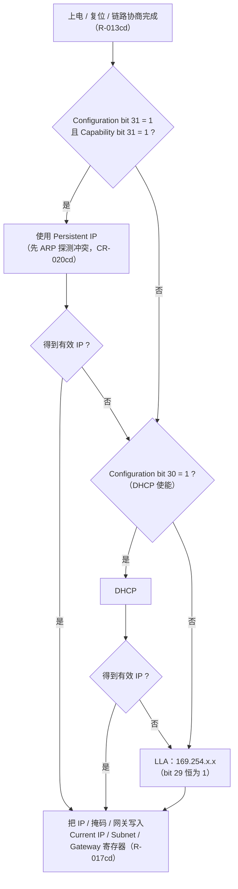
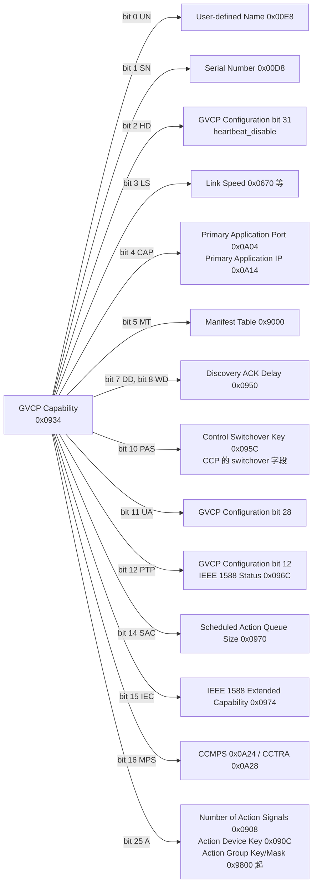
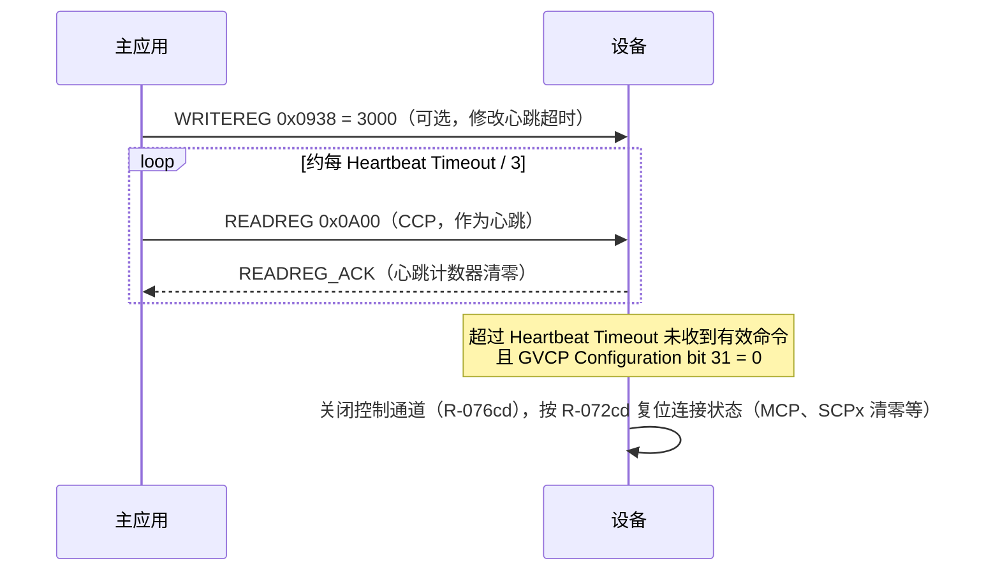
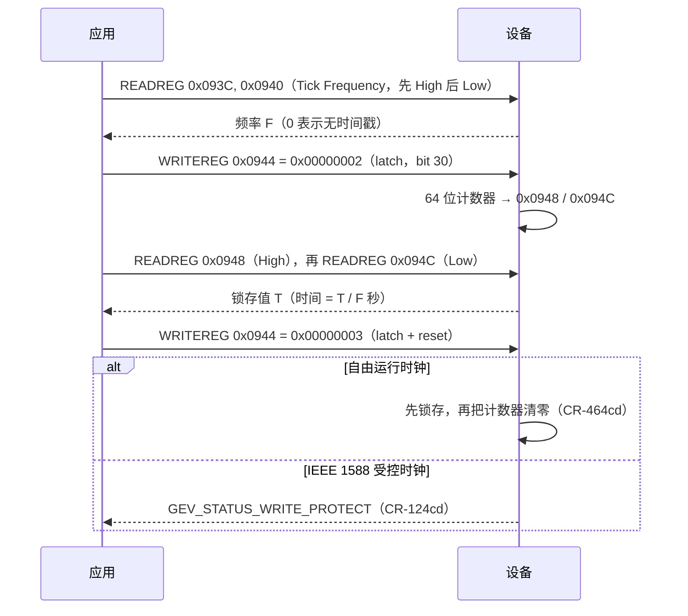
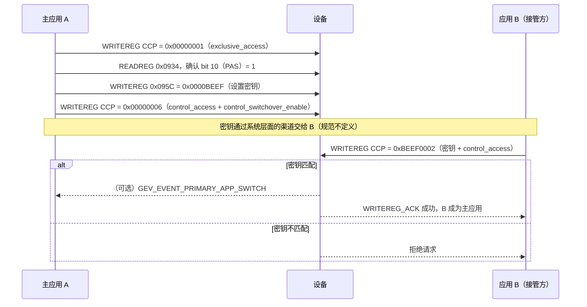
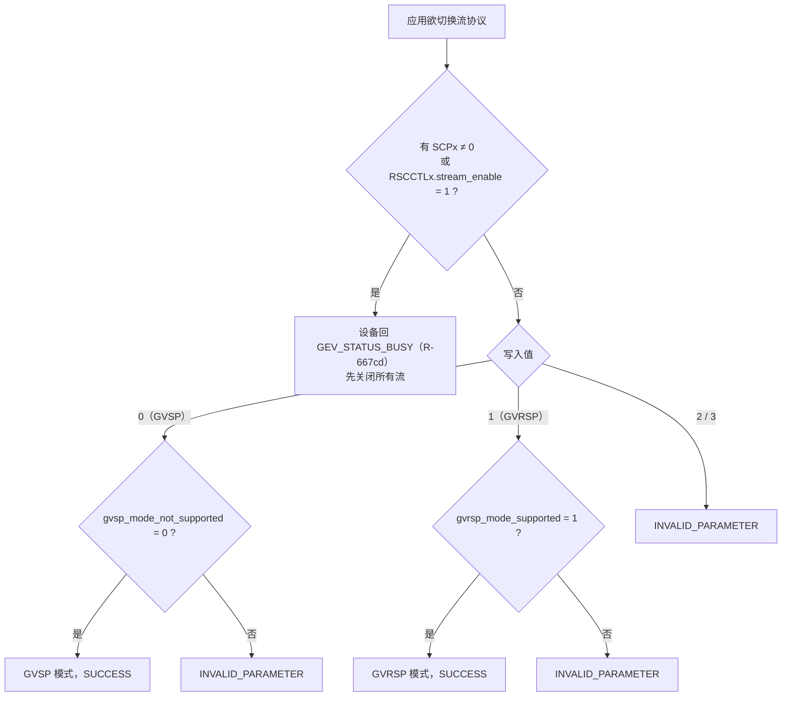
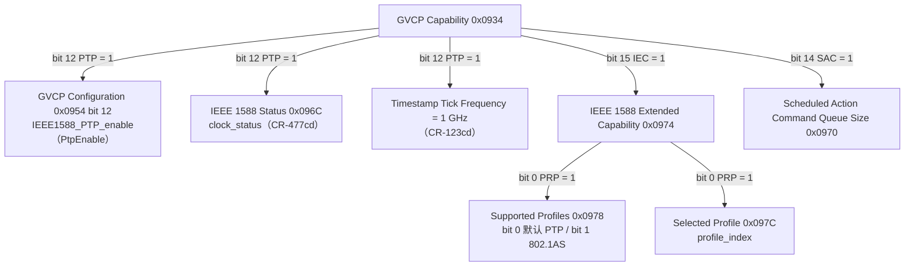

# 设备与网络类引导寄存器详解（§36.1–36.45）

> **覆盖范围**：Chapter 36 Bootstrap Registers 的 §36.1 Version Register 至 §36.45 IEEE 1588 Selected Profile Register（PDF p.269–312；§36.45 的位定义表延续到 p.312 页首）。地址总览与分组映射见 [01_overview_and_register_map.md](01_overview_and_register_map.md)；控制/消息/流通道等寄存器（§36.46–36.81）见 [03_channel_registers.md](03_channel_registers.md)。
>
> **一句话总结**：这 45 节定义了"设备是谁、有几个网口/通道、IP 怎么配、支持哪些可选功能、心跳/超时/时间戳/流协议/物理链路/IEEE 1588 怎么设"——其中 GVCP Capability（0x0934）、Streaming Capability（0x092C）、Message Channel Capability（0x0930）三个能力寄存器决定了应用后续能用哪些可选命令和寄存器。
>
> **约定提醒**：
> - 页码均为 PDF 页码（打印页码 = PDF 页码 − 1）。
> - 位编号沿用规范的 MSB-first：spec bit 0 = 最高位。位表中 "LSB0 掩码" 列给出常规 LSB-0 写法的 32 位掩码（spec bit n ↔ `1 << (31 − n)`，如 bit 0 → 0x80000000，bit 31 → 0x00000001），用于代码中 `value & mask`。
> - 所有引导寄存器大端序；多寄存器数值先访问低地址（High 在前）（[R-416cd]、[R-417ca]，见 [01](01_overview_and_register_map.md)）。
> - "💡 解读：" 为本知识库的理解或推论，非规范原文。
>
> **本文目录**
> - 核心要点 / 寄存器速查表
> - 设备身份：36.1 Version · 36.2 Device Mode
> - 网络接口：36.3 MAC Address · 36.4 Network Interface Capability · 36.5 Network Interface Configuration · 36.6 Current IP · 36.7 Current Subnet Mask · 36.8 Current Default Gateway
> - 字符串：36.9 Manufacturer Name · 36.10 Model Name · 36.11 Device Version · 36.12 Manufacturer Info · 36.13 Serial Number · 36.14 User-defined Name · 36.15 First URL · 36.16 Second URL
> - 数量与持久 IP：36.17 Number of Network Interfaces · 36.18–36.20 Persistent IP/Subnet/Gateway · 36.21 Link Speed · 36.22 Number of Message Channels · 36.23 Number of Stream Channels · 36.24 Number of Action Signals · 36.25 Action Device Key · 36.26 Number of Active Links
> - 能力：36.27 Streaming Capability · 36.28 Message Channel Capability · 36.29 GVCP Capability
> - 心跳/时间戳/发现：36.30 Heartbeat Timeout · 36.31 Timestamp Tick Frequency · 36.32 Timestamp Control · 36.33 Timestamp Value · 36.34 Discovery ACK Delay
> - 配置：36.35 GVCP Configuration · 36.36 Pending Timeout · 36.37 Control Switchover Key · 36.38 Streaming Configuration
> - 物理链路与 IEEE 1588：36.39 Physical Link Configuration Capability · 36.40 Physical Link Configuration · 36.41 IEEE 1588 Status · 36.42 Scheduled Action Command Queue Size · 36.43 IEEE 1588 Extended Capability · 36.44 IEEE 1588 Supported Profiles · 36.45 IEEE 1588 Selected Profile
> - 实现要点与易错点 / 相关章节 / 自测题

---

## 核心要点

- **Version（0x0000）**：v3.0 设备固定返回 0x00030000（高 16 位 major = 3，低 16 位 minor = 0）；2.2 设备返回 0x00020002（§36.1, p.269）。
- **Device Mode（0x0004）**：bit 0 已弃用且恒为 1（引导寄存器永远大端）；bit 1–3 为设备类别（0 发送端 / 1 接收端 / 2 收发端 / 3 外设）；bit 6–7 为当前物理链路配置；bit 24–31 为字符集（1 = UTF-8，2 = ASCII）（§36.2, p.270–271）。
- **每个网络接口一套寄存器**：MAC（High/Low）、Network Interface Capability/Configuration、Current IP/Subnet/Gateway、Persistent IP/Subnet/Gateway、Link Speed；接口 #0 必须有，#1–#3 视接口数而定，不存在的接口返回 `GEV_STATUS_INVALID_ADDRESS`；LAG 时这些寄存器反映的是聚合组的值（§36.3–36.8、§36.18–36.21）。
- **IP 配置位**：Capability 的 LLA（bit 29）与 DHCP（bit 30）恒为 1，Persistent IP（bit 31）可选；Configuration 中 LLA 恒为 1、DHCP 出厂为 1、Persistent IP 出厂为 0；bit 0/1 控制 PAUSE 帧收/发（§36.4–36.5, p.273–275）。
- **字符串寄存器**与 DISCOVERY_ACK、DNS-SD TXT 记录内容一致；Serial Number、User-defined Name 可选（由 GVCP Capability bit 1/bit 0 指示），User-defined Name 必须非易失保存；First/Second URL 即使有 Manifest Table 也必须实现（§36.9–36.16）。
- **数量寄存器**：网络接口 1–4（bit 29–31）、消息通道 0/1、流通道 0–512（v3.0 起不随流协议变化，[R-605cd]）、Action 信号 0–128、活动链路数 ≤ 接口数（§36.17、§36.22–36.26）。
- **三个能力寄存器**：Streaming Capability（v3.0 新增 `gvsp_mode_not_supported`/`gvrsp_mode_supported`）、Message Channel Capability、GVCP Capability（32 位逐位列出全部可选 GVCP 功能；bit 9/13/26/30 已弃用、在 v3.0 设备上恒为 1，因此 v3.0 设备的 GVCP Capability 至少为 0x00440022）（§36.27–36.29）。
- **心跳**：Heartbeat Timeout 默认 3000 ms（0x0BB8），小于 500 ms 的写入 SHOULD 被提升为 500 ms；可通过 GVCP Configuration bit 31 关闭心跳（需 GVCP Capability bit 2），控制通道关闭时该位须复位（[CR-571s]）（§36.30、§36.35）。
- **时间戳**：64 位 Tick Frequency（0 = 无时间戳；IEEE 1588 时固定 1 GHz）、只写的 Timestamp Control（bit 30 latch、bit 31 reset，同写时先锁存后复位）、锁存后的 Timestamp Value；PTP 受控时禁止复位（§36.31–36.33）。
- **Streaming Configuration（0x0960）**：`streaming_protocol`（bit 4–5）选择 0 = GVSP / 1 = GVRSP；有流通道打开时写入返回 `GEV_STATUS_BUSY`；非法组合按 Table 36-2 返回 `GEV_STATUS_INVALID_PARAMETER`（§36.38, p.304–306）。
- **其他**：Discovery ACK Delay 出厂 ≤ 1000 ms、可写时须持久保存（§36.34）；Pending Timeout 是发出 PENDING_ACK 前的最长执行时间（§36.36）；Control Switchover Key 为 16 位只写密钥（§36.37）；物理链路配置重启后生效（§36.39–36.40）；IEEE 1588 状态/扩展能力/支持与选用的 profile（§36.41–36.45）。

---

## 寄存器速查表

| 章节 | 地址 | 名称 | 长度 | 访问 | M/O | 出厂默认值 |
|---|---|---|---|---|---|---|
| [36.1](#sec-36-1) | 0x0000 | Version | 4 | R | M | 0x00030000 |
| [36.2](#sec-36-2) | 0x0004 | Device Mode | 4 | R | M | 设备相关 |
| [36.3](#sec-36-3) | 0x0008 / 0x000C（#0） | Device MAC Address High / Low | 4 / 4 | R | M（#0） | 设备相关 |
| [36.4](#sec-36-4) | 0x0010（#0） | Network Interface Capability | 4 | R | M（#0） | 设备相关 |
| [36.5](#sec-36-5) | 0x0014（#0） | Network Interface Configuration | 4 | R/W | M（#0） | 见说明（LLA = 1、DHCP = 1、PIP = 0） |
| [36.6](#sec-36-6) | 0x0024（#0） | Current IP Address | 4 | R | M（#0） | 0x00000000 |
| [36.7](#sec-36-7) | 0x0034（#0） | Current Subnet Mask | 4 | R | M（#0） | 0x00000000 |
| [36.8](#sec-36-8) | 0x0044（#0） | Current Default Gateway | 4 | R | M（#0） | 设备相关 |
| [36.9](#sec-36-9) | 0x0048 | Manufacturer Name | 32 | R | M | 设备相关 |
| [36.10](#sec-36-10) | 0x0068 | Model Name | 32 | R | M | 设备相关 |
| [36.11](#sec-36-11) | 0x0088 | Device Version | 32 | R | M | 设备相关 |
| [36.12](#sec-36-12) | 0x00A8 | Manufacturer Info | 48 | R | M | 设备相关 |
| [36.13](#sec-36-13) | 0x00D8 | Serial Number | 16 | R | O | 设备相关 |
| [36.14](#sec-36-14) | 0x00E8 | User-defined Name | 16 | R/W | O | 设备相关 |
| [36.15](#sec-36-15) | 0x0200 | First URL | 512 | R | M | 设备相关 |
| [36.16](#sec-36-16) | 0x0400 | Second URL | 512 | R | M | 设备相关 |
| [36.17](#sec-36-17) | 0x0600 | Number of Network Interfaces | 4 | R | M | 设备相关 |
| [36.18](#sec-36-18) | 0x064C（#0） | Persistent IP Address | 4 | R/W | O | 设备相关 |
| [36.19](#sec-36-19) | 0x065C（#0） | Persistent Subnet Mask | 4 | R/W | O | 设备相关 |
| [36.20](#sec-36-20) | 0x066C（#0） | Persistent Default Gateway | 4 | R/W | O | 设备相关 |
| [36.21](#sec-36-21) | 0x0670（#0） | Link Speed | 4 | R | O | 设备相关 |
| [36.22](#sec-36-22) | 0x0900 | Number of Message Channels | 4 | R | M | 设备相关 |
| [36.23](#sec-36-23) | 0x0904 | Number of Stream Channels | 4 | R | M | 设备相关 |
| [36.24](#sec-36-24) | 0x0908 | Number of Action Signals | 4 | R | O | 设备相关 |
| [36.25](#sec-36-25) | 0x090C | Action Device Key | 4 | W | O | 0 |
| [36.26](#sec-36-26) | 0x0910 | Number of Active Links | 4 | R | M | 设备相关 |
| [36.27](#sec-36-27) | 0x092C | Streaming Capability | 4 | R | M[1] | 设备相关 |
| [36.28](#sec-36-28) | 0x0930 | Message Channel Capability | 4 | R | M | 设备相关 |
| [36.29](#sec-36-29) | 0x0934 | GVCP Capability | 4 | R | M | 设备相关 |
| [36.30](#sec-36-30) | 0x0938 | Heartbeat Timeout | 4 | R/W | M | 3000 = 0x0BB8 |
| [36.31](#sec-36-31) | 0x093C / 0x0940 | Timestamp Tick Frequency High / Low | 4 / 4 | R | O | 设备相关 |
| [36.32](#sec-36-32) | 0x0944 | Timestamp Control | 4 | W | O | 0 |
| [36.33](#sec-36-33) | 0x0948 / 0x094C | Timestamp Value High / Low | 4 / 4 | R | M（表）/ optional（§36.33） | 0 |
| [36.34](#sec-36-34) | 0x0950 | Discovery ACK Delay | 4 | R/(W) | O | 设备相关（≤ 1 秒） |
| [36.35](#sec-36-35) | 0x0954 | GVCP Configuration | 4 | R/W | O | 见说明 |
| [36.36](#sec-36-36) | 0x0958 | Pending Timeout | 4 | R | M | 设备相关 |
| [36.37](#sec-36-37) | 0x095C | Control Switchover Key | 4 | W | O | 0 |
| [36.38](#sec-36-38) | 0x0960 | Streaming Configuration | 4 | R/W | M | 设备相关 |
| [36.39](#sec-36-39) | 0x0964 | Physical Link Configuration Capability | 4 | R | M | 设备相关 |
| [36.40](#sec-36-40) | 0x0968 | Physical Link Configuration | 4 | R/W（表中 R/(W)） | M | 设备相关 |
| [36.41](#sec-36-41) | 0x096C | IEEE 1588 Status | 4 | R | O | 0 |
| [36.42](#sec-36-42) | 0x0970 | Scheduled Action Command Queue Size | 4 | R | O | 设备相关 |
| [36.43](#sec-36-43) | 0x0974 | IEEE 1588 Extended Capability | 4 | R | O | 设备相关 |
| [36.44](#sec-36-44) | 0x0978 | IEEE 1588 Supported Profiles | 4 | R | O | 设备相关 |
| [36.45](#sec-36-45) | 0x097C | IEEE 1588 Selected Profile | 4 | R/W | O | 设备相关 |

（"设备相关" = 规范写 "Device-specific"。网络接口 #1–#3 的地址见 [01 的 5.B 节](01_overview_and_register_map.md)。）

---

## 36.1 Version 寄存器（§36.1, p.269–270）

表示设备实现的 GigE Vision 规范版本。v3.0 设备返回 0x00030000；上一版本 2.2 返回 0x00020002。应用可用它确认设备遵循的规范版本。

| 地址 | 长度 | 访问 | M/O | 出厂默认值 |
|---|---|---|---|---|
| 0x0000 | 4 字节 | R（Read） | M（[R-429cd]） | 0x00030000 |

| spec 位 | LSB0 掩码 | 名称 | 说明 |
|---|---|---|---|
| 0–15 | 0xFFFF0000 | major_version | 规范主版本号：3.0 → 3，2.1 → 2。对应 SFNC `DeviceTLVersionMajor` |
| 16–31 | 0x0000FFFF | minor_version | 规范次版本号：3.0 → 0，2.1 → 1。对应 SFNC `DeviceTLVersionMinor` |

- 映射表描述：高两字节为主版本号、低两字节为次版本号（p.248）。DISCOVERY_ACK 的 `spec_version_major`/`spec_version_minor` 即此寄存器（§16.1.2, p.122）。
- 💡 解读：`major = value >> 16; minor = value & 0xFFFF`。§36.38 的 NOTE 提醒：部分 GEV 2.x 应用看到"未知版本号"会直接报错，即使设备同时支持 GVSP 也可能无法互通（p.306）——应用端不宜对未知的更高版本一律拒绝。

## 36.2 Device Mode 寄存器（§36.2, p.270–271）

指示引导寄存器中字符串所用的字符集，以及链路配置、设备类别等设备相关信息。

| 地址 | 长度 | 访问 | M/O | 出厂默认值 |
|---|---|---|---|---|
| 0x0004 | 4 字节 | R | M（[R-430cd]） | 设备相关 |

| spec 位 | LSB0 掩码 | 名称 | 说明 |
|---|---|---|---|
| 0 | 0x80000000 | deprecated（原 endianness） | **恒为 1**。GigE Vision 1.x 中用于指示引导寄存器的字节序；2.0 起弃用，为向后兼容必须置 1；自 2.0 起引导寄存器总是大端 |
| 1–3 | 0x70000000 | device_class | 设备类别：0 = Transmitter（发送端）、1 = Receiver（接收端）、2 = Transceiver（收发端）、3 = Peripheral（外设），其他保留。对应 SFNC `DeviceType` |
| 4–5 | 0x0C000000 | reserved | 恒为 0，读时忽略 |
| 6–7 | 0x03000000 | current_link_configuration（CLC） | 当前物理链路配置：0 = Single Link、1 = Multiple Links、2 = Static LAG、3 = Dynamic LAG。NOTE：ML 与 LAG 同时使用时报告数值最大的那个 |
| 8–23 | 0x00FFFF00 | reserved | 恒为 0，读时忽略 |
| 24–31 | 0x000000FF | character_set_index | 字符集：0 = 保留、1 = UTF-8、2 = ASCII（为与 GenICam 兼容推荐使用）、其他保留。对应 SFNC `DeviceCharacterSet` |

- 💡 解读：解码公式 `device_class = (v >> 28) & 0x7`，`CLC = (v >> 24) & 0x3`，`charset = v & 0xFF`。例：0x80000002 = 发送端 + 单链路 + ASCII；0x90000002 = 接收端 + 单链路 + ASCII；0x83000001 = 发送端 + 动态 LAG + UTF-8。
- device_class 决定了映射表脚注 [1]/[2] 的适用性（例如外设不需要 Streaming Capability，[R-456cd]）；支持 GVRSP 的设备必须是 Transmitter（[CR-663cd]，§36.27）。
- CLC 反映"当前实际使用"的链路配置；下次重启要使用的配置由 Physical Link Configuration（0x0968，§36.40）设定，支持哪些配置看 0x0964（§36.39）。
- 本寄存器同时出现在 DISCOVERY_ACK 的 `device_mode` 字段（§16.1.2, p.122）。

## 36.3 Device MAC Address 寄存器（§36.3, p.271–273）

存储指定网络接口的 MAC 地址；如果使用链路聚合（LAG），则是聚合组使用的 MAC 地址。

- [R-431cd]：设备必须在其所有支持的网络接口上实现 Device MAC Address 寄存器，High、Low 两部分都必须存在；对不支持的网络接口必须返回 `GEV_STATUS_INVALID_ADDRESS`。
- 应用必须先访问 High 部分再访问 Low 部分（p.272）。

### 36.3.1 High Part（p.272）

| 地址 | 长度 | 访问 | M/O | 出厂默认值 |
|---|---|---|---|---|
| 0x0008（#0）、0x0680（#1，可选）、0x0700（#2，可选）、0x0780（#3，可选） | 4 字节 | R | #0 为 M | 设备相关 |

| spec 位 | LSB0 掩码 | 名称 | 说明 |
|---|---|---|---|
| 0–15 | 0xFFFF0000 | reserved | 恒为 0，读时忽略 |
| 16–31 | 0x0000FFFF | mac_address（高 2 字节） | MAC 地址的高 2 字节。对应 SFNC `GevMACAddress` |

### 36.3.2 Low Part（p.272–273）

| 地址 | 长度 | 访问 | M/O | 出厂默认值 |
|---|---|---|---|---|
| 0x000C（#0）、0x0684（#1，可选）、0x0704（#2，可选）、0x0784（#3，可选） | 4 字节 | R | #0 为 M | 设备相关 |

| spec 位 | LSB0 掩码 | 名称 | 说明 |
|---|---|---|---|
| 0–31 | 0xFFFFFFFF | mac_address（低 4 字节） | MAC 地址的低 4 字节。对应 SFNC `GevMACAddress` |

💡 解读：例如 MAC 00:0C:DF:12:34:56 → High = 0x0000000C，Low = 0xDF123456；48 位 MAC = `((uint64)(High & 0xFFFF) << 32) | Low`。DISCOVERY_ACK 中的 `device_MAC_address (high/low)` 字段布局与此完全相同（§16.1.2, p.122）。

## 36.4 Network Interface Capability 寄存器（§36.4, p.273–274）

指示指定网络接口支持的网络与 IP 配置方案，多个方案可同时支持；LAG 时为聚合组支持的方案。

- [R-432cd]：设备必须在所有支持的网络接口上实现本寄存器；不支持的接口返回 `GEV_STATUS_INVALID_ADDRESS`。

| 地址 | 长度 | 访问 | M/O | 出厂默认值 |
|---|---|---|---|---|
| 0x0010（#0）、0x0688（#1，可选）、0x0708（#2，可选）、0x0788（#3，可选） | 4 字节 | R | #0 为 M | 设备相关 |

| spec 位 | LSB0 掩码 | 名称 | 说明 |
|---|---|---|---|
| 0 | 0x80000000 | PAUSE_reception（PR） | 1 = 该接口能处理（接收）PAUSE 帧 |
| 1 | 0x40000000 | PAUSE_generation（PG） | 1 = 该接口能生成 PAUSE 帧 |
| 2–28 | 0x3FFFFFF8 | reserved | 恒为 0，读时忽略 |
| 29 | 0x00000004 | LLA（L） | 支持链路本地地址（Link-Local Address）。**恒为 1** |
| 30 | 0x00000002 | DHCP（D） | 支持 DHCP。**恒为 1** |
| 31 | 0x00000001 | Persistent_IP（P） | 支持 Persistent IP 时为 1，否则为 0 |

- 映射表描述：各位可"或"组合；其余位保留为 0；DHCP 与 LLA 位必须为 1（p.248）。
- 依据：设备必须支持 DHCP 与 LLA（[R-014cd]，§4, p.40）；Persistent IP 可选（§4.2）。PAUSE 是 GVCP 可选的流控手段之一（§8.1.4, p.65）。
- 💡 解读：因此本寄存器的最小值是 0x00000006。接口 #0 的本寄存器即 DISCOVERY_ACK 的 `IP_config_options` 字段。

## 36.5 Network Interface Configuration 寄存器（§36.5, p.274–275）

指示指定网络接口当前激活了哪些网络与 IP 配置方案；LAG 时为聚合组当前使用的方案。

- [R-433cd]：设备必须在所有支持的网络接口上实现本寄存器；不支持的接口返回 `GEV_STATUS_INVALID_ADDRESS`。

| 地址 | 长度 | 访问 | M/O | 出厂默认值 |
|---|---|---|---|---|
| 0x0014（#0）、0x068C（#1，可选）、0x070C（#2，可选）、0x078C（#3，可选） | 4 字节 | R/W | #0 为 M | 见下表各位说明 |

| spec 位 | LSB0 掩码 | 名称 | 说明 |
|---|---|---|---|
| 0 | 0x80000000 | PAUSE_reception（PR） | 置 1 使能本接口接收 PAUSE 帧。出厂值设备相关；不可配置时可硬编码。新设置在下一次链路协商时生效，且必须在设备复位后保持。对应 SFNC `GevPAUSEFrameReception` |
| 1 | 0x40000000 | PAUSE_generation（PG） | 置 1 使能本接口发送 PAUSE 帧。出厂值、生效与持久性规则同上。对应 SFNC `GevPAUSEFrameTransmission` |
| 2–28 | 0x3FFFFFF8 | reserved | 恒为 0，读时忽略 |
| 29 | 0x00000004 | LLA（L） | LLA 已激活。**恒为 1**（映射表：只读）。对应 SFNC `GevCurrentIPConfigurationLLA` |
| 30 | 0x00000002 | DHCP（D） | 本接口激活 DHCP。**出厂值 1**。对应 SFNC `GevCurrentIPConfigurationDHCP` |
| 31 | 0x00000001 | Persistent_IP（P） | 本接口激活 Persistent IP。**出厂值 0**。对应 SFNC `GevCurrentIPConfigurationPersistentIP` |

与第 4 章（IP 配置）的配合（§4.1–4.4, p.40–47）：

- IP 配置顺序必须是 Persistent IP（若支持且使能）→ DHCP（若使能）→ LLA（[R-015cd]）；出厂必须禁用 Persistent IP、使能 DHCP，LLA 始终使能（[R-016cd]）；LLA 不可禁用（[R-029cd]）。
- DHCP 使能标志 SHOULD 存在非易失存储中，表示"下次设备复位时"是否启用 DHCP（[O-022cd]）；没有这块存储时设备必须当作 DHCP 永远使能（[CR-025cd]）。
- PAUSE 配置若支持，必须在设备复位后保持（[CR-053cd]，§8.1.4, p.65）。
- 💡 解读：出厂值通常为 0x00000006（LLA + DHCP；若厂商默认开启 PAUSE 还要加上 0x80000000/0x40000000）。写入 D/P 位不会立刻改变当前 IP，而是在下一次 IP 配置周期（上电、复位或链路重新协商后，[R-013cd]）生效；若想立即重走 IP 配置流程，可复位设备，或在没有应用持有控制权时发送 `static_IP = 0` 的 FORCEIP_CMD（[R-150cd]、[R-151cd]，§16.2）。
- 接口 #0 的本寄存器即 DISCOVERY_ACK 的 `IP_config_current` 字段。

## 36.6 Current IP Address 寄存器（§36.6, p.275–276）

报告指定网络接口配置完成后的 IP 地址；LAG 时为聚合组使用的 IP 地址。

- [R-434cd]：设备必须在所有支持的网络接口上支持本寄存器；不支持的接口返回 `GEV_STATUS_INVALID_ADDRESS`。

| 地址 | 长度 | 访问 | M/O | 出厂默认值 |
|---|---|---|---|---|
| 0x0024（#0）、0x069C（#1，可选）、0x071C（#2，可选）、0x079C（#3，可选） | 4 字节 | R | #0 为 M | 0x00000000 |

| spec 位 | LSB0 掩码 | 名称 | 说明 |
|---|---|---|---|
| 0–31 | 0xFFFFFFFF | IPv4_address | 本网络接口的 IP 地址。对应 SFNC `GevCurrentIPAddress` |

- [R-017cd]（§4.1, p.42）：一旦分配到有效 IP，相关信息必须复制到对应引导寄存器。⚠️ 规范该条把 0x0024 写成 "Persistent IP Address (address 0x0024 …)"，但 0x0024 实为 Current IP Address，应为笔误。
- 💡 解读：IPv4 按网络字节序存放，192.168.1.10 → 0xC0A8010A。LLA 地址范围为 169.254.1.0–169.254.254.255（§4.4, p.47）。FORCEIP_CMD 设置的静态 IP 也会体现在这里，但重启后丢失（§4.1, p.41）。

## 36.7 Current Subnet Mask 寄存器（§36.7, p.276–277）

提供指定网络接口的子网掩码；LAG 时为聚合组使用的子网掩码。

- [R-435cd]：设备必须在所有支持的网络接口上支持本寄存器；不支持的接口返回 `GEV_STATUS_INVALID_ADDRESS`。

| 地址 | 长度 | 访问 | M/O | 出厂默认值 |
|---|---|---|---|---|
| 0x0034（#0）、0x06AC（#1，可选）、0x072C（#2，可选）、0x07AC（#3，可选） | 4 字节 | R | #0 为 M | 0x00000000 |

| spec 位 | LSB0 掩码 | 名称 | 说明 |
|---|---|---|---|
| 0–31 | 0xFFFFFFFF | IPv4_subnet_mask | 本网络接口的子网掩码。对应 SFNC `GevCurrentSubnetMask` |

## 36.8 Current Default Gateway 寄存器（§36.8, p.277）

指示指定网络接口的默认网关 IP 地址；LAG 时为聚合组使用的默认网关。

- [R-436cd]：设备必须在所有支持的网络接口上支持本寄存器；不支持的接口返回 `GEV_STATUS_INVALID_ADDRESS`。

| 地址 | 长度 | 访问 | M/O | 出厂默认值 |
|---|---|---|---|---|
| 0x0044（#0）、0x06BC（#1，可选）、0x073C（#2，可选）、0x07BC（#3，可选） | 4 字节 | R | #0 为 M | 设备相关 |

| spec 位 | LSB0 掩码 | 名称 | 说明 |
|---|---|---|---|
| 0–31 | 0xFFFFFFFF | IPv4_default_gateway | 本网络接口的默认网关。对应 SFNC `GevCurrentDefaultGateway` |

- 注意：规范给本寄存器的出厂默认值是 "Device-specific"，而 Current IP/Subnet Mask 是 0x00000000（p.276–277），原文如此。
- DISCOVERY_ACK 中 `current_IP`、`current_subnet_mask`、`default_gateway` 必须等于 IP 配置得到的值（[R-032cd]，§5.1.1, p.49）。

## 36.9 Manufacturer Name 寄存器（§36.9, p.277–278）

存放厂商名称字符串，使用 Device Mode 指定的字符集。

| 地址 | 长度 | 访问 | M/O | 出厂默认值 |
|---|---|---|---|---|
| 0x0048 | 32 字节 | R | M（[R-437cd]） | 设备相关 |

| spec 位 | LSB0 掩码 | 名称 | 说明 |
|---|---|---|---|
| —（字符串） | — | manufacturer_name | 厂商名称字符串。在 DISCOVERY_ACK 和 DNS-SD 的 TXT 记录中返回。对应 SFNC `DeviceVendorName` |

## 36.10 Model Name 寄存器（§36.10, p.278）

存放设备型号字符串，使用 Device Mode 指定的字符集。

| 地址 | 长度 | 访问 | M/O | 出厂默认值 |
|---|---|---|---|---|
| 0x0068 | 32 字节 | R | M（[R-438cd]） | 设备相关 |

| spec 位 | LSB0 掩码 | 名称 | 说明 |
|---|---|---|---|
| —（字符串） | — | model_name | 设备型号字符串。在 DISCOVERY_ACK 和 DNS-SD 的 TXT 记录中返回。对应 SFNC `DeviceModelName` |

## 36.11 Device Version 寄存器（§36.11, p.278–279）

存放设备版本字符串，使用 Device Mode 指定的字符集。XML 设备描述文件也应提供这一信息，以确认设备与描述文件匹配。

- NOTE：本寄存器用于识别设备版本，因此任何 form-fit-function 变化（硬件或固件）都应使本寄存器的值改变（p.279）。

| 地址 | 长度 | 访问 | M/O | 出厂默认值 |
|---|---|---|---|---|
| 0x0088 | 32 字节 | R | M（[R-439cd]） | 设备相关 |

| spec 位 | LSB0 掩码 | 名称 | 说明 |
|---|---|---|---|
| —（字符串） | — | device_version | 设备版本字符串。在 DISCOVERY_ACK 和 DNS-SD 的 TXT 记录中返回。对应 SFNC `DeviceVersion` |

## 36.12 Manufacturer Info 寄存器（§36.12, p.279–280）

存放厂商自定义的附加设备信息字符串，使用 Device Mode 指定的字符集。

| 地址 | 长度 | 访问 | M/O | 出厂默认值 |
|---|---|---|---|---|
| 0x00A8 | 48 字节 | R | M（[R-440cd]） | 设备相关 |

| spec 位 | LSB0 掩码 | 名称 | 说明 |
|---|---|---|---|
| —（字符串） | — | manufacturer_specific_information | 设备的附加信息字符串。在 DISCOVERY_ACK 和 DNS-SD 的 TXT 记录中返回。对应 SFNC `DeviceManufacturerInfo` |

## 36.13 Serial Number 寄存器（§36.13, p.280）

可选寄存器，存放设备序列号字符串（Device Mode 指定的字符集）。应用可检查 GVCP Capability（0x0934）**bit 1** 判断是否支持。

| 地址 | 长度 | 访问 | M/O | 出厂默认值 |
|---|---|---|---|---|
| 0x00D8（可选） | 16 字节 | R | O（[O-441cd]：SHOULD 实现） | 设备相关 |

| spec 位 | LSB0 掩码 | 名称 | 说明 |
|---|---|---|---|
| —（字符串） | — | serial_number | 设备序列号。若支持，在 DISCOVERY_ACK 和 DNS-SD 的 TXT 记录中返回。对应 SFNC `DeviceSerialNumber` |

- 不支持时，DISCOVERY_ACK 的 `serial_number` 字段全为 NULL（映射表，p.250）；READMEM 访问应得到 `GEV_STATUS_INVALID_ADDRESS` 且 length = 0（[CR-425cd]）。
- 相关：[O-034cd] 建议设备外壳上贴有序列号与 MAC 地址标签，便于与发现列表对应（§5.1.3, p.49）。

## 36.14 User-defined Name 寄存器（§36.14, p.280–281）

可选寄存器，存放用户可编程的设备名称字符串（Device Mode 指定的字符集）。应用可检查 GVCP Capability（0x0934）**bit 0** 判断是否支持。

- [CR-443cd]：支持本寄存器时，设备必须提供持久存储来记住用户定义名；该名称必须在上电重启后仍可读出；应用一旦设置本寄存器，其值即写入非易失存储。

| 地址 | 长度 | 访问 | M/O | 出厂默认值 |
|---|---|---|---|---|
| 0x00E8（可选） | 16 字节 | R/W | O（[O-442cd]：SHOULD 实现） | 设备相关 |

| spec 位 | LSB0 掩码 | 名称 | 说明 |
|---|---|---|---|
| —（字符串） | — | user_defined_name | 设备名称字符串。若支持，在 DISCOVERY_ACK 和 DNS-SD 的 TXT 记录中返回。对应 SFNC `DeviceUserID` |

- 不支持时 DISCOVERY_ACK 的 `user_defined_name` 字段全为 NULL（映射表，p.251）；WRITEMEM 写入应得到 `GEV_STATUS_INVALID_ADDRESS` 且 index = 0（[CR-426cd]）。
- 💡 解读：应用通常用 WRITEMEM 一次写入 16 字节（不足补 NULL），写入需要控制权（CCP）。它是多相机系统中区分同型号设备的常用手段。

## 36.15 First URL 寄存器（§36.15, p.281）

存放 XML 设备描述文件的第一个 URL（Device Mode 指定的字符集）。除非设备提供 Manifest Table，应用应优先使用 First URL 获取 XML。

| 地址 | 长度 | 访问 | M/O | 出厂默认值 |
|---|---|---|---|---|
| 0x0200 | 512 字节 | R | M（[R-444cd]：即使有 Manifest Table 也必须实现） | 设备相关 |

| spec 位 | LSB0 掩码 | 名称 | 说明 |
|---|---|---|---|
| —（字符串） | — | first_URL | XML 设备描述文件的第一个 URL |

URL 的三种形式（§14.1.1–14.1.3, p.95–98；URI 语法遵循 RFC3986）：

| 形式 | 含义 | 示例（规范原例） |
|---|---|---|
| `local:<filename>.<extension>;<address>;<length>` | XML 存在设备非易失存储中；地址、长度为十六进制 | `local:acme_titan_rev1.zip;1C400;A000`（位于 0x1C400、长 0xA000 字节的 ZIP） |
| `http://www.<manufacturer.com>/<path>/<filename>.<extension>` | 从厂商网站下载 | `http://www.acme.com/camera/acme_titan_rev1.xml` |
| `file:<filename>.<extension>` | 在应用主机的本地目录中 | `file:acme_titan_rev1.zip` |

- 扩展名 `xml` = 未压缩文本，`zip` = ZIP 压缩（只允许 DEFLATE/STORE，XML 必须是 ZIP 中的第一个文件）（§14.1, p.94–95）；XML 内容变化时文件名必须改变（[R-532cd]）；设备内存中的 XML 起始地址必须 32 位对齐（[R-119cd]）。
- 一个 512 字节的 URL 寄存器可以用一次 READMEM 读完（§14.1, p.95）。

## 36.16 Second URL 寄存器（§36.16, p.282）

存放 XML 设备描述文件的第二个 URL（Device Mode 指定的字符集），在应用用 First URL 获取失败时作为备选。

| 地址 | 长度 | 访问 | M/O | 出厂默认值 |
|---|---|---|---|---|
| 0x0400 | 512 字节 | R | M（[R-445cd]：即使有 Manifest Table 也必须实现） | 设备相关 |

| spec 位 | LSB0 掩码 | 名称 | 说明 |
|---|---|---|---|
| —（字符串） | — | second_URL | XML 设备描述文件的第二个 URL |

- [R-121ca]：设备不支持 Manifest Table 时，应用必须退回使用 First/Second URL——先试 First URL，失败再用 Second URL（§14.1.4, p.98）。
- [R-122ca]：设备提供 Manifest Table 时，应用必须优先使用 Manifest Table（GVCP Capability bit 5，见 §36.29）。

## 36.17 Number of Network Interfaces 寄存器（§36.17, p.282–283）

指示设备支持的网络接口数。一般等于设备上以太网接口的个数，但使用链路聚合时，被聚合器归并的多个物理接口只算一个虚拟接口。

| 地址 | 长度 | 访问 | M/O | 出厂默认值 |
|---|---|---|---|---|
| 0x0600 | 4 字节 | R | M（[R-446cd]） | 设备相关 |

| spec 位 | LSB0 掩码 | 名称 | 说明 |
|---|---|---|---|
| 0–28 | 0xFFFFFFF8 | reserved | 恒为 0，读时忽略 |
| 29–31 | 0x00000007 | number_of_interfaces | 网络接口数，取值 1–4，其他值无效。对应 SFNC `GevInterfaceSelector` 的条目数 |

- 设备至少要有 1 个网络接口（主接口 = #0），最多 4 个（p.282；另见 [R-001cd]、[R-003cd]，§3, p.35）。
- **只有接口 #0 支持 GVCP**；其他接口只承载流通道，用于提升设备的输出带宽（p.282）。

## 36.18 Persistent IP Address 寄存器（§36.18, p.283–284）

可选寄存器，指示指定网络接口的持久（Persistent）IP 地址，仅在设备以 Persistent IP 方案启动时使用；LAG 时为聚合组使用的持久 IP。

- [CR-447cd]：支持 Persistent IP 时，设备必须在所有支持的网络接口上实现本寄存器；不支持的接口返回 `GEV_STATUS_INVALID_ADDRESS`。

| 地址 | 长度 | 访问 | M/O | 出厂默认值 |
|---|---|---|---|---|
| 0x064C（#0）、0x06CC（#1）、0x074C（#2）、0x07CC（#3），均为可选 | 4 字节 | R/W | O | 设备相关 |

| spec 位 | LSB0 掩码 | 名称 | 说明 |
|---|---|---|---|
| 0–31 | 0xFFFFFFFF | persistent_IP_address | 本网络接口的 IPv4 持久 IP 地址。对应 SFNC `GevPersistentIPAddress` |

## 36.19 Persistent Subnet Mask 寄存器（§36.19, p.284）

可选寄存器，指示与持久 IP 地址配套的子网掩码，仅在 Persistent IP 方案启动时使用；LAG 时为聚合组使用的值。

- [CR-448cd]：支持 Persistent IP 时，设备必须在所有支持的网络接口上实现本寄存器；不支持的接口返回 `GEV_STATUS_INVALID_ADDRESS`。

| 地址 | 长度 | 访问 | M/O | 出厂默认值 |
|---|---|---|---|---|
| 0x065C（#0）、0x06DC（#1）、0x075C（#2）、0x07DC（#3），均为可选 | 4 字节 | R/W | O | 设备相关 |

| spec 位 | LSB0 掩码 | 名称 | 说明 |
|---|---|---|---|
| 0–31 | 0xFFFFFFFF | persistent_subnet_mask | 本网络接口的 IPv4 持久子网掩码。对应 SFNC `GevPersistentSubnetMask` |

## 36.20 Persistent Default Gateway 寄存器（§36.20, p.284–285）

可选寄存器，指示指定网络接口的持久默认网关，仅在 Persistent IP 方案启动时使用；LAG 时为聚合组使用的值。

- [CR-449cd]：支持 Persistent IP 时，设备必须在所有支持的网络接口上实现本寄存器；不支持的接口返回 `GEV_STATUS_INVALID_ADDRESS`。

| 地址 | 长度 | 访问 | M/O | 出厂默认值 |
|---|---|---|---|---|
| 0x066C（#0）、0x06EC（#1）、0x076C（#2）、0x07EC（#3），均为可选 | 4 字节 | R/W | O | 设备相关 |

| spec 位 | LSB0 掩码 | 名称 | 说明 |
|---|---|---|---|
| 0–31 | 0xFFFFFFFF | persistent_default_gateway | 本网络接口的 IPv4 持久默认网关。对应 SFNC `GevPersistentDefaultGateway` |

Persistent IP 三件套的共同规则（§4.2, p.42–43；§16.2）：

- 是否支持看对应接口 Network Interface Capability 的 bit 31；是否启用看 Network Interface Configuration 的 bit 31（§4.2, p.42–43）。
- 支持 Persistent IP 必须使用这些引导寄存器，并提供非易失存储（[CR-018cd]）；三个值必须存入非易失存储，且应用一写入就立即保存（[CR-019cd]）。
- 接口配置为 Persistent IP 时，不允许使用 0.0.0.0 或 255.255.255.255；若配置无效，设备转入下一个 IP 配置方案（§4.2 NOTE, p.43）。
- 使用前必须用 ARP 探测地址冲突，冲突则不得使用并转入下一方案（[CR-020cd]）。
- FORCEIP_CMD 不得修改任何 Persistent IP 配置（[R-604cd]，§16.2.1）；当设备被配置了一个"不明"的持久 IP 时，可以先用 FORCEIP_CMD 临时接管，再改写或禁用这些寄存器（§4.2, p.43）。

## 36.21 Link Speed 寄存器（§36.21, p.285–286）

可选寄存器，给出指定网络接口的以太网链路速率（Mbit/s），可用于计算传输速度；LAG 时为聚合器内所有链路的总速率。应用可检查 GVCP Capability（0x0934）**bit 3** 判断是否支持。

- [CR-450cd]：支持 Link Speed 寄存器时，设备必须在所有支持的网络接口上各实现一个；不支持的接口返回 `GEV_STATUS_INVALID_ADDRESS`。例如只有一个网络接口的设备只需支持接口 #0 的 Link Speed（p.285）。

| 地址 | 长度 | 访问 | M/O | 出厂默认值 |
|---|---|---|---|---|
| 0x0670（#0）、0x06F0（#1）、0x0770（#2）、0x07F0（#3），均为可选 | 4 字节 | R | O | 设备相关 |

| spec 位 | LSB0 掩码 | 名称 | 说明 |
|---|---|---|---|
| 0–31 | 0xFFFFFFFF | link_speed | 以太网链路速率（Mbps）；链路断开时为 0。对应 SFNC `DeviceLinkSpeed` |

- 示例（p.285）：1 Gbit/s = 1000；10 GigE = 10 000。

## 36.22 Number of Message Channels 寄存器（§36.22, p.286–287）

报告设备支持的消息通道（Message Channel）数量。设备最多支持 1 个消息通道，也允许一个都不支持。

| 地址 | 长度 | 访问 | M/O | 出厂默认值 |
|---|---|---|---|---|
| 0x0900 | 4 字节 | R | M（[R-451cd]） | 设备相关 |

| spec 位 | LSB0 掩码 | 名称 | 说明 |
|---|---|---|---|
| 0–31 | 0xFFFFFFFF | number_of_message_channels | 设备支持的消息通道数，只能是 0 或 1。对应 SFNC `DeviceEventChannelCount` |

- 与第 12 章一致：设备必须提供一个或零个消息通道（[R-096cd]，§12, p.89）。为 0 时，消息通道寄存器 0x0B00–0x0B20 都不存在。

## 36.23 Number of Stream Channels 寄存器（§36.23, p.287–288）

报告设备支持的流通道（Stream Channel）数量。每个流通道可用于 GVSP、GVRSP 或两者（取决于设备能力）；所有流通道使用的流协议由 Streaming Configuration 的 `streaming_protocol` 字段统一选择。支持的流通道数是固定的，而"当前激活"的流通道数取决于配置，通过 GenICam 接口报告；应用可以打开任何一个"支持的"流通道，不论它当前是否激活（p.287）。

| 地址 | 长度 | 访问 | M/O | 出厂默认值 |
|---|---|---|---|---|
| 0x0904 | 4 字节 | R | M（[R-452cd]） | 设备相关 |

| spec 位 | LSB0 掩码 | 名称 | 说明 |
|---|---|---|---|
| 0–31 | 0xFFFFFFFF | number_of_stream_channels | 设备支持的流通道数，取值 0–512。对应 SFNC `DeviceStreamChannelCount` |

- [R-605cd]（v3.0 新增）：设备支持的流通道数必须保持不变，不随所选流协议或其他任何设备配置而变化。
- 💡 解读：因此应用可以在读一次 0x0904 后，按 `0x0D00 + 0x40·x`（x < 该值）安全地枚举所有流通道的寄存器块，而不必担心切换 GVSP/GVRSP 后通道数改变。

## 36.24 Number of Action Signals 寄存器（§36.24, p.288）

可选寄存器，报告设备支持的 action 信号数量。

- [CR-453cd]：设备支持 Action 命令时，必须实现本寄存器。

| 地址 | 长度 | 访问 | M/O | 出厂默认值 |
|---|---|---|---|---|
| 0x0908（可选） | 4 字节 | R | O | 设备相关 |

| spec 位 | LSB0 掩码 | 名称 | 说明 |
|---|---|---|---|
| 0–31 | 0xFFFFFFFF | number_of_action_signals | 设备支持的 action 信号数，取值 0–128。对应 SFNC `ActionSelector` 的最大值 |

- 是否支持 Action 命令看 GVCP Capability bit 25（ACTION）。每个 action 信号 x 对应一对 ACTION_GROUP_KEYx（0x9800 + 0x10·x）/ACTION_GROUP_MASKx（0x9804 + 0x10·x）寄存器（§36.80–36.81，见 [03](03_channel_registers.md)）。

## 36.25 Action Device Key 寄存器（§36.25, p.288–289）

可选寄存器，提供用于校验 Action 命令合法性的设备密钥。它被设计为**只写**，以便在 CCP 不处于独占访问模式时隐藏密钥：意图是让主应用（Primary Application）拥有绝对控制权——主应用可以把密钥交给次级应用（Secondary Application），从而阻止流氓应用利用 ACTION_CMD 机制（p.288）。

- [CR-454cd]：设备支持 Action 命令时，必须实现本寄存器。

| 地址 | 长度 | 访问 | M/O | 出厂默认值 |
|---|---|---|---|---|
| 0x090C（可选） | 4 字节 | W（Write-only） | O | 0 |

| spec 位 | LSB0 掩码 | 名称 | 说明 |
|---|---|---|---|
| 0–31 | 0xFFFFFFFF | action_device_key | 用于校验 Action 命令合法性的设备密钥。对应 SFNC `ActionDeviceKey` |

- ACTION_CMD 中的 `device_key` 必须等于本寄存器的值，设备才可能断言 action 信号（§14.3 Table 14-2 条件 2, p.104）。
- 读取本寄存器应得到 `GEV_STATUS_ACCESS_DENIED`（[R-423cd]）。💡 解读：应用无法回读确认密钥，必须自己记住写入的值。

## 36.26 Number of Active Links 寄存器（§36.26, p.289–290）

指示当前活动链路数。链路一旦与另一台以太网设备连接（即以太网链路协商完成后）就被视为活动。

| 地址 | 长度 | 访问 | M/O | 出厂默认值 |
|---|---|---|---|---|
| 0x0910 | 4 字节 | R | M（[R-455cd]） | 设备相关 |

| spec 位 | LSB0 掩码 | 名称 | 说明 |
|---|---|---|---|
| 0–28 | 0xFFFFFFF8 | reserved | 恒为 0，读时忽略 |
| 29–31 | 0x00000007 | number_of_active_links | 活动链路数，必须 ≤ Number of Network Interfaces（0x0600）。只有一个网络接口的设备应报告 1 |

- 💡 解读：在 ML 或 LAG 配置下，应用可以对比 0x0910 与 0x0600 判断是否有物理链路掉线（例如 LAG 中某一根网线被拔掉时，聚合组仍然可用，但活动链路数会减少）。

## 36.27 Streaming Capability 寄存器（§36.27, p.290–291）

报告设备支持的可选流通道特性。在规范早期版本中，本寄存器叫 **GVSP Capability**。

| 地址 | 长度 | 访问 | M/O | 出厂默认值 |
|---|---|---|---|---|
| 0x092C | 4 字节 | R | M[1]（[R-456cd]：发送端/接收端/收发端设备必须实现） | 设备相关 |

| spec 位 | LSB0 掩码 | 名称 | 说明 |
|---|---|---|---|
| 0 | 0x80000000 | SCSPx_supported（SP） | 所有支持的流通道都提供 SCSPx（流通道源端口）寄存器。**仅支持 GVRSP 时不得置位** |
| 1 | 0x40000000 | deprecated | **恒为 0**。旧版用作 `legacy_16bit_block_id_supported` |
| 2 | 0x20000000 | SCMBSx_supported（BS） | 所有支持的 GVSP 流通道都提供 SCMBSx（流通道最大块大小）寄存器 |
| 3 | 0x10000000 | SCEBAx_supported（EB） | 所有支持的流通道都提供 SCEBAx（流通道扩展引导地址）寄存器。**支持 GVRSP 时必须置位** |
| 4 | 0x08000000 | gvsp_mode_not_supported（GP） | 设备**不**支持 GVSP 流传输协议 |
| 5 | 0x04000000 | gvrsp_mode_supported（RP） | 设备支持 GVRSP 流传输协议 |
| 6–31 | 0x03FFFFFF | reserved | 恒为 0，读时忽略 |

相关要求（p.291，除注明外均为 v3.0 新增）：

- [R-606s]：`gvsp_mode_not_supported` 未置位时，发送/接收/收发设备必须至少支持 Table 25-1 列出的一种 GVSP 载荷类型。
- [R-607s]：发送/接收/收发设备必须至少支持一种流协议——GVSP（GP 位为 0）或 GVRSP（RP 位为 1）。
- [CR-663cd]：支持 GVRSP 的设备必须是 Transmitter（Device Mode 的 device_class）。
- [CR-664cd]：只支持 GVRSP（GP = 1 且 RP = 1）的设备不得置位 `SCSPx_supported`。
- [CR-665cd]：支持 GVRSP（RP = 1）的设备必须置位 `SCEBAx_supported`。
- 另：只支持 GVRSP 的设备不得置位 GVCP Capability 的 PACKETRESEND 位（[CR-666cd]，§36.29），也不得置位 SCCx 的 `unconditional_streaming_supported`（[CR-616cd]，§11.13, p.88）。

GP/RP 组合的含义：

| GP（bit 4） | RP（bit 5） | 含义 | streaming_protocol 出厂值（§36.38） |
|---|---|---|---|
| 0 | 0 | 只支持 GVSP（与 2.x 设备相同） | 0 |
| 0 | 1 | GVSP + GVRSP 双模 | 0 |
| 1 | 1 | 只支持 GVRSP | 1 |
| 1 | 0 | 两种都不支持——对发送/接收/收发设备违反 [R-607s] | — |

💡 解读：GVSP 用"否定"语义的 `gvsp_mode_not_supported` 而不是 "gvsp_supported"，是为了向后兼容——2.x 及更早的设备这些位是保留位、读出 0，正好被解释为"支持 GVSP、不支持 GVRSP"。

## 36.28 Message Channel Capability 寄存器（§36.28, p.291–292）

报告设备支持的可选消息通道特性。

| 地址 | 长度 | 访问 | M/O | 出厂默认值 |
|---|---|---|---|---|
| 0x0930 | 4 字节 | R | M（[R-457cd]） | 设备相关 |

| spec 位 | LSB0 掩码 | 名称 | 说明 |
|---|---|---|---|
| 0 | 0x80000000 | MCSP_supported（SP） | 消息通道提供 MCSP（Message Channel Source Port，0x0B1C）寄存器 |
| 1 | 0x40000000 | MCCFG_supported（CC） | 消息通道提供 MCCFG（Message Channel Configuration，0x0B20）寄存器 |
| 2 | 0x20000000 | MCEC_supported（EC） | 支持在 EVENTDATA_CMD 消息中拼接多个事件。注意要拼接还必须支持 "MCC" |
| 3–31 | 0x1FFFFFFF | reserved | 恒为 0，读时忽略 |

- 💡 解读：bit 2 说明中的 "MCC" 是 MCCFG 的旧称（2.2 版将 MCC 更名为 MCCFG，附录 D, p.415）；也就是说要使用事件拼接，bit 1 也应为 1，并由应用置位 MCCFG 的 `MCEC_enable`（§36.56，见 [03](03_channel_registers.md)）。

## 36.29 GVCP Capability 寄存器（§36.29, p.292–294）

报告设备在控制通道上支持的可选 GVCP 命令和可选引导寄存器。其中一部分功能在支持时还需要通过 GVCP Configuration 寄存器（0x0954）使能。**这是判断"设备支持哪些可选功能"的关键寄存器。**

| 地址 | 长度 | 访问 | M/O | 出厂默认值 |
|---|---|---|---|---|
| 0x0934 | 4 字节 | R | M（[R-458cd]） | 设备相关 |

| spec 位 | LSB0 掩码 | 名称 | 说明 |
|---|---|---|---|
| 0 | 0x80000000 | user_defined_name（UN） | 支持 User-defined Name 寄存器（0x00E8） |
| 1 | 0x40000000 | serial_number（SN） | 支持 Serial Number 寄存器（0x00D8） |
| 2 | 0x20000000 | heartbeat_disable（HD） | 心跳可以被关闭（通过 GVCP Configuration bit 31）。对应 SFNC `DeviceLinkHeartbeatMode` |
| 3 | 0x10000000 | link_speed_register（LS） | 支持 Link Speed 寄存器 |
| 4 | 0x08000000 | CCP_application_port_IP_register（CAP） | 支持 Primary Application Port（0x0A04）与 Primary Application IP Address（0x0A14）寄存器 |
| 5 | 0x04000000 | manifest_table（MT） | 支持 Manifest Table；支持时应用必须用 Manifest Table 获取 XML |
| 6 | 0x02000000 | test_data（TD） | GVSP 测试包（test packet）用 LFSR 生成器的数据填充 |
| 7 | 0x01000000 | discovery_ACK_delay（DD） | 支持 Discovery ACK Delay 寄存器（0x0950） |
| 8 | 0x00800000 | writable_discovery_ACK_delay（WD） | 在支持 Discovery ACK Delay 时，表示应用可以写它；为 0 则该寄存器只读 |
| 9 | 0x00400000 | deprecated | **恒为 1**。旧版用作 `extended_status_code_for_1_1` |
| 10 | 0x00200000 | primary_application_switchover（PAS） | 支持主应用切换（primary application switchover） |
| 11 | 0x00100000 | unconditional_ACTION（UA） | 支持无条件 ACTION_CMD（主控制通道关闭时也处理 ACTION_CMD）。对应 SFNC `ActionUnconditionalMode` |
| 12 | 0x00080000 | IEEE1588_support（PTP） | 支持 IEEE 1588 PTP。不支持 IEEE 1588 PTP 的设备此位必须为 0，即使它通过 bit 15（IEC）支持 802.1AS |
| 13 | 0x00040000 | deprecated | **恒为 1**。旧版用作 `extended_status_code_for_2_0` |
| 14 | 0x00020000 | scheduled_action_command（SAC） | 支持 Scheduled Action Commands；置位同时表示 Scheduled Action Command Queue Size 寄存器（0x0970）存在 |
| 15 | 0x00010000 | IEEE1588_extended_capabilities（IEC） | IEEE 1588 Extended Capability 寄存器（0x0974）存在 |
| 16 | 0x00008000 | control_channel_large_packet_size（MPS） | 设备支持大尺寸控制通道包；Control Channel Max Packet Size（0x0A24）与 Control Channel Test Region Address（0x0A28）寄存器存在 |
| 17–24 | 0x00007F80 | reserved | 恒为 0，读时忽略 |
| 25 | 0x00000040 | ACTION（A） | 支持 ACTION_CMD 与 ACTION_ACK |
| 26 | 0x00000020 | deprecated | **恒为 1**。旧版用作 PENDING_ACK（能力位） |
| 27 | 0x00000010 | EVENTDATA（ED） | 支持 EVENTDATA_CMD 与 EVENTDATA_ACK |
| 28 | 0x00000008 | EVENT（E） | 支持 EVENT_CMD 与 EVENT_ACK |
| 29 | 0x00000004 | PACKETRESEND（PR） | 支持 PACKETRESEND_CMD。只支持 GVRSP 时不得置位 |
| 30 | 0x00000002 | deprecated | **恒为 1**。旧版用作 WRITEMEM（能力位） |
| 31 | 0x00000001 | concatenation（C） | 支持在一条消息中包含多个操作（拼接） |

相关要求与说明：

- [CR-666cd]（v3.0 新增，p.294）：只支持 GVRSP 的设备（Streaming Capability 的 GP = 1 且 RP = 1）不得置位 PACKETRESEND 位。
- bit 31 与拼接：设备必须用 bit 31 指示 READREG/WRITEREG 能否拼接（[R-158cd]、[R-167cd]）；bit 31 为 0 时应用不得发送拼接的 READREG/WRITEREG（[R-535ca]、[R-536ca]，§16.3–16.4, p.127–129）。576 字节的包最多可拼接读 135 个寄存器、写 67 个寄存器（§16.3–16.4）。
- bit 5：设备提供 Manifest Table 时应用必须优先使用它（[R-122ca]，§14.1.4, p.98）。
- 四个弃用位（9、13、26、30）恒为 1：它们原本表示的功能在 v3.0 已成为必备——PENDING_ACK 自 v3.0 起为强制（§16.8, p.142），WRITEMEM 必须被所有设备支持（[R-185cd]，§16.6）。💡 解读：因此 v3.0 设备的 GVCP Capability **最小值为 0x00440022**（只有这四位为 1），对 v3.0 设备不必再看这些位。但与旧版本设备互通时它们仍有旧含义：[O-186ca] 建议支持旧版本规范的应用检查 bit 30 以确认设备是否支持 WRITEMEM（便于与 GigE Vision 1.x 设备互通，§16.6, p.134）。
- 💡 解读（解码示例）：读到 0xF14E007F 表示——UN、SN、HD、LS、DD（WD = 0，故 Discovery ACK Delay 只读）、PTP、SAC、ACTION、EVENTDATA、EVENT、PACKETRESEND、concatenation 被支持，外加四个恒为 1 的弃用位；不支持 CAP、MT、TD、PAS、UA、IEC、MPS。

GVCP Capability 各位与"可选寄存器/配置位"的对应关系：

## 36.30 Heartbeat Timeout 寄存器（§36.30, p.294–295）

指示当前的心跳超时（毫秒）。

- [R-459cd]：设备必须实现本寄存器。
- [O-460cd]：小于 500 ms 的值 SHOULD 被设备改为 500 ms，并且寄存器内容改为反映设备实际使用的值。

| 地址 | 长度 | 访问 | M/O | 出厂默认值 |
|---|---|---|---|---|
| 0x0938 | 4 字节 | R/W | M | 3000 = 0x0BB8 |

| spec 位 | LSB0 掩码 | 名称 | 说明 |
|---|---|---|---|
| 0–31 | 0xFFFFFFFF | timeout | 心跳超时，单位 ms（最小 500 ms）。对应 SFNC `DeviceLinkHeartbeatTimeout` |

- 映射表补充（p.257）：内部按心跳所用时钟取整；心跳超时的精度至少为 100 ms；最小值 500 ms。
- NOTE（p.295）：修改本寄存器后，新值可能要等到"原先设定的超时时间"过后才生效。
- 心跳机制（§10.5, p.75）：设备必须提供控制心跳超时的引导寄存器（[R-074cd]）；主应用发来的任何有效 GVCP 命令都会复位心跳计数器，PACKETRESEND_CMD、DISCOVERY_CMD、ACTION_CMD、FORCEIP_CMD 除外（[R-075cd]）；超过超时没有收到控制消息且心跳未被关闭（GVCP Configuration bit 31）时，设备必须关闭控制通道（[R-076cd]）。推荐用"读 CCP 寄存器"作为心跳。
- 应用建议（§8.1.5, p.65）：在每个心跳超时周期内发 3 次心跳，这样丢 2 个包也不会断连。
- 发出 PENDING_ACK 后到命令 ACK 发出之间，心跳计数暂停（[R-212cd]，§16.8, p.143）。

## 36.31 Timestamp Tick Frequency 寄存器（§36.31, p.295–297）

可选寄存器，指示时间戳计数器每秒的 tick 数，即时间戳频率（Hz）。例如 100 MHz 时钟的值为 100 000 000 = 0x05F5E100。High/Low 两个寄存器组合成 64 位值。

- 若使用 IEEE 1588，Timestamp Tick Frequency 必须为 1 000 000 000 Hz（1 GHz），表示时间戳以 1 ns 为单位；但时间戳的实际精度可能低于 1 ns（递增时可能跳过某些值，取决于 IEEE 1588 时钟精度）（p.295）。另见 [CR-123cd]：支持 IEEE 1588 的设备该寄存器必须固定为 1 GHz（§14.2.2, p.100）。
- NOTE：时间戳计数器也用于计算流通道的包间延时（SCPDx 的单位就是时间戳 tick）（p.295）。
- 两个寄存器都为 0 表示不支持时间戳（p.295）。
- [CR-461cd]：设备支持时间戳计数器时必须实现本组寄存器，High、Low 都必须存在；值为 0 或寄存器不存在即表示没有时间戳计数器——这也意味着没有控制包间延时的机制（p.296）。
- 应用必须先访问 High 再访问 Low（p.296）。

### 36.31.1 High Part（p.296）

| 地址 | 长度 | 访问 | M/O | 出厂默认值 |
|---|---|---|---|---|
| 0x093C（可选） | 4 字节 | R | O | 设备相关 |

| spec 位 | LSB0 掩码 | 名称 | 说明 |
|---|---|---|---|
| 0–31 | 0xFFFFFFFF | timestamp_frequency（高 32 位） | 时间戳频率的高 32 位。与 SFNC `TimestampLatchValue` 的增量相关 |

### 36.31.2 Low Part（p.296–297）

| 地址 | 长度 | 访问 | M/O | 出厂默认值 |
|---|---|---|---|---|
| 0x0940（可选） | 4 字节 | R | O | 设备相关 |

| spec 位 | LSB0 掩码 | 名称 | 说明 |
|---|---|---|---|
| 0–31 | 0xFFFFFFFF | timestamp_frequency（低 32 位） | 时间戳频率的低 32 位。与 SFNC `TimestampLatchValue` 的增量相关 |

- 💡 解读：100 MHz → High = 0x00000000、Low = 0x05F5E100；1 GHz → High = 0x00000000、Low = 0x3B9ACA00。时间戳换算：秒 = Timestamp Value ÷ Tick Frequency。
- ⚠️ 规范表述存在张力：[CR-123cd] 说支持 IEEE 1588 的设备频率"固定"为 1 GHz，而 §36.35 GVCP Configuration 的 PTP 位说明又说"使能或关闭 PTP 时，Timestamp Tick Frequency 与 Timestamp Value 可能改变以反映新的时间域"（p.301）。💡 稳妥做法：应用每次切换 PTP 使能后都重新读取频率。

## 36.32 Timestamp Control 寄存器（§36.32, p.297–298）

可选寄存器，用于控制时间戳计数器。

- [CR-462cd]：设备支持时间戳计数器时必须实现本寄存器。
- [CR-463ca]：存在时间戳计数器时，应用不得尝试读取本寄存器——它是只写的。

| 地址 | 长度 | 访问 | M/O | 出厂默认值 |
|---|---|---|---|---|
| 0x0944（可选） | 4 字节 | W（Write-only） | O | 0 |

| spec 位 | LSB0 掩码 | 名称 | 说明 |
|---|---|---|---|
| 0–29 | 0xFFFFFFFC | reserved | 恒为 0 |
| 30 | 0x00000002 | latch（L） | 把当前时间戳计数器锁存到 Timestamp Value 寄存器（0x0948）。对应 SFNC `TimestampLatch` |
| 31 | 0x00000001 | reset（R） | 把 64 位时间戳计数器复位为 0。以 IEEE 1588 受控时钟运行时不能复位。对应 SFNC `TimestampReset` |

- [CR-464cd]：应用在同一次访问中同时置位 latch 和 reset 时，设备必须**先锁存再复位**（即写 0x00000003 = 先取当前值再清零）。
- NOTE（p.298）：写 1 即执行相应操作，之后无需再写 0。映射表描述也说 "No need to clear to 0"（p.257）。
- PTP 受控时复位被禁用，设备必须对复位写入返回 `GEV_STATUS_WRITE_PROTECT`（[CR-124cd]，§14.2.2, p.100）；GVCP Configuration 的 PTP 位说明同样指出 PTP 使能时不能用本寄存器复位时间戳（§36.35）。

## 36.33 Timestamp Value 寄存器（§36.33, p.298–299）

报告时间戳计数器的**锁存值**。之所以要先锁存，是为了保证分两次 32 位读取 64 位值时数据的完整性（p.298）。

- [CR-466ca]：应用想读取时间戳计数器的 64 位值、且设备支持时间戳计数器时，必须先向 Timestamp Control 的 bit 30（latch）写 1，把自由运行的计数器拷贝到这两个寄存器。
- [CR-467cd]：不支持时间戳时，Timestamp Value 必须始终为 0。
- 这两个寄存器递增时不一定取遍所有值，可能按时钟源相对 Tick Frequency 的精度跳变；例如支持 IEEE 1588 的设备必须报告 1 GHz，但 1588 主时钟的质量未必达到这一精度（p.298）。
- 应用必须先访问 High 再访问 Low（p.298）。

### 36.33.1 High Part（p.298–299）

| 地址 | 长度 | 访问 | M/O | 出厂默认值 |
|---|---|---|---|---|
| 0x0948（§36.33 标注 optional） | 4 字节 | R | 映射表为 M | 0 |

| spec 位 | LSB0 掩码 | 名称 | 说明 |
|---|---|---|---|
| 0–31 | 0xFFFFFFFF | latched_timestamp_value（高 32 位） | 锁存的时间戳值高 32 位。对应 SFNC `TimestampLatchValue` |

### 36.33.2 Low Part（p.299）

| 地址 | 长度 | 访问 | M/O | 出厂默认值 |
|---|---|---|---|---|
| 0x094C（§36.33 标注 optional） | 4 字节 | R | 映射表为 M | 0 |

| spec 位 | LSB0 掩码 | 名称 | 说明 |
|---|---|---|---|
| 0–31 | 0xFFFFFFFF | latched_timestamp_value（低 32 位） | 锁存的时间戳值低 32 位。对应 SFNC `TimestampLatchValue` |

- ⚠️ M/O 不一致：映射表标 M（p.257），本节正文称 "These optional registers" 且地址带 "[optional]"。💡 解读：结合 [CR-467cd]（不支持时间戳时必须为 0），设备总是实现这两个寄存器最稳妥。
- 💡 解读：IEEE 1588 使能时，时间戳是以 ns 为单位、距 PTP 纪元（或 ARB 时间尺度的任意纪元）的 64 位有符号值（§14.2.2, p.100）。

时间戳锁存/复位流程：

## 36.34 Discovery ACK Delay 寄存器（§36.34, p.299–300）

可选寄存器，指示设备收到 DISCOVERY_CMD 后、发回 DISCOVERY_ACK 前最多等待的随机延时（毫秒）；实际延时在 0 到该值之间随机取。应用可检查 GVCP Capability（0x0934）**bit 7** 判断是否支持。

- [O-468cd]：设备 SHOULD 实现本寄存器。
- [CR-469cd]：本寄存器可写时，其值必须持久保存在非易失存储中，在下次复位或上电后继续使用。
- [CR-470cd]：支持本寄存器时，其出厂默认值最大不得超过 1000 ms（1 秒）——为了与 1.0 版本向后兼容。
- 如果设备只支持固定值，本寄存器可以是只读的；不支持随机延时的设备也可以让它只读且值为 0。GVCP Capability **bit 8**（writable_discovery_ACK_delay）指示它是否可写。应用应从 XML 获取它是否可写及最大可设值（p.300）。

| 地址 | 长度 | 访问 | M/O | 出厂默认值 |
|---|---|---|---|---|
| 0x0950 | 4 字节 | R/(W) | O | 设备相关（≤ 1 秒） |

| spec 位 | LSB0 掩码 | 名称 | 说明 |
|---|---|---|---|
| 0–15 | 0xFFFF0000 | reserved | 恒为 0，读时忽略 |
| 16–31 | 0x0000FFFF | delay | 收到 DISCOVERY_CMD 后发送 DISCOVERY_ACK 前的最大随机延时（ms）。对应 SFNC `GevDiscoveryAckDelay` |

- 配套的发现行为（[O-144cd]，§16.1.2, p.121）：支持本寄存器时，设备 SHOULD 在 0 到该值之间均匀随机等待后再发 DISCOVERY_ACK；不支持时 SHOULD 在 0–1 秒之间随机等待。这样大量设备同时收到广播发现时不容易压垮应用。
- 💡 解读：delay 字段只有 16 位，因此最大可表示 65 535 ms。

## 36.35 GVCP Configuration 寄存器（§36.35, p.301–302）

可选寄存器，提供对 GVCP 的附加控制；这些附加功能必须由 GVCP Capability（0x0934）指示。例如在支持该能力时可以用它关闭心跳，便于调试（p.301）。

- [O-471cd]：设备 SHOULD 实现本寄存器。

| 地址 | 长度 | 访问 | M/O | 出厂默认值 |
|---|---|---|---|---|
| 0x0954（可选） | 4 字节 | R/W | O | 见下表各位说明 |

| spec 位 | LSB0 掩码 | 名称 | 说明 |
|---|---|---|---|
| 0–11 | 0xFFF00000 | reserved | 恒为 0，读时忽略 |
| 12 | 0x00080000 | IEEE1588_PTP_enable（PTP） | 使能用 IEEE 1588 PTP 作为时间戳寄存器的时钟源。仅当 GVCP Capability 的 IEEE1588_support 位（bit 12）置位时可用。PTP 使能时不能用 Timestamp Control 复位时间戳。出厂值设备相关。使能或关闭 PTP 时，Timestamp Tick Frequency 与 Timestamp Value 可能改变以反映新的时间域。对应 SFNC `PtpEnable` |
| 13 | 0x00040000 | deprecated | **恒为 1**。旧版用作 `extended_status_code_for_2_0` |
| 14–27 | 0x0003FFF0 | reserved | 恒为 0，读时忽略 |
| 28 | 0x00000008 | unconditional_ACTION_enable（UA） | 使能无条件 action 命令模式：即使主控制通道已关闭也处理 ACTION_CMD。仅当 GVCP Capability 的 unconditional_ACTION 位（bit 11）置位时可用。**出厂值必须为 0**。NOTE：提供此使能位是为了对不当的 action 命令提供一定保护，例如在工业控制中作为安全措施 |
| 29 | 0x00000004 | deprecated | **恒为 1**。旧版用作 `extended_status_code_for_1_1` |
| 30 | 0x00000002 | deprecated | **恒为 1**。旧版用作 `PENDING_ACK_enable` |
| 31 | 0x00000001 | heartbeat_disable（HD） | 关闭心跳。仅当 GVCP Capability 的 heartbeat_disable 能力位（bit 2）置位时可用。**出厂值必须为 0** |

- [CR-571s]（p.302）：支持本寄存器的 GVSP 发送端或接收端，在其控制通道关闭、且无条件流（unconditional streaming）与无条件 action 都未激活时，必须把 heartbeat_disable 字段恢复为出厂默认值。
- 💡 解读：出厂值通常为 0x00040006（三个弃用位为 1）；若厂商默认使能 PTP 则为 0x000C0006。应用修改时宜"读-改-写"，保持弃用位为 1、保留位为 0。
- 无条件 action 与 Action 四条件中的第 1 条相关：设备必须有打开的主控制通道，**或**已使能无条件 action 模式（§14.3 Table 14-2, p.104–105）。

## 36.36 Pending Timeout 寄存器（§36.36, p.302–303）

指示 GVCP 命令在返回 ACK 前的最长执行时间，不包括包在网络上的传输时间；也就是设备发出 PENDING_ACK 之前所需的最长时间。应用可据此推算发出各种 GVCP 命令后应等待 ACK 的超时（p.302）。

- [R-472cd]：设备必须实现本寄存器。
- NOTE（p.302）：本寄存器不考虑拼接命令；使用拼接时，应用需要按读/写访问的个数自行估算实际的最坏超时。

| 地址 | 长度 | 访问 | M/O | 出厂默认值 |
|---|---|---|---|---|
| 0x0958 | 4 字节 | R | M | 设备相关 |

| spec 位 | LSB0 掩码 | 名称 | 说明 |
|---|---|---|---|
| 0–31 | 0xFFFFFFFF | max_execution_time | 设备发出 PENDING_ACK（通知应用延长当前 GVCP 命令的 ACK 超时）之前的最坏执行时间（ms），针对非拼接的读/写访问。对应 SFNC `DeviceLinkCommandTimeout` |

- PENDING_ACK 在 v3.0 中成为强制（§16.8, p.142）：设备必须在命令执行时间超过 Pending Timeout 之前发出 PENDING_ACK（[R-210cd]）；DISCOVERY_CMD、FORCEIP_CMD、PACKETRESEND_CMD 不得使用 PENDING_ACK（[R-209cd]）。
- 应用侧（§8.1.3, p.62）：ACK 超时 SHOULD 可由用户配置，默认可取 200 ms；Pending Timeout 给出了设备的最坏情况参考。
- 💡 解读：应用的 ACK 超时宜取 "Pending Timeout + 网络往返余量"；收到 PENDING_ACK 后按其中的 `time_to_completion` 延长等待。拼接 N 个访问时按 N 倍估算。

## 36.37 Control Switchover Key 寄存器（§36.37, p.303–304）

可选寄存器，提供用于认证"主应用切换"（primary application switchover）请求的密钥。它是**只写**的，以对次级应用隐藏密钥。主要目的是提供一种机制来控制"谁可以接管设备"：主应用或更高层的系统管理实体可以把密钥交给需要接管设备的应用。应用可检查 GVCP Capability（0x0934）**bit 10** 判断是否支持主应用切换（p.303）。

- [CR-473cd]：设备支持主应用切换时，必须实现本寄存器。

| 地址 | 长度 | 访问 | M/O | 出厂默认值 |
|---|---|---|---|---|
| 0x095C（可选） | 4 字节 | W（Write-only） | O | 0 |

| spec 位 | LSB0 掩码 | 名称 | 说明 |
|---|---|---|---|
| 0–15 | 0xFFFF0000 | reserved | 恒为 0 |
| 16–31 | 0x0000FFFF | control_switchover_key | 用于认证主应用切换请求的密钥。对应 SFNC `GevPrimaryApplicationSwitchoverKey` |

切换机制（§14.4, p.109–111；CCP 位定义见 §36.46，[03](03_channel_registers.md)）：

- 主应用以 "control access with switchover enabled" 模式连接（CCP 的 `control_switchover_enable` = 1、`control_access` = 1）后，另一个应用可以写 CCP 请求控制权，并在 CCP 的 `control_switchover_key` 字段（CCP bit 0–15）中给出 16 位密钥；与本寄存器中的密钥一致即授予切换。
- 建议的设置步骤（§14.4.1）：① 主应用申请并获得独占访问；② 检查 GVCP Capability bit 10；③ 写本寄存器设置密钥；④ 不关闭控制通道，申请 "control access with switchover enabled"；⑤ 知道密钥的其他应用即可请求并获得控制权。
- 可选：设备可在授予新主应用前，向原主应用发送 `GEV_EVENT_PRIMARY_APP_SWITCH` 事件（需原主应用已打开消息通道并使能该事件）（§14.4, p.110）。
- ⚠️ 易错点：密钥在本寄存器中位于 spec bit 16–31（LSB0 掩码 0x0000FFFF，即低 16 位），而在 CCP 中位于 spec bit 0–15（LSB0 掩码 0xFFFF0000，即高 16 位）。💡 例：密钥 0xBEEF → 写 0x095C = 0x0000BEEF；接管方写 CCP = 0xBEEF0002（密钥 + `control_access`，CCP bit 30 = 0x00000002）。

## 36.38 Streaming Configuration 寄存器（§36.38, p.304–306）

为流配置提供附加的全局控制；这些附加功能由 Streaming Capability（0x092C）指示。在早期版本中本寄存器叫 **GVSP Configuration**。v3.0 中它的核心作用是选择 GVSP 或 GVRSP 流协议。

- [R-474cd]：发送端、接收端或收发端设备必须实现本寄存器。

| 地址 | 长度 | 访问 | M/O | 出厂默认值 |
|---|---|---|---|---|
| 0x0960 | 4 字节 | R/W | M（映射表无脚注；按 [R-474cd] 外设可不实现） | 设备相关 |

| spec 位 | LSB0 掩码 | 名称 | 说明 |
|---|---|---|---|
| 0 | 0x80000000 | reserved | 恒为 0，读时忽略 |
| 1 | 0x40000000 | deprecated | **恒为 1**。旧版用作 `64bit_block_id_enable` |
| 2–3 | 0x30000000 | reserved | 恒为 0，读时忽略 |
| 4–5 | 0x0C000000 | streaming_protocol（SP） | 设备使用的流协议：0 = 使能 GVSP 模式（若支持）；1 = 使能 GVRSP 模式（若支持）；2–3 = 保留，读时忽略。取值必须与 Streaming Capability 的 `gvsp_mode_not_supported`、`gvrsp_mode_supported` 一致。NOTE：应用选择不支持的协议时，3.0（或更高）设备回 `GEV_STATUS_INVALID_PARAMETER`；实现早期版本规范的设备会忽略对此字段的写入，读回始终为 0。出厂值：设备支持 GVSP 时必须为 0；只支持 GVRSP 时必须为 1 |
| 6–31 | 0x03FFFFFF | reserved | 恒为 0，读时忽略 |

相关要求（均为 v3.0 新增，p.305–306）：

- [R-667cd]：任何 GVSP 流通道处于打开状态（某个 SCPx 非 0）或任何 GVRSP 流已使能（某个 RSCCTLx 的 `stream_enable` 位置位）时，设备必须禁止写本寄存器；此时写入必须返回 `GEV_STATUS_BUSY`。
- [R-668cd]：设备必须按 Table 36-2 处理对 `streaming_protocol` 的写入：

| gvsp_mode_not_supported | gvrsp_mode_supported | 写入的 streaming_protocol | 设备行为 |
|---|---|---|---|
| 0 | x | 0 | 使能 GVSP 模式，回 `GEV_STATUS_SUCCESS` |
| x | 1 | 1 | 使能 GVRSP 模式，回 `GEV_STATUS_SUCCESS` |
| x | 0 | 1 | 回 `GEV_STATUS_INVALID_PARAMETER` |
| 1 | x | 0 | 回 `GEV_STATUS_INVALID_PARAMETER` |
| x | x | 2 或 3 | 回 `GEV_STATUS_INVALID_PARAMETER` |

（x = 任意值）

- NOTE（p.306）：上述为向后兼容而设计的处理，并不能保证所有现有 GEV 2.x 应用都能与（同时）支持 GVSP 的 GEV 3.0 设备协作，因为应用可能检查 GEV 版本号，并因设备报告的版本未知/不受支持而报错。
- [CR-669cd]：支持 GVSP（GP 位未置位）的设备，`streaming_protocol` 出厂值必须为 0。
- [CR-670cd]：只支持 GVRSP（GP = 1 且 RP = 1）的设备，`streaming_protocol` 出厂值必须为 1。
- 附录 C（p.407）：GVSP 专用引导寄存器只在 `streaming_protocol` = 0 时可用；bit 1（原 `64bit_block_id_enable`）对 GVRSP 流无意义。
- 💡 解读：`streaming_protocol = (v >> 26) & 0x3`。GVSP 模式下典型读值为 0x40000000，GVRSP 模式为 0x44000000（bit 1 恒为 1）。

## 36.39 Physical Link Configuration Capability 寄存器（§36.39, p.306–307）

指示设备支持的物理链路配置（Physical Link Configuration）。

| 地址 | 长度 | 访问 | M/O | 出厂默认值 |
|---|---|---|---|---|
| 0x0964 | 4 字节 | R | M（[R-475cd]） | 设备相关 |

| spec 位 | LSB0 掩码 | 名称 | 说明 |
|---|---|---|---|
| 0–27 | 0xFFFFFFF0 | reserved | 恒为 0，读时忽略 |
| 28 | 0x00000008 | dynamic_link_aggregation_group_configuration（dLAG） | 支持动态 LAG 配置 |
| 29 | 0x00000004 | static_link_aggregation_group_configuration（sLAG） | 支持静态 LAG 配置 |
| 30 | 0x00000002 | multiple_links_configuration（ML） | 支持多链路（ML）配置 |
| 31 | 0x00000001 | single_link_configuration（SL） | 支持单链路（SL）配置 |

- 四种配置的含义（第 3 章, p.34–39）：SL = 单个物理口；ML = 多个物理口各自独立、各有 IP，只有 #0 跑 GVCP；静态/动态 LAG = 按 IEEE 802.1AX 聚合成一个虚拟链路、只有一个 IP（动态 LAG 通过 LACP 自动协商）。
- 💡 解读：所有设备都必须支持 SL 配置（[R-002cd]，§3.1, p.35），所以 bit 31 实际上应总为 1。

## 36.40 Physical Link Configuration 寄存器（§36.40, p.307–308）

指示设备当前使能的主物理链路配置，应与 Physical Link Configuration Capability 寄存器配合使用以确定哪些取值有效。修改配置后，必须重启设备（断电重启或其他方式）新设置才会生效（p.307）。

| 地址 | 长度 | 访问 | M/O | 出厂默认值 |
|---|---|---|---|---|
| 0x0968 | 4 字节 | R/W（映射表为 R/(W)） | M（[R-476cd]） | 设备相关 |

| spec 位 | LSB0 掩码 | 名称 | 说明 |
|---|---|---|---|
| 0–29 | 0xFFFFFFFC | reserved | 恒为 0，读时忽略 |
| 30–31 | 0x00000003 | link_configuration（LC） | 设备下次重启/上电时使用的主物理链路配置：0 = Single Link、1 = Multiple Links、2 = Static LAG、3 = Dynamic LAG。NOTE：仅做 IP 配置不足以让设备采用新的链路配置，因此不能用 FORCEIP_CMD 来应用新的链路配置。对应 SFNC `GevPhysicalLinkConfiguration` |

- 💡 解读：标题说"当前使能的"配置，字段说明却说"下次重启时使用的"配置——两者在"写入后、重启前"这段时间可能不同。当前实际生效的配置看 Device Mode 的 CLC（bit 6–7，§36.2）；写入值应是 Capability 寄存器中置位的配置之一，否则设备 SHOULD 回 `GEV_STATUS_INVALID_PARAMETER`（[O-427cd]）。

## 36.41 IEEE 1588 Status 寄存器（§36.41, p.308–309）

可选寄存器，指示 IEEE 1588 时钟的状态。

- [CR-477cd]：设备支持 IEEE 1588 时，必须实现本寄存器。

| 地址 | 长度 | 访问 | M/O | 出厂默认值 |
|---|---|---|---|---|
| 0x096C | 4 字节 | R | O | 0 |

| spec 位 | LSB0 掩码 | 名称 | 说明 |
|---|---|---|---|
| 0–27 | 0xFFFFFFF0 | reserved | 恒为 0，读时忽略 |
| 28–31 | 0x0000000F | clock_status | IEEE 1588 时钟状态。取值必须与 IEEE 1588 的 PTP 端口状态枚举一致（INITIALIZING、FAULTY、DISABLED、LISTENING、PRE_MASTER、MASTER、PASSIVE、UNCALIBRATED、SLAVE），详见 IEEE 1588。由于本寄存器不锁存，它与 SFNC 定义的 `PtpStatus` 特征并不相同 |

- 为什么放在寄存器里：大多数支持 IEEE 1588 的嵌入式设备用 LED 指示时钟状态，而 GigE Vision 不要求 LED，所以必须通过寄存器接口给出（§14.2.3, p.101）。其余 1588 参数由 IEEE 1588 自己的管理协议配置，不在引导寄存器中暴露。
- 💡 解读：GigE Vision 规范本身没有列出各状态的数值。按 IEEE 1588-2008 的 portState 枚举，INITIALIZING = 1、FAULTY = 2、DISABLED = 3、LISTENING = 4、PRE_MASTER = 5、MASTER = 6、PASSIVE = 7、UNCALIBRATED = 8、SLAVE = 9（请以 IEEE 1588 原文为准）；4 位字段足以容纳。出厂值 0 不属于上述枚举，可理解为"尚未运行/未知"。

## 36.42 Scheduled Action Command Queue Size 寄存器（§36.42, p.309）

可选寄存器，报告任一时刻可排队的 Scheduled Action Command 数量，即队列大小。GVCP Capability **bit 14**（scheduled_action_command）置位时本寄存器存在。

- [CR-478cd]：设备支持 Scheduled Action Commands 时，必须实现本寄存器。

| 地址 | 长度 | 访问 | M/O | 出厂默认值 |
|---|---|---|---|---|
| 0x0970 | 4 字节 | R | O | 设备相关 |

| spec 位 | LSB0 掩码 | 名称 | 说明 |
|---|---|---|---|
| 0–31 | 0xFFFFFFFF | queue_size | 队列大小，即同一时刻最多可挂起的 Scheduled Action Command 数。对应 SFNC `ActionQueueSize` |

- 队列已满时又收到 ACTION_CMD，设备必须回带 `GEV_STATUS_OVERFLOW`（0x8015）的 ACTION_ACK，且不得将其入队（[CR-127cd]，§14.3.1, p.105）。相关状态码还有 `GEV_STATUS_ACTION_LATE`（0x8016，请求的执行时间已过）与 `GEV_STATUS_NO_REF_TIME`（0x8013，设备未同步到主时钟）（Chapter 19, p.158–159）。
- Scheduled Action 依赖设备时间基准，通常与 IEEE 1588 配合使用（§14.3.1）。

## 36.43 IEEE 1588 Extended Capability 寄存器（§36.43, p.310）

可选的能力寄存器，报告扩展 IEEE 1588 特性是否可用。GVCP Capability（0x0934）**bit 15** 置位时本寄存器存在。（映射表中名称写作 "IEEE 1588 Extended Capabilities"。）

- [CR-558cd]：设备通过置位 GVCP Capability bit 15（IEC）表示支持 IEEE1588_extended_capabilities 时，必须实现本寄存器。

| 地址 | 长度 | 访问 | M/O | 出厂默认值 |
|---|---|---|---|---|
| 0x0974 | 4 字节 | R | O | 设备相关 |

| spec 位 | LSB0 掩码 | 名称 | 说明 |
|---|---|---|---|
| 0 | 0x80000000 | profile_reg_presence（PRP） | IEEE 1588 Supported Profiles（0x0978）与 IEEE 1588 Selected Profile（0x097C）寄存器存在 |
| 1–31 | 0x7FFFFFFF | reserved | 恒为 0，读时忽略 |

## 36.44 IEEE 1588 Supported Profiles 寄存器（§36.44, p.310–311）

可选寄存器，报告设备支持的 IEEE 1588 profile。IEEE 1588 Extended Capability（0x0974）**bit 0** 置位时本寄存器存在。

- [CR-559cd]：设备通过置位 IEEE 1588 Extended Capability 的 bit 0 表示支持 profile_reg_presence 时，必须实现本寄存器。

| 地址 | 长度 | 访问 | M/O | 出厂默认值 |
|---|---|---|---|---|
| 0x0978 | 4 字节 | R | O | 设备相关 |

| spec 位 | LSB0 掩码 | 名称 | 说明 |
|---|---|---|---|
| 0 | 0x80000000 | default_PTP（PTP） | 支持 IEEE 1588-2008 默认 PTP profile（delay request-response 机制） |
| 1 | 0x40000000 | IEEE1588_802_1as（AS） | 支持 IEEE 802.1AS profile |
| 2–31 | 0x3FFFFFFF | reserved | 恒为 0，读时忽略 |

GigE Vision 可用的 1588 profile（§14.2.4 Table 14-1, p.102）：

| Profile | 说明 | 版本 / Profile identifier |
|---|---|---|
| IEEE 1588-2008 默认 PTP profile（delay request-response） | 使用 delay request-response 机制的默认 PTP profile | 1.0 / 00-1B-19-00-01-00 |
| IEEE 802.1AS | 在全双工点对点链路上传递时间的 802.1AS PTP profile（桥接网络中的定时与同步） | 1.0 / 00-80-C2-00-01-00 |

- [CR-126c]：支持 IEEE 1588 的 GigE Vision 设备或应用必须至少支持 Table 14-1 中的一个 profile（§14.2.4, p.102）。

## 36.45 IEEE 1588 Selected Profile 寄存器（§36.45, p.311–312）

可选寄存器，用于从 Supported Profiles 列出的 profile 中选择要使用的那个。IEEE 1588 Extended Capability（0x0974）**bit 0** 置位时本寄存器存在。

- [CR-560cd]：设备通过置位 IEEE 1588 Extended Capability 的 bit 0 表示支持 profile_reg_presence 时，必须实现本寄存器。

| 地址 | 长度 | 访问 | M/O | 出厂默认值 |
|---|---|---|---|---|
| 0x097C | 4 字节 | R/W | O | 设备相关 |

| spec 位 | LSB0 掩码 | 名称 | 说明 |
|---|---|---|---|
| 0–26 | 0xFFFFFFE0 | reserved | 恒为 0，读时忽略 |
| 27–31 | 0x0000001F | profile_index | 所选 profile 的"位序号"（指 Supported Profiles 寄存器中的位号）。设备可以按需把此设置保存在非易失存储中 |

- 💡 解读：按 spec 位号，profile_index = 0 选择默认 PTP（Supported Profiles bit 0），= 1 选择 802.1AS（bit 1）；5 位字段可表示 0–31，正好覆盖 Supported Profiles 的 32 个位。应写入 Supported Profiles 中已置位的序号。§14.2.4 同样指出设备可选择持久保存当前 profile（p.102）。

IEEE 1588 相关寄存器的发现链：

- ⚠️ 规范表述存疑：GVCP Capability bit 12 的说明称"不支持 IEEE 1588 PTP 的设备此位必须为 0，即使它通过 bit 15（IEC）支持 802.1AS"（p.294），而 GVCP Configuration 的 PTP 使能位又"仅当 IEEE1588_support 位置位时可用"（p.301）。这样一个只支持 802.1AS 的设备如何使能时间同步，规范没有说清楚；遇到此类设备时请以其 XML/SFNC 特征为准。

---

## 实现要点与易错点

### 设备端

- **Version 固定返回 0x00030000**；Device Mode bit 0 恒为 1，device_class 要如实填写——支持 GVRSP 的设备必须是 Transmitter（[CR-663cd]）。
- **每个"支持的"网络接口都要有全套寄存器**（MAC、NIC Capability/Configuration、Current IP/Subnet/Gateway，以及支持时的 Persistent IP 三件套与 Link Speed）；不存在的接口回 `GEV_STATUS_INVALID_ADDRESS`；LAG 时报告聚合组的值。
- **IP 相关固定值**：Capability bit 29/30 恒为 1；Configuration bit 29 恒为 1 且只读；出厂 DHCP = 1、Persistent IP = 0（[R-016cd]）；PAUSE 设置与 Persistent IP 设置必须跨复位保持（[CR-053cd]、[CR-019cd]）。IP 配置完成后要把结果写入 Current IP/Subnet/Gateway（[R-017cd]）。
- **字符串**：按 Device Mode 字符集编码，未占满须 NULL 结尾；任何 form-fit-function 变化都要改 Device Version；User-defined Name 一写就要落盘（[CR-443cd]）；First/Second URL 即使有 Manifest 也要有效。
- **弃用位按固定值返回**：GVCP Capability bit 9/13/26/30 = 1；GVCP Configuration bit 13/29/30 = 1；Streaming Capability bit 1 = 0；Streaming Configuration bit 1 = 1。
- **能力位与实际实现必须一致**：例如置位 LS 就必须为每个接口实现 Link Speed；置位 SAC 就必须有 0x0970；置位 IEC 就必须有 0x0974；只支持 GVRSP 时不得置位 SCSPx_supported、PACKETRESEND（[CR-664cd]、[CR-666cd]），且必须置位 SCEBAx_supported（[CR-665cd]）。
- **流通道数固定不变**（[R-605cd]），与当前流协议无关。
- **Heartbeat**：小于 500 ms 的写入 SHOULD 提升为 500 ms 并反映到寄存器（[O-460cd]）；控制通道关闭且没有无条件模式时要复位 heartbeat_disable（[CR-571s]）。
- **时间戳**：同时 latch + reset 时先锁存后复位（[CR-464cd]）；PTP 受控时拒绝复位并回 `WRITE_PROTECT`（[CR-124cd]）；支持 1588 时频率为 1 GHz（[CR-123cd]）；不支持时间戳时 Timestamp Value 读 0（[CR-467cd]）。
- **Discovery ACK Delay**：出厂值 ≤ 1000 ms（[CR-470cd]），可写时要持久保存（[CR-469cd]）。
- **Streaming Configuration**：有流打开时写入回 `BUSY`（[R-667cd]），按 Table 36-2 处理非法值（[R-668cd]），出厂值遵守 [CR-669cd]/[CR-670cd]。
- **Pending Timeout 要如实反映最坏执行时间**，并在超出前发 PENDING_ACK（[R-210cd]）。

### 应用端

- **按 MSB-first 位号解析**：spec bit n 的掩码是 `1 << (31 − n)`；例如判断是否支持拼接用 `cap & 0x00000001`（bit 31），判断 Manifest 用 `cap & 0x04000000`（bit 5）。
- **弃用位只对旧设备有意义**：PENDING_ACK、WRITEMEM、扩展状态码在 v3.0 都是必备的，v3.0 设备的 GVCP Capability 至少为 0x00440022 是正常的；与旧版本设备互通时才需要按旧含义检查这些位（如 [O-186ca] 检查 bit 30 判断 WRITEMEM）。
- **只在 bit 31 置位时发拼接 READREG/WRITEREG**（[R-535ca]、[R-536ca]）。
- **Version 检查要宽容**：不要因为版本号"未知"（如 3.0）就拒绝设备（§36.38 NOTE, p.306）。
- **ACK 超时参考 Pending Timeout**，拼接时按访问数放大；**心跳周期取 Heartbeat Timeout 的约 1/3**；修改心跳超时后，新值可能要等旧超时过后才生效（p.295）。
- **64 位值先读 High**；读时间戳前先写 latch；**永远不要读 Timestamp Control、Action Device Key、Control Switchover Key**（只写寄存器，会得到 `ACCESS_DENIED`）。
- **Control Switchover Key 与 CCP 中密钥的位置不同**：0x095C 中在低 16 位（spec bit 16–31），CCP 中在高 16 位（spec bit 0–15）。
- **改流协议前先关闭所有流**（SCPx 写 0、RSCCTLx.stream_enable 清 0），否则得到 `BUSY`；写前确认 Streaming Capability 支持目标协议。
- **改 IP 配置/物理链路配置后要重启或重走 IP 配置**：NIC Configuration 的 D/P 位在下一次 IP 配置周期生效；Physical Link Configuration 必须重启设备，FORCEIP_CMD 无效。
- **写 GVCP Configuration、Streaming Configuration 时用"读-改-写"**，保留弃用位的固定值。
- **Link Speed = 0 表示链路断开**；Number of Active Links < Number of Network Interfaces 可能意味着有链路掉线。

---

## 相关章节

- [01_overview_and_register_map.md](01_overview_and_register_map.md) — 引导寄存器通用规则、地址空间全景、按功能分组的映射表
- [03_channel_registers.md](03_channel_registers.md) — CCP、Primary Application、CCMPS/CCTRA、消息通道、流通道（SCPx…SCEBAx）、GenDC/GVRSP 扩展寄存器、Manifest Table、Action Group
- [../01_device_discovery/device_discovery.md](../01_device_discovery/device_discovery.md) — 物理链路配置（Ch3）、IP 配置 Persistent IP/DHCP/LLA（Ch4）、设备枚举与 DNS-SD（Ch5）
- [../02_gvcp/01_transport_and_channels.md](../02_gvcp/01_transport_and_channels.md) — ACK 超时、心跳（§8.1.5、§10.5）、控制通道开闭（§10.3–10.4）、PENDING_ACK 的使用（§10.7）
- [../02_gvcp/02_advanced_concepts.md](../02_gvcp/02_advanced_concepts.md) — XML 获取与 URL 格式（§14.1）、IEEE 1588 与时间戳（§14.2）、Action / Scheduled Action（§14.3）、主应用切换（§14.4）
- [../02_gvcp/03_message_formats.md](../02_gvcp/03_message_formats.md) — DISCOVERY_ACK、READREG/WRITEREG 拼接、PENDING_ACK、ACTION_CMD 报文格式
- [../02_gvcp/04_command_values_status_events.md](../02_gvcp/04_command_values_status_events.md) — 状态码数值与事件
- [../03_gvsp/01_transport_and_data_block.md](../03_gvsp/01_transport_and_data_block.md) — GVSP 流通道、测试包（LFSR）、包间延时
- [../04_gvrsp/01_rocev2_and_streaming_model.md](../04_gvrsp/01_rocev2_and_streaming_model.md) — GVRSP 流模型（与 Streaming Capability/Configuration 配合）
- [../reference/requirements_index.md](../reference/requirements_index.md) — 全部要求编号；[../reference/deprecated_requirements.md](../reference/deprecated_requirements.md) — 已废弃要求（如本节范围内的 [CR-465cd]，2.0 引入、3.0 废弃，附录 A, p.399）

---

## 自测题

1. 读到 Device Mode = 0x90000001，请解码各字段。
   

答案

   bit 0 = 1（弃用位，正常）；device_class = (0x90000001 >> 28) & 0x7 = 1 → **Receiver**；CLC = (v >> 24) & 0x3 = 0 → **Single Link**；character_set_index = v & 0xFF = 1 → **UTF-8**（§36.2, p.270–271）。
   

2. GVCP Capability 读到 0xF14E007F，设备支持 Manifest Table 吗？能否发送拼接的 WRITEREG？Discovery ACK Delay 能否写？
   

答案

   bit 5（0x04000000）为 0 → **不支持** Manifest Table，应使用 First/Second URL；bit 31（0x00000001）为 1 → **可以**拼接；bit 7（DD，0x01000000）为 1 但 bit 8（WD，0x00800000）为 0 → Discovery ACK Delay 存在但**只读**。另外 bit 9/13/26/30 为 1 只是弃用位的固定值（§36.29, p.293–294）。
   

3. 应用把 Heartbeat Timeout 写成 200，然后马上读回，应该看到什么？新值何时生效？
   

答案

   按 [O-460cd]，设备 SHOULD 把小于 500 ms 的值改为 500 ms，并让寄存器反映实际值，所以读回通常是 500（0x01F4）。NOTE 指出新值可能要等到原先设定的超时（如默认 3000 ms）过后才生效（§36.30, p.295）。
   

4. 一台双模（GP = 0、RP = 1）设备正在用 SCP0 推流，应用直接向 0x0960 写 0x44000000 会怎样？正确做法是什么？写入 streaming_protocol = 2 又会怎样？
   

答案

   有 GVSP 流通道打开（SCP0 ≠ 0）时设备必须拒绝写入并回 `GEV_STATUS_BUSY`（[R-667cd]）。正确做法：先写 SCP0 = 0 关闭流，再写 0x0960（bit 4–5 = 1），设备按 Table 36-2 使能 GVRSP 并回 SUCCESS。写入 2 或 3 一律回 `GEV_STATUS_INVALID_PARAMETER`（[R-668cd]，p.305–306）。
   

5. 设备工作在 IEEE 1588 受控时钟下，应用向 0x0944 写 0x00000003，结果如何？Timestamp Tick Frequency 应为多少？
   

答案

   PTP 受控时不允许复位时间戳，设备必须回 `GEV_STATUS_WRITE_PROTECT`（[CR-124cd]，§14.2.2；§36.32 也说明此时无法复位）。支持 IEEE 1588 的设备 Tick Frequency 必须是 1 GHz，即 High = 0x00000000、Low = 0x3B9ACA00（[CR-123cd]、§36.31）。
   

6. 要让接口 #0 下次上电使用持久 IP 192.168.10.20/24、网关 192.168.10.1，需要检查和写哪些寄存器？
   

答案

   先读 0x0010 确认 bit 31（Persistent_IP）= 1；写 0x064C = 0xC0A80A14、0x065C = 0xFFFFFF00、0x066C = 0xC0A80A01（设备须立即存入非易失存储，[CR-019cd]）；再把 0x0014 的 bit 31 置 1（LLA 位保持 1，DHCP 位可保留作后备）。新配置在下一次 IP 配置周期（上电/复位/链路重新协商）生效，按 Persistent IP → DHCP → LLA 的顺序尝试（[R-015cd]）。
   

7. 主应用设置切换密钥 0x1234，接管应用应向哪两个寄存器写什么值？为什么 0x095C 读不出来？
   

答案

   主应用写 Control Switchover Key：0x095C = 0x00001234（密钥在 spec bit 16–31），并以 CCP = 0x00000006（control_access + control_switchover_enable）连接；接管应用写 CCP = 0x12340002（密钥在 CCP bit 0–15，加 control_access）。0x095C 是只写寄存器，目的是对次级应用隐藏密钥，读它会得到 `GEV_STATUS_ACCESS_DENIED`（§36.37、§14.4）。
   

8. Supported Profiles 读到 0xC0000000，要选 802.1AS 应该怎么写？这些寄存器存在的前提是什么？
   

答案

   0xC0000000 = bit 0（默认 PTP）+ bit 1（802.1AS）都支持。向 Selected Profile（0x097C）写 profile_index = 1（即寄存器值 0x00000001）选择 802.1AS。前提是 GVCP Capability bit 15（IEC）= 1 → IEEE 1588 Extended Capability（0x0974）存在，且其 bit 0（PRP）= 1（[CR-558cd]–[CR-560cd]，§36.43–36.45）。
   

