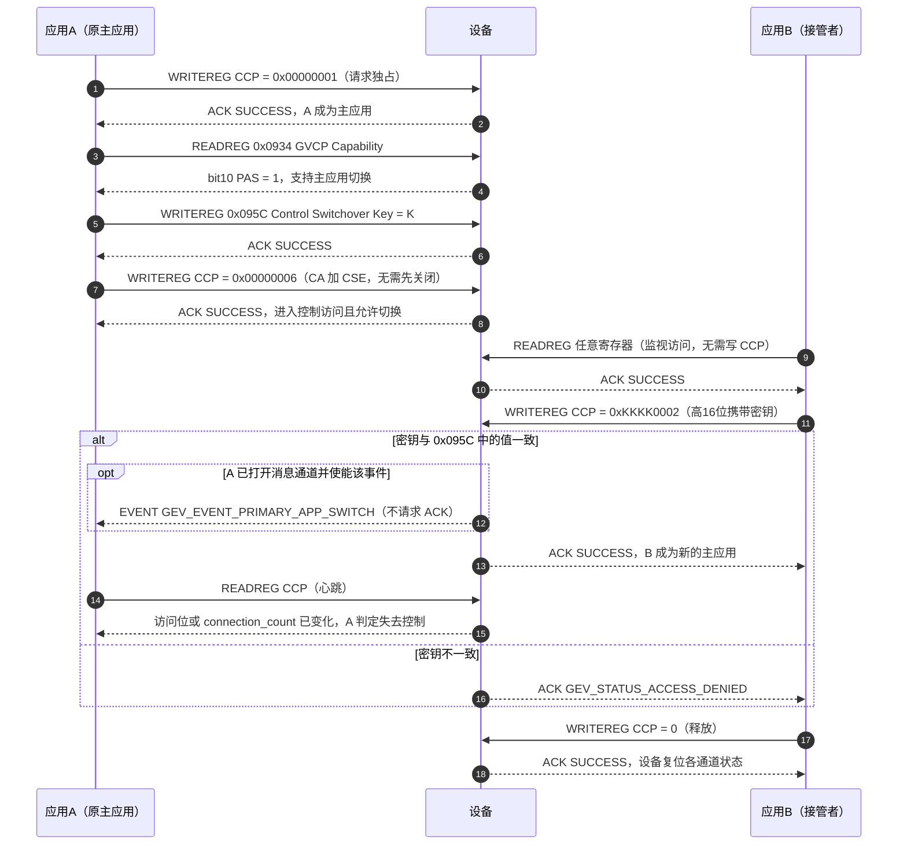
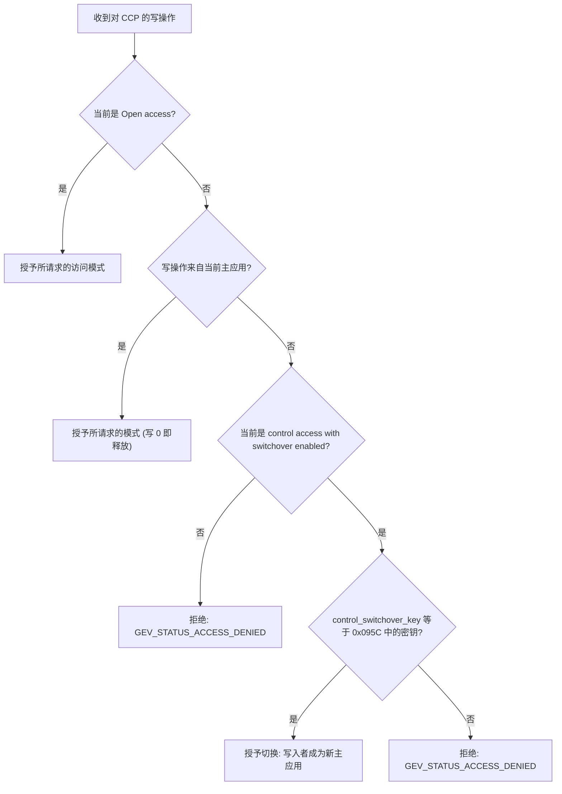
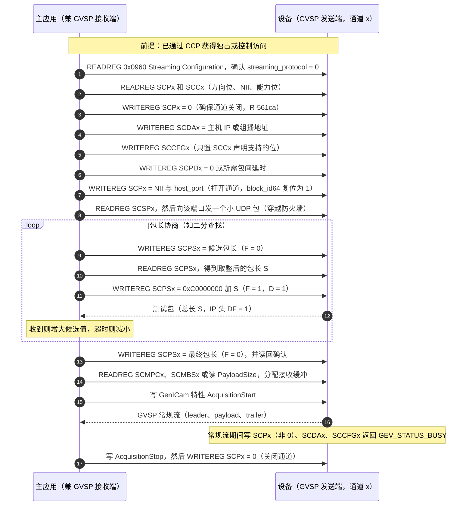
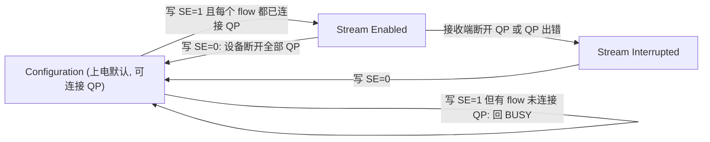
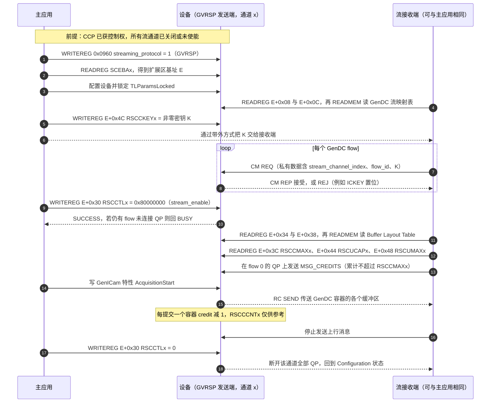
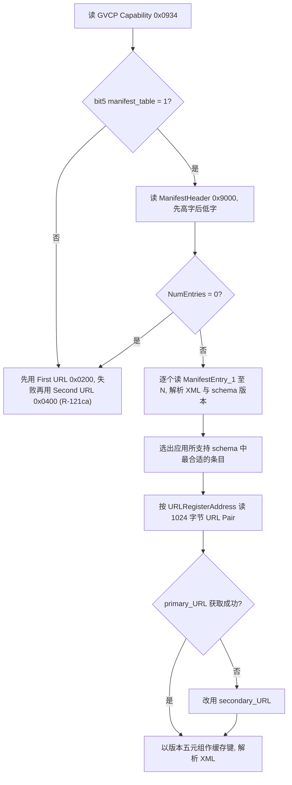
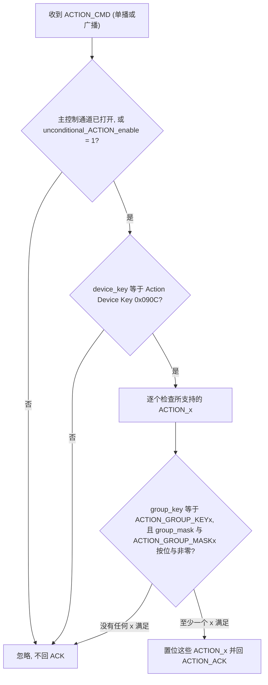

# 05-3 Bootstrap 寄存器（下）：通道相关寄存器（§36.46–§36.81）

> **覆盖范围**：GigE Vision Specification v3.0.00 第 36 章 §36.46 – §36.81，PDF p.312–352；地址与 M/O 信息参考寄存器总表 Table 36-1（PDF p.258–269）；并交叉引用 Ch10–14、Ch16–17、Ch23–24、Ch29–33、Ch38、附录 C/D。
>
> **一句话总结**：这一组寄存器回答了六个问题——谁在控制设备（CCP）、控制通道能用多大的包（CCMPS/CCTRA）、事件发到哪里（MC*）、GVSP 数据流如何开/关/定包长（SC*，每个流通道 0x40 字节一组）、GVRSP 流如何使能与鉴权（经 SCEBAx 指向的 RSC*）、XML 描述文件去哪里取（Manifest Table）以及 ACTION_CMD 如何按组匹配（ACTION_GROUP_KEY/MASK）。
>
> **本文目录**：
> - 核心要点
> - 速查表：通道寄存器地址布局（表 A–D）
> - 一、控制通道：§36.46 CCP · §36.47 Primary Application Port · §36.48 Primary Application IP Address · §36.49 CCMPS · §36.50 CCTRA
> - 二、消息通道：§36.51 MCP · §36.52 MCDA · §36.53 MCTT · §36.54 MCRC · §36.55 MCSP · §36.56 MCCFG
> - 三、GVSP 流通道：§36.57 SCPx · §36.58 SCPSx · §36.59 SCPDx · §36.60 SCDAx · §36.61 SCSPx · §36.62 SCCx · §36.63 SCCFGx · §36.64 SCMPCx · §36.65 SCMBSx · §36.66 SCEBAx · §36.67 SCGDAx · §36.68 SCGDSx · §36.69 SCGFTAx · §36.70 SCGFTSx
> - 四、GVRSP 流通道：§36.71 RSCCTLx · §36.72 RSCBLTAx · §36.73 RSCBLTSx · §36.74 RSCCMAXx · §36.75 RSCCCNTx · §36.76 RSCUCAPx · §36.77 RSCUMAXx · §36.78 RSCCKEYx
> - 五、§36.79 Manifest Table（ManifestHeader / ManifestEntry / URL Pair）
> - 六、§36.80 ACTION_GROUP_KEYx · §36.81 ACTION_GROUP_MASKx
> - 规范原文中的存疑与不一致
> - 实现要点与易错点（设备端 / 应用端）
> - 相关章节 · 自测题

**阅读约定**

- 位编号沿用规范：spec 位 0 = 32 位寄存器的最高位（MSB），spec 位 31 = 最低位（LSB）。表中"LSB0 掩码"列给出常规写法（LSB = bit0）的十六进制掩码，例如 spec 位 0 → `0x80000000`，spec 位 16–31 → `0x0000FFFF`。
- 所有 bootstrap 寄存器都是大端（big-endian）。
- "M/O"列先给寄存器总表（Table 36-1）的标注，再给对应需求 ID。总表脚注（p.269）：**[1]** 仅对 transmitter / receiver / transceiver 设备强制，peripheral 不适用；**[2]** 仅对 transmitter 设备强制；**[3]** 支持 GVSP 时强制；**[4]** 支持 GVRSP 时强制。
- 以"💡 解读："开头的内容是本知识库的理解或推导，不是规范原文。

---

## 核心要点

1. **CCP（0x0A00）是本组中唯一对所有设备（含 peripheral）都强制的寄存器**（R-479cd）：bit31 `exclusive_access`(EA)、bit30 `control_access`(CA)、bit29 `control_switchover_enable`(CSE)；bits 0–15 `control_switchover_key` 只在接管时写入、读回恒为 0；**v3.0 新增 bits 16–19 `connection_count`**（设备维护、每次打开控制通道递增）用于检测连接丢失——因此应用读回 CCP 时必须按位掩码判断，不能整字比较。
2. 主应用写 0 释放控制（R-071ca）；控制通道关闭（含心跳超时）时，设备必须清 MCP、清 GVSP 发送端的 SCPx（无条件流除外）、清 RSCCTLx.stream_enable 并断开 QP、复位主应用端口/IP（R-072cd），还要复位 SCCFGx（无条件流/无条件 action 均未生效时，CR-570s）和 RSCCKEYx（CR-685st）。
3. **v3.0 新增大包 GVCP**：GVCP Capability bit16 `control_channel_large_packet_size` → CCMPS（0x0A24，≥576 且 4 字节对齐）+ CCTRA（0x0A28，只读测试区）；应用应先用小包"学习"测试区内容，再用大包读回比对，确认整条链路真正可用的 GVCP 包长。
4. 消息通道：先写 MCDA、MCTT、MCRC、MCCFG，**最后**写 MCP（host_port≠0 即打开），关闭时**最先**写 MCP=0；MCTT=0 表示不要 ACK，组播时必须为 0；MCSP 用于穿越防火墙；MCCFG bit0 允许 EVENTDATA 合并多个事件。
5. GVSP 流通道寄存器按通道成组：基址 `0x0D00 + 0x40 * x`（0 ≤ x < 512），组内 +0x00 SCPx、+0x04 SCPSx、+0x08 SCPDx、+0x18 SCDAx、+0x1C SCSPx、+0x20 SCCx、+0x24 SCCFGx、+0x30 SCMPCx、+0x34/+0x38 SCMBSx、+0x3C SCEBAx。
6. **SCPx 是 GVSP 流通道的"开关"**：打开时最后写（包长协商用的 SCPSx 除外）、关闭时最先写；应用写 SCDAx/SCCFGx/SCPSx 前必须先令 host_port=0（R-561ca）；常规流期间设备拒绝写 SCPx（写 0 关闭除外）并回 GEV_STATUS_BUSY（R-586cd）。
7. **SCPSx**：bit0 `fire_test_packet`（自清零）、bit1 `do_not_fragment`、**bit2 已废弃（v2.0 及更早为 pixel_endianness）**、bits 16–31 `packet_size`（含 IP 20 B + UDP 8 B + GVSP 头）。设备不支持的包长须向下取整（小于最小值则向上取整）、更新寄存器且不发测试包（R-562st）；包长协商必须在通道打开之后、常规流开始之前（R-567s）。
8. SCCx（能力）与 SCCFGx（使能）在 bits 24–31 成对出现：GDC、MP、LLT、（废弃）、PRD、（废弃）、US、EC；bits 27、29 分别是已废弃的 multi-zone 与 all-in-transmission。
9. SCEBAx 指向每通道扩展区：+0x00～+0x0C 为 GenDC 预取描述符/流映射表的地址与大小，+0x30～+0x4C 为 8 个 GVRSP 寄存器（RSCCTLx…RSCCKEYx）。
10. **GVSP/GVRSP 互斥访问**：streaming_protocol=1（GVRSP）时访问 SCPx 必须回 ACCESS_DENIED（R-671cd）；=0（GVSP）时读写 RSCCTLx/RSCCKEYx 必须回 ACCESS_DENIED（CR-673cd、CR-684cd）。
11. GVRSP：RSCCKEYx（只写，默认 0 = 禁止任何 QP 连接）是 QP 连接口令；RSCCTLx.stream_enable 置 1 后不能再连接 QP；RSCCMAXx/RSCCCNTx 描述 container credit 计数器；RSCUMAXx ≥ 4（MSG_CREDITS 消息的大小）。
12. Manifest Table（0x9000，512 B = 8 B 头 + 63 个 8 B 条目）与 URL Pair（1024 B，必须在 0xA000 以后的厂商区，唯一例外是指向 0x0200）；ACTION_GROUP_KEYx/MASKx（0x9800/0x9804 + 0x10·x，x < 128）：ACTION_CMD 的 group_key 相等且 group_mask 按位与非零才会触发。

---

## 速查表：通道寄存器地址布局

### 表 A 固定地址的控制/消息通道寄存器（寄存器总表 p.258–259）

| 地址 | 寄存器 | 本文小节 | 总表 M/O | 访问 | 出厂默认 |
|---|---|---|---|---|---|
| `0x0A00` | Control Channel Privilege（CCP） | §36.46 | M | R/W | 0 |
| `0x0A04` | Primary Application Port | §36.47 | O | R | 0 |
| `0x0A08`–`0x0A13` | Reserved | — | — | — | — |
| `0x0A14` | Primary Application IP Address | §36.48 | O | R | 0 |
| `0x0A18`–`0x0A23` | Reserved | — | — | — | — |
| `0x0A24` | Control Channel Max Packet Size（CCMPS） | §36.49 | O（条件强制 CR-608cd） | R（总表写 R/W，见"存疑"） | 设备相关 |
| `0x0A28` | Control Channel Test Region Address（CCTRA） | §36.50 | O（条件强制 CR-611cd） | R（同上） | 设备相关 |
| `0x0A2C`–`0x0AFF` | Reserved | — | — | — | — |
| `0x0B00` | Message Channel Port（MCP） | §36.51 | O | R/W | 0 |
| `0x0B04`–`0x0B0F` | Reserved | — | — | — | — |
| `0x0B10` | Message Channel Destination Address（MCDA） | §36.52 | O | R/W | 0 |
| `0x0B14` | Message Channel Transmission Timeout（MCTT） | §36.53 | O | R/W | 设备相关 |
| `0x0B18` | Message Channel Retry Count（MCRC） | §36.54 | O | R/W | 设备相关 |
| `0x0B1C` | Message Channel Source Port（MCSP） | §36.55 | O | R | 不可用时为 0 |
| `0x0B20` | Message Channel Configuration（MCCFG） | §36.56 | O | R/W | 不可用时为 0 |
| `0x0B24`–`0x0CFF` | Reserved | — | — | — | — |

### 表 B 每个 GVSP 流通道的寄存器块（每通道 0x40 字节，基址 `B(x) = 0x0D00 + 0x40 * x`，0 ≤ x < 512）

| 块内偏移 | 寄存器 | 通道 0 | 通道 1 | 通道 511 | 总表 M/O（通道 0；通道 1–511 均为 O） | 访问 |
|---|---|---|---|---|---|---|
| +0x00 | SCPx（Port） | `0x0D00` | `0x0D40` | `0x8CC0` | M[1][3] | R/W |
| +0x04 | SCPSx（Packet Size） | `0x0D04` | `0x0D44` | `0x8CC4` | M[1][3] | R/W |
| +0x08 | SCPDx（Packet Delay） | `0x0D08` | `0x0D48` | `0x8CC8` | M[2][3] | R/W |
| +0x0C～+0x17 | Reserved | `0x0D0C` | `0x0D4C` | `0x8CCC` | — | — |
| +0x18 | SCDAx（Destination Address） | `0x0D18` | `0x0D58` | `0x8CD8` | M[1][3] | R/W |
| +0x1C | SCSPx（Source Port） | `0x0D1C` | `0x0D5C` | `0x8CDC` | O | R |
| +0x20 | SCCx（Capability） | `0x0D20` | `0x0D60` | `0x8CE0` | O（CR-494cd 条件强制） | R |
| +0x24 | SCCFGx（Configuration） | `0x0D24` | `0x0D64` | `0x8CE4` | O（CR-495cd 条件强制） | R/W |
| +0x28～+0x2F | 通道 0 标为 Deprecated（原 zone 寄存器，8 B）；其他通道标为 Reserved | `0x0D28` | `0x0D68` | `0x8CE8` | — | — |
| +0x30 | SCMPCx（Max Packet Count） | `0x0D30` | `0x0D70` | `0x8CF0` | M[1][3] | R |
| +0x34 | SCMBSx High | `0x0D34` | `0x0D74` | `0x8CF4` | M[1][3] | R |
| +0x38 | SCMBSx Low | `0x0D38` | `0x0D78` | `0x8CF8` | M[1][3] | R |
| +0x3C | SCEBAx（Extended Bootstrap Address） | `0x0D3C` | `0x0D7C` | `0x8CFC` | M[1] | R |

- 只有设备实际支持的通道才可访问（总表 p.265："Only supported channels are available"）；支持的通道数见 Number of Stream Channels 寄存器（0x0904，0–512）。产品支持流时必须提供 1–512 个流通道（R-079s），并且必须从索引 0 开始连续编号（R-080s），通道数不随所选流协议变化（R-605cd）。
- 💡 解读：通道 511 的块止于 `0x8CFF`；其后到 Manifest Table（`0x9000`）之前为保留区。

### 表 C SCEBAx 指向的扩展区（基址 `E(x)` = SCEBAx 寄存器读出的值；总表 p.261–262）

| 偏移 | 寄存器 | 本文小节 | 总表 M/O | 访问 | 含义 |
|---|---|---|---|---|---|
| +0x00 | SCGDAx | §36.67 | O（CR-596cd） | R | GenDC 预取描述符地址 |
| +0x04 | SCGDSx | §36.68 | O（CR-598cd） | R | GenDC 预取描述符大小 |
| +0x08 | SCGFTAx | §36.69 | O（CR-599cd） | R | GenDC 流映射表地址 |
| +0x0C | SCGFTSx | §36.70 | O（CR-601cd） | R | GenDC 流映射表大小 |
| +0x10～+0x2F | Reserved（32 B，为 GenDC 寄存器预留） | — | O | R | — |
| +0x30 | RSCCTLx | §36.71 | M[2][4] | R/W | GVRSP 流使能 |
| +0x34 | RSCBLTAx | §36.72 | M[2][4] | R | Buffer Layout Table 地址 |
| +0x38 | RSCBLTSx | §36.73 | M[2][4] | R | Buffer Layout Table 区域大小 |
| +0x3C | RSCCMAXx | §36.74 | M[2][4] | R | credit 计数器最大值 |
| +0x40 | RSCCCNTx | §36.75 | M[2][4] | R | credit 计数器当前值 |
| +0x44 | RSCUCAPx | §36.76 | M[2][4] | R | 上行（upstream）能力 |
| +0x48 | RSCUMAXx | §36.77 | M[2][4] | R | 上行消息最大长度 |
| +0x4C | RSCCKEYx | §36.78 | M[2][4] | W | QP 连接密钥 |

💡 解读：扩展区放在哪里完全由设备决定（SCEBAx 是只读指针，要求 4 字节对齐），通常位于厂商区；SCEBAx = 0 表示该通道没有扩展寄存器。

### 表 D Manifest 与 Action 区域（总表 p.268–269）

| 地址 | 寄存器 | 长度 | 访问 | 总表 M/O |
|---|---|---|---|---|
| `0x9000` | Manifest Table（Header + Entry_1…Entry_63） | 512 B | R | O（O-498cd） |
| `0x9200`～`0x97FF` | Reserved | — | — | — |
| `0x9800 + 0x10 * x` | ACTION_GROUP_KEYx（0 ≤ x < 128） | 4 B | R/W | O（CR-503cd） |
| `0x9804 + 0x10 * x` | ACTION_GROUP_MASKx | 4 B | R/W | O（CR-504cd） |
| `0x9808 + 0x10 * x`（8 B） | Reserved | — | — | — |
| `0xA000` | 厂商自定义寄存器区起点（URL Pair 必须放在这里或之后） | — | — | — |

---

## 一、控制通道相关寄存器

本部分包括 CCP（0x0A00）、Primary Application Port / IP Address（0x0A04 / 0x0A14）、CCMPS（0x0A24）和 CCTRA（0x0A28），覆盖 §36.46–36.50（p.312–317）。

## 36.46 Control Channel Privilege 寄存器 CCP（§36.46, p.312–314）

控制通道权限（Control Channel Privilege, CCP）寄存器把"控制权"授予一个应用：同一时刻只允许一个应用（主应用，primary application）写设备寄存器；只要主应用没有独占权限，其他应用仍可读寄存器（p.312）。

| 地址/地址公式 | 长度 | 访问 | M/O | 出厂默认值 |
|---|---|---|---|---|
| `0x0A00` | 4 字节 | R/W | M（R-479cd） | 0 |

**位域**

| spec 位 | LSB0 掩码 | 名称 | 说明 |
|---|---|---|---|
| 0–15 | `0xFFFF0000` | control_switchover_key | 仅当设备支持主应用切换能力时有意义。只有当 CSE 位在**本次写操作之前**就已置位、并且本次写入来自**另一个应用**时才会被比对：写入值与 Control Switchover Key 寄存器（0x095C）相同才发生切换。无论是否支持切换，**读回恒为 0**。 |
| 16–19 | `0x0000F000` | connection_count | **v3.0 新增**（附录 D, p.416："Add connection counter to CCP register"）。若设备支持，该字段是与当前控制应用关联的"连接所有权标识"，由设备管理，写入值被忽略；**每次打开控制通道时设备将其加 1**，首次连接之后永不为 0。设备不支持连接标识时恒读 0。 |
| 20–28 | `0x00000FF8` | reserved | 恒为 0，读时忽略。 |
| 29 | `0x00000004` | control_switchover_enable（CSE） | 仅在支持切换能力时有效：写 1 表示允许另一个应用（凭正确密钥）请求独占或控制访问。与 CA 位配合使用；EA=1 时为 don't care。不支持切换能力时恒读 0。对应 SFNC `GevCCP`。 |
| 30 | `0x00000002` | control_access（CA） | 写 1 请求控制访问（是否"允许切换"由同时写入的 CSE 决定）。CSE=0 时其他应用无法夺取控制；CSE=1 时其他应用可请求接管。其他应用始终可以监视（读）。对应 SFNC `GevCCP`。 |
| 31 | `0x00000001` | exclusive_access（EA） | 写 1 请求独占访问：其他应用既不能控制也不能监视。EA 与 CA 同时置位时 EA 优先。对应 SFNC `GevCCP`。 |

**Table 36-3 访问模式定义**（p.313–314）。由于独占比控制（带或不带切换）更严格，只要 EA=1，设备就处于独占模式，与 CA、CSE 无关：

| CSE（bit29） | CA（bit30） | EA（bit31） | 访问模式 |
|---|---|---|---|
| x | 0 | 0 | Open access（开放：无主应用） |
| 0 | 1 | 0 | Control access（控制访问） |
| 1 | 1 | 0 | Control access with switchover enabled（控制访问 + 允许切换） |
| x | x | 1 | Exclusive access（独占访问） |

**常用写入值**（💡 解读：由上表推得）

| 意图 | 写入 CCP 的值 | 备注 |
|---|---|---|
| 释放控制（关闭控制通道） | `0x00000000` | R-071ca |
| 独占访问 | `0x00000001` | 设备必须支持（R-061cd） |
| 控制访问 | `0x00000002` | 设备可以不支持 |
| 控制访问 + 允许切换 | `0x00000006` | 需支持主应用切换（GVCP Capability bit10），应先写好 Control Switchover Key |
| 另一应用接管，请求控制访问（密钥 0xKKKK） | `0xKKKK0002` | 仅当当前处于"控制 + 允许切换"模式时才会比对密钥 |
| 另一应用接管，请求独占访问 | `0xKKKK0001` | 同上 |

**语义与用法**

- **获取权限（打开控制通道）**：应用把所需权限写入 CCP，然后看 WRITEREG_ACK 的状态：GEV_STATUS_SUCCESS 表示获得，GEV_STATUS_ACCESS_DENIED（0x8006）表示被拒（§10.3, p.73）。监视访问（monitor access）**不写 CCP**，直接发 READREG/READMEM 即可，且只在没有独占应用时可用（§10.1, p.72）。
- **四级权限**（§10.1, p.69–72）：
  - 独占：设备必须支持（R-061cd）；此时设备不得允许二级应用建立控制通道（R-062cd），对其他应用的命令一律回 ACCESS_DENIED，但 ACTION_CMD、DISCOVERY_CMD、PACKETRESEND_CMD 和 FORCEIP_CMD 例外（R-063cd）。
  - 控制：设备可不支持；支持时应允许二级应用使用 READREG/READMEM（CO-064cd）。
  - 控制 + 允许切换：设备可不支持；当前主应用处于该模式时，持有正确密钥的应用可被授予控制权，否则回 ACCESS_DENIED（CR-065cd、CR-067cd）。
  - 监视：二级应用只读，不写 CCP。
- **同一主应用的再次写入**：重复请求同一权限必须返回 SUCCESS（R-069cd）；也可以不断开控制通道，直接在独占 / 控制 / 控制 + 允许切换之间切换（R-070cd, p.73）。
- **主应用上下文**：设备至少要记住主应用的 IP 地址、UDP 源端口和所授权限（R-068cd, p.72），据此判断后续命令是否"来自主应用"。0x0A04 / 0x0A14 两个寄存器就是把这份上下文的一部分公开出来。
- **释放与关闭**：主应用必须写 0 释放权限（R-071ca, p.74）。控制通道关闭时（主动写 0 或心跳超时，R-076cd），设备必须停止采集并中止所有流（除非 SCCFGx 配置了无条件流），清 MCP 和 GVSP 发送端的 SCPx，清 GVRSP 发送端的 RSCCTLx.stream_enable 并断开所有 QP，复位 Primary Application Port/IP 寄存器，然后可以接受新的连接；完成后寄存器必须反映新状态（R-072cd, p.74）。
- **心跳与失联检测**：规范推荐用"读 CCP"来刷新心跳计数（§10.5, p.75）。应用还可以读 CCP，观察访问模式位和/或 connection_count 是否仍与自己建立连接时一致；若不一致，即认为连接已丢失，需要重新建立控制通道（p.75）。
- 💡 解读：引入 connection_count 后，读回值可能是 `0x00003002`（count=3，CA=1）这类数值。沿用旧代码 `if (ccp == 0x2)` 会误判，应写成 `mode = ccp & 0x7`、`count = (ccp >> 12) & 0xF`，并在打开通道后保存 count 以供心跳比对。
- 💡 解读：connection_count 只有 4 位，规范只说"首次连接后永不为 0"，没有规定回绕方式；合理推测是 15 之后回绕到 1（跳过 0）。规范也未说明主应用切换（switchover）是否算一次"打开控制通道"，应用不要只依赖 count 来判断是否被接管。
- 💡 解读：按 Table 36-3，写 `0x00000004`（只有 CSE=1）也被解释为 Open access，效果相当于释放控制，不能用它来"单独打开 CSE"。

**主应用切换（primary application switchover）**（§14.4, p.109–111）

- 前提：GVCP Capability（0x0934）bit10 `primary_application_switchover`（PAS）= 1，且设备实现 Control Switchover Key 寄存器（0x095C，只写，出厂 0，密钥位于该寄存器的 bits 16–31；CR-473cd，§36.37 p.303–304）。
- 推荐设置步骤（§14.4.1, p.110–111）：① 先申请独占；② 读 GVCP Capability bit10 确认支持切换；③ 写 Control Switchover Key；④ 不关闭控制通道，直接把 CCP 改为"控制 + 允许切换"；⑤ 此后知道密钥的其他应用即可申请接管。
- 设备对 CCP 写操作的处理逻辑见下方流程图（据 §14.4 伪代码, p.110）。
- 通知原主应用：设备可以在授予新主应用**之前**向原主应用发送 GEV_EVENT_PRIMARY_APP_SWITCH 事件，前提是原主应用已打开消息通道并使能了该事件；该事件不应请求 ACK（因为 ACK 回来时消息通道可能已归新主应用管理）。切换不会关闭消息通道，由新主应用接手管理（p.110）。
- 密钥只提供"防止误接管"的最低限度保护；主控制通道本身也不是安全机制（§10.1 NOTE, p.72）。
- 💡 易混点：同一个 16 位密钥，在 Control Switchover Key 寄存器（0x095C）中位于 spec 位 16–31（掩码 `0x0000FFFF`），而在 CCP 中位于 spec 位 0–15（掩码 `0xFFFF0000`）。

**与其他寄存器的交互**：Control Switchover Key（0x095C）；GVCP Capability（0x0934）bit10 PAS、bit4 CAP；Heartbeat Timeout（0x0938）；GVCP Configuration（0x0954）bit31 heartbeat_disable；关闭时联动 MCP、SCPx、SCCFGx、RSCCTLx、RSCCKEYx、0x0A04、0x0A14。

**相关需求**：R-479cd、R-061cd、R-062cd、R-063cd、CO-064cd、CR-065cd、CO-066cd、CR-067cd、R-068cd、R-069cd、R-070cd、R-071ca、R-072cd、R-076cd、CR-473cd。

### 流程图（a）应用通过 CCP 获取控制权与主应用切换

设备侧对"写 CCP"的判定逻辑（§14.4 伪代码, p.110）：

## 36.47 Primary Application Port 寄存器（§36.47, p.314）

该可选寄存器给出当前持有控制通道权限的主应用的 UDP 端口。应用可读 GVCP Capability（0x0934）bit4 `CCP_application_port_IP_register`（CAP）判断它是否存在（p.314）。

| 地址/地址公式 | 长度 | 访问 | M/O | 出厂默认值 |
|---|---|---|---|---|
| `0x0A04`（可选） | 4 字节 | R | O（O-480cd） | 0 |

| spec 位 | LSB0 掩码 | 名称 | 说明 |
|---|---|---|---|
| 0–15 | `0xFFFF0000` | reserved | 恒 0，读时忽略。 |
| 16–31 | `0x0000FFFF` | primary_application_port | 主应用的 UDP **源端口**。没有主应用绑定（CCP = 0）时必须为 0。对应 SFNC `GevPrimaryApplicationSocket`。 |

- 控制通道关闭时，设备必须复位该寄存器（R-072cd, p.74）。
- 💡 解读：二级应用或诊断工具可以读它和 0x0A14，知道"是谁（哪个 IP:端口）正在控制这台设备"，在多主机系统中排查"设备被占用"非常有用。

## 36.48 Primary Application IP Address 寄存器（§36.48, p.315）

该可选寄存器给出主应用的 IP 地址；同样由 GVCP Capability bit4（CAP）指示是否支持（p.315）。

| 地址/地址公式 | 长度 | 访问 | M/O | 出厂默认值 |
|---|---|---|---|---|
| `0x0A14`（可选） | 4 字节 | R | O（O-481cd） | 0 |

| spec 位 | LSB0 掩码 | 名称 | 说明 |
|---|---|---|---|
| 0–31 | `0xFFFFFFFF` | primary_application_IP_address | 主应用的 IPv4 地址，必须是单播地址。没有主应用（CCP = 0）时必须为 0。对应 SFNC `GevPrimaryApplicationIPAddress`。 |

- 与 0x0A04 一起构成 R-068cd 所要求的"主应用上下文"中可公开的部分；控制通道关闭时复位（R-072cd）。

## 36.49 Control Channel Max Packet Size 寄存器 CCMPS（§36.49, p.315–316）

报告设备在控制通道上支持的最大包长（字节），**包含**协议头：IPv4 头 20 B、UDP 头 8 B 以及 GVCP 头。应用不得发送大于该值的控制通道包（p.315）。是否存在由 GVCP Capability 的 `control_channel_large_packet_size` 位指示。

| 地址/地址公式 | 长度 | 访问 | M/O | 出厂默认值 |
|---|---|---|---|---|
| `0x0A24` | 4 字节 | R（§36.49；总表 p.259 标 R/W，见"存疑"） | 总表 O；GVCP Capability bit16 MPS = 1 时必须实现（CR-608cd，v3.0 新增） | 设备相关 |

| spec 位 | LSB0 掩码 | 名称 | 说明 |
|---|---|---|---|
| 0–15 | `0xFFFF0000` | reserved | 恒 0，读时忽略。 |
| 16–31 | `0x0000FFFF` | max_packet_size | 控制通道收/发的最大包长（字节）。也可通过 SFNC `GevControlChannelMaxPacketSize` 暴露。 |

**规则与用法**

- 值必须 4 字节对齐，因为控制通道命令只支持 4 字节的倍数（CR-609cd）；值至少为 576（CR-610cd）。
- 能力位：GVCP Capability（0x0934）bit16 `control_channel_large_packet_size`（MPS）置 1 表示设备支持大控制包，并同时提供 CCMPS 与 CCTRA（§36.29, p.294）。
- 协议头共 36 B（IP 20 + UDP 8 + GVCP 8），因此：拼接 READREG 一次最多读 (CCMPS − 36) / 4 个寄存器——576 B 时为 135 个（§16.3, p.126）；READMEM 一次最多读 CCMPS − 40 字节（另有 4 B 地址字段，§16.5, p.132）。
- 💡 解读：例如 CCMPS = 1500 时，一次拼接 READREG 最多 366 个寄存器，READMEM 一次最多 1460 字节。这正是 v3.0"支持更大 GVCP 包以容纳扩展的寄存器负载（如文件传输）并保持向后兼容"这一改动（附录 D, p.415）的落脚点。若 MPS = 0（寄存器不存在），按传统默认的 576 B 控制通道包长处理（§16.3 称 576 B 为"default control channel packet size", p.126）。
- 💡 解读：CCMPS 只代表**设备**的能力，主机协议栈、网卡、交换机都可能更小，所以需要下一节的测试区实测。

**相关需求**：CR-608cd、CR-609cd、CR-610cd。

## 36.50 Control Channel Test Region Address 寄存器 CCTRA（§36.50, p.316–317）

即使设备报告支持大包，实际可用的包长仍可能受主机协议栈、网卡、交换机等系统组件限制。CCTRA 给出"控制通道测试区"的基址，用来测试不同的控制通道包长（p.316）。

| 地址/地址公式 | 长度 | 访问 | M/O | 出厂默认值 |
|---|---|---|---|---|
| `0x0A28` | 4 字节 | R（§36.50；总表 p.259 标 R/W，见"存疑"） | 总表 O；MPS = 1 时必须实现（CR-611cd，v3.0 新增） | 设备相关 |

| spec 位 | LSB0 掩码 | 名称 | 说明 |
|---|---|---|---|
| 0–31 | `0xFFFFFFFC`（有效位）；`0x00000003` 必须为 0 | control_channel_test_region_address | 测试区地址，必须 32 位对齐（spec 位 30、31 清零）。NOTE：测试区只用于测试特定大小的 GVCP 命令，内容由设备定义，"可能随时变化"。 |

**测试区的使用方法**（p.317）

- 测试区只读，返回一个确定的、由设备定义的图样，每次读取都相同。
- 待测区间为 `[基址, 基址 + CCMPS − 36)`（36 = 协议头大小）。可以用拼接的 READREG_CMD 或 READMEM_CMD 读这段"虚拟寄存器"区间。
- 步骤：
  1. 读 GVCP Capability bit16（MPS）确认支持；读 CCMPS（记为 M）和 CCTRA（记为 T）。
  2. 先用多次**小**读（例如每包 ≤ 576 B）把测试区的期望数据"学"下来。
  3. 尝试大包：想测包长 P（≤ M）时，拼接 READREG 读 (P − 36)/4 个地址，或 READMEM 读 P − 40 字节——READMEM 比 READREG 少读 4 字节，因为 READMEM_ACK 中的 address 字段也计入测试数据（p.317）。
  4. 把返回数据与第 2 步学到的期望数据比较；若超时或不一致，说明链路上某个环节不支持该包长，减小 P 再试（例如二分查找）。
- 拼接 READREG 需要 GVCP Capability bit31（concatenation）为 1（R-535ca, p.127）。
- 💡 解读：以 M = 1500 为例，READREG 读 T、T+4 … T+0x5B4 共 366 个地址，或 READMEM 从 T 读 1460 字节，两者产生的 ACK 都恰好是 1500 B 的 IP 包。

**相关需求**：CR-611cd（另见 R-535ca、R-177c/R-179c 对 READMEM 长度与地址对齐的要求）。

---

## 二、消息通道寄存器

消息通道（message channel）供设备向应用发送异步消息（事件）。设备最多支持 1 个消息通道（R-096cd），数量见 Number of Message Channels 寄存器（0x0900，读 0 或 1）。下面 6 个寄存器在不支持消息通道时都不存在。

## 36.51 Message Channel Port 寄存器 MCP（§36.51, p.317–318）

| 地址/地址公式 | 长度 | 访问 | M/O | 出厂默认值 |
|---|---|---|---|---|
| `0x0B00`（可选） | 4 字节 | R/W | 总表 O；支持消息通道则必须实现（CR-482cd） | 0 |

| spec 位 | LSB0 掩码 | 名称 | 说明 |
|---|---|---|---|
| 0–13 | `0xFFFC0000` | reserved | 恒 0，读时忽略。 |
| 14–15 | `0x00030000` | network_interface_index（NII） | 本版本恒为 0：只有主接口 #0 支持 GVCP。 |
| 16–31 | `0x0000FFFF` | host_port | 设备发送消息的目的 UDP 端口。写 0 关闭消息通道。对应 SFNC `GevMCPHostPort`。 |

**语义与用法**

- 打开（§12.2, p.90）：主应用先写 MCDA（目的 IP），再写 MCP 的 host_port；host_port ≠ 0 即激活通道，否则通道关闭（CR-099ca）。只有拥有写权限的主应用能打开消息通道。设备应使用任意动态端口作为消息通道的 UDP 源端口（CO-098cd）。
- MCP 必须是打开时**最后**访问、关闭时**最先**访问的消息通道寄存器（§12.4, p.91）。关闭时写 MCP = 0（CR-106ca）；关闭瞬间正在发送的消息必须完整发出（CR-107cd）；应用在通道关闭后收到的消息必须静默丢弃（CR-108ca）。
- 应用回 ACK 时，必须以收到的消息包的 UDP 源端口作为 ACK 的目的端口（CR-100ca, p.90）。
- 消息通道上的 req_id 必须逐条递增（重传除外），回绕时跳过 0（65535 之后是 1）（CR-097cd, p.89）。
- 多网口设备上消息通道必须建立在接口 #0（CR-116c, §13.3 p.93）。
- 控制通道关闭时设备必须清 MCP（R-072cd）；主应用切换**不会**关闭消息通道（§14.4, p.110）。

## 36.52 Message Channel Destination Address 寄存器 MCDA（§36.52, p.318–319）

| 地址/地址公式 | 长度 | 访问 | M/O | 出厂默认值 |
|---|---|---|---|---|
| `0x0B10`（可选） | 4 字节 | R/W | 总表 O；CR-483cd | 0 |

| spec 位 | LSB0 掩码 | 名称 | 说明 |
|---|---|---|---|
| 0–31 | `0xFFFFFFFF` | channel_destination_IP | 消息通道的目的 IPv4 地址，可以是单播或组播地址。对应 SFNC `GevMCDA`。 |

- 组播（§12.5, p.91）：把 MCDA 设为组播组地址即可把事件同时发往多处。组播时不允许 ACK：设备必须清除消息的 ACK 位（CR-109cd），应用也必须同时把 MCTT 设为 0。
- 组播地址范围（p.91 NOTE）：239.0.0.0–239.255.255.255 为管理域（本地）组播；224.0.1.0–238.255.255.255 为全局组播（参见 RFC3171）。

## 36.53 Message Channel Transmission Timeout 寄存器 MCTT（§36.53, p.319–320）

| 地址/地址公式 | 长度 | 访问 | M/O | 出厂默认值 |
|---|---|---|---|---|
| `0x0B14`（可选） | 4 字节 | R/W | 总表 O；CR-484cd | 设备相关 |

| spec 位 | LSB0 掩码 | 名称 | 说明 |
|---|---|---|---|
| 0–31 | `0xFFFFFFFF` | timeout | 传输超时，单位 ms。写 0 表示消息通道上不要求确认（ACK）。对应 SFNC `GevMCTT`。 |

- CR-485cd：当请求 ACK 时，该值是设备发出消息后等待 ACK 的时间。
- CR-103cd（§12.3, p.90）：MCTT ≠ 0 时，消息命令头的 ACKNOWLEDGE 位必须置 1；MCTT = 0 时必须由设备清 0。

## 36.54 Message Channel Retry Count 寄存器 MCRC（§36.54, p.320）

| 地址/地址公式 | 长度 | 访问 | M/O | 出厂默认值 |
|---|---|---|---|---|
| `0x0B18`（可选） | 4 字节 | R/W | 总表 O；CR-486cd | 设备相关 |

| spec 位 | LSB0 掩码 | 名称 | 说明 |
|---|---|---|---|
| 0–31 | `0xFFFFFFFF` | retry_count | 消息超时后允许的重传次数。对应 SFNC `GevMCRC`。 |

- 超时后设备必须重发同一条消息，次数由 MCRC 决定（CR-101cd）；MCRC = 0 时不得重传（CR-102cd）（§12.3, p.90）。
- 💡 解读：对一条请求 ACK 的消息，设备最多约等待 MCTT × (MCRC + 1) 毫秒后放弃。

## 36.55 Message Channel Source Port 寄存器 MCSP（§36.55, p.320–321）

用途：帮助主机应用让设备发来的异步事件能穿过防火墙/NAT——应用从自己的消息接收端口向设备的 MCSP 端口发送"假" UDP 包，使事件流量看起来是应用"请求"来的，而不是不请自来的（p.320）。

| 地址/地址公式 | 长度 | 访问 | M/O | 出厂默认值 |
|---|---|---|---|---|
| `0x0B1C`（可选） | 4 字节 | R（Read-Only） | 总表 O；CO-487cd（SHOULD） | 不可用时为 0 |

| spec 位 | LSB0 掩码 | 名称 | 说明 |
|---|---|---|---|
| 0–15 | `0xFFFF0000` | reserved | 恒 0，读时忽略。 |
| 16–31 | `0x0000FFFF` | source_port | 消息通道打开期间，设备发送消息所用的 UDP 源端口。对应 SFNC `GevMCSP`。 |

- 能力位：Message Channel Capability（0x0930）bit0 `MCSP_supported`（SP）（§36.28, p.292）。
- CR-104cd：MCP ≠ 0 时 MCSP 必须返回非 0 的源端口；也可以更早就非 0，但之后在整个控制会话中保持不变（p.90）。
- CR-105cd：设备必须静默忽略来自 MCDA/MCP 组合、发往 MCSP 端口、且不是 EVENT_ACK/EVENTDATA_ACK 的 UDP 流量（p.90）。
- CR-110ca：应用只有在消息通道已打开、并成功读到非 0 的 MCSP 后，才可以向该端口发包（p.92）。
- 推荐流程（§12.6, p.91–92）：经 MCDA、MCP 打开通道后读 MCSP；从 MCP 中设置的同一端口向 MCSP 发一个小于 GVCP 最大命令包的 UDP 包；视防火墙情况每约 30 s（可配置）重复一次。设备不会应答这些包。

## 36.56 Message Channel Configuration 寄存器 MCCFG（§36.56, p.321–322）

| 地址/地址公式 | 长度 | 访问 | M/O | 出厂默认值 |
|---|---|---|---|---|
| `0x0B20`（可选） | 4 字节 | R/W | 总表 O；支持消息通道的可选特性时必须实现（CR-585cd） | 不可用时为 0 |

| spec 位 | LSB0 掩码 | 名称 | 说明 |
|---|---|---|---|
| 0 | `0x80000000` | MCEC_enable（EC） | 置 1 表示允许设备把多个事件合并（concatenate）到一个 EVENTDATA_CMD 消息中。 |
| 1–31 | `0x7FFFFFFF` | reserved | 恒 0，读时忽略。 |

- 能力位：Message Channel Capability（0x0930）bit1 `MCCFG_supported`（CC）表示 MCCFG 存在；bit2 `MCEC_supported`（EC）表示支持 EVENTDATA 事件合并（同时要求支持 MCCFG）（§36.28, p.292）。
- CR-234cd（§17.2, p.150）：未置位 MCEC_enable 时，设备在一个 EVENTDATA 消息中只能放一个事件。普通 EVENT_CMD 的事件合并不受此位控制（576 B 内最多 22 个事件，§17.1 p.147）。
- 该寄存器在 v2.2 由 MCC 更名为 MCCFG（附录 D, p.415）。

**消息通道配置小结**（💡 解读：按 §12.2–12.6 整理）：读 0x0900 确认有消息通道 → 写 MCDA（组播则同时令 MCTT = 0）→ 按需写 MCTT、MCRC、MCCFG → **最后**写 MCP = host_port → 读 MCSP 并向其发送 keep-alive UDP 包 → 关闭时**首先**写 MCP = 0。

---

## 三、GVSP 流通道寄存器

GVSP（GigE Vision Streaming Protocol）流通道寄存器按通道分组，每通道 0x40 字节（表 B）。发送端与接收端共用的有 SCCx、SCCFGx、SCPx、SCPSx、SCDAx、SCMPCx；仅发送端的有 SCPDx、SCSPx、SCMBSx（§11.3, p.82–83）。附录 C（p.407–408）规定：所有 GVSP 专用寄存器只在 Streaming Configuration（0x0960）的 streaming_protocol = 0 时可用。

## 36.57 GVSP Stream Channel Port 寄存器 SCPx（§36.57, p.322–324）

为给定流通道提供端口信息，并且**用来打开/关闭流通道**：打开时它必须是应用写入的最后一个流通道寄存器（SCPSx 用于包长协商时除外），关闭时它是第一个写入的寄存器（p.322）。

| 地址/地址公式 | 长度 | 访问 | M/O | 出厂默认值 |
|---|---|---|---|---|
| `0x0D00 + 0x40 * x`（0 ≤ x < 512；0 < x < 512 时对 GVSP 发送端/接收端可选；peripheral 不适用） | 4 字节 | R/W | 通道 0：M[1][3]；支持 GVSP 时所有流通道都必须实现（CR-488cd） | 设备相关 |

| spec 位 | LSB0 掩码 | 名称 | 说明 |
|---|---|---|---|
| 0 | `0x80000000` | direction（D） | 只读，报告流通道方向：0 = Transmitter（发送端），1 = Receiver（接收端）。对应 SFNC `DeviceStreamChannelType`。 |
| 1–13 | `0x7FFC0000` | reserved | 恒 0，读时忽略。 |
| 14–15 | `0x00030000` | network_interface_index（NII） | 使用的网络接口索引（0–3）。某些流可能硬绑定在特定网口上，此时该字段只读、不可编程；链路聚合配置下设备只暴露一个网口。对应 SFNC `GevSCPInterfaceIndex`。 |
| 16–31 | `0x0000FFFF` | host_port | 发送端：数据流发往的 UDP 端口；接收端：可从其接收数据流的端口。写 0 关闭流通道。对 GVSP 发送端，打开通道时流通道 block ID 必须复位为 1。对应 SFNC `GevSCPHostPort`。 |

**规则与用法**

- **R-561ca**（p.322）：应用写 SCDAx、SCCFGx、SCPSx 之前必须先把 host_port 置 0（包长协商期间写 SCPSx 除外）。NOTE：这迫使通道配置在打开前完成，从而保证配置一致；要改流通道配置，必须先清 host_port。
- **R-586cd**：常规流期间，设备必须禁止写 SCPx，但写 0（关闭流）除外；写被禁止时回 GEV_STATUS_BUSY（0x8007）。
- **R-671cd**：若实现了 SCPx，设备在 GVRSP 模式下（Streaming Configuration 的 streaming_protocol = 1）必须对其访问返回 GEV_STATUS_ACCESS_DENIED。
- 打开与关闭（§11.5, §11.8, p.83–85）：只有主应用能配置流通道；写非 0 的 host_port 激活通道（R-087ca）；写 0 关闭通道（R-091ca）。
- block_id64 在通道打开时复位为 1（R-259st, §24.2 p.174）；block_id64 = 0 保留给测试包。
- 多网口（§13.2, p.93）：发送端必须使用 NII 指定的网口（R-113st），设备型接收端同理（CR-114sr）；PACKETRESEND_CMD 总是发到接口 #0，其 stream_channel_index 对应 SCPx，从而决定从哪个网口重发（R-115ca）。
- 关闭时：发送端应尽快停流，但不得发送不完整的包（R-092st），也不要求补发 data trailer；若想停在块边界，应先用厂商寄存器/特性（如相机的 AcquisitionStop）（§11.8, p.85–86）。
- 控制通道关闭时设备必须清 GVSP 发送端的 SCPx（R-072cd）；接收端通道是否复位由实现决定，规范建议保持打开，便于简单的接收设备在无主控制通道时继续显示视频（p.74 NOTE）。
- 方向不可编程：一个流通道只能是发送端或接收端之一（Ch11, p.81）；对 transceiver，建议把发送通道排在较低索引（p.81 NOTE）。

**相关需求**：CR-488cd、R-561ca、R-586cd、R-671cd、R-087ca、R-091ca、R-092st、R-259st、R-113st、CR-114sr、R-115ca。

## 36.58 GVSP Stream Channel Packet Size 寄存器 SCPSx（§36.58, p.324–326）

给出流通道的包大小（字节）——这是**整个 IP 包**的大小，包含 IP 头 20 B、UDP 头 8 B 和 GVSP 头。对 GVSP 发送端，它还提供设置 IP 头"don't fragment"位以及向 GVSP 接收端发射测试包（test packet）的手段（p.324）。

| 地址/地址公式 | 长度 | 访问 | M/O | 出厂默认值 |
|---|---|---|---|---|
| `0x0D04 + 0x40 * x`（0 < x < 512 时对 GVSP 发送端/接收端可选；peripheral 不适用） | 4 字节 | R/W | 通道 0：M[1][3]；CR-489cd | 设备相关 |

| spec 位 | LSB0 掩码 | 名称 | 说明 |
|---|---|---|---|
| 0 | `0x80000000` | fire_test_packet（F） | 发送端：置 1 后发射**一个**大小为 bits 16–31 所指定值的测试包，测试包的 IP 头"don't fragment"位必须置 1；若发送端支持 LFSR 发生器，测试包载荷按该多项式填充，否则载荷内容无关紧要。该位由设备自动清 0（self-cleared）。接收端：无效果，恒读 0。对应 SFNC `GevSCPSFireTestPacket`。 |
| 1 | `0x40000000` | do_not_fragment（D） | 发送端：该位被复制到每个流包 IP 头的"don't fragment"位，可用于防止流通道上的 IP 分片。接收端：无效果，恒读 0。对应 SFNC `GevSCPSDoNotFragment`。 |
| 2 | `0x20000000` | deprecated | 恒 0，读时忽略。**在 v2.0 及更早版本中是 pixel_endianness**（v3.0 已废弃）。 |
| 3–15 | `0x1FFF0000` | reserved | 恒 0，读时忽略。 |
| 16–31 | `0x0000FFFF` | packet_size | 发送端：本通道发送的流包大小（字节）；data leader、data trailer 以及最后一个数据包可以更小（块大小不一定是包长的整数倍）。相机通过**强制特性** `GevSCPSPacketSize` 访问。发送端不支持所请求的值时，不得发射测试包，而应向下取整到最近的支持值；若请求值小于最小支持值，则向上取整。接收端：表示接收端支持的最大 GVSP 包长，只读。对应 SFNC `GevSCPSPacketSize`，为扩展兼容也可通过 `DeviceStreamChannelPacketSize` 提供。 |

**规则与用法**

- 本通道正在发送（streaming active）时不能写该寄存器（p.324）。
- **R-490st**（p.326）：发送端不得在应用没有写该寄存器的情况下改变包长。接收端依据包长计算每个包的数据该拷到缓冲区的哪个位置，所以配置后必须保持不变。允许发送端把写入值取整为 4 的倍数，但**不允许**因为应用改了数据格式（如图像宽度、像素格式）而改变包长。
- **R-562st**（p.326）：不支持请求的包长时，不得发射测试包；必须向下取整到最近的支持值**并更新寄存器**；小于最小支持值时向上取整。
- 建议应用写后读回（值可能已被取整），并在请求测试包之前确认包长有效；应用必须能应对包长协商中的这种取整（p.326 NOTE）。
- 接收端：packet_size 为只读的"最大支持包长"，F、D 位无效且读 0（§36.58, p.325；§11.3 NOTE, p.83）。
- data leader / trailer 默认不超过 576 B；只有 SCCFGx 的 large_leader_trailer_enable 置 1 时，才可大到 SCPSx 的值（R-261st, §24.3 p.175）。

**包长协商**（§11.7, p.84–85）

- 目的：找出不会导致 IP 分片的最大包长。GVSP 本身不限制包长，由控制全局的管理实体（management entity）与发送端协商。
- 机制：一次性写入 SCPSx——bits 16–31 为包长、bit0（F）请求测试包、bit1（D）表示不允许分片；发送端随即发出一个总大小（含 IP、UDP 头）恰为该值的测试包。
- 流程：管理实体先写 SCPDx、SCDAx、SCPx（host_port ≠ 0，打开通道），然后对每个候选值：① 写包长（F = 0）；② 读回取整后的值；③ 用该值再加上 F 位写一次以请求测试包。收到测试包就增大候选值，收不到就减小（二分查找或其他搜索）。可先写极小值和极大值（如 0 和 65535）再读回，得到搜索上下限。
- **R-567s**：包长协商必须在通道打开之后、常规流开始之前进行；常规流一旦开始，必须关闭并重新打开通道才能改包长。
- 通道关闭时请求测试包：设备可以忽略，或回 GEV_STATUS_INVALID_PARAMETER（0x8002）；常规流期间请求测试包：设备应回 GEV_STATUS_BUSY（p.84–85）。
- **R-093st**：发送端不支持请求的包长时，不得发送测试包。
- 测试包格式（§24.5, p.183）不遵循通常的 GVSP 包布局（block ID 为 0，Extended ID 位无定义），接收端必须事先知道"接下来是测试包"并相应解码。若 GVCP Capability bit6 `test_data`（TD）= 1，载荷由 16 位 LFSR 生成（CR-280st），接收端应据此比对（CO-281sr）。
- 局限：存在多条路由时，不同路径的 MTU 可能不同，测试包走过的路径不一定是数据包的路径（p.85 NOTE）。
- 💡 解读：Extended ID 格式的 GVSP 头为 20 B（status 2 + flag 2 + EI/packet_format 字 4 + block_id64 8 + packet_id32 4，§24.2 p.173–174），所以通用载荷格式下每个数据包的有效载荷 = packet_size − 48 B。例如 1500 → 1452 B，9000（巨帧）→ 8952 B。

**相关需求**：CR-489cd、R-490st、R-562st、R-567s、R-093st、R-561ca。

## 36.59 GVSP Stream Channel Packet Delay 寄存器 SCPDx（§36.59, p.326–327）

在给定物理链路上为该流通道发送的相邻两包之间插入的**最小**延时（时间戳计数器单位）。当 GVSP 接收端跟不上设备发包速度时，可作为粗略的流控手段（p.326）。

| 地址/地址公式 | 长度 | 访问 | M/O | 出厂默认值 |
|---|---|---|---|---|
| `0x0D08 + 0x40 * x`（0 < x < 512 时对 GVSP 发送端可选；GVSP 接收端与 peripheral 不适用） | 4 字节 | R/W | 通道 0：M[2][3]；CR-491cd | 0 |

| spec 位 | LSB0 掩码 | 名称 | 说明 |
|---|---|---|---|
| 0–31 | `0xFFFFFFFF` | delay | 包间延时，单位为时间戳 tick。对应 SFNC `GevSCPD`。 |

- 延时通常与时间戳计数器同粒度（频率很高，精度很高）；若设备不支持时间戳（Timestamp Tick Frequency 寄存器 0x093C/0x0940 为 0 或不存在），则该寄存器无效（p.326；CR-461cd, §36.31 p.296）。
- NOTE（p.326）：这意味着每个网络接口对每个流都需要独立的计时器来测量包间延时。
- 延时从前一包**结束**计到下一包**开始**（§23.1.4, p.167）。
- 作为补充，设备也可以支持 IEEE 802.3 的 PAUSE 机制（p.326；§23.1.4）。
- 启用 IEEE 1588 时，Timestamp Tick Frequency 必须为 1 GHz，即 1 tick = 1 ns（§36.31, p.295）。
- 💡 解读：延时（秒）= delay ÷ TickFrequency。例如 1 GHz 时 delay = 10000 即 10 µs。若想把 1 Gb/s 链路上 1500 B 包的占用率降到约 50%：每包线路时间约 (1500 + 38) × 8 ns ≈ 12.3 µs（38 B 为以太网 MAC 头、FCS、前导码与帧间隔开销），则 delay ≈ 12300（1 GHz 时钟）。
- 💡 解读：v3.0 的 §36.59 没有"流传输期间锁定 SCPDx"的要求，附录 D 也记录 v2.2 已移除 SCPD 的锁定要求（"Removed SCPD locking requirement", p.415），R-561ca 也不包括 SCPDx；因此 SCPDx 可以在流传输中调整（何时生效取决于实现）。

## 36.60 GVSP Stream Channel Destination Address 寄存器 SCDAx（§36.60, p.327–328）

对 GVSP 发送端，它是该流通道的目的 IP；对 GVSP 接收端，它是该接收端可接收的数据流的目的 IP（p.327）。

| 地址/地址公式 | 长度 | 访问 | M/O | 出厂默认值 |
|---|---|---|---|---|
| `0x0D18 + 0x40 * x`（0 < x < 512 时对 GVSP 发送端/接收端可选；peripheral 不适用） | 4 字节 | R/W | 通道 0：M[1][3]；CR-492cd | 发送端（SCPx.direction = 0）为 0；接收端（direction = 1）为设备相关 |

| spec 位 | LSB0 掩码 | 名称 | 说明 |
|---|---|---|---|
| 0–31 | `0xFFFFFFFF` | channel_destination_IP | 流通道目的 IPv4 地址，可为单播或组播地址。对应 SFNC `GevSCDA`。 |

- 发送端在流传输进行中不能写该寄存器；**R-588cd**：常规流期间设备必须禁止写，回 GEV_STATUS_BUSY。
- R-561ca：写 SCDAx 前 host_port 必须为 0。
- 组播（§11.9, p.86）：把发送端的 SCDAx 设为组播地址即启用组播；此时任何目的端都可以在控制通道上发送 PACKETRESEND。配合 SCCFGx 的 PRD 位，可把重发包定向到请求者的 IP（见 §36.63）。
- 💡 解读：对设备型接收端，"设备相关"的默认值一般是它自己的 IP 或它所加入的组播组地址。

## 36.61 GVSP Stream Channel Source Port 寄存器 SCSPx（§36.61, p.328–329）

给出 GVSP 发送端流通道的 UDP 源端口。用途与 MCSP 类似：让主机应用从 GVSP 接收端的接收端口向发送端的源端口发"假" UDP 包，使流量看起来是接收端"请求"来的，从而穿过防火墙/NAT（p.328）。

| 地址/地址公式 | 长度 | 访问 | M/O | 出厂默认值 |
|---|---|---|---|---|
| `0x0D1C + 0x40 * x`（0 ≤ x < 512 时对 GVSP 发送端可选；GVSP 接收端与 peripheral 不适用） | 4 字节 | R（Read-Only） | 总表 O；CO-493cd（SHOULD） | 不可用时为 0 |

| spec 位 | LSB0 掩码 | 名称 | 说明 |
|---|---|---|---|
| 0–15 | `0xFFFF0000` | reserved | 恒 0，读时忽略。 |
| 16–31 | `0x0000FFFF` | source_port | 流通道打开期间，GVSP 流量所用的 UDP 源端口。对应 SFNC `GevSCSP`。 |

- 能力位：Streaming Capability（0x092C）bit0 `SCSPx_supported`（SP）表示所有流通道都提供 SCSPx；仅支持 GVRSP 的设备不得置位（CR-664cd, §36.27 p.290–291）。
- CR-094st：只要一个 GVSP 发送通道支持 SCSPx，所有发送通道都必须支持（§11.11, p.86）。
- CR-089cd：SCPx ≠ 0 时 SCSPx 必须返回非 0 的源端口；可以更早就非 0，但之后在控制会话期间保持不变（§11.6, p.84）。
- CR-090cd：SCPx ≠ 0 时，设备必须静默忽略来自 SCDAx/SCPx 组合、发往 SCSPx 端口的 UDP 流量。
- 推荐用法（§11.11, p.86–87）：通过 SCDAx、SCPx 打开通道后、启动采集前读 SCSPx（非 0 时可缓存，以后不必每次读）；从 SCPx 中设定的同一个主机端口向 SCSPx 发送一个小于 GVCP 最大命令包的 UDP 包（所有已打开的流通道都要做）；视防火墙情况每约 30 s 重复一次。
- CR-095ca：应用只有在流通道已打开、且读回非 0 的 SCSPx 之后，才可向该端口发包。
- 发送端应使用动态端口（49152–65535）作为流通道的 UDP 源端口（O-086st, §11.5 p.83）。

## 36.62 GVSP Stream Channel Capability 寄存器 SCCx（§36.62, p.329–331）

列出该 GVSP 流通道特有的能力。早期版本的规范把它叫做 "Stream Channel Capability register"（p.329）。

| 地址/地址公式 | 长度 | 访问 | M/O | 出厂默认值 |
|---|---|---|---|---|
| `0x0D20 + 0x40 * x`（0 ≤ x < 512 时对 GVSP 发送端/接收端可选；peripheral 不适用） | 4 字节 | R | 总表 O；支持 GVSP 时所有流通道都必须实现（CR-494cd） | 设备相关 |

| spec 位 | LSB0 掩码 | 名称 | 说明 |
|---|---|---|---|
| 0 | `0x80000000` | reserved | 恒 0，读时忽略。 |
| 1 | `0x40000000` | IP_reassembly_supported（R） | 该流通道支持重组被分片的 IP 包；否则读 0。 |
| 2–22 | `0x3FFFFE00` | reserved | 恒 0，读时忽略。 |
| 23 | `0x00000100` | scmpcx_supported（PC） | 该流通道支持 SCMPCx 寄存器；否则读 0。 |
| 24 | `0x00000080` | gendc_supported（GDC） | 该流通道支持 GenDC 流；否则读 0。 |
| 25 | `0x00000040` | multi-part_supported（MP） | 该流通道支持 Multi-part 载荷类型；否则读 0。 |
| 26 | `0x00000020` | large_leader_trailer_supported（LLT） | 发送端或接收端所支持的 data leader / data trailer 最大包长：0 = 最大 576 B（与 GigE Vision 2.0 及更早版本兼容）；1 = 最大可到 SCPSx 允许的值。某些载荷类型（如 multi-part）可能需要大 leader/trailer。 |
| 27 | `0x00000010` | deprecated | 恒 0。旧版本中为 multi_zone_supported。 |
| 28 | `0x00000008` | packet_resend_destination_option（PRD） | 是否存在重发包的替代目的地，只对 GVSP 发送端有效：0 = 无替代，总是发往 SCDAx；1 = 按 SCCFGx 的 PRD 位选择目的地。GVSP 接收端必须为 0。 |
| 29 | `0x00000004` | deprecated | 恒 0。旧版本中为 all_in_transmission_supported。 |
| 30 | `0x00000002` | unconditional_streaming_supported（US） | 对 GVSP 发送端，表示该通道支持无条件流；否则读 0。 |
| 31 | `0x00000001` | extended_chunk_data_supported（EC） | 该通道支持**已废弃的** extended chunk data 载荷类型（0x0005）；否则读 0。 |

- CR-589cd（p.331）：支持 gendc_supported 的设备必须同时支持 scmpcx_supported。
- CR-616cd（§11.13, p.88）：仅支持 GVRSP 的设备不得置 US 位；GVRSP 不允许无条件流（p.74–75 NOTE）。
- 💡 解读：SCCx 与 SCCFGx 的 bits 24–31 一一对应（GDC、MP、LLT、废弃、PRD、废弃、US、EC），因此 SCCFGx 中允许置 1 的位是 `SCCx & 0x000000EB` 的子集（0xEB = bits 24/25/26/28/30/31）。
- 💡 解读：bit1（IP 重组）主要对接收端有意义：接收端不支持重组时，应确保发送端不分片（置 SCPSx 的 D 位并选择合适包长）。

## 36.63 GVSP Stream Channel Configuration 寄存器 SCCFGx（§36.63, p.331–333）

为该流通道的可选特性提供额外控制；这些可选特性必须由同一通道的 SCCx 声明支持（p.331）。例如可以用它使能 GVSP 发送端的无条件流模式。

| 地址/地址公式 | 长度 | 访问 | M/O | 出厂默认值 |
|---|---|---|---|---|
| `0x0D24 + 0x40 * x`（0 ≤ x < 512 时对 GVSP 发送端/接收端可选；peripheral 不适用） | 4 字节 | R/W | 总表 O；支持 GVSP 时所有流通道都必须实现（CR-495cd） | 0 |

| spec 位 | LSB0 掩码 | 名称 | 说明 |
|---|---|---|---|
| 0–23 | `0xFFFFFF00` | reserved | 恒 0，读时忽略。 |
| 24 | `0x00000080` | gendc_enable（GDC） | 允许 GVSP 发送端（SCPx.direction = 0）在本通道发送 GenDC 载荷类型。只是"允许"，不强制一直使用；具体用哪种载荷取决于上下文与发送端配置。 |
| 25 | `0x00000040` | multi_part_enable（MP） | 允许 GVSP 发送端在本通道使用 Multi-part 载荷类型；同样只是"允许"。 |
| 26 | `0x00000020` | large_leader_trailer_enable（LLT） | 对发送端和接收端都有效：0 = data leader/trailer 最大 576 B；1 = 最大为 SCPSx 的值。某些载荷类型（如 multi-part 图像）可能需要。 |
| 27 | `0x00000010` | deprecated | 恒 0。旧版本中为 multi_zone_enabled。 |
| 28 | `0x00000008` | packet_resend_destination（PRD） | 为因 PACKETRESEND 请求而重发的流包启用替代 IP 目的地，只对发送端有效：0 = 发往 SCDAx；1 = 发往 PACKETRESEND_CMD 包中的源 IP 地址。接收端 don't care。对应 SFNC `GevSCCFGPacketResendDestination`。 |
| 29 | `0x00000004` | deprecated | 恒 0。旧版本中为 all_in_transmission_enabled。 |
| 30 | `0x00000002` | unconditional_streaming_enable（US） | 使 GVSP 发送端（direction = 0）在其设备的控制通道关闭时、或无论设备收到何种 ICMP 消息（如目的不可达）时都继续发流。对接收端无效，恒读 0。对应 SFNC `GevSCCFGUnconditionalSTreaming`（原文拼写如此）。 |
| 31 | `0x00000001` | extended_chunk_data_enable（EC） | 允许发送端使用已废弃的 extended chunk data 载荷类型（0x0005）。对接收端无效，恒读 0。对应 SFNC `GevSCCFGExtendedChunkData`。 |

**规则与用法**

- **R-590cd**：常规流期间设备必须禁止写 SCCFGx，回 GEV_STATUS_BUSY。
- **R-561ca**：写 SCCFGx 前 host_port 必须为 0。
- **CR-570s**（p.333）：若 GVSP 发送端支持 SCCFGx，则在控制通道关闭、且无条件流与无条件 action 都未生效时，必须把 SCCFGx 复位为出厂默认值。
- 无条件流（§11.13, p.88）：自 v1.2 引入。置 US 后，即使控制通道关闭或设备收到 ICMP 目的不可达，发送端也继续发流——"只要主应用要求它发"。适合多接收端视频分发等"主应用崩溃也不能断流"的场景。GVRSP 不支持无条件流。
- 💡 解读：LLT 两端都要配：若接收端也是设备，开启发送端 LLT 之前应确认接收端的 SCCx.LLT = 1 并同样使能。
- 💡 解读：组播时置 PRD = 1，可让重发包只单播给发出 PACKETRESEND 的接收端，避免把重发流量灌给所有组成员。

**相关需求**：CR-495cd、R-590cd、R-561ca、CR-570s、CR-616cd。

## 36.64 GVSP Stream Channel Max Packet Count 寄存器 SCMPCx（§36.64, p.334）

报告传输一个 GVSP 块最多可使用的包数。当对应 SCCx 的 bit23（scmpcx_supported）置位时该寄存器可用。对于载荷包长可变的载荷类型，块内包数无法根据块大小算出，因此需要该寄存器（p.334）。

| 地址/地址公式 | 长度 | 访问 | M/O | 出厂默认值 |
|---|---|---|---|---|
| `0x0D30 + 0x40 * x`（0 ≤ x < 512 对 GVSP 发送端强制；GVSP 接收端与 peripheral 不适用） | 4 字节 | R（Read-Only） | 通道 0：M[1][3]；支持 GVSP 时所有流通道都必须实现（CR-591cd） | 设备相关 |

| spec 位 | LSB0 掩码 | 名称 | 说明 |
|---|---|---|---|
| 0–31 | `0xFFFFFFFF` | count | 在**当前包长**下，传输一个 GVSP 块（含 leader 与 trailer）最多使用的包数。 |

- **R-592st**：常规流期间发送端不得改变 SCMPCx 的内容。
- 💡 解读：该值依赖当前包长，应在包长协商完成后再读取；接收端可据此预分配"包到达位图"或重发跟踪表。对于定长载荷，可粗略估算为 ⌈载荷字节数 ÷ (packet_size − 48)⌉ + 2（leader + trailer），但应以寄存器值为准。

## 36.65 GVSP Stream Channel Max Block Size 寄存器 SCMBSx（§36.65, p.335–336）

报告一个 GVSP 块可包含的最大字节数（64 位，分为高、低两个寄存器）。使用 GenDC 时，把流映射表（Flow Mapping Table）中各 flow 的大小相加也能得到同样的信息；由于 GVRSP 只支持 GenDC 载荷，GVRSP 应使用流映射表来确定最大块大小（p.335）。

- **CR-593cd**：支持 GVSP 的设备必须为所有支持的流通道实现 SCMBSx。
- **R-594st**：常规流期间发送端不得改变 SCMBSx 的内容。
- 可用性指示：Streaming Capability（0x092C）bit2 `SCMBSx_supported`（BS）（§36.27, p.290）。

### 36.65.1 High Part（p.335）

| 地址/地址公式 | 长度 | 访问 | M/O | 出厂默认值 |
|---|---|---|---|---|
| `0x0D34 + 0x40 * x`（0 ≤ x < 512 时对 GVSP 发送端可选；GVSP 接收端与 peripheral 不适用） | 4 字节 | R（Read-Only） | 通道 0：M[1][3]；CR-593cd | 设备相关 |

| spec 位 | LSB0 掩码 | 名称 | 说明 |
|---|---|---|---|
| 0 | `0x80000000` | maximum_block_size 的最高位 | 必须为 0：对应的 SFNC `PayloadSize` 是 GenICam IInteger（有符号数），置 0 以避免负值。位域图在此位直接画成 "0"。 |
| 1–31 | `0x7FFFFFFF` | maximum_block_size（高位部分） | 最大块大小的高位部分（位域图写作 "upper 31-bit"，位表写作 "upper 32-bit"）。对应 SFNC `PayloadSize`。 |

### 36.65.2 Low Part（p.336）

| 地址/地址公式 | 长度 | 访问 | M/O | 出厂默认值 |
|---|---|---|---|---|
| `0x0D38 + 0x40 * x`（同上） | 4 字节 | R（Read-Only） | 通道 0：M[1][3]；CR-593cd | 设备相关 |

| spec 位 | LSB0 掩码 | 名称 | 说明 |
|---|---|---|---|
| 0–31 | `0xFFFFFFFF` | maximum_block_size（低 32 位） | 最大块大小的低 32 位。对应 SFNC `PayloadSize`。 |

- 💡 解读：最大块大小 = High × 2^32 + Low（因 High 的最高位为 0，最大为 2^63 − 1）。例：High = 0、Low = `0x00BB8000` → 12,288,000 B（如 4096 × 3000 的 Mono8 图像）。
- 💡 解读：规范对其他 64 位寄存器要求"先读高位再读低位"（如 §36.31 p.296、Manifest 条目 p.348），读 SCMBSx 也宜遵循同样顺序。

## 36.66 Stream Channel Extended Bootstrap Address 寄存器 SCEBAx（§36.66, p.336–337）

给出该流通道扩展 bootstrap 寄存器区的起始地址（p.336）。扩展区布局见上文表 C。

| 地址/地址公式 | 长度 | 访问 | M/O | 出厂默认值 |
|---|---|---|---|---|
| `0x0D3C + 0x40 * x`（地址块注：0 ≤ x < 512 时对 transmitter 可选；receiver 与 peripheral 不适用——与 R-595cd 及总表矛盾，见"存疑"） | 4 字节 | R（Read-Only） | 通道 0：M[1]；R-595cd（所有支持的流通道都必须实现） | 设备相关 |

| spec 位 | LSB0 掩码 | 名称 | 说明 |
|---|---|---|---|
| 0–31 | `0xFFFFFFFC`（有效位）；`0x00000003` 必须为 0 | extended_register_address | 该流通道扩展 bootstrap 寄存器区的起始地址。0 表示扩展区中没有该通道的寄存器。必须 32 位对齐（spec 位 30、31 清零）。 |

- 可用性指示：Streaming Capability（0x092C）bit3 `SCEBAx_supported`（EB）——表示所有支持的流通道都有 SCEBAx；支持 GVRSP 时必须置位（CR-665cd, §36.27 p.291）。

## 36.67 Stream Channel GenDC Descriptor Address 寄存器 SCGDAx（§36.67, p.337–338）

给出 GenDC 预取描述符（prefetch descriptor）的位置。预取描述符描述设备将要发送的 GenDC 容器的结构与内容，接收端可以在开流前读取，从而无需解析实时数据就了解容器布局（§38, p.365）。

| 地址/地址公式 | 长度 | 访问 | M/O | 出厂默认值 |
|---|---|---|---|---|
| `SCEBA(x) + 0x0`（0 ≤ x < 512 时对 transmitter 可选；receiver 与 peripheral 不适用） | 4 字节 | R（Read-Only） | 总表 O；支持 GenDC 载荷的流通道必须实现（CR-596cd） | 设备相关 |

| spec 位 | LSB0 掩码 | 名称 | 说明 |
|---|---|---|---|
| 0–31 | `0xFFFFFFFC`（有效位）；`0x00000003` 必须为 0 | descriptor_address | GenDC 预取描述符的地址，描述符格式由 GenICam GenDC 规范定义。设备不会在该通道发送 GenDC 数据、或该通道的描述符无法预取时为 0。必须 32 位对齐。 |

- **R-597st**：常规流期间发送端不得改变描述符内容；**CR-613st**：设置 TLParamsLocked 后描述符内容必须冻结（§38, p.365）。
- 冻结不等于容器格式固定：可变之处用描述符的 VariableFields 字段标示；每个块中仍会传送容器描述符（初步 preliminary 和/或最终 final 形式，至少一个 final）（§38, p.365）。
- GVRSP：若预取描述符的 VariableFields 非 0（需要传初步和最终两份描述符），Buffer Layout Table 的第一个缓冲区必须使用 duplicate 标志（§29.3, p.215–216）。

## 36.68 Stream Channel GenDC Descriptor Size 寄存器 SCGDSx（§36.68, p.338–339）

| 地址/地址公式 | 长度 | 访问 | M/O | 出厂默认值 |
|---|---|---|---|---|
| `SCEBA(x) + 0x4`（0 ≤ x < 512 时对 transmitter 可选；receiver 与 peripheral 不适用） | 4 字节 | R（Read-Only） | 总表 O；CR-598cd | 设备相关 |

| spec 位 | LSB0 掩码 | 名称 | 说明 |
|---|---|---|---|
| 0–31 | `0xFFFFFFFF` | descriptor_size | GenDC 预取描述符的大小。设备不会在该通道发送 GenDC 数据、或描述符无法预取时为 0。 |

- 💡 解读：读取描述符即 READMEM(SCGDAx, SCGDSx)；READMEM 长度须为 4 的倍数且每次不超过 CCMPS − 40（或 536）字节，较大的描述符需分段读。

## 36.69 Stream Channel GenDC Flow Mapping Table Address 寄存器 SCGFTAx（§36.69, p.339–340）

给出 GenDC 流映射表的位置。流映射表描述一个 GenDC 容器在传输时如何被划分到一个或多个 flow 上，接收端据此把收到的数据放回重建容器中的正确位置（§38, p.365）。

| 地址/地址公式 | 长度 | 访问 | M/O | 出厂默认值 |
|---|---|---|---|---|
| `SCEBA(x) + 0x8`（0 ≤ x < 512 时对 transmitter 可选；receiver 与 peripheral 不适用） | 4 字节 | R（Read-Only） | 总表 O；能以流方式发送 GenDC 容器的通道必须实现（CR-599cd） | 设备相关 |

| spec 位 | LSB0 掩码 | 名称 | 说明 |
|---|---|---|---|
| 0–31 | `0xFFFFFFFC`（有效位）；`0x00000003` 必须为 0 | flow_table_address | GenDC 流映射表的地址，格式由 GenICam GenDC 规范定义。设备不会在该通道发送 GenDC 数据时为 0。必须 32 位对齐。 |

- **R-600st**：常规流期间发送端不得改变流映射表内容；**CR-614st**：设置 TLParamsLocked 后流映射表必须冻结（§38, p.365）。
- GVRSP：接收端读流映射表得知该通道有哪些 GenDC flow，再为每个 flow 连接一个 QP（§30.1 p.221；§31.3 p.226）。
- 各 flow 的大小之和即最大块大小（§36.65, p.335）；Buffer Layout Table 中属于 flow X 的缓冲区大小之和必须等于流映射表中 flow X 的 FlowSize（R-622s, p.215）。
- 流映射表只规定有哪些 flow 以及容器载荷如何分布在这些 flow 上，不定义容器内容；每块在某个 flow 上的数据量可以变化，但不超过该 flow 的最大值（§38, p.365–366）。

## 36.70 Stream Channel GenDC Flow Mapping Table Size 寄存器 SCGFTSx（§36.70, p.340–341）

| 地址/地址公式 | 长度 | 访问 | M/O | 出厂默认值 |
|---|---|---|---|---|
| `SCEBA(x) + 0xC`（0 ≤ x < 512 时对 transmitter 可选；receiver 与 peripheral 不适用） | 4 字节 | R（Read-Only） | 总表 O；CR-601cd | 设备相关 |

| spec 位 | LSB0 掩码 | 名称 | 说明 |
|---|---|---|---|
| 0–31 | `0xFFFFFFFF` | flow_table_size | GenDC 流映射表的大小。设备不会在该通道发送 GenDC 数据时为 0。 |

## GVSP 流通道小结

### 流程图（b）配置并启动一个 GVSP 流通道（含测试包包长协商）

💡 解读：图中 SCPDx、SCSPx 的步骤可按需省略；若应用不做包长协商，则 SCPSx 也应在打开通道（写 SCPx）**之前**写好，因为 R-561ca 只对"包长协商"放宽了顺序要求。

### 表 E 常规流期间各寄存器的写保护（GVSP）

| 寄存器 | 常规流期间的设备行为 | 依据 |
|---|---|---|
| SCPx | 只接受写 0（关闭）；其他写入回 GEV_STATUS_BUSY | R-586cd（p.322） |
| SCPSx | 不可写；此时请求测试包应回 GEV_STATUS_BUSY | §36.58（p.324）；§11.7（p.85） |
| SCDAx | 禁止写，回 GEV_STATUS_BUSY | R-588cd（p.327） |
| SCCFGx | 禁止写，回 GEV_STATUS_BUSY | R-590cd（p.331） |
| SCPDx | 无锁定要求（v2.2 已移除） | §36.59；附录 D（p.415） |
| SCMPCx、SCMBSx | 设备不得改变其内容 | R-592st、R-594st |
| GenDC 预取描述符、流映射表 | 设备不得改变其内容（TLParamsLocked 时冻结） | R-597st、R-600st、CR-613st、CR-614st |
| Streaming Configuration（0x0960） | 任一 SCPx 非 0 或任一 RSCCTLx.stream_enable 置位时不可写，回 GEV_STATUS_BUSY | R-667cd（p.305） |

应用侧对应的约束：改 SCDAx / SCCFGx / SCPSx 之前必须先令 host_port = 0（R-561ca）。

### 表 F GVSP / GVRSP 两种模式下的寄存器可访问性

| 寄存器 | GVSP 模式（streaming_protocol = 0） | GVRSP 模式（streaming_protocol = 1） | 依据 |
|---|---|---|---|
| SCPx | 正常访问 | 必须回 GEV_STATUS_ACCESS_DENIED | R-671cd（p.322） |
| SCPSx、SCPDx、SCDAx、SCSPx、SCCx、SCCFGx、SCMPCx、SCMBSx | 正常访问 | "Not available for GVRSP streaming"（未规定具体状态码） | 附录 C（p.407–408） |
| SCEBAx、SCGDAx、SCGDSx、SCGFTAx、SCGFTSx | 正常访问 | 正常访问（GVRSP 依赖 GenDC 流映射表） | §30.1、§31.3 |
| RSCCTLx、RSCCKEYx | 读写都必须回 GEV_STATUS_ACCESS_DENIED | 正常访问 | CR-673cd、CR-684cd（p.341, p.346） |
| 其他 RSC* 寄存器 | 回 GEV_STATUS_ACCESS_DENIED 或 GEV_STATUS_INVALID_ADDRESS | 正常访问 | §11.12（p.87） |

---

## 四、GVRSP 流通道寄存器

GVRSP（GigE Vision RDMA Streaming Protocol）是 v3.0 新增的基于 RoCEv2 的流协议，只传 GenDC 载荷。它的 8 个寄存器都位于 SCEBAx 指向的扩展区 +0x30～+0x4C（表 C）。前缀约定：`RSC…` 为数据流寄存器，`RSCU…` 为上行（upstream）通信寄存器（§11.12, p.87）。

- 所有 GVRSP 寄存器只在 Streaming Configuration（0x0960）的 streaming_protocol = 1 时可用，否则设备回 GEV_STATUS_ACCESS_DENIED 或 GEV_STATUS_INVALID_ADDRESS（§11.12, p.87）；其中 RSCCTLx 与 RSCCKEYx 明确要求回 ACCESS_DENIED（CR-673cd、CR-684cd）。
- 相关能力：Streaming Capability（0x092C）bit4 `gvsp_mode_not_supported`（GP）、bit5 `gvrsp_mode_supported`（RP）；支持 GVRSP 的设备必须是 Transmitter（CR-663cd），且必须置 SCEBAx_supported（CR-665cd）（§36.27, p.291）。
- 本版本只完整定义了 GVRSP **发送端**的 bootstrap 寄存器接口，接收端/收发端留待以后的版本（附录 C, p.408）。
- 协议细节见 [../04_gvrsp/01_rocev2_and_streaming_model.md](../04_gvrsp/01_rocev2_and_streaming_model.md) 与 [../04_gvrsp/02_connection_and_flow_control.md](../04_gvrsp/02_connection_and_flow_control.md)。

## 36.71 GVRSP Stream Channel Control 寄存器 RSCCTLx（§36.71, p.341）

控制流通道 x 在 GVRSP 模式下的运行。

| 地址/地址公式 | 长度 | 访问 | M/O | 出厂默认值 |
|---|---|---|---|---|
| `SCEBA(x) + 0x30` | 4 字节 | R/W | 总表 M[2][4]；支持 GVRSP 时所有流通道都必须实现（CR-672cd） | 0 |

| spec 位 | LSB0 掩码 | 名称 | 说明 |
|---|---|---|---|
| 0 | `0x80000000` | stream_enable（SE） | 使能 GVRSP 流。 |
| 1–31 | `0x7FFFFFFF` | reserved | 原文说明栏为空；💡 解读：按全章惯例视为恒 0、读时忽略。 |

**GVRSP 流通道状态机**（Ch30, p.220）

**规则与用法**

- **CR-673cd**：同时支持 GVSP 与 GVRSP 的设备在 GVSP 模式下，必须对 RSCCTLx 的读写都回 GEV_STATUS_ACCESS_DENIED。
- **CR-631st**：stream_enable 未置位时，发送端不得在该流通道上发送数据（Ch30, p.222）。
- **CR-632st**：写 SE = 1 时若该通道有任一 GenDC flow 没有已连接的 QP，必须回 GEV_STATUS_BUSY 并留在 Configuration 状态。
- **CR-633st**：写 SE = 0 时，发送端必须断开该流的所有 QP。
- **CR-638st**：SE = 1 期间，发送端必须拒绝该流的所有连接请求（CM REQ）——REJ 私有数据中置 STENA 标志（§31.3–31.4, p.228–230）。换言之，**QP 必须在使能之前连好**。
- 置 SE = 1 后，发送端锁定 Buffer Layout Table 和其他 GVRSP 流通道寄存器，只要流保持使能，所有可写的 GVRSP 寄存器都保持不变（§30.1 第 5 步, p.221）；Buffer Layout Table 冻结见 CR-620st（p.214）。
- **CR-655st**：Configuration 状态（SE = 0）下 container credit 计数器必须为 0（Ch33, p.238）。
- **R-667cd**：任一 RSCCTLx.stream_enable 置位时，Streaming Configuration 寄存器不可写（回 BUSY）。
- 控制通道关闭时，设备必须清 RSCCTLx.stream_enable 并断开所有 QP（R-072cd）；GVRSP **不允许**无条件流（p.74–75 NOTE）。
- 关闭流程（§30.2, p.222）：① 接收端停止在 GenDC flow 0 上发上行消息；② 主应用写 SE = 0；③ 发送端尽快停流并断开所有已连接 QP；④ 断开完成后发送端回到 Configuration 状态并把 SE 清 0。若要停在块边界，应先用 SFNC AcquisitionStop 和/或等待所有已排队缓冲区完成。
- 💡 解读：规范说 Stream Interrupted 状态"只能通过写 0 离开"，因此该状态下 SE 很可能仍读为 1；应用不能只凭 SE = 1 判断流是否健康，还要关注 QP 状态（以及设备经消息通道报告的错误）。

## 36.72 GVRSP Stream Channel Buffer Layout Table Address 寄存器 RSCBLTAx（§36.72, p.342）

报告流通道 x 的 GVRSP 缓冲区布局表（Buffer Layout Table）的地址；表的定义见 §29.3。

| 地址/地址公式 | 长度 | 访问 | M/O | 出厂默认值 |
|---|---|---|---|---|
| `SCEBA(x) + 0x34` | 4 字节 | R | 总表 M[2][4]；CR-674cd | 设备相关 |

| spec 位 | LSB0 掩码 | 名称 | 说明 |
|---|---|---|---|
| 0–31 | `0xFFFFFFFC`（位域图中 spec 位 30–31 画为 0，即 4 字节对齐） | gvrsp_blt_address | 流通道 x 的 GVRSP Buffer Layout Table 的地址。 |

**Buffer Layout Table 结构速览**（§29.3, Figure 29-4, p.214–215；全部字段大端，R-627s）

| 字节偏移 | 字段 | spec 位 / LSB0 掩码 | 说明 |
|---|---|---|---|
| +0 | buffer_count | 0–31 / `0xFFFFFFFF` | 有效条目数 n，至少为 1（R-621s）。 |
| +4 + 8·i | buffer[i].size | 0–31 / `0xFFFFFFFF` | 缓冲区 i 的字节数，最大 2^31。 |
| +8 + 8·i | buffer[i].flow_id | 0–15 / `0xFFFF0000` | 承载缓冲区 i 的 GenDC flow ID。 |
| +8 + 8·i | reserved | 16–30 / `0x0000FFFE` | 保留。 |
| +8 + 8·i | buffer[i].duplicate（d） | 31 / `0x00000001` | 该缓冲区在第一轮缓冲区之后还会再传一次（用于以最终描述符覆盖初步描述符）；只允许 buffer[0] 置位（R-625s）。 |

- 关键规则：属于 flow X 的缓冲区大小之和等于流映射表中 flow X 的 FlowSize（R-622s）；全部缓冲区大小之和等于 SFNC PayloadSize（R-623s）；buffer[0] 必须走 flow 0（R-624s）；缓冲区在容器中的偏移是隐含的（依次累加）（p.214–215）。
- 该表随时可读，且读到的必须总是完整、有效的表；SE = 1 期间内容冻结（CR-620st, p.214）。

## 36.73 GVRSP Stream Channel Buffer Layout Table Size 寄存器 RSCBLTSx（§36.73, p.342–343）

报告为流通道 x 的 Buffer Layout Table **分配的内存区域**大小（字节）。设备在当前配置下可能只用其中一部分，但整个区域必须始终可读；表中的 buffer_count 与每个条目的已知大小共同决定实际使用的部分（p.342）。

| 地址/地址公式 | 长度 | 访问 | M/O | 出厂默认值 |
|---|---|---|---|---|
| `SCEBA(x) + 0x38` | 4 字节 | R | 总表 M[2][4]；CR-675cd | 设备相关 |

| spec 位 | LSB0 掩码 | 名称 | 说明 |
|---|---|---|---|
| 0–31 | `0xFFFFFFFF` | gvrsp_blt_size | 流通道 x 的 Buffer Layout Table 的最大大小（字节）；有效大小可以比它小。 |

- **CR-676cd**：RSCBLTSx ≥ 4 + 8 = 12 字节（buffer_count 加至少一个条目）。
- 💡 解读：有效长度 = 4 + 8 × buffer_count；区域最多能容纳 (RSCBLTSx − 4) ÷ 8 个条目。由于 SE = 1 后表被冻结，按 Ch30 的流程在置 SE = 1 **之后**再读表最稳妥（先读 4 字节 buffer_count，再读 8n 字节；或直接按 RSCBLTSx 整区读取）。

## 36.74 GVRSP Stream Channel Credits Counter Maximum Supported Value 寄存器 RSCCMAXx（§36.74, p.343–344）

报告发送端 container credit 计数器在流通道 x 上支持的最大值。

| 地址/地址公式 | 长度 | 访问 | M/O | 出厂默认值 |
|---|---|---|---|---|
| `SCEBA(x) + 0x3C` | 4 字节 | R | 总表 M[2][4]；CR-677cd | 设备相关 |

| spec 位 | LSB0 掩码 | 名称 | 说明 |
|---|---|---|---|
| 0–31 | `0xFFFFFFFF` | gvrsp_credits_count_max_value | 流通道 x 的 container credit 最大值。 |

- **CR-678cd**：RSCCMAXx ≥ 1。
- 应用层流控（Ch33, p.238–239）：发送端为每个流通道维护一个 container credit 计数器——收到有效 MSG_CREDITS 时加上消息中的 credit 数（CR-656st）；一个块（GenDC 容器）被提交发送时减 1，最晚不晚于该块最后一个字节发出时（CR-657st）；计数不大于 0 时不得开始发送新块（CR-658st）。
- 收发双方都要保证计数不超过 RSCCMAXx：接收端不得发送会导致溢出的 MSG_CREDITS（CR-659sr）；若发生溢出，发送端必须释放所有已连接 QP（CR-660st），接收端需重新建立连接。
- 接收端在为某个容器发放 credit 之前，必须先为该容器的所有缓冲区投递好 QP 接收请求（CR-661sr）。MSG_CREDITS 的 credit 数放在 24 位 opcode_specific 字段中（§32.1, p.236）。

## 36.75 GVRSP Stream Channel Credits Counter Current Value 寄存器 RSCCCNTx（§36.75, p.344–345）

报告发送端在流通道 x 上的 container credit 计数器当前值；该值不得超过 RSCCMAXx。

| 地址/地址公式 | 长度 | 访问 | M/O | 出厂默认值 |
|---|---|---|---|---|
| `SCEBA(x) + 0x40` | 4 字节 | R | 总表 M[2][4]；CR-679cd | 设备相关 |

| spec 位 | LSB0 掩码 | 名称 | 说明 |
|---|---|---|---|
| 0–31 | `0xFFFFFFFF` | gvrsp_credits_count_current_value | 流通道 x 的 container credit 当前值。 |

- NOTE（p.344–345）：该值随并发的异步事件变化（发送端完成一个 GenDC 容器的发送、接受接收端发来的上行消息），**仅供参考**；实际的数据传输或流控算法不应依赖它。
- Configuration 状态下为 0（CR-655st）。

## 36.76 GVRSP Stream Channel Upstream Capability 寄存器 RSCUCAPx（§36.76, p.345）

列出 GVRSP 流通道 x 在上行通信方面的能力。

| 地址/地址公式 | 长度 | 访问 | M/O | 出厂默认值 |
|---|---|---|---|---|
| `SCEBA(x) + 0x44` | 4 字节 | R | 总表 M[2][4]；CR-680cd | 设备相关 |

| spec 位 | LSB0 掩码 | 名称 | 说明 |
|---|---|---|---|
| 0 | `0x80000000` | msg_trigger_supported（TRG） | 设备支持 GVRSP 触发消息（MSG_TRIGGER）。 |
| 1–31 | `0x7FFFFFFF` | reserved | 原文说明栏为空；💡 解读：视为恒 0、读时忽略。 |

- **CR-649st**：发送端必须通过 RSCUCAPx 的能力位声明它支持的所有可选上行消息类型（设备自定义消息除外）（§32, p.235）。
- 上行消息操作码（Table 32-1, p.234）：MSG_NOP = 0x00（保留）、MSG_CREDITS = 0x01（收发双方必须支持，CR-647sr/CR-648st，因此没有能力位）、MSG_TRIGGER = 0x02（可选，即本寄存器 bit0）、0x03–0x7F 保留、0x80–0xFF 设备自定义（最高位必须置 1，CR-654sr）。
- MSG_TRIGGER 的 24 位 opcode_specific 是映射到 SFNC LinkTrigger0–LinkTrigger23 的位掩码：消息 bit31 → LinkTrigger0，bit30 → LinkTrigger1，依此类推；置 1 的位在收到消息时立即触发，设备未实现的位被静默忽略（§32.2, p.236）。

## 36.77 GVRSP Stream Channel Upstream Maximum Supported Message Size 寄存器 RSCUMAXx（§36.77, p.345–346）

报告发送端在该 GVRSP 流通道上能接收的最大上行消息长度；接收端不得发送更长的上行消息。

| 地址/地址公式 | 长度 | 访问 | M/O | 出厂默认值 |
|---|---|---|---|---|
| `SCEBA(x) + 0x48` | 4 字节 | R | 总表 M[2][4]；CR-681cd | 设备相关 |

| spec 位 | LSB0 掩码 | 名称 | 说明 |
|---|---|---|---|
| 0–31 | `0xFFFFFFFF` | gvrsp_upstream_max_msg_size | 该 GVRSP 流通道支持的最大上行消息长度（字节）。最小 4，最大 2^31（文本提取中显示为 "231"，系上标丢失；已对照 PDF 字号核实）。 |

- **CR-682cd**：RSCUMAXx ≥ 4，即必选的 MSG_CREDITS 消息的大小；若设备支持自定义上行消息，可以更大。
- **CR-652sr**：接收端不得发送大于 RSCUMAXx 的上行消息；**CR-653st**：发送端必须随时准备接收、接受并正确确认任何不超过 RSCUMAXx 的上行消息，即使消息类型不支持、来自 flow 0 以外的 flow 或操作无法执行，也不得产生 InfiniBand/RoCEv2 传输层错误（§32, p.235–236）。超长消息不得被处理（p.235）。
- 上行消息只能经 GenDC flow 0 的 QP 发送/接受（CR-650sr、CR-651st）；错误应通过 GigE Vision 消息通道带外报告，以免把 QP 推入错误状态（p.235）。

## 36.78 GVRSP Stream Channel QP Connection Key 寄存器 RSCCKEYx（§36.78, p.346–347）

提供用于鉴权 GVRSP 流通道 QP 连接请求的密钥。寄存器**只写**，以对二级应用隐藏密钥。主要目的是控制"谁能连接该流通道的队列对（Queue Pair, QP）"，尤其当流接收端与主应用不是同一个实体时：由主应用或更高层的系统管理实体把密钥交给将要发起连接的接收端。默认值 0 不是有效的连接密钥（p.346）。

| 地址/地址公式 | 长度 | 访问 | M/O | 出厂默认值 |
|---|---|---|---|---|
| `SCEBA(x) + 0x4C` | 4 字节 | W（Write-Only） | 总表 M[2][4]；CR-683cd | 0 |

| spec 位 | LSB0 掩码 | 名称 | 说明 |
|---|---|---|---|
| 0–31 | `0xFFFFFFFF` | gvrsp_qp_connection_key | 发送端流通道 x 的 QP 连接密钥。默认 0 表示当前没有任何接收端可以连接该流通道，对应的连接请求会被设备拒绝。写入有效密钥后，只有私有数据字段中携带相同密钥的连接请求才会被接受。 |

**规则与用法**

- **CR-684cd**：同时支持两种模式的设备在 GVSP 模式下，必须对 RSCCKEYx 的读写都回 GEV_STATUS_ACCESS_DENIED。
- **CR-685st**：GVRSP 模式下控制通道关闭时，发送端必须把 RSCCKEYx 复位为出厂默认值 0。因此重新连接后，主应用必须先写入新的非零密钥，才能连接任何 QP（§31.3, p.227）。
- **CR-686st** / **CR-687st**：发送端必须拒绝 qp_connection_key 与 RSCCKEYx 不相等的 CM REQ，也必须拒绝密钥为 0 的 CM REQ（§31.4）。
- CM REQ 的 Consumer Private Data（Figure 31-2, p.227–228，大端）：ASCII 签名 "GEV_RDMA"（64 位）、version（8 位，当前 0x01）、reserved（24 位）、reserved（7 位）、stream_channel_index（9 位）、flow_id（16 位）、qp_connection_key（32 位）。连接只在该密钥等于主应用最后一次写入 RSCCKEYx 的值时才被批准。
- 被拒时，REJ 消息的 Reason 为 Consumer Reject，PrivateData 中置 `invalid_qp_connection_key`（ICKEY）标志（密钥为 0 或与 RSCCKEYx 不符）（§31.4, p.229–230）。
- 💡 解读：密钥是"防误连"的基本校验，不是加密安全机制；与 Control Switchover Key、Action Device Key 同属"只写口令"设计。

### 流程图（c）用 GVRSP 流通道寄存器建立一次 GVRSP 流

💡 解读：图中接收端用 READREG/READMEM 读设备属于监视访问，要求主应用没有独占设备；若主应用持独占权，或接收端是另一台设备，则须由主应用把流映射表、Buffer Layout Table 等信息转交给接收端——规范把这种转交方式留给实现（Ch11, p.81）。

---

## 五、XML 文档清单：Manifest Table（§36.79, p.347–351）

本部分说明 0x9000 处的 Manifest Table（表头 + 最多 63 个条目）以及条目所指向的 URL Pair。

## 36.79 Manifest Table 总体（§36.79, p.347–348）

可选的 Manifest Table 由一个表头（给出条目数）和若干条目组成，每个条目描述一个文档。只有 GVCP Capability（0x0934）bit5 `manifest_table`（MT）置位时该表才存在（p.347）；MT 置位时，应用必须使用 Manifest Table 来获取 XML 设备描述文件（§36.29, p.293）。

背景（§14.1.4, p.98）：一台设备可能支持多个 GenApi schema 版本，因而提供多个 XML 文件。每个条目给出 XML 文件自身的版本号、它所基于的 GenApi schema 版本号，以及一对 URL 寄存器（URL Pair）的地址。Manifest Table 只支持 GenICam XML 文件（但 XML 文件内部可以再引用其他文档，如数据手册）。

| 地址/地址公式 | 长度 | 访问 | M/O | 出厂默认值 |
|---|---|---|---|---|
| `0x9000`（可选） | 512 字节 | R | 总表 O；设备 SHOULD 实现（O-498cd）；应用 MUST 支持（R-499ca） | 设备相关 |

**表内布局**（p.348；源文本中该表的 Support 列错位，已对照 PDF 核实）

| 地址 | 名称 | 支持 | 访问 | 长度（字节） | 说明 |
|---|---|---|---|---|---|
| `0x9000` | ManifestHeader | M* | R | 8 | 表头 |
| `0x9008`（0x9000 + 8） | ManifestEntry_1 | M* | R | 8 | 第 1 个条目 |
| `0x9010`（0x9000 + 16） | ManifestEntry_2 | O | R | 8 | 第 2 个条目 |
| `0x9000 + 8 * N` | ManifestEntry_N | O | R | 8 | 第 N 个条目 |
| `0x91F8`（0x9000 + 8 * 63） | ManifestEntry_63 | O | R | 8 | 最后一个条目 |

\*：仅在支持 Manifest Table 时强制。

- 即使提供了 Manifest Table，设备也必须在 First URL（0x0200）和 Second URL（0x0400）寄存器中提供有效内容（p.348）。
- 对 8 字节条目，应用必须**先访问高半部分**（bit 0–31，低地址），再访问低半部分（bit 32–63，高地址）（p.348）。
- GenICam SFNC 中以 "DeviceManifest" 为前缀的一组特性可用于访问 Manifest Table（p.348 NOTE）。
- 应用侧：设备不支持 Manifest 时，必须回退到 First URL / Second URL，先试 First 再试 Second（R-121ca）；设备提供 Manifest 时，必须优先使用它（R-122ca）（§14.1.4, p.98）。

### 36.79.1 ManifestHeader（p.348–349）

ManifestHeader 给出条目数。条目数可以为 0，此时应使用 First URL（0x0200）和 Second URL（0x0400）寄存器获取 XML 设备描述文件（p.349）。

| spec 位（64 位） | 字节偏移 | 字内 LSB0 掩码 | 64 位 LSB0 掩码 | 名称 | 说明 |
|---|---|---|---|---|---|
| 0–5 | +0（字节 0 的高 6 位，位于 0x9000 字） | `0xFC000000`（0x9000） | `0xFC00000000000000` | NumEntries | 条目数 N，0 ≤ N ≤ 63。N = 0 时必须使用 First URL / Second URL 寄存器。 |
| 6–63 | +0～+7 | `0x03FFFFFF`（0x9000）、`0xFFFFFFFF`（0x9004） | `0x03FFFFFFFFFFFFFF` | reserved | 恒 0，读时忽略。 |

### 36.79.2 ManifestEntry（p.349–350）

每个 ManifestEntry 描述一个 XML 文档的类型与版本，并指向一对用于定位该文档的 URL 寄存器。URL Pair 必须位于 bootstrap 寄存器区**之外**，即位于厂商自定义寄存器区（从 0xA000 开始）（p.349）；唯一的例外是指向 0x0200 的 First URL 寄存器（p.350）。

记条目的高字（低地址）为 w0、低字（高地址）为 w1：

| spec 位（64 位） | 字节偏移 | 字内 LSB0 掩码 | 提取方法 | 名称 | 说明 |
|---|---|---|---|---|---|
| 0–5 | +0 | `0xFC000000`（w0） | `(w0 >> 26) & 0x3F` | XMLMajorVersion | 所引用的 GenApi XML 文件的主版本号。SFNC `DeviceManifestXMLMajorVersion`。 |
| 6–11 | +0～+1 | `0x03F00000`（w0） | `(w0 >> 20) & 0x3F` | XMLMinorVersion | XML 文件的次版本号。SFNC `DeviceManifestXMLMinorVersion`。 |
| 12–17 | +1～+2 | `0x000FC000`（w0） | `(w0 >> 14) & 0x3F` | XMLSubMinorVersion | XML 文件的子次版本号。SFNC `DeviceManifestXMLSubMinorVersion`。 |
| 18–23 | +2 | `0x00003F00`（w0） | `(w0 >> 8) & 0x3F` | SchemaMajorVersion | XML 文件所用 schema 的主版本号。SFNC `DeviceManifestXMLSchemaMajorVersion`。 |
| 24–29 | +3 | `0x000000FC`（w0） | `(w0 >> 2) & 0x3F` | SchemaMinorVersion | schema 的次版本号。SFNC `DeviceManifestXMLSchemaMinorVersion`。 |
| 30–31 | +3 | `0x00000003`（w0） | — | reserved | 恒 0，读时忽略。 |
| 32–63 | +4～+7 | `0xFFFFFFFF`（w1） | `w1` | URLRegisterAddress | 用于命名和定位该文档的 URL Pair 寄存器的地址；必须位于厂商区，除非指向 0x0200 的 First URL 寄存器。 |

**规范示例**（p.350）：一台相机支持一个修订号为 3.1.0、符合 GenApi schema 1.0 的 XML 文件，最小 Manifest Table 为 NumEntries = 1；Entry_1：XMLMajor = 3、XMLMinor = 1、XMLSubMinor = 0、SchemaMajor = 1、SchemaMinor = 0、URLRegisterAddress = 0x0200。

💡 解读：按上表编码后寄存器内容为：

| 地址 | 值 | 含义 |
|---|---|---|
| `0x9000` | `0x04000000` | NumEntries = 1 |
| `0x9004` | `0x00000000` | reserved |
| `0x9008` | `0x0C100100` | XML 3.1.0，schema 1.0 |
| `0x900C` | `0x00000200` | URL Pair 位于 0x0200 |

💡 解读：规范说 Manifest 条目的设计使 v1.0 起就有的 First URL / Second URL 寄存器可被复用（p.350）——First URL（0x0200，512 B）与 Second URL（0x0400，512 B）地址连续，恰好构成一个 1024 B 的 URL Pair（primary_URL + secondary_URL），所以才允许 URLRegisterAddress = 0x0200 这一例外。

### 36.79.3 URL Pair（p.350–351）

每个文档给出一个首选（primary）URL 和一个备选（secondary）URL。应用应先尝试 primary，失败后才回退到 secondary——与 First URL / Second URL 寄存器的用法相同（§14.1）（p.350）。

| 地址/地址公式 | 长度 | 访问 | M/O | 出厂默认值 |
|---|---|---|---|---|
| 设备相关（由 ManifestEntry 的 URLRegisterAddress 给出；须在 0xA000 以后的厂商区，或为 0x0200） | 1024 字节 | R | 随 Manifest 条目提供 | 设备相关 |

| 字节偏移 | 名称 | 说明 |
|---|---|---|
| 0–511 | primary_URL | 指向该文档的首选 URL 字符串。SFNC `DeviceManifestPrimaryURL`。 |
| 512–1023 | secondary_URL | 指向该文档的备选 URL 字符串。SFNC `DeviceManifestSecondaryURL`。 |

- **CR-500cd**：URL Pair 中的 URL 字符串必须使用 Device Mode 寄存器（0x0004）所指示的字符集（character_set_index：1 = UTF-8，2 = ASCII，§36.2 p.271）。
- **CR-501cd**：若文件是 ZIP 压缩的，被引用的文档必须是 ZIP 中的第一个文件；后面可以跟任意数量的其他文件，其内容不由本规范定义。
- **CR-502cd**：文档内容一旦变化，条目中的五元组 {XMLMajorVersion, XMLMinorVersion, XMLSubMinorVersion, SchemaMajorVersion, SchemaMinorVersion} 必须随之变化——因此该五元组可以作为缓存文档的键。
- URL 格式（§14.1.1–14.1.3, p.95–98）：字符串最多 512 字节，遵循 RFC3986 URI 语法；`local:<文件名>.<扩展名>;<十六进制地址>;<十六进制长度>` 表示存在设备非易失存储中，用 READMEM 读取（例如 `local:acme_titan_rev1.zip;1C400;A000`，文件起始须 32 位对齐，R-119cd）；`http://…` 表示厂商网站；`file:<文件名>.<扩展名>` 表示应用所在机器的本地目录。

### XML 描述文件定位流程（💡 解读：据 §14.1.4 与 §36.79 整理）

💡 解读：规范没有规定"多个条目时如何挑选"的算法，图中"最合适"的标准（通常是应用支持的最高 schema 版本）由应用自行决定。

---

## 六、Action 组键/组掩码寄存器（§36.80–36.81, p.351–352）

本部分说明 ACTION_CMD 过滤所用的、每个 action 信号的组键与组掩码寄存器（0x9800 起，每个 action 占 0x10 字节）。

## 36.80 Action Group Key 寄存器 ACTION_GROUP_KEYx（§36.80, p.351–352）

这些可选寄存器给出设备信号 ACTION_x 所关联的组键（group key）。设备最多支持 128 个 action（ACTION_0～ACTION_127）。支持 Action 命令时，设备用该 32 位组键与收到的 ACTION_CMD 包中的 group_key 字段比对（p.351）。

| 地址/地址公式 | 长度 | 访问 | M/O | 出厂默认值 |
|---|---|---|---|---|
| `0x9800 + 0x10 * x`（0 ≤ x < 128；可选） | 4 字节 | R/W | 总表 O；支持 Action 命令时必须按所支持的 action 数实现（CR-503cd） | 0 |

| spec 位 | LSB0 掩码 | 名称 | 说明 |
|---|---|---|---|
| 0–31 | `0xFFFFFFFF` | action_group_key | Action Group Key 条目。SFNC `ActionGroupKey`。 |

## 36.81 Action Group Mask 寄存器 ACTION_GROUP_MASKx（§36.81, p.352）

这些可选寄存器给出设备信号 ACTION_x 所关联的组掩码（group mask）。支持 Action 命令时，设备把该 32 位组掩码与收到的 ACTION_CMD 包中的 group_mask 字段做"按位与"（p.352）。

| 地址/地址公式 | 长度 | 访问 | M/O | 出厂默认值 |
|---|---|---|---|---|
| `0x9804 + 0x10 * x`（0 ≤ x < 128；可选） | 4 字节 | R/W | 总表 O；CR-504cd | 0（disabled，即禁用） |

| spec 位 | LSB0 掩码 | 名称 | 说明 |
|---|---|---|---|
| 0–31 | `0xFFFFFFFF` | action_group_mask | Action Group Mask 条目。SFNC `ActionGroupMask`。 |

**Action 信号被触发的四个条件**（Table 14-2, §14.3, p.104–105）

1. 设备有已打开的主控制通道，或者启用了无条件 action 模式（GVCP Configuration 0x0954 bit28 `unconditional_ACTION_enable`，需 GVCP Capability bit11 支持）；
2. ACTION_CMD 的 device_key 等于 Action Device Key 寄存器（0x090C，只写）的值；
3. ACTION_CMD 的 group_key 等于该 action 的 ACTION_GROUP_KEYx；
4. ACTION_CMD 的 group_mask 与该 action 的 ACTION_GROUP_MASKx 按位与的结果非 0（至少有一个相同位置的位同时为 1）。

对至少一个 ACTION_x 四个条件都满足时，设备在内部置位这些 action 信号（可多个并行）并回 ACTION_ACK；对所有支持的 action 都不满足时，设备忽略该请求，**连 ACTION_ACK 都不回**（p.104–105）。

- 相关寄存器：Number of Action Signals（0x0908，0–128，CR-453cd）、Action Device Key（0x090C，只写，CR-454cd）、GVCP Capability bit25 `ACTION`（A）、bit14 `scheduled_action_command`（SAC）与 Scheduled Action Command Queue Size（0x0970）。
- ACTION_CMD 可由主应用或任意二级应用单播或广播发出，ACTION_ACK 总是单播；即使设备处于独占访问，ACTION_CMD 也会被处理（R-063cd）；ACTION_CMD 不会刷新心跳（R-075cd）。
- 规范示例（§14.3.2 第 4 例, p.109）：ACTION_CMD 的 device_key = 0x34638452、group_key = 0x00000001、group_mask = 0x00000001；设备 0 的 ACTION_3 与设备 1 的 ACTION_1 都配置为 key = 0x00000001、mask = 0xFFFFFFFF，于是两台设备的"软件触发"虽然挂在不同编号的 action 上，也能被同一条命令"同时"触发。
- 💡 解读：group_key 用来圈定"一组设备"（如同一条产线上的相机），group_mask 的各位用来划分子组。由于掩码出厂为 0（禁用），使用前必须写入非零掩码，否则条件 4 永远不满足。

---

## 规范原文中的存疑与不一致

以下各点在阅读 PDF p.248–269、p.312–352 时发现，本文已尽量按章节正文处理，并在此显式列出：

1. **CCMPS / CCTRA 的访问类型**：寄存器总表（p.259）标为 R/W，§36.49（p.316）与 §36.50（p.317）定义为 Read。本文按章节定义视为只读。
2. **总表 Support 列的笔误**：p.263、p.267 中 SCMPC1、SCMBS1、SCEBA1 及 SCMPC511、SCMBS511、SCEBA511 的 Support 列印成数字 "0"，按上下文应为字母 "O"（Optional）。
3. **总表中的 "0x8CF0 Reserved"**：p.268 在 SCGFTS511 之后列出 0x8CF0 为 Reserved，与 SCMPC511（0x8CF0）冲突；按 0x40 步长，最后一个通道块止于 0x8CFF，保留区应始于 0x8D00。
4. **SCEBAx 的适用范围**：§36.66 地址块写"[optional for 0 ≤ x < 512 for transmitters] [Not applicable for receivers and peripherals]"（p.336），但 R-595cd 要求所有支持的流通道都实现，总表对通道 0 标 M[1]（脚注 [1] 包含 receiver/transceiver）（p.261）。
5. **SCMPCx 的定位**：§36.64 开头称其为"optional registers"、"available when bit 23 of the corresponding SCCx register is set"，而 CR-591cd 要求支持 GVSP 就对所有流通道实现；地址块写"[mandatory … for GVSP transmitters] [Not applicable for GVSP receivers …]"（p.334），§11.3（p.82–83）却把它列为发送端与接收端共有的寄存器。
6. **SCMBSx、SCCx、SCCFGx 的 M/O**：地址块或总表标为可选（O），但 CR-593cd、CR-494cd、CR-495cd 要求"支持 GVSP 就必须实现"；SCMBSx 另有 Streaming Capability bit2 作为可用性指示（p.290）。
7. **SCMBSx 高位部分的描述**：位域图写"upper 31-bit"并把 bit0 画为 0，位表写"upper 32-bit"，同时要求 bit0 为 0（p.335）。
8. **"231" 实为 2^31**：RSCUMAXx 的最大值（p.346）与 Buffer Layout Table 中 buffer size 的上限（p.215）在文本提取中显示为 "231"，系上标丢失；已核对 PDF 字号。
9. **CCTRA 测试区内容是否稳定**：正文称返回"deterministic … identical for every read"（p.317），位表 NOTE 却说内容"may change at any time"。💡 理解为一次探测过程中保持稳定、跨时间或固件版本可能变化，应用不应把它当常量长期缓存。
10. **connection_count 的细节**：没有规定 4 位计数的回绕方式，也没有说明主应用切换是否算作一次"打开控制通道"（p.313）。
11. **SCPSx 写保护的状态码**：§36.58 只说流传输期间"不可写"（p.324），未给出状态码；§11.7 只说流传输期间请求测试包"should"回 BUSY（p.85）。
12. **跨模式访问的状态码**：§11.12 允许 GVRSP 寄存器在 GVSP 模式下回 ACCESS_DENIED 或 INVALID_ADDRESS（p.87），CR-673cd / CR-684cd 则对 RSCCTLx / RSCCKEYx 明确要求 ACCESS_DENIED；GVSP 专用寄存器在 GVRSP 模式下除 SCPx（R-671cd）外均未规定状态码（附录 C, p.407–408）。
13. **reserved 行说明为空**：RSCCTLx 与 RSCUCAPx 位表中 bits 1–31 "reserved" 的说明栏为空（p.341, p.345），按全章惯例视为恒 0。
14. **附录 C 表格错位**：p.407 把 `gvrsp_mode_supported` 写在 0x0934（GVCP Capability）一行下，实际是 Streaming Capability（0x092C）bit5（§36.27, p.291）。
15. **文本提取伪影**：从 PDF 提取的纯文本中，多张位表（CCP、SCPSx、SCCx、SCCFGx 等）的"位号"列与"名称/说明"列错行；本文所有位号、掩码均已用 pdfplumber 逐表核对 PDF 原页。

---

## 实现要点与易错点

### 设备端

1. **CCP 判定与上下文**：以（IP，UDP 源端口）识别主应用（R-068cd）；EA 优先于 CA；只有支持切换时 CSE 才可置位；control_switchover_key 读恒 0，且只在"CSE 已于本次写入前置位 + 写入者不是主应用"时比对密钥。connection_count 在每次打开控制通道时加 1，首次连接后不为 0，写入值忽略。
2. **控制通道关闭的清理清单**（写 0 或心跳超时）：MCP = 0；GVSP 发送端 SCPx = 0（无条件流除外）；RSCCTLx.stream_enable = 0 并断开所有 QP；0x0A04 / 0x0A14 = 0（R-072cd）；SCCFGx 复位为出厂值（CR-570s，除非无条件流或无条件 action 生效）；RSCCKEYx = 0（CR-685st）；GVCP Configuration 的 heartbeat_disable 复位（CR-571s）；完成后寄存器必须反映新状态。
3. **CCMPS / CCTRA**：CCMPS ≥ 576 且为 4 的倍数，且与设备真实处理能力一致；测试区 4 字节对齐、只读、内容确定，覆盖 `[T, T + CCMPS − 36)` 整个范围，同时支持拼接 READREG 与 READMEM 两种读法。
4. **消息通道**：MCTT ≠ 0 时置 ACK 位、= 0 时清 ACK 位（CR-103cd）；目的地址为组播时清 ACK 位（CR-109cd）；MCSP 在 MCP ≠ 0 时非 0 且会话内不变；未置 MCEC_enable 时 EVENTDATA 只放一个事件。
5. **SCPx**：常规流期间只接受写 0（否则 BUSY）；GVRSP 模式下对 SCPx 的访问回 ACCESS_DENIED；打开时 block_id64 复位为 1；direction 只读；NII 硬绑定时只读。
6. **SCPSx**：不支持的值向下取整（小于最小值则向上取整）并更新寄存器，且不发测试包；测试包必须置 DF；F 位自清零；不得因 Width、PixelFormat 等改变而自行改包长（R-490st）；接收端通道的 F、D 读 0，packet_size 只读并表示最大可接收包长。
7. **SCDAx / SCCFGx**：常规流期间写入回 BUSY；SCCFGx 只允许置 SCCx 声明支持的位，废弃位（27、29）与对接收端无效的位读 0；接收端通道的 SCCx.PRD 必须为 0。
8. **只读描述类寄存器**：SCMPCx、SCMBSx、GenDC 描述符与流映射表在常规流期间不得变化（TLParamsLocked 时冻结）；SCMBSx 高位 bit0 = 0；不发 GenDC 时 SCGDAx / SCGDSx / SCGFTAx / SCGFTSx 置 0；支持 GenDC 就必须支持 SCMPCx（CR-589cd）。
9. **GVRSP**：GVSP 模式下 RSCCTLx / RSCCKEYx 回 ACCESS_DENIED；写 SE = 1 时检查每个 flow 都有已连接的 QP（否则 BUSY）；SE = 1 期间拒绝 CM REQ 并冻结 Buffer Layout Table；拒绝密钥为 0 或不符的 CM REQ；RSCBLTSx ≥ 12、RSCCMAXx ≥ 1、RSCUMAXx ≥ 4；Configuration 状态下 credit 计数为 0；仅支持 GVRSP 的设备不得置 SCCx.US、SCSPx_supported 和 PACKETRESEND 能力位。
10. **Manifest**：URL Pair 放在 0xA000 以后（或指向 0x0200）；有 Manifest 时 First / Second URL 仍需有效；文档内容一变，版本五元组必须变（CR-502cd）；ZIP 中目标文档放第一个（CR-501cd）；URL 字符集遵循 Device Mode。
11. **Action**：按 Number of Action Signals 实现相应数量的 Key / Mask 寄存器；Mask 出厂为 0（禁用）；四个条件全部满足才触发并回 ACK，否则静默丢弃。

### 应用端

1. **读 CCP 必须掩码**：`mode = ccp & 0x7`、`count = (ccp >> 12) & 0xF`；打开控制通道后保存 count，心跳读 CCP 时同时比较 mode 与 count，任一不符即视为失去控制。
2. **切换密钥的位置不同**：0x095C 中密钥在低 16 位（spec 位 16–31），CCP 中在高 16 位（spec 位 0–15）。先写 0x095C，再把 CCP 设为 0x00000006；不要写 0x00000004（会被解释为 Open access，相当于释放）。
3. **释放控制**：退出前写 CCP = 0（R-071ca）。设备随后会清 MCP、SCPx 等；下次连接时需重新完整配置，不要假设其他寄存器已回到默认值（p.74 NOTE）。
4. **GVCP 包长**：发包不超过 CCMPS；MPS = 0 时按 576；先用测试区确认整条链路再使用大包；发送拼接 READREG / WRITEREG 前检查 GVCP Capability bit31。
5. **消息通道**：MCP 最后写、最先清；组播时 MCTT = 0；只有读到非 0 的 MCSP 后才向它发 keep-alive。
6. **GVSP 开流顺序**：SCPx = 0 → SCDAx → SCCFGx →（SCPDx）→（SCPSx）→ SCPx = host_port →（包长协商）→ AcquisitionStart；关闭时先写 SCPx = 0。修改 SCDAx / SCCFGx / SCPSx 前确保 host_port = 0（R-561ca）。
7. **包长协商**：先写值（F = 0）再读回取整值，然后带 F（和 D）请求测试包；只能在通道打开之后、开流之前进行；接收端要能识别 block ID 为 0、格式特殊的测试包；以 SCPSx 读回值为准。
8. **能力先行**：先读 SCPx.direction 区分发送 / 接收通道，读 SCCx 决定 SCCFGx 可置哪些位；对旧版本设备，用 Streaming Capability bit2 / bit3 与 SCCx bit23 判断 SCMBSx、SCEBAx、SCMPCx 是否存在。
9. **SCMBSx**：先读高位再读低位，组合成 64 位；GenDC / GVRSP 场景用流映射表求最大块大小。
10. **协议模式**：访问 SC* / RSC* 前先确认 streaming_protocol；切换协议前必须关闭所有 GVSP 通道并清除所有 stream_enable，否则写 0x0960 会得到 BUSY（R-667cd）。
11. **GVRSP**：每次（重新）建立控制通道后都要重写非零 RSCCKEYx（关闭时被清 0）；先连好所有 flow 的 QP 再置 SE（否则 BUSY）；置 SE 后再读 Buffer Layout Table；credit 累计不超过 RSCCMAXx；上行消息不超过 RSCUMAXx 且只走 flow 0；不要拿 RSCCCNTx 做流控。
12. **Manifest**：应用必须支持（R-499ca）；有 Manifest 时优先使用（R-122ca）；8 字节条目先读高位字；NumEntries = 0 时退回 First / Second URL；以版本五元组作缓存键；primary 失败再用 secondary。
13. **Action**：写入非零 group mask（出厂 0 = 禁用）与一致的 group key、device key；无匹配时设备不回 ACK——广播 ACTION_CMD 收到的 ACK 数少于设备数可能是正常现象。

---

## 相关章节

- [01_overview_and_register_map.md](01_overview_and_register_map.md)：bootstrap 寄存器总览与寄存器总表
- [02_device_and_network_registers.md](02_device_and_network_registers.md)：§36.1–36.45，包括本文频繁引用的 Device Mode、GVCP Capability、Streaming Capability / Configuration、Control Switchover Key、Action Device Key、Timestamp Tick Frequency 等
- [../reference/bootstrap_register_map.md](../reference/bootstrap_register_map.md)：寄存器总表原文
- [../02_gvcp/01_transport_and_channels.md](../02_gvcp/01_transport_and_channels.md)：控制通道权限、心跳、流/消息通道的打开与关闭、包长协商（Ch7–13）
- [../02_gvcp/02_advanced_concepts.md](../02_gvcp/02_advanced_concepts.md)：XML 获取与 Manifest、IEEE 1588、Action 命令、主应用切换（Ch14）
- [../02_gvcp/03_message_formats.md](../02_gvcp/03_message_formats.md)：READREG / WRITEREG / READMEM、EVENT / EVENTDATA 报文格式（Ch15–17）
- [../02_gvcp/04_command_values_status_events.md](../02_gvcp/04_command_values_status_events.md)：状态码（ACCESS_DENIED、BUSY 等）与事件码（Ch18–21、附录 B）
- [../03_gvsp/01_transport_and_data_block.md](../03_gvsp/01_transport_and_data_block.md)：GVSP 包头、测试包与 LFSR、包间延时与 PAUSE（Ch22–24）
- [../03_gvsp/02_payload_types_and_pixel_layouts.md](../03_gvsp/02_payload_types_and_pixel_layouts.md)：Multi-part、GenDC 等载荷类型（Ch25–26）
- [../04_gvrsp/01_rocev2_and_streaming_model.md](../04_gvrsp/01_rocev2_and_streaming_model.md)：RoCEv2、Buffer Layout Table、GVRSP 流通道状态（Ch27–30）
- [../04_gvrsp/02_connection_and_flow_control.md](../04_gvrsp/02_connection_and_flow_control.md)：QP 连接与密钥、credit 流控、上行消息（Ch31–35、附录 C）
- [../06_interoperability/interoperability_and_testing.md](../06_interoperability/interoperability_and_testing.md)：相机强制特性（GevSCPSPacketSize 等）、GenDC 流的使用（Ch37–39）
- [../reference/requirements_index.md](../reference/requirements_index.md)：全部需求 ID 索引（含引入版本）
- [../00_overview/03_version_history_and_v3_changes.md](../00_overview/03_version_history_and_v3_changes.md)：v3.0 变化（connection_count、大包 GVCP、GVRSP 等）
- [../00_overview/02_glossary.md](../00_overview/02_glossary.md)：术语表

---

## 自测题

**1.** 应用读 CCP 得到 `0x00002006`。请解释各字段，并说明旧代码 `if (ccp == 0x6)` 的问题。此时另一个应用想用密钥 0x1234 接管并请求独占，应向 CCP 写什么？

答案

control_switchover_key 读恒为 0；connection_count = (0x2006 >> 12) & 0xF = 2；bits 20–28 为 0；低 3 位 0x6 = CSE（0x4）+ CA（0x2），EA = 0 → "控制访问 + 允许切换"（Table 36-3, p.314）。整字比较会把 connection_count 一起比进去，导致误判，应使用 `(ccp & 0x7) == 0x6` 并单独比较 count（§36.46；§10.5 p.75）。接管者应写 `0x12340001`：密钥位于 CCP 的 spec 位 0–15（高 16 位），而在 Control Switchover Key 寄存器 0x095C 中是 `0x00001234`（spec 位 16–31）。密钥不符时回 GEV_STATUS_ACCESS_DENIED（CR-065cd / CR-067cd）；若当前主应用只是普通控制访问（CSE = 0），无论密钥如何都会被拒（§14.4 伪代码, p.110）。

**2.** 设备 GVCP Capability bit16 = 1，CCMPS = 1500，CCTRA = 0x00F00000。要验证 1500 字节的 GVCP 包能否走通，拼接 READREG 要读多少个寄存器、地址范围是什么？用 READMEM 要读多少字节？还需要什么前提？

答案

协议头 36 B，所以 READREG 读 (1500 − 36) / 4 = 366 个寄存器，地址 0x00F00000～0x00F005B4；READMEM 从 0x00F00000 读 1500 − 40 = 1460 字节（READMEM_ACK 中 4 字节 address 字段也算测试数据）。拼接 READREG 要求 GVCP Capability bit31（concatenation）= 1（R-535ca）。应先用若干小包读出测试区的期望数据，再用大包读并比对；超时或不一致说明链路某处不支持该包长（§36.50, p.317）。

**3.** 写出不做包长协商时打开 GVSP 流通道 0 的推荐写顺序，并说明为何 SCP0 必须最后写。采集过程中写 SCDA0 会发生什么？

答案

SCP0 = 0（确保关闭）→ SCDA0 → SCCFG0 →（SCPD0）→ SCPS0 → SCP0 = NII + host_port（最后）。SCPx 是流通道的开关，打开时必须最后写、关闭时最先写（p.322）；且 R-561ca 要求写 SCDAx / SCCFGx / SCPSx 时 host_port 必须为 0（只有包长协商时的 SCPSx 例外）。采集期间写 SCDA0 会得到 GEV_STATUS_BUSY（R-588cd）；应先停采集、写 SCP0 = 0，再修改。

**4.** 包长协商中，应用直接写 SCPS0 = `0xC0002400`，而发送端最大只支持 9000 字节。会发生什么？正确的做法是什么？

答案

0x2400 = 9216 字节，超出支持范围：发送端不得发测试包（R-093st / R-562st），而必须把 packet_size 向下取整到最近的支持值（如 9000 = 0x2328）并更新寄存器；F 位自清零。正确做法是：先写候选值（F = 0）→ 读回取整后的值 S → 再写 `0xC0000000 + S` 请求测试包；整个协商必须在通道打开之后、常规流之前进行（R-567s），常规流期间请求测试包应得到 BUSY（§11.7, p.84–85）。

**5.** 某发送端 SCC0 = `0x400001EA`。它支持哪些特性？SCCFG0 最多可以写成什么值？

答案

0x40000000 → bit1 IP 重组；0x100 → bit23 scmpcx_supported；0x80 → bit24 GDC；0x40 → bit25 MP；0x20 → bit26 LLT；0x08 → bit28 PRD；0x02 → bit30 US；bit31 EC 未置位（不支持已废弃的 extended chunk data）。SCCFG0 只能置 SCCx 声明支持的、且在 SCCFGx 中有定义的位：0x1EA & 0xEB = 0xEA，即最多 `0x000000EA`（GDC + MP + LLT + PRD + US）。此外它满足 CR-589cd（支持 GenDC 则支持 SCMPCx）。

**6.** 一台同时支持 GVSP 与 GVRSP 的设备当前 streaming_protocol = 1，RSCCTL0.stream_enable = 1。分别执行：(a) 读 SCP0；(b) 写 0x0960 把协议切回 GVSP；(c) 接收端再为通道 0 发一个 CM REQ。结果如何？若随后控制通道因心跳超时关闭，RSCCKEY0 与 RSCCTL0 会怎样？

答案

(a) GEV_STATUS_ACCESS_DENIED（R-671cd）；(b) GEV_STATUS_BUSY，因为有 stream_enable 置位（R-667cd）；(c) 被拒（CR-638st），REJ 私有数据置 STENA。控制通道关闭后，设备清 RSCCTL0.stream_enable 并断开所有 QP（R-072cd），RSCCKEY0 复位为 0（CR-685st）——重新连接后主应用必须先写入新的非零密钥，接收端才能重新连接 QP。

**7.** 读 Manifest Table：0x9000 = `0x04000000`、0x9004 = `0x00000000`、0x9008 = `0x0C100100`、0x900C = `0x00000200`。请解释，并说明为什么这里的 URLRegisterAddress 可以是 0x0200。

答案

NumEntries = 0x04000000 >> 26 = 1；条目 1：XMLMajor = 3、XMLMinor = 1、XMLSubMinor = 0、SchemaMajor = 1、SchemaMinor = 0（即规范 p.350 的示例：XML 3.1.0，GenApi schema 1.0），URL Pair 位于 0x0200。First URL（0x0200，512 B）与 Second URL（0x0400，512 B）地址连续，恰好构成 1024 B 的 URL Pair（primary_URL + secondary_URL），所以规范允许指向 0x0200 作为唯一例外；其他 URL Pair 必须位于 0xA000 以后的厂商区（p.349–350）。读取时每个 8 字节条目先读高位字（p.348）。

**8.** 设备 ACTION_GROUP_KEY0 = 0x24、ACTION_GROUP_MASK0 = 0x01，主控制通道已打开。收到 ACTION_CMD：device_key 正确、group_key = 0x24、group_mask = 0x02。设备会触发 ACTION_0 吗？会回 ACK 吗？如果 ACTION_GROUP_MASK0 保持出厂值又会怎样？

答案

不会触发：0x02 & 0x01 = 0，不满足第 4 个条件（Table 14-2, p.104）。若其他 action 也都不满足，设备忽略该命令，**不回** ACTION_ACK（p.105）。ACTION_GROUP_MASKx 出厂为 0（disabled），与任何 group_mask 按位与都为 0，所以该 action 在写入非零掩码之前永远不会被触发（§36.81, p.352）。

