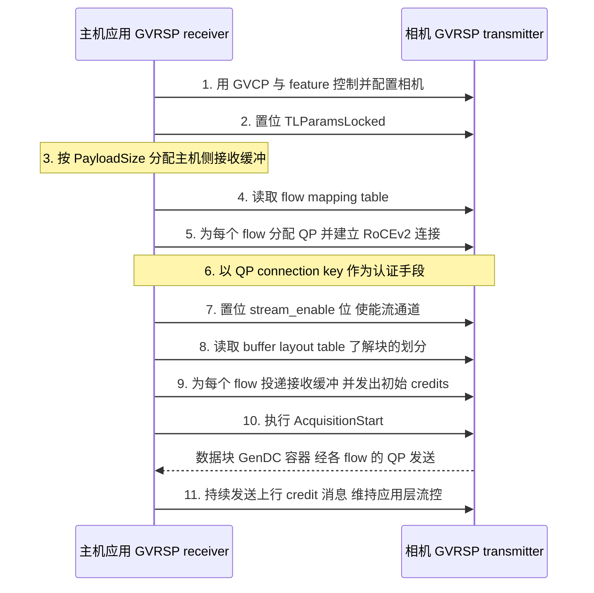
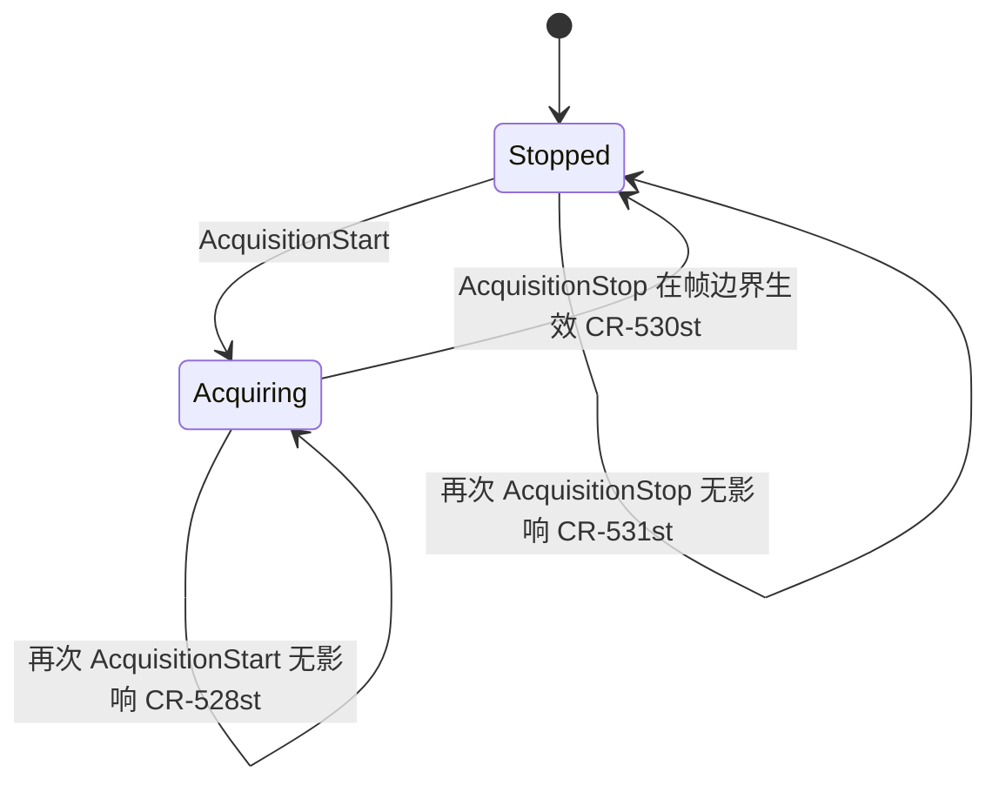
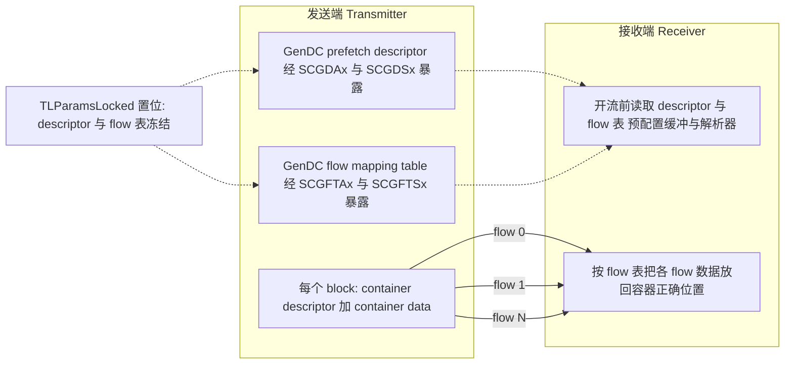

# 互操作性与测试（第 37–39 章：相机标准 feature、GenDC 流、测试）

> **覆盖范围**：Interoperability 部分——Chapter 37 Standard Features List for Cameras（§37.1–§37.8，PDF p.354–364）、Chapter 38 Using GenDC Streams（含 §38.1，p.365–366）、Chapter 39 Testing（§39.1–§39.3，p.367–368）。
>
> **一句话总结**：GigE Vision 借助 GenICam XML（GenApi 语法 + SFNC 2.8 命名）实现“任意相机 + 任意软件”的互操作——相机必须在 XML 中提供 8 个强制 feature（Width、Height、PixelFormat、PayloadSize、GevSCPSPacketSize、AcquisitionMode、AcquisitionStart、AcquisitionStop），支持 GenDC 或 PTP 的设备还要实现相应 SFNC feature；GenDC 流用 prefetch descriptor + flow mapping table 预先描述数据并在 TLParamsLocked 时冻结；合规由厂商自我认证，设备须提供测试用 feature。
>
> **本文目录**：核心要点 → 37.1 引言 → 37.2 GenICam 标准 → 37.3 互操作的层次 → 37.4 三个用例 → 37.5 XML 强制 feature（37.5.1–37.5.7）→ 37.6 GenDC feature → 37.7 IEEE 1588 feature → 37.8 命名约定 → 第 38 章 GenDC 流 → 38.1 何时使用 flow → 第 39 章 测试 → 实现要点与易错点 → 相关章节 → 自测题
>
> **约定**：Access 列中括号内的访问方式为可选（例如 R/(W) = 必须可读、可选可写；(R)/W = 必须可写、可选可读）（Table 37-1 注, p.359）。

---

## 核心要点

- 设备提供的 GenICam XML **必须符合 GenICam 规范，包括 SFNC 2.8 或更高版本**（[R-505cd]，§37.1, p.354）。
- Bootstrap 寄存器是“所有相机统一”的固定映射；GenICam XML 是厂商自定的动态映射——要让软件理解 feature 的**含义**，必须靠标准 feature 名（SFNC）（§37.2, p.354）。
- 互操作有层次：最简单是 GUI 罗列 feature 由人理解；更高层次是软件自动理解 feature 含义。一个 feature 有名称、表示形式、单位、行为 4 个特征，只统一名称不足以保证互操作（§37.3, p.355）。
- 规范用 3 个用例定义强制 feature：①连续采集与显示（仅 GVSP 相机）②最简单的相机（相当于 RS-170 模拟相机）③只支持 GVRSP 的 3.0 相机（§37.4, p.355–357）。
- 流发送端必须在 XML 中提供表 37-1 的 8 个 feature（[CR-506st]）；其中 **GevSCPSPacketSize 只对 GVSP 发送端强制**（p.358）。非相机设备不需要（p.359）。
- 关键约束：Width/Height 为 IInteger、单位像素、正值、可读；PayloadSize 为正、可变时取最坏值；GevSCPSPacketSize 取值 46–65535 且必须反映 SCPS 的 `packet_size`；AcquisitionMode 默认 "Continuous"；重复 Start/Stop 不改变状态；Stop 在帧边界生效（§37.5.1–§37.5.7）。
- 支持 GenDC 的设备必须实现 GenDCStreamingMode、GenDCStreamingStatus、GenDCDescriptor、GenDCFlowMappingTable（[CR-602cd]）；支持 PTP 的设备必须实现 9 个 Ptp* feature（[CR-612cd]）。
- GenDC 流：prefetch descriptor 描述容器结构，flow mapping table 描述容器如何分布到各 flow；二者在 TLParamsLocked 置位时冻结（[CR-613st]、[CR-614st]），但容器内容仍可逐块变化（第 38 章, p.365–366）。
- flow 只在需要时使用：并行传输、可变大小的 part、独立监控（§38.1, p.366）。
- 合规是**自我认证**：用 Compliancy Matrix 报告并在注册时提交，设备可部分借助 GigE Vision Validation Framework 证明（§39.1, p.367）；所有设备必须支持 TestPendingAck（[R-563cd]）。

---

## 第 37 章 相机标准 feature 列表（Standard Features List for Cameras）

### 37.1 引言（§37.1, p.354）

- GigE Vision 依靠 GenICam™ 规范（www.genicam.org）描述相机支持的 feature：形式是一个遵循 GenICam **GenApi** 模块语法的 **XML 设备描述文件**。
- 应用软件获取并解释该 XML，枚举设备支持的 feature；XML 提供 “feature ↔ 实现该 feature 的设备寄存器” 的映射。
- GenICam 的 **SFNC**（Standard Features Naming Convention）模块定义了一组标准 feature 名；相机厂商使用这些名字可以方便与第三方软件互操作。

> **[R-505cd]** 为使 GigE Vision 设备与应用软件互操作，设备提供的 GenICam XML 设备描述文件 **MUST** 符合 GenICam 规范，**包括 SFNC 模块 2.8 或更高版本**（p.354）。

- NOTE：设备的 GenICam 合规性通过一个验证套件保证，该套件可由 **GigE Vision Validation Framework** 调用（p.354）。
- 💡 补充：XML 本身对所有设备都是强制的——“A GigE Vision device MUST have an XML device description file”（[R-117cd]，§14.1, p.94），获取方式（First/Second URL、Manifest Table、READMEM）见 [GVCP 高级概念](../02_gvcp/02_advanced_concepts.md)。
- 由于大部分 GigE Vision 设备是相机，本章给出相机 XML 中必须出现的强制 feature 列表；**非相机设备不在本章范围内**。任何提供“符合 GenApi 语法且包含本章强制 feature”的 XML 的相机，都被认为适用于 GigE Vision（p.354）。

### 37.2 GenICam™ 标准（§37.2, p.354）

- GenICam 是 **EMVA**（European Machine Vision Association, www.emva.org）的标准与商标。
- GenICam 的优点是**高度动态**：feature 映射可以针对具体相机定制，由厂商决定提供哪些 feature、按厂商习惯命名。这与 bootstrap 寄存器“对所有相机强制统一映射”截然不同。
- 缺点：应用软件无法从任意 feature 名识别其含义。解决办法是定义跨相机型号通用的**标准 feature 名**，让软件知道某个名字代表什么。
- 但标准名定义得越细，越限制厂商实现 feature 的自由，因此**不宜过度规定所有 feature**。

| 对比项 | Bootstrap 寄存器 | GenICam XML feature |
|---|---|---|
| 映射方式 | 规范规定的固定地址，所有设备一致 | 厂商在 XML 中自定义 feature → 寄存器映射 |
| 灵活性 | 低 | 高 |
| 软件能否理解含义 | 能（规范定义） | 只有使用 SFNC 标准名时才能 |
| 典型用途 | 发现、控制通道、流通道建立等传输层功能 | 相机功能配置（ROI、像素格式、采集控制……） |

### 37.3 互操作的层次（§37.3, p.355）

| 层次 | 描述 | 例子 |
|---|---|---|
| 最简单 | GUI 只把 feature 列表显示出来，由**用户**查看并理解每个 feature 的含义；可用在线帮助（如 tooltip）解释 | 相机配置程序 |
| 更复杂 | **软件**能够正确解释某个 feature 名对应的功能，无需用户介入即可做出恰当决策 | 自动配置的采集软件 |

一个 feature 的特征至少包括 4 项：

1. 名称（Name）
2. 表示形式（Representation：整数、浮点、布尔、枚举……）
3. 计量单位（Unit of measurement）
4. 行为（Behavior）

例：feature “Gain” 可以是以 dB 为单位的浮点数（表示对传感器输出模拟信号的放大量），也可以定义为枚举 {GAIN_x1, GAIN_x2, GAIN_x4}。**因此只统一 feature 名称不足以保证互操作。** 由于相机厂商与图像处理软件厂商众多，很难在名称、表示、单位与行为上都达成共识；很多情况下 feature 的表示形式直接取决于相机架构（p.355）。

### 37.4 用例（§37.4, p.355–357）

GigE Vision 的目标之一：用户买一台 GigE Vision 相机，就能轻松接入任何 GigE Vision 兼容的应用软件。为保证最低限度的互操作，规范考虑 3 个用例，支持它们所需的 feature 被定为**强制**：

1. 连续采集与显示图像；
2. 最简单的 GigE Vision 相机；
3. 只支持 GVRSP 流的 GigE Vision 3.0 相机。

其他 feature 列在 SFNC 文档中；规范**建议**相机厂商尽可能使用其中的名字（p.355）。

> NOTE（p.356）：强制 feature 列表只考虑**单个 stream channel**。若有多个 stream channel，应按 SFNC 的建议使用 “Selector” feature 指定要配置的 stream channel 索引。

#### 37.4.1 用例 #1：仅支持 GVSP 的相机的连续采集与显示（§37.4.1, p.356）

应用要能初始化相机、开始自由运行（free-running）采集，并把图像显示到屏幕。**相机的出厂默认设置必须保证：打开采集控制后无需任何额外配置即可显示合适的实时图像。**

| 步骤 | 动作 | 依赖 |
|---|---|---|
| 1 | 用 GVCP 控制相机 | Bootstrap 寄存器 |
| 2 | 用 GVSP 寄存器建立 stream channel | Bootstrap 寄存器 |
| 3 | 通过相机 XML 获取 payload 特性（如 PayloadSize） | XML 标准 feature |
| 4 | 在 PC 上分配缓冲区 | 不需与相机交互 |
| 5 | 通过 stream channel 启动连续采集 | XML 标准 feature（AcquisitionMode / AcquisitionStart） |

#### 37.4.2 用例 #2：最简单的 GigE Vision 相机（§37.4.2, p.356）

- 设想一台最简单的相机，基本等同于 **RS-170 模拟相机**：没有触发控制、曝光控制、模拟增益控制等，只以标称帧率连续采集。
- 原则：**强制 feature 必须是所有相机都具备的；不是所有相机都需要的 feature 就不能设为强制。**

> 💡 解读：这解释了为什么强制列表里没有 ExposureTime、Gain、TriggerMode 等常见 feature——它们由 SFNC 推荐，但不是 GigE Vision 强制项。

#### 37.4.3 用例 #3：只支持 GVRSP 流的 GigE Vision 3.0 相机（§37.4.3, p.356–357）

该用例针对**只支持一个 GVRSP stream channel** 的相机。应用要像用例 #1 那样配置相机并启动/停止采集。除 GVCP 需求外，满足以下条件即可实现 GVRSP 互操作：

1. 相机实现**全部 GVRSP bootstrap 寄存器**，以便控制相机并实例化 GVRSP stream channel；
2. 相机实现 **GevStreamingMode**，以指示工作模式 “GVRSP”；
3. 相机实现 §37.6 定义的 **GenDC 相关 feature**。

> ⚠️ 不确定项：`GevStreamingMode` 在 3.0 正文中仅此一处出现，未给出定义或与寄存器的映射。💡 推测它对应 Streaming Configuration 寄存器（0x0960）的 `streaming_protocol` 字段（§36.38, p.305），但规范未明说，应以 SFNC 为准。

成功采集的 11 个步骤（p.357）：



> 💡 解读（结合 PART 4）：步骤 5 必须在步骤 7 之前——流使能（`stream_enable` = 1）后发送端会拒绝该流的所有连接请求（[CR-638st]，p.228）；buffer layout table 中所有 buffer 大小之和必须等于 PayloadSize（[R-623s]，p.215）；credits 以 MSG_CREDITS 上行消息发送（第 32–33 章）。详见 [GVRSP 流模型](../04_gvrsp/01_rocev2_and_streaming_model.md) 与 [连接与流控](../04_gvrsp/02_connection_and_flow_control.md)。

---

### 37.5 XML 描述文件的强制 feature（§37.5, p.357–359）

> **[CR-506st]** 在控制相机、实例化 stream channel 所需的 bootstrap 寄存器之外，**流发送端 MUST 在其 XML 描述文件中支持表 37-1 中的 feature**（p.357）。

NOTE：这些 feature 在 GenICam SFNC 中有进一步描述，用于相机配置。

**Table 37-1：GigE Vision 强制 XML feature**（p.357–359）

| Feature 名 | Interface | Access | 单位 | 说明（中文转述） |
|---|---|---|---|---|
| `Width` | IInteger | R/(W) | pixels | 相机在 stream channel 上输出图像的宽度。更高级的用例参考 SFNC。 |
| `Height` | IInteger | R/(W) | pixels | 输出图像的高度。对线扫描源，表示由连续多行组合而成的帧的高度。更高级用例参考 SFNC。 |
| `PixelFormat` | IEnumeration | R/(W) | N/A | 相机在 stream channel 上输出的像素格式，见 §26.3 Pixel Formats。 |
| `PayloadSize` | IInteger | R | Bytes | 每个 block 在 stream channel 上传输的**最大**字节数，包括图像、chunk、GenDC 容器和 parts，即一个 block 的数据 payload。数据 payload 被分成 UDP 包传输，传输时附加的 leader、trailer 以及 UDP、GVSP 头等**不算**数据 payload。主要供应用软件确定要分配的缓冲大小（当前工作模式下可能的最大缓冲）。 |
| `GevSCPSPacketSize` | IInteger | R/W | bytes | **仅对 GVSP 发送端强制。** 采集期间发送的 GVSP 包大小，反映该 stream channel 对应 SCPS 寄存器的 `packet_size` 字段。该 feature **MUST** 明确给出相机支持的最小值、最大值和步进（increment）。 |
| `AcquisitionMode` | IEnumeration | R/(W) | N/A | 应用用来设置采集模式，表示图像如何从相机输出（连续、单帧、多帧……）。GigE Vision 只强制一个取值：**"Continuous"**——相机输出无限的图像序列，必须由应用显式停止。AcquisitionMode 可以有更多枚举项，但只有这一项是强制的。AcquisitionStart / AcquisitionStop 用于控制采集状态。 |
| `AcquisitionStart` | ICommand | (R)/W | N/A | 按指定的采集模式开始图像采集。 |
| `AcquisitionStop` | ICommand | (R)/W | N/A | 按指定的采集模式停止图像采集。 |

- 该列表**只针对相机设备**；非相机设备不必支持这些 feature（p.359）。
- **不要求**所有 bootstrap 寄存器都通过 XML 暴露，但按 [O-414cd] **建议**这样做；XML 的目的是暴露与用户相关的 feature（p.359）。

#### 37.5.1 Width 与 Height（§37.5.1, p.359–361）

Width 和 Height 表示相机输出图像的尺寸，本质上就是从传感器中取出的**感兴趣区域（ROI）**的尺寸。Figure 37-1（p.360）展示了描述 ROI 的各个 feature：HeightMax、WidthMax、OffsetY、OffsetX 是 SFNC 推荐的名字，但 GigE Vision **只强制 Width 和 Height**。

```
(0,0)
 +-------------------------------- WidthMax ---------------------------------+
 |              | OffsetY                                                    |
 |              v                                                            |
 |  OffsetX --> +---------- Width ----------+                                |
 |              |                           |                                | HeightMax
 |              |  Area of Interest (AOI)   | Height                         |
 |              |                           |                                |
 |              +---------------------------+                                |
 +---------------------------------------------------------------------------+
```

| 需求 | 内容 |
|---|---|
| [CR-507st] | Width 与 Height **MUST** 用 GenICam 的 **IInteger** 接口表示（64 位整数） |
| [CR-508st] | Width 与 Height **MUST** 以**像素**为单位 |
| [CR-509st] | Width **MUST** 只取正值 |
| [CR-510st] | Width **MUST** 可读 |
| [CR-511st] | Height **MUST** 只取正值 |
| [CR-512st] | Height **MUST** 可读 |

- Width 取值范围 1 到最大宽度（原文此处写作 “MaxWidth”，图与 SFNC 名称为 **WidthMax**，p.360）；Height 取值 1 到 HeightMax。
- 若可配置 ROI 大小，Width / Height **可以**可写；默认值通常为传感器宽/高。
- 有的相机会给 Width 设置更粗的步进，以免把不同行的像素打包到一起：例如使用 **Mono1p** 时 Width 步进可限定为 **8**，保证同一字节内的 8 个像素来自同一行（另见 §26.2, p.202–203）。
- 若除 Width、Height 外没有其他 ROI feature，则图像从 (0, 0) 开始，相当于 OffsetY = 0、OffsetX = 0、Width = WidthMax、Height = HeightMax（p.360–361）。
- Width / Height 可写时，可用来裁剪传感器输出的图像。
- **线扫描相机**：Height 表示组合成一帧的行数；每帧由 GVSP 的 data leader 与 data trailer 包围。只有一行的帧完全合法（这就是传统线扫描的定义）（p.361）。

#### 37.5.2 PixelFormat（§37.5.2, p.361）

PixelFormat 给出 stream channel 输出的像素类型，定义见第 26 章。

> **[CR-514st]** 当 PixelFormat 的某个枚举项使用了 “GenICam Pixel Format Values” 中的名字时，该枚举项 **MUST** 使用对应的数值。

> 💡 解读：即 PixelFormat 的枚举值应直接等于 PFNC 规定的 32 位像素格式值，这样 XML 中的 PixelFormat 与 GVSP data leader 里的 `pixel_format` 字段才能一致（Bayer 相关规则见 §26.3.1, p.203）。

#### 37.5.3 PayloadSize（§37.5.3, p.361）

- 只读 feature，表示在 stream channel 的**数据 payload 包**中，**一个 block ID** 所发送的**最大数据字节数**。
- **不包括** IP、UDP、GVSP 头，也不包括 data leader、data trailer 包；**包括**附加在图像之后的任何数据（如 chunk）。
- 主要用途：给出一个易于获取的缓冲区大小，供在图像 stream channel 上分配接收缓冲。
- 数据大小可变时，PayloadSize **必须**给出可能的最大值（最坏情况）。

> **[CR-517st]** PayloadSize **MUST** 只取正值。

- PayloadSize 通常取决于 Width、Height 与 PixelFormat；若数据块中附加了 chunk 或 part 等额外数据，所需的 PC 缓冲可能大于图像本身。

#### 37.5.4 GevSCPSPacketSize（§37.5.4, p.361–362）

- 帮助应用确定发送端在出流时支持的包大小。它基本上反映 SCPS 寄存器的 `packet_size` 字段，但额外提供取值范围信息（最小值、最大值、步进），便于寻找最优包大小。
- 该范围只代表**发送端自身**的限制，不考虑交换机等网络设备引入的限制，因此**建议用 Test Packet 确认整个系统支持所请求的包大小**。

> **[CR-520st]** GevSCPSPacketSize **MUST** 只取 **46 到 65535** 范围内的整数值；发送端可以在此范围内施加更小的范围（p.362）。

NOTE（p.362）：最小值 46 的由来——以太网最小帧 64 字节，减去目的 MAC 6 字节、源 MAC 6 字节、Ethertype 2 字节、帧校验序列（32 位 CRC）4 字节，剩 46 字节数据。这对大多数 GEV 2.x 传输模式都不够，发送端应确保最小值足以容纳 GVSP payload 头和一些数据。

```
最小以太网帧 64 B = 目的 MAC 6 + 源 MAC 6 + Ethertype 2 + 数据 46 + FCS 4
```

> **[CR-521st]** 通过 GevSCPSPacketSize 读写的值 **MUST** 反映在对应 SCPS bootstrap 寄存器的 `packet_size` 字段中。

- 例如，允许发送端把包大小值取整为 4 字节的倍数；但**不允许**在应用改变数据格式（例如图像宽度或像素格式）时擅自改变包大小 feature。通常 GevSCPSPacketSize 应给出合适的最小值、最大值和步进，使取整变得不必要（p.362）。

> 💡 解读：原文只说 “round a packet size value to a multiple of 4 bytes”，未限定取整方向，实现时应回读确认实际值。另外 SCPSx 的 `packet_size` 位于 bit 16–31（MSB-first 编号，§36.58, p.325）。对仅支持 GVRSP 的相机，GevSCPSPacketSize 不是强制的（表 37-1）。

#### 37.5.5 AcquisitionMode（§37.5.5, p.362–363）

- 决定采集期间图像的排序方式，通常指启动采集后捕获的图像数量：可以是不间断采集，也可以是预定帧数。这与 stream channel 是否打开**完全无关**。

| 需求 | 内容 |
|---|---|
| [CR-523st] | AcquisitionMode **MUST** 可读 |
| [CR-524st] | 当 AcquisitionMode 的枚举有多个取值时，它必须可写；强制取值为 “Continuous”；**默认状态 MUST 为 "Continuous"** |

**Table 37-2：AcquisitionMode 字符串**（p.362）

| 模式 | 字符串 |
|---|---|
| 不间断采集（Uninterrupted acquisition） | "Continuous" |

- 其他采集模式由 SFNC 推荐；字符串对应的**数值由设备自定**（device specific）。
- AcquisitionMode 应只在采集停止时修改；在 AcquisitionStart 之后、AcquisitionStop 之前修改的结果本规范未定义——应在 AcquisitionStop 之后再修改（p.362–363）。

> **[CR-526st]** AcquisitionMode 为 "Continuous" 时，图像采集由 "AcquisitionStart" 命令启动，并持续到应用发出 "AcquisitionStop" 命令。允许用其他命令（如可选的 AcquisitionAbort）结束采集（p.363）。

#### 37.5.6 AcquisitionStart（§37.5.6, p.363）

- 按 AcquisitionMode 指定的模式开始采集；期望在命令发出后**尽快**开始。
- 注意：开始采集前，**stream channel 必须已通过 bootstrap 寄存器建立**，其他设备 feature 也必须已初始化。

> **[CR-528st]** 采集已启动后、AcquisitionStop 之前**再次发出 AcquisitionStart，MUST NOT 影响采集状态**——发送端必须保持采集激活。

#### 37.5.7 AcquisitionStop（§37.5.7, p.363）

- 在**当前帧完成后**终止采集。

> **[CR-530st]** 发出 AcquisitionStop 后，采集 **MUST** 尽快在**帧边界**（即 data trailer 之后）停止。
>
> **[CR-531st]** AcquisitionStop 已生效后、下一次 AcquisitionStart 之前**再次发出 AcquisitionStop，MUST NOT 影响采集状态**——发送端必须保持采集停止。



> 💡 本章需求编号不连续（缺 513、515、516、518、519、522、525、527、529）：附录 A 表 40-2 显示 [CR-513st]、[CR-515st]、[CR-516st]、[CR-518st]、[CR-519st]、[CR-525st]、[CR-527st]、[CR-529st] 在 **3.0** 中废弃，[CR-522st] 在 2.1 中废弃（p.400）。见 [废弃需求列表](../reference/deprecated_requirements.md)。

### 37.6 GenDC feature（§37.6, p.363）

为保证支持 GenDC 的组件之间的互操作，设备必须实现与 GenDC 相关的 SFNC feature。

> **[CR-602cd]** 若设备的 stream channel 能够传输 GenDC 容器，它 **MUST** 实现以下 SFNC feature：**GenDCStreamingMode、GenDCStreamingStatus、GenDCDescriptor、GenDCFlowMappingTable**。
>
> **[CR-603cd]** 若设备在**多个** stream channel 上支持 GenDC，则 GenDCStreamingStatus、GenDCDescriptor、GenDCFlowMappingTable **MUST** 由 **DeviceStreamChannelSelector** feature 选择。

> 💡 [CR-603cd] 未把 GenDCStreamingMode 列入需要 selector 的 feature。GenDCDescriptor / GenDCFlowMappingTable 对应第 38 章所述的 prefetch descriptor 与 flow mapping table。

### 37.7 IEEE 1588 feature（§37.7, p.364）

IEEE 1588（PTP）时间同步**主要通过 SFNC feature 控制与报告**，bootstrap 寄存器只提供最基本的使能与状态功能。支持 PTP 时，以下 SFNC feature 为强制，以获得更好的互操作性。

> **[CR-612cd]**（3.0 新增）若设备支持 IEEE 1588 时间同步，它 **MUST** 实现以下 SFNC feature：

| # | Feature | 💡 用途（据名称推断，详见 SFNC） |
|---|---|---|
| 1 | PtpEnable | 使能 PTP |
| 2 | PtpClockAccuracy | 时钟精度 |
| 3 | PtpDataSetLatch | 锁存 PTP 数据集以便一致读取 |
| 4 | PtpStatus | PTP 端口状态 |
| 5 | PtpServoStatus | 时钟伺服状态 |
| 6 | PtpOffsetFromMaster | 与主时钟的偏差 |
| 7 | PtpClockID | 本时钟 ID |
| 8 | PtpParentClockID | 父时钟 ID |
| 9 | PtpGrandmasterClockID | 祖主时钟 ID |

> 💡 寄存器层面对应 GVCP Configuration 寄存器 bit 12 `IEEE1588_PTP_enable`（相关 SFNC PtpEnable，§36.35, p.301）以及 IEEE 1588 Status、Extended Capability、Supported/Selected Profiles 等寄存器（§36.41、§36.43–§36.45, p.308–311）。PTP 原理见 [高级概念](../02_gvcp/02_advanced_concepts.md)。

### 37.8 与命名约定的关系（§37.8, p.364）

- 本章只描述 XML 中的**强制** feature；其他推荐 feature 见 SFNC（http://www.genicam.org）。
- 实现本章未描述的 feature 时**应当**遵循该命名约定。
- 新推荐 feature 名的提案应提交给 **GenICam 委员会**。

---

## 第 38 章 使用 GenDC 流（Using GenDC Streams, p.365–366）

**GenDC 是什么**：GenDC（Generic Data Container）是以传输无关方式描述和封装任意数据的标准，属于 GenICam 的一部分。一个 GenDC 容器可以在不同传输协议上存储或传输多种数据。**GenDC 定义“传什么”（容器），本规范定义“怎么传”**。为传输 GenDC 容器，本规范定义了 **GVSP 的 GenDC payload 类型**以及 **GVRSP 协议**（p.365）。

**设备需要暴露的两个 GenDC 数据结构**（可通过 bootstrap 寄存器，并可选地通过 SFNC feature 暴露）：

| 数据结构 | 作用 | 对应 bootstrap 寄存器 |
|---|---|---|
| **GenDC prefetch descriptor** | 描述设备将要发送的 GenDC 容器的结构与内容；接收端可在开流**之前**读取，从而无需解析实时数据就了解容器布局 | Stream Channel GenDC Descriptor Address（**SCGDAx**，SCEBA(x)+0）与 Descriptor Size（**SCGDSx**，SCEBA(x)+4）（§36.67–§36.68, p.337–338） |
| **GenDC flow mapping table** | 描述 GenDC 容器在传输时如何划分并分布到一个或多个 flow 上；接收端据此把收到的数据准确放回重建容器中的正确位置 | Stream Channel GenDC Flow Mapping Table Address（**SCGFTAx**，SCEBA(x)+8）与 Size（**SCGFTSx**，SCEBA(x)+0xC）（§36.69–§36.70, p.339–340） |

- 两者一起，使主机能**提前**配置缓冲区与解析器。
- 为让应用可以信赖这些内容，设备必须保证**流激活期间内容不变**。使用 GenApi 时，通过**在开流前置位 TLParamsLocked feature** 来保证：TLParamsLocked 置位后，flow mapping table 与 prefetch descriptor 即被冻结。

> **[CR-613st]**（3.0 新增）若发送端实现了 Stream Channel GenDC Descriptor Address，则 TLParamsLocked 置位时 GenDC prefetch descriptor 的内容 **MUST** 冻结。
>
> **[CR-614st]**（3.0 新增）若发送端实现了 Stream Channel GenDC Flow Mapping Table Address，则 TLParamsLocked 置位时 GenDC flow mapping table 的内容 **MUST** 冻结。

**冻结 ≠ 容器格式固定**（p.365–366）：

- 即使 flow mapping table 与 prefetch descriptor 在流传输期间被冻结，**容器格式不必在整个传输过程中固定**：GenDC descriptor 仍可逐块变化，例如每个 block 中图像的尺寸都可以不同。这种可变性需要在 prefetch descriptor 的 **VariableFields** 字段中标明。
- 即使有 prefetch descriptor，**container descriptor 也总是在承载容器数据的 block 中传输**：block 传输结束时，block 中包含 container descriptor 及其后的容器数据。传输过程中 descriptor 可能以两种形式出现两次：**preliminary（初步）**或 **final（最终）**；**每个 block 至少传一个 final descriptor**。preliminary descriptor 提前提供即将到来的数据信息，final descriptor 包含最终的确定细节。
- 固定的 flow 表并不意味着容器格式是静态的：flow mapping table 只规定某 stream channel 上**存在哪些 GenDC flow**以及容器 payload **如何分布**到这些 flow 上，**不定义容器内容**。每个 flow 上发送的数据量可以逐块变化，只要不超过 flow mapping table 中为该 flow 定义的**最大大小**。



### 38.1 何时使用 flow（§38.1, p.366）

flow 会增加发送端与接收端的复杂度，**只在必要时使用**；很多情况下单个 flow 即可。

| 使用 flow 的理由 | 说明 | 用 GVSP GenDC payload 时 |
|---|---|---|
| **并行传输（Parallel Transmission）** | 容器的不同部分可并行发送，例如图像走一个 flow、元数据走另一个 flow；无需等第一部分（图像）发完再发第二部分（元数据），缩短总传输时间并减少相机内部缓冲 | 不用 flow 也能实现 |
| **可变 part 大小（Variable Parts Size）** | GenDC 中 part 的**位置**不在 VariableFields 里，因此不能变。使用 GVRSP 时，若某 part 比预期小，发送端必须发送**填充数据**补齐空隙；用 flow 可让每个 part 独立、以可变大小发送，无需填充。例：容器含图像 part 与元数据 part，图像大小可变时，把图像和元数据放到不同 flow，各自大小独立 | 不用 flow 也能实现 |
| **独立监控（Independent Monitoring）** | 可分别监控容器的不同部分。例：相机把一幅大图拆到多个 flow 上，接收端可以独立跟踪每个 flow，**第一个 flow 传完即可开始处理** | — |

> 💡 解读：前两条理由在 GVSP GenDC payload 下“不需要 flow 也能做到”，说明 flow 对 **GVRSP** 尤其重要——GVRSP 按 buffer layout table 把数据写入预先投递的缓冲区（见 [GVRSP 流模型](../04_gvrsp/01_rocev2_and_streaming_model.md)），位置固定，可变大小只能靠填充或拆分 flow 解决。

---

## 第 39 章 测试（Testing, p.367–368）

### 39.1 标准合规（§39.1, p.367）

- GigE Vision 合规由产品厂商**自我认证（self-certified）**：所有适用需求都必须满足，并在**注册流程**中使用 **Compliancy Matrix** 报告。
- 对设备而言，成功运行 **GigE Vision Validation Framework** 可以作为部分证明。

### 39.2 可测试性设计（§39.2, p.367）

- GigE Vision 设备应当便于测试。用于检查合规的 Validation Framework 需要在**无外部交互**的情况下运行。
- 为此所需的功能与配置寄存器是标准的一部分；SFNC 还定义了可实现的标准**测试 feature 名**以提高可测试性。

### 39.3 用于测试的设备 feature（§39.3, p.367–368）

测试所需的设备 feature 位于 XML 设备描述文件中；需要实现哪些取决于设备能力，其中一些取自 SFNC。

> **[R-563cd]** 设备 **MUST** 支持表 39-1 中的 feature。

**Table 39-1：PENDING_ACK 测试 feature**

| Feature | Interface | Access | 单位 | 说明 |
|---|---|---|---|---|
| TestPendingAck | IInteger | R/W | ms | 测试 PENDING_ACK 功能，参见 SFNC |

> **[CR-564cd]** 若设备支持 message channel，则 **MUST** 支持表 39-2 中的 feature。

**Table 39-2：Message channel 测试 feature**

| Feature | Interface | Access | 单位 | 说明 |
|---|---|---|---|---|
| TestEventGenerate | ICommand | (R)/W | N/A | 产生一个 Test Event，参见 SFNC |
| EventTest | IInteger | R | N/A | Test 类型事件的唯一标识；必须定义在 EventTestData category 中，参见 SFNC |
| EventTestTimestamp | IInteger | R | N/A | Test 类型事件的时间戳；必须定义在 EventTestData category 中，参见 SFNC |

> **[CR-565cd]** 若设备支持 GVSP payload 类型 **Multi-part 或 GenDC**，则 **MUST** 支持表 39-3 中的 feature。

**Table 39-3：Multi-part payload 类型测试 feature**

| Feature | Interface | Access | 单位 | 说明 |
|---|---|---|---|---|
| TestPayloadFormatMode | IEnumeration | R/W | N/A | 用于强制使用 multi-part payload 类型的测试 feature。测试时要求的枚举值：**Off**；**MultiPart**（若支持 Multi-part）；**GenDC**（若支持 GenDC）。参见 SFNC |

> 💡 解读：TestPendingAck 对**所有**设备强制（[R-563cd]，后缀 cd、类型 R），与 3.0 把 PENDING_ACK 改为强制相呼应（§16.8, p.142）；Validation Framework 可借此让设备“故意”拖延应答，以验证 PENDING_ACK 行为。这三条需求（[R-563cd]、[CR-564cd]、[CR-565cd]）均在 2.1 引入（附录 A 表 40-1，p.387）。

---

## 实现要点与易错点

**设备端（相机 / 发送端）**

- XML 必须通过 GenICam 合规检查并符合 **SFNC 2.8+**（[R-505cd]）：从 2.x 升级时检查 feature 名称、类型、单位是否与 SFNC 2.8 一致。
- **出厂默认设置必须能直接出图**：打开采集控制后无需额外配置即可得到合适的实时图像（§37.4.1, p.356）；AcquisitionMode 默认必须是 "Continuous"（[CR-524st]）。
- Width / Height 必须是 IInteger（不是 IFloat）、单位像素、正值、可读；packed 像素格式（如 Mono1p）建议加大 Width 步进，避免跨行打包。
- PayloadSize 必须是**最坏情况**值，且包含 chunk / parts / GenDC 容器；不要漏算 chunk 导致主机缓冲溢出。用 GVRSP 时，buffer layout table 中 buffer 大小之和必须等于 PayloadSize（[R-623s]，p.215）。
- GevSCPSPacketSize（仅 GVSP）：必须给出 min / max / increment，范围在 46–65535 内，与 SCPS `packet_size` 双向一致；**不得**因宽度、像素格式变化而擅自改变。
- AcquisitionStart / AcquisitionStop 必须幂等；Stop 必须在帧边界（data trailer 之后）生效。
- 支持 GenDC：实现 4 个 GenDC feature（[CR-602cd]），多流时用 DeviceStreamChannelSelector（[CR-603cd]）；TLParamsLocked 置位后冻结 prefetch descriptor 与 flow mapping table（[CR-613st]、[CR-614st]），但每块的 container descriptor 可以变化，可变字段要在 VariableFields 中声明；每个 block 至少发送一个 final descriptor。
- 支持 PTP：实现全部 9 个 Ptp* feature（[CR-612cd]）。
- 测试 feature：**所有设备**都要有 TestPendingAck（[R-563cd]）；有 message channel 就要有 TestEventGenerate / EventTest / EventTestTimestamp（[CR-564cd]）；支持 Multi-part 或 GenDC 就要有 TestPayloadFormatMode（[CR-565cd]）。注意这些要求的后缀是 `cd`，**非相机设备同样适用**，与只针对相机的表 37-1 不同。

**应用端（采集软件 / SDK）**

- 要做到“插上任何 GigE Vision 相机都能出图”，只依赖表 37-1 的 8 个强制 feature；其他 feature（曝光、增益、触发……）要做存在性检查。
- 用 PayloadSize 分配缓冲；不要用 Width × Height × 每像素字节数自行计算（会漏掉 chunk / GenDC 头等）。
- GevSCPSPacketSize 的范围只反映发送端能力，**不代表交换机/网卡也支持**，应用 Test Packet 验证整条链路（§37.5.4, p.361）。
- 修改 AcquisitionMode 前先 AcquisitionStop（否则结果未定义）。
- 多 stream channel 设备：强制 feature 只针对单个 stream channel，多通道时按 SFNC 使用 Selector。
- GVRSP / GenDC：开流前置位 TLParamsLocked，读取 prefetch descriptor 与 flow mapping table 预配置解析器；遵守用例 #3 的步骤顺序（先建 QP 连接，再置位 stream_enable）。

**测试 / 合规**

- 合规是自我认证 + Compliancy Matrix + 注册；Validation Framework 只能“部分”证明设备合规，不能替代逐条核对需求（§39.1, p.367）。
- 让 Validation Framework 能无人值守运行：不要让测试依赖外部触发或人工操作（§39.2, p.367）。

---

## 相关章节

- [引言与系统架构](../00_overview/01_introduction_and_architecture.md) · [版本历史与 3.0 变化](../00_overview/03_version_history_and_v3_changes.md) · [术语表](../00_overview/02_glossary.md)
- [GVCP 高级概念（XML 获取、IEEE 1588、Action、Switchover）](../02_gvcp/02_advanced_concepts.md)
- [GVCP 消息格式（PENDING_ACK、EVENT/EVENTDATA）](../02_gvcp/03_message_formats.md)
- [GVSP 传输与数据块（Test Packet、chunk）](../03_gvsp/01_transport_and_data_block.md) · [Payload 类型与像素布局（GenDC payload、PFNC）](../03_gvsp/02_payload_types_and_pixel_layouts.md)
- [GVRSP：RoCEv2 与流模型（buffer layout table）](../04_gvrsp/01_rocev2_and_streaming_model.md) · [连接与流控（QP 连接、credits）](../04_gvrsp/02_connection_and_flow_control.md)
- [通道寄存器（SCPSx、SCGDAx、SCGFTAx、RSCCTLx）](../05_bootstrap_registers/03_channel_registers.md)
- [全部需求索引](../reference/requirements_index.md) · [废弃需求列表](../reference/deprecated_requirements.md)

---

## 自测题

1. 表 37-1 中的 8 个强制 feature 是什么？哪一个只对 GVSP 发送端强制？
   <details><summary>答案</summary>

   Width、Height、PixelFormat、PayloadSize、GevSCPSPacketSize、AcquisitionMode、AcquisitionStart、AcquisitionStop；其中 GevSCPSPacketSize 只对 GVSP 发送端强制（p.357–359）。
   </details>

2. 为什么规范说“只标准化 feature 名不足以保证互操作”？
   <details><summary>答案</summary>

   一个 feature 有名称、表示形式、单位、行为 4 个特征。例如 Gain 可以是以 dB 为单位的浮点数，也可以是 {GAIN_x1, GAIN_x2, GAIN_x4} 枚举；名字相同但表示不同，软件仍无法正确使用（§37.3, p.355）。
   </details>

3. GevSCPSPacketSize 的合法范围是多少？最小值 46 是怎么来的？
   <details><summary>答案</summary>

   46–65535（[CR-520st]）。以太网最小帧 64 字节减去目的 MAC 6、源 MAC 6、Ethertype 2、FCS 4 字节，剩 46 字节（p.362）。
   </details>

4. PayloadSize 包括哪些数据、不包括哪些？数据大小可变时取什么值？
   <details><summary>答案</summary>

   包括一个 block 的全部数据 payload：图像以及附加数据（chunk、parts、GenDC 容器）；不包括 IP、UDP、GVSP 头以及 data leader / data trailer 包。数据大小可变时必须取最大可能值（最坏情况）（§37.5.3, p.361；表 37-1）。
   </details>

5. 相机已在采集时再次收到 AcquisitionStart 会怎样？AcquisitionStop 何时生效？
   <details><summary>答案</summary>

   再次 AcquisitionStart 不得影响采集状态，采集保持激活（[CR-528st]）；AcquisitionStop 应尽快在帧边界（data trailer 之后）停止采集（[CR-530st]）（p.363）。
   </details>

6. TLParamsLocked 置位后，GenDC 的哪些内容被冻结？每个 block 的图像尺寸还能变化吗？
   <details><summary>答案</summary>

   prefetch descriptor（若实现了 SCGDAx）和 flow mapping table（若实现了 SCGFTAx）被冻结（[CR-613st]、[CR-614st]）。容器内容仍可逐块变化（如图像尺寸），但可变字段要在 prefetch descriptor 的 VariableFields 中标明，且每个 flow 的数据量不得超过 flow mapping table 中定义的最大值（p.365–366）。
   </details>

7. 列举使用多个 GenDC flow 的三个理由。哪些在 GVSP GenDC payload 下不用 flow 也能实现？
   <details><summary>答案</summary>

   并行传输、可变 part 大小（避免填充）、独立监控。前两个在 GVSP GenDC payload 下不用 flow 也能实现（§38.1, p.366）。
   </details>

8. 一台不带 message channel、不支持 Multi-part / GenDC 的 GigE Vision 频闪灯控制器（Peripheral），在第 37、39 章中至少要满足哪些 feature 要求？
   <details><summary>答案</summary>

   表 37-1 只针对相机，Peripheral 不需要；但 [R-563cd] 适用于所有设备，因此必须提供 TestPendingAck（IInteger，R/W，单位 ms）。此外所有设备都必须有 XML 设备描述文件（[R-117cd]，§14.1, p.94），且须符合 GenICam 与 SFNC 2.8+（[R-505cd]）。[CR-564cd]、[CR-565cd] 的条件不成立，不适用（§37.5, p.359；§39.3, p.367–368）。
   </details>

